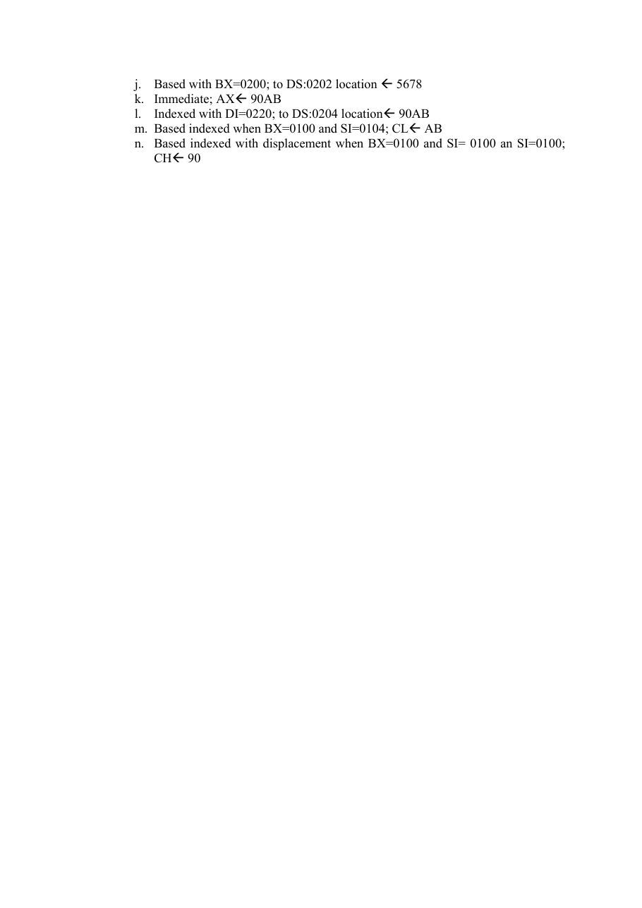
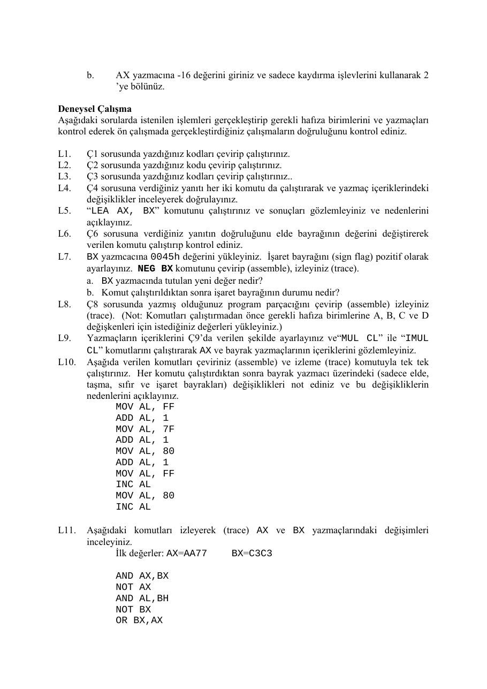

This post brings together the related notes and exercises from the Başkent University **EEM332 Microprocessors** course archive (2006–2015). Addressing modes, register exchange, addition and flags, searching for the smallest and largest value; lab handouts and solutions. Work prepared by a friend and course documents are presented together; student names, numbers and group information have been removed. PDF archive copies of the documents and, where available, source code can be downloaded as a ZIP at the end of the post.

## eem332_lab03

EEM 332 - Microprocessors Experiment No: 3 Experiment Title: Addressing Modes

Preliminary Work: Read about the addressing modes in your textbook and learn them. Write the name of each addressing mode, give an example of it, and prepare a list. (E.g.: Immediate Operand Addressing Mode

```asm
MOV AX,1234)
```

Experimental Work

### 1. For the instructions given below, state the name of the addressing mode and the physical address valid for that instruction. Whether a register is used as the source or the destination does not affect how the physical address is calculated. The initial states of the registers are as follows: DS = 1000, SS =

### 2000, BX = 0300, BP = 1000, DI = 0100, SI = 0200.

a. MOV AL,[1234] Direct addressing, PA: 10000+1234=11234 b. MOV AX,[BX] Reg. indirect addressing, PA: 10000+0300=10300 c. MOV [DI],AL d. MOV AL,[BP+DI] e. MOV CX,[DI] f. MOV DX,[BP] g. MOV [100],DL h. MOV [SI+100],AX i. MOV DL,[BX+100] j. MOV [SI],DX k. MOV CL,[BX] l. MOV CH,[BX+SI] m. MOV AX,[BP+200] n. MOV AL,[BP+SI-200] o. MOV AL,[SI-0100]

### 2. Write the assembly instructions that will perform the following operations using the specified addressing mode. The given operations are sequential. You may need to use the results of the previous steps.

a. Immediate; AXÅ1234

```asm
mov ax, 1234
```

b. Register; BXÅ1234

```asm
mov bx, ax
```

c. Register; CLÅ 34 d. Direct; to DS:0200 locationÅ1234 e. Direct; CHÅ 12 f. Direct; to ES:0220 locationÅ 1234 g. Register indirect using SI; AHÅ 34 h. Register indirect using BP; BHÅ34 i. Immediate; AXÅ 5678

j. Based with BX=0200; to DS:0202 location Å 5678 k. Immediate; AXÅ 90AB l. Indexed with DI=0220; to DS:0204 locationÅ 90AB m. Based indexed when BX=0100 and SI=0104; CLÅ AB n. Based indexed with displacement when BX=0100 and SI= 0100 an SI=0100;

### CHÅ 90



## eem332_lab04

EEM 332 - Microprocessors Experiment No: 4 Experiment Title: Arithmetic and Logic Operations 1

Preliminary Work

Answer the following questions. Bring an extra copy of your work with you. The preliminary work will be collected at the beginning of the laboratory session.

Q1.     You want to exchange the contents of the AX and BX registers. Perform this operation using only the MOV instruction and the AX, BX and CX registers. Q2.     Can you perform the same operation using only one instruction? State it. Q3.     You want to swap the 16-bit values at memory locations DS:300 and DS:400. Using which three lines of instructions can this be done? State them. (hint: one of the instructions is XCHG) Q4.     What are the differences between the "ADD AX,1" and "INC AX" instructions? Q5.     What is the LEA instruction used for? Is there a difference between the "LEA AX,[BX]" and "MOV AX,[BX]" instructions, and if so, what is it? Q6.     What operation does the "ADC AX, BX" instruction perform? Answer according to the following two conditions. a. carry flag is 1. b. carry flag is 0. Q7.     What changes are observed when the "NEG BX" instruction is executed? Q8.     State the assembly instructions required to carry out the operation given below

### 

Z=A+B*(C-D)

```asm
Note: A, B, C, D and Z are 8-bit values stored in the stated
```

order starting at memory address DS:500. Q9.     AL=20H CL=80H

```asm
MUL CL ………………. Æ AX=1000.
```

----------------------------------------------- However, IMUL CL …………. Æ gives AX=F000. Explain the reason for this. State the status of the flags for both instructions. Q10. With AX=0040 and BX=0041, write the assembly code required to perform the following operations.

a.     Divide the values stored in the AX and BX registers by 2 using only shift operations. Multiply the values stored in the AX and BX registers by 2 using only shift operations. Compare the new values of the AX and BX registers and check the carry and zero flags. Increment the value in the AX register, then compare the new values of the AX and BX registers and check the carry and zero flags. Exchange the values of the AX and BX registers, then compare the new values of the AX and BX registers and check the carry and zero flags.

b.     Enter the value -16 into the AX register and divide it by 2 using only shift operations.

Experimental Work Perform the operations requested in the following questions and verify the preliminary work you did by checking the required memory locations and registers.

L1.    Assemble and run the code you wrote for Q1. L2.    Assemble and run the code you wrote for Q2. L3.    Assemble and run the code you wrote for Q3. L4.    Verify your answer to Q4 by running both instructions and examining the changes in the register contents. L5.    Run the "LEA AX, BX" instruction, observe the results and explain the reasons. L6.    Verify the correctness of your answer to Q6 by changing the value of the carry flag and running the given instruction. L7.    Load the value 0045h into the BX register. Set the sign flag to positive. Assemble the NEG BX instruction and trace it. a. What is the new value held in the BX register? b. What is the state of the sign flag after the instruction is executed? L8.    Assemble and trace the program fragment you wrote for Q8. (Note: Before executing the instructions, load the desired values for the variables A, B, C and D into the necessary memory locations.) L9.    Set the register contents as given in Q9 and observe the contents of AX and the flag register by running the "MUL CL" and "IMUL CL" instructions. L10.   Assemble the instructions given below and run them one by one using the trace command. After executing each instruction, note the changes in the flag register (only the carry, overflow, zero and sign flags) and explain the reasons for these changes.

```asm
MOV AL, FF
ADD AL, 1
MOV AL, 7F
ADD AL, 1
MOV AL, 80
ADD AL, 1
MOV AL, FF
INC AL
MOV AL, 80
INC AL
```

L11.   Trace the following instructions and examine the changes in the AX and BX registers.

```asm
inceleyiniz.
```

Initial values: AX=AA77     BX=C3C3

```asm
AND AX,BX
NOT AX
AND AL,BH
NOT BX
OR BX,AX
```

```asm
NOT AH
OR BL,AH
XOR AX,BX
NOT BX
XOR BH,AH
```

L12.   Write the assembly instructions required to perform the operations given below

a.     Enter the number "4" into the AX register as an ASCII code and convert this value to binary using logic operations (by its nature, DEBUG will display the result in hexadecimal). b.     Enter the number "48" into the AX register as an ASCII code and convert this value to unpacked binary using logic operations. c.     Enter the number "48" into the BX register as an ASCII code and convert this value to packed binary using logic operations. d.     Load the value 0038h into the AX register and convert it to ASCII code. You may show the result in any register you wish.

L13.   Run the code you wrote for Q10 and verify the correctness of your program.

L14.   Write the assembly instructions required to perform the following operations

a.     Exchange the contents of the AL and AH registers using the rotate functions. b.     Exchange the contents of the AL and AH registers using the rotate functions and their carry and logic features.

L15.   With AL=66h and BL=48h, what is the result of executing the following instruction?

```asm
ADD AL,BL
```

Write the assembly code that loads the true value of the sum of the values in the AL and BL registers into the AX register. Use the CBW instruction of the assembly language for this.



## EEM332 Experiment 3 preliminary work

### 1) The exchange is performed;

```asm
MOV CX,AX
MOVAX,BX
MOV BX,CX
```

with these instructions.

```
-a 100
13B6:0100 mov cx,ax
13B6:0102 mov ax,bx
13B6:0104 mov bx,cx
13B6:0106
-r
AX=1300 BX=1500 CX=0000 DX=0000 SP=FFEE BP=0000 SI=0000 DI=0000
DS=13B6 ES=13B6 SS=13B6 CS=13B6 IP=0100 NV UP EI PL NZ NA PO NC
13B6:0100 89C1      MOV CX,AX
-t
```

```
AX=1300 BX=1500 CX=1300 DX=0000 SP=FFEE BP=0000 SI=0000 DI=0000
DS=13B6 ES=13B6 SS=13B6 CS=13B6 IP=0102 NV UP EI PL NZ NA PO NC
13B6:0102 89D8    MOV AX,BX
-t
```

```
AX=1500 BX=1500 CX=1300 DX=0000 SP=FFEE BP=0000 SI=0000 DI=0000
DS=13B6 ES=13B6 SS=13B6 CS=13B6 IP=0104 NV UP EI PL NZ NA PO NC
13B6:0104 89CB    MOV BX,CX
-t
AX=1500 BX=1300 CX=1300 DX=0000 SP=FFEE BP=0000 SI=0000 DI=0000
DS=13B6 ES=13B6 SS=13B6 CS=13B6 IP=0106 NV UP EI PL NZ NA PO NC
13B6:0106 0000    ADD [BX+SI],AL           DS:1300=00
```

-

### 2) We can perform the same operation

```asm
XCHG AX,BX
```

with this code.

```
-r
AX=1300 BX=1500 CX=1500 DX=0000 SP=FFEE BP=0000 SI=0002 DI=0002
DS=13B6 ES=13B6 SS=13B6 CS=13B6 IP=0100 NV UP EI PL ZR NA PE NC
13B6:0100 89C1       MOV CX,AX
-a
13B6:010A xchg ax,bx
13B6:010C
-t
AX=1500 BX=1300 CX=1300 DX=0000 SP=FFEE BP=0000 SI=0002 DI=0002
DS=13B6 ES=13B6 SS=13B6 CS=13B6 IP=0106 NV UP EI PL ZR NA PE NC
13B6:0106 87C3       XCHG AX,BX
-t
AX=1300 BX=1500 CX=1300 DX=0000 SP=FFEE BP=0000 SI=0002 DI=0002
DS=13B6 ES=13B6 SS=13B6 CS=13B6 IP=0108 NV UP EI PL ZR NA PE NC
13B6:0108 87C3       XCHG A
```

### 3) MOV AX,[0300]

```asm
XCHG [0400],AX
MOV [0300],AX
```

We can perform it with these instructions.

### 4) If we try the instructions by writing them in a program,

```
AX=1300 BX=1500 CX=1300 DX=0000 SP=FFEE BP=0000 SI=0002 DI=0002
DS=13B6 ES=13B6 SS=13B6 CS=13B6 IP=010C NV UP EI PL ZR NA PE NC
13B6:010C 050100   ADD AX,0001
-t
```

```
AX=1301 BX=1500 CX=1300 DX=0000 SP=FFEE BP=0000 SI=0002 DI=0002
DS=13B6 ES=13B6 SS=13B6 CS=13B6 IP=010F NV UP EI PL NZ NA PO NC
13B6:010F 40    INC AX
-t
```

```
AX=1302 BX=1500 CX=1300 DX=0000 SP=FFEE BP=0000 SI=0002 DI=0002
DS=13B6 ES=13B6 SS=13B6 CS=13B6 IP=0110 NV UP EI PL NZ NA PO NC
13B6:0110 0000         ADD [BX+SI],AL                   DS:1502=00
```

- * Both instructions perform the same operation, but the first takes up 3 bytes whereas the "inc ax" instruction takes up 1 byte.

- The ADD instruction performs addition. The INC instruction only increments by 1.

- The INC instruction also works on 8- and 16-bit registers and on memory.

### 5)

```asm
LEA AX,[BX] = This instruction transfers the effective address of BX to AX. The LEA instruction works like a pointer.
```

```asm
MOV AX,[BX] = This instruction, on the other hand, transfers the contents of the address to AX.
```

### "ADC"

### 6) The "ADC" instruction performs addition just like "ADD", but in the "ADC" instruction the carry flag also takes part in the

addition.

For example, if Carry flag=1,

```
AX=BX+AX+CF
```

As can be seen in the example below, AX=3B08, BX=1304 and CF=1 (CY is present in the flags). The result came out as expected: AX=BX+AX+CF=3B08+1304+1=4E0D. Had we performed the same operation with the ADD instruction, the result would have been 4E0C.

```
-r
AX=3B08 BX=1304 CX=1304 DX=0000 SP=FFEE BP=0000 SI=0004 DI=0004
DS=13B6 ES=13B6 SS=13B6 CS=13B6 IP=0100 NV UP EI PL NZ NA PO CY
13B6:0100 11D8      ADC AX,BX
-a 13b6:0100
13B6:0100 adc ax,bx
13B6:0102
```

```
-r
AX=3B08 BX=1304 CX=1304 DX=0000 SP=FFEE BP=0000 SI=0004 DI=0004
DS=13B6 ES=13B6 SS=13B6 CS=13B6 IP=0100 NV UP EI PL NZ NA PO CY
13B6:0100 11D8    ADC AX,BX
-t
```

```
AX=4E0D BX=1304 CX=1304 DX=0000 SP=FFEE BP=0000 SI=0004 DI=0004
DS=13B6 ES=13B6 SS=13B6 CS=13B6 IP=0102 NV UP EI PL NZ NA PO NC
13B6:0102 89D8    MOV AX,BX
```

### 7)

With this instruction we can find the two's complement of numbers.

For example, let us pick an arbitrary number. Let our number be AX=1BC3.

If we split the number 1BC3 into its bits, we get = 0001 1011 1100 0011.

### We obtain the 2's complement by keeping everything the same up to and including the first 1 from the right and writing the opposite of the rest, that is,

the complement of 1BC3 = 1110 0100 0011 1101 = E43D.

Trying it out to see:

```
-r
AX=1BC3 BX=1304 CX=1304 DX=0000 SP=FFEE BP=0000 SI=0004 DI=0004
DS=13B6 ES=13B6 SS=13B6 CS=13B6 IP=0100 NV UP EI PL NZ NA PO NC
13B6:0100 11D8      ADC AX,BX
-a 13b6:0100
13B6:0100 neg ax
13B6:0102
-t
```

```
AX=E43D BX=1304 CX=1304 DX=0000 SP=FFEE BP=0000 SI=0004 DI=0004
DS=13B6 ES=13B6 SS=13B6 CS=13B6 IP=0102 NV UP EI NG NZ AC PO CY
13B6:0102 89D8    MOV AX,BX
```

### 8)

```asm
MOV AL, [0503]
```

```asm
SUB [0502], AL
```

```asm
MOV AL, [0502]
```

```asm
MUL [0501]
```

```asm
ADD AL,[0500]
```

```asm
MOV [0504], AL
```

We can perform the operation Z=A+B*(C-D) with these instructions.

### 9) The reason the same register values give different results with mul and imul is that; with the MUL instruction

we multiply AL by CL and can transfer the result directly to AX. In the question, the product of the two unsigned numbers came out as 1000H. Of the flags, the overflow and carry flags are affected. With the IMUL instruction, the two given values are also multiplied, and the two's complement of the result is taken and transferred to AX. The flags to be affected are OV and CF, as in the previous case.

### 10)

```
-r
AX=0040 BX=0041 CX=1304 DX=0000 SP=FFEE BP=0000 SI=0004 DI=0004
DS=13B6 ES=13B6 SS=13B6 CS=13B6 IP=0100 NV UP EI NG NZ AC PE CY
13B6:0100 F7D8    NEG AX
```

```
-a 13b6:0100
13B6:0100 shr ax,1 // divide ax by 2
13B6:0102 shr bx,1 // divide bx by 2
13B6:0104 shl ax,1 // multiply ax by 2
13B6:0106 shl bx,1 // multiply bx by 2
13B6:0108
```

```
-t
```

```
AX=0020 BX=0041 CX=1304 DX=0000 SP=FFEE BP=0000 SI=0004 DI=0004
DS=13B6 ES=13B6 SS=13B6 CS=13B6 IP=0102 NV UP EI PL NZ AC PO NC
13B6:0102 D1EB    SHR BX,1
-t
```

```
AX=0020 BX=0020 CX=1304 DX=0000 SP=FFEE BP=0000 SI=0004 DI=0004
DS=13B6 ES=13B6 SS=13B6 CS=13B6 IP=0104 NV UP EI PL NZ AC PO CY
13B6:0104 D1E0    SHL AX,1
-t
```

```
AX=0040 BX=0020 CX=1304 DX=0000 SP=FFEE BP=0000 SI=0004 DI=0004
DS=13B6 ES=13B6 SS=13B6 CS=13B6 IP=0106 NV UP EI PL NZ AC PO NC
13B6:0106 D1E3    SHL BX,1
-t
```

```
AX=0040 BX=0040 CX=1304 DX=0000 SP=FFEE BP=0000 SI=0004 DI=0004
DS=13B6 ES=13B6 SS=13B6 CS=13B6 IP=0108 NV UP EI PL NZ AC PO NC
13B6:0108 87C3        XCHG AX,BX
```

- At the end of the first division, when we divide AX by two, the carry flag is 0, i.e. it appears as NC. When we divide BX by two, the result is 20 with a remainder bit of 1 carried out, and we can see the carry flag change from NC to CY, i.e. from 0 to 1.

In the multiplication, we went from 20 to 40 in both. Since there was no carry out in either operation, the carry flag went to 0, i.e. NC.

Since the result was not zero in any of the 4 operations, the zero flag never changed and stayed NZ.

```
-a
13B6:0108 inc ax
13B6:0109
-t
```

```
AX=0041 BX=0040 CX=1304 DX=0000 SP=FFEE BP=0000 SI=0004 DI=0004
DS=13B6 ES=13B6 SS=13B6 CS=13B6 IP=0109 NV UP EI PL NZ NA PE NC
13B6:0109 C3     RET
```

Since we only incremented AX, AX went from 40 to 41. As expected, there was no change in BX. The zero flag remained NZ and the carry flag remained NC. There was no change.

```
-a
13B6:0109 xchg ax,bx
13B6:010B
-t
```

```
AX=0040 BX=0041 CX=1304 DX=0000 SP=FFEE BP=0000 SI=0004 DI=0004
DS=13B6 ES=13B6 SS=13B6 CS=13B6 IP=010B NV UP EI PL NZ NA PE NC
13B6:010B C3     RET
```

At the end of the operation, the values of AX and BX were exchanged. AX, which was 41, became 40, and BX, which was 40, became 41.

There was no change in the zero flag and the carry flag either, because we performed neither an operation whose result goes to zero nor a calculation that would leave a carry at the end of the operation.

### 10) The number -16 corresponds to FFEA in hex.

```
-a 13b6:0100
13B6:0100 shr ax,1
13B6:0102
-r
AX=FFEA BX=0041 CX=1304 DX=0000 SP=FFEE BP=0000 SI=0004 DI=0004
DS=13B6 ES=13B6 SS=13B6 CS=13B6 IP=0100 NV UP EI PL NZ NA PE NC
13B6:0100 D1E8     SHR AX,1
-t
```

```
AX=7FF5 BX=0041 CX=1304 DX=0000 SP=FFEE BP=0000 SI=0004 DI=0004
DS=13B6 ES=13B6 SS=13B6 CS=13B6 IP=0102 OV UP EI PL NZ NA PE NC
13B6:0102 D1EB    SHR BX,1
```

## LAB 4 PRELIMINARY WORK

### 1) .MODEL SMALL

```asm
.Stack 64k
DATA DB 13,-10,19,14,-18,-9,12,-19,16
```

```asm
.CODE
```

```asm
MAIN: MOV AX,@DATA
MOV DS,AX
MOV SI,100H
MOV AL,[SI]
MOV CX,8
INC SI
```

```asm
AGAIN:CMP AL, [SI]
JL NEXT
MOV AL, [SI]
```

```asm
NEXT:INC SI
LOOP AGAIN
```

```asm
MOV AH, 4CH
INT 21H
```

```asm
END MAIN
```

### 2)

```asm
.MODEL SMALL
.STACK 100h
DATA DB 87,96,45,75
```

```asm
.DATA
```

```asm
.CODE
```

```asm
MAIN:MOV AX,@DATA
MOV DS,AX
MOV SI,100H
MOV AL,[SI]
```

```asm
MOV CX,4
INC SI
```

```asm
AGAIN: CMP AL, [SI]
JA NEXT
MOV AL, [SI]
```

```asm
NEXT:   INC SI
LOOP AGAIN
```

```asm
MOV AH, 4CH
INT 21H
```

```asm
END MAIN
```

-2-

## 332_lab03_experiment

### L1-)

```
-r ax
```

### AX 0000

:aaaa

```
-r bx
```

### BX 0000

:bbbb

```
-a cs:100
1627:0100 mov cx,ax
1627:0102 mov ax,bx
1627:0104 mov bx,cx
```

```
-t=cs:100
```

```
AX=AAAA BX=BBBB CX=AAAA DX=0000 SP=FFEE BP=0000 SI=0000 DI=0000
DS=1627 ES=1627 SS=1627 CS=1627 IP=0102 NV UP EI PL ZR NA PE NC
1627:0102 89D8   MOV AX,BX
-t=cs:102
```

```
AX=BBBB BX=BBBB CX=AAAA DX=0000 SP=FFEE BP=0000 SI=0000 DI=0000
DS=1627 ES=1627 SS=1627 CS=1627 IP=0104 NV UP EI PL ZR NA PE NC
1627:0104 89CB   MOV BX,CX
-t=cs:104
```

```
AX=BBBB BX=AAAA CX=AAAA DX=0000 SP=FFEE BP=0000 SI=0000 DI=0000
DS=1627 ES=1627 SS=1627 CS=1627 IP=0106 NV UP EI PL ZR NA PE NC
1627:0106 803EC19A00 CMP BYTE PTR [9AC1],00          DS:9AC1=00
```

### L2-)

```
-r ax
```

### AX BBBB

:aaaa

```
-r bx
```

### BX AAAA

:bbbb

```
-a cs:100
1627:0100 xchg ax,bx
```

```
-t=cs:100
```

```
AX=BBBB BX=AAAA CX=AAAA DX=0000 SP=FFEE BP=0000 SI=0000 DI=0000
DS=1627 ES=1627 SS=1627 CS=1627 IP=0102 NV UP EI PL ZR NA PE NC
1627:0102 89D8   MOV AX,BX
```

### L3-)

```
-a cs:100
1627:0100 mov ax,[300]
1627:0103 xchg ax,[400]
1627:0107 mov [300],ax
```

```
-e cs:300
1627:0300 11.33
-e cs:301
1627:0301 11.33
-e cs:400
1627:0400 44.44
-e cs:401
1627:0401 44.44
-r ip
```

### IP 0104

:100

```
-t
```

```
AX=3333 BX=0080 CX=0080 DX=0006 SP=FFEE BP=0001 SI=0000 DI=0000
DS=1627 ES=1627 SS=1627 CS=1627 IP=0103 OV UP EI PL ZR NA PE CY
1627:0103 87060004 XCHG AX,[0400]             DS:0400=4444
-t
```

```
AX=4444 BX=0080 CX=0080 DX=0006 SP=FFEE BP=0001 SI=0000 DI=0000
DS=1627 ES=1627 SS=1627 CS=1627 IP=0107 OV UP EI PL ZR NA PE CY
1627:0107 A30003  MOV [0300],AX              DS:0300=3333
-t
```

```
-d ds:300 301
1627:0300 44 44
-d ds:400 401
1627:0400 33 33
```

### L4-)

```
-a cs:100
1627:0100 add ax,1
1627:0103 inc ax
1627:0104
-r ax
```

### AX 0000

:0000

```
-t=cs:100
```

```
AX=0001 BX=AAAA CX=AAAA DX=0000 SP=FFEE BP=0000 SI=0000 DI=0000
DS=1627 ES=1627 SS=1627 CS=1627 IP=0103 NV UP EI PL NZ NA PO NC
```

```
1627:0103 40          INC   AX
-r ax
```

### AX 0001

:0000

```
-t=cs:103
```

```
AX=0001 BX=AAAA CX=AAAA DX=0000 SP=FFEE BP=0000 SI=0000 DI=0000
DS=1627 ES=1627 SS=1627 CS=1627 IP=0104 NV UP EI PL NZ NA PO NC
1627:0104 89CB   MOV BX,CX
```

### L5-)

```
-a cs:100
1627:0100 lea ax,bx
```

^ Error

### L6-)

```
-a cs:100
1627:0100 adc ax,bx
```

```
-r ax
```

### AX AAAA

:0002

```
-r bx
```

### BX AAAA

:0003

```
-r f
```

### OV DN DI NG NZ NA PE NC -

```
-t=cs:100
```

```
AX=0005 BX=0003 CX=AAAA DX=0000 SP=FFEE BP=0000 SI=0000 DI=0000
DS=1627 ES=1627 SS=1627 CS=1627 IP=0102 NV DN DI PL NZ NA PE NC
1627:0102 004089  ADD [BX+SI-77],AL           DS:FF8C=00
```

```
-r ax
```

### AX 0005

:0002

```
-r f
```

NV DN DI PL NZ NA PE NC -cy

```
-t=cs:100
```

```
AX=0006 BX=0003 CX=AAAA DX=0000 SP=FFEE BP=0000 SI=0000 DI=0000
DS=1627 ES=1627 SS=1627 CS=1627 IP=0102 NV DN DI PL NZ NA PE NC
1627:0102 004089  ADD [BX+SI-77],AL           DS:FF8C=00
```

### L7-)

```
-r bx
```

### BX 0045

:0045

```
-r f
```

NV DN DI NG NZ AC PO CY -pl

```
-a cs:100
1627:0100 neg bx
1627:0102
-t=cs:100
```

```
AX=0000 BX=FFBB CX=AAAA DX=0000 SP=FFEE BP=0000 SI=0000 DI=0000
DS=1627 ES=1627 SS=1627 CS=1627 IP=0102 NV DN DI NG NZ AC PE CY
1627:0102 004089  ADD [BX+SI-77],AL           DS:FF44=00
```

a-) BX=FFBB

b-) ng (negative)

### L8-)

```
-a cs:100
1627:0100 mov al,[502]
1627:0103 sub al,[503]
1627:0107 mov bh,[501]
1627:010B mul bh
1627:010D mov bh,[500]
1627:0110 add bh,al
1627:0112 mov [504],bh
```

```
-e ds:500
1627:0500 92.4
-e ds:501
1627:0501 00.3
-e ds:502
1627:0502 00.2
-e ds:503
1627:0503 2E.1
-r ip
```

### IP 0103

:100

```
AX=0002 BX=0000 CX=0302 DX=0006 SP=FFEE BP=0001 SI=0000 DI=0000
DS=1627 ES=1627 SS=1627 CS=1627 IP=0103 NV UP EI PL NZ NA PO NC
1627:0103 2A060305 SUB AL,[0503]             DS:0503=01
-t
```

```
AX=0001 BX=0000 CX=0302 DX=0006 SP=FFEE BP=0001 SI=0000 DI=0000
DS=1627 ES=1627 SS=1627 CS=1627 IP=0107 NV UP EI PL NZ NA PO NC
```

```
1627:0107 8A3E0105   MOV   BH,[0501]         DS:0501=03
-t
```

```
AX=0001 BX=0300 CX=0302 DX=0006 SP=FFEE BP=0001 SI=0000 DI=0000
DS=1627 ES=1627 SS=1627 CS=1627 IP=010B NV UP EI PL NZ NA PO NC
1627:010B F6E7   MUL BH
-t
```

```
AX=0003 BX=0300 CX=0302 DX=0006 SP=FFEE BP=0001 SI=0000 DI=0000
DS=1627 ES=1627 SS=1627 CS=1627 IP=010D NV UP EI PL NZ NA PE NC
1627:010D 8A3E0005  MOV BH,[0500]             DS:0500=04
-t
```

```
AX=0003 BX=0400 CX=0302 DX=0006 SP=FFEE BP=0001 SI=0000 DI=0000
DS=1627 ES=1627 SS=1627 CS=1627 IP=0111 NV UP EI PL NZ NA PE NC
1627:0111 00C7   ADD BH,AL
```

```
-t
```

```
AX=0003 BX=0700 CX=0302 DX=0006 SP=FFEE BP=0001 SI=0000 DI=0000
DS=1627 ES=1627 SS=1627 CS=1627 IP=0113 NV UP EI PL NZ NA PO NC
1627:0113 883E0405 MOV [0504],BH              DS:0504=07
-d ds:504 504
1627:0500       07
```

### L9-)

```
-a cs:100
1627:0100 mul cl
1627:0102 imul cl
1627:0104
```

- rip

### IP 0113

:100

```
-t
```

```
AX=1000 BX=0700 CX=0080 DX=0006 SP=FFEE BP=0001 SI=0000 DI=0000
DS=1627 ES=1627 SS=1627 CS=1627 IP=0102 OV UP EI PL ZR NA PE CY
1627:0102 F6E9   IMUL CL
-r ax
```

### AX 1000

:20

```
-r bx
```

### BX 0700

:80

```
-r ip
```

### IP 0102

:102

```
-t
```

```
AX=F000 BX=0080 CX=0080 DX=0006 SP=FFEE BP=0001 SI=0000 DI=0000
```

```
DS=1627 ES=1627 SS=1627 CS=1627 IP=0104 OV UP EI PL ZR NA PE CY
1627:0104 06    PUSH ES
```

### L10-)

```
-a cs:100
1627:0100 mov al,ff
1627:0102 add al,1
1627:0104 mov al,7f
1627:0106 add al,1
1627:0108 mov al,80
1627:010A add al,1
1627:010C mov al,ff
1627:010E inc al
1627:0110 mov al,80
1627:0112 inc al
1627:0114
-r ip
```

### IP 0102

:100

```
AX=FFFF BX=0000 CX=0000 DX=0000 SP=FFEE BP=0000 SI=0000 DI=0000
DS=1627 ES=1627 SS=1627 CS=1627 IP=0102 NV UP EI NG NZ NA PO NC
1627:0102 0401   ADD AL,01
-t
```

```
AX=FF00 BX=0000 CX=0000 DX=0000 SP=FFEE BP=0000 SI=0000 DI=0000
DS=1627 ES=1627 SS=1627 CS=1627 IP=0104 NV UP EI PL ZR AC PE CY
1627:0104 B07F   MOV AL,7F
-t
```

```
AX=FF7F BX=0000 CX=0000 DX=0000 SP=FFEE BP=0000 SI=0000 DI=0000
DS=1627 ES=1627 SS=1627 CS=1627 IP=0106 NV UP EI PL ZR AC PE CY
1627:0106 0401   ADD AL,01
-t
```

```
AX=FF80 BX=0000 CX=0000 DX=0000 SP=FFEE BP=0000 SI=0000 DI=0000
DS=1627 ES=1627 SS=1627 CS=1627 IP=0108 OV UP EI NG NZ AC PO NC
1627:0108 B080   MOV AL,80
-t
```

```
AX=FF80 BX=0000 CX=0000 DX=0000 SP=FFEE BP=0000 SI=0000 DI=0000
DS=1627 ES=1627 SS=1627 CS=1627 IP=010A OV UP EI NG NZ AC PO NC
1627:010A 0401   ADD AL,01
```

```
AX=FF81 BX=0000 CX=0000 DX=0000 SP=FFEE BP=0000 SI=0000 DI=0000
DS=1627 ES=1627 SS=1627 CS=1627 IP=010C NV UP EI NG NZ NA PE NC
1627:010C B0FF    MOV AL,FF
-t
```

```
AX=FFFF BX=0000 CX=0000 DX=0000 SP=FFEE BP=0000 SI=0000 DI=0000
DS=1627 ES=1627 SS=1627 CS=1627 IP=010E NV UP EI NG NZ NA PE NC
1627:010E FEC0    INC AL
-t
```

```
AX=FF00 BX=0000 CX=0000 DX=0000 SP=FFEE BP=0000 SI=0000 DI=0000
DS=1627 ES=1627 SS=1627 CS=1627 IP=0110 NV UP EI PL ZR AC PE NC
1627:0110 B080   MOV AL,80
-t
```

```
AX=FF80 BX=0000 CX=0000 DX=0000 SP=FFEE BP=0000 SI=0000 DI=0000
DS=1627 ES=1627 SS=1627 CS=1627 IP=0112 NV UP EI PL ZR AC PE NC
1627:0112 FEC0   INC AL
```

### L11-)

```
-a cs:100
1627:0100 and ax,bx
1627:0102 not ax
1627:0104 and al,bh
1627:0106 not bx
1627:0108 or bx,ax
1627:010A not ah
1627:010C or bl,ah
1627:010E xor ax,bx
1627:0110 not bx
1627:0112 xor bh,ah
1627:0114
-r ax
```

### AX FF80

:aa77 -rbx

### BX 0000

:c3c3

```
-r ip
```

### IP 0112

:100

```
AX=8243 BX=C3C3 CX=0000 DX=0000 SP=FFEE BP=0000 SI=0000 DI=0000
DS=1627 ES=1627 SS=1627 CS=1627 IP=0102 NV UP EI NG NZ NA PO NC
1627:0102 F7D0   NOT AX
-t
```

```
AX=7DBC BX=C3C3 CX=0000 DX=0000 SP=FFEE BP=0000 SI=0000 DI=0000
DS=1627 ES=1627 SS=1627 CS=1627 IP=0104 NV UP EI NG NZ NA PO NC
1627:0104 20F8   AND AL,BH
-t
```

```
AX=7D80 BX=C3C3 CX=0000 DX=0000 SP=FFEE BP=0000 SI=0000 DI=0000
DS=1627 ES=1627 SS=1627 CS=1627 IP=0106 NV UP EI NG NZ NA PO NC
```

```
1627:0106 F7D3        NOT   BX
-t
```

```
AX=7D80 BX=3C3C CX=0000 DX=0000 SP=FFEE BP=0000 SI=0000 DI=0000
DS=1627 ES=1627 SS=1627 CS=1627 IP=0108 NV UP EI NG NZ NA PO NC
1627:0108 09C3   OR    BX,AX
-t
```

```
AX=7D80 BX=7DBC CX=0000 DX=0000 SP=FFEE BP=0000 SI=0000 DI=0000
DS=1627 ES=1627 SS=1627 CS=1627 IP=010A NV UP EI PL NZ NA PO NC
1627:010A F6D4    NOT AH
```

```
AX=8280 BX=7DBC CX=0000 DX=0000 SP=FFEE BP=0000 SI=0000 DI=0000
DS=1627 ES=1627 SS=1627 CS=1627 IP=010C NV UP EI PL NZ NA PO NC
1627:010C 08E3   OR    BL,AH
-t
```

```
AX=8280 BX=7DBE CX=0000 DX=0000 SP=FFEE BP=0000 SI=0000 DI=0000
DS=1627 ES=1627 SS=1627 CS=1627 IP=010E NV UP EI NG NZ NA PE NC
1627:010E 31D8   XOR AX,BX
-t
```

```
AX=FF3E BX=7DBE CX=0000 DX=0000 SP=FFEE BP=0000 SI=0000 DI=0000
DS=1627 ES=1627 SS=1627 CS=1627 IP=0110 NV UP EI NG NZ NA PO NC
1627:0110 F7D3   NOT BX
-t
```

```
AX=FF3E BX=8241 CX=0000 DX=0000 SP=FFEE BP=0000 SI=0000 DI=0000
DS=1627 ES=1627 SS=1627 CS=1627 IP=0112 NV UP EI NG NZ NA PO NC
1627:0112 30E7   XOR BH,AH
```

### L12-)

### L13-)

a.

```
-r ax
```

### AX FF3E

:0040

```
-r bx
```

### BX 8241

:0041

```
-a cs:100
1627:0100 shr ax,1
1627:0102 shr bx,1
1627:0104 shl ax,1
1627:0106 shl bx,1
1627:0108 cmp ax,bx
```

```
1627:010A inc ax
1627:010B cmp ax,bx
1627:010D xchg ax,bx
1627:010F cmp ax,bx
```

```
-r ip
```

### IP 0112

:100

```
-t
```

```
AX=0020 BX=0041 CX=0000 DX=0000 SP=FFEE BP=0000 SI=0000 DI=0000
DS=1627 ES=1627 SS=1627 CS=1627 IP=0102 NV UP EI PL NZ NA PO NC
1627:0102 D1EB    SHR BX,1
-t
```

```
AX=0020 BX=0020 CX=0000 DX=0000 SP=FFEE BP=0000 SI=0000 DI=0000
DS=1627 ES=1627 SS=1627 CS=1627 IP=0104 NV UP EI PL NZ NA PO CY
1627:0104 D1E0   SHL AX,1
-t
```

```
AX=0040 BX=0020 CX=0000 DX=0000 SP=FFEE BP=0000 SI=0000 DI=0000
DS=1627 ES=1627 SS=1627 CS=1627 IP=0106 NV UP EI PL NZ NA PO NC
1627:0106 D1E3   SHL BX,1
-t
```

```
AX=0040 BX=0040 CX=0000 DX=0000 SP=FFEE BP=0000 SI=0000 DI=0000
DS=1627 ES=1627 SS=1627 CS=1627 IP=0108 NV UP EI PL NZ NA PO NC
1627:0108 39D8   CMP AX,BX
```

```
AX=0040 BX=0040 CX=0000 DX=0000 SP=FFEE BP=0000 SI=0000 DI=0000
DS=1627 ES=1627 SS=1627 CS=1627 IP=010A NV UP EI PL ZR NA PE NC
1627:010A 40    INC AX
-t
```

```
AX=0041 BX=0040 CX=0000 DX=0000 SP=FFEE BP=0000 SI=0000 DI=0000
DS=1627 ES=1627 SS=1627 CS=1627 IP=010B NV UP EI PL NZ NA PE NC
1627:010B 39D8    CMP AX,BX
-t
```

```
AX=0041 BX=0040 CX=0000 DX=0000 SP=FFEE BP=0000 SI=0000 DI=0000
DS=1627 ES=1627 SS=1627 CS=1627 IP=010D NV UP EI PL NZ NA PO NC
1627:010D 87C3    XCHG AX,BX
-t
```

```
AX=0040 BX=0041 CX=0000 DX=0000 SP=FFEE BP=0000 SI=0000 DI=0000
DS=1627 ES=1627 SS=1627 CS=1627 IP=010F NV UP EI PL NZ NA PO NC
1627:010F 39D8   CMP AX,BX
```

b.

```
-a cs:100
1627:0100 sar ax,1
1627:0102
-r ax
```

### AX 0000

:fff0

```
-r
AX=FFF0 BX=0000 CX=0000 DX=0000 SP=FFEE BP=0000 SI=0000 DI=0000
DS=1627 ES=1627 SS=1627 CS=1627 IP=0100 NV UP EI PL NZ NA PO NC
1627:0100 D1F8     SAR AX,1
-r ip
```

### IP 0100

### 

```
-t
```

```
AX=FFF8 BX=0000 CX=0000 DX=0000 SP=FFEE BP=0000 SI=0000 DI=0000
DS=1627 ES=1627 SS=1627 CS=1627 IP=0102 NV UP EI NG NZ NA PO NC
1627:0102 3AC4    CMP AL,AH
```

### L14-)

a.

```
-r ax
```

### AX 4422

:1199

```
-r cx
```

### CX 0008

:8

```
-a cs:100
1627:0100 rol ax,cl
1627:0102
-r ip
```

### IP 0104

:100

```
-t
```

```
AX=9911 BX=0041 CX=0008 DX=0000 SP=FFEE BP=0000 SI=0000 DI=0000
DS=1627 ES=1627 SS=1627 CS=1627 IP=0102 NV UP EI NG NZ NA PO CY
1627:0102 D1C0    ROL AX,1
```

b.

## 332_lab04_report

### 1)

```asm
.MODEL SMALL
.STACK 64
.DATA
SICAKLIK DB      13,-10,+19,14,-18,-9,+12,-19,+16
eksi        DB   '-$'
```

```asm
.CODE
MAIN           PROC FAR     ;this is the program entry point
MOV AX,@DATA ;load the data segment address
MOV DS,AX             ;assign value to DS
```

```asm
MOV SI, offset SICAKLIK ; point to SICAKLIK
MOV AL,[SI]
INC SI
MOV CX,8
```

```asm
DON: CMP AL,[SI]
JLE DEVAM
MOV AL,[SI]
```

### DEVAM

```asm
INC SI
DEC CX
JNZ DON
```

```asm
MOV DL,AL
SHL DL,1
JNC POZ
```

### NEG AL

```asm
MOV DL,0FFH
JMP NGTF
POZ:
MOV DL,0
NGTF:
```

```asm
MOV CL,AL                  ;decimal counter: copy the number from AL to CL
MOV AX,0
DONGU:  INC AL                 ;AL is the first digit
CMP AL,0Ah                 ;has it reached 10?
JNE DVM                    ;no, continue
MOV AL,0                   ;yes, reset it to zero
INC AH                     ;AH is the second digit
CMP AH,0Ah                 ;has it reached 10?
JNE DVM                    ;no, continue
MOV AH,0
```

```asm
DVM:LOOP DONGU
```

```asm
SHL DL,1
JNC POZ2
```

```asm
PUSH AX
```

```asm
MOV         AH,09
MOV         DX,OFFSET eksi
INT         21H
```

```asm
POP AX
POZ2:
```

```asm
OR  AL,30H
OR  AH,30H
MOV CX,AX
MOV DL,CH
```

```asm
MOV AH,02H
INT 21H
```

```asm
MOV DL,CL
```

```asm
MOV AH,02H
INT 21H
```

```asm
MOV AH,4CH        ;set up to
INT 21H           ;return to DOS
```

### MAIN           ENDP

```asm
END MAIN          ;this is the program exit point
```

### 2)

```asm
.MODEL SMALL
.STACK 64
.DATA
NOTLAR        DB           69,87,96,45,75
```

```asm
.CODE
MAIN           PROC FAR                 ;this is the program entry point
MOV AX,@DATA             ;load the data segment address
MOV DS,AX                ;assign value to DS
```

```asm
MOV SI, offset NOTLAR    ; point to NOTLAR
MOV AL,[SI]
INC SI
MOV CX,4
```

```asm
DONGU: MOV BL,[SI]
CMP AL,BL
JNC KONTROL
MOV AL,BL
```

```asm
KONTROL: INC SI
DEC CX
JNZ DONGU
```

```asm
MOV CL,AL        ;decimal counter: copy the number from AL to CL
MOV AX,0
DON: INC AL           ;AL is the first digit
CMP AL,0Ah       ;has it reached 10?
JNE DVM          ;no, continue
MOV AL,0         ;yes, reset it to zero
INC AH           ;AH is the second digit
CMP AH,0Ah        ;has it reached 10?
JNE DVM          ;no, continue
MOV AH,0
```

```asm
DVM: LOOP DON
```

```asm
OR  AL,30H        ;convert to ASCII
OR  AH,30H
MOV CX,AX
```

```asm
MOV DL,CH         ;print the second digit
```

```asm
MOV AH,02H
INT 21H
```

```asm
MOV DL,CL;print the first digit
```

```asm
MOV AH,02H
INT 21H
```

```asm
MOV AH,4CH        ;set up to
INT 21H           ;return to DOS
```

### MAIN       ENDP

```asm
END MAIN          ;this is the program exit point
```

## 3 Preliminary Work

Başkent University, Department of Electrical and Electronics Engineering

EEM 332 – Microprocessors

Preliminary Work

Experiment No:     3

Experiment Title: Arithmetic and Logic Operations

Experiment Date:      14 / 03 / 2007

Tuesday      Wednesday

Experiment Location:         A408      B407

This work consists of   3   pages, excluding the cover page.

### Q1.

```asm
mov cx,ax
mov ax,bx
mov bx,cx
```

### Q2.

```asm
xchg ax,bx
```

### Q3.

```asm
mov ax,[300]
xchg ax,[400]
mov [300],ax
```

### Q4.

```asm
The add ax,1 instruction adds the number 1 to the ax register and stores the result in the ax register.
The inc ax instruction increments the value in the ax register by 1. So here the 2 instructions
```

perform the same function.

### Q5.

```asm
LEA is the load effective address instruction. It loads this address into 16-bit registers (AX, BX,
```

CX, DX).

```asm
LEA AX,[BX] here, since the offset is just BX, it loads the value of BX into AX.
```

(effective address)

```asm
MOV AX,[BX] here, the value at offset BX in the memory region is assigned to AX.
```

(The data at DS:500 is transferred to AX.)

### Q6.

ADC AX,BX       performs the operation AX=AX+BX+CF.

a. If CF=1, AX=AX+BX+1 b. If CF=0, AX=AX+BX+0

### Q7.

The NEG BX instruction takes the complement of the BX register (as 2's complement binary).

The value in the BX register and the sign flag are affected by this operation.

### Q8.

```asm
mov al,[502]
sub al,[503]
mov bh,[501]
mul bh
mov bh,[500]
add bh,al
mov [504],bh
```

### Q9.

AL=20H CL=80H

```asm
MUL CL            since it operates as unsigned, it gives the result 20H x 80H = 1000 H
```

IMUL CL           operates as signed. 80 (hex) = 1000 0000 (binary). Since the first bit is the sign bit, the number is negative. Therefore the result will be negative: F000H (the 2's complement of 1 is F; since the result is negative, it is in 2's complement form).

At the end of this operation the Sign flag will be 1.

### Q10.

a.       SHR AX,1

```asm
SHR BX,1
```

```asm
SHL AX,1
SHL BX,1
```

```asm
After SHR BX,1 the value of CF became 1. The reason is:
```

0041 (hex) = 0000 0000 0100 0001 (binary); when shifted right, the rightmost 1 goes to CF.

The new values of the AX and BX registers are equal. The reason is that, as a result of dividing by 2, the value of AX became 0020 and the value of BX also became 0020. (41 hex / 2 = 20 hex)

After the comparison (CMP AX,BX) the zero flag became 1.

After incrementing the value in AX by 1 (INC AX), in the comparison the zero flag and carry flag became 0.

When the values of the AX and BX registers were exchanged (XCHG AX,BX), there was no change in the zero and carry flags.

b.        16 (decimal) = 0010 (hex), -16 (decimal) = FFF0 (hex)

### 8 (decimal) = 0008 (hex), -8 (decimal) = FFF8 (hex)

### FFF0 H = 1111 1111 1111 0000

### FFF8 H = 1111 1111 1111 1000

```asm
The SAR AX,1 instruction divides the number –16 (FFF0H) by two, giving -8 (FFF8).
```

```
-a cs:100
1627:0100 sar ax,1
1627:0102
-r ax
```

### AX 0000

:fff0

```
-r
```

```
AX=FFF0 BX=0000 CX=0000 DX=0000 SP=FFEE BP=0000 SI=0000 DI=0000
DS=1627 ES=1627 SS=1627 CS=1627 IP=0100 NV UP EI PL NZ NA PO NC
1627:0100 D1F8            SAR   AX,1
```

```
-r ip
```

### IP 0100

### 

```
-t
```

```
AX=FFF8 BX=0000 CX=0000 DX=0000 SP=FFEE BP=0000 SI=0000 DI=0000
DS=1627 ES=1627 SS=1627 CS=1627 IP=0102 NV UP EI NG NZ NA PO NC
1627:0102 3AC4            CMP   AL,AH
```

## Preliminary Work 332-4

### 1)

```asm
.DATA DB 13,-10,19,14,-18,-9,12,-19,16
```

```asm
.CODE
```

```asm
MAIN          PROC FAR
MOV CX, 9
MOV BX, OFFSET DATA
SUB AL,AL
```

```asm
AGAIN:        CMP AL,[BX]
JLE NEXT
MOV AL,[BX]
```

### NEXT :INC BX

```asm
LOOP AGAIN
MOV DH,AL
```

### MAIN          ENDP

```asm
END MAIN
```

### 2)

```asm
.DATA DB 68,87,96,45,75
```

```asm
.CODE
```

```asm
MAIN          PROC FAR
MOV CX, 5
MOV BX, OFFSET DATA
SUB AL,AL
```

```asm
AGAIN:        CMP AL,[BX]
JA NEXT
MOV AL,[BX]
```

### NEXT :INC BX

```asm
LOOP AGAIN
MOV DH,AL
```

### MAIN          ENDP

```asm
END MAIN
```

## calisma-705

6-)

```
-a 100
15B7:0100 adc ax,bx
15B7:0102
-r
AX=0000 BX=0000 CX=0000 DX=0000 SP=FFEE BP=0000 SI=0000 DI=0000
DS=15B7 ES=15B7 SS=15B7 CS=15B7 IP=0100 NV UP EI PL NZ NA PO CY
15B7:0100 11D8      ADC AX,BX
-r f
```

NV UP EI NG NZ NA PO NC -cy

```
-r
AX=0000 BX=0000 CX=0000 DX=0000 SP=FFEE BP=0000 SI=0000 DI=0000
DS=15B7 ES=15B7 SS=15B7 CS=15B7 IP=0100 NV UP EI NG NZ NA PO CY
15B7:0100 11D8      ADC AX,BX
-t
```

```
AX=0001 BX=0000 CX=0000 DX=0000 SP=FFEE BP=0000 SI=0000 DI=0000
DS=15B7 ES=15B7 SS=15B7 CS=15B7 IP=0102 NV UP EI PL NZ NA PO NC
15B7:0102 0000   ADD [BX+SI],AL            DS:0000=CD
```

-

7-)

```
-r f
```

NV UP EI PL NZ NA PO NC -pl

```
-r
AX=0000 BX=0000 CX=0000 DX=0000 SP=FFEE BP=0000 SI=0000 DI=0000
DS=15B7 ES=15B7 SS=15B7 CS=15B7 IP=0100 NV UP EI PL NZ NA PO NC
15B7:0100 0000    ADD [BX+SI],AL           DS:0000=CD
-r bx
```

### BX 0000

:0045

```
-a 100
15B7:0100 neg bx
15B7:0102
-r ip
```

### IP 0100

:0100

```
-r
AX=0000 BX=0045 CX=0000 DX=0000 SP=FFEE BP=0000 SI=0000 DI=0000
DS=15B7 ES=15B7 SS=15B7 CS=15B7 IP=0100 NV UP EI PL NZ NA PO NC
15B7:0100 F7DB     NEG BX
-t
```

```
AX=0000 BX=FFBB CX=0000 DX=0000 SP=FFEE BP=0000 SI=0000 DI=0000
DS=15B7 ES=15B7 SS=15B7 CS=15B7 IP=0102 NV UP EI NG NZ AC PE CY
15B7:0102 0000   ADD [BX+SI],AL            DS:FFBB=00
```

--

8.

```
-r ds
```

### DS 15B7

:0500

```
-r
AX=0000 BX=0000 CX=0000 DX=0000 SP=FFEE BP=0000 SI=0000 DI=0000
DS=0500 ES=15B7 SS=15B7 CS=15B7 IP=0100 NV UP EI NG NZ AC PE NC
15B7:0100 F7DB        NEG BX
-a 100
15B7:0100 mov bx,[502]
15B7:0104 sub bx,[503]
15B7:0108 mov ax,[501]
15B7:010B mul bx
15B7:010D add ax,[500]
15B7:0111
-t
```

```
AX=0000 BX=0000 CX=0000 DX=0000 SP=FFEE BP=0000 SI=0000 DI=0000
DS=0500 ES=15B7 SS=15B7 CS=15B7 IP=0100 NV UP EI PL NZ NA PE NC
15B7:0100 8B1E0205 MOV BX,[0502]              DS:0502=0A7E
-t
```

```
AX=0000 BX=0A7E CX=0000 DX=0000 SP=FFEE BP=0000 SI=0000 DI=0000
DS=0500 ES=15B7 SS=15B7 CS=15B7 IP=0104 NV UP EI PL NZ NA PE NC
15B7:0104 2B1E0305  SUB BX,[0503]            DS:0503=D50A
-t
```

```
AX=0000 BX=3574 CX=0000 DX=0000 SP=FFEE BP=0000 SI=0000 DI=0000
DS=0500 ES=15B7 SS=15B7 CS=15B7 IP=0108 NV UP EI PL NZ NA PE CY
15B7:0108 A10105  MOV AX,[0501]             DS:0501=7E01
-t
```

```
AX=7E01 BX=3574 CX=0000 DX=0000 SP=FFEE BP=0000 SI=0000 DI=0000
DS=0500 ES=15B7 SS=15B7 CS=15B7 IP=010B NV UP EI PL NZ NA PE CY
15B7:010B F7E3   MUL BX
-t
```

```
AX=4D74 BX=3574 CX=0000 DX=1A4F SP=FFEE BP=0000 SI=0000 DI=0000
DS=0500 ES=15B7 SS=15B7 CS=15B7 IP=010D OV UP EI PL NZ NA PE CY
15B7:010D 03060005 ADD AX,[0500]             DS:0500=0180
-t
```

```
AX=4EF4 BX=3574 CX=0000 DX=1A4F SP=FFEE BP=0000 SI=0000 DI=0000
DS=0500 ES=15B7 SS=15B7 CS=15B7 IP=0111 NV UP EI PL NZ NA PO NC
15B7:0111 0000   ADD [BX+SI],AL             DS:3574=00
```

9-)

```
-r ax
```

### AX 0020

:0020

```
-r cx
```

### CX 0080

:0080

```
-r ip
```

### IP 0100

:0100

```
-a 100
15B7:0100 mul cx
15B7:0102
-r ip
```

### IP 0100

:0100

```
-t
```

```
AX=1000 BX=0000 CX=0080 DX=0000 SP=FFEE BP=0000 SI=0000 DI=0000
DS=0500 ES=15B7 SS=15B7 CS=15B7 IP=0102 NV UP EI PL NZ NA PE NC
15B7:0102 0205         ADD AL,[DI]                      DS:0000=53
```

-

```asm
The mul instruction multiplied the values in al and cl and wrote the result to the ax register
```

10-)

```
-a 100
15B7:0100 mov al,ff
15B7:0102 add al,1
15B7:0104 mov al,7f
15B7:0106 add al,1
15B7:0108 mov al,80
15B7:010A add al,1
15B7:010C mov al,ff
15B7:010E inc al
15B7:0110 mov al,80
15B7:0112 inc al
15B7:0114
```

```
AX=00FF BX=0081 CX=0080 DX=0000 SP=FFEE BP=0000 SI=0000 DI=0000
DS=0500 ES=15B7 SS=15B7 CS=15B7 IP=0102 NV UP EI PL NZ NA PO NC
15B7:0102 0401   ADD AL,01
-t
```

```
AX=0000 BX=0081 CX=0080 DX=0000 SP=FFEE BP=0000 SI=0000 DI=0000
DS=0500 ES=15B7 SS=15B7 CS=15B7 IP=0104 NV UP EI PL ZR AC PE CY
15B7:0104 B07F   MOV AL,7F
-t
```

```
AX=007F BX=0081 CX=0080 DX=0000 SP=FFEE BP=0000 SI=0000 DI=0000
DS=0500 ES=15B7 SS=15B7 CS=15B7 IP=0106 NV UP EI PL ZR AC PE CY
15B7:0106 0401   ADD AL,01
-t
```

```
AX=0080 BX=0081 CX=0080 DX=0000 SP=FFEE BP=0000 SI=0000 DI=0000
DS=0500 ES=15B7 SS=15B7 CS=15B7 IP=0108 OV UP EI NG NZ AC PO NC
15B7:0108 B080   MOV AL,80
-t
```

```
AX=0080 BX=0081 CX=0080 DX=0000 SP=FFEE BP=0000 SI=0000 DI=0000
DS=0500 ES=15B7 SS=15B7 CS=15B7 IP=010A OV UP EI NG NZ AC PO NC
15B7:010A 0401   ADD AL,01
-t
```

```
AX=0081 BX=0081 CX=0080 DX=0000 SP=FFEE BP=0000 SI=0000 DI=0000
DS=0500 ES=15B7 SS=15B7 CS=15B7 IP=010C NV UP EI NG NZ NA PE NC
15B7:010C B0FF    MOV AL,FF
-t
```

```
AX=00FF BX=0081 CX=0080 DX=0000 SP=FFEE BP=0000 SI=0000 DI=0000
DS=0500 ES=15B7 SS=15B7 CS=15B7 IP=010E NV UP EI NG NZ NA PE NC
15B7:010E FEC0    INC AL
-t
```

```
AX=0000 BX=0081 CX=0080 DX=0000 SP=FFEE BP=0000 SI=0000 DI=0000
DS=0500 ES=15B7 SS=15B7 CS=15B7 IP=0110 NV UP EI PL ZR AC PE NC
15B7:0110 B080   MOV AL,80
-t
```

```
AX=0080 BX=0081 CX=0080 DX=0000 SP=FFEE BP=0000 SI=0000 DI=0000
DS=0500 ES=15B7 SS=15B7 CS=15B7 IP=0112 NV UP EI PL ZR AC PE NC
15B7:0112 FEC0      INC AL
```

- 11-)

```
-a 100
15B7:0100 and ax,bx
15B7:0102 not ax
15B7:0104 and al,bh
15B7:0106 not bx
15B7:0108 or bx,ax
15B7:010A not ah
15B7:010C or bl,ah
15B7:010E xor ax,bx
15B7:0110 not bx
15B7:0112 xor bh,ah
15B7:0114
```

```
-r ip
```

### IP 0112

:0100

```
-t
```

```
AX=8243 BX=C3C3 CX=0080 DX=0000 SP=FFEE BP=0000 SI=0000 DI=0000
DS=0500 ES=15B7 SS=15B7 CS=15B7 IP=0102 NV UP EI NG NZ NA PO NC
15B7:0102 F7D0   NOT AX
-t
```

```
AX=7DBC BX=C3C3 CX=0080 DX=0000 SP=FFEE BP=0000 SI=0000 DI=0000
DS=0500 ES=15B7 SS=15B7 CS=15B7 IP=0104 NV UP EI NG NZ NA PO NC
15B7:0104 20F8   AND AL,BH
-t
```

```
AX=7D80 BX=C3C3 CX=0080 DX=0000 SP=FFEE BP=0000 SI=0000 DI=0000
DS=0500 ES=15B7 SS=15B7 CS=15B7 IP=0106 NV UP EI NG NZ NA PO NC
15B7:0106 F7D3   NOT BX
-t
```

```
AX=7D80 BX=3C3C CX=0080 DX=0000 SP=FFEE BP=0000 SI=0000 DI=0000
DS=0500 ES=15B7 SS=15B7 CS=15B7 IP=0108 NV UP EI NG NZ NA PO NC
15B7:0108 09C3   OR   BX,AX
```

-AX=7D80 BX=7DBC CX=0080 DX=0000 SP=FFEE BP=0000 SI=0000 DI=0000

```
DS=0500 ES=15B7 SS=15B7 CS=15B7 IP=010A NV UP EI PL NZ NA PO NC
15B7:010A F6D4    NOT AH
-t
```

```
AX=8280 BX=7DBC CX=0080 DX=0000 SP=FFEE BP=0000 SI=0000 DI=0000
DS=0500 ES=15B7 SS=15B7 CS=15B7 IP=010C NV UP EI PL NZ NA PO NC
15B7:010C 08E3   OR    BL,AH
-t
```

```
AX=8280 BX=7DBE CX=0080 DX=0000 SP=FFEE BP=0000 SI=0000 DI=0000
DS=0500 ES=15B7 SS=15B7 CS=15B7 IP=010E NV UP EI NG NZ NA PE NC
15B7:010E 31D8   XOR AX,BX
-t
```

```
AX=FF3E BX=7DBE CX=0080 DX=0000 SP=FFEE BP=0000 SI=0000 DI=0000
DS=0500 ES=15B7 SS=15B7 CS=15B7 IP=0110 NV UP EI NG NZ NA PO NC
15B7:0110 F7D3   NOT BX
-t
```

```
AX=FF3E BX=8241 CX=0080 DX=0000 SP=FFEE BP=0000 SI=0000 DI=0000
DS=0500 ES=15B7 SS=15B7 CS=15B7 IP=0112 NV UP EI NG NZ NA PO NC
15B7:0112 30E7   XOR BH,AH
```

-

13-)

a 1)

```
-r ax
```

### AX 0000

:0040

```
-r bx
```

### BX 0000

:0041 -a100

```
15B7:0100 sar ax,1
15B7:0102 sar bx,1
15B7:0104
-r
AX=0040 BX=0041 CX=0000 DX=0000 SP=FFEE BP=0000 SI=0000 DI=0000
DS=15B7 ES=15B7 SS=15B7 CS=15B7 IP=0100 NV UP EI PL NZ NA PO NC
15B7:0100 D1F8     SAR AX,1
-t
AX=0020 BX=0041 CX=0000 DX=0000 SP=FFEE BP=0000 SI=0000 DI=0000
DS=15B7 ES=15B7 SS=15B7 CS=15B7 IP=0102 NV UP EI PL NZ NA PO NC
15B7:0102 D1FB      SAR BX,1
-t
AX=0020 BX=0020 CX=0000 DX=0000 SP=FFEE BP=0000 SI=0000 DI=0000
DS=15B7 ES=15B7 SS=15B7 CS=15B7 IP=0104 NV UP EI PL NZ NA PO CY
15B7:0104 0000     ADD [BX+SI],AL           DS:0020=FF
```

a 2)

```
-r ax
```

### AX 0000

:0040

```
-r bx
```

### BX 0000

:0041

```
-a 100
15B7:0100 shl ax,1
15B7:0102 shl bx,1
15B7:0104
-r
AX=0040 BX=0041 CX=0000 DX=0000 SP=FFEE BP=0000 SI=0000 DI=0000
DS=15B7 ES=15B7 SS=15B7 CS=15B7 IP=0100 NV UP EI PL NZ NA PO NC
15B7:0100 D1E0     SHL AX,1
-t
AX=0080 BX=0041 CX=0000 DX=0000 SP=FFEE BP=0000 SI=0000 DI=0000
DS=15B7 ES=15B7 SS=15B7 CS=15B7 IP=0102 NV UP EI PL NZ NA PO NC
15B7:0102 D1E3     SHL BX,1
-t
```

```
AX=0080 BX=0082 CX=0000 DX=0000 SP=FFEE BP=0000 SI=0000 DI=0000
DS=15B7 ES=15B7 SS=15B7 CS=15B7 IP=0104 NV UP EI PL NZ NA PE NC
15B7:0104 0000   ADD [BX+SI],AL             DS:0082=20
```

a 3)

```
-t
AX=0020 BX=0041 CX=0000 DX=0000 SP=FFEE BP=0000 SI=0000 DI=0000
DS=15B7 ES=15B7 SS=15B7 CS=15B7 IP=0102 NV UP EI PL NZ NA PO NC
15B7:0102 D1FB    SAR BX,1
-t
AX=0020 BX=0020 CX=0000 DX=0000 SP=FFEE BP=0000 SI=0000 DI=0000
DS=15B7 ES=15B7 SS=15B7 CS=15B7 IP=0104 NV UP EI PL NZ NA PO CY
15B7:0104 0000   ADD [BX+SI],AL             DS:0020=FF
-t
AX=0080 BX=0041 CX=0000 DX=0000 SP=FFEE BP=0000 SI=0000 DI=0000
DS=15B7 ES=15B7 SS=15B7 CS=15B7 IP=0102 NV UP EI PL NZ NA PO NC
15B7:0102 D1E3   SHL BX,1
-t
AX=0080 BX=0082 CX=0000 DX=0000 SP=FFEE BP=0000 SI=0000 DI=0000
DS=15B7 ES=15B7 SS=15B7 CS=15B7 IP=0104 NV UP EI PL NZ NA PE NC
15B7:0104 0000   ADD [BX+SI],AL             DS:0082=20
```

a 4)

```
-r ax
```

### AX 0000

:0040

```
-r bx
```

### BX 0000

:0041

```
-a 100
15B7:0100 inc ax
15B7:0101
-r
AX=0040 BX=0041 CX=0000 DX=0000 SP=FFEE BP=0000 SI=0000 DI=0000
DS=15B7 ES=15B7 SS=15B7 CS=15B7 IP=0100 NV UP EI PL NZ NA PO NC
15B7:0100 40     INC AX
-t
AX=0041 BX=0041 CX=0000 DX=0000 SP=FFEE BP=0000 SI=0000 DI=0000
DS=15B7 ES=15B7 SS=15B7 CS=15B7 IP=0101 NV UP EI PL NZ NA PE NC
15B7:0101 0000    ADD [BX+SI],AL            DS:0041=00
```

a5)

```
-r ax
```

### AX 0000

:0040

```
-r bx
```

### BX 0000

:0041

```
-a 100
15B7:0100 xchg ax,bx
15B7:0102
-r
AX=0040 BX=0041 CX=0000 DX=0000 SP=FFEE BP=0000 SI=0000 DI=0000
DS=15B7 ES=15B7 SS=15B7 CS=15B7 IP=0100 NV UP EI PL NZ NA PO NC
15B7:0100 87C3       XCHG AX,BX
-t
AX=0041 BX=0040 CX=0000 DX=0000 SP=FFEE BP=0000 SI=0000 DI=0000
DS=15B7 ES=15B7 SS=15B7 CS=15B7 IP=0102 NV UP EI PL NZ NA PO NC
15B7:0102 0000       ADD [BX+SI],AL         DS:0040=05
```

14-)

```
-r ax
```

### AX DDDD

:2244

```
-r bx
```

### BX 0000

:2244

```
-r cx
```

### CX 0008

:0008

```
-a 100
15B7:0100 ror ax,cl
15B7:0102
-r ip
```

### IP 0104

:0100

```
-t
```

```
AX=4422 BX=2244 CX=0008 DX=0000 SP=FFEE BP=0000 SI=0000 DI=0000
DS=0500 ES=15B7 SS=15B7 CS=15B7 IP=0102 OV UP EI NG NZ NA PO NC
15B7:0102 F7D0   NOT AX
```

- b)

```
-a 102
15B7:0102 rol ax,cl
15B7:0104
-r ip
```

### IP 0102

:0100

```
-t
```

```
AX=2244 BX=2244 CX=0008 DX=0000 SP=FFEE BP=0000 SI=0000 DI=0000
DS=0500 ES=15B7 SS=15B7 CS=15B7 IP=0102 NV UP EI NG NZ NA PO NC
15B7:0102 D3C0    ROL AX,CL
```

## EEM 332 4 OC

1-) This program finds the lowest of the given temperature values.

### MODEL SMALL

```asm
.STACK
.DATA
```

```asm
SIGN_DATA DB +13,-10,+19,+14,-18,-9,+12,-19,+16
ORG 0010
LOWEST DB
```

MAİN:       Prog Far

```asm
MOV CX,8
MOV SI,OFFSET SING_DATA
BACK:       MOV AL,[SI]
INC SI
CMP AL,[SI]
JLE SEARCH
MOV AL,[SI]
SEARCH:     LOOP BACK
MOV LOWEST,AL
MOV AH,4CH
INT 21
ENDP
END MAIN
```

2-) This program finds the highest of the given grades.

### MODEL SMALL

```asm
.STACK
.DATA
```

```asm
SIGN_DATA DB 69,87,96,45,75
ORG 001
HIGH DB
```

MAİN:       Prog Far

```asm
MOV CX,5
MOV BX,OFFSET DATA
SUB AL,AL
```

```asm
BACK:       CMP AL,[BX]
JA NEXT
MOV AL,[BX]
```

```asm
NEXT:       INC BX
LOOP AGAIN
MOV DH,AL
INT 21 H
ENDP
END MAIN
```

## EEM_332_Lab_04

1.

```asm
;PRELIMINARY WORK -1-
```

```asm
.MODEL SMALL
.STACK 100h
```

```asm
.DATA
ORG   100H
D1          DB    13
D2          DB    -10
D3          DB    19
D4          DB    14
D5          DB    -18
D6          DB    -9
D7          DB    12
D8          DB    -19
D9          DB    16
```

```asm
.CODE
```

### START

```asm
MOV AX,@DATA
MOV DS,AX
MOV SI,100H
MOV AL,[SI]
MOV CX,8
INC SI
```

### AGAIN

```asm
CMP AL, [SI]
JL DEGISTIRME
MOV AL, [SI]
```

### DEGISTIRME

```asm
INC SI
LOOP AGAIN
```

```asm
MOV AH, 4CH
INT 21H
```

```asm
END START
```

-1-

2.

```asm
;PRELIMINARY WORK -2-
```

```asm
.MODEL SMALL
.STACK 100h
```

```asm
.DATA
ORG   100H
D1          DB    69
D2          DB    87
D3          DB    96
D4          DB    45
D5          DB    75
```

```asm
.CODE
```

### START

```asm
MOV AX,@DATA
MOV DS,AX
MOV SI,100H
MOV AL,[SI]
MOV CX,4
INC SI
```

### AGAIN

```asm
CMP AL, [SI]
JA DEGISTIRME
MOV AL, [SI]
```

### DEGISTIRME

```asm
INC SI
LOOP AGAIN
```

```asm
MOV AH, 4CH
INT 21H
```

```asm
END START
```

-2-

## eem 332 preliminary work 3

1-)

```asm
Mov cx,ax
Mov ax,bx
Mov bx,cx
```

2-)

We can perform the same operation using the XCHG instruction as well. This way, we also no longer need any unnecessary variables.

```
-r
AX=0000 BX=0000 CX=0000 DX=0000 SP=FFEE BP=0000 SI=0000 DI=0000
DS=14E6 ES=14E6 SS=14E6 CS=14E6 IP=0100 NV UP EI PL NZ NA PO NC
14E6:0100 0000       ADD [BX+SI],AL         DS:0000=CD
-r ax
```

### AX 0000

:1000

```
-r bx
```

### BX 0000

:2000

```
-r
AX=1000 BX=2000 CX=0000 DX=0000 SP=FFEE BP=0000 SI=0000 DI=0000
DS=14E6 ES=14E6 SS=14E6 CS=14E6 IP=0100 NV UP EI PL NZ NA PO NC
14E6:0100 0000       ADD [BX+SI],AL         DS:2000=00
-a 100
14E6:0100 xchg ax,bx
14E6:0102
-t
AX=2000 BX=1000 CX=0000 DX=0000 SP=FFEE BP=0000 SI=0000 DI=0000
DS=14E6 ES=14E6 SS=14E6 CS=14E6 IP=0102 NV UP EI PL NZ NA PO NC
14E6:0102 0000       ADD [BX+SI],AL         DS:1000=00
```

3-)

We can write this operation using the XCHG and MOV instructions.

```
-d ds:300
14E6:0300 00 00 00 00 00 00 00 00-00 00 00 00 00 00 00 00 ................
-d ds:400
14E6:0400 00 00 00 00 00 00 00 00-00 00 00 00 00 00 00 00 ................
```

```
14E6:0110 mov ax,[0300] (we moved the data at address 0300 into ax)
14E6:0113 xchg [0400],ax (the data in ax and the data at address 0400 were swapped)
14E6:0117 mov [0300],ax (we moved the data in ax to address 0300)
```

As a result of these operations, the data at addresses 0300 and 0400 were swapped using the ax register.

```
-d ds:300
14E6:0300 00 00 00 00 00 00 00-00 00 00 00 00 00 00 00
```

```
-d ds:400
14E6:0400 00 00 00 00 00 00 00 00-00 00 00 00 00 00 00 00
```

4-)

```asm
The difference between the add and inc instructions is that add occupies 3 bytes while inc occupies 1 byte
```

and both instructions perform the same operation.

```
-r ax
```

### AX 0000

:0100

```
-a 100
14E6:0100 add ax,1
14E6:0103 inc ax,1
14E6:0104
-r
AX=0100 BX=0000 CX=0000 DX=0000 SP=FFEE BP=0000 SI=0000 DI=0000
DS=14E6 ES=14E6 SS=14E6 CS=14E6 IP=0100 NV UP EI PL NZ NA PO NC
14E6:0100 050100     ADD AX,0001
-t
AX=0101 BX=0000 CX=0000 DX=0000 SP=FFEE BP=0000 SI=0000 DI=0000
DS=14E6 ES=14E6 SS=14E6 CS=14E6 IP=0103 NV UP EI PL NZ NA PO NC
14E6:0103 40       INC AX
-t
AX=0102 BX=0000 CX=0000 DX=0000 SP=FFEE BP=0000 SI=0000 DI=0000
DS=14E6 ES=14E6 SS=14E6 CS=14E6 IP=0104 NV UP EI PL NZ NA PO NC
14E6:0104 0000      ADD [BX+SI],AL          DS:0000=CD
```

5-)

```asm
The mov ax,[bx] instruction goes to the address in bx, reads the value there over the data bus, and writes it to ax.
The lea ax,[bx] instruction loads the value of bx into ax.
```

6-)

```
-r ax
```

### AX 0000

:0100

```
-r bx
```

### BX 0000

:0200

```
-a 100
14E6:0100 adc ax,bx
14E6:0102
-r
AX=0100 BX=0200 CX=0000 DX=0000 SP=FFEE BP=0000 SI=0000 DI=0000
DS=14E6 ES=14E6 SS=14E6 CS=14E6 IP=0100 NV UP EI PL NZ NA PE NC
14E6:0100 0000      ADC AX,BX
```

```
-t
AX=0300 BX=0200 CX=0000 DX=0000 SP=FFEE BP=0000 SI=0000 DI=0000
DS=14E6 ES=14E6 SS=14E6 CS=14E6 IP=0102 NV UP EI PL NZ NA PE NC
14F2:0102 040A   MOV AX,[BX]
```

When the carry flag is 0, the "adc" instruction writes the sum of the ax and bx values to the ax register.

```
-r ax
```

### AX 0000

:0100

```
-r bx
```

### BX 0000

:0200

```
-a 100
14E6:0100 adc ax,bx
14E6:0102
-r
AX=0100 BX=0200 CX=0000 DX=0000 SP=FFEE BP=0000 SI=0000 DI=0000
DS=14E6 ES=14E6 SS=14E6 CS=14E6 IP=0100 NV UP EI PL NZ NA PE CY
14E6:0100 11D8      ADC AX,BX
-t
AX=0301 BX=0200 CX=0000 DX=0000 SP=FFEE BP=0000 SI=0000 DI=0000
DS=14F2 ES=14F2 SS=14F2 CS=14F2 IP=0102 NV UP EI PL NZ NA PE NC
14E6:0102 8B07      MOV AX,[BX]
```

When the carry flag is 1, the "adc" instruction adds 1 to the sum of the ax and bx values and writes the result to the ax register.

7-)

When the neg bx instruction is executed, it takes the two's complement of the bx value.

```
14E6:0100 neg bx
14E6:0102
-r
AX=0100 BX=0200 CX=0000 DX=0000 SP=FFEE BP=0000 SI=0000 DI=0000
DS=14E6 ES=14E6 SS=14E6 CS=14E6 IP=0100 NV UP EI NG NZ NA PE CY
14E6:0100 004000  NEG BX                   DS:0200=00
-t
AX=0100 BX=FE00 CX=0000 DX=0000 SP=FFEE BP=0000 SI=0000 DI=0000
DS=14E6 ES=14E6 SS=14E6 CS=14E6 IP=0102 NV UP EI PL ZR NA PE NC
14E6:0102 0000   ADD [BX+SI],AL             DS:FE00=00
```

8-)

```
-a 100
14E6:0100 MOV bx,[0502]
14E6:0104 SUB bx,[0503]
14E6:0108 MOV ax,[0501]
14E6:010B MUL bx
```

```
14E6:010D ADD ax,[0500]
14E6:0111 MOV [0504],ax
14E6:0114
```

```
-u 0100
14E6:0100 8B1E0205  MOV BX,[0502]
14E6:0104 2B1E0305  SUB BX,[0503]
14E6:0108 A10105   MOV AX,[0501]
14E6:010B F7E3     MUL BX
14E6:010D 03060005  ADD AX,[0500]
14E6:0111 A30405   MOV [0504],AX
```

A= DS:0500, B= DS:0501, C=DS:0502, D=DS:0503, Z=DS:0504

9-)

```asm
With the MUL instruction, we multiply the al and cl values and write the result to the ax register, whereas the IMUL instruction takes the two's complement of the product of the al
```

and cl values and writes it to the ax register.

10-)

a 1)

```
-r ax
```

### AX 0000

:0040

```
-r bx
```

### BX 0000

:0041 -a100

```
14E6:0100 sar ax,1
14E6:0102 sar bx,1
14E6:0104
-r
AX=0040 BX=0041 CX=0000 DX=0000 SP=FFEE BP=0000 SI=0000 DI=0000
DS=14E6 ES=14E6 SS=14E6 CS=14E6 IP=0100 NV UP EI PL NZ NA PO NC
14E6:0100 D1F8     SAR AX,1
-t
AX=0020 BX=0041 CX=0000 DX=0000 SP=FFEE BP=0000 SI=0000 DI=0000
DS=14E6 ES=14E6 SS=14E6 CS=14E6 IP=0102 NV UP EI PL NZ NA PO NC
14E6:0102 D1FB      SAR BX,1
-t
AX=0020 BX=0020 CX=0000 DX=0000 SP=FFEE BP=0000 SI=0000 DI=0000
DS=14E6 ES=14E6 SS=14E6 CS=14E6 IP=0104 NV UP EI PL NZ NA PO CY
14E6:0104 0000     ADD [BX+SI],AL           DS:0020=FF
```

a 2)

```
-r ax
```

### AX 0000

:0040

```
-r bx
```

### BX 0000

:0041

```
-a 100
14E6:0100 shl ax,1
14E6:0102 shl bx,1
14E6:0104
-r
AX=0040 BX=0041 CX=0000 DX=0000 SP=FFEE BP=0000 SI=0000 DI=0000
DS=14E6 ES=14E6 SS=14E6 CS=14E6 IP=0100 NV UP EI PL NZ NA PO NC
14E6:0100 D1E0     SHL AX,1
-t
AX=0080 BX=0041 CX=0000 DX=0000 SP=FFEE BP=0000 SI=0000 DI=0000
DS=14E6 ES=14E6 SS=14E6 CS=14E6 IP=0102 NV UP EI PL NZ NA PO NC
14E6:0102 D1E3     SHL BX,1
-t
AX=0080 BX=0082 CX=0000 DX=0000 SP=FFEE BP=0000 SI=0000 DI=0000
DS=14E6 ES=14E6 SS=14E6 CS=14E6 IP=0104 NV UP EI PL NZ NA PE NC
14E6:0104 0000     ADD [BX+SI],AL           DS:0082=20
```

a 3)

```
-t
AX=0020 BX=0041 CX=0000 DX=0000 SP=FFEE BP=0000 SI=0000 DI=0000
DS=14E6 ES=14E6 SS=14E6 CS=14E6 IP=0102 NV UP EI PL NZ NA PO NC
14E6:0102 D1FB    SAR BX,1
-t
AX=0020 BX=0020 CX=0000 DX=0000 SP=FFEE BP=0000 SI=0000 DI=0000
DS=14E6 ES=14E6 SS=14E6 CS=14E6 IP=0104 NV UP EI PL NZ NA PO CY
14E6:0104 0000   ADD [BX+SI],AL             DS:0020=FF
-t
AX=0080 BX=0041 CX=0000 DX=0000 SP=FFEE BP=0000 SI=0000 DI=0000
DS=14E6 ES=14E6 SS=14E6 CS=14E6 IP=0102 NV UP EI PL NZ NA PO NC
14E6:0102 D1E3   SHL BX,1
-t
AX=0080 BX=0082 CX=0000 DX=0000 SP=FFEE BP=0000 SI=0000 DI=0000
DS=14E6 ES=14E6 SS=14E6 CS=14E6 IP=0104 NV UP EI PL NZ NA PE NC
14E6:0104 0000   ADD [BX+SI],AL             DS:0082=20
```

a 4)

```
-r ax
```

### AX 0000

:0040

```
-r bx
```

### BX 0000

:0041

```
-a 100
14E6:0100 inc ax
14E6:0101
-r
AX=0040 BX=0041 CX=0000 DX=0000 SP=FFEE BP=0000 SI=0000 DI=0000
DS=14E6 ES=14E6 SS=14E6 CS=14E6 IP=0100 NV UP EI PL NZ NA PO NC
14E6:0100 40     INC AX
-t
AX=0041 BX=0041 CX=0000 DX=0000 SP=FFEE BP=0000 SI=0000 DI=0000
DS=14E6 ES=14E6 SS=14E6 CS=14E6 IP=0101 NV UP EI PL NZ NA PE NC
14E6:0101 0000    ADD [BX+SI],AL            DS:0041=00
```

a 5)

```
-r ax
```

### AX 0000

:0040

```
-r bx
```

### BX 0000

:0041

```
-a 100
14E6:0100 xchg ax,bx
14E6:0102
-r
AX=0040 BX=0041 CX=0000 DX=0000 SP=FFEE BP=0000 SI=0000 DI=0000
DS=14E6 ES=14E6 SS=14E6 CS=14E6 IP=0100 NV UP EI PL NZ NA PO NC
14E6:0100 87C3       XCHG AX,BX
-t
AX=0041 BX=0040 CX=0000 DX=0000 SP=FFEE BP=0000 SI=0000 DI=0000
DS=14E6 ES=14E6 SS=14E6 CS=14E6 IP=0102 NV UP EI PL NZ NA PO NC
14E6:0102 0000       ADD [BX+SI],AL         DS:0040=05
```

b)

```
-r ax
```

### AX 0000

### FFF0

```
-a 100
14E6:0100 sar ax,1
14E6:0102
-r
AX=FFF0 BX=0000 CX=0000 DX=0000 SP=FFEE BP=0000 SI=0000 DI=0000
DS=14E6 ES=14E6 SS=14E6 CS=14E6 IP=0100 NV UP EI PL NZ NA PO NC
14E6:0100 D1F8     SAR AX,1
-t
AX=FFF8 BX=0000 CX=0000 DX=0000 SP=FFEE BP=0000 SI=0000 DI=0000
DS=14E6 ES=14E6 SS=14E6 CS=14E6 IP=0102 NV UP EI NG NZ NA PO NC
14E6:0102 0000     ADD [BX+SI],AL           DS:0000=CD
```

## eem332_rapor_4(1)

### EXPERIMENTAL WORK

### 5)     The lea ax,[bx] instruction loads the value contained in bx into ax.

### The program below explains this

```
AX=0000 BX=0000 CX=0000 DX=0000 SP=FFEE BP=0000 SI=0000 DI=0000
DS=154F ES=154F SS=154F CS=154F IP=0100 NV UP EI PL NZ NA PO NC
154F:0100 0000        ADD [BX+SI],AL        DS:0000=CD
-r ax
```

### AX 0000

:0100

```
-r bx
```

### BX 0000

:0200

```
-a
154F:0100 lea ax,bx
```

^ Error

```
154F:0100 lea ax,[bx]
154F:0102
-r
AX=0100 BX=0200 CX=0000 DX=0000 SP=FFEE BP=0000 SI=0000 DI=0000
DS=154F ES=154F SS=154F CS=154F IP=0100 NV UP EI PL NZ NA PO NC
154F:0100 8D07        LEA AX,[BX]          DS:0000=20C
-t
```

```
AX=0200 BX=0200 CX=0000 DX=0000 SP=FFEE BP=0000 SI=0000 DI=0000
DS=154F ES=154F SS=154F CS=154F IP=0102 NV UP EI PL NZ NA PO NC
154F:0102 0000   ADD [BX+SI],AL             DS:0000=CD
```

### 7)

```
154F:0100 neg bx
154F:0102
-r
AX=0000 BX=0045 CX=0000 DX=0000 SP=FFEE BP=0000 SI=0000 DI=0000
DS=154F ES=154F SS=154F CS=154F IP=0100 NV UP EI PL NZ NA PO NC
154F:0100 F7DB    NEG BX
-t
```

```
AX=0000 BX=FFBB CX=0000 DX=0000 SP=FFEE BP=0000 SI=0000 DI=0000
DS=154F ES=154F SS=154F CS=154F IP=0102 NV UP EI NG NZ AC PE CY
154F:0102 0000   ADD [BX+SI],AL             DS:FFBB=00
```

a) The new value held in the BX register is FFBB. b) After the instruction is executed, the sign flag changes from "PL" to "NG".

### 10)

```
-a
154F:0100 mov al,ff
154F:0102 add al,1
154F:0104 mov al,7f
154F:0106 add al,1
154F:0108 mov al,80
154F:010A add al,1
```

```
154F:010C mov al,ff
154F:010E inc al
154F:0110 mov al,80
154F:0112 inc al
154F:0114
-r
AX=0000 BX=0000 CX=0000 DX=0000 SP=FFEE BP=0000 SI=0000 DI=0000
DS=154F ES=154F SS=154F CS=154F IP=0100 NV UP EI PL NZ NA PO NC
154F:0100 B0FF      MOV AL,FF
```

```
AX=00FF BX=0000 CX=0000 DX=0000 SP=FFEE BP=0000 SI=0000 DI=0000
DS=154F ES=154F SS=154F CS=154F IP=0102 NV UP EI PL NZ NA PO NC
154F:0102 0401         ADD AL,01→Here, if we increase the value in AL by 1, the zero
```

flag, auxiliary carry flag, and carry flag are set. Only the sign flag is not set, because the result is interpreted as positive. The reasons the other flags are set can be understood by adding the values in hexadecimal.

```
-t
```

```
AX=0000 BX=0000 CX=0000 DX=0000 SP=FFEE BP=0000 SI=0000 DI=0000
DS=154F ES=154F SS=154F CS=154F IP=0104 NV UP EI PL ZR AC PE CY
154F:0104 B07F   MOV AL,7F→There is no change here.
-t
```

```
AX=007F BX=0000 CX=0000 DX=0000 SP=FFEE BP=0000 SI=0000 DI=0000
DS=154F ES=154F SS=154F CS=154F IP=0106 NV UP EI PL ZR AC PE CY
154F:0106 0401        ADD AL,01→If we add 1 to the value AL=7F, the overflow flag is set.
```

Because of the hexadecimal addition, the binary equivalent of eight has a one in the most significant bit, which is also used as the sign bit. Therefore, the sign flag also becomes "NG".

```
-t
```

```
AX=0080 BX=0000 CX=0000 DX=0000 SP=FFEE BP=0000 SI=0000 DI=0000
DS=154F ES=154F SS=154F CS=154F IP=0108 OV UP EI NG NZ AC PO NC
154F:0108 B080   MOV AL,80
-t
```

```
AX=0080 BX=0000 CX=0000 DX=0000 SP=FFEE BP=0000 SI=0000 DI=0000
DS=154F ES=154F SS=154F CS=154F IP=010A OV UP EI NG NZ AC PO NC
154F:010A 0401        ADD AL,01→The sign flag is set because of the binary equivalent of the value 8.
```

The carry flag and the parity flag also change depending on this addition.

```
AX=0081 BX=0000 CX=0000 DX=0000 SP=FFEE BP=0000 SI=0000 DI=0000
DS=154F ES=154F SS=154F CS=154F IP=010C NV UP EI NG NZ NA PE NC
154F:010C B0FF    MOV AL,FF
-t
```

```
AX=00FF BX=0000 CX=0000 DX=0000 SP=FFEE BP=0000 SI=0000 DI=0000
DS=154F ES=154F SS=154F CS=154F IP=010E NV UP EI NG NZ NA PE NC
154F:010E FEC0         INC AL→The situation in the 1st trace is repeated, except that because the "INC" instruction
```

is used, the "PE" and "NC" flags are not affected by this.

```
-t
```

```
AX=0000 BX=0000 CX=0000 DX=0000 SP=FFEE BP=0000 SI=0000 DI=0000
DS=154F ES=154F SS=154F CS=154F IP=0110 NV UP EI PL ZR AC PE NC
154F:0110 B080   MOV AL,80
```

```
-t
```

```
AX=0080 BX=0000 CX=0000 DX=0000 SP=FFEE BP=0000 SI=0000 DI=0000
DS=154F ES=154F SS=154F CS=154F IP=0112 NV UP EI PL ZR AC PE NC
154F:0112 FEC0   INC AL
-t
```

```
AX=0081 BX=0000 CX=0000 DX=0000 SP=FFEE BP=0000 SI=0000 DI=0000
DS=154F ES=154F SS=154F CS=154F IP=0114 NV UP EI NG NZ NA PE NC
154F:0114 0000   ADD [BX+SI],AL             DS:0000=CD→The situation in the 7th trace
```

is repeated.

### 11)

```
154F:0100 mov ax,aa77
154F:0103 mov bx,c3c3
154F:0106 and ax,bx
154F:0108 not ax
154F:010A and al,bh
154F:010C not bx
154F:010E or bx,ax
154F:0110 not ah
154F:0112 or bl,ah
154F:0114 xor ax,bx
154F:0116 not bx
154F:0118 xor bh,ah
154F:011A
```

```
-r
AX=0000 BX=0000 CX=0000 DX=0000 SP=FFEE BP=0000 SI=0000 DI=0000
DS=154F ES=154F SS=154F CS=154F IP=0100 NV UP EI PL NZ NA PO NC
154F:0100 B877AA   MOV AX,AA77
-t
```

```
AX=AA77 BX=0000 CX=0000 DX=0000 SP=FFEE BP=0000 SI=0000 DI=0000
DS=154F ES=154F SS=154F CS=154F IP=0103 NV UP EI PL NZ NA PO NC
154F:0103 BBC3C3   MOV BX,C3C3
-t
```

```
AX=AA77 BX=C3C3 CX=0000 DX=0000 SP=FFEE BP=0000 SI=0000 DI=0000
DS=154F ES=154F SS=154F CS=154F IP=0106 NV UP EI PL NZ NA PO NC
154F:0106 21D8   AND AX,BX
-t
```

```
AX=8243 BX=C3C3 CX=0000 DX=0000 SP=FFEE BP=0000 SI=0000 DI=0000
DS=154F ES=154F SS=154F CS=154F IP=0108 NV UP EI NG NZ NA PO NC
154F:0108 F7D0   NOT AX
-t
```

```
AX=7DBC BX=C3C3 CX=0000 DX=0000 SP=FFEE BP=0000 SI=0000 DI=0000
DS=154F ES=154F SS=154F CS=154F IP=010A NV UP EI NG NZ NA PO NC
154F:010A 20F8   AND AL,BH
```

```
AX=7D80 BX=C3C3 CX=0000 DX=0000 SP=FFEE BP=0000 SI=0000 DI=0000
DS=154F ES=154F SS=154F CS=154F IP=010C NV UP EI NG NZ NA PO NC
154F:010C F7D3    NOT BX
-t
```

```
AX=7D80 BX=3C3C CX=0000 DX=0000 SP=FFEE BP=0000 SI=0000 DI=0000
DS=154F ES=154F SS=154F CS=154F IP=010E NV UP EI NG NZ NA PO NC
154F:010E 09C3   OR    BX,AX
-t
```

```
AX=7D80 BX=7DBC CX=0000 DX=0000 SP=FFEE BP=0000 SI=0000 DI=0000
DS=154F ES=154F SS=154F CS=154F IP=0110 NV UP EI PL NZ NA PO NC
154F:0110 F6D4   NOT AH
-t
```

```
AX=8280 BX=7DBC CX=0000 DX=0000 SP=FFEE BP=0000 SI=0000 DI=0000
DS=154F ES=154F SS=154F CS=154F IP=0112 NV UP EI PL NZ NA PO NC
154F:0112 08E3   OR   BL,AH
-t
```

```
AX=8280 BX=7DBE CX=0000 DX=0000 SP=FFEE BP=0000 SI=0000 DI=0000
DS=154F ES=154F SS=154F CS=154F IP=0114 NV UP EI NG NZ NA PE NC
154F:0114 31D8   XOR AX,BX
```

```
AX=FF3E BX=7DBE CX=0000 DX=0000 SP=FFEE BP=0000 SI=0000 DI=0000
DS=154F ES=154F SS=154F CS=154F IP=0116 NV UP EI NG NZ NA PO NC
154F:0116 F7D3   NOT BX
-t
```

```
AX=FF3E BX=8241 CX=0000 DX=0000 SP=FFEE BP=0000 SI=0000 DI=0000
DS=154F ES=154F SS=154F CS=154F IP=0118 NV UP EI NG NZ NA PO NC
154F:0118 30E7   XOR BH,AH
-t
```

```
AX=FF3E BX=7D41 CX=0000 DX=0000 SP=FFEE BP=0000 SI=0000 DI=0000
DS=154F ES=154F SS=154F CS=154F IP=011A NV UP EI PL NZ NA PE NC
154F:011A 0000   ADD [BX+SI],AL             DS:7D41=00
```

### 12)

a)

```
152D:0100 mov ax,0034
152D:0103 or al,30
152D:0105 aaa
152D:0106
-r
AX=0000 BX=0000 CX=0000 DX=0000 SP=FFEE BP=0000 SI=0000 DI=0000
DS=152D ES=152D SS=152D CS=152D IP=0100 NV UP EI PL NZ NA PO NC
152D:0100 B83400     MOV AX,0034
-t
```

```
AX=0034 BX=0000 CX=0000 DX=0000 SP=FFEE BP=0000 SI=0000 DI=0000
DS=152D ES=152D SS=152D CS=152D IP=0103 NV UP EI PL NZ NA PO NC
152D:0103 0C30   OR   AL,30
-t
```

```
AX=0034 BX=0000 CX=0000 DX=0000 SP=FFEE BP=0000 SI=0000 DI=0000
DS=152D ES=152D SS=152D CS=152D IP=0105 NV UP EI PL NZ NA PO NC
152D:0105 37    AAA
-t
```

```
AX=0004 BX=0000 CX=0000 DX=0000 SP=FFEE BP=0000 SI=0000 DI=0000
DS=152D ES=152D SS=152D CS=152D IP=0106 NV UP EI PL NZ NA PO NC
152D:0106 0000  ADD [BX+SI],AL             DS:0000=CD
```

b)

c)

d)-a

```
152D:0100 mov ax,0038
152D:0103 or al,30
152D:0105 aaa
152D:0106
-r
AX=0000 BX=0000 CX=0000 DX=0000 SP=FFEE BP=0000 SI=0000 DI=0000
DS=152D ES=152D SS=152D CS=152D IP=0100 NV UP EI PL NZ NA PO NC
152D:0100 B83800     MOV AX,0038
-t
```

```
AX=0038 BX=0000 CX=0000 DX=0000 SP=FFEE BP=0000 SI=0000 DI=0000
DS=152D ES=152D SS=152D CS=152D IP=0103 NV UP EI PL NZ NA PO NC
152D:0103 0C30   OR   AL,30
-t
```

```
AX=0038 BX=0000 CX=0000 DX=0000 SP=FFEE BP=0000 SI=0000 DI=0000
DS=152D ES=152D SS=152D CS=152D IP=0105 NV UP EI PL NZ NA PO NC
152D:0105 37    AAA
-t
```

```
AX=0008 BX=0000 CX=0000 DX=0000 SP=FFEE BP=0000 SI=0000 DI=0000
DS=152D ES=152D SS=152D CS=152D IP=0106 NV UP EI PL NZ NA PO NC
152D:0106 0000  ADD [BX+SI],AL             DS:0000=CD
```

### 14) a)

```
-r
AX=1234 BX=0004 CX=0004 DX=0000 SP=FFEE BP=0000 SI=0000 DI=0000
DS=154F ES=154F SS=154F CS=154F IP=0100 NV UP EI PL NZ NA PO NC
154F:0100 D3C8   ROR AX,CL
-t
```

```
AX=4123 BX=0004 CX=0004 DX=0000 SP=FFEE BP=0000 SI=0000 DI=0000
DS=154F ES=154F SS=154F CS=154F IP=0102 NV UP EI PL NZ NA PO NC
154F:0102 D3C8   ROR AX,CL
-t
```

```
AX=3412 BX=0004 CX=0004 DX=0000 SP=FFEE BP=0000 SI=0000 DI=0000
DS=154F ES=154F SS=154F CS=154F IP=0104 NV UP EI PL NZ NA PO NC
154F:0104 C8    DB    C8
```

b)

### 15)      Result of ADD AL,BL:

```
-a
152D:0100 mov al,66
152D:0102 mov bl,48
152D:0104 add al,bl
152D:0106
-t
```

```
AX=0066 BX=0000 CX=0000 DX=0000 SP=FFEE BP=0000 SI=0000
```

DI=0000

```
DS=152D ES=152D SS=152D CS=152D IP=0102 NV UP EI PL NZ NA PO
```

### NC

```
152D:0102 B348   MOV BL,48
-t
```

```
AX=0066 BX=0048 CX=0000 DX=0000 SP=FFEE BP=0000 SI=0000
```

DI=0000

```
DS=152D ES=152D SS=152D CS=152D IP=0104 NV UP EI PL NZ NA PO
```

### NC

```
152D:0104 00D8   ADD AL,BL
-t
```

```
AX=00AE BX=0048 CX=0000 DX=0000 SP=FFEE BP=0000 SI=0000
```

DI=0000

```
DS=152D ES=152D SS=152D CS=152D IP=0106 OV UP EI NG NZ NA PO
```

### NC

```
152D:0106 0000  ADD [BX+SI],AL             DS:0048=00
```

### After using the CBW instruction

```asm
MOV   AL,66
CBW
ADD   AL,BL
MOV   BL,48
```

```
-r
AX=0000 BX=0000 CX=0000 DX=0000 SP=FFEE BP=0000 SI=0000 DI=0000
DS=152D ES=152D SS=152D CS=152D IP=0100 NV UP EI PL NZ NA PO NC
152D:0100 B066   MOV AL,66
-t
```

```
AX=0066 BX=0000 CX=0000 DX=0000 SP=FFEE BP=0000 SI=0000 DI=0000
DS=152D ES=152D SS=152D CS=152D IP=0102 NV UP EI PL NZ NA PO NC
152D:0102 B348   MOV BL,48
-t
```

```
AX=0066 BX=0048 CX=0000 DX=0000 SP=FFEE BP=0000 SI=0000 DI=0000
```

```
DS=152D ES=152D SS=152D CS=152D IP=0104 NV UP EI PL NZ NA PO NC
152D:0104 00D8   ADD AL,BL
-t
```

```
AX=00AE BX=0048 CX=0000 DX=0000 SP=FFEE BP=0000 SI=0000 DI=0000
DS=152D ES=152D SS=152D CS=152D IP=0106 OV UP EI NG NZ NA PO NC
152D:0106 98   CBW
-t
```

```
AX=FFAE BX=0048 CX=0000 DX=0000 SP=FFEE BP=0000 SI=0000 DI=0000
DS=152D ES=152D SS=152D CS=152D IP=0107 OV UP EI NG NZ NA PO NC
152D:0107 0000  ADD [BX+SI],AL             DS:0048=00
```

## rapor4

Başkent University, Department of Electrical and Electronics Engineering

EEM 332 – Microprocessors Laboratory

Preliminary Work / Report

Experiment No: # 4 Experiment Title: Arithmetic and Logic Operations 1 Experiment Date: 24/03/2006

### 5)

```asm
Lea ax, bx    instruction loads the value of bx into ax.
```

When we run the instruction, -a100

```
13A5:0100 lea ax,bx
```

^ Error

```
13A5:0100 lea ax,[bx]
13A5:0102
-r
AX=1234 BX=1111 CX=0000 DX=0000 SP=FFEE BP=0000 SI=0000 DI=0000
DS=13A5 ES=13A5 SS=13A5 CS=13A5 IP=0100 NV UP EI PL NZ NA PO NC
13A5:0100 8D07          LEA AX,[BX]            DS:1111=0000
-t
```

```
AX=1111 BX=1111 CX=0000 DX=0000 SP=FFEE BP=0000 SI=0000 DI=0000
DS=13A5 ES=13A5 SS=13A5 CS=13A5 IP=0102 NV UP EI PL NZ NA PO NC
13A5:0102 0000          ADD [BX+SI],AL                         DS:1111=00
```

- When we ran the first instruction given, it produced an error message, because the lea instruction cannot load a value directly; it loads the value held at that address, that is, by enclosing the operand in square brackets it loads the value at the address. To avoid the error, we must enclose the operand in square brackets.

### 7)

```
-r bx
```

### BX 0000

:0045

```
-r
AX=0000 BX=0045 CX=0000 DX=0000 SP=FFEE BP=0000 SI=0000 DI=0000
DS=13A5 ES=13A5 SS=13A5 CS=13A5 IP=0100 NV UP EI PL NZ NA PO NC
13A5:0100 0000    ADD [BX+SI],AL           DS:0045=00
```

-rf NV UP EI PL NZ NA PO NC -pl -rf

### NV UP EI PL NZ NA PO NC -

-a100

```
13A5:0100 neg bx
13A5:0102
-r
AX=0000 BX=0045 CX=0000 DX=0000 SP=FFEE BP=0000 SI=0000 DI=0000
DS=13A5 ES=13A5 SS=13A5 CS=13A5 IP=0100 NV UP EI PL NZ NA PO NC
13A5:0100 F7DB     NEG BX
```

-

```
AX=0000 BX=FFBB CX=0000 DX=0000 SP=FFEE BP=0000 SI=0000 DI=0000
DS=13A5 ES=13A5 SS=13A5 CS=13A5 IP=0102 NV UP EI NG NZ AC PE CY
13A5:0102 0000    ADD [BX+SI],AL           DS:FFBB=00
```

-

a) The new value held in the BX register is FFBB. b) After the instruction is executed, the sign flag changes from PL to NG.

### 10)

-a100

```
13A5:0100 mov al,ff
13A5:0102 add al,1
13A5:0104 mov al,7f
13A5:0106 add al,1
13A5:0108 mov al,80
13A5:010A add al,1
13A5:010C mov al,ff
13A5:010E inc al
13A5:0110 mov al,80
13A5:0112 inc al
13A5:0114
```

-

```
-r
AX=0000 BX=0000 CX=0000 DX=0000 SP=FFEE BP=0000 SI=0000 DI=0000
DS=13A5 ES=13A5 SS=13A5 CS=13A5 IP=0100 NV UP EI PL NZ NA PO NC
13A5:0100 B0FF         MOV AL,FF
-t
AX=00FF BX=0000 CX=0000 DX=0000 SP=FFEE BP=0000 SI=0000 DI=0000
DS=13A5 ES=13A5 SS=13A5 CS=13A5 IP=0102 NV UP EI PL NZ NA PO NC
13A5:0102 0401        ADD AL,01
```

In this trace, if we increase the value in AL by 1, the zero flag, auxiliary carry flag, and carry flag are set. Only the sign flag is not set, because the result is interpreted as positive. The reasons the other flags are set can be understood by adding the values in hexadecimal.

```
-t
AX=0000 BX=0000 CX=0000 DX=0000 SP=FFEE BP=0000 SI=0000 DI=0000
DS=13A5 ES=13A5 SS=13A5 CS=13A5 IP=0104 NV UP EI PL ZR AC PE CY
13A5:0104 B07F        MOV AL,7F
```

There is no change.

```
-t
```

```
AX=007F BX=0000 CX=0000 DX=0000 SP=FFEE BP=0000 SI=0000 DI=0000
DS=13A5 ES=13A5 SS=13A5 CS=13A5 IP=0106 NV UP EI PL ZR AC PE CY
13A5:0106 0401        ADD AL,01
```

If we add 1 to the value AL=7F, the overflow flag is set. Because of the hexadecimal addition, the binary equivalent of eight has a one in the most significant bit, which is also used as the sign bit. Therefore, the sign flag also becomes "NG".

```
-t
```

```
AX=0080 BX=0000 CX=0000 DX=0000 SP=FFEE BP=0000 SI=0000 DI=0000
DS=13A5 ES=13A5 SS=13A5 CS=13A5 IP=0108 OV UP EI NG NZ AC PO NC
13A5:0108 B080   MOV AL,80
```

-

```
-t
```

```
AX=0080 BX=0000 CX=0000 DX=0000 SP=FFEE BP=0000 SI=0000 DI=0000
DS=13A5 ES=13A5 SS=13A5 CS=13A5 IP=010A OV UP EI NG NZ AC PO NC
13A5:010A 0401         ADD AL,01
```

The sign flag is set because of the binary equivalent of the value 8. The carry flag and the parity flag also change depending on this addition.

```
-t
AX=0081 BX=0000 CX=0000 DX=0000 SP=FFEE BP=0000 SI=0000 DI=0000
DS=13A5 ES=13A5 SS=13A5 CS=13A5 IP=010C NV UP EI NG NZ NA PE NC
13A5:010C B0FF        MOV AL,FF
-t
AX=00FF BX=0000 CX=0000 DX=0000 SP=FFEE BP=0000 SI=0000 DI=0000
DS=13A5 ES=13A5 SS=13A5 CS=13A5 IP=010E NV UP EI NG NZ NA PE NC
13A5:010E FEC0        INC AL
```

### The situation in the 1st trace is repeated, except that because the "INC" instruction is used, the "PE" and "NC"

flags are not affected by this.

```
-t
```

```
AX=0000 BX=0000 CX=0000 DX=0000 SP=FFEE BP=0000 SI=0000 DI=0000
DS=13A5 ES=13A5 SS=13A5 CS=13A5 IP=0110 NV UP EI PL ZR AC PE NC
13A5:0110 B080   MOV AL,80
```

-

```
-t
```

```
AX=0080 BX=0000 CX=0000 DX=0000 SP=FFEE BP=0000 SI=0000 DI=0000
DS=13A5 ES=13A5 SS=13A5 CS=13A5 IP=0112 NV UP EI PL ZR AC PE NC
13A5:0112 FEC0   INC AL
-t
```

```
AX=0081 BX=0000 CX=0000 DX=0000 SP=FFEE BP=0000 SI=0000 DI=0000
DS=13A5 ES=13A5 SS=13A5 CS=13A5 IP=0114 NV UP EI NG NZ NA PE NC
13A5:0114 0000       ADD [BX+SI],AL        DS:0000=CD
-t
```

The situation in the 7th trace is repeated.

### 11)

```
-r ax
```

### AX 0000

### AA77

```
-r bx
```

### BX 0000

### C3C3

-a100

```
13A5:0100 and ax,bx
13A5:0102 not ax
13A5:0104 and al,bh
13A5:0106 not bx
13A5:0108 or bx,ax
13A5:010A not ah
13A5:010C or bl,ah
13A5:010E xor ax,bx
13A5:0110 not bx
13A5:0112 xor bh,ah
13A5:0114
```

-

```
-r
AX=AA77 BX=C3C3 CX=0000 DX=0000 SP=FFEE BP=0000 SI=0000 DI=0000
DS=13A5 ES=13A5 SS=13A5 CS=13A5 IP=0100 NV UP EI PL NZ NA PO NC
13A5:0100 21D8   AND AX,BX
-t
```

```
AX=8243 BX=C3C3 CX=0000 DX=0000 SP=FFEE BP=0000 SI=0000 DI=0000
DS=13A5 ES=13A5 SS=13A5 CS=13A5 IP=0102 NV UP EI NG NZ NA PO NC
13A5:0102 F7D0   NOT AX
-t
```

```
AX=7DBC BX=C3C3 CX=0000 DX=0000 SP=FFEE BP=0000 SI=0000 DI=0000
DS=13A5 ES=13A5 SS=13A5 CS=13A5 IP=0104 NV UP EI NG NZ NA PO NC
13A5:0104 20F8   AND AL,BH
-t
```

```
AX=7D80 BX=C3C3 CX=0000 DX=0000 SP=FFEE BP=0000 SI=0000 DI=0000
DS=13A5 ES=13A5 SS=13A5 CS=13A5 IP=0106 NV UP EI NG NZ NA PO NC
13A5:0106 F7D3   NOT BX
-t
```

```
AX=7D80 BX=3C3C CX=0000 DX=0000 SP=FFEE BP=0000 SI=0000 DI=0000
DS=13A5 ES=13A5 SS=13A5 CS=13A5 IP=0108 NV UP EI NG NZ NA PO NC
13A5:0108 09C3   OR   BX,AX
```

-

```
AX=7D80 BX=7DBC CX=0000 DX=0000 SP=FFEE BP=0000 SI=0000 DI=0000
DS=13A5 ES=13A5 SS=13A5 CS=13A5 IP=010A NV UP EI PL NZ NA PO NC
13A5:010A F6D4   NOT AH
-t
```

```
AX=8280 BX=7DBC CX=0000 DX=0000 SP=FFEE BP=0000 SI=0000 DI=0000
DS=13A5 ES=13A5 SS=13A5 CS=13A5 IP=010C NV UP EI PL NZ NA PO NC
13A5:010C 08E3   OR   BL,AH
-t
```

```
AX=8280 BX=7DBE CX=0000 DX=0000 SP=FFEE BP=0000 SI=0000 DI=0000
DS=13A5 ES=13A5 SS=13A5 CS=13A5 IP=010E NV UP EI NG NZ NA PE NC
13A5:010E 31D8   XOR AX,BX
-t
```

```
AX=FF3E BX=7DBE CX=0000 DX=0000 SP=FFEE BP=0000 SI=0000 DI=0000
DS=13A5 ES=13A5 SS=13A5 CS=13A5 IP=0110 NV UP EI NG NZ NA PO NC
13A5:0110 F7D3   NOT BX
-t
```

```
AX=FF3E BX=8241 CX=0000 DX=0000 SP=FFEE BP=0000 SI=0000 DI=0000
DS=13A5 ES=13A5 SS=13A5 CS=13A5 IP=0112 NV UP EI NG NZ NA PO NC
13A5:0112 30E7   XOR BH,AH
```

-

```
-t
AX=FF3E BX=7D41 CX=0000 DX=0000 SP=FFEE BP=0000 SI=0000 DI=0000
DS=13A5 ES=13A5 SS=13A5 CS=13A5 IP=0114 NV UP EI PL NZ NA PE NC
13A5:0114 0000  ADD [BX+SI],AL             DS:7D41=00
```

-

### 12)

a)

```
-r
AX=0000 BX=0000 CX=0000 DX=0000 SP=FFEE BP=0000 SI=0000 DI=0000
DS=13A5 ES=13A5 SS=13A5 CS=13A5 IP=0100 NV UP EI PL NZ NA PO NC
13A5:0100 0000     ADD [BX+SI],AL          DS:0000=CD
```

-a100

```
13A5:0100 mov ax,0034
13A5:0103 or al,30
13A5:0105 aaa
13A5:0106
-r
AX=0000 BX=0000 CX=0000 DX=0000 SP=FFEE BP=0000 SI=0000 DI=0000
DS=13A5 ES=13A5 SS=13A5 CS=13A5 IP=0100 NV UP EI PL NZ NA PO NC
13A5:0100 B83400     MOV AX,0034
-t
```

```
AX=0034 BX=0000 CX=0000 DX=0000 SP=FFEE BP=0000 SI=0000 DI=0000
DS=13A5 ES=13A5 SS=13A5 CS=13A5 IP=0103 NV UP EI PL NZ NA PO NC
13A5:0103 0C30   OR   AL,30
```

-

```
AX=0034 BX=0000 CX=0000 DX=0000 SP=FFEE BP=0000 SI=0000 DI=0000
DS=13A5 ES=13A5 SS=13A5 CS=13A5 IP=0105 NV UP EI PL NZ NA PO NC
13A5:0105 37    AAA
-t
```

```
AX=0004 BX=0000 CX=0000 DX=0000 SP=FFEE BP=0000 SI=0000 DI=0000
DS=13A5 ES=13A5 SS=13A5 CS=13A5 IP=0106 NV UP EI PL NZ NA PO NC
13A5:0106 0000  ADD [BX+SI],AL             DS:0000=CD
```

d)

```
-r
AX=0000 BX=0000 CX=0000 DX=0000 SP=FFEE BP=0000 SI=0000 DI=0000
DS=139F ES=139F SS=139F CS=139F IP=0100 NV UP EI PL NZ NA PO NC
139F:0100 0000     ADD [BX+SI],AL           DS:0000=CD
```

-a100

```
139F:0100 mov ax,0038
139F:0103 or al,30
139F:0105 aaa
139F:0106
-r
AX=0000 BX=0000 CX=0000 DX=0000 SP=FFEE BP=0000 SI=0000 DI=0000
DS=139F ES=139F SS=139F CS=139F IP=0100 NV UP EI PL NZ NA PO NC
139F:0100 B83800    MOV AX,0038
```

-

```
-t
```

```
AX=0038 BX=0000 CX=0000 DX=0000 SP=FFEE BP=0000 SI=0000 DI=0000
DS=139F ES=139F SS=139F CS=139F IP=0103 NV UP EI PL NZ NA PO NC
139F:0103 0C30   OR    AL,30
-t
```

```
AX=0038 BX=0000 CX=0000 DX=0000 SP=FFEE BP=0000 SI=0000 DI=0000
DS=139F ES=139F SS=139F CS=139F IP=0105 NV UP EI PL NZ NA PO NC
139F:0105 37    AAA
-t
```

```
AX=0008 BX=0000 CX=0000 DX=0000 SP=FFEE BP=0000 SI=0000 DI=0000
DS=139F ES=139F SS=139F CS=139F IP=0106 NV UP EI PL NZ NA PO NC
139F:0106 0000   ADD [BX+SI],AL             DS:0000=CD
-t
```

```
AX=0008 BX=0000 CX=0000 DX=0000 SP=FFEE BP=0000 SI=0000 DI=0000
DS=139F ES=139F SS=139F CS=139F IP=0108 NV UP EI NG NZ AC PO NC
139F:0108 0000   ADD [BX+SI],AL             DS:0000=D5
```

-

### 14)

a.)

```
-r
AX=1234 BX=0004 CX=0004 DX=0000 SP=FFEE BP=0000 SI=0000 DI=0000
DS=13A5 ES=13A5 SS=13A5 CS=13A5 IP=0106 NV UP EI PL NZ NA PO NC
13A5:0106 D3C8   ROR AX,CL
-t
```

```
AX=4123 BX=0004 CX=0004 DX=0000 SP=FFEE BP=0000 SI=0000 DI=0000
DS=13A5 ES=13A5 SS=13A5 CS=13A5 IP=0108 NV UP EI PL NZ NA PO NC
13A5:0108 D3C8    ROR AX,CL
-t
```

```
AX=3412 BX=0004 CX=0004 DX=0000 SP=FFEE BP=0000 SI=0000 DI=0000
DS=13A5 ES=13A5 SS=13A5 CS=13A5 IP=010A NV UP EI PL NZ NA PO NC
13A5:010A C8    DB   C8
```

b)

### 15)

```
-r
AX=0000 BX=0000 CX=0000 DX=0000 SP=FFEE BP=0000 SI=0000 DI=0000
DS=13A5 ES=13A5 SS=13A5 CS=13A5 IP=0100 NV UP EI PL NZ NA PO NC
13A5:0100 0000      ADD [BX+SI],AL         DS:0000=CD
-a 100
13A5:0100 mov al,66
13A5:0102 mov bl,48
13A5:0104 add al,bl
13A5:0106
-r
AX=0000 BX=0000 CX=0000 DX=0000 SP=FFEE BP=0000 SI=0000 DI=0000
DS=13A5 ES=13A5 SS=13A5 CS=13A5 IP=0100 NV UP EI PL NZ NA PO NC
13A5:0100 B066      MOV AL,66
-t
```

```
AX=0066 BX=0000 CX=0000 DX=0000 SP=FFEE BP=0000 SI=0000 DI=0000
DS=13A5 ES=13A5 SS=13A5 CS=13A5 IP=0102 NV UP EI PL NZ NA PO NC
13A5:0102 B348   MOV BL,48
-t
```

```
AX=0066 BX=0048 CX=0000 DX=0000 SP=FFEE BP=0000 SI=0000 DI=0000
DS=13A5 ES=13A5 SS=13A5 CS=13A5 IP=0104 NV UP EI PL NZ NA PO NC
13A5:0104 00D8   ADD AL,BL
-t
```

```
AX=00AE BX=0048 CX=0000 DX=0000 SP=FFEE BP=0000 SI=0000 DI=0000
DS=13A5 ES=13A5 SS=13A5 CS=13A5 IP=0106 OV UP EI NG NZ NA PO NC
13A5:0106 0000       ADD [BX+SI],AL                      DS:0048=00
```

--This instruction adds the AL and BL values and stores the result in AL.

### Full version of the second part of the instruction

```
-r
AX=0000 BX=0000 CX=0000 DX=0000 SP=FFEE BP=0000 SI=0000 DI=0000
DS=139F ES=139F SS=139F CS=139F IP=0100 NV UP EI PL NZ NA PO NC
139F:0100 0000      ADD [BX+SI],AL          DS:0000=CD
```

-a100

```
139F:0100 mov al,66
139F:0102 mov bl,48
139F:0104 add al,bl
139F:0106 cbw
139F:0107
-r
AX=0000 BX=0000 CX=0000 DX=0000 SP=FFEE BP=0000 SI=0000 DI=0000
DS=139F ES=139F SS=139F CS=139F IP=0100 NV UP EI PL NZ NA PO NC
139F:0100 B066      MOV AL,66
-t
```

```
AX=0066 BX=0000 CX=0000 DX=0000 SP=FFEE BP=0000 SI=0000 DI=0000
DS=139F ES=139F SS=139F CS=139F IP=0102 NV UP EI PL NZ NA PO NC
139F:0102 B348   MOV BL,48
```

-

```
-t
```

```
AX=0066 BX=0048 CX=0000 DX=0000 SP=FFEE BP=0000 SI=0000 DI=0000
DS=139F ES=139F SS=139F CS=139F IP=0104 NV UP EI PL NZ NA PO NC
139F:0104 00D8   ADD AL,BL
-t
```

```
AX=00AE BX=0048 CX=0000 DX=0000 SP=FFEE BP=0000 SI=0000 DI=0000
DS=139F ES=139F SS=139F CS=139F IP=0106 OV UP EI NG NZ NA PO NC
139F:0106 98    CBW
```

-

```
-t
```

```
AX=FFAE BX=0048 CX=0000 DX=0000 SP=FFEE BP=0000 SI=0000 DI=0000
DS=139F ES=139F SS=139F CS=139F IP=0107 OV UP EI NG NZ NA PO NC
139F:0107 0000   ADD [BX+SI],AL             DS:0048=00
```

-

## rapor4b

### 5)

```asm
Lea ax,[bx]   instruction loads the value of bx into ax.
```

```asm
The Mov ax,[bx] instruction, on the other hand, loads into ax the value pointed to by the offset
```

value of bx in the data segment. Both instructions occupy 2 bytes of memory.

```
-a 100
1506:0100 lea ax, bx
```

^ Error

### 7)

```
-r bx
```

### BX 0000

:45

```
-r f
```

NV UP EI PL NZ NA PO NC -pl

```
-r f
```

### NV UP EI PL NZ NA PO NC -

```
-a
1506:0100 neg bx
1506:0102
-r
AX=0000 BX=0045 CX=0000 DX=0000 SP=FFEE BP=0000 SI=0000 DI=0000
DS=1506 ES=1506 SS=1506 CS=1506 IP=0100 NV UP EI PL NZ NA PO NC
1506:0100 F7DB     NEG BX
-t
AX=0000 BX=FFBB CX=0000 DX=0000 SP=FFEE BP=0000 SI=0000 DI=0000
DS=1506 ES=1506 SS=1506 CS=1506 IP=0102 NV UP EI NG NZ AC PE CY
1506:0102 0000    ADD [BX+SI],AL            DS:FFBB=00
```

a) BX=FFBB b) PL → NG

### 10)

```
-r
AX=0000 BX=0000 CX=0000 DX=0000 SP=FFEE BP=0000 SI=0000 DI=0000
DS=150F ES=150F SS=150F CS=150F IP=0100 NV UP EI PL NZ NA PO NC
150F:0100 0000      ADD [BX+SI],AL           DS:0000=CD
-a
150F:0100 mov al,ff
150F:0102 add al,1
150F:0104 mov al,7f
150F:0106 add al,1
150F:0108 mov al,80
150F:010A add al,1
150F:010C mov al,ff
150F:010E inc al
150F:0110 mov al,80
150F:0112 inc al
150F:0114
-r
AX=0000 BX=0000 CX=0000 DX=0000 SP=FFEE BP=0000 SI=0000 DI=0000
DS=15 0F ES=150F SS=150F CS=150F IP=0100 NV UP EI PL NZ NA PO NC
```

```
150F:0100 B0FF   MOV AL,FF
-t
AX=00FF BX=0000 CX=0000 DX=0000 SP=FFEE BP=0000 SI=0000 DI=0000
DS=150F ES=150F SS=150F CS=150F IP=0102 NV UP EI PL NZ NA PO NC
150F:0102 0401   ADD AL,01
-t
AX=0000 BX=0000 CX=0000 DX=0000 SP=FFEE BP=0000 SI=0000 DI=0000
DS=150F ES=150F SS=150F CS=150F IP=0104 NV UP EI PL ZR AC PE CY
150F:0104 B07F   MOV AL,7F
-t
AX=007F BX=0000 CX=0000 DX=0000 SP=FFEE BP=0000 SI=0000 DI=0000
DS=150F ES=150F SS=150F CS=150F IP=0106 NV UP EI PL ZR AC PE CY
150F:0106 0401   ADD AL,01
-t
AX=0080 BX=0000 CX=0000 DX=0000 SP=FFEE BP=0000 SI=0000 DI=0000
DS=150F ES=150F SS=150F CS=150F IP=0108 OV UP EI NG NZ AC PO NC
150F:0108 B080   MOV AL,80
-t
AX=0080 BX=0000 CX=0000 DX=0000 SP=FFEE BP=0000 SI=0000 DI=0000
DS=150F ES=150F SS=150F CS=150F IP=010A OV UP EI NG NZ AC PO NC
150F:010A 0401   ADD AL,01
-t
AX=0081 BX=0000 CX=0000 DX=0000 SP=FFEE BP=0000 SI=0000 DI=0000
DS=150F ES=150F SS=150F CS=150F IP=010C NV UP EI NG NZ NA PE NC
150F:010C B0FF    MOV AL,FF
-t
AX=00FF BX=0000 CX=0000 DX=0000 SP=FFEE BP=0000 SI=0000 DI=0000
DS=150F ES=150F SS=150F CS=150F IP=010E NV UP EI NG NZ NA PE NC
150F:010E FEC0    INC AL
-t
AX=0000 BX=0000 CX=0000 DX=0000 SP=FFEE BP=0000 SI=0000 DI=0000
DS=150F ES=150F SS=150F CS=150F IP=0110 NV UP EI PL ZR AC PE NC
150F:0110 B080   MOV AL,80
-t
AX=0080 BX=0000 CX=0000 DX=0000 SP=FFEE BP=0000 SI=0000 DI=0000
DS=150F ES=150F SS=150F CS=150F IP=0112 NV UP EI PL ZR AC PE NC
150F:0112 FEC0   INC AL
```

### 11)

```
-r ax
```

### AX 0A01

:aa77

```
-r bx
```

### BX 0000

:c3c3

```
-a 100
1506:0100 and ax,bx
1506:0102 not ax
1506:0104 and al,bh
1506:0106 not bx
```

```
1506:0108 or bx,ax
1506:010A not ah
1506:010C or bl,ah
1506:010E xor ax,bx
1506:0110 not bx
1506:0112 xor bh,ah
```

```
AX=8243 BX=C3C3 CX=0006 DX=0038 SP=FFEE BP=0000 SI=0000 DI=0000
DS=1506 ES=1506 SS=1506 CS=1506 IP=0102 NV UP EI NG NZ NA PO NC
1506:0102 F7D0   NOT AX
-t
```

```
AX=7DBC BX=C3C3 CX=0006 DX=0038 SP=FFEE BP=0000 SI=0000
```

DI=0000

```
DS=1506 ES=1506 SS=1506 CS=1506 IP=0104 NV UP EI NG NZ NA PO NC
1506:0104 20F8   AND AL,BH
-t
```

```
AX=7D80 BX=C3C3 CX=0006 DX=0038 SP=FFEE BP=0000 SI=0000 DI=0000
DS=1506 ES=1506 SS=1506 CS=1506 IP=0106 NV UP EI NG NZ NA PO NC
1506:0106 F7D3   NOT BX
-t
```

```
AX=7D80 BX=3C3C CX=0006 DX=0038 SP=FFEE BP=0000 SI=0000 DI=0000
DS=1506 ES=1506 SS=1506 CS=1506 IP=0108 NV UP EI NG NZ NA PO NC
1506:0108 09C3   OR    BX,AX
-t
```

```
AX=827D BX=82FF CX=0006 DX=0038 SP=FFEE BP=0000 SI=0000 DI=0000
DS=1506 ES=1506 SS=1506 CS=1506 IP=010A NV UP EI NG NZ NA PE NC
1506:010A F6D4    NOT AH
-t
```

```
AX=7D7D BX=82FF CX=0006 DX=0038 SP=FFEE BP=0000 SI=0000 DI=0000
DS=1506 ES=1506 SS=1506 CS=1506 IP=010C NV UP EI NG NZ NA PE NC
1506:010C 08E3   OR    BL,AH
-t
```

```
AX=7D7D BX=82FF CX=0006 DX=0038 SP=FFEE BP=0000 SI=0000 DI=0000
DS=1506 ES=1506 SS=1506 CS=1506 IP=010E NV UP EI NG NZ NA PE NC
1506:010E 31D8   XOR AX,BX
-t
```

```
AX=FF82 BX=82FF CX=0006 DX=0038 SP=FFEE BP=0000 SI=0000 DI=0000
DS=1506 ES=1506 SS=1506 CS=1506 IP=0110 NV UP EI NG NZ NA PE NC
1506:0110 F7D3   NOT BX
-t
```

```
AX=FF82 BX=7D00 CX=0006 DX=0038 SP=FFEE BP=0000 SI=0000 DI=0000
```

```
DS=1506 ES=1506 SS=1506 CS=1506 IP=0112 NV UP EI NG NZ NA PE NC
1506:0112 30E7   XOR BH,AH
```

### 12)

### 14)

a.

```
-r
AX=1234 BX=0004 CX=0004 DX=0000 SP=FFEE BP=0000 SI=0000 DI=0000
DS=14F2 ES=14F2 SS=14F2 CS=14F2 IP=0100 NV UP EI PL NZ NA PO NC
14F2:0100 D3C8   ROR AX,CL
-t
```

```
AX=4123 BX=0004 CX=0004 DX=0000 SP=FFEE BP=0000 SI=0000 DI=0000
DS=14F2 ES=14F2 SS=14F2 CS=14F2 IP=0102 NV UP EI PL NZ NA PO NC
14F2:0102 D3C8   ROR AX,CL
-t
```

```
AX=3412 BX=0004 CX=0004 DX=0000 SP=FFEE BP=0000 SI=0000 DI=0000
DS=14F2 ES=14F2 SS=14F2 CS=14F2 IP=0104 NV UP EI PL NZ NA PO NC
14F2:0104 C8    DB    C8
```

b.

### 15)

```
14F2:0000 B066    MOV   AL,66
14F2:0002 B348    MOV   BL,48
14F2:0004 00D8    ADD   AL,BL
14F2:0006 98     CBW
```

## calisma-744

Başkent University Department of Electrical and Electronics Engineering

EEM 332 – Microprocessors Laboratory

Preliminary Work

Experiment No: 3 Experiment Name: Addressing Modes Experiment Date: 28/03/2011

### 1)

```asm
Mov cx,ax
Mov ax,bx
Mov bx,cx
```

### 2)

The same operation can also be done using a single instruction

```asm
Xchg ax,bx kod komut satırı yazarak değiştirmek mümkündür.
```

### By writing the instruction on the command line

```
-r
AX=0000 BX=0000 CX=0000 DX=0000 SP=FFEE BP=0000 SI=0000 DI=0000
DS=11B7 ES=11B7 SS=11B7 CS=11B7 IP=0100 NV UP EI PL NZ NA PO NC
11B7:0100 0000       ADD [BX+SI],AL         DS:0000=CD
-r ax
```

### AX 0000

:1000

```
-r bx
```

### BX 0000

:2000

```
-r
AX=1000 BX=2000 CX=0000 DX=0000 SP=FFEE BP=0000 SI=0000 DI=0000
DS=11B7 ES=11B7 SS=11B7 CS=11B7 IP=0100 NV UP EI PL NZ NA PO NC
11B7:0100 0000       ADD [BX+SI],AL         DS:2000=00
```

-

```
-a 100
11B7:0100 xchg ax,bx
11B7:0102
-t
```

```
AX=2000 BX=1000 CX=0000 DX=0000 SP=FFEE BP=0000 SI=0000 DI=0000
DS=11B7 ES=11B7 SS=11B7 CS=11B7 IP=0102 NV UP EI PL NZ NA PO NC
11B7:0102 0000        ADD [BX+SI],AL                       DS:1000=00
```

- When we execute the instruction, the values of ax and bx are swapped.

### 3)

```
11B7:0110 mov ax,[0300]
11B7:0113 xchg [0400],ax
11B7:0117 mov [0300],ax
```

By writing these instructions, we can swap the 16-bit values at memory locations DS:300 and DS:400.

### 4)

```
-a 100
11B7:0100 ADD AX,1
11B7:0103 INC AX
```

```
11B7:0104
-r
AX=0000 BX=0000 CX=0000 DX=0000 SP=FFEE BP=0000 SI=0000 DI=0000
DS=11B7 ES=11B7 SS=11B7 CS=11B7 IP=0100 NV UP EI PL NZ NA PO NC
11B7:0100 050100 ADD AX,0001
-t
```

```
AX=0001 BX=0000 CX=0000 DX=0000 SP=FFEE BP=0000 SI=0000 DI=0000
DS=11B7ES=11B7 SS=11B7 CS=11B7 IP=11B7 NV UP EI PL NZ NA PO NC
11B7:0103 40    INC AX
-t
```

```
AX=0002 BX=0000 CX=0000 DX=0000 SP=FFEE BP=0000 SI=0000 DI=0000
DS=11B7 ES=11B7 SS=11B7 CS=11B7 IP=0104 NV UP EI PL NZ NA PE NC
11B7:0104 0000         ADD [BX+SI],AL                       DS:0000=CD
```

- Both debug instructions perform the same operation. The difference between them is that the add ax,1 instruction occupies 3 bytes, whereas inc ax occupies 1 byte.

### 5)     The Lea ax,[bx] instruction loads the value of bx into ax.

```asm
The Mov ax,[bx] instruction, on the other hand, loads into ax the value pointed to by the offset given by bx in the data segment.
```

Both instructions occupy 2 bytes in memory.

### 6)

```
-r ax
```

### AX 0000

:2

```
-r bx
```

### BX 0000

:3 -a100

```
11B7:0100 ADC AX,BX
11B7:0102
-r
AX=0002 BX=0003 CX=0000 DX=0000 SP=FFEE BP=0000 SI=0000 DI=0000
DS=11B7 ES=11B7 SS=11B7 CS=11B7 IP=0100 NV UP EI PL NZ NA PO NC
11B7:0100 11D8    ADC AX,BX
-t
```

```
AX=0005 BX=0003 CX=0000 DX=0000 SP=FFEE BP=0000 SI=0000 DI=0000
DS=11B7 ES=11B7 SS=11B7 CS=11B7 IP=0102 NV UP EI PL NZ NA PE NC
11B7:0102 0000   ADD [BX+SI],AL            DS:0003=9F
```

-

- When the carry flag is "0", the "adc" instruction loads the sum of the ax and bx values into the ax register.

```
-r ax
```

### AX 0000

:2

```
-r bx
```

### BX 0000

:3 -a100

```
11B7:0100 ADC AX,BX
11B7:0102
-r
AX=0002 BX=0003 CX=0000 DX=0000 SP=FFEE BP=0000 SI=0000 DI=0000
DS=11B7 ES=11B7 SS=11B7 CS=11B7 IP=0100 NV UP EI PL NZ NA PO CY
11B7:0100 11D8    ADC AX,BX
-t
```

```
AX=0006 BX=0003 CX=0000 DX=0000 SP=FFEE BP=0000 SI=0000 DI=0000
DS=11B7 ES=11B7 SS=11B7 CS=11B7 IP=0102 NV UP EI PL NZ NA PE NC
11B7:0102 0000   ADD [BX+SI],AL            DS:0003=9F
```

-

When the carry flag is "1", the "adc" instruction adds 1 to the sum of the ax and bx values and loads the result into the ax register.

### 7) The NEG BX instruction takes the 2's complement of the bx value.

```
-r
AX=0000 BX=0000 CX=0000 DX=0000 SP=FFEE BP=0000 SI=0000 DI=0000
DS=11B7 ES=11B7 SS=11B7 CS=11B7 IP=0100 NV UP EI PL NZ NA PO NC
11B7:0100 0000   ADD [BX+SI],AL             DS:0000=CD
-r ax
```

### AX 0000

:0100

```
-r bx
```

### BX 0000

:0001 -a100

```
11B7:0100 NEG BX
11B7:0102
-r
AX=0100 BX=0001 CX=0000 DX=0000 SP=FFEE BP=0000 SI=0000 DI=0000
DS=11B7 ES=11B7 SS=11B7 CS=11B7 IP=0100 NV UP EI PL NZ NA PO NC
11B7:0100 F7DB    NEG BX
-t
```

```
AX=0100 BX=FFFF CX=0000 DX=0000 SP=FFEE BP=0000 SI=0000 DI=0000
DS=11B7 ES=11B7 SS=11B7 CS=11B7 IP=0102 NV UP EI NG NZ AC PE CY
11B7:0102 0000   ADD [BX+SI],AL             DS:FFFF=00
```

-

### 8)

A=DS:500 B=DS:501 C=DS:502 D=DS:503 Z=DS:504

### Program instructions

```asm
Mov bx.[0502]
Sub bx,[0503]
Mov ax,[0501]
Mul bx
Add ax,[0501]
Mov [0504],ax
```

### 9)

```asm
The MUL instruction multiplies the AL and CL values and loads the result into the AX register, whereas the IMUL instruction
```

takes the 2's complement of the product of the two values and loads it into the AX register.

```
AX=0000 BX=0000 CX=0000 DX=0000 SP=FFEE BP=0000 SI=0000 DI=0000
DS=11B7 ES=11B7 SS=11B7 CS=11B7 IP=0100 NV UP EI PL NZ NA PO NC
11B7:0100 A070    MOV AL,20
```

```
AX=0020 BX=0000 CX=0000 DX=0000 SP=FFEE BP=0000 SI=0000 DI=0000
DS=11B7 ES=11B7 SS=11B7 CS=11B7 IP=0102 NV UP EI PL NZ NA PO NC
11B7:0102 B180   MOV CL,80
```

```
AX=0020 BX=0000 CX=0080 DX=0000 SP=FFEE BP=0000 SI=0000 DI=0000
DS=11B7 ES=11B7 SS=11B7 CS=11B7 IP=0104 NV UP EI PL NZ NA PO NC
11B7:0104 F6E1   MUL CL
```

```
AX=1000 BX=0000 CX=0080 DX=0000 SP=FFEE BP=0000 SI=0000 DI=0000
DS=11B7 ES=11B7 SS=11B7 CS=11B7 IP=0106 OV UP EI PL ZR NA PE CY
11B7:0106 0000   ADD [BX+SI],AL            DS:0000=CD
```

```
AX=0000 BX=0000 CX=0000 DX=0000 SP=FFEE BP=0000 SI=0000 DI=0000
DS=11B7 ES=11B7 SS=11B7 CS=11B7 IP=0100 NV UP EI PL NZ NA PO NC
11B7:0100 A070   MOV AL,20
```

```
AX=0020 BX=0000 CX=0000 DX=0000 SP=FFEE BP=0000 SI=0000 DI=0000
DS=11B7 ES=11B7 SS=11B7 CS=11B7 IP=0102 NV UP EI PL NZ NA PO NC
11B7:0102 B180   MOV CL,80
```

```
AX=0020 BX=0000 CX=0080 DX=0000 SP=FFEE BP=0000 SI=0000 DI=0000
DS=11B7 ES=11B7 SS=11B7 CS=11B7 IP=0104 NV UP EI PL NZ NA PO NC
11B7:0104 F6E9   IMUL CL
```

```
AX=F000 BX=0000 CX=0080 DX=0000 SP=FFEE BP=0000 SI=0000 DI=0000
DS=11B7 ES=11B7 SS=11B7 CS=11B7 IP=11B7 OV UP EI PL ZR NA PE CY
11B7:0106 0000   ADD [BX+SI],AL            DS:0000=CD
```

### 10)

a) -a100

```
11B7:0100 sar ax,1
11B7:0102 sar bx,1
11B7:0104
-r
AX=0000 BX=0000 CX=0000 DX=0000 SP=FFEE BP=0000 SI=0000 DI=0000
DS=11B7 ES=11B7 SS=11B7 CS=11B7 IP=0100 NV UP EI PL NZ NA PO NC
11B7:0100 D1F8     SAR AX,1
-t
```

```
AX=0000 BX=0000 CX=0000 DX=0000 SP=FFEE BP=0000 SI=0000 DI=0000
DS=11B7 ES=11B7 SS=11B7 CS=11B7 IP=0102 NV UP EI PL ZR NA PE NC
11B7:0102 D1FB   SAR BX,1
-t
```

```
AX=0000 BX=0000 CX=0000 DX=0000 SP=FFEE BP=0000 SI=0000 DI=0000
DS=11B7 ES=11B7 SS=11B7 CS=11B7 IP=0104 NV UP EI PL ZR NA PE NC
11B7:0104 0000   ADD [BX+SI],AL            DS:0000=CD
```

-

b)

```
-r
AX=0000 BX=0000 CX=0000 DX=0000 SP=FFEE BP=0000 SI=0000 DI=0000
DS=11B7 ES=11B7 SS=11B7 CS=11B7 IP=0100 NV UP EI PL NZ NA PO NC
11B7:0100 D1E0    SHL AX,1
```

```
-t
```

```
AX=0000 BX=0000 CX=0000 DX=0000 SP=FFEE BP=0000 SI=0000 DI=0000
DS=11B7 ES=11B7 SS=11B7 CS=11B7 IP=0102 NV UP EI PL ZR NA PE NC
11B7:0102 D1E3    SHL BX,1
-t
```

```
AX=0000 BX=0000 CX=0000 DX=0000 SP=FFEE BP=0000 SI=0000 DI=0000
DS=11B7 ES=11B7 SS=11B7 CS=11B7 IP=0104 NV UP EI PL ZR NA PE NC
11B7:0104 0000   ADD [BX+SI],AL              DS:0000=CD
```

-

c)

```
-r
AX=0020 BX=0020 CX=0000 DX=000C SP=FFEE BP=0000 SI=0000 DI=0000
DS=11B7 ES=11B7 SS=11B7 CS=11B7 IP=0100 NV UP EI NG NZ AC PO CY
11B7:0100 39D8   CMP AX,BX
-t
```

```
AX=0020 BX=0020 CX=0000 DX=000C SP=FFEE BP=0000 SI=0000 DI=0000
DS=11B7 ES=11B7 SS=11B7 CS=11B7 IP=0102 NV UP EI PL ZR NA PE NC
11B7:0102 D1E3    SHL BX,1
```

```
-r
AX=0080 BX=0082 CX=0000 DX=000C SP=FFEE BP=0000 SI=0000 DI=0000
DS=11B7 ES=11B7 SS=11B7 CS=11B7 IP=0100 NV UP EI PL NZ NA PE NC
11B7:0100 39D8   CMP AX,BX
-t
```

```
AX=0080 BX=0082 CX=0000 DX=000C SP=FFEE BP=0000 SI=0000 DI=0000
DS=11B7 ES=11B7 SS=11B7 CS=11B7 IP=0102 NV UP EI NG NZ AC PO CY
11B7:0102 D1E3    SHL BX,1
```

d)

```
-r
AX=0040 BX=0041 CX=0000 DX=000C SP=FFEE BP=0000 SI=0000 DI=0000
DS=11B7 ES=11B7 SS=11B7 CS=13A5 IP=0100 NV UP EI PL NZ NA PE NC
11B7:0100 40    INC AX
-t
```

```
AX=0041 BX=0041 CX=0000 DX=000C SP=FFEE BP=0000 SI=0000 DI=0000
DS=11B7 ES=11B7 SS=11B7 CS=11B7 IP=0101 NV UP EI PL NZ NA PE NC
11B7:0101 39D8   CMP AX,BX
-t
```

```
AX=0041 BX=0041 CX=0000 DX=000C SP=FFEE BP=0000 SI=0000 DI=0000
DS=11B7 ES=11B7 SS=11B7 CS=11B7 IP=0103 NV UP EI PL ZR NA PE NC
11B7:0103 E32B   JCXZ 0130
```

e)

```
-r
AX=0040 BX=0041 CX=0000 DX=000C SP=FFEE BP=0000 SI=0000 DI=0000
DS=11B7 ES=11B7 SS=11B7 CS=11B7 IP=0100 NV UP EI PL ZR NA PE NC
11B7:0100 87C3   XCHG AX,BX
-t
```

```
AX=0041 BX=0040 CX=0000 DX=000C SP=FFEE BP=0000 SI=0000 DI=0000
DS=11B7 ES=11B7 SS=11B7 CS=11B7 IP=0102 NV UP EI PL ZR NA PE NC
11B7:0102 39D8   CMP AX,BX
-t
```

```
AX=0041 BX=0040 CX=0000 DX=000C SP=FFEE BP=0000 SI=0000 DI=0000
DS=11B7 ES=11B7 SS=11B7 CS=11B7IP=0104 NV UP EI PL NZ NA PO NC
11B7:0104 2B1E0305 SUB BX,[0503]             DS:0503=0303
```

2b) b.

```
-r
AX=FFF0 BX=0040 CX=0000 DX=000C SP=FFEE BP=0000 SI=0000 DI=0000
DS=11B7 ES=11B7 SS=11B7 CS=11B7 IP=0100 NV UP EI NG NZ NA PO NC
11B7:0100 D1F8   SAR AX,1
-t
```

```
AX=FFF8 BX=0040 CX=0000 DX=000C SP=FFEE BP=0000 SI=0000 DI=0000
DS=11B7 ES=11B7 SS=11B7 CS=11B7 IP=0102 NV UP EI NG NZ NA PO NC
11B7:0102 39D8   CMP AX,BX
```

## preliminary-work-4(1)

Başkent University Department of Electrical and Electronics Engineering

EEM 332 – Microprocessors Laboratory

Preliminary Work

Experiment No: 4 Experiment Name: Arithmetic and Logic Operations 1 Experiment Date: 24/03/2006

### 1)

```asm
MOV CX,AX
MOV AX,BX
MOV BX,CX
```

### 2)

```
-R AX
```

### AX 0000

:0100

```
-R BX
```

### BX 0000

:0200

```
-R
AX=0100 BX=0200 CX=0000 DX=0000 SP=FFEE BP=0000 SI=0000 DI=0000
DS=152D ES=152D SS=152D CS=152D IP=0100 NV UP EI PL NZ NA PO NC
152D:0100 0000   ADD [BX+SI],AL              DS:0002=FF
-A
152D:0100 XCHG AX,BX
152D:0102
-R
AX=0100 BX=0200 CX=0000 DX=0000 SP=FFEE BP=0000 SI=0000 DI=0000
DS=152D ES=152D SS=152D CS=152D IP=0100 NV UP EI PL NZ NA PO NC
152D:0100 87C3    XCHG AX,BX
-T
AX=0200 BX=0100 CX=0000 DX=0000 SP=FFEE BP=0000 SI=0000 DI=0000
DS=152D ES=152D SS=152D CS=152D IP=0102 NV UP EI PL NZ NA PO NC
152D:0102 0000   ADD [BX+SI],AL              DS:0001=20
```

### 3)

```
-D DS:100
152D:0100 01 00 00 00 00 00 00 00-00 00 00 00 00 00 00 00
-D DS:200
152D:0200 02 00 00 00 00 00 00 00-00 00 00 00 00 00 00 00
```

```
152D:0110 MOV AX,[0100]
152D:0113 XCHG [0200],AX
152D:0117 MOV [0100],AX
```

```
-D DS:100
152D:0100 02 00 00 00 00 00 00 00-00 00 00 00 00 00 00 00
-D DS:200
152D:0200 01 00 00 00 00 00 00 00-00 00 00 00 00 00 00 00
```

### 4)

```
-A 100
152D:0100 ADD AX,1
152D:0103 INC AX
152D:0104
-R
AX=0004 BX=0004 CX=0000 DX=0000 SP=FFEE BP=0000 SI=0000 DI=0000
DS=152D ES=152D SS=152D CS=152D IP=0100 NV UP EI PL NZ NA PO NC
152D:0100 050100   ADD AX,0001
```

```
-T
```

```
AX=0005 BX=0004 CX=0000 DX=0000 SP=FFEE BP=0000 SI=0000 DI=0000
DS=152D ES=152D SS=152D CS=152D IP=0103 NV UP EI PL NZ NA PE NC
152D:0103 40    INC AX
-T
AX=0006 BX=0004 CX=0000 DX=0000 SP=FFEE BP=0000 SI=0000 DI=0000
DS=152D ES=152D SS=152D CS=152D IP=0104 NV UP EI PL NZ NA PE NC
152D:0104 0300   ADD AX,[BX+SI]              DS:0004=9A00
```

### THESE TWO INSTRUCTIONS HAVE THE SAME FUNCTION, BUT THE "ADD AX,1" INSTRUCTION OCCUPIES 3 BYTES

### WHILE THE "INC AX" INSTRUCTION OCCUPIES ONLY 1 BYTE

### OF SPACE.

### 5)

```asm
LEA AX,[BX]     LOADS THE VALUE OF BX INTO AX.
MOV AX,[BX]     LOADS INTO AX THE VALUE POINTED TO BY THE OFFSET GIVEN BY BX IN THE DATA SEGMENT.
```

### BOTH INSTRUCTIONS OCCUPY 2 BYTES

### IN MEMORY.

### 6)

```
-R AX
```

### AX 0004

:1

```
-R BX
```

### BX 0004

:2

```
-A 100
152D:0100 ADC AX,BX
152D:0102
-R
AX=0001 BX=0002 CX=0000 DX=0000 SP=FFEE BP=0000 SI=0000 DI=0000
DS=152D ES=152D SS=152D CS=152D IP=0100 NV UP EI PL NZ NA PE NC
152D:0100 11D8    ADC AX,BX
-T
AX=0003 BX=0002 CX=0000 DX=0000 SP=FFEE BP=0000 SI=0000 DI=0000
DS=152D ES=152D SS=152D CS=152D IP=0102 NV UP EI PL NZ NA PE NC
152D:0102 8B07    MOV AX,[BX]               DS:0002=9FFF
```

### WHEN THE CARRY FLAG IS "0", THE "ADC" INSTRUCTION LOADS THE SUM OF THE AX AND BX VALUES

### INTO AX.

```
-R AX
```

### AX 0004

:1

```
-R BX
```

### BX 0004

:2

```
-A 100
152D:0100 ADC AX,BX
152D:0102
-R
```

```
AX=0001 BX=0002 CX=0000 DX=0000 SP=FFEE BP=0000 SI=0000 DI=0000
DS=152D ES=152D SS=152D CS=152D IP=0100 NV UP EI PL NZ NA PE CY
152D:0100 11D8    ADC AX,BX
```

```
-T
AX=0004 BX=0002 CX=0000 DX=0000 SP=FFEE BP=0000 SI=0000 DI=0000
DS=152D ES=152D SS=152D CS=152D IP=0102 NV UP EI PL NZ NA PE NC
152D:0102 8B07    MOV AX,[BX]               DS:0002=9FFF
```

### WHEN THE CARRY FLAG IS "1", THE "ADC" INSTRUCTION ADDS 1 TO THE SUM OF THE AX AND BX VALUES

### AND LOADS THE RESULT INTO AX.

### 7)

### THE "NEG BX" INSTRUCTION TAKES THE 2'S COMPLEMENT OF THE VALUE IN THE BX REGISTER

```
-R
AX=0100 BX=0001 CX=0000 DX=0000 SP=FFEE BP=0000 SI=0000 DI=0000
DS=152D ES=152D SS=152D CS=152D IP=0100 NV UP EI PL NZ AC PO CY
152D:0100 F7DB    NEG BX
-T
AX=0100 BX=FFFF CX=0000 DX=0000 SP=FFEE BP=0000 SI=0000 DI=0000
DS=152D ES=152D SS=152D CS=152D IP=0102 NV UP EI NG NZ AC PE CY
152D:0102 8B07    MOV AX,[BX]               DS:FFFF=CD00
```

### 8)

```
-A
152D:0100 MOV BX,[0502]→C
152D:0104 SUB BX,[0503] →C-D
152D:0108 MOV AX,[0501]→B
152D:010B MUL BX        →B*(C-D)
152D:010D ADD AX,[0500]→A+B*(C-D)
152D:0111 MOV [0504],AX→Z=A+B*(C-D)
```

A= DS:500, B= DS:501, C=DS:502, D=DS:503,   Z=DS:504

### 9)

```asm
THE MUL INSTRUCTION MULTIPLIES THE AL AND CL VALUES AND LOADS THE RESULT INTO AX, WHEREAS THE IMUL
```

### INSTRUCTION TAKES THE 2'S COMPLEMENT OF THE PRODUCT OF THE TWO VALUES AND LOADS IT INTO

### AX.

```
AX=0000 BX=0000 CX=0000 DX=0000 SP=FFEE BP=0000 SI=0000 DI=0000
DS=152D ES=152D SS=152D CS=152D IP=0100 NV UP EI PL NZ NA PO NC
152D:0100 A070   MOV AL,20
```

```
AX=0020 BX=0000 CX=0000 DX=0000 SP=FFEE BP=0000 SI=0000 DI=0000
DS=152D ES=152D SS=152D CS=152D IP=0102 NV UP EI PL NZ NA PO NC
152D:0102 B180   MOV CL,80
```

```
AX=0020 BX=0000 CX=0080 DX=0000 SP=FFEE BP=0000 SI=0000 DI=0000
DS=152D ES=152D SS=152D CS=152D IP=0104 NV UP EI PL NZ NA PO NC
152D:0104 F6E1   MUL CL
```

```
AX=1000 BX=0000 CX=0080 DX=0000 SP=FFEE BP=0000 SI=0000 DI=0000
DS=152D ES=152D SS=152D CS=152D IP=0106 OV UP EI PL ZR NA PE CY
152D:0106 0000  ADD [BX+SI],AL             DS:0000=CD
```

```
AX=0000 BX=0000 CX=0000 DX=0000 SP=FFEE BP=0000 SI=0000 DI=0000
DS=152D ES=152D SS=152D CS=152D IP=0100 NV UP EI PL NZ NA PO NC
152D:0100 A070   MOV AL,20
```

```
AX=0020 BX=0000 CX=0000 DX=0000 SP=FFEE BP=0000 SI=0000 DI=0000
DS=152D ES=152D SS=152D CS=152D IP=0102 NV UP EI PL NZ NA PO NC
152D:0102 B180   MOV CL,80
```

```
AX=0020 BX=0000 CX=0080 DX=0000 SP=FFEE BP=0000 SI=0000 DI=0000
DS=152D ES=152D SS=152D CS=152D IP=0104 NV UP EI PL NZ NA PO NC
152D:0104 F6E9   IMUL CL
```

```
AX=F000 BX=0000 CX=0080 DX=0000 SP=FFEE BP=0000 SI=0000 DI=0000
DS=152D ES=152D SS=152D CS=152D IP=0106 OV UP EI PL ZR NA PE CY
152D:0106 0000  ADD [BX+SI],AL             DS:0000=CD
```

### 10)

### A.

### I)

```
152D:0100 SAR AX,1
152D:0102 SAR BX,1
152D:0104
-R
AX=0040 BX=0041 CX=0000 DX=000C SP=FFEE BP=0000 SI=0000 DI=0000
DS=152D ES=152D SS=152D CS=152D IP=0100 NV UP EI PL NZ NA PE NC
152D:0100 D1F8     SAR AX,1
-T
```

```
AX=0020 BX=0041 CX=0000 DX=000C SP=FFEE BP=0000 SI=0000 DI=0000
DS=152D ES=152D SS=152D CS=152D IP=0102 NV UP EI PL NZ NA PO NC
152D:0102 D1FB    SAR BX,1
-T
```

```
AX=0020 BX=0020 CX=0000 DX=000C SP=FFEE BP=0000 SI=0000 DI=0000
DS=152D ES=152D SS=152D CS=152D IP=0104 NV UP EI PL NZ NA PO CY
152D:0104 2B1E0305  SUB BX,[0503]             DS:0503=0303
```

### II)

```
152D:0100 SHL AX,1
152D:0102 SHL BX,1
152D:0104
-R
```

```
AX=0040 BX=0041 CX=0000 DX=000C SP=FFEE BP=0000 SI=0000 DI=0000
DS=152D ES=152D SS=152D CS=152D IP=0100 NV UP EI PL NZ NA PO CY
152D:0100 D1E0    SHL AX,1
-T
```

```
AX=0080 BX=0041 CX=0000 DX=000C SP=FFEE BP=0000 SI=0000 DI=0000
DS=152D ES=152D SS=152D CS=152D IP=0102 NV UP EI PL NZ NA PO NC
152D:0102 D1E3    SHL BX,1
-T
```

```
AX=0080 BX=0082 CX=0000 DX=000C SP=FFEE BP=0000 SI=0000 DI=0000
DS=152D ES=152D SS=152D CS=152D IP=0104 NV UP EI PL NZ NA PE NC
152D:0104 2B1E0305  SUB BX,[0503]             DS:0503=0303
```

### III)

```
-R
AX=0020 BX=0020 CX=0000 DX=000C SP=FFEE BP=0000 SI=0000 DI=0000
DS=152D ES=152D SS=152D CS=152D IP=0100 NV UP EI NG NZ AC PO CY
152D:0100 39D8    CMP AX,BX
-T
```

```
AX=0020 BX=0020 CX=0000 DX=000C SP=FFEE BP=0000 SI=0000 DI=0000
DS=152D ES=152D SS=152D CS=152D IP=0102 NV UP EI PL ZR NA PE NC
152D:0102 D1E3    SHL BX,1
```

```
-R
AX=0080 BX=0082 CX=0000 DX=000C SP=FFEE BP=0000 SI=0000 DI=0000
DS=152D ES=152D SS=152D CS=152D IP=0100 NV UP EI PL NZ NA PE NC
152D:0100 39D8    CMP AX,BX
-T
```

```
AX=0080 BX=0082 CX=0000 DX=000C SP=FFEE BP=0000 SI=0000 DI=0000
DS=152D ES=152D SS=152D CS=152D IP=0102 NV UP EI NG NZ AC PO CY
152D:0102 D1E3    SHL BX,1
```

### IV)

```
-R
AX=0040 BX=0041 CX=0000 DX=000C SP=FFEE BP=0000 SI=0000 DI=0000
DS=152D ES=152D SS=152D CS=152D IP=0100 NV UP EI PL NZ NA PE NC
152D:0100 40    INC AX
-T
```

```
AX=0041 BX=0041 CX=0000 DX=000C SP=FFEE BP=0000 SI=0000 DI=0000
DS=152D ES=152D SS=152D CS=152D IP=0101 NV UP EI PL NZ NA PE NC
152D:0101 39D8    CMP AX,BX
-T
```

```
AX=0041 BX=0041 CX=0000 DX=000C SP=FFEE BP=0000 SI=0000 DI=0000
DS=152D ES=152D SS=152D CS=152D IP=0103 NV UP EI PL ZR NA PE NC
152D:0103 E32B    JCXZ 0130
```

### V)

```
-R
AX=0040 BX=0041 CX=0000 DX=000C SP=FFEE BP=0000 SI=0000 DI=0000
DS=152D ES=152D SS=152D CS=152D IP=0100 NV UP EI PL ZR NA PE NC
152D:0100 87C3    XCHG AX,BX
-T
```

```
AX=0041 BX=0040 CX=0000 DX=000C SP=FFEE BP=0000 SI=0000 DI=0000
DS=152D ES=152D SS=152D CS=152D IP=0102 NV UP EI PL ZR NA PE NC
152D:0102 39D8    CMP AX,BX
-T
```

```
AX=0041 BX=0040 CX=0000 DX=000C SP=FFEE BP=0000 SI=0000 DI=0000
DS=152D ES=152D SS=152D CS=152D IP=0104 NV UP EI PL NZ NA PO NC
152D:0104 2B1E0305  SUB BX,[0503]             DS:0503=0303
```

### B.

```
-R
AX=FFF0 BX=0040 CX=0000 DX=000C SP=FFEE BP=0000 SI=0000 DI=0000
DS=152D ES=152D SS=152D CS=152D IP=0100 NV UP EI NG NZ NA PO NC
152D:0100 D1F8    SAR AX,1
-T
```

```
AX=FFF8 BX=0040 CX=0000 DX=000C SP=FFEE BP=0000 SI=0000 DI=0000
DS=152D ES=152D SS=152D CS=152DIP=0102 NV UP EI NG NZ NA PO NC
152D:0102 39D8    CMP AX,BX
```

## preliminary-work-4

### 1)

```asm
Mov cx,ax
Mov ax,bx
Mov bx,cx
```

### 2)

```
-r ax
```

### AX 0000

:1

```
-r bx
```

### BX 0000

:2

```
-r
AX=0001 BX=0002 CX=0000 DX=0000 SP=FFEE BP=0000 SI=0000 DI=0000
DS=14F2 ES=14F2 SS=14F2 CS=14F2 IP=0100 NV UP EI PL NZ NA PO NC
14F2:0100 0000       ADD [BX+SI],AL         DS:0002=FF
-a 100
14F2:0100 xchg ax,bx
14F2:0102
-r
AX=0001 BX=0002 CX=0000 DX=0000 SP=FFEE BP=0000 SI=0000 DI=0000
DS=14F2 ES=14F2 SS=14F2 CS=14F2 IP=0100 NV UP EI PL NZ NA PO NC
14F2:0100 87C3       XCHG AX,BX
-t
AX=0002 BX=0001 CX=0000 DX=0000 SP=FFEE BP=0000 SI=0000 DI=0000
DS=14F2 ES=14F2 SS=14F2 CS=14F2 IP=0102 NV UP EI PL NZ NA PO NC
14F2:0102 0000       ADD [BX+SI],AL         DS:0001=20
```

### 3)

```
-d ds:300
14F2:0300 03 00 00 00 00 00 00 00-00 00 00 00 00 00 00 00
-d ds:400
14F2:0400 04 00 00 00 00 00 00 00-00 00 00 00 00 00 00 00
```

```
14F2:0110 mov ax,[0300]
14F2:0113 xchg [0400],ax
14F2:0117 mov [0300],ax
```

```
-d ds:300
14F2:0300 04 00 00 00 00 00 00 00-00 00 00 00 00 00 00 00
-d ds:400
14F2:0400 03 00 00 00 00 00 00 00-00 00 00 00 00 00 00 00
```

### 4)

```
-a 100
14F2:0100 add ax,1
14F2:0103 inc ax
14F2:0104
-r
AX=0004 BX=0004 CX=0000 DX=0000 SP=FFEE BP=0000 SI=0000 DI=0000
DS=14F2 ES=14F2 SS=14F2 CS=14F2 IP=0100 NV UP EI PL NZ NA PO NC
14F2:0100 050100   ADD AX,0001
-t
```

```
AX=0005 BX=0004 CX=0000 DX=0000 SP=FFEE BP=0000 SI=0000 DI=0000
DS=14F2 ES=14F2 SS=14F2 CS=14F2 IP=0103 NV UP EI PL NZ NA PE NC
14F2:0103 40    INC AX
-t
AX=0006 BX=0004 CX=0000 DX=0000 SP=FFEE BP=0000 SI=0000 DI=0000
DS=14F2 ES=14F2 SS=14F2 CS=14F2 IP=0104 NV UP EI PL NZ NA PE NC
14F2:0104 0300   ADD AX,[BX+SI]             DS:0004=9A00
```

As can be seen, both instructions have the same function, but the "add ax,1" instruction occupies 3 bytes, whereas the "inc ax" instruction occupies only 1 byte.

### 5)

```asm
Lea ax,[bx] loads the value of bx into ax.
Mov ax,[bx] loads into ax the value pointed to by the offset given by bx in the data segment.
```

Both instructions occupy 2 bytes in memory.

### 6)

```
-r ax
```

### AX 0004

:1

```
-r bx
```

### BX 0004

:2

```
-a 100
14F2:0100 adc ax,bx
14F2:0102
-r
AX=0001 BX=0002 CX=0000 DX=0000 SP=FFEE BP=0000 SI=0000 DI=0000
DS=14F2 ES=14F2 SS=14F2 CS=14F2 IP=0100 NV UP EI PL NZ NA PE NC
14F2:0100 11D8      ADC AX,BX
-t
AX=0003 BX=0002 CX=0000 DX=0000 SP=FFEE BP=0000 SI=0000 DI=0000
DS=14F2 ES=14F2 SS=14F2 CS=14F2 IP=0102 NV UP EI PL NZ NA PE NC
14F2:0102 8B07      MOV AX,[BX]             DS:0002=9FFF
```

When the carry flag is "0", the "adc" instruction loads the sum of the ax and bx values into the ax register.

```
-r ax
```

### AX 0004

:1

```
-r bx
```

### BX 0004

:2

```
-a 100
14F2:0100 adc ax,bx
14F2:0102
-r
AX=0001 BX=0002 CX=0000 DX=0000 SP=FFEE BP=0000 SI=0000 DI=0000
DS=14F2 ES=14F2 SS=14F2 CS=14F2 IP=0100 NV UP EI PL NZ NA PE CY
14F2:0100 11D8      ADC AX,BX
```

```
-t
AX=0004 BX=0002 CX=0000 DX=0000 SP=FFEE BP=0000 SI=0000 DI=0000
DS=14F2 ES=14F2 SS=14F2 CS=14F2 IP=0102 NV UP EI PL NZ NA PE NC
14F2:0102 8B07   MOV AX,[BX]                DS:0002=9FFF
```

When the carry flag is "1", the "adc" instruction adds 1 to the sum of the ax and bx values and loads the result into the ax register.

### 7)

The "neg" instruction takes the 2's complement of the bx value

```
-r
AX=0100 BX=0001 CX=0000 DX=0000 SP=FFEE BP=0000 SI=0000 DI=0000
DS=14F2 ES=14F2 SS=14F2 CS=14F2 IP=0100 NV UP EI PL NZ AC PO CY
14F2:0100 F7DB    NEG BX
-t
AX=0100 BX=FFFF CX=0000 DX=0000 SP=FFEE BP=0000 SI=0000 DI=0000
DS=14F2 ES=14F2 SS=14F2 CS=14F2 IP=0102 NV UP EI NG NZ AC PE CY
14F2:0102 8B07   MOV AX,[BX]                DS:FFFF=CD00
```

### 8)

```
-u 100
14F2:0100 8B1E0205  MOV BX,[0502]
14F2:0104 2B1E0305  SUB BX,[0503]
14F2:0108 A10105   MOV AX,[0501]
14F2:010B F7E3     MUL BX
14F2:010D 03060005  ADD AX,[0500]
14F2:0111 A30405   MOV [0504],AX
```

A= DS:500,    B= DS:501,    C=DS:502,      D=DS:503,     Z=DS:504

### 9)

```asm
The MUL instruction multiplies the al and cl values and loads the result into the ax register, whereas the IMUL instruction
```

takes the 2's complement of the product of the two values and loads it into the ax register.

### 10)

a.

i)

```
14F2:0100 sar ax,1
14F2:0102 sar bx,1
14F2:0104
-r
AX=0040 BX=0041 CX=0000 DX=000C SP=FFEE BP=0000 SI=0000 DI=0000
DS=14F2 ES=14F2 SS=14F2 CS=14F2 IP=0100 NV UP EI PL NZ NA PE NC
14F2:0100 D1F8     SAR AX,1
-t
```

```
AX=0020 BX=0041 CX=0000 DX=000C SP=FFEE BP=0000 SI=0000 DI=0000
DS=14F2 ES=14F2 SS=14F2 CS=14F2 IP=0102 NV UP EI PL NZ NA PO NC
14F2:0102 D1FB    SAR BX,1
-t
```

```
AX=0020 BX=0020 CX=0000 DX=000C SP=FFEE BP=0000 SI=0000 DI=0000
```

```
DS=14F2 ES=14F2 SS=14F2 CS=14F2 IP=0104 NV UP EI PL NZ NA PO CY
14F2:0104 2B1E0305   SUB BX,[0503]           DS:0503=0303
```

ii)

```
14F2:0100 shl ax,1
14F2:0102 shl bx,1
14F2:0104
-r
AX=0040 BX=0041 CX=0000 DX=000C SP=FFEE BP=0000 SI=0000 DI=0000
DS=14F2 ES=14F2 SS=14F2 CS=14F2 IP=0100 NV UP EI PL NZ NA PO CY
14F2:0100 D1E0     SHL AX,1
-t
```

```
AX=0080 BX=0041 CX=0000 DX=000C SP=FFEE BP=0000 SI=0000 DI=0000
DS=14F2 ES=14F2 SS=14F2 CS=14F2 IP=0102 NV UP EI PL NZ NA PO NC
14F2:0102 D1E3   SHL BX,1
-t
```

```
AX=0080 BX=0082 CX=0000 DX=000C SP=FFEE BP=0000 SI=0000 DI=0000
DS=14F2 ES=14F2 SS=14F2 CS=14F2 IP=0104 NV UP EI PL NZ NA PE NC
14F2:0104 2B1E0305 SUB BX,[0503]             DS:0503=0303
```

iii)

```
-r
AX=0020 BX=0020 CX=0000 DX=000C SP=FFEE BP=0000 SI=0000 DI=0000
DS=14F2 ES=14F2 SS=14F2 CS=14F2 IP=0100 NV UP EI NG NZ AC PO CY
14F2:0100 39D8   CMP AX,BX
-t
```

```
AX=0020 BX=0020 CX=0000 DX=000C SP=FFEE BP=0000 SI=0000 DI=0000
DS=14F2 ES=14F2 SS=14F2 CS=14F2 IP=0102 NV UP EI PL ZR NA PE NC
14F2:0102 D1E3   SHL BX,1
```

```
-r
AX=0080 BX=0082 CX=0000 DX=000C SP=FFEE BP=0000 SI=0000 DI=0000
DS=14F2 ES=14F2 SS=14F2 CS=14F2 IP=0100 NV UP EI PL NZ NA PE NC
14F2:0100 39D8   CMP AX,BX
-t
```

```
AX=0080 BX=0082 CX=0000 DX=000C SP=FFEE BP=0000 SI=0000 DI=0000
DS=14F2 ES=14F2 SS=14F2 CS=14F2 IP=0102 NV UP EI NG NZ AC PO CY
14F2:0102 D1E3   SHL BX,1
```

iv)

```
-r
AX=0040 BX=0041 CX=0000 DX=000C SP=FFEE BP=0000 SI=0000 DI=0000
DS=14F2 ES=14F2 SS=14F2 CS=14F2 IP=0100 NV UP EI PL NZ NA PE NC
14F2:0100 40    INC AX
-t
```

```
AX=0041 BX=0041 CX=0000 DX=000C SP=FFEE BP=0000 SI=0000 DI=0000
DS=14F2 ES=14F2 SS=14F2 CS=14F2 IP=0101 NV UP EI PL NZ NA PE NC
14F2:0101 39D8   CMP AX,BX
-t
```

```
AX=0041 BX=0041 CX=0000 DX=000C SP=FFEE BP=0000 SI=0000 DI=0000
DS=14F2 ES=14F2 SS=14F2 CS=14F2 IP=0103 NV UP EI PL ZR NA PE NC
14F2:0103 E32B   JCXZ 0130
```

v)

```
-r
AX=0040 BX=0041 CX=0000 DX=000C SP=FFEE BP=0000 SI=0000 DI=0000
DS=14F2 ES=14F2 SS=14F2 CS=14F2 IP=0100 NV UP EI PL ZR NA PE NC
14F2:0100 87C3   XCHG AX,BX
-t
```

```
AX=0041 BX=0040 CX=0000 DX=000C SP=FFEE BP=0000 SI=0000 DI=0000
DS=14F2 ES=14F2 SS=14F2 CS=14F2 IP=0102 NV UP EI PL ZR NA PE NC
14F2:0102 39D8   CMP AX,BX
-t
```

```
AX=0041 BX=0040 CX=0000 DX=000C SP=FFEE BP=0000 SI=0000 DI=0000
DS=14F2 ES=14F2 SS=14F2 CS=14F2 IP=0104 NV UP EI PL NZ NA PO NC
14F2:0104 2B1E0305 SUB BX,[0503]             DS:0503=0303
```

b.

```
-r
AX=FFF0 BX=0040 CX=0000 DX=000C SP=FFEE BP=0000 SI=0000 DI=0000
DS=14F2 ES=14F2 SS=14F2 CS=14F2 IP=0100 NV UP EI NG NZ NA PO NC
14F2:0100 D1F8   SAR AX,1
-t
```

```
AX=FFF8 BX=0040 CX=0000 DX=000C SP=FFEE BP=0000 SI=0000 DI=0000
DS=14F2 ES=14F2 SS=14F2 CS=14F2 IP=0102 NV UP EI NG NZ NA PO NC
14F2:0102 39D8   CMP AX,BX
```

## preliminary-work-3

Başkent University Department of Electrical and Electronics Engineering

EEM 332 – Microprocessors Laboratory

Preliminary Work / Report

Experiment No: # 3 Experiment Name: Addressing Modes Experiment Date: 17/03/2006

### 1) Register Operand Addressing Mode:

```asm
MOV CH,AH
```

### 2) Immediate Operand Addressing Mode:

```asm
MOV CX,1234
```

### 3) Memory Operand Addressing Modes:

### * Direct Addressing Mode 

```asm
MOV CX,[1234H]
```

### * Register Indirect Addressing Mode 

```asm
MOV AX, [SI]
```

### * Based Addressing Mode 

```asm
MOV [BX] + 1234H, AL
```

### *Indexed Addressing Mode 

```asm
MOV AL, [SI] + 2000H
```

### *Based-Indexed Addressing Mode 

```asm
MOV AH , [BX] [SI] + 1234H
```

## calisma-850

Başkent University, Department of Electrical and Electronics Engineering

EEM 332 – Microprocessors Laboratory

Pre-Lab Work

Experiment No: #3 Experiment Title: Addressing Modes Experiment Date: 17/03/2006

### 1)

```asm
Mov cx,ax
Mov ax,bx
Mov bx,cx
```

### 2)

It is possible to do the same operation with a single instruction.

```asm
Xchg ax,bx kod komut satırı yazarak değiştirmek mümkündür.
```

### If we run the command line

```
-r
AX=0000 BX=0000 CX=0000 DX=0000 SP=FFEE BP=0000 SI=0000 DI=0000
DS=13A5 ES=13A5 SS=13A5 CS=13A5 IP=0100 NV UP EI PL NZ NA PO NC
13A5:0100 0000       ADD [BX+SI],AL        DS:0000=CD
-r ax
```

### AX 0000

:1000

```
-r bx
```

### BX 0000

:2000

```
-r
AX=1000 BX=2000 CX=0000 DX=0000 SP=FFEE BP=0000 SI=0000 DI=0000
DS=13A5 ES=13A5 SS=13A5 CS=13A5 IP=0100 NV UP EI PL NZ NA PO NC
13A5:0100 0000       ADD [BX+SI],AL        DS:2000=00
```

-

```
-a 100
13A5:0100 xchg ax,bx
13A5:0102
-t
```

```
AX=2000 BX=1000 CX=0000 DX=0000 SP=FFEE BP=0000 SI=0000 DI=0000
DS=13A5 ES=13A5 SS=13A5 CS=13A5 IP=0102 NV UP EI PL NZ NA PO NC
13A5:0102 0000        ADD [BX+SI],AL                       DS:1000=00
```

- When we execute the instruction, we see that the values of ax and bx have been swapped.

### 3)

```
13A5:0110 mov ax,[0300]
13A5:0113 xchg [0400],ax
13A5:0117 mov [0300],ax
```

By writing this command sequence, we can swap the 16-bit values at memory locations DS:300 and DS:400.

### 4)

```
-a 100
13A5:0100 ADD AX,1
13A5:0103 INC AX
```

```
13A5:0104
-r
AX=0000 BX=0000 CX=0000 DX=0000 SP=FFEE BP=0000 SI=0000 DI=0000
DS=13A5 ES=13A5 SS=13A5 CS=13A5 IP=0100 NV UP EI PL NZ NA PO NC
13A5:0100 050100 ADD AX,0001
-t
```

```
AX=0001 BX=0000 CX=0000 DX=0000 SP=FFEE BP=0000 SI=0000 DI=0000
DS=13A5 ES=13A5 SS=13A5 CS=13A5 IP=0103 NV UP EI PL NZ NA PO NC
13A5:0103 40    INC AX
-t
```

```
AX=0002 BX=0000 CX=0000 DX=0000 SP=FFEE BP=0000 SI=0000 DI=0000
DS=13A5 ES=13A5 SS=13A5 CS=13A5 IP=0104 NV UP EI PL NZ NA PO NC
13A5:0104 0000         ADD [BX+SI],AL                       DS:0000=CD
```

- Both debug instructions perform the same operation. The difference between them is that the add ax,1 instruction occupies 3 bytes, while inc ax occupies 1 byte.

### 5)     The Lea ax,[bx] instruction loads the value of bx into ax.

```asm
Mov ax,[bx] instruction, on the other hand, loads into ax the value pointed to by
```

the offset value of bx in the data segment. Both of these instructions occupy 2 bytes in memory.

### 6)

```
-r ax
```

### AX 0000

:2

```
-r bx
```

### BX 0000

:3 -a100

```
13A5:0100 ADC AX,BX
13A5:0102
-r
AX=0002 BX=0003 CX=0000 DX=0000 SP=FFEE BP=0000 SI=0000 DI=0000
DS=13A5 ES=13A5 SS=13A5 CS=13A5 IP=0100 NV UP EI PL NZ NA PO NC
13A5:0100 11D8    ADC AX,BX
-t
```

```
AX=0005 BX=0003 CX=0000 DX=0000 SP=FFEE BP=0000 SI=0000 DI=0000
DS=13A5 ES=13A5 SS=13A5 CS=13A5 IP=0102 NV UP EI PL NZ NA PE NC
13A5:0102 0000  ADD [BX+SI],AL             DS:0003=9F
```

-

- When the carry flag is "0", the "adc" instruction loads the sum of the ax and bx values into the ax register.

```
-r ax
```

### AX 0000

:2

```
-r bx
```

### BX 0000

:3 -a100

```
13A5:0100 ADC AX,BX
13A5:0102
-r
AX=0002 BX=0003 CX=0000 DX=0000 SP=FFEE BP=0000 SI=0000 DI=0000
DS=13A5 ES=13A5 SS=13A5 CS=13A5 IP=0100 NV UP EI PL NZ NA PO CY
13A5:0100 11D8    ADC AX,BX
-t
```

```
AX=0006 BX=0003 CX=0000 DX=0000 SP=FFEE BP=0000 SI=0000 DI=0000
DS=13A5 ES=13A5 SS=13A5 CS=13A5 IP=0102 NV UP EI PL NZ NA PE NC
13A5:0102 0000  ADD [BX+SI],AL             DS:0003=9F
```

-

When the carry flag is "1", the "adc" instruction adds 1 to the sum of the ax and bx values and loads the result into the ax register.

### 7) The NEG BX instruction takes the 2's complement of the bx value.

```
-r
AX=0000 BX=0000 CX=0000 DX=0000 SP=FFEE BP=0000 SI=0000 DI=0000
DS=13A5 ES=13A5 SS=13A5 CS=13A5 IP=0100 NV UP EI PL NZ NA PO NC
13A5:0100 0000   ADD [BX+SI],AL            DS:0000=CD
-r ax
```

### AX 0000

:0100

```
-r bx
```

### BX 0000

:0001 -a100

```
13A5:0100 NEG BX
13A5:0102
-r
AX=0100 BX=0001 CX=0000 DX=0000 SP=FFEE BP=0000 SI=0000 DI=0000
DS=13A5 ES=13A5 SS=13A5 CS=13A5 IP=0100 NV UP EI PL NZ NA PO NC
13A5:0100 F7DB    NEG BX
-t
```

```
AX=0100 BX=FFFF CX=0000 DX=0000 SP=FFEE BP=0000 SI=0000 DI=0000
DS=13A5 ES=13A5 SS=13A5 CS=13A5 IP=0102 NV UP EI NG NZ AC PE CY
13A5:0102 0000  ADD [BX+SI],AL             DS:FFFF=00
```

-

### 8)

A=DS:500 B=DS:501 C=DS:502 D=DS:503 Z=DS:504

### Program instructions

```asm
Mov bx.[0502]
Sub bx,[0503]
Mov ax,[0501]
Mul bx
Add ax,[0501]
Mov [0504],ax
```

### 9)

```asm
The MUL instruction multiplies the AL and CL values and loads the result into the AX register, whereas the IMUL instruction
```

takes the 2's complement of the product of the two values and loads it into the AX register.

```
AX=0000 BX=0000 CX=0000 DX=0000 SP=FFEE BP=0000 SI=0000 DI=0000
DS=13A5 ES=13A5 SS=13A5 CS=13A5 IP=0100 NV UP EI PL NZ NA PO NC
13A5:0100 A070   MOV AL,20
```

```
AX=0020 BX=0000 CX=0000 DX=0000 SP=FFEE BP=0000 SI=0000 DI=0000
DS=13A5 ES=13A5 SS=13A5 CS=13A5 IP=0102 NV UP EI PL NZ NA PO NC
13A5:0102 B180   MOV CL,80
```

```
AX=0020 BX=0000 CX=0080 DX=0000 SP=FFEE BP=0000 SI=0000 DI=0000
DS=13A5 ES=13A5 SS=13A5 CS=13A5 IP=0104 NV UP EI PL NZ NA PO NC
13A5:0104 F6E1   MUL CL
```

```
AX=1000 BX=0000 CX=0080 DX=0000 SP=FFEE BP=0000 SI=0000 DI=0000
DS=13A5 ES=13A5 SS=13A5 CS=13A5 IP=0106 OV UP EI PL ZR NA PE CY
13A5:0106 0000  ADD [BX+SI],AL             DS:0000=CD
```

```
AX=0000 BX=0000 CX=0000 DX=0000 SP=FFEE BP=0000 SI=0000 DI=0000
DS=13A5 ES=13A5 SS=13A5 CS=13A5 IP=0100 NV UP EI PL NZ NA PO NC
13A5:0100 A070   MOV AL,20
```

```
AX=0020 BX=0000 CX=0000 DX=0000 SP=FFEE BP=0000 SI=0000 DI=0000
DS=13A5 ES=13A5 SS=13A5 CS=13A5 IP=0102 NV UP EI PL NZ NA PO NC
13A5:0102 B180   MOV CL,80
```

```
AX=0020 BX=0000 CX=0080 DX=0000 SP=FFEE BP=0000 SI=0000 DI=0000
DS=13A5 ES=13A5 SS=13A5 CS=13A5 IP=0104 NV UP EI PL NZ NA PO NC
13A5:0104 F6E9   IMUL CL
```

```
AX=F000 BX=0000 CX=0080 DX=0000 SP=FFEE BP=0000 SI=0000 DI=0000
DS=13A5 ES=13A5 SS=13A5 CS=13A5 IP=0106 OV UP EI PL ZR NA PE CY
13A5:0106 0000  ADD [BX+SI],AL             DS:0000=CD
```

### 10)

a) -a100

```
13A5:0100 sar ax,1
13A5:0102 sar bx,1
13A5:0104
-r
AX=0000 BX=0000 CX=0000 DX=0000 SP=FFEE BP=0000 SI=0000 DI=0000
DS=13A5 ES=13A5 SS=13A5 CS=13A5 IP=0100 NV UP EI PL NZ NA PO NC
13A5:0100 D1F8     SAR AX,1
-t
```

```
AX=0000 BX=0000 CX=0000 DX=0000 SP=FFEE BP=0000 SI=0000 DI=0000
DS=13A5 ES=13A5 SS=13A5 CS=13A5 IP=0102 NV UP EI PL ZR NA PE NC
13A5:0102 D1FB   SAR BX,1
-t
```

```
AX=0000 BX=0000 CX=0000 DX=0000 SP=FFEE BP=0000 SI=0000 DI=0000
DS=13A5 ES=13A5 SS=13A5 CS=13A5 IP=0104 NV UP EI PL ZR NA PE NC
13A5:0104 0000  ADD [BX+SI],AL             DS:0000=CD
```

-

b)

```
-r
AX=0000 BX=0000 CX=0000 DX=0000 SP=FFEE BP=0000 SI=0000 DI=0000
DS=13A5 ES=13A5 SS=13A5 CS=13A5 IP=0100 NV UP EI PL NZ NA PO NC
13A5:0100 D1E0   SHL AX,1
```

```
-t
```

```
AX=0000 BX=0000 CX=0000 DX=0000 SP=FFEE BP=0000 SI=0000 DI=0000
DS=13A5 ES=13A5 SS=13A5 CS=13A5 IP=0102 NV UP EI PL ZR NA PE NC
13A5:0102 D1E3   SHL BX,1
-t
```

```
AX=0000 BX=0000 CX=0000 DX=0000 SP=FFEE BP=0000 SI=0000 DI=0000
DS=13A5 ES=13A5 SS=13A5 CS=13A5 IP=0104 NV UP EI PL ZR NA PE NC
13A5:0104 0000  ADD [BX+SI],AL             DS:0000=CD
```

-

c)

```
-r
AX=0020 BX=0020 CX=0000 DX=000C SP=FFEE BP=0000 SI=0000 DI=0000
DS=13A5 ES=13A5 SS=13A5 CS=13A5 IP=0100 NV UP EI NG NZ AC PO CY
13A5:0100 39D8   CMP AX,BX
-t
```

```
AX=0020 BX=0020 CX=0000 DX=000C SP=FFEE BP=0000 SI=0000 DI=0000
DS=13A5 ES=13A5 SS=13A5 CS=13A5 IP=0102 NV UP EI PL ZR NA PE NC
13A5:0102 D1E3   SHL BX,1
```

```
-r
AX=0080 BX=0082 CX=0000 DX=000C SP=FFEE BP=0000 SI=0000 DI=0000
DS=13A5 ES=13A5 SS=13A5 CS=13A5 IP=0100 NV UP EI PL NZ NA PE NC
13A5:0100 39D8   CMP AX,BX
-t
```

```
AX=0080 BX=0082 CX=0000 DX=000C SP=FFEE BP=0000 SI=0000 DI=0000
DS=13A5 ES=13A5 SS=13A5 CS=13A5 IP=0102 NV UP EI NG NZ AC PO CY
13A5:0102 D1E3   SHL BX,1
```

d)

```
-r
AX=0040 BX=0041 CX=0000 DX=000C SP=FFEE BP=0000 SI=0000 DI=0000
DS=13A5 ES=13A5 SS=13A5 CS=13A5 IP=0100 NV UP EI PL NZ NA PE NC
13A5:0100 40    INC AX
-t
```

```
AX=0041 BX=0041 CX=0000 DX=000C SP=FFEE BP=0000 SI=0000 DI=0000
DS=13A5 ES=13A5 SS=13A5 CS=13A5 IP=0101 NV UP EI PL NZ NA PE NC
13A5:0101 39D8   CMP AX,BX
-t
```

```
AX=0041 BX=0041 CX=0000 DX=000C SP=FFEE BP=0000 SI=0000 DI=0000
DS=13A5 ES=13A5 SS=13A5 CS=13A5 IP=0103 NV UP EI PL ZR NA PE NC
13A5:0103 E32B   JCXZ 0130
```

e)

```
-r
AX=0040 BX=0041 CX=0000 DX=000C SP=FFEE BP=0000 SI=0000 DI=0000
DS=13A5 ES=13A5 SS=13A5 CS=13A5 IP=0100 NV UP EI PL ZR NA PE NC
13A5:0100 87C3   XCHG AX,BX
-t
```

```
AX=0041 BX=0040 CX=0000 DX=000C SP=FFEE BP=0000 SI=0000 DI=0000
DS=13A5 ES=13A5 SS=13A5 CS=13A5 IP=0102 NV UP EI PL ZR NA PE NC
13A5:0102 39D8   CMP AX,BX
-t
```

```
AX=0041 BX=0040 CX=0000 DX=000C SP=FFEE BP=0000 SI=0000 DI=0000
DS=13A5 ES=13A5 SS=13A5 CS=13A5 IP=0104 NV UP EI PL NZ NA PO NC
13A5:0104 2B1E0305 SUB BX,[0503]            DS:0503=0303
```

2b) b.

```
-r
AX=FFF0 BX=0040 CX=0000 DX=000C SP=FFEE BP=0000 SI=0000 DI=0000
DS=13A5 ES=13A5 SS=13A5 CS=13A5 IP=0100 NV UP EI NG NZ NA PO NC
13A5:0100 D1F8   SAR AX,1
-t
```

```
AX=FFF8 BX=0040 CX=0000 DX=000C SP=FFEE BP=0000 SI=0000 DI=0000
DS=13A5 ES=13A5 SS=13A5 CS=13A5 IP=0102 NV UP EI NG NZ NA PO NC
13A5:0102 39D8   CMP AX,BX
```

## 332 Pre-Lab 4

### 1) Program that finds the smallest of the temperature values;

```asm
.MODEL SMALL
.STACK 64
.DATA
DATA          DB +13,-10,+19,+14,-18,-9,+12,-19,+16
SONUC DB
.CODE
```

MAIN          PROG FAR                                 -program entry point

```asm
MOV AX,@DATA                             -the data segment address is loaded
MOV DS,AX
MOV DI,OFFSET DATA
MOV CX,8             -loop operations are performed on the CX register
AGAIN:        MOV AL,[DI]
INC DI                                   -increments the index
CMP AL,[DI]                              -comparison is made
JLE NEXT          -is the current value less than or equal to the previous value
MOV AL,[DI]
```

NEXT :        LOOP AGAIN                               -the loop exits when CX=0

```asm
MOV SONUC,AL                             -the lowest temperature value was transferred
MOV AH,4CH
INT 21                                   -return to DOS
```

### MAIN          ENDP

```asm
END MAIN                                 -exit from the program
```

### 2) Program that finds the highest of a student's grades;

```asm
.MODEL SMALL
.STACK 64
.DATA
DATA           DB 69,87,96,45,75
SONUC DB
.CODE
```

### MAIN          PROG FAR

```asm
MOV       AX,@DATA
MOV       DS,AX
MOV DI,OFFSET DATA
MOV CX,5
MOV AX,00
AGAIN:        CMP AL,[DI]
JA NEXT                     ( It must satisfy the condition ZF=0 and CF=0.)
MOV AL,[DI]
INC DI
```

### NEXT :        LOOP AGAIN

```asm
MOV SONUC,AL
MOV AH,4CH
INT 21
```

### MAIN          ENDP

```asm
END MAIN
```

## Lab Report 3 – 332

### 1) If we show swapping the values in two registers in a table using symbolic notation (* and !);

Instruction          AX     BX    CX     Explanation

### INITIAL STATE        *      !

```asm
MOV CX , AX          *      !     *      The value in AX was loaded into CX
MOV AX , BX          !      !     *      The value in BX was loaded into AX
MOV BX , CX          !      *     !      The value in CX was loaded into BX
```

The CX register is used here as a temporary storage unit.

### 2) We can perform the operation we did in the first question with a single instruction as follows;

```asm
XCHG AX , BX
```

### 3) If we show it in a table using symbolic notation (* and !), this swap can be done with the following code;

Instruction          DS:300    DS:400     AX      Explanation

### INITIAL STATE        *         !

```asm
MOV AX , [300]       *         !          *       The value at the location pointed to by 300 was loaded into AX
XCHG AX , [400]      *         *          !       AX was exchanged with the value at the location pointed to by 400
MOV [300] , AX       !         *          !       The value of AX was loaded into the location pointed to by 300
```

As can be seen from the result, the values at the locations pointed to by 300 and 400 have been swapped.

### 4) Both the ADD AX,1 and INC AX instructions increase the value of the AX register by 1. The ADD

AX,1 instruction occupies 3 bytes in memory, while the INC AX instruction occupies 1 byte. In a large program, the INC instruction takes up less memory. In addition, the INC instruction performs this operation in less time. Therefore, the INC instruction is more advantageous.

### 5) The LEA (load effective address) instruction allows relative location addresses to be

loaded into the destination operand. When we use the LEA AX , [BX] instruction, the contents of the BX register are copied into the AX register. That is, it is the same as the MOV AX, BX instruction. When we use the MOV AX , [BX] instruction, however, the data located in memory at DS:BX is transferred into the AX register.

### 6) In the ADC (Add With Carry) instruction, the carry is taken into account and added during the addition.

According to the ADC AX, BX instruction, the values in the AX and BX registers and the value in the Carry Flag are added together and assigned to AX.

a) If the Carry Flag is 1, the result of AX + BX + 1 is written to AX. b) If the Carry Flag is 0, the result of AX + BX + 0 is written to AX.

### 7) The NEG instruction takes the two's complement of the number. In the process, the values of the flags also change.

PL → NG : Indicates that the sign of the number was positive initially and then became negative. NA →AC : Indicates a transition from the Not Auxiliary Carry state to the Auxiliary Carry state. PO → PE : Indicates that the parity bit went from 0 to 1. NC → CY : Indicates a transition from the no-carry state to the carry state.

### 8) To carry out the operation Z = A + B * ( C – D);

```asm
MOV BL, [ 501]
MOV CL, [502]
MOV DL, [ 503]
SUB CL, DL
MOV AL, CL
MUL BL
ADD AL, [500]
MOV [504], AL
```

With this code, values were first loaded into the registers. With the SUB CL, DL instruction, the contents of the CL register became the result of CL – DL. With the MUL BL instruction, the operation AX = AL * BL is carried out.

### 9) The MUL instruction is used for multiplying unsigned numbers, and the IMUL instruction is used for multiplying signed numbers.

AL = 20H ........ 32 ( Decimal )

CL = 80H ....... 128 ( Decimal )

```asm
MUL CL ....... → AX = 1000H.
```

Because AL * CL gives 4096 ( Decimal ).

4096 = 1000H

IMUL CL ..... → AX = F000.

Because the IMUL instruction performs multiplication on signed numbers. The result of the MUL instruction,

```asm
1000h = 0001 0000 0000 0000 in binary, is interpreted as a signed number when the IMUL instruction is used.
```

Therefore, it takes the value 1111 0000 0000 0000 = F000H.

If we look at the state of the flags in the Debug environment;

```asm
Result of MUL CL ;
```

```
-a 100
0C7F:0100 mul cl
0C7F:0102
-t
AX=1000 BX=0000 CX=0080 DX=0000 SP=FFEE BP=0000 SI=0000 DI=0000
DS=0C7F ES=0C7F SS=0C7F CS=0C7F IP=0102 OV UP EI PL NZ NA PO CY
0C7F:0102 04DA   ADD AL,DA
```

Result of IMUL CL ;

```
-a 100
0C7F:0100 IMUL CL
0C7F:0102
-t
AX=F000 BX=0000 CX=0080 DX=0000 SP=FFEE BP=0000 SI=0000 DI=0000
DS=0C7F ES=0C7F SS=0C7F CS=0C7F IP=0102 OV UP EI PL NZ NA PO CY
0C7F:0102 04DA    ADD AL,DA
```

### 10) a) Dividing the values stored in the AX and BX registers by 2 using only the shift operation;

```
-A 100
0C7F:0100 SHR AX , 1
0C7F:0102 SHR BX , 1
0C7F:0104
-T
```

```
AX=0020 BX=0041 CX=0000 DX=0000 SP=FFEE BP=0000 SI=0000 DI=0000
DS=0C7F ES=0C7F SS=0C7F CS=0C7F IP=0102 NV UP EI PL NZ NA PO NC
0C7F:0102 D1EB   SHR BX,1
-T
```

```
AX=0020 BX=0020 CX=0000 DX=0000 SP=FFEE BP=0000 SI=0000 DI=0000
DS=0C7F ES=0C7F SS=0C7F CS=0C7F IP=0104 NV UP EI PL NZ NA PO CY
0C7F:0104 020B   ADD CL,[BP+DI]            SS:0000=CD
```

Looking at the flag states, the SHR BX , 1 instruction caused a transition from the no-carry state (NC) to the carry state (CY).

Multiplying the values stored in the AX and BX registers by 2 using only the shift operation;

```
-a
0C7F:0104 SHL AX , 1
0C7F:0106 SHL BX , 1
0C7F:0108
-T
```

```
AX=0040 BX=0020 CX=0000 DX=0000 SP=FFEE BP=0000 SI=0000 DI=0000
DS=0C7F ES=0C7F SS=0C7F CS=0C7F IP=0106 NV UP EI PL NZ NA PO NC
0C7F:0106 D1E3   SHL BX,1
-T
```

```
AX=0040 BX=0040 CX=0000 DX=0000 SP=FFEE BP=0000 SI=0000 DI=0000
DS=0C7F ES=0C7F SS=0C7F CS=0C7F IP=0108 NV UP EI PL NZ NA PO NC
0C7F:0108 022604F0 ADD AH,[F004]            DS:F004=00
```

While the register contents became AX = BX = 0040H, the flag state returned to the no-carry (NC) state, and the zero flag did not change.

Let us increment the contents of the AX register by 1 and check the contents of the AX and BX registers and the flag states;

```
-a
```

```
0C7F:0108 INC AX
```

```
0C7F:0109
```

```
-T
```

```
AX=0041 BX=0040 CX=0000 DX=0000 SP=FFEE BP=0000 SI=0000 DI=0000
```

```
DS=0C7F ES=0C7F SS=0C7F CS=0C7F IP=0109 NV UP EI PL NZ NA PE NC
```

```
0C7F:0109 26         ES:
```

```
0C7F:010A 04F0         ADD     AL,F0
```

The contents of the AX register increased by 1; the contents of the BX register and the flag states did not change.

If we exchange the contents of the AX and BX registers with each other;

```
-a
```

```
0C7F:0109 XCHG AX , BX
```

```
0C7F:010B
```

```
-T
```

```
AX=0040 BX=0041 CX=0000 DX=0000 SP=FFEE BP=0000 SI=0000 DI=0000
```

```
DS=0C7F ES=0C7F SS=0C7F CS=0C7F IP=010B NV UP EI PL NZ NA PE NC
```

```
0C7F:010B F0         LOCK
```

```
0C7F:010C 0204        ADD      AL,[SI]                  DS:0000=CD
```

The contents of the AX and BX registers were exchanged; there was no change in the flag states.

b) 16 (decimal) → 0000 0000 0001 0000 (binary) → 0010 (hex)

Then -16 (decimal) → 1111 1111 1111 0000 → FFF0 (hex).

```
-A
0C7F:010B SHR AX , 1
0C7F:010D
-T
```

```
AX=7FF8 BX=0041 CX=0000 DX=0000 SP=FFEE BP=0000 SI=0000 DI=0000
DS=0C7F ES=0C7F SS=0C7F CS=0C7F IP=010D OV UP EI PL NZ NA PO NC
0C7F:010D 0404   ADD AL,04
```

In this way, we divided the contents of the AX register by two.

## calisma-1232

```asm
;THE FORM OF AN ASSEMBLY LANGUAGE PROGRAM
; USING SIMPLIFIED SEGMENT DEFINITION
		.MODEL SMALL
		.STACK 64
		.DATA
DATA            DB 69,87,96,45,75
		SONUC DB ?
		.CODE
MAIN		PROC	FAR		;this is the program entry point
		MOV	AX,@DATA	;load the data segment address
		MOV	DS,AX		;assign value to DS
		MOV DI,OFFSET DATA
		MOV CX,5
		MOV AX,00
AGAIN:		CMP AL,[DI]
		JA NEXT
		MOV AL,[DI]
		INC DI
NEXT:		LOOP AGAIN
		MOV SONUC,AL	
		MOV	AH,4CH	;set up to
		INT	21H		;return to DOS
MAIN		ENDP			
		END	MAIN		;this is the program exit point
```

## calisma-1260

```
UMUT [personal information removed] SAĞDIÇOĞLU
[personal information removed]

EXPERIMENT 3 (28.03.2011)


Microsoft Windows XP [Version 5.1.2600]
(C) Copyright 1985-2001 Microsoft Corp.

C:\calisma>debug

1)
-r ax
AX 0000
:100
-r bx
BX 0000
:150
-a 100
1524:0100 mov cx,ax
1524:0102 mov ax,bx
1524:0104 mov bx,cx
1524:0106
-t

AX=0100  BX=0150  CX=0100  DX=0000  SP=FFEE  BP=0000  SI=0000  DI=0000
DS=1524  ES=1524  SS=1524  CS=1524  IP=0102   NV UP EI PL NZ NA PO NC
1524:0102 89D8          MOV     AX,BX
-t

AX=0150  BX=0150  CX=0100  DX=0000  SP=FFEE  BP=0000  SI=0000  DI=0000
DS=1524  ES=1524  SS=1524  CS=1524  IP=0104   NV UP EI PL NZ NA PO NC
1524:0104 89CB          MOV     BX,CX
-t

AX=0150  BX=0100  CX=0100  DX=0000  SP=FFEE  BP=0000  SI=0000  DI=0000
DS=1524  ES=1524  SS=1524  CS=1524  IP=0106   NV UP EI PL NZ NA PO NC
1524:0106 0000          ADD     [BX+SI],AL                         DS:0100=89
---------------------------------------------------------------------------------
The contents of the AX and BX registers were swapped
---------------------------------------------------------------------------------


2)
-r ax
AX 0150
:
-r bx
BX 0100
:
-a 106
1524:0106 xchg ax,bx
1524:0108
-t

AX=0100  BX=0150  CX=0100  DX=0000  SP=FFEE  BP=0000  SI=0000  DI=0000
DS=1524  ES=1524  SS=1524  CS=1524  IP=0108   NV UP EI PL NZ NA PO NC
1524:0108 0000          ADD     [BX+SI],AL                         DS:0150=00

---------------------------------------------------------------------------------
We swapped the AX and BX register values with the xchg instruction
---------------------------------------------------------------------------------


3)
-a 108
1524:0108 mov ax,[300]
1524:010B xchg ax,[400]
1524:010F mov[300],ax
1524:0112
-t

AX=0000  BX=0150  CX=0100  DX=0000  SP=FFEE  BP=0000  SI=0000  DI=0000
DS=1524  ES=1524  SS=1524  CS=1524  IP=010B   NV UP EI PL NZ NA PO NC
1524:010B 87060004      XCHG    AX,[0400]                          DS:0400=0000
-t

AX=0000  BX=0150  CX=0100  DX=0000  SP=FFEE  BP=0000  SI=0000  DI=0000
DS=1524  ES=1524  SS=1524  CS=1524  IP=010F   NV UP EI PL NZ NA PO NC
1524:010F A30003        MOV     [0300],AX                          DS:0300=0000
-t

AX=0000  BX=0150  CX=0100  DX=0000  SP=FFEE  BP=0000  SI=0000  DI=0000
DS=1524  ES=1524  SS=1524  CS=1524  IP=0112   NV UP EI PL NZ NA PO NC
1524:0112 0000          ADD     [BX+SI],AL                         DS:0150=00
---------------------------------------------------------------------------------
The values at [300] and [400] were exchanged
---------------------------------------------------------------------------------


4)
-a 112
1524:0112 add ax,1
1524:0115 inc ax
1524:0116
-t

AX=0001  BX=0150  CX=0100  DX=0000  SP=FFEE  BP=0000  SI=0000  DI=0000
DS=1524  ES=1524  SS=1524  CS=1524  IP=0115   NV UP EI PL NZ NA PO NC
1524:0115 40            INC     AX
-t

AX=0002  BX=0150  CX=0100  DX=0000  SP=FFEE  BP=0000  SI=0000  DI=0000
DS=1524  ES=1524  SS=1524  CS=1524  IP=0116   NV UP EI PL NZ NA PO NC
1524:0116 0000          ADD     [BX+SI],AL


5)
-a 116
1524:0116 lea ax,bx
                   ^ Error
1524:0116 lea ax,[bx]
1524:0118
-t

AX=0150  BX=0150  CX=0100  DX=0000  SP=FFEE  BP=0000  SI=0000  DI=0000
DS=1524  ES=1524  SS=1524  CS=1524  IP=0118   NV UP EI PL NZ NA PO NC
1524:0118 0000          ADD     [BX+SI],AL                         DS:0150=00

------------------------------------------------------------------------------
It first gave an error because there were no brackets []; with the bracketed
notation, the value of the BX register was written to AX (like the MOV instruction).
------------------------------------------------------------------------------


6)
-a 118
1524:0118 adc ax,bx
1524:011A
-t

AX=02A0  BX=0150  CX=0100  DX=0000  SP=FFEE  BP=0000  SI=0000  DI=0000
DS=1524  ES=1524  SS=1524  CS=1524  IP=011A   NV UP EI PL NZ NA PE NC
1524:011A 0000          ADD     [BX+SI],AL                         DS:0150=00
-r f
NV UP EI PL NZ NA PE NC  -cy
-a 011A
1524:011A adc ax,bx
1524:011C
-t

AX=03F1  BX=0150  CX=0100  DX=0000  SP=FFEE  BP=0000  SI=0000  DI=0000
DS=1524  ES=1524  SS=1524  CS=1524  IP=011C   NV UP EI PL NZ NA PO NC
1524:011C 3400          XOR     AL,00

------------------------------------------------------------------------------
I did it in 2 different ways: with the carry clear and with the carry set
------------------------------------------------------------------------------


7)
-r bx
BX 0150
:0045
-r f
NV UP EI PL NZ NA PO NC  -ng
-a 011C
1524:011C neg bx
1524:011E
-t

AX=03F1  BX=FFBB  CX=0100  DX=0000  SP=FFEE  BP=0000  SI=0000  DI=0000
DS=1524  ES=1524  SS=1524  CS=1524  IP=011E   NV UP EI NG NZ AC PE CY
1524:011E 1315          ADC     DX,[DI]                            DS:0000=20CD


--------------------------------------------------------------------------------
The NEG instruction takes the two's complement of the number.
a. The new value of BX is FFBB
b. The sign flag remained negative
--------------------------------------------------------------------------------


8)
-r ax
AX 03F1
:1111
-r bx
BX FFBB
:2222
-r cx
CX 0100
:3333
-r dx
DX 0000
:4444
-a 011E
1524:011E MOV BL,[501]
1524:0122 MOV CL,[502]
1524:0126 MOV DL,[503]
1524:012A SUB CL,DL
1524:012C MOV AL,CL
1524:012E MUL BL
1524:0130 ADD AL,[500]
1524:0134 MOV [504],AL
1524:0137
-t

AX=1111  BX=2200  CX=3333  DX=4444  SP=FFEE  BP=0000  SI=0000  DI=0000
DS=1524  ES=1524  SS=1524  CS=1524  IP=0122   NV UP EI NG NZ AC PE CY
1524:0122 8A0E0205      MOV     CL,[0502]                          DS:0502=00
-t

AX=1111  BX=2200  CX=3300  DX=4444  SP=FFEE  BP=0000  SI=0000  DI=0000
DS=1524  ES=1524  SS=1524  CS=1524  IP=0126   NV UP EI NG NZ AC PE CY
1524:0126 8A160305      MOV     DL,[0503]                          DS:0503=00
-t

AX=1111  BX=2200  CX=3300  DX=4400  SP=FFEE  BP=0000  SI=0000  DI=0000
DS=1524  ES=1524  SS=1524  CS=1524  IP=012A   NV UP EI NG NZ AC PE CY
1524:012A 28D1          SUB     CL,DL
-t

AX=1111  BX=2200  CX=3300  DX=4400  SP=FFEE  BP=0000  SI=0000  DI=0000
DS=1524  ES=1524  SS=1524  CS=1524  IP=012C   NV UP EI PL ZR NA PE NC
1524:012C 88C8          MOV     AL,CL
-t

AX=1100  BX=2200  CX=3300  DX=4400  SP=FFEE  BP=0000  SI=0000  DI=0000
DS=1524  ES=1524  SS=1524  CS=1524  IP=012E   NV UP EI PL ZR NA PE NC
1524:012E F6E3          MUL     BL
-t

AX=0000  BX=2200  CX=3300  DX=4400  SP=FFEE  BP=0000  SI=0000  DI=0000
DS=1524  ES=1524  SS=1524  CS=1524  IP=0130   NV UP EI PL ZR NA PE NC
1524:0130 02060005      ADD     AL,[0500]                          DS:0500=00
-t

AX=0000  BX=2200  CX=3300  DX=4400  SP=FFEE  BP=0000  SI=0000  DI=0000
DS=1524  ES=1524  SS=1524  CS=1524  IP=0134   NV UP EI PL ZR NA PE NC
1524:0134 A20405        MOV     [0504],AL                          DS:0504=00
-t

AX=0000  BX=2200  CX=3300  DX=4400  SP=FFEE  BP=0000  SI=0000  DI=0000
DS=1524  ES=1524  SS=1524  CS=1524  IP=0137   NV UP EI PL ZR NA PE NC
1524:0137 0000          ADD     [BX+SI],AL                         DS:2200=00

------------------------------------------------------------------------------
I performed the requested operation
------------------------------------------------------------------------------


9)
-r ax
AX 0000
:0020
-r cx
CX 3300
:0080
-a 0137
1524:0137 mul cl
1524:0139
-t

AX=1000  BX=2200  CX=0080  DX=4400  SP=FFEE  BP=0000  SI=0000  DI=0000
DS=1524  ES=1524  SS=1524  CS=1524  IP=0139   OV UP EI PL ZR NA PE CY
1524:0139 0000          ADD     [BX+SI],AL                         DS:2200=00


-r ax
AX 1000
:0020
-r cx
CX 0080
:0080
-a 0139
1524:0139 imul cl
1524:013B
-t

AX=F000  BX=2200  CX=0080  DX=4400  SP=FFEE  BP=0000  SI=0000  DI=0000
DS=1524  ES=1524  SS=1524  CS=1524  IP=013B   OV UP EI PL ZR NA PE CY
1524:013B 0000          ADD     [BX+SI],AL                         DS:2200=00

--------------------------------------------------------------------------------
The MUL instruction is used to multiply unsigned numbers, and the IMUL
instruction is used to multiply signed numbers.
--------------------------------------------------------------------------------


10)
-a 013B
1524:013B MOV AL,FF
1524:013D ADD AL,1
1524:013F MOV AL,7F
1524:0141 ADD AL,1
1524:0143 MOV AL,80
1524:0145 ADD AL,1
1524:0147 MOV AL,FF
1524:0149 INC AL
1524:014B MOV AL,80
1524:014D INC AL
1524:014F
-t

AX=F0FF  BX=2200  CX=0080  DX=4400  SP=FFEE  BP=0000  SI=0000  DI=0000
DS=1524  ES=1524  SS=1524  CS=1524  IP=013D   OV UP EI PL ZR NA PE CY
1524:013D 0401          ADD     AL,01
-t

AX=F000  BX=2200  CX=0080  DX=4400  SP=FFEE  BP=0000  SI=0000  DI=0000
DS=1524  ES=1524  SS=1524  CS=1524  IP=013F   NV UP EI PL ZR AC PE CY
1524:013F B07F          MOV     AL,7F
------------------------------------------------------------------------------
ov --> NV
------------------------------------------------------------------------------
-t
AX=F07F  BX=2200  CX=0080  DX=4400  SP=FFEE  BP=0000  SI=0000  DI=0000
DS=1524  ES=1524  SS=1524  CS=1524  IP=0141   NV UP EI PL ZR AC PE CY
1524:0141 0401          ADD     AL,01
-t

AX=F080  BX=2200  CX=0080  DX=4400  SP=FFEE  BP=0000  SI=0000  DI=0000
DS=1524  ES=1524  SS=1524  CS=1524  IP=0143   OV UP EI NG NZ AC PO NC
1524:0143 B080          MOV     AL,80
-----------------------------------------------------------------------------
NV  -->  OV
PL  -->  NG
ZR  -->  NZ
CY  -->  NC
-----------------------------------------------------------------------------
-t

AX=F080  BX=2200  CX=0080  DX=4400  SP=FFEE  BP=0000  SI=0000  DI=0000
DS=1524  ES=1524  SS=1524  CS=1524  IP=0145   OV UP EI NG NZ AC PO NC
1524:0145 0401          ADD     AL,01
-t

AX=F081  BX=2200  CX=0080  DX=4400  SP=FFEE  BP=0000  SI=0000  DI=0000
DS=1524  ES=1524  SS=1524  CS=1524  IP=0147   NV UP EI NG NZ NA PE NC
1524:0147 B0FF          MOV     AL,FF
-----------------------------------------------------------------------------
OV  -->  NV
-----------------------------------------------------------------------------
-t

AX=F0FF  BX=2200  CX=0080  DX=4400  SP=FFEE  BP=0000  SI=0000  DI=0000
DS=1524  ES=1524  SS=1524  CS=1524  IP=0149   NV UP EI NG NZ NA PE NC
1524:0149 FEC0          INC     AL
-t

AX=F000  BX=2200  CX=0080  DX=4400  SP=FFEE  BP=0000  SI=0000  DI=0000
DS=1524  ES=1524  SS=1524  CS=1524  IP=014B   NV UP EI PL ZR AC PE NC
1524:014B B080          MOV     AL,80
-----------------------------------------------------------------------------
NZ  -->  ZR
NG  -->  PL
-----------------------------------------------------------------------------
-t

AX=F080  BX=2200  CX=0080  DX=4400  SP=FFEE  BP=0000  SI=0000  DI=0000
DS=1524  ES=1524  SS=1524  CS=1524  IP=014D   NV UP EI PL ZR AC PE NC
1524:014D FEC0          INC     AL
-t

AX=F081  BX=2200  CX=0080  DX=4400  SP=FFEE  BP=0000  SI=0000  DI=0000
DS=1524  ES=1524  SS=1524  CS=1524  IP=014F   NV UP EI NG NZ NA PE NC
1524:014F 0000          ADD     [BX+SI],AL                         DS:2200=00
------------------------------------------------------------------------------
PL  -->  NG
------------------------------------------------------------------------------


11)
-r ax
AX F081
:AA77
-r bx
BX 2200
:C3C3
-a 014F
1524:014F AND AX,BX
1524:0151 NOT AX
1524:0153 AND AL,BH
1524:0155 NOT BX
1524:0157 OR BX,AX
1524:0159 NOT AH
1524:015B OR BL,AH
1524:015D XOR AX,BX
1524:015F NOT BX
1524:0161 XOR BH,AH
1524:0163
-t

AX=8243  BX=C3C3  CX=0080  DX=4400  SP=FFEE  BP=0000  SI=0000  DI=0000
DS=1524  ES=1524  SS=1524  CS=1524  IP=0151   NV UP EI NG NZ NA PO NC
1524:0151 F7D0          NOT     AX
-t

AX=7DBC  BX=C3C3  CX=0080  DX=4400  SP=FFEE  BP=0000  SI=0000  DI=0000
DS=1524  ES=1524  SS=1524  CS=1524  IP=0153   NV UP EI NG NZ NA PO NC
1524:0153 20F8          AND     AL,BH
-t

AX=7D80  BX=C3C3  CX=0080  DX=4400  SP=FFEE  BP=0000  SI=0000  DI=0000
DS=1524  ES=1524  SS=1524  CS=1524  IP=0155   NV UP EI NG NZ NA PO NC
1524:0155 F7D3          NOT     BX
-t

AX=7D80  BX=3C3C  CX=0080  DX=4400  SP=FFEE  BP=0000  SI=0000  DI=0000
DS=1524  ES=1524  SS=1524  CS=1524  IP=0157   NV UP EI NG NZ NA PO NC
1524:0157 09C3          OR      BX,AX
-t

AX=7D80  BX=7DBC  CX=0080  DX=4400  SP=FFEE  BP=0000  SI=0000  DI=0000
DS=1524  ES=1524  SS=1524  CS=1524  IP=0159   NV UP EI PL NZ NA PO NC
1524:0159 F6D4          NOT     AH
-t

AX=8280  BX=7DBC  CX=0080  DX=4400  SP=FFEE  BP=0000  SI=0000  DI=0000
DS=1524  ES=1524  SS=1524  CS=1524  IP=015B   NV UP EI PL NZ NA PO NC
1524:015B 08E3          OR      BL,AH
-t

AX=8280  BX=7DBE  CX=0080  DX=4400  SP=FFEE  BP=0000  SI=0000  DI=0000
DS=1524  ES=1524  SS=1524  CS=1524  IP=015D   NV UP EI NG NZ NA PE NC
1524:015D 31D8          XOR     AX,BX
-t

AX=FF3E  BX=7DBE  CX=0080  DX=4400  SP=FFEE  BP=0000  SI=0000  DI=0000
DS=1524  ES=1524  SS=1524  CS=1524  IP=015F   NV UP EI NG NZ NA PO NC
1524:015F F7D3          NOT     BX
-t

AX=FF3E  BX=8241  CX=0080  DX=4400  SP=FFEE  BP=0000  SI=0000  DI=0000
DS=1524  ES=1524  SS=1524  CS=1524  IP=0161   NV UP EI NG NZ NA PO NC
1524:0161 30E7          XOR     BH,AH
-t

AX=FF3E  BX=7D41  CX=0080  DX=4400  SP=FFEE  BP=0000  SI=0000  DI=0000
DS=1524  ES=1524  SS=1524  CS=1524  IP=0163   NV UP EI PL NZ NA PE NC
1524:0163 0000          ADD     [BX+SI],AL                         DS:7D41=00


12)
-r ax
AX FF3E
:0034
-a 0163
1524:0163 AND AX,0F0F
1524:0166
-T

AX=0004  BX=7D41  CX=0080  DX=4400  SP=FFEE  BP=0000  SI=0000  DI=0000
DS=1524  ES=1524  SS=1524  CS=1524  IP=0166   NV UP EI PL NZ NA PO NC
1524:0166 0000          ADD     [BX+SI],AL                         DS:7D41=00


-r ax
AX 0004
:3438
-a 0166
1524:0166 AND AX,C4C8
1524:0169
-t

AX=0408  BX=7D41  CX=0080  DX=4400  SP=FFEE  BP=0000  SI=0000  DI=0000
DS=1524  ES=1524  SS=1524  CS=1524  IP=0169   NV UP EI PL NZ NA PO NC
1524:0169 0000          ADD     [BX+SI],AL                         DS:7D41=00


-r bx
BX 7D41
:3438
-a 0169
1524:0169 XOR BX,3740
1524:016D
-T

AX=0408  BX=0378  CX=0080  DX=4400  SP=FFEE  BP=0000  SI=0000  DI=0000
DS=1524  ES=1524  SS=1524  CS=1524  IP=016D   NV UP EI PL NZ NA PE NC
1524:016D 0000          ADD     [BX+SI],AL                         DS:0378=00


-r ax
AX 0408
:0038
-a 0171
1524:0171 AAA
1524:0172
-t

AX=0008  BX=3438  CX=0080  DX=4400  SP=FFEE  BP=0000  SI=0000  DI=0000
DS=1524  ES=1524  SS=1524  CS=1524  IP=0172   NV UP EI PL NZ NA PO NC
1524:0172 0000          ADD     [BX+SI],AL                         DS:3438=08


13)
-r ax
AX 0008
:40
-r bx
BX 3438
:41
-A 0172
1524:0172 SHR AX,1
1524:0174 SHR BX,1
1524:0176 SHL AX,1
1524:0178 SHL BX,1
1524:017A INC AX
1524:017B XCHG AX,BX
1524:017D

-t

AX=0020  BX=0041  CX=0080  DX=4400  SP=FFEE  BP=0000  SI=0000  DI=0000
DS=1524  ES=1524  SS=1524  CS=1524  IP=0174   NV UP EI PL NZ NA PO NC
1524:0174 D1EB          SHR     BX,1
-t

AX=0020  BX=0020  CX=0080  DX=4400  SP=FFEE  BP=0000  SI=0000  DI=0000
DS=1524  ES=1524  SS=1524  CS=1524  IP=0176   NV UP EI PL NZ NA PO CY
1524:0176 D1E0          SHL     AX,1
-t

AX=0040  BX=0020  CX=0080  DX=4400  SP=FFEE  BP=0000  SI=0000  DI=0000
DS=1524  ES=1524  SS=1524  CS=1524  IP=0178   NV UP EI PL NZ NA PO NC
1524:0178 D1E3          SHL     BX,1
-t

AX=0040  BX=0040  CX=0080  DX=4400  SP=FFEE  BP=0000  SI=0000  DI=0000
DS=1524  ES=1524  SS=1524  CS=1524  IP=017A   NV UP EI PL NZ NA PO NC
1524:017A 40            INC     AX
-t

AX=0041  BX=0040  CX=0080  DX=4400  SP=FFEE  BP=0000  SI=0000  DI=0000
DS=1524  ES=1524  SS=1524  CS=1524  IP=017B   NV UP EI PL NZ NA PE NC
1524:017B 87C3          XCHG    AX,BX
-t

AX=0040  BX=0041  CX=0080  DX=4400  SP=FFEE  BP=0000  SI=0000  DI=0000
DS=1524  ES=1524  SS=1524  CS=1524  IP=017D   NV UP EI PL NZ NA PE NC
1524:017D 0000          ADD     [BX+SI],AL                         DS:0041=00


14)
-r ax
AX 0040
:1234
-r cx
CX 0080
:5678
-a 017D
1524:017D ror ax,cl
1524:017F
-t

AX=3412  BX=0041  CX=5678  DX=4400  SP=FFEE  BP=0000  SI=0000  DI=0000
DS=1524  ES=1524  SS=1524  CS=1524  IP=017F   NV UP EI PL NZ NA PE NC
1524:017F 0000          ADD     [BX+SI],AL                         DS:0041=00


-R AX
AX FFAE
:1234
-R CX
CX 5678
:
-a 0182
1524:0182 rcr ax,cl
1524:0184
-t

AX=D024  BX=0048  CX=5678  DX=4400  SP=FFEE  BP=0000  SI=0000  DI=0000
DS=1524  ES=1524  SS=1524  CS=1524  IP=0184   NV UP EI NG NZ NA PO NC
1524:0184 0000          ADD     [BX+SI],AL                         DS:0048=00


15)
-r ax
AX 3412
:0066
-r bx
BX 0041
:0048
-a 017F
1524:017F add al,bl
1524:0181
-t

AX=00AE  BX=0048  CX=5678  DX=4400  SP=FFEE  BP=0000  SI=0000  DI=0000
DS=1524  ES=1524  SS=1524  CS=1524  IP=0181   OV UP EI NG NZ NA PO NC
1524:0181 0000          ADD     [BX+SI],AL                         DS:0048=00


-a 0181
1524:0181 cbw
1524:0182
-t

AX=FFAE  BX=0048  CX=5678  DX=4400  SP=FFEE  BP=0000  SI=0000  DI=0000
DS=1524  ES=1524  SS=1524  CS=1524  IP=0182   OV UP EI NG NZ NA PO NC
1524:0182 0000          ADD     [BX+SI],AL
```

## c3

```asm

	.MODEL SMALL
	.STACK 64 (?)

; DATA SEGMENT


	.DATA
CR	EQU	0DH
LF	EQU	0AH


STR1	DB  100, ?, 100 DUP (0)	
	ORG 100
STR2	DB CR, LF, 100 DUP (?), '$'	


MSG	DB	'CUMLEYI  YAZ..:$'
	ORG 22H
MSG2	DB	CR, LF, 'YENI CUMLE..:$'
	ORG 20H


    
	.CODE
MAIN	PROC	FAR                                   
	MOV AX, @DATA                          
	MOV DS, AX                                      
	
	XOR AX,AX		

	CALL CLRSCR		
	CALL CURSOR		
	
	MOV DX, OFFSET MSG
	CALL DISPLAYSTR		 
				
				

	MOV DX, OFFSET STR1	 
	CALL INPUT		

	MOV BX, OFFSET STR1	
	CALL FNDSPC		

	MOV AX, OFFSET STR1
	ADD AX, DX
	MOV SI, AX

	MOV AX, OFFSET STR2
	MOV DI, AX

	CALL REVERT		


	MOV DX, OFFSET MSG2
	CALL DISPLAYSTR
	
	
	MOV DX, OFFSET STR2
	CALL DISPLAYSTR
			
	MOV AH, 4CH		
	INT 21H		

	JMP tekrar	

MAIN	ENDP			
	


CLRSCR	PROC
	MOV AX, 0600H
	MOV BH, 07H
	MOV CX, 0000H
	MOV DX, 184FH
	INT 10H
	RET
CLRSCR	ENDP	
	


CURSOR	PROC
	MOV AH, 02H
	MOV BH, 00H
	MOV DL, 00H
	MOV DH, 00H	
	INT 10H
	RET
CURSOR	ENDP	
	


INPUT	PROC

	MOV AH,0AH		
	INT 21H			
	RET
INPUT	ENDP


FNDSPC	PROC

	;BX= OFFSET STR*******************************
	XOR DX,DX
	
SPACE:	MOV DX, BX		
				
SEARCH:	MOV AL,[BX]
	INC BX
	CMP AL, 20H		 
	JE SPACE			  
	CMP AL,0DH		
	JE LOST		
	JMP SEARCH		
	
LOST:	RET			
FNDSPC	ENDP


REVERT	PROC
	
	MOV AX, BX
	SUB AX, DX
	MOV CX, AX
	DEC CX
	
	
TURN:	MOV AL, [SI]
	MOV [DI], AL
	INC SI
	INC DI
	LOOP TURN
	
	MOV AL, 20H
	MOV [DI],  AL
	INC DI

	MOV AX, OFFSET STR1
	INC AX
	INC AX
	MOV SI, AX

COPY:	MOV AL, [SI]
	MOV [DI], AL
	INC DI
	INC SI
	CMP SI, DX
	JC COPY
	
	RET
REVERT	ENDP


DISPLAYSTR	PROC
	MOV AH, 09H
	INT 21H
	RET
DISPLAYSTR ENDP


	END MAIN
```

## eem332deney3

```
-a
1517:0107 ds: [0200],ax
              ^ Error
1517:0108
-a 107
1517:0107 ds: mov [0200],ax
1517:010B mov ch,[0201]
1517:010F es: mov [0220],ax
1517:0113 mov sı,220
              ^ Error
1517:0113 mov SI,0220
1517:0116 mov ah,[SI]
1517:0118 mov bp,0220
1517:011B ds: mov ax,5678
1517:011F mov bx,0200
1517:0122 ds: mov [bx+2] ax
                         ^ Error
1517:0123
-a 0122
1517:0122 ds: mov [bx+2],ax
1517:0126 mov ax,90AB
1517:0129 mov dı,0220
               ^ Error
1517:0129 mov DI,0220
1517:012C


1517:0135 mov cl [bx][SI]
                         ^ Error
1517:0135 mov cl[bx][SI]
                        ^ Error
1517:0135 mov cl,[bx][SI]
1517:0137 mov SI,100
1517:013A
-a 012C
1517:012C mov [DI]-1c,ax
1517:012F mov bx,100
1517:0132 mov SI,104
1517:0135 mov cl,[bx][SI]
1517:0137 mov SI,0100
1517:013A mov ch,[bx][SI]+5
1517:013D
-r ip
IP 0100
:t
 ^ Error
-t
AX=1234  BX=0000  CX=0000  DX=0000  SP=FFEE  BP=0220  SI=0100  DI=02B2
DS=1517  ES=1517  SS=1517  CS=1517  IP=0103   NV UP EI NG NZ NA PE NC
1517:0103 89C3          MOV     BX,AX


AX=1234  BX=1234  CX=0000  DX=0000  SP=FFEE  BP=0000  SI=0000  DI=0000
DS=1517  ES=1517  SS=1517  CS=1517  IP=0105   NV UP EI PL NZ NA PO NC
1517:0105 88D9          MOV     CL,BL
-t

AX=1234  BX=1234  CX=0034  DX=0000  SP=FFEE  BP=0000  SI=0000  DI=0000
DS=1517  ES=1517  SS=1517  CS=1517  IP=0107   NV UP EI PL NZ NA PO NC
1517:0107 3E            DS:
1517:0108 A30002        MOV     [0200],AX                          DS:0200=0000
-t

AX=1234  BX=1234  CX=0034  DX=0000  SP=FFEE  BP=0000  SI=0000  DI=0000
DS=1517  ES=1517  SS=1517  CS=1517  IP=010B   NV UP EI PL NZ NA PO NC
1517:010B 8A2E0102      MOV     CH,[0201]                          DS:0201=12
-t

AX=1234  BX=1234  CX=1234  DX=0000  SP=FFEE  BP=0000  SI=0000  DI=0000
DS=1517  ES=1517  SS=1517  CS=1517  IP=010F   NV UP EI PL NZ NA PO NC
1517:010F 26            ES:
1517:0110 A32002        MOV     [0220],AX                          ES:0220=0000
-

AX=1234  BX=1234  CX=1234  DX=0000  SP=FFEE  BP=0000  SI=0000  DI=0000
DS=1517  ES=1517  SS=1517  CS=1517  IP=0113   NV UP EI PL NZ NA PO NC
1517:0113 BE2002        MOV     SI,0220
-t

AX=1234  BX=1234  CX=1234  DX=0000  SP=FFEE  BP=0000  SI=0220  DI=0000
DS=1517  ES=1517  SS=1517  CS=1517  IP=0116   NV UP EI PL NZ NA PO NC
1517:0116 8A24          MOV     AH,[SI]                            DS:0220=34
-t

AX=3434  BX=1234  CX=1234  DX=0000  SP=FFEE  BP=0000  SI=0220  DI=0000
DS=1517  ES=1517  SS=1517  CS=1517  IP=0118   NV UP EI PL NZ NA PO NC
1517:0118 BD2002        MOV     BP,0220
-t

AX=3434  BX=1234  CX=1234  DX=0000  SP=FFEE  BP=0220  SI=0220  DI=0000
DS=1517  ES=1517  SS=1517  CS=1517  IP=011B   NV UP EI PL NZ NA PO NC
1517:011B 3E            DS:
1517:011C B87856        MOV     AX,5678
-

AX=5678  BX=1234  CX=1234  DX=0000  SP=FFEE  BP=0220  SI=0220  DI=0000
DS=1517  ES=1517  SS=1517  CS=1517  IP=011F   NV UP EI PL NZ NA PO NC
1517:011F BB0002        MOV     BX,0200
-t

AX=5678  BX=0200  CX=1234  DX=0000  SP=FFEE  BP=0220  SI=0220  DI=0000
DS=1517  ES=1517  SS=1517  CS=1517  IP=0122   NV UP EI PL NZ NA PO NC
1517:0122 3E            DS:
1517:0123 894702        MOV     [BX+02],AX                         DS:0202=0000
-t

AX=5678  BX=0200  CX=1234  DX=0000  SP=FFEE  BP=0220  SI=0220  DI=0000
DS=1517  ES=1517  SS=1517  CS=1517  IP=0126   NV UP EI PL NZ NA PO NC
1517:0126 B8AB90        MOV     AX,90AB
-t

AX=90AB  BX=0200  CX=1234  DX=0000  SP=FFEE  BP=0220  SI=0220  DI=0000
DS=1517  ES=1517  SS=1517  CS=1517  IP=0129   NV UP EI PL NZ NA PO NC
1517:0129 BF2002        MOV     DI,0220
-

AX=90AB  BX=0200  CX=1234  DX=0000  SP=FFEE  BP=0220  SI=0220  DI=0220
DS=1517  ES=1517  SS=1517  CS=1517  IP=012C   NV UP EI PL NZ NA PO NC
1517:012C 8945E4        MOV     [DI-1C],AX                         DS:0204=0000
-t

AX=90AB  BX=0200  CX=1234  DX=0000  SP=FFEE  BP=0220  SI=0220  DI=0220
DS=1517  ES=1517  SS=1517  CS=1517  IP=012F   NV UP EI PL NZ NA PO NC
1517:012F BB0001        MOV     BX,0100
-t

AX=90AB  BX=0100  CX=1234  DX=0000  SP=FFEE  BP=0220  SI=0220  DI=0220
DS=1517  ES=1517  SS=1517  CS=1517  IP=0132   NV UP EI PL NZ NA PO NC
1517:0132 BE0401        MOV     SI,0104
-

AX=90AB  BX=0100  CX=1234  DX=0000  SP=FFEE  BP=0220  SI=0104  DI=0220
DS=1517  ES=1517  SS=1517  CS=1517  IP=0135   NV UP EI PL NZ NA PO NC
1517:0135 8A08          MOV     CL,[BX+SI]                         DS:0204=AB
-t

AX=90AB  BX=0100  CX=12AB  DX=0000  SP=FFEE  BP=0220  SI=0104  DI=0220
DS=1517  ES=1517  SS=1517  CS=1517  IP=0137   NV UP EI PL NZ NA PO NC
1517:0137 BE0001        MOV     SI,0100
-t

AX=90AB  BX=0100  CX=12AB  DX=0000  SP=FFEE  BP=0220  SI=0100  DI=0220
DS=1517  ES=1517  SS=1517  CS=1517  IP=013A   NV UP EI PL NZ NA PO NC
1517:013A 8A6805        MOV     CH,[BX+SI+05]                      DS:0205=90
-

AX=90AB  BX=0100  CX=90AB  DX=0000  SP=FFEE  BP=0220  SI=0100  DI=0220
DS=1517  ES=1517  SS=1517  CS=1517  IP=013D   NV UP EI PL NZ NA PO NC
1517:013D 0000          ADD     [BX+SI],AL                         DS:0200=34
-t
```

## eem332trace

```

AX=1234  BX=0000  CX=0000  DX=0000  SP=FFEE  BP=0220  SI=0100  DI=02B2
DS=1517  ES=1517  SS=1517  CS=1517  IP=0103   NV UP EI NG NZ NA PE NC
1517:0103 89C3          MOV     BX,AX
-t

AX=1234  BX=1234  CX=0000  DX=0000  SP=FFEE  BP=0220  SI=0100  DI=02B2
DS=1517  ES=1517  SS=1517  CS=1517  IP=0105   NV UP EI NG NZ NA PE NC
1517:0105 88D9          MOV     CL,BL
-t

AX=1234  BX=1234  CX=0034  DX=0000  SP=FFEE  BP=0220  SI=0100  DI=02B2
DS=1517  ES=1517  SS=1517  CS=1517  IP=0107   NV UP EI NG NZ NA PE NC
1517:0107 3E            DS:
1517:0108 A30002        MOV     [0200],AX                          DS:0200=12FF
-t

AX=1234  BX=1234  CX=0034  DX=0000  SP=FFEE  BP=0220  SI=0100  DI=02B2
DS=1517  ES=1517  SS=1517  CS=1517  IP=010B   NV UP EI NG NZ NA PE NC
1517:010B 8A2E0102      MOV     CH,[0201]                          DS:0201=12
-

-t

AX=1234  BX=1234  CX=1234  DX=0000  SP=FFEE  BP=0220  SI=0100  DI=02B2
DS=1517  ES=1517  SS=1517  CS=1517  IP=010F   NV UP EI NG NZ NA PE NC
1517:010F 26            ES:
1517:0110 A32002        MOV     [0220],AX                          ES:0220=90AB
-t

AX=1234  BX=1234  CX=1234  DX=0000  SP=FFEE  BP=0220  SI=0100  DI=02B2
DS=1517  ES=1517  SS=1517  CS=1517  IP=0113   NV UP EI NG NZ NA PE NC
1517:0113 BE2002        MOV     SI,0220
-t

AX=1234  BX=1234  CX=1234  DX=0000  SP=FFEE  BP=0220  SI=0220  DI=02B2
DS=1517  ES=1517  SS=1517  CS=1517  IP=0116   NV UP EI NG NZ NA PE NC
1517:0116 8A24          MOV     AH,[SI]                            DS:0220=34
-t

AX=3434  BX=1234  CX=1234  DX=0000  SP=FFEE  BP=0220  SI=0220  DI=02B2
DS=1517  ES=1517  SS=1517  CS=1517  IP=0118   NV UP EI NG NZ NA PE NC
1517:0118 BD2002        MOV     BP,0220
-
-t

AX=3434  BX=1234  CX=1234  DX=0000  SP=FFEE  BP=0220  SI=0220  DI=02B2
DS=1517  ES=1517  SS=1517  CS=1517  IP=011B   NV UP EI NG NZ NA PE NC
1517:011B 3E            DS:
1517:011C B87856        MOV     AX,5678
-t

AX=5678  BX=1234  CX=1234  DX=0000  SP=FFEE  BP=0220  SI=0220  DI=02B2
DS=1517  ES=1517  SS=1517  CS=1517  IP=011F   NV UP EI NG NZ NA PE NC
1517:011F BB0002        MOV     BX,0200
-t

AX=5678  BX=0200  CX=1234  DX=0000  SP=FFEE  BP=0220  SI=0220  DI=02B2
DS=1517  ES=1517  SS=1517  CS=1517  IP=0122   NV UP EI NG NZ NA PE NC
1517:0122 3E            DS:
1517:0123 894702        MOV     [BX+02],AX                         DS:0202=5678
-t

AX=5678  BX=0200  CX=1234  DX=0000  SP=FFEE  BP=0220  SI=0220  DI=02B2
DS=1517  ES=1517  SS=1517  CS=1517  IP=0126   NV UP EI NG NZ NA PE NC
1517:0126 B8AB90        MOV     AX,90AB
-
-t

AX=90AB  BX=0200  CX=1234  DX=0000  SP=FFEE  BP=0220  SI=0220  DI=02B2
DS=1517  ES=1517  SS=1517  CS=1517  IP=0129   NV UP EI NG NZ NA PE NC
1517:0129 BF2002        MOV     DI,0220
-t

AX=90AB  BX=0200  CX=1234  DX=0000  SP=FFEE  BP=0220  SI=0220  DI=0220
DS=1517  ES=1517  SS=1517  CS=1517  IP=012C   NV UP EI NG NZ NA PE NC
1517:012C 8945E4        MOV     [DI-1C],AX                         DS:0204=90AB
-t

AX=90AB  BX=0200  CX=1234  DX=0000  SP=FFEE  BP=0220  SI=0220  DI=0220
DS=1517  ES=1517  SS=1517  CS=1517  IP=012F   NV UP EI NG NZ NA PE NC
1517:012F BB0001        MOV     BX,0100
-t

AX=90AB  BX=0100  CX=1234  DX=0000  SP=FFEE  BP=0220  SI=0220  DI=0220
DS=1517  ES=1517  SS=1517  CS=1517  IP=0132   NV UP EI NG NZ NA PE NC
1517:0132 BE0401        MOV     SI,0104
-
-t

AX=90AB  BX=0100  CX=1234  DX=0000  SP=FFEE  BP=0220  SI=0104  DI=0220
DS=1517  ES=1517  SS=1517  CS=1517  IP=0135   NV UP EI NG NZ NA PE NC
1517:0135 8A08          MOV     CL,[BX+SI]                         DS:0204=AB
-t

AX=90AB  BX=0100  CX=12AB  DX=0000  SP=FFEE  BP=0220  SI=0104  DI=0220
DS=1517  ES=1517  SS=1517  CS=1517  IP=0137   NV UP EI NG NZ NA PE NC
1517:0137 BE0001        MOV     SI,0100
-t

AX=90AB  BX=0100  CX=12AB  DX=0000  SP=FFEE  BP=0220  SI=0100  DI=0220
DS=1517  ES=1517  SS=1517  CS=1517  IP=013A   NV UP EI NG NZ NA PE NC
1517:013A 8A6805        MOV     CH,[BX+SI+05]                      DS:0205=90
-t

AX=90AB  BX=0100  CX=90AB  DX=0000  SP=FFEE  BP=0220  SI=0100  DI=0220
DS=1517  ES=1517  SS=1517  CS=1517  IP=013D   NV UP EI NG NZ NA PE NC
1517:013D 0000          ADD     [BX+SI],AL                         DS:0200=34
-
```

## utrace

```asm
-u100
1517:0100 B83412        MOV     AX,1234
1517:0103 89C3          MOV     BX,AX
1517:0105 88D9          MOV     CL,BL
1517:0107 3E            DS:
1517:0108 A30002        MOV     [0200],AX
1517:010B 8A2E0102      MOV     CH,[0201]
1517:010F 26            ES:
1517:0110 A32002        MOV     [0220],AX
1517:0113 BE2002        MOV     SI,0220
1517:0116 8A24          MOV     AH,[SI]
1517:0118 BD2002        MOV     BP,0220
1517:011B 3E            DS:
1517:011C B87856        MOV     AX,5678
1517:011F BB0002        MOV     BX,0200
-
-u 011F
1517:011F BB0002        MOV     BX,0200
1517:0122 3E            DS:
1517:0123 894702        MOV     [BX+02],AX
1517:0126 B8AB90        MOV     AX,90AB
1517:0129 BF2002        MOV     DI,0220
1517:012C 8945E4        MOV     [DI-1C],AX
1517:012F BB0001        MOV     BX,0100
1517:0132 BE0401        MOV     SI,0104
1517:0135 8A08          MOV     CL,[BX+SI]
1517:0137 BE0001        MOV     SI,0100
1517:013A 8A6805        MOV     CH,[BX+SI+05]
1517:013D 0000          ADD     [BX+SI],AL
-
```

## rapor3

```
experiment 3 programs and traces


C:\calisma>debug
-a100
13A5:0100 mov ax,1234
13A5:0103 mov bx,ax
13A5:0105 mov cl,bl
13A5:0107 DS: mov [0200],ax
13A5:010B mov ch,[0201]
13A5:010F ES: mov [0220],ax
13A5:0113 mov SI,0220
13A5:0116 mov ah,[SI]
13A5:0118 mov bp,0220
13A5:011B DS: mov ax,5678
13A5:011F mov bx,0200
13A5:0122 DS: mov [bx+2],ax
13A5:0126 mov ax,90AB
13A5:0129 mov DI,0220
13A5:012C mov [DI]-1c,ax
13A5:012F mov bx,100
13A5:0132 mov SI,104
13A5:0135 mov cl,[bx][SI]
13A5:0137 mov SI,0100
13A5:013A mov ch,[bx][SI]+5


-t

AX=1234  BX=0000  CX=0000  DX=0000  SP=FFEE  BP=0000  SI=0000  DI=0000
DS=13A5  ES=13A5  SS=13A5  CS=13A5  IP=0103   NV UP EI PL NZ NA PO NC
13A5:0103 89C3          MOV     BX,AX
-t

AX=1234  BX=1234  CX=0000  DX=0000  SP=FFEE  BP=0000  SI=0000  DI=0000
DS=13A5  ES=13A5  SS=13A5  CS=13A5  IP=0105   NV UP EI PL NZ NA PO NC
13A5:0105 88D9          MOV     CL,BL
-t

AX=1234  BX=1234  CX=0034  DX=0000  SP=FFEE  BP=0000  SI=0000  DI=0000
DS=13A5  ES=13A5  SS=13A5  CS=13A5  IP=0107   NV UP EI PL NZ NA PO NC
13A5:0107 3E            DS:
13A5:0108 A30002        MOV     [0200],AX                          DS:0200=0000
-t

AX=1234  BX=1234  CX=0034  DX=0000  SP=FFEE  BP=0000  SI=0000  DI=0000
DS=13A5  ES=13A5  SS=13A5  CS=13A5  IP=010B   NV UP EI PL NZ NA PO NC
13A5:010B 8A2E0102      MOV     CH,[0201]                          DS:0201=12
-

-t

AX=1234  BX=1234  CX=1234  DX=0000  SP=FFEE  BP=0000  SI=0000  DI=0000
DS=13A5  ES=13A5  SS=13A5  CS=13A5  IP=010F   NV UP EI PL NZ NA PO NC
13A5:010F 26            ES:
13A5:0110 A32002        MOV     [0220],AX                          ES:0220=0000
-t

AX=1234  BX=1234  CX=1234  DX=0000  SP=FFEE  BP=0000  SI=0000  DI=0000
DS=13A5  ES=13A5  SS=13A5  CS=13A5  IP=0113   NV UP EI PL NZ NA PO NC
13A5:0113 BE2002        MOV     SI,0220
-t

AX=1234  BX=1234  CX=1234  DX=0000  SP=FFEE  BP=0000  SI=0220  DI=0000
DS=13A5  ES=13A5  SS=13A5  CS=13A5  IP=0116   NV UP EI PL NZ NA PO NC
13A5:0116 8A24          MOV     AH,[SI]                            DS:0220=34
-t

AX=3434  BX=1234  CX=1234  DX=0000  SP=FFEE  BP=0000  SI=0220  DI=0000
DS=13A5  ES=13A5  SS=13A5  CS=13A5  IP=0118   NV UP EI PL NZ NA PO NC
13A5:0118 BD2002        MOV     BP,0220
-

-t

AX=3434  BX=1234  CX=1234  DX=0000  SP=FFEE  BP=0220  SI=0220  DI=0000
DS=13A5  ES=13A5  SS=13A5  CS=13A5  IP=011B   NV UP EI PL NZ NA PO NC
13A5:011B 3E            DS:
13A5:011C B87856        MOV     AX,5678
-t

AX=5678  BX=1234  CX=1234  DX=0000  SP=FFEE  BP=0220  SI=0220  DI=0000
DS=13A5  ES=13A5  SS=13A5  CS=13A5  IP=011F   NV UP EI PL NZ NA PO NC
13A5:011F BB0002        MOV     BX,0200
-t

AX=5678  BX=0200  CX=1234  DX=0000  SP=FFEE  BP=0220  SI=0220  DI=0000
DS=13A5  ES=13A5  SS=13A5  CS=13A5  IP=0122   NV UP EI PL NZ NA PO NC
13A5:0122 3E            DS:
13A5:0123 894702        MOV     [BX+02],AX                         DS:0202=0000
-t

AX=5678  BX=0200  CX=1234  DX=0000  SP=FFEE  BP=0220  SI=0220  DI=0000
DS=13A5  ES=13A5  SS=13A5  CS=13A5  IP=0126   NV UP EI PL NZ NA PO NC
13A5:0126 B8AB90        MOV     AX,90AB
-

-t

AX=90AB  BX=0200  CX=1234  DX=0000  SP=FFEE  BP=0220  SI=0220  DI=0000
DS=13A5  ES=13A5  SS=13A5  CS=13A5  IP=0129   NV UP EI PL NZ NA PO NC
13A5:0129 BF2002        MOV     DI,0220
-t

AX=90AB  BX=0200  CX=1234  DX=0000  SP=FFEE  BP=0220  SI=0220  DI=0220
DS=13A5  ES=13A5  SS=13A5  CS=13A5  IP=012C   NV UP EI PL NZ NA PO NC
13A5:012C 8945E4        MOV     [DI-1C],AX                         DS:0204=0000
-t

AX=90AB  BX=0200  CX=1234  DX=0000  SP=FFEE  BP=0220  SI=0220  DI=0220
DS=13A5  ES=13A5  SS=13A5  CS=13A5  IP=012F   NV UP EI PL NZ NA PO NC
13A5:012F BB0001        MOV     BX,0100
-t

AX=90AB  BX=0100  CX=1234  DX=0000  SP=FFEE  BP=0220  SI=0220  DI=0220
DS=13A5  ES=13A5  SS=13A5  CS=13A5  IP=0132   NV UP EI PL NZ NA PO NC
13A5:0132 BE0401        MOV     SI,0104
-

-t

AX=90AB  BX=0100  CX=1234  DX=0000  SP=FFEE  BP=0220  SI=0104  DI=0220
DS=13A5  ES=13A5  SS=13A5  CS=13A5  IP=0135   NV UP EI PL NZ NA PO NC
13A5:0135 8A08          MOV     CL,[BX+SI]                         DS:0204=AB
-t

AX=90AB  BX=0100  CX=12AB  DX=0000  SP=FFEE  BP=0220  SI=0104  DI=0220
DS=13A5  ES=13A5  SS=13A5  CS=13A5  IP=0137   NV UP EI PL NZ NA PO NC
13A5:0137 BE0001        MOV     SI,0100
-t

AX=90AB  BX=0100  CX=12AB  DX=0000  SP=FFEE  BP=0220  SI=0100  DI=0220
DS=13A5  ES=13A5  SS=13A5  CS=13A5  IP=013A   NV UP EI PL NZ NA PO NC
13A5:013A 8A6805        MOV     CH,[BX+SI+05]                      DS:0205=90
-t

AX=90AB  BX=0100  CX=90AB  DX=0000  SP=FFEE  BP=0220  SI=0100  DI=0220
DS=13A5  ES=13A5  SS=13A5  CS=13A5  IP=013D   NV UP EI PL NZ NA PO NC
13A5:013D 0000          ADD     [BX+SI],AL                         DS:0200=34
-


-d
13A5:0100  B8 34 12 89 C3 88 D9 3E-A3 00 02 8A 2E 01 02 26   .4.....>.......&
13A5:0110  A3 20 02 BE 20 02 8A 24-BD 20 02 3E B8 78 56 BB   . .. ..$. .>.xV.
13A5:0120  00 02 3E 89 47 02 B8 AB-90 BF 20 02 89 45 E4 BB   ..>.G..... ..E..
13A5:0130  00 01 BE 04 01 8A 08 BE-00 01 8A 68 05 00 00 00   ...........h....
13A5:0140  00 00 00 00 00 00 00 00-00 00 00 00 00 00 00 00   ................
13A5:0150  00 00 00 00 00 00 00 00-00 00 00 00 00 00 00 00   ................
13A5:0160  00 00 00 00 00 00 00 00-00 00 00 00 00 00 00 00   ................
13A5:0170  00 00 00 00 00 00 00 00-00 00 00 00 00 00 00 00   ................
-


-u 100
13A5:0100 B83412        MOV     AX,1234
13A5:0103 89C3          MOV     BX,AX
13A5:0105 88D9          MOV     CL,BL
13A5:0107 3E            DS:
13A5:0108 A30002        MOV     [0200],AX
13A5:010B 8A2E0102      MOV     CH,[0201]
13A5:010F 26            ES:
13A5:0110 A32002        MOV     [0220],AX
13A5:0113 BE2002        MOV     SI,0220
13A5:0116 8A24          MOV     AH,[SI]
13A5:0118 BD2002        MOV     BP,0220
13A5:011B 3E            DS:
13A5:011C B87856        MOV     AX,5678
13A5:011F BB0002        MOV     BX,0200
13A5:0122 3E            DS:
13A5:0123 894702        MOV     [BX+02],AX
13A5:0126 B8AB90        MOV     AX,90AB
13A5:0129 BF2002        MOV     DI,0220
13A5:012C 8945E4        MOV     [DI-1C],AX
13A5:012F BB0001        MOV     BX,0100
13A5:0132 BE0401        MOV     SI,0104
13A5:0135 8A08          MOV     CL,[BX+SI]
13A5:0137 BE0001        MOV     SI,0100
13A5:013A 8A6805        MOV     CH,[BX+SI+05]
13A5:013D 0000          ADD     [BX+SI],AL
-
```

## Cİ

```asm
		.MODEL SMALL
		.STACK 64
		.DATA
		ORG 0100h
DAT		DB 100 DUP(?)
		.CODE
MAIN		PROC 		FAR
		MOV 		AX,@DATA
		MOV		DS,AX
		SUB		AX,AX
		MOV 		CX,100
		MOV		SI,OFFSET DAT
		sub		bx,bx

verial:
		mov 		ax,0
		int 		16h
		mov		[si],al
		mov		si
		mov 		dl,al
		mov		ah,02
		int 		21h
		cmp		al,32d
		jnz		devam	
		inc		bx

devam:		cmp 		al,46
		jz 		yazdir
		loop		verial

yazdir:		inc 		bl
		sub 		ax,ax
		mov 		al,bl
		mov		cl,10
		div 		cl
		mov 		bx,ax

		mov 		ah,02
		int 		21h
		mov 		dl,9
		int 		21h
		mov 		dl,bl
		or 		dl,48
		int 		21h
		mov		dl,bh
		or		dl,48
		int 		21h
		mov		ah,4ch
		int 		21h
		
		ENDP
		END MAIN
```

## c. MOV [DI],AL  Reg. Indirect addressing, PA10000+0100=10100

```asm
c. MOV [DI],AL ? Reg. Indirect addressing, PA:10000+0100=10100
	d. MOV AL,[BP+DI] ? Based Indexed addressing, PA:10000+1000+0100=11100
	e. MOV CX,[DI] ? Indexed addressing, PA:10100
	f.  MOV DX,[BP] ? Based addressing, PA:11000
	g  MOV [100],DL ? Direct addressing, PA:10100
	h. MOV [SI+100],AX ? Indexed addressing PA:20000+0200+100= 20300
	i.  MOV DL,[BX+100] ? Based addressing, PA:10000+0300+100= 10400
	j.  MOV [SI],DX ? Register indirect  addressing, PA:10200
	k. MOV CL,[BX] ? Based addressing, PA:10300 
	l.  MOV CH,[BX+SI] ? Based indexed addressing, PA:10000+0300+0200=10500
	m.MOV AX,[BP+200] ? Based addressing, PA:11200
	n. MOV AL,[BP+SI-200] ? Based indexed addressing, PA:11000 
	o. MOV AL,[SI-0100] ? Indexed indirect addressing, PA:10100
2)
```

## -r ip

```asm
-r ip
IP 0100
:100
-r
AX=0200  BX=0100  CX=0000  DX=0000  SP=FFEE  BP=0000  SI=0000  DI=0000
DS=14F1  ES=14F1  SS=14F1  CS=14F1  IP=0100   NV UP EI PL NZ NA PO NC
14F1:0100 89C1          MOV     CX,AX
-t

AX=0200  BX=0100  CX=0200  DX=0000  SP=FFEE  BP=0000  SI=0000  DI=0000
DS=14F1  ES=14F1  SS=14F1  CS=14F1  IP=0102   NV UP EI PL NZ NA PO NC
14F1:0102 89D8          MOV     AX,BX
-t

AX=0100  BX=0100  CX=0200  DX=0000  SP=FFEE  BP=0000  SI=0000  DI=0000
DS=14F1  ES=14F1  SS=14F1  CS=14F1  IP=0104   NV UP EI PL NZ NA PO NC
14F1:0104 89CB          MOV     BX,CX
-t

AX=0100  BX=0200  CX=0200  DX=0000  SP=FFEE  BP=0000  SI=0000  DI=0000
DS=14F1  ES=14F1  SS=14F1  CS=14F1  IP=0106   NV UP EI PL NZ NA PO NC
14F1:0106 0000          ADD     [BX+SI],AL                         DS:0200=00
-
```

## 14F10100 mov ax,1234

```
-a
14F1:0100 mov ax,1234
14F1:0103 mov bx,ax
14F1:0105 mov cl,al
14F1:0107 mov [200],ax
14F1:010A mov ch,12
14F1:010C es:mov [220] ,ax
14F1:0110 mov si, 200
14F1:0113 mov bp, 200
14F1:0116 mov ah,[si]
14F1:0118 mov bh,[bp]
14F1:011B mov ax,5678
14F1:011E mov bx,200
14F1:0121 mov [bx+2],ax
14F1:0124 mov ax,90ab
14F1:0127 mov di, 220
14F1:012A mov [di-1b],ax
14F1:012D mov bx, 100
14F1:0130 mov si, 104
14F1:0133 mov cl, [bx][si]
14F1:0135 mov si,100
14F1:0138 mov ch, [bx][si+4]
14F1:013B


AX=1234  BX=0000  CX=0000  DX=0000  SP=FFEE  BP=0000  SI=0000  DI=0000
DS=14F1  ES=14F1  SS=14F1  CS=14F1  IP=0103   NV UP EI PL NZ NA PO NC
14F1:0103 89C3          MOV     BX,AX
-t

AX=1234  BX=1234  CX=0000  DX=0000  SP=FFEE  BP=0000  SI=0000  DI=0000
DS=14F1  ES=14F1  SS=14F1  CS=14F1  IP=0105   NV UP EI PL NZ NA PO NC
14F1:0105 88C1          MOV     CL,AL
-t

AX=1234  BX=1234  CX=0034  DX=0000  SP=FFEE  BP=0000  SI=0000  DI=0000
DS=14F1  ES=14F1  SS=14F1  CS=14F1  IP=0107   NV UP EI PL NZ NA PO NC
14F1:0107 A30002        MOV     [0200],AX                          DS:0200=0000
-t

AX=1234  BX=1234  CX=0034  DX=0000  SP=FFEE  BP=0000  SI=0000  DI=0000
DS=14F1  ES=14F1  SS=14F1  CS=14F1  IP=010A   NV UP EI PL NZ NA PO NC
14F1:010A B512          MOV     CH,12
-t

AX=1234  BX=1234  CX=1234  DX=0000  SP=FFEE  BP=0000  SI=0000  DI=0000
DS=14F1  ES=14F1  SS=14F1  CS=14F1  IP=010C   NV UP EI PL NZ NA PO NC
14F1:010C 26            ES:
14F1:010D A32002        MOV     [0220],AX                          ES:0220=0000
-

AX=1234  BX=1234  CX=1234  DX=0000  SP=FFEE  BP=0000  SI=0000  DI=0000
DS=14F1  ES=14F1  SS=14F1  CS=14F1  IP=0110   NV UP EI PL NZ NA PO NC
14F1:0110 BE0002        MOV     SI,0200
-t

AX=1234  BX=1234  CX=1234  DX=0000  SP=FFEE  BP=0000  SI=0200  DI=0000
DS=14F1  ES=14F1  SS=14F1  CS=14F1  IP=0113   NV UP EI PL NZ NA PO NC
14F1:0113 BD0002        MOV     BP,0200
-t

AX=1234  BX=1234  CX=1234  DX=0000  SP=FFEE  BP=0200  SI=0200  DI=0000
DS=14F1  ES=14F1  SS=14F1  CS=14F1  IP=0116   NV UP EI PL NZ NA PO NC
14F1:0116 8A24          MOV     AH,[SI]                            DS:0200=34
-t

AX=3434  BX=1234  CX=1234  DX=0000  SP=FFEE  BP=0200  SI=0200  DI=0000
DS=14F1  ES=14F1  SS=14F1  CS=14F1  IP=0118   NV UP EI PL NZ NA PO NC
14F1:0118 8A7E00        MOV     BH,[BP+00]                         SS:0200=34
-t

AX=3434  BX=3434  CX=1234  DX=0000  SP=FFEE  BP=0200  SI=0200  DI=0000
DS=14F1  ES=14F1  SS=14F1  CS=14F1  IP=011B   NV UP EI PL NZ NA PO NC
14F1:011B B87856        MOV     AX,5678
-

AX=5678  BX=3434  CX=1234  DX=0000  SP=FFEE  BP=0200  SI=0200  DI=0000
DS=14F1  ES=14F1  SS=14F1  CS=14F1  IP=011E   NV UP EI PL NZ NA PO NC
14F1:011E BB0002        MOV     BX,0200
-t

AX=5678  BX=0200  CX=1234  DX=0000  SP=FFEE  BP=0200  SI=0200  DI=0000
DS=14F1  ES=14F1  SS=14F1  CS=14F1  IP=0121   NV UP EI PL NZ NA PO NC
14F1:0121 894702        MOV     [BX+02],AX                         DS:0202=0000
-t

AX=5678  BX=0200  CX=1234  DX=0000  SP=FFEE  BP=0200  SI=0200  DI=0000
DS=14F1  ES=14F1  SS=14F1  CS=14F1  IP=0124   NV UP EI PL NZ NA PO NC
14F1:0124 B8AB90        MOV     AX,90AB
-t

AX=90AB  BX=0200  CX=1234  DX=0000  SP=FFEE  BP=0200  SI=0200  DI=0000
DS=14F1  ES=14F1  SS=14F1  CS=14F1  IP=0127   NV UP EI PL NZ NA PO NC
14F1:0127 BF2002        MOV     DI,0220
-t

AX=90AB  BX=0200  CX=1234  DX=0000  SP=FFEE  BP=0200  SI=0200  DI=0220
DS=14F1  ES=14F1  SS=14F1  CS=14F1  IP=012A   NV UP EI PL NZ NA PO NC
14F1:012A 8945E5        MOV     [DI-1B],AX                         DS:0205=0000
-

AX=90AB  BX=0200  CX=1234  DX=0000  SP=FFEE  BP=0200  SI=0200  DI=0220
DS=14F1  ES=14F1  SS=14F1  CS=14F1  IP=012D   NV UP EI PL NZ NA PO NC
14F1:012D BB0001        MOV     BX,0100
-t

AX=90AB  BX=0100  CX=1234  DX=0000  SP=FFEE  BP=0200  SI=0200  DI=0220
DS=14F1  ES=14F1  SS=14F1  CS=14F1  IP=0130   NV UP EI PL NZ NA PO NC
14F1:0130 BE0401        MOV     SI,0104
-t

AX=90AB  BX=0100  CX=1234  DX=0000  SP=FFEE  BP=0200  SI=0104  DI=0220
DS=14F1  ES=14F1  SS=14F1  CS=14F1  IP=0133   NV UP EI PL NZ NA PO NC
14F1:0133 8A08          MOV     CL,[BX+SI]                         DS:0204=00
-t

AX=90AB  BX=0100  CX=1200  DX=0000  SP=FFEE  BP=0200  SI=0104  DI=0220
DS=14F1  ES=14F1  SS=14F1  CS=14F1  IP=0135   NV UP EI PL NZ NA PO NC
14F1:0135 BE0001        MOV     SI,0100
-t

AX=90AB  BX=0100  CX=1200  DX=0000  SP=FFEE  BP=0200  SI=0100  DI=0220
DS=14F1  ES=14F1  SS=14F1  CS=14F1  IP=0138   NV UP EI PL NZ NA PO NC
14F1:0138 8A6804        MOV     CH,[BX+SI+04]                      DS:0204=00
-

AX=90AB  BX=0100  CX=0000  DX=0000  SP=FFEE  BP=0200  SI=0100  DI=0220
DS=14F1  ES=14F1  SS=14F1  CS=14F1  IP=013B   NV UP EI PL NZ NA PO NC
14F1:013B 0000          ADD     [BX+SI],AL                         DS:0200=34
-
```

*Note: The given temperature array has a minimum value of −19 and a maximum value of 19. Some student versions start the comparison with AL=0; this initialization does not give the correct result for every data set. The source code is transcribed without corrections.*
