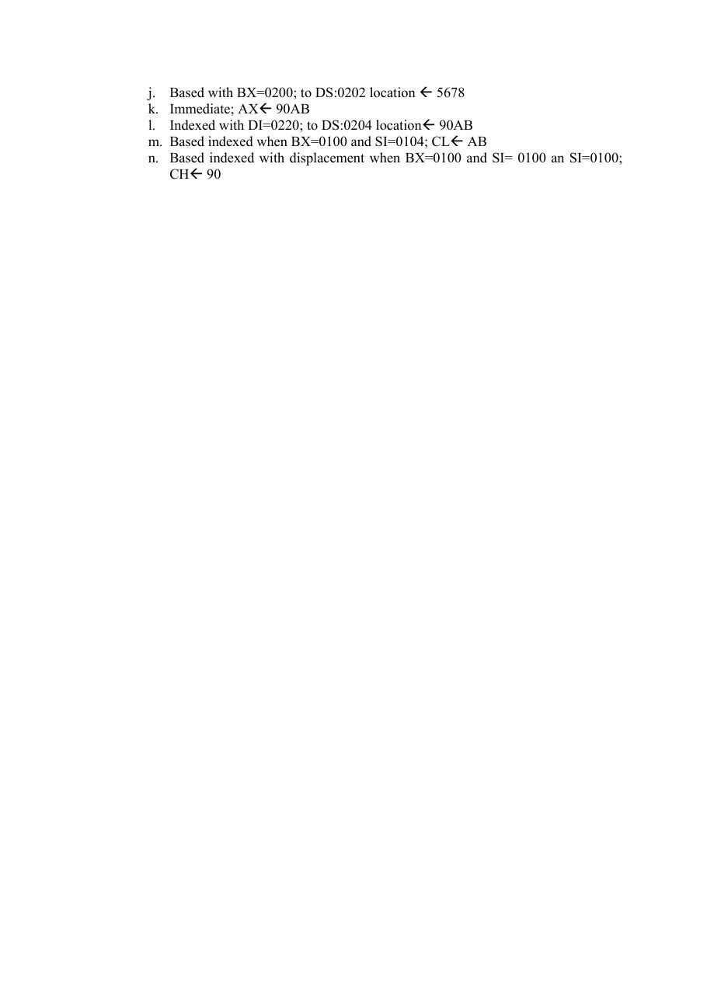
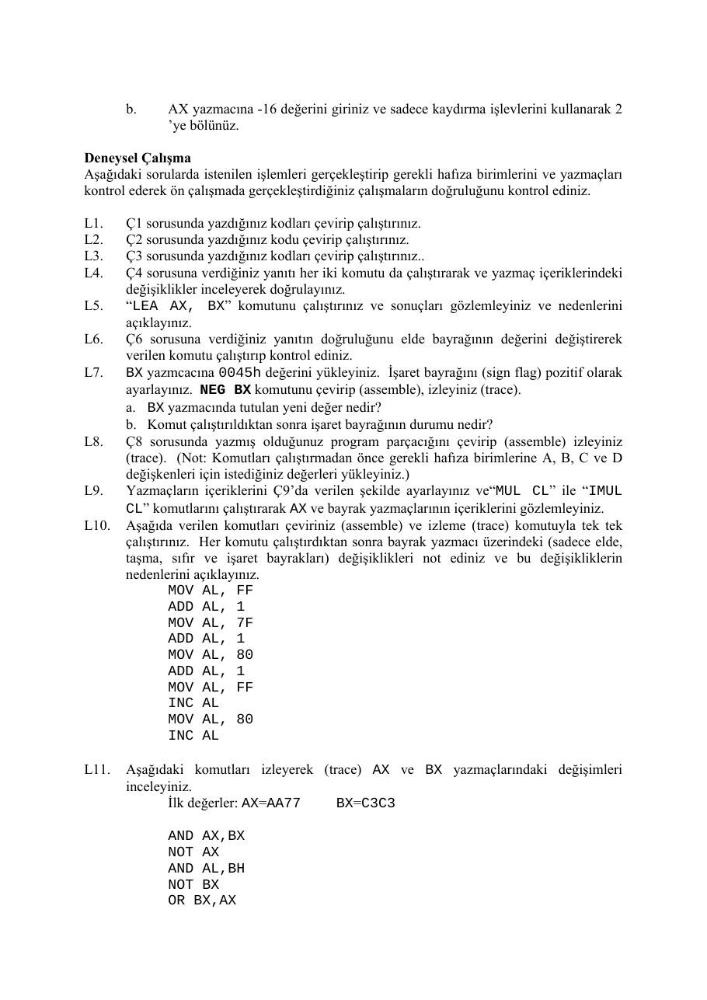

Bu yazı, Başkent Üniversitesi **EEM332 Mikroişlemciler** ders arşivindeki ilgili notları ve uygulamaları bir araya getiriyor (2006–2015). Adresleme kipleri, yazmaç değiştirme, toplama ve bayraklar, en küçük ve en büyük değeri arama; deney föyleri ve çözümler. Bir arkadaşın hazırladığı çalışmalar ve ders belgeleri birlikte aktarılmış; öğrenci adları, numaraları ve grup bilgileri çıkarılmıştır. Belgelerin PDF arşiv kopyaları ve varsa kaynak kodları yazının sonunda ZIP olarak indirilebilir.

## eem332_lab03

EEM 332 - Mikroişlemciler Deney Numarası: 3 Deney Adı: Adresleme Kipleri (Addressing Modes)

Ön Çalışma Ders kitabınızdan adresleme kiplerini okuyup öğrenin. Her adresleme kipinin adını yazarak buna bir örnek veriniz ve bir liste hazırlayınız. (Ör: Immediate Operand Addressing Mode

```asm
MOV AX,1234)
```

Deneysel Çalışma

### 1. Aşağıda verilen komutlar için adresleme kipinin adını ve o komutta geçerli olan

fiziksel adresi (physical address) belirtiniz. Yazmaçların kaynak (source) veya varış noktası (destination) olarak kullanılması fiziksel adresin hesaplanma yöntemini etkilememektedir. Yazmaçların ilk durumları şu şekildedir: DS = 1000, SS =

### 2000, BX = 0300, BP = 1000, DI = 0100, SI = 0200.

a. MOV AL,[1234] Direct addressing, PA: 10000+1234=11234 b. MOV AX,[BX] Reg. indirect addressing, PA: 10000+0300=10300 c. MOV [DI],AL d. MOV AL,[BP+DI] e. MOV CX,[DI] f. MOV DX,[BP] g. MOV [100],DL h. MOV [SI+100],AX i. MOV DL,[BX+100] j. MOV [SI],DX k. MOV CL,[BX] l. MOV CH,[BX+SI] m. MOV AX,[BP+200] n. MOV AL,[BP+SI-200] o. MOV AL,[SI-0100]

### 2. Aşağıdaki işlemleri, belirtilen adresleme kipine uygun olarak gerçekleştirecek çevirici

(assembly) komutlarını yazınız. Verilen işlemler sıralıdır (sequential). Çalıştığınız aşamadan önceki aşamaların sonuçlarını kullanmanız gerekebilir.

a. Immediate; AXÅ1234

```asm
mov ax, 1234
```

b. Register; BXÅ1234

```asm
mov bx, ax
```

c. Register; CLÅ 34 d. Direct; to DS:0200 locationÅ1234 e. Direct; CHÅ 12 f. Direct; to ES:0220 locationÅ 1234 g. Register indirect using SI; AHÅ 34 h. Register indirect using BP; BHÅ34 i. Immediate; AXÅ 5678

j. Based with BX=0200; to DS:0202 location Å 5678 k. Immediate; AXÅ 90AB l. Indexed with DI=0220; to DS:0204 locationÅ 90AB m. Based indexed when BX=0100 and SI=0104; CLÅ AB n. Based indexed with displacement when BX=0100 and SI= 0100 an SI=0100;

### CHÅ 90



## eem332_lab04

EEM 332 - Mikroişlemciler Deney Numarası: 4 Deney Adı: Aritmetik ve Mantık İşlemleri 1

Ön Çalışma

Aşağıdaki soruları yanıtlayınız. Çalışmasının fazladan bir kopyasını yanınızda getiriniz. Ön çalışmalar laboratuvar saatinin başında toplanacaktır.

Ç1.     AX ve BX yazmaçlarının içeriklerinin birbirleriyle değiştirilmesi istenmektedir. Bu işlemi sadece MOV komutunu ve AX, BX ve CX yazmaçlarını kullanarak gerçekleştiriniz. Ç2.     Aynı işlemi sadece bir komut kullanarak gerçekleştirebilir misiniz? Belirtiniz. Ç3.     DS:300 ve DS:400 hafıza yerlerindeki 16-bitlik değerlerinin yerlerinin birbirleriyle değiştirilmesi istenmektedir. Bu işlem hangi üç komut satırını kullanarak gerçekleştirilebilir? Belirtiniz. (ipucu: komutlardan birisi XCHG’dir) Ç4.     “ADD AX,1” ve “INC AX” komutları arasındaki farklar nelerdir? Ç5.     LEA komutu ne için kullanılır? “LEA AX,[BX]” ve “MOV AX,[BX]” komutları arasında fark var mıdır, varsa bu farkları nedir? Ç6.     “ADC AX, BX” komutu ne işlemi yapar? Aşağıdaki iki koşula göre yanıtlayınız. a. elde bayrağı (carry flag) 1. b. elde bayrağı (carry flag) 0. Ç7.     “NEG BX” komutu çalıştırıldığında hangi değişiklikler gözlenir? Ç8.     Aşağıda verilen işlemin gerçekleşmesi için gereken çevirici (assembly) komutlarını

### belirtiniz

Z=A+B*(C-D)

```asm
Not: A, B, C, D ve Z değişkenleri DS:500 hafıza adresinden başlayarak, belirtilen
```

sırayla saklanan 8-bitlik değerlerdir. Ç9.     AL=20H CL=80H

```asm
MUL CL ………………. Æ AX=1000 ‘dir.
```

----------------------------------------------- Ancak IMUL CL …………. Æ AX=F000 olmaktadır. Bunun nedenini açıklayınız. Her iki komutta bayrakların durumlarını belirtiniz. Ç10. AX=0040 ve BX=0041 iken aşağıdaki işlemleri gerçekleştirmek için gereken çevirici kodlarını yazınız.

a.     AX ve BX yazmaçlarında saklanan değerleri sadece kaydırma (shift) işlevlerini kullanarak 2’ye bölünüz. AX ve BX yazmaçlarında saklanan değerleri sadece kaydırma işlevlerini kullanarak 2’yle çarpınız. AX ve BX yazmaçlarının yeni değerlerini karşılaştırınız ve elde (carry) ve sıfır (zero) bayraklarını kontrol ediniz. AX yazmacındaki değeri arttırınız (increase) ve AX ve BX yazmaçlarının yeni değerlerini karşılaştırınız ve elde (carry) ve sıfır (zero) bayraklarını kontrol ediniz. AX ve BX yazmaçlarının değerlerini birbirleriyle değiştiriniz (exchange) ve AX ve BX yazmaçlarının yeni değerlerini karşılaştırınız ve elde (carry) ve sıfır (zero) bayraklarını kontrol ediniz.

b.     AX yazmacına -16 değerini giriniz ve sadece kaydırma işlevlerini kullanarak 2 ’ye bölünüz.

Deneysel Çalışma Aşağıdaki sorularda istenilen işlemleri gerçekleştirip gerekli hafıza birimlerini ve yazmaçları kontrol ederek ön çalışmada gerçekleştirdiğiniz çalışmaların doğruluğunu kontrol ediniz.

L1.    Ç1 sorusunda yazdığınız kodları çevirip çalıştırınız. L2.    Ç2 sorusunda yazdığınız kodu çevirip çalıştırınız. L3.    Ç3 sorusunda yazdığınız kodları çevirip çalıştırınız.. L4.    Ç4 sorusuna verdiğiniz yanıtı her iki komutu da çalıştırarak ve yazmaç içeriklerindeki değişiklikler inceleyerek doğrulayınız. L5.    “LEA AX, BX” komutunu çalıştırınız ve sonuçları gözlemleyiniz ve nedenlerini açıklayınız. L6.    Ç6 sorusuna verdiğiniz yanıtın doğruluğunu elde bayrağının değerini değiştirerek verilen komutu çalıştırıp kontrol ediniz. L7.    BX yazmcacına 0045h değerini yükleyiniz. İşaret bayrağını (sign flag) pozitif olarak ayarlayınız. NEG BX komutunu çevirip (assemble), izleyiniz (trace). a. BX yazmacında tutulan yeni değer nedir? b. Komut çalıştırıldıktan sonra işaret bayrağının durumu nedir? L8.    Ç8 sorusunda yazmış olduğunuz program parçacığını çevirip (assemble) izleyiniz (trace). (Not: Komutları çalıştırmadan önce gerekli hafıza birimlerine A, B, C ve D değişkenleri için istediğiniz değerleri yükleyiniz.) L9.    Yazmaçların içeriklerini Ç9’da verilen şekilde ayarlayınız ve“MUL CL” ile “IMUL CL” komutlarını çalıştırarak AX ve bayrak yazmaçlarının içeriklerini gözlemleyiniz. L10.   Aşağıda verilen komutları çeviriniz (assemble) ve izleme (trace) komutuyla tek tek çalıştırınız. Her komutu çalıştırdıktan sonra bayrak yazmacı üzerindeki (sadece elde, taşma, sıfır ve işaret bayrakları) değişiklikleri not ediniz ve bu değişikliklerin nedenlerini açıklayınız.

```asm
MOV AL, FF
ADD AL, 1
MOV AL, 7F
ADD AL, 1
MOV AL, 80
ADD AL, 1
MOV AL, FF
INC AL
MOV AL, 80
INC AL
```

L11.   Aşağıdaki komutları izleyerek (trace) AX ve BX yazmaçlarındaki değişimleri

```asm
inceleyiniz.
```

İlk değerler: AX=AA77     BX=C3C3

```asm
AND AX,BX
NOT AX
AND AL,BH
NOT BX
OR BX,AX
```

```asm
NOT AH
OR BL,AH
XOR AX,BX
NOT BX
XOR BH,AH
```

L12.   Aşağıda verilen işlemleri gerçekleştirmek için gereken çevirici (assembly) komutlarını yazınız

a.     AX yazmacına “4” sayısını ASCII kodu olarak giriniz ve bu değeri mantık işlemleri ile ikilik (binary) sisteme çeviriniz (yapısı gereği DEBUG sonucu 16’lık tabanda gösterecektir). b.     AX yazmacına “48” sayısını ASCII kodu olarak giriniz ve bu değeri mantık işlemleri ile açılmış ikilik (unpacked binary) sisteme çeviriniz. c.     BX yazmacına “48” sayısını ASCII kodu olarak giriniz ve bu değeri mantık işlemleri ile açılmamış ikilik (packed binary) sisteme çeviriniz. d.     AX yazmacına 0038h değerini yükleyiniz ve bunu ASCII koduna çeviriniz. Sonucu istediğiniz bir yazmaçta gösterebilirsiniz.

L13.   Ç10 sorusunda yazdığınız kodları çalıştırınız ve programınızın doğruluğunu kontrol ediniz.

L14.   Aşağıdaki işlemleri gerçekleştirmek için gereken çevirici (assembly) komutlarını yazınız

a.     AL ve AH yazmaçlarının içeriklerini döndürme (rotate) işlevlerini kullanarak birbirleriyle değiştiriniz. b.     AL ve AH yazmaçlarının içeriklerini döndürme (rotate) işlevlerini ve bunların elde (carry) ve mantık (logic) özelliklerini kullanarak birbirleriyle değiştiriniz.

L15.   AL=66h ve BL=48h iken aşağıdaki komutun çalıştırılmasıyla oluşacak sonuç nedir?

```asm
ADD AL,BL
```

AL ve BL yazmaçlarındaki değerlerin toplamının gerçek değerini AX yazmacına yükleyen çevirici kodunu yazınız. Bunun için çevirici dilindeki CBW komutunu kullanınınız.



## EEM332 Deney 3 önçalışma

### 1) Yer değiştirme işi;

```asm
MOV CX,AX
MOVAX,BX
MOV BX,CX
```

kodlari ile gerçekleştirilir.

```
-a 100
13B6:0100 mov cx,ax
13B6:0102 mov ax,bx
13B6:0104 mov bx,cx
13B6:0106
-r
AX=1300 BX=1500 CX=0000 DX=0000 SP=FFEE BP=0000 SI=0000 DI=0000
DS=13B6 ES=13B6 SS=13B6 CS=13B6 IP=0100 NV UP EI PL NZ NA PO NC
13B6:0100 89C1      MOV CX,AX
-t
```

```
AX=1300 BX=1500 CX=1300 DX=0000 SP=FFEE BP=0000 SI=0000 DI=0000
DS=13B6 ES=13B6 SS=13B6 CS=13B6 IP=0102 NV UP EI PL NZ NA PO NC
13B6:0102 89D8    MOV AX,BX
-t
```

```
AX=1500 BX=1500 CX=1300 DX=0000 SP=FFEE BP=0000 SI=0000 DI=0000
DS=13B6 ES=13B6 SS=13B6 CS=13B6 IP=0104 NV UP EI PL NZ NA PO NC
13B6:0104 89CB    MOV BX,CX
-t
AX=1500 BX=1300 CX=1300 DX=0000 SP=FFEE BP=0000 SI=0000 DI=0000
DS=13B6 ES=13B6 SS=13B6 CS=13B6 IP=0106 NV UP EI PL NZ NA PO NC
13B6:0106 0000    ADD [BX+SI],AL           DS:1300=00
```

-

### 2) Aynı işlemi

```asm
XCHG AX,BX
```

Kodu ile gerçekleştirebiliriz.

```
-r
AX=1300 BX=1500 CX=1500 DX=0000 SP=FFEE BP=0000 SI=0002 DI=0002
DS=13B6 ES=13B6 SS=13B6 CS=13B6 IP=0100 NV UP EI PL ZR NA PE NC
13B6:0100 89C1       MOV CX,AX
-a
13B6:010A xchg ax,bx
13B6:010C
-t
AX=1500 BX=1300 CX=1300 DX=0000 SP=FFEE BP=0000 SI=0002 DI=0002
DS=13B6 ES=13B6 SS=13B6 CS=13B6 IP=0106 NV UP EI PL ZR NA PE NC
13B6:0106 87C3       XCHG AX,BX
-t
AX=1300 BX=1500 CX=1300 DX=0000 SP=FFEE BP=0000 SI=0002 DI=0002
DS=13B6 ES=13B6 SS=13B6 CS=13B6 IP=0108 NV UP EI PL ZR NA PE NC
13B6:0108 87C3       XCHG A
```

### 3) MOV AX,[0300]

```asm
XCHG [0400],AX
MOV [0300],AX
```

Komutları ile gerçekleştirebiliriz.

### 4) Komutları programda yazarak deneyecek olursak,

```
AX=1300 BX=1500 CX=1300 DX=0000 SP=FFEE BP=0000 SI=0002 DI=0002
DS=13B6 ES=13B6 SS=13B6 CS=13B6 IP=010C NV UP EI PL ZR NA PE NC
13B6:010C 050100   ADD AX,0001
-t
```

```
AX=1301 BX=1500 CX=1300 DX=0000 SP=FFEE BP=0000 SI=0002 DI=0002
DS=13B6 ES=13B6 SS=13B6 CS=13B6 IP=010F NV UP EI PL NZ NA PO NC
13B6:010F 40    INC AX
-t
```

```
AX=1302 BX=1500 CX=1300 DX=0000 SP=FFEE BP=0000 SI=0002 DI=0002
DS=13B6 ES=13B6 SS=13B6 CS=13B6 IP=0110 NV UP EI PL NZ NA PO NC
13B6:0110 0000         ADD [BX+SI],AL                   DS:1502=00
```

- * İki kod da aynı işlemi yapar ancak ilk kod 3 byte yer kaplar iken “inc ax” komutu 1 byte lık yer kaplar.

- Add komutu ekleme işlemi yapar. İnc komutu ise sadece 1 artırır.

- İnc komutu 8,16 bitlik yazmaçlar ve hafızalarda da işlem yapar.

### 5)

```asm
LEA AX,[BX] = Bu komutla BX in efektif adresini AX e aktarır. Lea komutu pointer gibi çalışır.
```

```asm
MOV AX,[BX] = Bu komutla ise adres içeriğini AX e aktarır.
```

### “ADC”

### 6) “ADC “ komutu aynı “ADD” gibi toplama işlemi yapar ancak “ADC” komutunda carry flagde

toplamaya katılır.

Örneğin; Carry flag=1 ise,

```
AX=BX+AX+CF
```

Aşağdaki örnekte görüleceği üzere AX=3B08 , BX=1304 ve CF=1 ( flaglerde CY mevcut) Sonuç beklentiği gibi AX=BX+AX+CF=3B08+1304+1=4E0D çıktı. Aynı işlemi ADD komutu işle yapsaydık sonuç 4E0C çıkacaktı.

```
-r
AX=3B08 BX=1304 CX=1304 DX=0000 SP=FFEE BP=0000 SI=0004 DI=0004
DS=13B6 ES=13B6 SS=13B6 CS=13B6 IP=0100 NV UP EI PL NZ NA PO CY
13B6:0100 11D8      ADC AX,BX
-a 13b6:0100
13B6:0100 adc ax,bx
13B6:0102
```

```
-r
AX=3B08 BX=1304 CX=1304 DX=0000 SP=FFEE BP=0000 SI=0004 DI=0004
DS=13B6 ES=13B6 SS=13B6 CS=13B6 IP=0100 NV UP EI PL NZ NA PO CY
13B6:0100 11D8    ADC AX,BX
-t
```

```
AX=4E0D BX=1304 CX=1304 DX=0000 SP=FFEE BP=0000 SI=0004 DI=0004
DS=13B6 ES=13B6 SS=13B6 CS=13B6 IP=0102 NV UP EI PL NZ NA PO NC
13B6:0102 89D8    MOV AX,BX
```

### 7)

Bu komutla sayıların ikinci complimentini bulabiliriz.

Örneğin rasgele bir sayı seçelim. Sayımız AX=1BC3 olsun.

1BC3 sayınısı bit lerine ayırırsak = 0001 1011 1100 0011 elde ederiz.

### 2. complimenti sağ dan ilk 1 sayısına kadar aynı sonrasını tam tersi ni yazarak elde ederiz yani

1BC3 ün kompimenti = 1110 0100 0011 1101= E43D dir.

Deneyerek görecek olursak;

```
-r
AX=1BC3 BX=1304 CX=1304 DX=0000 SP=FFEE BP=0000 SI=0004 DI=0004
DS=13B6 ES=13B6 SS=13B6 CS=13B6 IP=0100 NV UP EI PL NZ NA PO NC
13B6:0100 11D8      ADC AX,BX
-a 13b6:0100
13B6:0100 neg ax
13B6:0102
-t
```

```
AX=E43D BX=1304 CX=1304 DX=0000 SP=FFEE BP=0000 SI=0004 DI=0004
DS=13B6 ES=13B6 SS=13B6 CS=13B6 IP=0102 NV UP EI NG NZ AC PO CY
13B6:0102 89D8    MOV AX,BX
```

### 8)

```asm
MOV AL, [0503]
```

```asm
SUB [0502], AL
```

```asm
MOV AL, [0502]
```

```asm
MUL [0501]
```

```asm
ADD AL,[0500]
```

```asm
MOV [0504], AL
```

Komutları ile Z=A+B*(C-D) işlemini gerçekleştirebiliriz.

### 9) mul ile imul da aynı değere sahip registerlerin farklı sonuçlar vermesinin sebebi; MUL komutuyla

AL ile CL yi çarpıp direk AX e aktarabiliyoruz. Soruda işaretsiz iki hez sayının çarpımı 1000H çıkmıştır. Flaglerden ise overflow ve carry carry flag etkilenir. IMUL komutu ile de verilen iki değer çarpılır, çıkan sonucun 2 komplimenti alınarak AX e aktarılır. Etkilenecek flagler ise bir öncekinde olduğu gibi OV ve CF dir.

### 10)

```
-r
AX=0040 BX=0041 CX=1304 DX=0000 SP=FFEE BP=0000 SI=0004 DI=0004
DS=13B6 ES=13B6 SS=13B6 CS=13B6 IP=0100 NV UP EI NG NZ AC PE CY
13B6:0100 F7D8    NEG AX
```

```
-a 13b6:0100
13B6:0100 shr ax,1 // ax i 2 y bölme
13B6:0102 shr bx,1 // bx i 2 ye bölme
13B6:0104 shl ax,1 // ax i 2 ile çarpma
13B6:0106 shl bx,1 // bx i 2 ile çarpma
13B6:0108
```

```
-t
```

```
AX=0020 BX=0041 CX=1304 DX=0000 SP=FFEE BP=0000 SI=0004 DI=0004
DS=13B6 ES=13B6 SS=13B6 CS=13B6 IP=0102 NV UP EI PL NZ AC PO NC
13B6:0102 D1EB    SHR BX,1
-t
```

```
AX=0020 BX=0020 CX=1304 DX=0000 SP=FFEE BP=0000 SI=0004 DI=0004
DS=13B6 ES=13B6 SS=13B6 CS=13B6 IP=0104 NV UP EI PL NZ AC PO CY
13B6:0104 D1E0    SHL AX,1
-t
```

```
AX=0040 BX=0020 CX=1304 DX=0000 SP=FFEE BP=0000 SI=0004 DI=0004
DS=13B6 ES=13B6 SS=13B6 CS=13B6 IP=0106 NV UP EI PL NZ AC PO NC
13B6:0106 D1E3    SHL BX,1
-t
```

```
AX=0040 BX=0040 CX=1304 DX=0000 SP=FFEE BP=0000 SI=0004 DI=0004
DS=13B6 ES=13B6 SS=13B6 CS=13B6 IP=0108 NV UP EI PL NZ AC PO NC
13B6:0108 87C3        XCHG AX,BX
```

- İlk bölme işleminin sonunda ax i ikiye böldüğümüzde carry flag 0 dır yani NC olarak görülüyor. Bx i ikiye böldüğümüzde ise sonuç 20 elde 1 vardır, carry flag in NC den CY ye yani 0 dan 1 e geçtiğini görebiliriz.

Çarpma işleminde ise ikisinde de 20 den 40 a çıktık. İki işlemde de elde olmadığı için carry flag 0 a yani NC ye geçti.

4 işlemde de sonuç sıfır olmadığı için zero flag hiç değişmemiş NZ olarak kalmıştır.

```
-a
13B6:0108 inc ax
13B6:0109
-t
```

```
AX=0041 BX=0040 CX=1304 DX=0000 SP=FFEE BP=0000 SI=0004 DI=0004
DS=13B6 ES=13B6 SS=13B6 CS=13B6 IP=0109 NV UP EI PL NZ NA PE NC
13B6:0109 C3     RET
```

Sadece ax i artırdığımız için AX 40 dan 41 e çıktı. BX de ise beklendiği gibi hiçbir değişiklik olmadı. Zero flag NZ Carry flag de NC olarak kaldı. Hiçbir değişiklik olmadı.

```
-a
13B6:0109 xchg ax,bx
13B6:010B
-t
```

```
AX=0040 BX=0041 CX=1304 DX=0000 SP=FFEE BP=0000 SI=0004 DI=0004
DS=13B6 ES=13B6 SS=13B6 CS=13B6 IP=010B NV UP EI PL NZ NA PE NC
13B6:010B C3     RET
```

İşlem sonunda ax ile bx in değerleri bir biri ile yer değiştirdi. Ax 41 ilken 40, bx ise 40 iken 41 oldu.

Zero flag ve carry flag de de herhangi bir değişiklik olmadı çünkü sonucu sıfıra giden bir işlem ve işlem sonunda elde kalacak bir hesaplama yapmadık.

### 10) -16 sayısı hex olarak FFEA ya karşılık gelmektedir.

```
-a 13b6:0100
13B6:0100 shr ax,1
13B6:0102
-r
AX=FFEA BX=0041 CX=1304 DX=0000 SP=FFEE BP=0000 SI=0004 DI=0004
DS=13B6 ES=13B6 SS=13B6 CS=13B6 IP=0100 NV UP EI PL NZ NA PE NC
13B6:0100 D1E8     SHR AX,1
-t
```

```
AX=7FF5 BX=0041 CX=1304 DX=0000 SP=FFEE BP=0000 SI=0004 DI=0004
DS=13B6 ES=13B6 SS=13B6 CS=13B6 IP=0102 OV UP EI PL NZ NA PE NC
13B6:0102 D1EB    SHR BX,1
```

## LAB 4 ÖNÇALIŞMA

### 1) .MODEL SMALL

```asm
.Stack 64k
DATA DB 13,-10,19,14,-18,-9,12,-19,16
```

```asm
.CODE
```

```asm
MAIN: MOV AX,@DATA
MOV DS,AX
MOV SI,100H
MOV AL,[SI]
MOV CX,8
INC SI
```

```asm
AGAIN:CMP AL, [SI]
JL NEXT
MOV AL, [SI]
```

```asm
NEXT:INC SI
LOOP AGAIN
```

```asm
MOV AH, 4CH
INT 21H
```

```asm
END MAIN
```

### 2)

```asm
.MODEL SMALL
.STACK 100h
DATA DB 87,96,45,75
```

```asm
.DATA
```

```asm
.CODE
```

```asm
MAIN:MOV AX,@DATA
MOV DS,AX
MOV SI,100H
MOV AL,[SI]
```

```asm
MOV CX,4
INC SI
```

```asm
AGAIN: CMP AL, [SI]
JA NEXT
MOV AL, [SI]
```

```asm
NEXT:   INC SI
LOOP AGAIN
```

```asm
MOV AH, 4CH
INT 21H
```

```asm
END MAIN
```

-2-

## 332_lab03_deney çalışması

### L1-)

```
-r ax
```

### AX 0000

:aaaa

```
-r bx
```

### BX 0000

:bbbb

```
-a cs:100
1627:0100 mov cx,ax
1627:0102 mov ax,bx
1627:0104 mov bx,cx
```

```
-t=cs:100
```

```
AX=AAAA BX=BBBB CX=AAAA DX=0000 SP=FFEE BP=0000 SI=0000 DI=0000
DS=1627 ES=1627 SS=1627 CS=1627 IP=0102 NV UP EI PL ZR NA PE NC
1627:0102 89D8   MOV AX,BX
-t=cs:102
```

```
AX=BBBB BX=BBBB CX=AAAA DX=0000 SP=FFEE BP=0000 SI=0000 DI=0000
DS=1627 ES=1627 SS=1627 CS=1627 IP=0104 NV UP EI PL ZR NA PE NC
1627:0104 89CB   MOV BX,CX
-t=cs:104
```

```
AX=BBBB BX=AAAA CX=AAAA DX=0000 SP=FFEE BP=0000 SI=0000 DI=0000
DS=1627 ES=1627 SS=1627 CS=1627 IP=0106 NV UP EI PL ZR NA PE NC
1627:0106 803EC19A00 CMP BYTE PTR [9AC1],00          DS:9AC1=00
```

### L2-)

```
-r ax
```

### AX BBBB

:aaaa

```
-r bx
```

### BX AAAA

:bbbb

```
-a cs:100
1627:0100 xchg ax,bx
```

```
-t=cs:100
```

```
AX=BBBB BX=AAAA CX=AAAA DX=0000 SP=FFEE BP=0000 SI=0000 DI=0000
DS=1627 ES=1627 SS=1627 CS=1627 IP=0102 NV UP EI PL ZR NA PE NC
1627:0102 89D8   MOV AX,BX
```

### L3-)

```
-a cs:100
1627:0100 mov ax,[300]
1627:0103 xchg ax,[400]
1627:0107 mov [300],ax
```

```
-e cs:300
1627:0300 11.33
-e cs:301
1627:0301 11.33
-e cs:400
1627:0400 44.44
-e cs:401
1627:0401 44.44
-r ip
```

### IP 0104

:100

```
-t
```

```
AX=3333 BX=0080 CX=0080 DX=0006 SP=FFEE BP=0001 SI=0000 DI=0000
DS=1627 ES=1627 SS=1627 CS=1627 IP=0103 OV UP EI PL ZR NA PE CY
1627:0103 87060004 XCHG AX,[0400]             DS:0400=4444
-t
```

```
AX=4444 BX=0080 CX=0080 DX=0006 SP=FFEE BP=0001 SI=0000 DI=0000
DS=1627 ES=1627 SS=1627 CS=1627 IP=0107 OV UP EI PL ZR NA PE CY
1627:0107 A30003  MOV [0300],AX              DS:0300=3333
-t
```

```
-d ds:300 301
1627:0300 44 44
-d ds:400 401
1627:0400 33 33
```

### L4-)

```
-a cs:100
1627:0100 add ax,1
1627:0103 inc ax
1627:0104
-r ax
```

### AX 0000

:0000

```
-t=cs:100
```

```
AX=0001 BX=AAAA CX=AAAA DX=0000 SP=FFEE BP=0000 SI=0000 DI=0000
DS=1627 ES=1627 SS=1627 CS=1627 IP=0103 NV UP EI PL NZ NA PO NC
```

```
1627:0103 40          INC   AX
-r ax
```

### AX 0001

:0000

```
-t=cs:103
```

```
AX=0001 BX=AAAA CX=AAAA DX=0000 SP=FFEE BP=0000 SI=0000 DI=0000
DS=1627 ES=1627 SS=1627 CS=1627 IP=0104 NV UP EI PL NZ NA PO NC
1627:0104 89CB   MOV BX,CX
```

### L5-)

```
-a cs:100
1627:0100 lea ax,bx
```

^ Hatası

### L6-)

```
-a cs:100
1627:0100 adc ax,bx
```

```
-r ax
```

### AX AAAA

:0002

```
-r bx
```

### BX AAAA

:0003

```
-r f
```

### OV DN DI NG NZ NA PE NC -

```
-t=cs:100
```

```
AX=0005 BX=0003 CX=AAAA DX=0000 SP=FFEE BP=0000 SI=0000 DI=0000
DS=1627 ES=1627 SS=1627 CS=1627 IP=0102 NV DN DI PL NZ NA PE NC
1627:0102 004089  ADD [BX+SI-77],AL           DS:FF8C=00
```

```
-r ax
```

### AX 0005

:0002

```
-r f
```

NV DN DI PL NZ NA PE NC -cy

```
-t=cs:100
```

```
AX=0006 BX=0003 CX=AAAA DX=0000 SP=FFEE BP=0000 SI=0000 DI=0000
DS=1627 ES=1627 SS=1627 CS=1627 IP=0102 NV DN DI PL NZ NA PE NC
1627:0102 004089  ADD [BX+SI-77],AL           DS:FF8C=00
```

### L7-)

```
-r bx
```

### BX 0045

:0045

```
-r f
```

NV DN DI NG NZ AC PO CY -pl

```
-a cs:100
1627:0100 neg bx
1627:0102
-t=cs:100
```

```
AX=0000 BX=FFBB CX=AAAA DX=0000 SP=FFEE BP=0000 SI=0000 DI=0000
DS=1627 ES=1627 SS=1627 CS=1627 IP=0102 NV DN DI NG NZ AC PE CY
1627:0102 004089  ADD [BX+SI-77],AL           DS:FF44=00
```

a-) BX=FFBB

b-) ng ( negatif )

### L8-)

```
-a cs:100
1627:0100 mov al,[502]
1627:0103 sub al,[503]
1627:0107 mov bh,[501]
1627:010B mul bh
1627:010D mov bh,[500]
1627:0110 add bh,al
1627:0112 mov [504],bh
```

```
-e ds:500
1627:0500 92.4
-e ds:501
1627:0501 00.3
-e ds:502
1627:0502 00.2
-e ds:503
1627:0503 2E.1
-r ip
```

### IP 0103

:100

```
AX=0002 BX=0000 CX=0302 DX=0006 SP=FFEE BP=0001 SI=0000 DI=0000
DS=1627 ES=1627 SS=1627 CS=1627 IP=0103 NV UP EI PL NZ NA PO NC
1627:0103 2A060305 SUB AL,[0503]             DS:0503=01
-t
```

```
AX=0001 BX=0000 CX=0302 DX=0006 SP=FFEE BP=0001 SI=0000 DI=0000
DS=1627 ES=1627 SS=1627 CS=1627 IP=0107 NV UP EI PL NZ NA PO NC
```

```
1627:0107 8A3E0105   MOV   BH,[0501]         DS:0501=03
-t
```

```
AX=0001 BX=0300 CX=0302 DX=0006 SP=FFEE BP=0001 SI=0000 DI=0000
DS=1627 ES=1627 SS=1627 CS=1627 IP=010B NV UP EI PL NZ NA PO NC
1627:010B F6E7   MUL BH
-t
```

```
AX=0003 BX=0300 CX=0302 DX=0006 SP=FFEE BP=0001 SI=0000 DI=0000
DS=1627 ES=1627 SS=1627 CS=1627 IP=010D NV UP EI PL NZ NA PE NC
1627:010D 8A3E0005  MOV BH,[0500]             DS:0500=04
-t
```

```
AX=0003 BX=0400 CX=0302 DX=0006 SP=FFEE BP=0001 SI=0000 DI=0000
DS=1627 ES=1627 SS=1627 CS=1627 IP=0111 NV UP EI PL NZ NA PE NC
1627:0111 00C7   ADD BH,AL
```

```
-t
```

```
AX=0003 BX=0700 CX=0302 DX=0006 SP=FFEE BP=0001 SI=0000 DI=0000
DS=1627 ES=1627 SS=1627 CS=1627 IP=0113 NV UP EI PL NZ NA PO NC
1627:0113 883E0405 MOV [0504],BH              DS:0504=07
-d ds:504 504
1627:0500       07
```

### L9-)

```
-a cs:100
1627:0100 mul cl
1627:0102 imul cl
1627:0104
```

- rip

### IP 0113

:100

```
-t
```

```
AX=1000 BX=0700 CX=0080 DX=0006 SP=FFEE BP=0001 SI=0000 DI=0000
DS=1627 ES=1627 SS=1627 CS=1627 IP=0102 OV UP EI PL ZR NA PE CY
1627:0102 F6E9   IMUL CL
-r ax
```

### AX 1000

:20

```
-r bx
```

### BX 0700

:80

```
-r ip
```

### IP 0102

:102

```
-t
```

```
AX=F000 BX=0080 CX=0080 DX=0006 SP=FFEE BP=0001 SI=0000 DI=0000
```

```
DS=1627 ES=1627 SS=1627 CS=1627 IP=0104 OV UP EI PL ZR NA PE CY
1627:0104 06    PUSH ES
```

### L10-)

```
-a cs:100
1627:0100 mov al,ff
1627:0102 add al,1
1627:0104 mov al,7f
1627:0106 add al,1
1627:0108 mov al,80
1627:010A add al,1
1627:010C mov al,ff
1627:010E inc al
1627:0110 mov al,80
1627:0112 inc al
1627:0114
-r ip
```

### IP 0102

:100

```
AX=FFFF BX=0000 CX=0000 DX=0000 SP=FFEE BP=0000 SI=0000 DI=0000
DS=1627 ES=1627 SS=1627 CS=1627 IP=0102 NV UP EI NG NZ NA PO NC
1627:0102 0401   ADD AL,01
-t
```

```
AX=FF00 BX=0000 CX=0000 DX=0000 SP=FFEE BP=0000 SI=0000 DI=0000
DS=1627 ES=1627 SS=1627 CS=1627 IP=0104 NV UP EI PL ZR AC PE CY
1627:0104 B07F   MOV AL,7F
-t
```

```
AX=FF7F BX=0000 CX=0000 DX=0000 SP=FFEE BP=0000 SI=0000 DI=0000
DS=1627 ES=1627 SS=1627 CS=1627 IP=0106 NV UP EI PL ZR AC PE CY
1627:0106 0401   ADD AL,01
-t
```

```
AX=FF80 BX=0000 CX=0000 DX=0000 SP=FFEE BP=0000 SI=0000 DI=0000
DS=1627 ES=1627 SS=1627 CS=1627 IP=0108 OV UP EI NG NZ AC PO NC
1627:0108 B080   MOV AL,80
-t
```

```
AX=FF80 BX=0000 CX=0000 DX=0000 SP=FFEE BP=0000 SI=0000 DI=0000
DS=1627 ES=1627 SS=1627 CS=1627 IP=010A OV UP EI NG NZ AC PO NC
1627:010A 0401   ADD AL,01
```

```
AX=FF81 BX=0000 CX=0000 DX=0000 SP=FFEE BP=0000 SI=0000 DI=0000
DS=1627 ES=1627 SS=1627 CS=1627 IP=010C NV UP EI NG NZ NA PE NC
1627:010C B0FF    MOV AL,FF
-t
```

```
AX=FFFF BX=0000 CX=0000 DX=0000 SP=FFEE BP=0000 SI=0000 DI=0000
DS=1627 ES=1627 SS=1627 CS=1627 IP=010E NV UP EI NG NZ NA PE NC
1627:010E FEC0    INC AL
-t
```

```
AX=FF00 BX=0000 CX=0000 DX=0000 SP=FFEE BP=0000 SI=0000 DI=0000
DS=1627 ES=1627 SS=1627 CS=1627 IP=0110 NV UP EI PL ZR AC PE NC
1627:0110 B080   MOV AL,80
-t
```

```
AX=FF80 BX=0000 CX=0000 DX=0000 SP=FFEE BP=0000 SI=0000 DI=0000
DS=1627 ES=1627 SS=1627 CS=1627 IP=0112 NV UP EI PL ZR AC PE NC
1627:0112 FEC0   INC AL
```

### L11-)

```
-a cs:100
1627:0100 and ax,bx
1627:0102 not ax
1627:0104 and al,bh
1627:0106 not bx
1627:0108 or bx,ax
1627:010A not ah
1627:010C or bl,ah
1627:010E xor ax,bx
1627:0110 not bx
1627:0112 xor bh,ah
1627:0114
-r ax
```

### AX FF80

:aa77 -rbx

### BX 0000

:c3c3

```
-r ip
```

### IP 0112

:100

```
AX=8243 BX=C3C3 CX=0000 DX=0000 SP=FFEE BP=0000 SI=0000 DI=0000
DS=1627 ES=1627 SS=1627 CS=1627 IP=0102 NV UP EI NG NZ NA PO NC
1627:0102 F7D0   NOT AX
-t
```

```
AX=7DBC BX=C3C3 CX=0000 DX=0000 SP=FFEE BP=0000 SI=0000 DI=0000
DS=1627 ES=1627 SS=1627 CS=1627 IP=0104 NV UP EI NG NZ NA PO NC
1627:0104 20F8   AND AL,BH
-t
```

```
AX=7D80 BX=C3C3 CX=0000 DX=0000 SP=FFEE BP=0000 SI=0000 DI=0000
DS=1627 ES=1627 SS=1627 CS=1627 IP=0106 NV UP EI NG NZ NA PO NC
```

```
1627:0106 F7D3        NOT   BX
-t
```

```
AX=7D80 BX=3C3C CX=0000 DX=0000 SP=FFEE BP=0000 SI=0000 DI=0000
DS=1627 ES=1627 SS=1627 CS=1627 IP=0108 NV UP EI NG NZ NA PO NC
1627:0108 09C3   OR    BX,AX
-t
```

```
AX=7D80 BX=7DBC CX=0000 DX=0000 SP=FFEE BP=0000 SI=0000 DI=0000
DS=1627 ES=1627 SS=1627 CS=1627 IP=010A NV UP EI PL NZ NA PO NC
1627:010A F6D4    NOT AH
```

```
AX=8280 BX=7DBC CX=0000 DX=0000 SP=FFEE BP=0000 SI=0000 DI=0000
DS=1627 ES=1627 SS=1627 CS=1627 IP=010C NV UP EI PL NZ NA PO NC
1627:010C 08E3   OR    BL,AH
-t
```

```
AX=8280 BX=7DBE CX=0000 DX=0000 SP=FFEE BP=0000 SI=0000 DI=0000
DS=1627 ES=1627 SS=1627 CS=1627 IP=010E NV UP EI NG NZ NA PE NC
1627:010E 31D8   XOR AX,BX
-t
```

```
AX=FF3E BX=7DBE CX=0000 DX=0000 SP=FFEE BP=0000 SI=0000 DI=0000
DS=1627 ES=1627 SS=1627 CS=1627 IP=0110 NV UP EI NG NZ NA PO NC
1627:0110 F7D3   NOT BX
-t
```

```
AX=FF3E BX=8241 CX=0000 DX=0000 SP=FFEE BP=0000 SI=0000 DI=0000
DS=1627 ES=1627 SS=1627 CS=1627 IP=0112 NV UP EI NG NZ NA PO NC
1627:0112 30E7   XOR BH,AH
```

### L12-)

### L13-)

a.

```
-r ax
```

### AX FF3E

:0040

```
-r bx
```

### BX 8241

:0041

```
-a cs:100
1627:0100 shr ax,1
1627:0102 shr bx,1
1627:0104 shl ax,1
1627:0106 shl bx,1
1627:0108 cmp ax,bx
```

```
1627:010A inc ax
1627:010B cmp ax,bx
1627:010D xchg ax,bx
1627:010F cmp ax,bx
```

```
-r ip
```

### IP 0112

:100

```
-t
```

```
AX=0020 BX=0041 CX=0000 DX=0000 SP=FFEE BP=0000 SI=0000 DI=0000
DS=1627 ES=1627 SS=1627 CS=1627 IP=0102 NV UP EI PL NZ NA PO NC
1627:0102 D1EB    SHR BX,1
-t
```

```
AX=0020 BX=0020 CX=0000 DX=0000 SP=FFEE BP=0000 SI=0000 DI=0000
DS=1627 ES=1627 SS=1627 CS=1627 IP=0104 NV UP EI PL NZ NA PO CY
1627:0104 D1E0   SHL AX,1
-t
```

```
AX=0040 BX=0020 CX=0000 DX=0000 SP=FFEE BP=0000 SI=0000 DI=0000
DS=1627 ES=1627 SS=1627 CS=1627 IP=0106 NV UP EI PL NZ NA PO NC
1627:0106 D1E3   SHL BX,1
-t
```

```
AX=0040 BX=0040 CX=0000 DX=0000 SP=FFEE BP=0000 SI=0000 DI=0000
DS=1627 ES=1627 SS=1627 CS=1627 IP=0108 NV UP EI PL NZ NA PO NC
1627:0108 39D8   CMP AX,BX
```

```
AX=0040 BX=0040 CX=0000 DX=0000 SP=FFEE BP=0000 SI=0000 DI=0000
DS=1627 ES=1627 SS=1627 CS=1627 IP=010A NV UP EI PL ZR NA PE NC
1627:010A 40    INC AX
-t
```

```
AX=0041 BX=0040 CX=0000 DX=0000 SP=FFEE BP=0000 SI=0000 DI=0000
DS=1627 ES=1627 SS=1627 CS=1627 IP=010B NV UP EI PL NZ NA PE NC
1627:010B 39D8    CMP AX,BX
-t
```

```
AX=0041 BX=0040 CX=0000 DX=0000 SP=FFEE BP=0000 SI=0000 DI=0000
DS=1627 ES=1627 SS=1627 CS=1627 IP=010D NV UP EI PL NZ NA PO NC
1627:010D 87C3    XCHG AX,BX
-t
```

```
AX=0040 BX=0041 CX=0000 DX=0000 SP=FFEE BP=0000 SI=0000 DI=0000
DS=1627 ES=1627 SS=1627 CS=1627 IP=010F NV UP EI PL NZ NA PO NC
1627:010F 39D8   CMP AX,BX
```

b.

```
-a cs:100
1627:0100 sar ax,1
1627:0102
-r ax
```

### AX 0000

:fff0

```
-r
AX=FFF0 BX=0000 CX=0000 DX=0000 SP=FFEE BP=0000 SI=0000 DI=0000
DS=1627 ES=1627 SS=1627 CS=1627 IP=0100 NV UP EI PL NZ NA PO NC
1627:0100 D1F8     SAR AX,1
-r ip
```

### IP 0100

### 

```
-t
```

```
AX=FFF8 BX=0000 CX=0000 DX=0000 SP=FFEE BP=0000 SI=0000 DI=0000
DS=1627 ES=1627 SS=1627 CS=1627 IP=0102 NV UP EI NG NZ NA PO NC
1627:0102 3AC4    CMP AL,AH
```

### L14-)

a.

```
-r ax
```

### AX 4422

:1199

```
-r cx
```

### CX 0008

:8

```
-a cs:100
1627:0100 rol ax,cl
1627:0102
-r ip
```

### IP 0104

:100

```
-t
```

```
AX=9911 BX=0041 CX=0008 DX=0000 SP=FFEE BP=0000 SI=0000 DI=0000
DS=1627 ES=1627 SS=1627 CS=1627 IP=0102 NV UP EI NG NZ NA PO CY
1627:0102 D1C0    ROL AX,1
```

b.

## 332_lab04_rapor

### 1)

```asm
.MODEL SMALL
.STACK 64
.DATA
SICAKLIK DB      13,-10,+19,14,-18,-9,+12,-19,+16
eksi        DB   '-$'
```

```asm
.CODE
MAIN           PROC FAR     ;this is the program entry point
MOV AX,@DATA ;load the data segment address
MOV DS,AX             ;assign value to DS
```

```asm
MOV SI, offset SICAKLIK ; point to SICAKLIK
MOV AL,[SI]
INC SI
MOV CX,8
```

```asm
DON: CMP AL,[SI]
JLE DEVAM
MOV AL,[SI]
```

### DEVAM

```asm
INC SI
DEC CX
JNZ DON
```

```asm
MOV DL,AL
SHL DL,1
JNC POZ
```

### NEG AL

```asm
MOV DL,0FFH
JMP NGTF
POZ:
MOV DL,0
NGTF:
```

```asm
MOV CL,AL                  ;decimal döncek sayı AL CL at
MOV AX,0
DONGU:  INC AL                 ;AL ilk basamak
CMP AL,0Ah                 ;10 olmuşmu?
JNE DVM                    ;hayır devam
MOV AL,0                   ;evet sıfırla
INC AH                     ;AH ikinci basamak
CMP AH,0Ah                 ;10 olmuşmu?
JNE DVM                    ;hayır devam
MOV AH,0
```

```asm
DVM:LOOP DONGU
```

```asm
SHL DL,1
JNC POZ2
```

```asm
PUSH AX
```

```asm
MOV         AH,09
MOV         DX,OFFSET eksi
INT         21H
```

```asm
POP AX
POZ2:
```

```asm
OR  AL,30H
OR  AH,30H
MOV CX,AX
MOV DL,CH
```

```asm
MOV AH,02H
INT 21H
```

```asm
MOV DL,CL
```

```asm
MOV AH,02H
INT 21H
```

```asm
MOV AH,4CH        ;set up to
INT 21H           ;return to DOS
```

### MAIN           ENDP

```asm
END MAIN          ;this is the program exit point
```

### 2)

```asm
.MODEL SMALL
.STACK 64
.DATA
NOTLAR        DB           69,87,96,45,75
```

```asm
.CODE
MAIN           PROC FAR                 ;this is the program entry point
MOV AX,@DATA             ;load the data segment address
MOV DS,AX                ;assign value to DS
```

```asm
MOV SI, offset NOTLAR    ; point to NOTLAR
MOV AL,[SI]
INC SI
MOV CX,4
```

```asm
DONGU: MOV BL,[SI]
CMP AL,BL
JNC KONTROL
MOV AL,BL
```

```asm
KONTROL: INC SI
DEC CX
JNZ DONGU
```

```asm
MOV CL,AL        ;decimal döncek sayı AL CL at
MOV AX,0
DON: INC AL           ;AL ilk basamak
CMP AL,0Ah       ;10 olmuşmu?
JNE DVM          ;hayır devam
MOV AL,0         ;evet sıfırla
INC AH           ;AH ikinci basamak
CMP AH,0Ah        ;10 olmuşmu?
JNE DVM          ;hayır devam
MOV AH,0
```

```asm
DVM: LOOP DON
```

```asm
OR  AL,30H        ;ASCII’ye çevir
OR  AH,30H
MOV CX,AX
```

```asm
MOV DL,CH         ;ikinci basamak yazdır
```

```asm
MOV AH,02H
INT 21H
```

```asm
MOV DL,CL;birinci basamak yazdır
```

```asm
MOV AH,02H
INT 21H
```

```asm
MOV AH,4CH        ;set up to
INT 21H           ;return to DOS
```

### MAIN       ENDP

```asm
END MAIN          ;this is the program exit point
```

## 3 önçalışma

Başkent Üniversitesi Elektrik – Elektronik Mühendisliği Bölümü

EEM 332 – Mikroişlemciler

Ön Çalışma

Deney No:     3

Deney Adı: Aritmetik ve Mantık İşlemleri

Deney Tarihi:      14 / 03 / 2007

Salı      Çarşamba

Deney Yeri:         A408      B407

Bu çalışma,kapak sayfası hariç          3   sayfadan oluşmaktadır.

### Ç1.

```asm
mov cx,ax
mov ax,bx
mov bx,cx
```

### Ç2.

```asm
xchg ax,bx
```

### Ç3.

```asm
mov ax,[300]
xchg ax,[400]
mov [300],ax
```

### Ç4.

```asm
add ax,1 komutu ax register’ı ile 1 sayısını toplar sonucu ax register’ında
saklar.
inc ax komutu ax registerının içindeki değeri 1 arttırır.Yani burada 2 komut
```

aynı işlevi görmektedir.

### Ç5.

```asm
LEA ofset adres yükleme komutudur. Bu adresi 16 bitlik yazmaçlara (AX, BX,
```

CX, DX) yükler.

```asm
LEA AX,[BX] burada offset sadece BX olduğu için BX değerini AX’e yükler.
```

(effective address)

```asm
MOV AX,[BX] burada hafıza bölgesinin BX ofsetindeki değer AX’e atanır.
```

(AX’E DS:500’deki veri aktarılır.)

### Ç6.

ADC AX,BX       AX=AX+BX+CF işlemini gerçekleştirir.

a. CF=1 ise AX=AX+BX+1 b. CF=0 ise AX=AX+BX+0

### Ç7.

NEG BX komutu BX registerının tümleyenini alır.(2’s complement binary olarak).

Bu işlemden BX registerının içindeki değer ve işaret bayrağı etkilenir.

### Ç8.

```asm
mov al,[502]
sub al,[503]
mov bh,[501]
mul bh
mov bh,[500]
add bh,al
mov [504],bh
```

### Ç9.

AL=20H CL=80H

```asm
MUL CL            unsigned olarak işlem yaptığı için 20H x 80H = 1000 H
```

sonucunu verir.

IMUL CL           signed olarak işlem yapar 8016 = 1000 0000 2 ‘dir.İlk bit sign biti olduğu için sayı negatiftir.Dolayısıyla sonuç negatif olacaktır. F000H ( 1’in 2’s complementi F tir sonuç negatif olduğu içinde 2’s complement formdadır).

Bu işlem sonunda Sign flag 1 olacaktır.

### Ç10.

a.       SHR AX,1

```asm
SHR BX,1
```

```asm
SHL AX,1
SHL BX,1
```

```asm
SHR BX,1 işleminden sonra cf ‘in değeri 1 olmuştur sebebi ise:
```

004116 = 0000 0000 0100 0001 2 sağa kaydırıldığında en sağdaki 1 cf’e gitmektedir.

AX ve BX yazmaçlarının yeni değerleri eşittir.Bunun sebebi 2 ye bölme işlemi sonucu AX yazmacının değeri 0020,BX yazmacının değeri de 0020 olmuştur.(41 16 / 2 = 2016 )

Karşılaştırma işleminden sonra ( CMP AX,BX ) zero flag 1 olmuştur.

AX yazmacındaki değeri 1 arttırdıktan sonra ( INC AX ) karşılaştırma işleminde zero flag ve carry flag 0 olmuştur.

AX ve BX yazmaçlarının değerleri birbiriyle değiştirildiğinde ( XCHG AX,BX ), zero ve carry flaglerinde bir değişiklik olmamıştır.

b.        1610 = 001016 , -1610 = FFF016

### 810 = 000816 , -810 = FFF816

### FFF0 H = 1111 1111 1111 0000

### FFF8 H = 1111 1111 1111 1000

```asm
SAR AX,1 komutu –16 (FFF0H) sayısını ikiye böler, -8 (FFF8).
```

```
-a cs:100
1627:0100 sar ax,1
1627:0102
-r ax
```

### AX 0000

:fff0

```
-r
```

```
AX=FFF0 BX=0000 CX=0000 DX=0000 SP=FFEE BP=0000 SI=0000 DI=0000
DS=1627 ES=1627 SS=1627 CS=1627 IP=0100 NV UP EI PL NZ NA PO NC
1627:0100 D1F8            SAR   AX,1
```

```
-r ip
```

### IP 0100

### 

```
-t
```

```
AX=FFF8 BX=0000 CX=0000 DX=0000 SP=FFEE BP=0000 SI=0000 DI=0000
DS=1627 ES=1627 SS=1627 CS=1627 IP=0102 NV UP EI NG NZ NA PO NC
1627:0102 3AC4            CMP   AL,AH
```

## önçalışma 332-4

### 1)

```asm
.DATA DB 13,-10,19,14,-18,-9,12,-19,16
```

```asm
.CODE
```

```asm
MAIN          PROC FAR
MOV CX, 9
MOV BX, OFFSET DATA
SUB AL,AL
```

```asm
AGAIN:        CMP AL,[BX]
JLE NEXT
MOV AL,[BX]
```

### NEXT :INC BX

```asm
LOOP AGAIN
MOV DH,AL
```

### MAIN          ENDP

```asm
END MAIN
```

### 2)

```asm
.DATA DB 68,87,96,45,75
```

```asm
.CODE
```

```asm
MAIN          PROC FAR
MOV CX, 5
MOV BX, OFFSET DATA
SUB AL,AL
```

```asm
AGAIN:        CMP AL,[BX]
JA NEXT
MOV AL,[BX]
```

### NEXT :INC BX

```asm
LOOP AGAIN
MOV DH,AL
```

### MAIN          ENDP

```asm
END MAIN
```

## calisma-705

6-)

```
-a 100
15B7:0100 adc ax,bx
15B7:0102
-r
AX=0000 BX=0000 CX=0000 DX=0000 SP=FFEE BP=0000 SI=0000 DI=0000
DS=15B7 ES=15B7 SS=15B7 CS=15B7 IP=0100 NV UP EI PL NZ NA PO CY
15B7:0100 11D8      ADC AX,BX
-r f
```

NV UP EI NG NZ NA PO NC -cy

```
-r
AX=0000 BX=0000 CX=0000 DX=0000 SP=FFEE BP=0000 SI=0000 DI=0000
DS=15B7 ES=15B7 SS=15B7 CS=15B7 IP=0100 NV UP EI NG NZ NA PO CY
15B7:0100 11D8      ADC AX,BX
-t
```

```
AX=0001 BX=0000 CX=0000 DX=0000 SP=FFEE BP=0000 SI=0000 DI=0000
DS=15B7 ES=15B7 SS=15B7 CS=15B7 IP=0102 NV UP EI PL NZ NA PO NC
15B7:0102 0000   ADD [BX+SI],AL            DS:0000=CD
```

-

7-)

```
-r f
```

NV UP EI PL NZ NA PO NC -pl

```
-r
AX=0000 BX=0000 CX=0000 DX=0000 SP=FFEE BP=0000 SI=0000 DI=0000
DS=15B7 ES=15B7 SS=15B7 CS=15B7 IP=0100 NV UP EI PL NZ NA PO NC
15B7:0100 0000    ADD [BX+SI],AL           DS:0000=CD
-r bx
```

### BX 0000

:0045

```
-a 100
15B7:0100 neg bx
15B7:0102
-r ip
```

### IP 0100

:0100

```
-r
AX=0000 BX=0045 CX=0000 DX=0000 SP=FFEE BP=0000 SI=0000 DI=0000
DS=15B7 ES=15B7 SS=15B7 CS=15B7 IP=0100 NV UP EI PL NZ NA PO NC
15B7:0100 F7DB     NEG BX
-t
```

```
AX=0000 BX=FFBB CX=0000 DX=0000 SP=FFEE BP=0000 SI=0000 DI=0000
DS=15B7 ES=15B7 SS=15B7 CS=15B7 IP=0102 NV UP EI NG NZ AC PE CY
15B7:0102 0000   ADD [BX+SI],AL            DS:FFBB=00
```

--

8.

```
-r ds
```

### DS 15B7

:0500

```
-r
AX=0000 BX=0000 CX=0000 DX=0000 SP=FFEE BP=0000 SI=0000 DI=0000
DS=0500 ES=15B7 SS=15B7 CS=15B7 IP=0100 NV UP EI NG NZ AC PE NC
15B7:0100 F7DB        NEG BX
-a 100
15B7:0100 mov bx,[502]
15B7:0104 sub bx,[503]
15B7:0108 mov ax,[501]
15B7:010B mul bx
15B7:010D add ax,[500]
15B7:0111
-t
```

```
AX=0000 BX=0000 CX=0000 DX=0000 SP=FFEE BP=0000 SI=0000 DI=0000
DS=0500 ES=15B7 SS=15B7 CS=15B7 IP=0100 NV UP EI PL NZ NA PE NC
15B7:0100 8B1E0205 MOV BX,[0502]              DS:0502=0A7E
-t
```

```
AX=0000 BX=0A7E CX=0000 DX=0000 SP=FFEE BP=0000 SI=0000 DI=0000
DS=0500 ES=15B7 SS=15B7 CS=15B7 IP=0104 NV UP EI PL NZ NA PE NC
15B7:0104 2B1E0305  SUB BX,[0503]            DS:0503=D50A
-t
```

```
AX=0000 BX=3574 CX=0000 DX=0000 SP=FFEE BP=0000 SI=0000 DI=0000
DS=0500 ES=15B7 SS=15B7 CS=15B7 IP=0108 NV UP EI PL NZ NA PE CY
15B7:0108 A10105  MOV AX,[0501]             DS:0501=7E01
-t
```

```
AX=7E01 BX=3574 CX=0000 DX=0000 SP=FFEE BP=0000 SI=0000 DI=0000
DS=0500 ES=15B7 SS=15B7 CS=15B7 IP=010B NV UP EI PL NZ NA PE CY
15B7:010B F7E3   MUL BX
-t
```

```
AX=4D74 BX=3574 CX=0000 DX=1A4F SP=FFEE BP=0000 SI=0000 DI=0000
DS=0500 ES=15B7 SS=15B7 CS=15B7 IP=010D OV UP EI PL NZ NA PE CY
15B7:010D 03060005 ADD AX,[0500]             DS:0500=0180
-t
```

```
AX=4EF4 BX=3574 CX=0000 DX=1A4F SP=FFEE BP=0000 SI=0000 DI=0000
DS=0500 ES=15B7 SS=15B7 CS=15B7 IP=0111 NV UP EI PL NZ NA PO NC
15B7:0111 0000   ADD [BX+SI],AL             DS:3574=00
```

9-)

```
-r ax
```

### AX 0020

:0020

```
-r cx
```

### CX 0080

:0080

```
-r ip
```

### IP 0100

:0100

```
-a 100
15B7:0100 mul cx
15B7:0102
-r ip
```

### IP 0100

:0100

```
-t
```

```
AX=1000 BX=0000 CX=0080 DX=0000 SP=FFEE BP=0000 SI=0000 DI=0000
DS=0500 ES=15B7 SS=15B7 CS=15B7 IP=0102 NV UP EI PL NZ NA PE NC
15B7:0102 0205         ADD AL,[DI]                      DS:0000=53
```

-

```asm
mul komutu al ile cl degerlerini carparak ax yazmacına yazdı
```

10-)

```
-a 100
15B7:0100 mov al,ff
15B7:0102 add al,1
15B7:0104 mov al,7f
15B7:0106 add al,1
15B7:0108 mov al,80
15B7:010A add al,1
15B7:010C mov al,ff
15B7:010E inc al
15B7:0110 mov al,80
15B7:0112 inc al
15B7:0114
```

```
AX=00FF BX=0081 CX=0080 DX=0000 SP=FFEE BP=0000 SI=0000 DI=0000
DS=0500 ES=15B7 SS=15B7 CS=15B7 IP=0102 NV UP EI PL NZ NA PO NC
15B7:0102 0401   ADD AL,01
-t
```

```
AX=0000 BX=0081 CX=0080 DX=0000 SP=FFEE BP=0000 SI=0000 DI=0000
DS=0500 ES=15B7 SS=15B7 CS=15B7 IP=0104 NV UP EI PL ZR AC PE CY
15B7:0104 B07F   MOV AL,7F
-t
```

```
AX=007F BX=0081 CX=0080 DX=0000 SP=FFEE BP=0000 SI=0000 DI=0000
DS=0500 ES=15B7 SS=15B7 CS=15B7 IP=0106 NV UP EI PL ZR AC PE CY
15B7:0106 0401   ADD AL,01
-t
```

```
AX=0080 BX=0081 CX=0080 DX=0000 SP=FFEE BP=0000 SI=0000 DI=0000
DS=0500 ES=15B7 SS=15B7 CS=15B7 IP=0108 OV UP EI NG NZ AC PO NC
15B7:0108 B080   MOV AL,80
-t
```

```
AX=0080 BX=0081 CX=0080 DX=0000 SP=FFEE BP=0000 SI=0000 DI=0000
DS=0500 ES=15B7 SS=15B7 CS=15B7 IP=010A OV UP EI NG NZ AC PO NC
15B7:010A 0401   ADD AL,01
-t
```

```
AX=0081 BX=0081 CX=0080 DX=0000 SP=FFEE BP=0000 SI=0000 DI=0000
DS=0500 ES=15B7 SS=15B7 CS=15B7 IP=010C NV UP EI NG NZ NA PE NC
15B7:010C B0FF    MOV AL,FF
-t
```

```
AX=00FF BX=0081 CX=0080 DX=0000 SP=FFEE BP=0000 SI=0000 DI=0000
DS=0500 ES=15B7 SS=15B7 CS=15B7 IP=010E NV UP EI NG NZ NA PE NC
15B7:010E FEC0    INC AL
-t
```

```
AX=0000 BX=0081 CX=0080 DX=0000 SP=FFEE BP=0000 SI=0000 DI=0000
DS=0500 ES=15B7 SS=15B7 CS=15B7 IP=0110 NV UP EI PL ZR AC PE NC
15B7:0110 B080   MOV AL,80
-t
```

```
AX=0080 BX=0081 CX=0080 DX=0000 SP=FFEE BP=0000 SI=0000 DI=0000
DS=0500 ES=15B7 SS=15B7 CS=15B7 IP=0112 NV UP EI PL ZR AC PE NC
15B7:0112 FEC0      INC AL
```

- 11-)

```
-a 100
15B7:0100 and ax,bx
15B7:0102 not ax
15B7:0104 and al,bh
15B7:0106 not bx
15B7:0108 or bx,ax
15B7:010A not ah
15B7:010C or bl,ah
15B7:010E xor ax,bx
15B7:0110 not bx
15B7:0112 xor bh,ah
15B7:0114
```

```
-r ip
```

### IP 0112

:0100

```
-t
```

```
AX=8243 BX=C3C3 CX=0080 DX=0000 SP=FFEE BP=0000 SI=0000 DI=0000
DS=0500 ES=15B7 SS=15B7 CS=15B7 IP=0102 NV UP EI NG NZ NA PO NC
15B7:0102 F7D0   NOT AX
-t
```

```
AX=7DBC BX=C3C3 CX=0080 DX=0000 SP=FFEE BP=0000 SI=0000 DI=0000
DS=0500 ES=15B7 SS=15B7 CS=15B7 IP=0104 NV UP EI NG NZ NA PO NC
15B7:0104 20F8   AND AL,BH
-t
```

```
AX=7D80 BX=C3C3 CX=0080 DX=0000 SP=FFEE BP=0000 SI=0000 DI=0000
DS=0500 ES=15B7 SS=15B7 CS=15B7 IP=0106 NV UP EI NG NZ NA PO NC
15B7:0106 F7D3   NOT BX
-t
```

```
AX=7D80 BX=3C3C CX=0080 DX=0000 SP=FFEE BP=0000 SI=0000 DI=0000
DS=0500 ES=15B7 SS=15B7 CS=15B7 IP=0108 NV UP EI NG NZ NA PO NC
15B7:0108 09C3   OR   BX,AX
```

-AX=7D80 BX=7DBC CX=0080 DX=0000 SP=FFEE BP=0000 SI=0000 DI=0000

```
DS=0500 ES=15B7 SS=15B7 CS=15B7 IP=010A NV UP EI PL NZ NA PO NC
15B7:010A F6D4    NOT AH
-t
```

```
AX=8280 BX=7DBC CX=0080 DX=0000 SP=FFEE BP=0000 SI=0000 DI=0000
DS=0500 ES=15B7 SS=15B7 CS=15B7 IP=010C NV UP EI PL NZ NA PO NC
15B7:010C 08E3   OR    BL,AH
-t
```

```
AX=8280 BX=7DBE CX=0080 DX=0000 SP=FFEE BP=0000 SI=0000 DI=0000
DS=0500 ES=15B7 SS=15B7 CS=15B7 IP=010E NV UP EI NG NZ NA PE NC
15B7:010E 31D8   XOR AX,BX
-t
```

```
AX=FF3E BX=7DBE CX=0080 DX=0000 SP=FFEE BP=0000 SI=0000 DI=0000
DS=0500 ES=15B7 SS=15B7 CS=15B7 IP=0110 NV UP EI NG NZ NA PO NC
15B7:0110 F7D3   NOT BX
-t
```

```
AX=FF3E BX=8241 CX=0080 DX=0000 SP=FFEE BP=0000 SI=0000 DI=0000
DS=0500 ES=15B7 SS=15B7 CS=15B7 IP=0112 NV UP EI NG NZ NA PO NC
15B7:0112 30E7   XOR BH,AH
```

-

13-)

a 1)

```
-r ax
```

### AX 0000

:0040

```
-r bx
```

### BX 0000

:0041 -a100

```
15B7:0100 sar ax,1
15B7:0102 sar bx,1
15B7:0104
-r
AX=0040 BX=0041 CX=0000 DX=0000 SP=FFEE BP=0000 SI=0000 DI=0000
DS=15B7 ES=15B7 SS=15B7 CS=15B7 IP=0100 NV UP EI PL NZ NA PO NC
15B7:0100 D1F8     SAR AX,1
-t
AX=0020 BX=0041 CX=0000 DX=0000 SP=FFEE BP=0000 SI=0000 DI=0000
DS=15B7 ES=15B7 SS=15B7 CS=15B7 IP=0102 NV UP EI PL NZ NA PO NC
15B7:0102 D1FB      SAR BX,1
-t
AX=0020 BX=0020 CX=0000 DX=0000 SP=FFEE BP=0000 SI=0000 DI=0000
DS=15B7 ES=15B7 SS=15B7 CS=15B7 IP=0104 NV UP EI PL NZ NA PO CY
15B7:0104 0000     ADD [BX+SI],AL           DS:0020=FF
```

a 2)

```
-r ax
```

### AX 0000

:0040

```
-r bx
```

### BX 0000

:0041

```
-a 100
15B7:0100 shl ax,1
15B7:0102 shl bx,1
15B7:0104
-r
AX=0040 BX=0041 CX=0000 DX=0000 SP=FFEE BP=0000 SI=0000 DI=0000
DS=15B7 ES=15B7 SS=15B7 CS=15B7 IP=0100 NV UP EI PL NZ NA PO NC
15B7:0100 D1E0     SHL AX,1
-t
AX=0080 BX=0041 CX=0000 DX=0000 SP=FFEE BP=0000 SI=0000 DI=0000
DS=15B7 ES=15B7 SS=15B7 CS=15B7 IP=0102 NV UP EI PL NZ NA PO NC
15B7:0102 D1E3     SHL BX,1
-t
```

```
AX=0080 BX=0082 CX=0000 DX=0000 SP=FFEE BP=0000 SI=0000 DI=0000
DS=15B7 ES=15B7 SS=15B7 CS=15B7 IP=0104 NV UP EI PL NZ NA PE NC
15B7:0104 0000   ADD [BX+SI],AL             DS:0082=20
```

a 3)

```
-t
AX=0020 BX=0041 CX=0000 DX=0000 SP=FFEE BP=0000 SI=0000 DI=0000
DS=15B7 ES=15B7 SS=15B7 CS=15B7 IP=0102 NV UP EI PL NZ NA PO NC
15B7:0102 D1FB    SAR BX,1
-t
AX=0020 BX=0020 CX=0000 DX=0000 SP=FFEE BP=0000 SI=0000 DI=0000
DS=15B7 ES=15B7 SS=15B7 CS=15B7 IP=0104 NV UP EI PL NZ NA PO CY
15B7:0104 0000   ADD [BX+SI],AL             DS:0020=FF
-t
AX=0080 BX=0041 CX=0000 DX=0000 SP=FFEE BP=0000 SI=0000 DI=0000
DS=15B7 ES=15B7 SS=15B7 CS=15B7 IP=0102 NV UP EI PL NZ NA PO NC
15B7:0102 D1E3   SHL BX,1
-t
AX=0080 BX=0082 CX=0000 DX=0000 SP=FFEE BP=0000 SI=0000 DI=0000
DS=15B7 ES=15B7 SS=15B7 CS=15B7 IP=0104 NV UP EI PL NZ NA PE NC
15B7:0104 0000   ADD [BX+SI],AL             DS:0082=20
```

a 4)

```
-r ax
```

### AX 0000

:0040

```
-r bx
```

### BX 0000

:0041

```
-a 100
15B7:0100 inc ax
15B7:0101
-r
AX=0040 BX=0041 CX=0000 DX=0000 SP=FFEE BP=0000 SI=0000 DI=0000
DS=15B7 ES=15B7 SS=15B7 CS=15B7 IP=0100 NV UP EI PL NZ NA PO NC
15B7:0100 40     INC AX
-t
AX=0041 BX=0041 CX=0000 DX=0000 SP=FFEE BP=0000 SI=0000 DI=0000
DS=15B7 ES=15B7 SS=15B7 CS=15B7 IP=0101 NV UP EI PL NZ NA PE NC
15B7:0101 0000    ADD [BX+SI],AL            DS:0041=00
```

a5)

```
-r ax
```

### AX 0000

:0040

```
-r bx
```

### BX 0000

:0041

```
-a 100
15B7:0100 xchg ax,bx
15B7:0102
-r
AX=0040 BX=0041 CX=0000 DX=0000 SP=FFEE BP=0000 SI=0000 DI=0000
DS=15B7 ES=15B7 SS=15B7 CS=15B7 IP=0100 NV UP EI PL NZ NA PO NC
15B7:0100 87C3       XCHG AX,BX
-t
AX=0041 BX=0040 CX=0000 DX=0000 SP=FFEE BP=0000 SI=0000 DI=0000
DS=15B7 ES=15B7 SS=15B7 CS=15B7 IP=0102 NV UP EI PL NZ NA PO NC
15B7:0102 0000       ADD [BX+SI],AL         DS:0040=05
```

14-)

```
-r ax
```

### AX DDDD

:2244

```
-r bx
```

### BX 0000

:2244

```
-r cx
```

### CX 0008

:0008

```
-a 100
15B7:0100 ror ax,cl
15B7:0102
-r ip
```

### IP 0104

:0100

```
-t
```

```
AX=4422 BX=2244 CX=0008 DX=0000 SP=FFEE BP=0000 SI=0000 DI=0000
DS=0500 ES=15B7 SS=15B7 CS=15B7 IP=0102 OV UP EI NG NZ NA PO NC
15B7:0102 F7D0   NOT AX
```

- b)

```
-a 102
15B7:0102 rol ax,cl
15B7:0104
-r ip
```

### IP 0102

:0100

```
-t
```

```
AX=2244 BX=2244 CX=0008 DX=0000 SP=FFEE BP=0000 SI=0000 DI=0000
DS=0500 ES=15B7 SS=15B7 CS=15B7 IP=0102 NV UP EI NG NZ NA PO NC
15B7:0102 D3C0    ROL AX,CL
```

## EEM 332 4 OC

1-) Bu program verilen sıcaklık değerlerinin en düşüğünü bulur.

### MODEL SMALL

```asm
.STACK
.DATA
```

```asm
SIGN_DATA DB +13,-10,+19,+14,-18,-9,+12,-19,+16
ORG 0010
LOWEST DB
```

MAİN:       Prog Far

```asm
MOV CX,8
MOV SI,OFFSET SING_DATA
BACK:       MOV AL,[SI]
INC SI
CMP AL,[SI]
JLE SEARCH
MOV AL,[SI]
SEARCH:     LOOP BACK
MOV LOWEST,AL
MOV AH,4CH
INT 21
ENDP
END MAIN
```

2-) Bu program verilen notların en büyüğünü bulan programdır.

### MODEL SMALL

```asm
.STACK
.DATA
```

```asm
SIGN_DATA DB 69,87,96,45,75
ORG 001
HIGH DB
```

MAİN:       Prog Far

```asm
MOV CX,5
MOV BX,OFFSET DATA
SUB AL,AL
```

```asm
BACK:       CMP AL,[BX]
JA NEXT
MOV AL,[BX]
```

```asm
NEXT:       INC BX
LOOP AGAIN
MOV DH,AL
INT 21 H
ENDP
END MAIN
```

## EEM_332_Lab_04

1.

```asm
;ÖN ÇALIŞMA -1-
```

```asm
.MODEL SMALL
.STACK 100h
```

```asm
.DATA
ORG   100H
D1          DB    13
D2          DB    -10
D3          DB    19
D4          DB    14
D5          DB    -18
D6          DB    -9
D7          DB    12
D8          DB    -19
D9          DB    16
```

```asm
.CODE
```

### START

```asm
MOV AX,@DATA
MOV DS,AX
MOV SI,100H
MOV AL,[SI]
MOV CX,8
INC SI
```

### AGAIN

```asm
CMP AL, [SI]
JL DEGISTIRME
MOV AL, [SI]
```

### DEGISTIRME

```asm
INC SI
LOOP AGAIN
```

```asm
MOV AH, 4CH
INT 21H
```

```asm
END START
```

-1-

2.

```asm
;ÖN ÇALIŞMA -2-
```

```asm
.MODEL SMALL
.STACK 100h
```

```asm
.DATA
ORG   100H
D1          DB    69
D2          DB    87
D3          DB    96
D4          DB    45
D5          DB    75
```

```asm
.CODE
```

### START

```asm
MOV AX,@DATA
MOV DS,AX
MOV SI,100H
MOV AL,[SI]
MOV CX,4
INC SI
```

### AGAIN

```asm
CMP AL, [SI]
JA DEGISTIRME
MOV AL, [SI]
```

### DEGISTIRME

```asm
INC SI
LOOP AGAIN
```

```asm
MOV AH, 4CH
INT 21H
```

```asm
END START
```

-2-

## eem 332 öncalısma 3

1-)

```asm
Mov cx,ax
Mov ax,bx
Mov bx,cx
```

2-)

Aynı komutu XCHG komutunu kullanarak da gerçekleştirebiliriz. Böylece gereksiz değişkenlere de ihtiyacımız kalmamış olur.

```
-r
AX=0000 BX=0000 CX=0000 DX=0000 SP=FFEE BP=0000 SI=0000 DI=0000
DS=14E6 ES=14E6 SS=14E6 CS=14E6 IP=0100 NV UP EI PL NZ NA PO NC
14E6:0100 0000       ADD [BX+SI],AL         DS:0000=CD
-r ax
```

### AX 0000

:1000

```
-r bx
```

### BX 0000

:2000

```
-r
AX=1000 BX=2000 CX=0000 DX=0000 SP=FFEE BP=0000 SI=0000 DI=0000
DS=14E6 ES=14E6 SS=14E6 CS=14E6 IP=0100 NV UP EI PL NZ NA PO NC
14E6:0100 0000       ADD [BX+SI],AL         DS:2000=00
-a 100
14E6:0100 xchg ax,bx
14E6:0102
-t
AX=2000 BX=1000 CX=0000 DX=0000 SP=FFEE BP=0000 SI=0000 DI=0000
DS=14E6 ES=14E6 SS=14E6 CS=14E6 IP=0102 NV UP EI PL NZ NA PO NC
14E6:0102 0000       ADD [BX+SI],AL         DS:1000=00
```

3-)

Bu işlemi XCHG ve MOV komutlarını kullanarak yazabiliriz

```
-d ds:300
14E6:0300 00 00 00 00 00 00 00 00-00 00 00 00 00 00 00 00 ................
-d ds:400
14E6:0400 00 00 00 00 00 00 00 00-00 00 00 00 00 00 00 00 ................
```

```
14E6:0110 mov ax,[0300] (0300 adresindeki veriyi ax’e attık)
14E6:0113 xchg [0400],ax (ax adresindeki veriyi ile 0400 adresindeki veri yer değiştirdi)
14E6:0117 mov [0300],ax (ax adresindeki veriyi 0300 adresine attık)
```

Bu işlemler sonucunda ax degiskenini kullanarak 0300 ve 0400 adresindeki veriler yer değiştirmiştir.

```
-d ds:300
14E6:0300 00 00 00 00 00 00 00-00 00 00 00 00 00 00 00
```

```
-d ds:400
14E6:0400 00 00 00 00 00 00 00 00-00 00 00 00 00 00 00 00
```

4-)

```asm
Add ve inc komutları arasındaki fark add komutu 3 bytelik yer kaplarken inc komutu 1 bytelik
```

yer kaplamaktadır ve her iki komutta aynı işlemi yapmaktadır.

```
-r ax
```

### AX 0000

:0100

```
-a 100
14E6:0100 add ax,1
14E6:0103 inc ax,1
14E6:0104
-r
AX=0100 BX=0000 CX=0000 DX=0000 SP=FFEE BP=0000 SI=0000 DI=0000
DS=14E6 ES=14E6 SS=14E6 CS=14E6 IP=0100 NV UP EI PL NZ NA PO NC
14E6:0100 050100     ADD AX,0001
-t
AX=0101 BX=0000 CX=0000 DX=0000 SP=FFEE BP=0000 SI=0000 DI=0000
DS=14E6 ES=14E6 SS=14E6 CS=14E6 IP=0103 NV UP EI PL NZ NA PO NC
14E6:0103 40       INC AX
-t
AX=0102 BX=0000 CX=0000 DX=0000 SP=FFEE BP=0000 SI=0000 DI=0000
DS=14E6 ES=14E6 SS=14E6 CS=14E6 IP=0104 NV UP EI PL NZ NA PO NC
14E6:0104 0000      ADD [BX+SI],AL          DS:0000=CD
```

5-)

```asm
Mov ax,[bx] komutu bx adresine gider ve oradaki değeri data bus üzerinden alır ve ax’e yazar.
Lea ax,[bx] komutu bx’in değerini ax’e atar.
```

6-)

```
-r ax
```

### AX 0000

:0100

```
-r bx
```

### BX 0000

:0200

```
-a 100
14E6:0100 adc ax,bx
14E6:0102
-r
AX=0100 BX=0200 CX=0000 DX=0000 SP=FFEE BP=0000 SI=0000 DI=0000
DS=14E6 ES=14E6 SS=14E6 CS=14E6 IP=0100 NV UP EI PL NZ NA PE NC
14E6:0100 0000      ADC AX,BX
```

```
-t
AX=0300 BX=0200 CX=0000 DX=0000 SP=FFEE BP=0000 SI=0000 DI=0000
DS=14E6 ES=14E6 SS=14E6 CS=14E6 IP=0102 NV UP EI PL NZ NA PE NC
14F2:0102 040A   MOV AX,[BX]
```

Carry flag 0 olduğu zaman “adc” komutu ax ve bx değerlerinin toplamını ax yazmacına atar.

```
-r ax
```

### AX 0000

:0100

```
-r bx
```

### BX 0000

:0200

```
-a 100
14E6:0100 adc ax,bx
14E6:0102
-r
AX=0100 BX=0200 CX=0000 DX=0000 SP=FFEE BP=0000 SI=0000 DI=0000
DS=14E6 ES=14E6 SS=14E6 CS=14E6 IP=0100 NV UP EI PL NZ NA PE CY
14E6:0100 11D8      ADC AX,BX
-t
AX=0301 BX=0200 CX=0000 DX=0000 SP=FFEE BP=0000 SI=0000 DI=0000
DS=14F2 ES=14F2 SS=14F2 CS=14F2 IP=0102 NV UP EI PL NZ NA PE NC
14E6:0102 8B07      MOV AX,[BX]
```

Carry flag 1 olduğu zaman “adc” komutu ax ve bx değerlerinin toplamına 1 ekleyip ax yazmacına atar.

7-)

Neg bx komutu çalıştırıldığında bx değerinin 2’ye tümleyenini alıyor

```
14E6:0100 neg bx
14E6:0102
-r
AX=0100 BX=0200 CX=0000 DX=0000 SP=FFEE BP=0000 SI=0000 DI=0000
DS=14E6 ES=14E6 SS=14E6 CS=14E6 IP=0100 NV UP EI NG NZ NA PE CY
14E6:0100 004000  NEG BX                   DS:0200=00
-t
AX=0100 BX=FE00 CX=0000 DX=0000 SP=FFEE BP=0000 SI=0000 DI=0000
DS=14E6 ES=14E6 SS=14E6 CS=14E6 IP=0102 NV UP EI PL ZR NA PE NC
14E6:0102 0000   ADD [BX+SI],AL             DS:FE00=00
```

8-)

```
-a 100
14E6:0100 MOV bx,[0502]
14E6:0104 SUB bx,[0503]
14E6:0108 MOV ax,[0501]
14E6:010B MUL bx
```

```
14E6:010D ADD ax,[0500]
14E6:0111 MOV [0504],ax
14E6:0114
```

```
-u 0100
14E6:0100 8B1E0205  MOV BX,[0502]
14E6:0104 2B1E0305  SUB BX,[0503]
14E6:0108 A10105   MOV AX,[0501]
14E6:010B F7E3     MUL BX
14E6:010D 03060005  ADD AX,[0500]
14E6:0111 A30405   MOV [0504],AX
```

A= DS:0500, B= DS:0501, C=DS:0502, D=DS:0503, Z=DS:0504

9-)

```asm
MUL komutunda al ile cl değerlerini çarpıp ax yazmacına atıyoruz , IMUL komutunda ise al
```

ile cl değerin çarpımının 2 ye tümleyenini alıp ax yazmacına atıyor

10-)

a 1)

```
-r ax
```

### AX 0000

:0040

```
-r bx
```

### BX 0000

:0041 -a100

```
14E6:0100 sar ax,1
14E6:0102 sar bx,1
14E6:0104
-r
AX=0040 BX=0041 CX=0000 DX=0000 SP=FFEE BP=0000 SI=0000 DI=0000
DS=14E6 ES=14E6 SS=14E6 CS=14E6 IP=0100 NV UP EI PL NZ NA PO NC
14E6:0100 D1F8     SAR AX,1
-t
AX=0020 BX=0041 CX=0000 DX=0000 SP=FFEE BP=0000 SI=0000 DI=0000
DS=14E6 ES=14E6 SS=14E6 CS=14E6 IP=0102 NV UP EI PL NZ NA PO NC
14E6:0102 D1FB      SAR BX,1
-t
AX=0020 BX=0020 CX=0000 DX=0000 SP=FFEE BP=0000 SI=0000 DI=0000
DS=14E6 ES=14E6 SS=14E6 CS=14E6 IP=0104 NV UP EI PL NZ NA PO CY
14E6:0104 0000     ADD [BX+SI],AL           DS:0020=FF
```

a 2)

```
-r ax
```

### AX 0000

:0040

```
-r bx
```

### BX 0000

:0041

```
-a 100
14E6:0100 shl ax,1
14E6:0102 shl bx,1
14E6:0104
-r
AX=0040 BX=0041 CX=0000 DX=0000 SP=FFEE BP=0000 SI=0000 DI=0000
DS=14E6 ES=14E6 SS=14E6 CS=14E6 IP=0100 NV UP EI PL NZ NA PO NC
14E6:0100 D1E0     SHL AX,1
-t
AX=0080 BX=0041 CX=0000 DX=0000 SP=FFEE BP=0000 SI=0000 DI=0000
DS=14E6 ES=14E6 SS=14E6 CS=14E6 IP=0102 NV UP EI PL NZ NA PO NC
14E6:0102 D1E3     SHL BX,1
-t
AX=0080 BX=0082 CX=0000 DX=0000 SP=FFEE BP=0000 SI=0000 DI=0000
DS=14E6 ES=14E6 SS=14E6 CS=14E6 IP=0104 NV UP EI PL NZ NA PE NC
14E6:0104 0000     ADD [BX+SI],AL           DS:0082=20
```

a 3)

```
-t
AX=0020 BX=0041 CX=0000 DX=0000 SP=FFEE BP=0000 SI=0000 DI=0000
DS=14E6 ES=14E6 SS=14E6 CS=14E6 IP=0102 NV UP EI PL NZ NA PO NC
14E6:0102 D1FB    SAR BX,1
-t
AX=0020 BX=0020 CX=0000 DX=0000 SP=FFEE BP=0000 SI=0000 DI=0000
DS=14E6 ES=14E6 SS=14E6 CS=14E6 IP=0104 NV UP EI PL NZ NA PO CY
14E6:0104 0000   ADD [BX+SI],AL             DS:0020=FF
-t
AX=0080 BX=0041 CX=0000 DX=0000 SP=FFEE BP=0000 SI=0000 DI=0000
DS=14E6 ES=14E6 SS=14E6 CS=14E6 IP=0102 NV UP EI PL NZ NA PO NC
14E6:0102 D1E3   SHL BX,1
-t
AX=0080 BX=0082 CX=0000 DX=0000 SP=FFEE BP=0000 SI=0000 DI=0000
DS=14E6 ES=14E6 SS=14E6 CS=14E6 IP=0104 NV UP EI PL NZ NA PE NC
14E6:0104 0000   ADD [BX+SI],AL             DS:0082=20
```

a 4)

```
-r ax
```

### AX 0000

:0040

```
-r bx
```

### BX 0000

:0041

```
-a 100
14E6:0100 inc ax
14E6:0101
-r
AX=0040 BX=0041 CX=0000 DX=0000 SP=FFEE BP=0000 SI=0000 DI=0000
DS=14E6 ES=14E6 SS=14E6 CS=14E6 IP=0100 NV UP EI PL NZ NA PO NC
14E6:0100 40     INC AX
-t
AX=0041 BX=0041 CX=0000 DX=0000 SP=FFEE BP=0000 SI=0000 DI=0000
DS=14E6 ES=14E6 SS=14E6 CS=14E6 IP=0101 NV UP EI PL NZ NA PE NC
14E6:0101 0000    ADD [BX+SI],AL            DS:0041=00
```

a 5)

```
-r ax
```

### AX 0000

:0040

```
-r bx
```

### BX 0000

:0041

```
-a 100
14E6:0100 xchg ax,bx
14E6:0102
-r
AX=0040 BX=0041 CX=0000 DX=0000 SP=FFEE BP=0000 SI=0000 DI=0000
DS=14E6 ES=14E6 SS=14E6 CS=14E6 IP=0100 NV UP EI PL NZ NA PO NC
14E6:0100 87C3       XCHG AX,BX
-t
AX=0041 BX=0040 CX=0000 DX=0000 SP=FFEE BP=0000 SI=0000 DI=0000
DS=14E6 ES=14E6 SS=14E6 CS=14E6 IP=0102 NV UP EI PL NZ NA PO NC
14E6:0102 0000       ADD [BX+SI],AL         DS:0040=05
```

b)

```
-r ax
```

### AX 0000

### FFF0

```
-a 100
14E6:0100 sar ax,1
14E6:0102
-r
AX=FFF0 BX=0000 CX=0000 DX=0000 SP=FFEE BP=0000 SI=0000 DI=0000
DS=14E6 ES=14E6 SS=14E6 CS=14E6 IP=0100 NV UP EI PL NZ NA PO NC
14E6:0100 D1F8     SAR AX,1
-t
AX=FFF8 BX=0000 CX=0000 DX=0000 SP=FFEE BP=0000 SI=0000 DI=0000
DS=14E6 ES=14E6 SS=14E6 CS=14E6 IP=0102 NV UP EI NG NZ NA PO NC
14E6:0102 0000     ADD [BX+SI],AL           DS:0000=CD
```

## eem332_rapor_4(1)

### DENEYSEL ÇALIŞMA

### 5)     Lea ax,[bx] komutu bx’in içinde bulunan değeri ax’e atar.

### Aşağıda ise bunu açıklayan program

```
AX=0000 BX=0000 CX=0000 DX=0000 SP=FFEE BP=0000 SI=0000 DI=0000
DS=154F ES=154F SS=154F CS=154F IP=0100 NV UP EI PL NZ NA PO NC
154F:0100 0000        ADD [BX+SI],AL        DS:0000=CD
-r ax
```

### AX 0000

:0100

```
-r bx
```

### BX 0000

:0200

```
-a
154F:0100 lea ax,bx
```

^ Hatası

```
154F:0100 lea ax,[bx]
154F:0102
-r
AX=0100 BX=0200 CX=0000 DX=0000 SP=FFEE BP=0000 SI=0000 DI=0000
DS=154F ES=154F SS=154F CS=154F IP=0100 NV UP EI PL NZ NA PO NC
154F:0100 8D07        LEA AX,[BX]          DS:0000=20C
-t
```

```
AX=0200 BX=0200 CX=0000 DX=0000 SP=FFEE BP=0000 SI=0000 DI=0000
DS=154F ES=154F SS=154F CS=154F IP=0102 NV UP EI PL NZ NA PO NC
154F:0102 0000   ADD [BX+SI],AL             DS:0000=CD
```

### 7)

```
154F:0100 neg bx
154F:0102
-r
AX=0000 BX=0045 CX=0000 DX=0000 SP=FFEE BP=0000 SI=0000 DI=0000
DS=154F ES=154F SS=154F CS=154F IP=0100 NV UP EI PL NZ NA PO NC
154F:0100 F7DB    NEG BX
-t
```

```
AX=0000 BX=FFBB CX=0000 DX=0000 SP=FFEE BP=0000 SI=0000 DI=0000
DS=154F ES=154F SS=154F CS=154F IP=0102 NV UP EI NG NZ AC PE CY
154F:0102 0000   ADD [BX+SI],AL             DS:FFBB=00
```

a)BX yazmacında tutulan yeni değer FFBB dir. b)Komut çalıştırıldıktan sonra “PL” işaret bayrağı “NG” olmuştur.

### 10)

```
-a
154F:0100 mov al,ff
154F:0102 add al,1
154F:0104 mov al,7f
154F:0106 add al,1
154F:0108 mov al,80
154F:010A add al,1
```

```
154F:010C mov al,ff
154F:010E inc al
154F:0110 mov al,80
154F:0112 inc al
154F:0114
-r
AX=0000 BX=0000 CX=0000 DX=0000 SP=FFEE BP=0000 SI=0000 DI=0000
DS=154F ES=154F SS=154F CS=154F IP=0100 NV UP EI PL NZ NA PO NC
154F:0100 B0FF      MOV AL,FF
```

```
AX=00FF BX=0000 CX=0000 DX=0000 SP=FFEE BP=0000 SI=0000 DI=0000
DS=154F ES=154F SS=154F CS=154F IP=0102 NV UP EI PL NZ NA PO NC
154F:0102 0401         ADD AL,01→Burada AL’nin içindeki değeri 1 artırırsak zero
```

flag, auxilary carry flag, carry flag aktif olur.Yalnız sign flag aktif olmaz çünkü bunu pozitif olarak algılar.Diğer bayrakların aktif olma nedenleri de bunları hexadecimal olarak topladığımızda anlayabiliriz.

```
-t
```

```
AX=0000 BX=0000 CX=0000 DX=0000 SP=FFEE BP=0000 SI=0000 DI=0000
DS=154F ES=154F SS=154F CS=154F IP=0104 NV UP EI PL ZR AC PE CY
154F:0104 B07F   MOV AL,7F→Burada herhangi bir değişiklik olmamıştır.
-t
```

```
AX=007F BX=0000 CX=0000 DX=0000 SP=FFEE BP=0000 SI=0000 DI=0000
DS=154F ES=154F SS=154F CS=154F IP=0106 NV UP EI PL ZR AC PE CY
154F:0106 0401        ADD AL,01→AL=7F değerine 1 eklersek overflow bayrağı aktif
```

olur.Hexadecimal olarak toplamdan dolayı sekiz değerinin binary karşılığında son bitte bir vardır ve bu işaret biti olarak da kullanılır.Bundan dolayı sign flag de “NG” olur.

```
-t
```

```
AX=0080 BX=0000 CX=0000 DX=0000 SP=FFEE BP=0000 SI=0000 DI=0000
DS=154F ES=154F SS=154F CS=154F IP=0108 OV UP EI NG NZ AC PO NC
154F:0108 B080   MOV AL,80
-t
```

```
AX=0080 BX=0000 CX=0000 DX=0000 SP=FFEE BP=0000 SI=0000 DI=0000
DS=154F ES=154F SS=154F CS=154F IP=010A OV UP EI NG NZ AC PO NC
154F:010A 0401        ADD AL,01→Sign flag 8 değerinin binary karşılığıdan dolayı
```

aktif olur.Elde bayrağı ve parity bayrağı da bu toplama bağımlı olarak değişir.

```
AX=0081 BX=0000 CX=0000 DX=0000 SP=FFEE BP=0000 SI=0000 DI=0000
DS=154F ES=154F SS=154F CS=154F IP=010C NV UP EI NG NZ NA PE NC
154F:010C B0FF    MOV AL,FF
-t
```

```
AX=00FF BX=0000 CX=0000 DX=0000 SP=FFEE BP=0000 SI=0000 DI=0000
DS=154F ES=154F SS=154F CS=154F IP=010E NV UP EI NG NZ NA PE NC
154F:010E FEC0         INC AL→1. tracedeki durum tekrarlanır yalnız “INC” komutu
```

kullanıldığı için “PE” ve “NC” bayrakları bu durumdan etkilenmez.

```
-t
```

```
AX=0000 BX=0000 CX=0000 DX=0000 SP=FFEE BP=0000 SI=0000 DI=0000
DS=154F ES=154F SS=154F CS=154F IP=0110 NV UP EI PL ZR AC PE NC
154F:0110 B080   MOV AL,80
```

```
-t
```

```
AX=0080 BX=0000 CX=0000 DX=0000 SP=FFEE BP=0000 SI=0000 DI=0000
DS=154F ES=154F SS=154F CS=154F IP=0112 NV UP EI PL ZR AC PE NC
154F:0112 FEC0   INC AL
-t
```

```
AX=0081 BX=0000 CX=0000 DX=0000 SP=FFEE BP=0000 SI=0000 DI=0000
DS=154F ES=154F SS=154F CS=154F IP=0114 NV UP EI NG NZ NA PE NC
154F:0114 0000   ADD [BX+SI],AL             DS:0000=CD→7.tracedeki durum
```

tekrar etmiştir.

### 11)

```
154F:0100 mov ax,aa77
154F:0103 mov bx,c3c3
154F:0106 and ax,bx
154F:0108 not ax
154F:010A and al,bh
154F:010C not bx
154F:010E or bx,ax
154F:0110 not ah
154F:0112 or bl,ah
154F:0114 xor ax,bx
154F:0116 not bx
154F:0118 xor bh,ah
154F:011A
```

```
-r
AX=0000 BX=0000 CX=0000 DX=0000 SP=FFEE BP=0000 SI=0000 DI=0000
DS=154F ES=154F SS=154F CS=154F IP=0100 NV UP EI PL NZ NA PO NC
154F:0100 B877AA   MOV AX,AA77
-t
```

```
AX=AA77 BX=0000 CX=0000 DX=0000 SP=FFEE BP=0000 SI=0000 DI=0000
DS=154F ES=154F SS=154F CS=154F IP=0103 NV UP EI PL NZ NA PO NC
154F:0103 BBC3C3   MOV BX,C3C3
-t
```

```
AX=AA77 BX=C3C3 CX=0000 DX=0000 SP=FFEE BP=0000 SI=0000 DI=0000
DS=154F ES=154F SS=154F CS=154F IP=0106 NV UP EI PL NZ NA PO NC
154F:0106 21D8   AND AX,BX
-t
```

```
AX=8243 BX=C3C3 CX=0000 DX=0000 SP=FFEE BP=0000 SI=0000 DI=0000
DS=154F ES=154F SS=154F CS=154F IP=0108 NV UP EI NG NZ NA PO NC
154F:0108 F7D0   NOT AX
-t
```

```
AX=7DBC BX=C3C3 CX=0000 DX=0000 SP=FFEE BP=0000 SI=0000 DI=0000
DS=154F ES=154F SS=154F CS=154F IP=010A NV UP EI NG NZ NA PO NC
154F:010A 20F8   AND AL,BH
```

```
AX=7D80 BX=C3C3 CX=0000 DX=0000 SP=FFEE BP=0000 SI=0000 DI=0000
DS=154F ES=154F SS=154F CS=154F IP=010C NV UP EI NG NZ NA PO NC
154F:010C F7D3    NOT BX
-t
```

```
AX=7D80 BX=3C3C CX=0000 DX=0000 SP=FFEE BP=0000 SI=0000 DI=0000
DS=154F ES=154F SS=154F CS=154F IP=010E NV UP EI NG NZ NA PO NC
154F:010E 09C3   OR    BX,AX
-t
```

```
AX=7D80 BX=7DBC CX=0000 DX=0000 SP=FFEE BP=0000 SI=0000 DI=0000
DS=154F ES=154F SS=154F CS=154F IP=0110 NV UP EI PL NZ NA PO NC
154F:0110 F6D4   NOT AH
-t
```

```
AX=8280 BX=7DBC CX=0000 DX=0000 SP=FFEE BP=0000 SI=0000 DI=0000
DS=154F ES=154F SS=154F CS=154F IP=0112 NV UP EI PL NZ NA PO NC
154F:0112 08E3   OR   BL,AH
-t
```

```
AX=8280 BX=7DBE CX=0000 DX=0000 SP=FFEE BP=0000 SI=0000 DI=0000
DS=154F ES=154F SS=154F CS=154F IP=0114 NV UP EI NG NZ NA PE NC
154F:0114 31D8   XOR AX,BX
```

```
AX=FF3E BX=7DBE CX=0000 DX=0000 SP=FFEE BP=0000 SI=0000 DI=0000
DS=154F ES=154F SS=154F CS=154F IP=0116 NV UP EI NG NZ NA PO NC
154F:0116 F7D3   NOT BX
-t
```

```
AX=FF3E BX=8241 CX=0000 DX=0000 SP=FFEE BP=0000 SI=0000 DI=0000
DS=154F ES=154F SS=154F CS=154F IP=0118 NV UP EI NG NZ NA PO NC
154F:0118 30E7   XOR BH,AH
-t
```

```
AX=FF3E BX=7D41 CX=0000 DX=0000 SP=FFEE BP=0000 SI=0000 DI=0000
DS=154F ES=154F SS=154F CS=154F IP=011A NV UP EI PL NZ NA PE NC
154F:011A 0000   ADD [BX+SI],AL             DS:7D41=00
```

### 12)

a)

```
152D:0100 mov ax,0034
152D:0103 or al,30
152D:0105 aaa
152D:0106
-r
AX=0000 BX=0000 CX=0000 DX=0000 SP=FFEE BP=0000 SI=0000 DI=0000
DS=152D ES=152D SS=152D CS=152D IP=0100 NV UP EI PL NZ NA PO NC
152D:0100 B83400     MOV AX,0034
-t
```

```
AX=0034 BX=0000 CX=0000 DX=0000 SP=FFEE BP=0000 SI=0000 DI=0000
DS=152D ES=152D SS=152D CS=152D IP=0103 NV UP EI PL NZ NA PO NC
152D:0103 0C30   OR   AL,30
-t
```

```
AX=0034 BX=0000 CX=0000 DX=0000 SP=FFEE BP=0000 SI=0000 DI=0000
DS=152D ES=152D SS=152D CS=152D IP=0105 NV UP EI PL NZ NA PO NC
152D:0105 37    AAA
-t
```

```
AX=0004 BX=0000 CX=0000 DX=0000 SP=FFEE BP=0000 SI=0000 DI=0000
DS=152D ES=152D SS=152D CS=152D IP=0106 NV UP EI PL NZ NA PO NC
152D:0106 0000  ADD [BX+SI],AL             DS:0000=CD
```

b)

c)

d)-a

```
152D:0100 mov ax,0038
152D:0103 or al,30
152D:0105 aaa
152D:0106
-r
AX=0000 BX=0000 CX=0000 DX=0000 SP=FFEE BP=0000 SI=0000 DI=0000
DS=152D ES=152D SS=152D CS=152D IP=0100 NV UP EI PL NZ NA PO NC
152D:0100 B83800     MOV AX,0038
-t
```

```
AX=0038 BX=0000 CX=0000 DX=0000 SP=FFEE BP=0000 SI=0000 DI=0000
DS=152D ES=152D SS=152D CS=152D IP=0103 NV UP EI PL NZ NA PO NC
152D:0103 0C30   OR   AL,30
-t
```

```
AX=0038 BX=0000 CX=0000 DX=0000 SP=FFEE BP=0000 SI=0000 DI=0000
DS=152D ES=152D SS=152D CS=152D IP=0105 NV UP EI PL NZ NA PO NC
152D:0105 37    AAA
-t
```

```
AX=0008 BX=0000 CX=0000 DX=0000 SP=FFEE BP=0000 SI=0000 DI=0000
DS=152D ES=152D SS=152D CS=152D IP=0106 NV UP EI PL NZ NA PO NC
152D:0106 0000  ADD [BX+SI],AL             DS:0000=CD
```

### 14) a)

```
-r
AX=1234 BX=0004 CX=0004 DX=0000 SP=FFEE BP=0000 SI=0000 DI=0000
DS=154F ES=154F SS=154F CS=154F IP=0100 NV UP EI PL NZ NA PO NC
154F:0100 D3C8   ROR AX,CL
-t
```

```
AX=4123 BX=0004 CX=0004 DX=0000 SP=FFEE BP=0000 SI=0000 DI=0000
DS=154F ES=154F SS=154F CS=154F IP=0102 NV UP EI PL NZ NA PO NC
154F:0102 D3C8   ROR AX,CL
-t
```

```
AX=3412 BX=0004 CX=0004 DX=0000 SP=FFEE BP=0000 SI=0000 DI=0000
DS=154F ES=154F SS=154F CS=154F IP=0104 NV UP EI PL NZ NA PO NC
154F:0104 C8    DB    C8
```

b)

### 15)      ADD AL,BL sonucu:

```
-a
152D:0100 mov al,66
152D:0102 mov bl,48
152D:0104 add al,bl
152D:0106
-t
```

```
AX=0066 BX=0000 CX=0000 DX=0000 SP=FFEE BP=0000 SI=0000
```

DI=0000

```
DS=152D ES=152D SS=152D CS=152D IP=0102 NV UP EI PL NZ NA PO
```

### NC

```
152D:0102 B348   MOV BL,48
-t
```

```
AX=0066 BX=0048 CX=0000 DX=0000 SP=FFEE BP=0000 SI=0000
```

DI=0000

```
DS=152D ES=152D SS=152D CS=152D IP=0104 NV UP EI PL NZ NA PO
```

### NC

```
152D:0104 00D8   ADD AL,BL
-t
```

```
AX=00AE BX=0048 CX=0000 DX=0000 SP=FFEE BP=0000 SI=0000
```

DI=0000

```
DS=152D ES=152D SS=152D CS=152D IP=0106 OV UP EI NG NZ NA PO
```

### NC

```
152D:0106 0000  ADD [BX+SI],AL             DS:0048=00
```

### CBW komutu kullanıldıktan sonra

```asm
MOV   AL,66
CBW
ADD   AL,BL
MOV   BL,48
```

```
-r
AX=0000 BX=0000 CX=0000 DX=0000 SP=FFEE BP=0000 SI=0000 DI=0000
DS=152D ES=152D SS=152D CS=152D IP=0100 NV UP EI PL NZ NA PO NC
152D:0100 B066   MOV AL,66
-t
```

```
AX=0066 BX=0000 CX=0000 DX=0000 SP=FFEE BP=0000 SI=0000 DI=0000
DS=152D ES=152D SS=152D CS=152D IP=0102 NV UP EI PL NZ NA PO NC
152D:0102 B348   MOV BL,48
-t
```

```
AX=0066 BX=0048 CX=0000 DX=0000 SP=FFEE BP=0000 SI=0000 DI=0000
```

```
DS=152D ES=152D SS=152D CS=152D IP=0104 NV UP EI PL NZ NA PO NC
152D:0104 00D8   ADD AL,BL
-t
```

```
AX=00AE BX=0048 CX=0000 DX=0000 SP=FFEE BP=0000 SI=0000 DI=0000
DS=152D ES=152D SS=152D CS=152D IP=0106 OV UP EI NG NZ NA PO NC
152D:0106 98   CBW
-t
```

```
AX=FFAE BX=0048 CX=0000 DX=0000 SP=FFEE BP=0000 SI=0000 DI=0000
DS=152D ES=152D SS=152D CS=152D IP=0107 OV UP EI NG NZ NA PO NC
152D:0107 0000  ADD [BX+SI],AL             DS:0048=00
```

## rapor4

Başkent Üniversitesi Elektrik - Elektonik Mühendisliği Bölümü

EEM 332 – Mikroişlemciler Laboratuvarı

Ön Çalışma/ Rapor

Deney No: # 4 Deney Adı: Aritmetik ve Mantık İşlemleri 1 Deney Tarihi: 24/03/2006

### 5)

```asm
Lea ax, bx    komutu bx’in değerini ax’e atar.
```

Komutu çalıştırdığımız zaman -a100

```
13A5:0100 lea ax,bx
```

^ Hatası

```
13A5:0100 lea ax,[bx]
13A5:0102
-r
AX=1234 BX=1111 CX=0000 DX=0000 SP=FFEE BP=0000 SI=0000 DI=0000
DS=13A5 ES=13A5 SS=13A5 CS=13A5 IP=0100 NV UP EI PL NZ NA PO NC
13A5:0100 8D07          LEA AX,[BX]            DS:1111=0000
-t
```

```
AX=1111 BX=1111 CX=0000 DX=0000 SP=FFEE BP=0000 SI=0000 DI=0000
DS=13A5 ES=13A5 SS=13A5 CS=13A5 IP=0102 NV UP EI PL NZ NA PO NC
13A5:0102 0000          ADD [BX+SI],AL                         DS:1111=00
```

- Verilen ilk komutu çalıştırdığımız zaman hata mesajı Verdi çünkü lea komutu değer atamaz,o adresin içinde tutulan değeri atar ,yani köşeli parantez içine alarak adresin içindeki değeri atıyor. Hata olmaması için köşeli parantez içine almalıyız.

### 7)

```
-r bx
```

### BX 0000

:0045

```
-r
AX=0000 BX=0045 CX=0000 DX=0000 SP=FFEE BP=0000 SI=0000 DI=0000
DS=13A5 ES=13A5 SS=13A5 CS=13A5 IP=0100 NV UP EI PL NZ NA PO NC
13A5:0100 0000    ADD [BX+SI],AL           DS:0045=00
```

-rf NV UP EI PL NZ NA PO NC -pl -rf

### NV UP EI PL NZ NA PO NC -

-a100

```
13A5:0100 neg bx
13A5:0102
-r
AX=0000 BX=0045 CX=0000 DX=0000 SP=FFEE BP=0000 SI=0000 DI=0000
DS=13A5 ES=13A5 SS=13A5 CS=13A5 IP=0100 NV UP EI PL NZ NA PO NC
13A5:0100 F7DB     NEG BX
```

-

```
AX=0000 BX=FFBB CX=0000 DX=0000 SP=FFEE BP=0000 SI=0000 DI=0000
DS=13A5 ES=13A5 SS=13A5 CS=13A5 IP=0102 NV UP EI NG NZ AC PE CY
13A5:0102 0000    ADD [BX+SI],AL           DS:FFBB=00
```

-

a) Bx yazmacında tutulan yeni değer FFBB değeridir. b) Komut çalıştırıldıktan sonra işaret bayrağı PL --- NG olmaktadır

### 10)

-a100

```
13A5:0100 mov al,ff
13A5:0102 add al,1
13A5:0104 mov al,7f
13A5:0106 add al,1
13A5:0108 mov al,80
13A5:010A add al,1
13A5:010C mov al,ff
13A5:010E inc al
13A5:0110 mov al,80
13A5:0112 inc al
13A5:0114
```

-

```
-r
AX=0000 BX=0000 CX=0000 DX=0000 SP=FFEE BP=0000 SI=0000 DI=0000
DS=13A5 ES=13A5 SS=13A5 CS=13A5 IP=0100 NV UP EI PL NZ NA PO NC
13A5:0100 B0FF         MOV AL,FF
-t
AX=00FF BX=0000 CX=0000 DX=0000 SP=FFEE BP=0000 SI=0000 DI=0000
DS=13A5 ES=13A5 SS=13A5 CS=13A5 IP=0102 NV UP EI PL NZ NA PO NC
13A5:0102 0401        ADD AL,01
```

Bu tracede AL’nin içindeki değeri 1 artırırsak zero flag, auxilary carry flag, carry flag aktif olur.Sadece sign flag aktif olmaz çünkü bunu pozitif olarak algılar.Diğer bayrakların aktif olma nedenleri ise bunları hexadecimal olarak topladığımızda anlayabiliriz.

```
-t
AX=0000 BX=0000 CX=0000 DX=0000 SP=FFEE BP=0000 SI=0000 DI=0000
DS=13A5 ES=13A5 SS=13A5 CS=13A5 IP=0104 NV UP EI PL ZR AC PE CY
13A5:0104 B07F        MOV AL,7F
```

Herhangi bir değişiklik yoktur

```
-t
```

```
AX=007F BX=0000 CX=0000 DX=0000 SP=FFEE BP=0000 SI=0000 DI=0000
DS=13A5 ES=13A5 SS=13A5 CS=13A5 IP=0106 NV UP EI PL ZR AC PE CY
13A5:0106 0401        ADD AL,01
```

AL=7F değerine 1 eklersek overflow bayrağı aktif olur.Hexadecimal olarak toplamdan dolayı sekiz değerinin binary karşılığında son bitte bir vardır ve bu işaret biti olarak da kullanılır. Bundan dolayı sign flag de “NG” olur.

```
-t
```

```
AX=0080 BX=0000 CX=0000 DX=0000 SP=FFEE BP=0000 SI=0000 DI=0000
DS=13A5 ES=13A5 SS=13A5 CS=13A5 IP=0108 OV UP EI NG NZ AC PO NC
13A5:0108 B080   MOV AL,80
```

-

```
-t
```

```
AX=0080 BX=0000 CX=0000 DX=0000 SP=FFEE BP=0000 SI=0000 DI=0000
DS=13A5 ES=13A5 SS=13A5 CS=13A5 IP=010A OV UP EI NG NZ AC PO NC
13A5:010A 0401         ADD AL,01
```

Sign flag 8 değerinin binary karşılığıdan dolayı aktif olur.Elde bayrağı ve parity bayrağı da bu toplama bağımlı olarak değişir.

```
-t
AX=0081 BX=0000 CX=0000 DX=0000 SP=FFEE BP=0000 SI=0000 DI=0000
DS=13A5 ES=13A5 SS=13A5 CS=13A5 IP=010C NV UP EI NG NZ NA PE NC
13A5:010C B0FF        MOV AL,FF
-t
AX=00FF BX=0000 CX=0000 DX=0000 SP=FFEE BP=0000 SI=0000 DI=0000
DS=13A5 ES=13A5 SS=13A5 CS=13A5 IP=010E NV UP EI NG NZ NA PE NC
13A5:010E FEC0        INC AL
```

### 1. tracedeki durum tekrarlanır yalnız “INC” komutu kullanıldığı için “PE” ve “NC”

bayrakları bu durumdan etkilenmez.

```
-t
```

```
AX=0000 BX=0000 CX=0000 DX=0000 SP=FFEE BP=0000 SI=0000 DI=0000
DS=13A5 ES=13A5 SS=13A5 CS=13A5 IP=0110 NV UP EI PL ZR AC PE NC
13A5:0110 B080   MOV AL,80
```

-

```
-t
```

```
AX=0080 BX=0000 CX=0000 DX=0000 SP=FFEE BP=0000 SI=0000 DI=0000
DS=13A5 ES=13A5 SS=13A5 CS=13A5 IP=0112 NV UP EI PL ZR AC PE NC
13A5:0112 FEC0   INC AL
-t
```

```
AX=0081 BX=0000 CX=0000 DX=0000 SP=FFEE BP=0000 SI=0000 DI=0000
DS=13A5 ES=13A5 SS=13A5 CS=13A5 IP=0114 NV UP EI NG NZ NA PE NC
13A5:0114 0000       ADD [BX+SI],AL        DS:0000=CD
-t
```

7.tracedeki durum tekrar etmiştir.

### 11)

```
-r ax
```

### AX 0000

### AA77

```
-r bx
```

### BX 0000

### C3C3

-a100

```
13A5:0100 and ax,bx
13A5:0102 not ax
13A5:0104 and al,bh
13A5:0106 not bx
13A5:0108 or bx,ax
13A5:010A not ah
13A5:010C or bl,ah
13A5:010E xor ax,bx
13A5:0110 not bx
13A5:0112 xor bh,ah
13A5:0114
```

-

```
-r
AX=AA77 BX=C3C3 CX=0000 DX=0000 SP=FFEE BP=0000 SI=0000 DI=0000
DS=13A5 ES=13A5 SS=13A5 CS=13A5 IP=0100 NV UP EI PL NZ NA PO NC
13A5:0100 21D8   AND AX,BX
-t
```

```
AX=8243 BX=C3C3 CX=0000 DX=0000 SP=FFEE BP=0000 SI=0000 DI=0000
DS=13A5 ES=13A5 SS=13A5 CS=13A5 IP=0102 NV UP EI NG NZ NA PO NC
13A5:0102 F7D0   NOT AX
-t
```

```
AX=7DBC BX=C3C3 CX=0000 DX=0000 SP=FFEE BP=0000 SI=0000 DI=0000
DS=13A5 ES=13A5 SS=13A5 CS=13A5 IP=0104 NV UP EI NG NZ NA PO NC
13A5:0104 20F8   AND AL,BH
-t
```

```
AX=7D80 BX=C3C3 CX=0000 DX=0000 SP=FFEE BP=0000 SI=0000 DI=0000
DS=13A5 ES=13A5 SS=13A5 CS=13A5 IP=0106 NV UP EI NG NZ NA PO NC
13A5:0106 F7D3   NOT BX
-t
```

```
AX=7D80 BX=3C3C CX=0000 DX=0000 SP=FFEE BP=0000 SI=0000 DI=0000
DS=13A5 ES=13A5 SS=13A5 CS=13A5 IP=0108 NV UP EI NG NZ NA PO NC
13A5:0108 09C3   OR   BX,AX
```

-

```
AX=7D80 BX=7DBC CX=0000 DX=0000 SP=FFEE BP=0000 SI=0000 DI=0000
DS=13A5 ES=13A5 SS=13A5 CS=13A5 IP=010A NV UP EI PL NZ NA PO NC
13A5:010A F6D4   NOT AH
-t
```

```
AX=8280 BX=7DBC CX=0000 DX=0000 SP=FFEE BP=0000 SI=0000 DI=0000
DS=13A5 ES=13A5 SS=13A5 CS=13A5 IP=010C NV UP EI PL NZ NA PO NC
13A5:010C 08E3   OR   BL,AH
-t
```

```
AX=8280 BX=7DBE CX=0000 DX=0000 SP=FFEE BP=0000 SI=0000 DI=0000
DS=13A5 ES=13A5 SS=13A5 CS=13A5 IP=010E NV UP EI NG NZ NA PE NC
13A5:010E 31D8   XOR AX,BX
-t
```

```
AX=FF3E BX=7DBE CX=0000 DX=0000 SP=FFEE BP=0000 SI=0000 DI=0000
DS=13A5 ES=13A5 SS=13A5 CS=13A5 IP=0110 NV UP EI NG NZ NA PO NC
13A5:0110 F7D3   NOT BX
-t
```

```
AX=FF3E BX=8241 CX=0000 DX=0000 SP=FFEE BP=0000 SI=0000 DI=0000
DS=13A5 ES=13A5 SS=13A5 CS=13A5 IP=0112 NV UP EI NG NZ NA PO NC
13A5:0112 30E7   XOR BH,AH
```

-

```
-t
AX=FF3E BX=7D41 CX=0000 DX=0000 SP=FFEE BP=0000 SI=0000 DI=0000
DS=13A5 ES=13A5 SS=13A5 CS=13A5 IP=0114 NV UP EI PL NZ NA PE NC
13A5:0114 0000  ADD [BX+SI],AL             DS:7D41=00
```

-

### 12)

a)

```
-r
AX=0000 BX=0000 CX=0000 DX=0000 SP=FFEE BP=0000 SI=0000 DI=0000
DS=13A5 ES=13A5 SS=13A5 CS=13A5 IP=0100 NV UP EI PL NZ NA PO NC
13A5:0100 0000     ADD [BX+SI],AL          DS:0000=CD
```

-a100

```
13A5:0100 mov ax,0034
13A5:0103 or al,30
13A5:0105 aaa
13A5:0106
-r
AX=0000 BX=0000 CX=0000 DX=0000 SP=FFEE BP=0000 SI=0000 DI=0000
DS=13A5 ES=13A5 SS=13A5 CS=13A5 IP=0100 NV UP EI PL NZ NA PO NC
13A5:0100 B83400     MOV AX,0034
-t
```

```
AX=0034 BX=0000 CX=0000 DX=0000 SP=FFEE BP=0000 SI=0000 DI=0000
DS=13A5 ES=13A5 SS=13A5 CS=13A5 IP=0103 NV UP EI PL NZ NA PO NC
13A5:0103 0C30   OR   AL,30
```

-

```
AX=0034 BX=0000 CX=0000 DX=0000 SP=FFEE BP=0000 SI=0000 DI=0000
DS=13A5 ES=13A5 SS=13A5 CS=13A5 IP=0105 NV UP EI PL NZ NA PO NC
13A5:0105 37    AAA
-t
```

```
AX=0004 BX=0000 CX=0000 DX=0000 SP=FFEE BP=0000 SI=0000 DI=0000
DS=13A5 ES=13A5 SS=13A5 CS=13A5 IP=0106 NV UP EI PL NZ NA PO NC
13A5:0106 0000  ADD [BX+SI],AL             DS:0000=CD
```

d)

```
-r
AX=0000 BX=0000 CX=0000 DX=0000 SP=FFEE BP=0000 SI=0000 DI=0000
DS=139F ES=139F SS=139F CS=139F IP=0100 NV UP EI PL NZ NA PO NC
139F:0100 0000     ADD [BX+SI],AL           DS:0000=CD
```

-a100

```
139F:0100 mov ax,0038
139F:0103 or al,30
139F:0105 aaa
139F:0106
-r
AX=0000 BX=0000 CX=0000 DX=0000 SP=FFEE BP=0000 SI=0000 DI=0000
DS=139F ES=139F SS=139F CS=139F IP=0100 NV UP EI PL NZ NA PO NC
139F:0100 B83800    MOV AX,0038
```

-

```
-t
```

```
AX=0038 BX=0000 CX=0000 DX=0000 SP=FFEE BP=0000 SI=0000 DI=0000
DS=139F ES=139F SS=139F CS=139F IP=0103 NV UP EI PL NZ NA PO NC
139F:0103 0C30   OR    AL,30
-t
```

```
AX=0038 BX=0000 CX=0000 DX=0000 SP=FFEE BP=0000 SI=0000 DI=0000
DS=139F ES=139F SS=139F CS=139F IP=0105 NV UP EI PL NZ NA PO NC
139F:0105 37    AAA
-t
```

```
AX=0008 BX=0000 CX=0000 DX=0000 SP=FFEE BP=0000 SI=0000 DI=0000
DS=139F ES=139F SS=139F CS=139F IP=0106 NV UP EI PL NZ NA PO NC
139F:0106 0000   ADD [BX+SI],AL             DS:0000=CD
-t
```

```
AX=0008 BX=0000 CX=0000 DX=0000 SP=FFEE BP=0000 SI=0000 DI=0000
DS=139F ES=139F SS=139F CS=139F IP=0108 NV UP EI NG NZ AC PO NC
139F:0108 0000   ADD [BX+SI],AL             DS:0000=D5
```

-

### 14)

a.)

```
-r
AX=1234 BX=0004 CX=0004 DX=0000 SP=FFEE BP=0000 SI=0000 DI=0000
DS=13A5 ES=13A5 SS=13A5 CS=13A5 IP=0106 NV UP EI PL NZ NA PO NC
13A5:0106 D3C8   ROR AX,CL
-t
```

```
AX=4123 BX=0004 CX=0004 DX=0000 SP=FFEE BP=0000 SI=0000 DI=0000
DS=13A5 ES=13A5 SS=13A5 CS=13A5 IP=0108 NV UP EI PL NZ NA PO NC
13A5:0108 D3C8    ROR AX,CL
-t
```

```
AX=3412 BX=0004 CX=0004 DX=0000 SP=FFEE BP=0000 SI=0000 DI=0000
DS=13A5 ES=13A5 SS=13A5 CS=13A5 IP=010A NV UP EI PL NZ NA PO NC
13A5:010A C8    DB   C8
```

b)

### 15)

```
-r
AX=0000 BX=0000 CX=0000 DX=0000 SP=FFEE BP=0000 SI=0000 DI=0000
DS=13A5 ES=13A5 SS=13A5 CS=13A5 IP=0100 NV UP EI PL NZ NA PO NC
13A5:0100 0000      ADD [BX+SI],AL         DS:0000=CD
-a 100
13A5:0100 mov al,66
13A5:0102 mov bl,48
13A5:0104 add al,bl
13A5:0106
-r
AX=0000 BX=0000 CX=0000 DX=0000 SP=FFEE BP=0000 SI=0000 DI=0000
DS=13A5 ES=13A5 SS=13A5 CS=13A5 IP=0100 NV UP EI PL NZ NA PO NC
13A5:0100 B066      MOV AL,66
-t
```

```
AX=0066 BX=0000 CX=0000 DX=0000 SP=FFEE BP=0000 SI=0000 DI=0000
DS=13A5 ES=13A5 SS=13A5 CS=13A5 IP=0102 NV UP EI PL NZ NA PO NC
13A5:0102 B348   MOV BL,48
-t
```

```
AX=0066 BX=0048 CX=0000 DX=0000 SP=FFEE BP=0000 SI=0000 DI=0000
DS=13A5 ES=13A5 SS=13A5 CS=13A5 IP=0104 NV UP EI PL NZ NA PO NC
13A5:0104 00D8   ADD AL,BL
-t
```

```
AX=00AE BX=0048 CX=0000 DX=0000 SP=FFEE BP=0000 SI=0000 DI=0000
DS=13A5 ES=13A5 SS=13A5 CS=13A5 IP=0106 OV UP EI NG NZ NA PO NC
13A5:0106 0000       ADD [BX+SI],AL                      DS:0048=00
```

--Bu komut AL ile BL değerini toplayarak AL değerinin içine attı.

### Ikinci kısım komutun tam hali

```
-r
AX=0000 BX=0000 CX=0000 DX=0000 SP=FFEE BP=0000 SI=0000 DI=0000
DS=139F ES=139F SS=139F CS=139F IP=0100 NV UP EI PL NZ NA PO NC
139F:0100 0000      ADD [BX+SI],AL          DS:0000=CD
```

-a100

```
139F:0100 mov al,66
139F:0102 mov bl,48
139F:0104 add al,bl
139F:0106 cbw
139F:0107
-r
AX=0000 BX=0000 CX=0000 DX=0000 SP=FFEE BP=0000 SI=0000 DI=0000
DS=139F ES=139F SS=139F CS=139F IP=0100 NV UP EI PL NZ NA PO NC
139F:0100 B066      MOV AL,66
-t
```

```
AX=0066 BX=0000 CX=0000 DX=0000 SP=FFEE BP=0000 SI=0000 DI=0000
DS=139F ES=139F SS=139F CS=139F IP=0102 NV UP EI PL NZ NA PO NC
139F:0102 B348   MOV BL,48
```

-

```
-t
```

```
AX=0066 BX=0048 CX=0000 DX=0000 SP=FFEE BP=0000 SI=0000 DI=0000
DS=139F ES=139F SS=139F CS=139F IP=0104 NV UP EI PL NZ NA PO NC
139F:0104 00D8   ADD AL,BL
-t
```

```
AX=00AE BX=0048 CX=0000 DX=0000 SP=FFEE BP=0000 SI=0000 DI=0000
DS=139F ES=139F SS=139F CS=139F IP=0106 OV UP EI NG NZ NA PO NC
139F:0106 98    CBW
```

-

```
-t
```

```
AX=FFAE BX=0048 CX=0000 DX=0000 SP=FFEE BP=0000 SI=0000 DI=0000
DS=139F ES=139F SS=139F CS=139F IP=0107 OV UP EI NG NZ NA PO NC
139F:0107 0000   ADD [BX+SI],AL             DS:0048=00
```

-

## rapor4b

### 5)

```asm
Lea ax,[bx]   komutu bx’in değerini ax’e atar.
```

```asm
Mov ax,[bx] komutu ise bx değerinin data segmentteki offset değerinin gösterdiği
```

derğeri ax’e atar. İki komutta hafızada 2 byte lık yer kaplıyor.

```
-a 100
1506:0100 lea ax, bx
```

^ Hatası

### 7)

```
-r bx
```

### BX 0000

:45

```
-r f
```

NV UP EI PL NZ NA PO NC -pl

```
-r f
```

### NV UP EI PL NZ NA PO NC -

```
-a
1506:0100 neg bx
1506:0102
-r
AX=0000 BX=0045 CX=0000 DX=0000 SP=FFEE BP=0000 SI=0000 DI=0000
DS=1506 ES=1506 SS=1506 CS=1506 IP=0100 NV UP EI PL NZ NA PO NC
1506:0100 F7DB     NEG BX
-t
AX=0000 BX=FFBB CX=0000 DX=0000 SP=FFEE BP=0000 SI=0000 DI=0000
DS=1506 ES=1506 SS=1506 CS=1506 IP=0102 NV UP EI NG NZ AC PE CY
1506:0102 0000    ADD [BX+SI],AL            DS:FFBB=00
```

a) BX=FFBB b) PL → NG

### 10)

```
-r
AX=0000 BX=0000 CX=0000 DX=0000 SP=FFEE BP=0000 SI=0000 DI=0000
DS=150F ES=150F SS=150F CS=150F IP=0100 NV UP EI PL NZ NA PO NC
150F:0100 0000      ADD [BX+SI],AL           DS:0000=CD
-a
150F:0100 mov al,ff
150F:0102 add al,1
150F:0104 mov al,7f
150F:0106 add al,1
150F:0108 mov al,80
150F:010A add al,1
150F:010C mov al,ff
150F:010E inc al
150F:0110 mov al,80
150F:0112 inc al
150F:0114
-r
AX=0000 BX=0000 CX=0000 DX=0000 SP=FFEE BP=0000 SI=0000 DI=0000
DS=15 0F ES=150F SS=150F CS=150F IP=0100 NV UP EI PL NZ NA PO NC
```

```
150F:0100 B0FF   MOV AL,FF
-t
AX=00FF BX=0000 CX=0000 DX=0000 SP=FFEE BP=0000 SI=0000 DI=0000
DS=150F ES=150F SS=150F CS=150F IP=0102 NV UP EI PL NZ NA PO NC
150F:0102 0401   ADD AL,01
-t
AX=0000 BX=0000 CX=0000 DX=0000 SP=FFEE BP=0000 SI=0000 DI=0000
DS=150F ES=150F SS=150F CS=150F IP=0104 NV UP EI PL ZR AC PE CY
150F:0104 B07F   MOV AL,7F
-t
AX=007F BX=0000 CX=0000 DX=0000 SP=FFEE BP=0000 SI=0000 DI=0000
DS=150F ES=150F SS=150F CS=150F IP=0106 NV UP EI PL ZR AC PE CY
150F:0106 0401   ADD AL,01
-t
AX=0080 BX=0000 CX=0000 DX=0000 SP=FFEE BP=0000 SI=0000 DI=0000
DS=150F ES=150F SS=150F CS=150F IP=0108 OV UP EI NG NZ AC PO NC
150F:0108 B080   MOV AL,80
-t
AX=0080 BX=0000 CX=0000 DX=0000 SP=FFEE BP=0000 SI=0000 DI=0000
DS=150F ES=150F SS=150F CS=150F IP=010A OV UP EI NG NZ AC PO NC
150F:010A 0401   ADD AL,01
-t
AX=0081 BX=0000 CX=0000 DX=0000 SP=FFEE BP=0000 SI=0000 DI=0000
DS=150F ES=150F SS=150F CS=150F IP=010C NV UP EI NG NZ NA PE NC
150F:010C B0FF    MOV AL,FF
-t
AX=00FF BX=0000 CX=0000 DX=0000 SP=FFEE BP=0000 SI=0000 DI=0000
DS=150F ES=150F SS=150F CS=150F IP=010E NV UP EI NG NZ NA PE NC
150F:010E FEC0    INC AL
-t
AX=0000 BX=0000 CX=0000 DX=0000 SP=FFEE BP=0000 SI=0000 DI=0000
DS=150F ES=150F SS=150F CS=150F IP=0110 NV UP EI PL ZR AC PE NC
150F:0110 B080   MOV AL,80
-t
AX=0080 BX=0000 CX=0000 DX=0000 SP=FFEE BP=0000 SI=0000 DI=0000
DS=150F ES=150F SS=150F CS=150F IP=0112 NV UP EI PL ZR AC PE NC
150F:0112 FEC0   INC AL
```

### 11)

```
-r ax
```

### AX 0A01

:aa77

```
-r bx
```

### BX 0000

:c3c3

```
-a 100
1506:0100 and ax,bx
1506:0102 not ax
1506:0104 and al,bh
1506:0106 not bx
```

```
1506:0108 or bx,ax
1506:010A not ah
1506:010C or bl,ah
1506:010E xor ax,bx
1506:0110 not bx
1506:0112 xor bh,ah
```

```
AX=8243 BX=C3C3 CX=0006 DX=0038 SP=FFEE BP=0000 SI=0000 DI=0000
DS=1506 ES=1506 SS=1506 CS=1506 IP=0102 NV UP EI NG NZ NA PO NC
1506:0102 F7D0   NOT AX
-t
```

```
AX=7DBC BX=C3C3 CX=0006 DX=0038 SP=FFEE BP=0000 SI=0000
```

DI=0000

```
DS=1506 ES=1506 SS=1506 CS=1506 IP=0104 NV UP EI NG NZ NA PO NC
1506:0104 20F8   AND AL,BH
-t
```

```
AX=7D80 BX=C3C3 CX=0006 DX=0038 SP=FFEE BP=0000 SI=0000 DI=0000
DS=1506 ES=1506 SS=1506 CS=1506 IP=0106 NV UP EI NG NZ NA PO NC
1506:0106 F7D3   NOT BX
-t
```

```
AX=7D80 BX=3C3C CX=0006 DX=0038 SP=FFEE BP=0000 SI=0000 DI=0000
DS=1506 ES=1506 SS=1506 CS=1506 IP=0108 NV UP EI NG NZ NA PO NC
1506:0108 09C3   OR    BX,AX
-t
```

```
AX=827D BX=82FF CX=0006 DX=0038 SP=FFEE BP=0000 SI=0000 DI=0000
DS=1506 ES=1506 SS=1506 CS=1506 IP=010A NV UP EI NG NZ NA PE NC
1506:010A F6D4    NOT AH
-t
```

```
AX=7D7D BX=82FF CX=0006 DX=0038 SP=FFEE BP=0000 SI=0000 DI=0000
DS=1506 ES=1506 SS=1506 CS=1506 IP=010C NV UP EI NG NZ NA PE NC
1506:010C 08E3   OR    BL,AH
-t
```

```
AX=7D7D BX=82FF CX=0006 DX=0038 SP=FFEE BP=0000 SI=0000 DI=0000
DS=1506 ES=1506 SS=1506 CS=1506 IP=010E NV UP EI NG NZ NA PE NC
1506:010E 31D8   XOR AX,BX
-t
```

```
AX=FF82 BX=82FF CX=0006 DX=0038 SP=FFEE BP=0000 SI=0000 DI=0000
DS=1506 ES=1506 SS=1506 CS=1506 IP=0110 NV UP EI NG NZ NA PE NC
1506:0110 F7D3   NOT BX
-t
```

```
AX=FF82 BX=7D00 CX=0006 DX=0038 SP=FFEE BP=0000 SI=0000 DI=0000
```

```
DS=1506 ES=1506 SS=1506 CS=1506 IP=0112 NV UP EI NG NZ NA PE NC
1506:0112 30E7   XOR BH,AH
```

### 12)

### 14)

a.

```
-r
AX=1234 BX=0004 CX=0004 DX=0000 SP=FFEE BP=0000 SI=0000 DI=0000
DS=14F2 ES=14F2 SS=14F2 CS=14F2 IP=0100 NV UP EI PL NZ NA PO NC
14F2:0100 D3C8   ROR AX,CL
-t
```

```
AX=4123 BX=0004 CX=0004 DX=0000 SP=FFEE BP=0000 SI=0000 DI=0000
DS=14F2 ES=14F2 SS=14F2 CS=14F2 IP=0102 NV UP EI PL NZ NA PO NC
14F2:0102 D3C8   ROR AX,CL
-t
```

```
AX=3412 BX=0004 CX=0004 DX=0000 SP=FFEE BP=0000 SI=0000 DI=0000
DS=14F2 ES=14F2 SS=14F2 CS=14F2 IP=0104 NV UP EI PL NZ NA PO NC
14F2:0104 C8    DB    C8
```

b.

### 15)

```
14F2:0000 B066    MOV   AL,66
14F2:0002 B348    MOV   BL,48
14F2:0004 00D8    ADD   AL,BL
14F2:0006 98     CBW
```

## calisma-744

Başkent Üniversitesi Elektrik - Elektonik Mühendisliği Bölümü

EEM 332 – Mikroişlemciler Laboratuvarı

Önçalışma

Deney No: 3 Deney Adı: Adresleme Kipleri Deney Tarihi: 28/03/2011

### 1)

```asm
Mov cx,ax
Mov ax,bx
Mov bx,cx
```

### 2)

Aynı işlem tek bir kod kullanılarakda yapılabilir

```asm
Xchg ax,bx kod komut satırı yazarak değiştirmek mümkündür.
```

### Kod komut satırını ile 

```
-r
AX=0000 BX=0000 CX=0000 DX=0000 SP=FFEE BP=0000 SI=0000 DI=0000
DS=11B7 ES=11B7 SS=11B7 CS=11B7 IP=0100 NV UP EI PL NZ NA PO NC
11B7:0100 0000       ADD [BX+SI],AL         DS:0000=CD
-r ax
```

### AX 0000

:1000

```
-r bx
```

### BX 0000

:2000

```
-r
AX=1000 BX=2000 CX=0000 DX=0000 SP=FFEE BP=0000 SI=0000 DI=0000
DS=11B7 ES=11B7 SS=11B7 CS=11B7 IP=0100 NV UP EI PL NZ NA PO NC
11B7:0100 0000       ADD [BX+SI],AL         DS:2000=00
```

-

```
-a 100
11B7:0100 xchg ax,bx
11B7:0102
-t
```

```
AX=2000 BX=1000 CX=0000 DX=0000 SP=FFEE BP=0000 SI=0000 DI=0000
DS=11B7 ES=11B7 SS=11B7 CS=11B7 IP=0102 NV UP EI PL NZ NA PO NC
11B7:0102 0000        ADD [BX+SI],AL                       DS:1000=00
```

- Komutu işlettiğimiz zaman ax ve bx degerlerinin yerdeğiştirir.

### 3)

```
11B7:0110 mov ax,[0300]
11B7:0113 xchg [0400],ax
11B7:0117 mov [0300],ax
```

Komut satırı yazılarak DS:300 ve DS:400 hafıza yerlerindeki 16 bitlik değerlerinin yerlerini değiştirebiliriz.

### 4)

```
-a 100
11B7:0100 ADD AX,1
11B7:0103 INC AX
```

```
11B7:0104
-r
AX=0000 BX=0000 CX=0000 DX=0000 SP=FFEE BP=0000 SI=0000 DI=0000
DS=11B7 ES=11B7 SS=11B7 CS=11B7 IP=0100 NV UP EI PL NZ NA PO NC
11B7:0100 050100 ADD AX,0001
-t
```

```
AX=0001 BX=0000 CX=0000 DX=0000 SP=FFEE BP=0000 SI=0000 DI=0000
DS=11B7ES=11B7 SS=11B7 CS=11B7 IP=11B7 NV UP EI PL NZ NA PO NC
11B7:0103 40    INC AX
-t
```

```
AX=0002 BX=0000 CX=0000 DX=0000 SP=FFEE BP=0000 SI=0000 DI=0000
DS=11B7 ES=11B7 SS=11B7 CS=11B7 IP=0104 NV UP EI PL NZ NA PO NC
11B7:0104 0000         ADD [BX+SI],AL                       DS:0000=CD
```

- İki debug komutuda aynı işlemi yapmaktadır. Aralarındaki fark add ax,1 komutu 3 byte lık yer kaplamaktadır, inc ax ise 1 byte lık yer kaplamaktadır.

### 5)     Lea ax,[bx] komutu bx’in değerini ax’e atmaktadır.

```asm
Mov ax,[bx] komutu ise bx değerinin data segmentteki offset değerinin gösterdiği
```

degeri ax’e atmaktadır. Bu iki komutta hafızada 2 byte lık yer kaplamaktadır

### 6)

```
-r ax
```

### AX 0000

:2

```
-r bx
```

### BX 0000

:3 -a100

```
11B7:0100 ADC AX,BX
11B7:0102
-r
AX=0002 BX=0003 CX=0000 DX=0000 SP=FFEE BP=0000 SI=0000 DI=0000
DS=11B7 ES=11B7 SS=11B7 CS=11B7 IP=0100 NV UP EI PL NZ NA PO NC
11B7:0100 11D8    ADC AX,BX
-t
```

```
AX=0005 BX=0003 CX=0000 DX=0000 SP=FFEE BP=0000 SI=0000 DI=0000
DS=11B7 ES=11B7 SS=11B7 CS=11B7 IP=0102 NV UP EI PL NZ NA PE NC
11B7:0102 0000   ADD [BX+SI],AL            DS:0003=9F
```

-

- Carry flag “0” iken “adc” komutu ax ve bx değerlerinin toplamını ax yazmacına atar.

```
-r ax
```

### AX 0000

:2

```
-r bx
```

### BX 0000

:3 -a100

```
11B7:0100 ADC AX,BX
11B7:0102
-r
AX=0002 BX=0003 CX=0000 DX=0000 SP=FFEE BP=0000 SI=0000 DI=0000
DS=11B7 ES=11B7 SS=11B7 CS=11B7 IP=0100 NV UP EI PL NZ NA PO CY
11B7:0100 11D8    ADC AX,BX
-t
```

```
AX=0006 BX=0003 CX=0000 DX=0000 SP=FFEE BP=0000 SI=0000 DI=0000
DS=11B7 ES=11B7 SS=11B7 CS=11B7 IP=0102 NV UP EI PL NZ NA PE NC
11B7:0102 0000   ADD [BX+SI],AL            DS:0003=9F
```

-

Carry flag “1” oldugu zaman “adc” komutu ax ve bx değerlerinin toplamına 1 ekleyip ax yazmacına atıyor.

### 7) NEG BX komutu bx değerinin 2 ye tümleyenini alıyor.

```
-r
AX=0000 BX=0000 CX=0000 DX=0000 SP=FFEE BP=0000 SI=0000 DI=0000
DS=11B7 ES=11B7 SS=11B7 CS=11B7 IP=0100 NV UP EI PL NZ NA PO NC
11B7:0100 0000   ADD [BX+SI],AL             DS:0000=CD
-r ax
```

### AX 0000

:0100

```
-r bx
```

### BX 0000

:0001 -a100

```
11B7:0100 NEG BX
11B7:0102
-r
AX=0100 BX=0001 CX=0000 DX=0000 SP=FFEE BP=0000 SI=0000 DI=0000
DS=11B7 ES=11B7 SS=11B7 CS=11B7 IP=0100 NV UP EI PL NZ NA PO NC
11B7:0100 F7DB    NEG BX
-t
```

```
AX=0100 BX=FFFF CX=0000 DX=0000 SP=FFEE BP=0000 SI=0000 DI=0000
DS=11B7 ES=11B7 SS=11B7 CS=11B7 IP=0102 NV UP EI NG NZ AC PE CY
11B7:0102 0000   ADD [BX+SI],AL             DS:FFFF=00
```

-

### 8)

A=DS:500 B=DS:501 C=DS:502 D=DS:503 Z=DS:504

### Program komutları

```asm
Mov bx.[0502]
Sub bx,[0503]
Mov ax,[0501]
Mul bx
Add ax,[0501]
Mov [0504],ax
```

### 9)

```asm
MUL komutunda AL ile CL değerlerini çarpıp AX registera atıyor, IMUL komutunda
```

ise iki değerin çarpımının 2 ‘ye tümleyenini alıp AX registera atıyor.

```
AX=0000 BX=0000 CX=0000 DX=0000 SP=FFEE BP=0000 SI=0000 DI=0000
DS=11B7 ES=11B7 SS=11B7 CS=11B7 IP=0100 NV UP EI PL NZ NA PO NC
11B7:0100 A070    MOV AL,20
```

```
AX=0020 BX=0000 CX=0000 DX=0000 SP=FFEE BP=0000 SI=0000 DI=0000
DS=11B7 ES=11B7 SS=11B7 CS=11B7 IP=0102 NV UP EI PL NZ NA PO NC
11B7:0102 B180   MOV CL,80
```

```
AX=0020 BX=0000 CX=0080 DX=0000 SP=FFEE BP=0000 SI=0000 DI=0000
DS=11B7 ES=11B7 SS=11B7 CS=11B7 IP=0104 NV UP EI PL NZ NA PO NC
11B7:0104 F6E1   MUL CL
```

```
AX=1000 BX=0000 CX=0080 DX=0000 SP=FFEE BP=0000 SI=0000 DI=0000
DS=11B7 ES=11B7 SS=11B7 CS=11B7 IP=0106 OV UP EI PL ZR NA PE CY
11B7:0106 0000   ADD [BX+SI],AL            DS:0000=CD
```

```
AX=0000 BX=0000 CX=0000 DX=0000 SP=FFEE BP=0000 SI=0000 DI=0000
DS=11B7 ES=11B7 SS=11B7 CS=11B7 IP=0100 NV UP EI PL NZ NA PO NC
11B7:0100 A070   MOV AL,20
```

```
AX=0020 BX=0000 CX=0000 DX=0000 SP=FFEE BP=0000 SI=0000 DI=0000
DS=11B7 ES=11B7 SS=11B7 CS=11B7 IP=0102 NV UP EI PL NZ NA PO NC
11B7:0102 B180   MOV CL,80
```

```
AX=0020 BX=0000 CX=0080 DX=0000 SP=FFEE BP=0000 SI=0000 DI=0000
DS=11B7 ES=11B7 SS=11B7 CS=11B7 IP=0104 NV UP EI PL NZ NA PO NC
11B7:0104 F6E9   IMUL CL
```

```
AX=F000 BX=0000 CX=0080 DX=0000 SP=FFEE BP=0000 SI=0000 DI=0000
DS=11B7 ES=11B7 SS=11B7 CS=11B7 IP=11B7 OV UP EI PL ZR NA PE CY
11B7:0106 0000   ADD [BX+SI],AL             DS:0000=CD
```

### 10)

a) -a100

```
11B7:0100 sar ax,1
11B7:0102 sar bx,1
11B7:0104
-r
AX=0000 BX=0000 CX=0000 DX=0000 SP=FFEE BP=0000 SI=0000 DI=0000
DS=11B7 ES=11B7 SS=11B7 CS=11B7 IP=0100 NV UP EI PL NZ NA PO NC
11B7:0100 D1F8     SAR AX,1
-t
```

```
AX=0000 BX=0000 CX=0000 DX=0000 SP=FFEE BP=0000 SI=0000 DI=0000
DS=11B7 ES=11B7 SS=11B7 CS=11B7 IP=0102 NV UP EI PL ZR NA PE NC
11B7:0102 D1FB   SAR BX,1
-t
```

```
AX=0000 BX=0000 CX=0000 DX=0000 SP=FFEE BP=0000 SI=0000 DI=0000
DS=11B7 ES=11B7 SS=11B7 CS=11B7 IP=0104 NV UP EI PL ZR NA PE NC
11B7:0104 0000   ADD [BX+SI],AL            DS:0000=CD
```

-

b)

```
-r
AX=0000 BX=0000 CX=0000 DX=0000 SP=FFEE BP=0000 SI=0000 DI=0000
DS=11B7 ES=11B7 SS=11B7 CS=11B7 IP=0100 NV UP EI PL NZ NA PO NC
11B7:0100 D1E0    SHL AX,1
```

```
-t
```

```
AX=0000 BX=0000 CX=0000 DX=0000 SP=FFEE BP=0000 SI=0000 DI=0000
DS=11B7 ES=11B7 SS=11B7 CS=11B7 IP=0102 NV UP EI PL ZR NA PE NC
11B7:0102 D1E3    SHL BX,1
-t
```

```
AX=0000 BX=0000 CX=0000 DX=0000 SP=FFEE BP=0000 SI=0000 DI=0000
DS=11B7 ES=11B7 SS=11B7 CS=11B7 IP=0104 NV UP EI PL ZR NA PE NC
11B7:0104 0000   ADD [BX+SI],AL              DS:0000=CD
```

-

c)

```
-r
AX=0020 BX=0020 CX=0000 DX=000C SP=FFEE BP=0000 SI=0000 DI=0000
DS=11B7 ES=11B7 SS=11B7 CS=11B7 IP=0100 NV UP EI NG NZ AC PO CY
11B7:0100 39D8   CMP AX,BX
-t
```

```
AX=0020 BX=0020 CX=0000 DX=000C SP=FFEE BP=0000 SI=0000 DI=0000
DS=11B7 ES=11B7 SS=11B7 CS=11B7 IP=0102 NV UP EI PL ZR NA PE NC
11B7:0102 D1E3    SHL BX,1
```

```
-r
AX=0080 BX=0082 CX=0000 DX=000C SP=FFEE BP=0000 SI=0000 DI=0000
DS=11B7 ES=11B7 SS=11B7 CS=11B7 IP=0100 NV UP EI PL NZ NA PE NC
11B7:0100 39D8   CMP AX,BX
-t
```

```
AX=0080 BX=0082 CX=0000 DX=000C SP=FFEE BP=0000 SI=0000 DI=0000
DS=11B7 ES=11B7 SS=11B7 CS=11B7 IP=0102 NV UP EI NG NZ AC PO CY
11B7:0102 D1E3    SHL BX,1
```

d)

```
-r
AX=0040 BX=0041 CX=0000 DX=000C SP=FFEE BP=0000 SI=0000 DI=0000
DS=11B7 ES=11B7 SS=11B7 CS=13A5 IP=0100 NV UP EI PL NZ NA PE NC
11B7:0100 40    INC AX
-t
```

```
AX=0041 BX=0041 CX=0000 DX=000C SP=FFEE BP=0000 SI=0000 DI=0000
DS=11B7 ES=11B7 SS=11B7 CS=11B7 IP=0101 NV UP EI PL NZ NA PE NC
11B7:0101 39D8   CMP AX,BX
-t
```

```
AX=0041 BX=0041 CX=0000 DX=000C SP=FFEE BP=0000 SI=0000 DI=0000
DS=11B7 ES=11B7 SS=11B7 CS=11B7 IP=0103 NV UP EI PL ZR NA PE NC
11B7:0103 E32B   JCXZ 0130
```

e)

```
-r
AX=0040 BX=0041 CX=0000 DX=000C SP=FFEE BP=0000 SI=0000 DI=0000
DS=11B7 ES=11B7 SS=11B7 CS=11B7 IP=0100 NV UP EI PL ZR NA PE NC
11B7:0100 87C3   XCHG AX,BX
-t
```

```
AX=0041 BX=0040 CX=0000 DX=000C SP=FFEE BP=0000 SI=0000 DI=0000
DS=11B7 ES=11B7 SS=11B7 CS=11B7 IP=0102 NV UP EI PL ZR NA PE NC
11B7:0102 39D8   CMP AX,BX
-t
```

```
AX=0041 BX=0040 CX=0000 DX=000C SP=FFEE BP=0000 SI=0000 DI=0000
DS=11B7 ES=11B7 SS=11B7 CS=11B7IP=0104 NV UP EI PL NZ NA PO NC
11B7:0104 2B1E0305 SUB BX,[0503]             DS:0503=0303
```

2b) b.

```
-r
AX=FFF0 BX=0040 CX=0000 DX=000C SP=FFEE BP=0000 SI=0000 DI=0000
DS=11B7 ES=11B7 SS=11B7 CS=11B7 IP=0100 NV UP EI NG NZ NA PO NC
11B7:0100 D1F8   SAR AX,1
-t
```

```
AX=FFF8 BX=0040 CX=0000 DX=000C SP=FFEE BP=0000 SI=0000 DI=0000
DS=11B7 ES=11B7 SS=11B7 CS=11B7 IP=0102 NV UP EI NG NZ NA PO NC
11B7:0102 39D8   CMP AX,BX
```

## önçalışma4(1)

Başkent Üniversitesi Elektrik - Elektonik Mühendisliği Bölümü

EEM 332 – Mikroişlemciler Laboratuvarı

Ön Çalışma

Deney No:4 Deney Adı:Aritmetik ve Mantık İşlemleri 1 Deney Tarihi:24/03/2006

### 1)

```asm
MOV CX,AX
MOV AX,BX
MOV BX,CX
```

### 2)

```
-R AX
```

### AX 0000

:0100

```
-R BX
```

### BX 0000

:0200

```
-R
AX=0100 BX=0200 CX=0000 DX=0000 SP=FFEE BP=0000 SI=0000 DI=0000
DS=152D ES=152D SS=152D CS=152D IP=0100 NV UP EI PL NZ NA PO NC
152D:0100 0000   ADD [BX+SI],AL              DS:0002=FF
-A
152D:0100 XCHG AX,BX
152D:0102
-R
AX=0100 BX=0200 CX=0000 DX=0000 SP=FFEE BP=0000 SI=0000 DI=0000
DS=152D ES=152D SS=152D CS=152D IP=0100 NV UP EI PL NZ NA PO NC
152D:0100 87C3    XCHG AX,BX
-T
AX=0200 BX=0100 CX=0000 DX=0000 SP=FFEE BP=0000 SI=0000 DI=0000
DS=152D ES=152D SS=152D CS=152D IP=0102 NV UP EI PL NZ NA PO NC
152D:0102 0000   ADD [BX+SI],AL              DS:0001=20
```

### 3)

```
-D DS:100
152D:0100 01 00 00 00 00 00 00 00-00 00 00 00 00 00 00 00
-D DS:200
152D:0200 02 00 00 00 00 00 00 00-00 00 00 00 00 00 00 00
```

```
152D:0110 MOV AX,[0100]
152D:0113 XCHG [0200],AX
152D:0117 MOV [0100],AX
```

```
-D DS:100
152D:0100 02 00 00 00 00 00 00 00-00 00 00 00 00 00 00 00
-D DS:200
152D:0200 01 00 00 00 00 00 00 00-00 00 00 00 00 00 00 00
```

### 4)

```
-A 100
152D:0100 ADD AX,1
152D:0103 INC AX
152D:0104
-R
AX=0004 BX=0004 CX=0000 DX=0000 SP=FFEE BP=0000 SI=0000 DI=0000
DS=152D ES=152D SS=152D CS=152D IP=0100 NV UP EI PL NZ NA PO NC
152D:0100 050100   ADD AX,0001
```

```
-T
```

```
AX=0005 BX=0004 CX=0000 DX=0000 SP=FFEE BP=0000 SI=0000 DI=0000
DS=152D ES=152D SS=152D CS=152D IP=0103 NV UP EI PL NZ NA PE NC
152D:0103 40    INC AX
-T
AX=0006 BX=0004 CX=0000 DX=0000 SP=FFEE BP=0000 SI=0000 DI=0000
DS=152D ES=152D SS=152D CS=152D IP=0104 NV UP EI PL NZ NA PE NC
152D:0104 0300   ADD AX,[BX+SI]              DS:0004=9A00
```

### BU İKİ KOMUTUN İŞLEVİ AYNIDIR FAKAT “ADD AX,1” KOMUTU 3 BYTE

### YER KAPLARKEN, “INC AX” KOMUTU SADECE 1 BYTE YER

### KAPLAMAKTADIR.

### 5)

```asm
LEA AX,[BX]     KOMUTU BX’İN DEĞERİNİ AX’E ATAR.
MOV AX,[BX]     KOMUTU İSE BX DEĞERİNİN DATA SEGMENTTEKİ
```

### OFFSET DEĞERİNİN GÖSTERDİĞİ DEĞERİ AX’E ATAR. İKİ KOMUTTA

### HAFIZADA 2 BYTE YER KAPLAR.

### 6)

```
-R AX
```

### AX 0004

:1

```
-R BX
```

### BX 0004

:2

```
-A 100
152D:0100 ADC AX,BX
152D:0102
-R
AX=0001 BX=0002 CX=0000 DX=0000 SP=FFEE BP=0000 SI=0000 DI=0000
DS=152D ES=152D SS=152D CS=152D IP=0100 NV UP EI PL NZ NA PE NC
152D:0100 11D8    ADC AX,BX
-T
AX=0003 BX=0002 CX=0000 DX=0000 SP=FFEE BP=0000 SI=0000 DI=0000
DS=152D ES=152D SS=152D CS=152D IP=0102 NV UP EI PL NZ NA PE NC
152D:0102 8B07    MOV AX,[BX]               DS:0002=9FFF
```

### CARRY FLAG “0” İKEN “ADC” KOMUTU AX VE BX DEĞERLERİNİN

### TOPLAMINI AX’E ATAR.

```
-R AX
```

### AX 0004

:1

```
-R BX
```

### BX 0004

:2

```
-A 100
152D:0100 ADC AX,BX
152D:0102
-R
```

```
AX=0001 BX=0002 CX=0000 DX=0000 SP=FFEE BP=0000 SI=0000 DI=0000
DS=152D ES=152D SS=152D CS=152D IP=0100 NV UP EI PL NZ NA PE CY
152D:0100 11D8    ADC AX,BX
```

```
-T
AX=0004 BX=0002 CX=0000 DX=0000 SP=FFEE BP=0000 SI=0000 DI=0000
DS=152D ES=152D SS=152D CS=152D IP=0102 NV UP EI PL NZ NA PE NC
152D:0102 8B07    MOV AX,[BX]               DS:0002=9FFF
```

### CARRY FLAG “1” İKEN “ADC” KOMUTU AX VE BX DEĞERLERİNİN

### TOPLAMINA 1 EKLEYİP AX’E ATAR.

### 7)

### “NEG BX” KOMUTU BX REGİSTERINDAKİ DEĞERİN 2 YE TÜMLEYENİNİ

### ALIR

```
-R
AX=0100 BX=0001 CX=0000 DX=0000 SP=FFEE BP=0000 SI=0000 DI=0000
DS=152D ES=152D SS=152D CS=152D IP=0100 NV UP EI PL NZ AC PO CY
152D:0100 F7DB    NEG BX
-T
AX=0100 BX=FFFF CX=0000 DX=0000 SP=FFEE BP=0000 SI=0000 DI=0000
DS=152D ES=152D SS=152D CS=152D IP=0102 NV UP EI NG NZ AC PE CY
152D:0102 8B07    MOV AX,[BX]               DS:FFFF=CD00
```

### 8)

```
-A
152D:0100 MOV BX,[0502]→C
152D:0104 SUB BX,[0503] →C-D
152D:0108 MOV AX,[0501]→B
152D:010B MUL BX        →B*(C-D)
152D:010D ADD AX,[0500]→A+B*(C-D)
152D:0111 MOV [0504],AX→Z=A+B*(C-D)
```

A= DS:500, B= DS:501, C=DS:502, D=DS:503,   Z=DS:504

### 9)

```asm
MUL KOMUTUNDA AL İLE CL DEĞERLERİNİ ÇARPIP AX’E ATAR, IMUL
```

### KOMUTUNDA İSE İKİ DEĞERİN ÇARPIMININ 2 YE TÜMLEYENİNİ ALIP

### AX’E ATAR.

```
AX=0000 BX=0000 CX=0000 DX=0000 SP=FFEE BP=0000 SI=0000 DI=0000
DS=152D ES=152D SS=152D CS=152D IP=0100 NV UP EI PL NZ NA PO NC
152D:0100 A070   MOV AL,20
```

```
AX=0020 BX=0000 CX=0000 DX=0000 SP=FFEE BP=0000 SI=0000 DI=0000
DS=152D ES=152D SS=152D CS=152D IP=0102 NV UP EI PL NZ NA PO NC
152D:0102 B180   MOV CL,80
```

```
AX=0020 BX=0000 CX=0080 DX=0000 SP=FFEE BP=0000 SI=0000 DI=0000
DS=152D ES=152D SS=152D CS=152D IP=0104 NV UP EI PL NZ NA PO NC
152D:0104 F6E1   MUL CL
```

```
AX=1000 BX=0000 CX=0080 DX=0000 SP=FFEE BP=0000 SI=0000 DI=0000
DS=152D ES=152D SS=152D CS=152D IP=0106 OV UP EI PL ZR NA PE CY
152D:0106 0000  ADD [BX+SI],AL             DS:0000=CD
```

```
AX=0000 BX=0000 CX=0000 DX=0000 SP=FFEE BP=0000 SI=0000 DI=0000
DS=152D ES=152D SS=152D CS=152D IP=0100 NV UP EI PL NZ NA PO NC
152D:0100 A070   MOV AL,20
```

```
AX=0020 BX=0000 CX=0000 DX=0000 SP=FFEE BP=0000 SI=0000 DI=0000
DS=152D ES=152D SS=152D CS=152D IP=0102 NV UP EI PL NZ NA PO NC
152D:0102 B180   MOV CL,80
```

```
AX=0020 BX=0000 CX=0080 DX=0000 SP=FFEE BP=0000 SI=0000 DI=0000
DS=152D ES=152D SS=152D CS=152D IP=0104 NV UP EI PL NZ NA PO NC
152D:0104 F6E9   IMUL CL
```

```
AX=F000 BX=0000 CX=0080 DX=0000 SP=FFEE BP=0000 SI=0000 DI=0000
DS=152D ES=152D SS=152D CS=152D IP=0106 OV UP EI PL ZR NA PE CY
152D:0106 0000  ADD [BX+SI],AL             DS:0000=CD
```

### 10)

### A.

### İ)

```
152D:0100 SAR AX,1
152D:0102 SAR BX,1
152D:0104
-R
AX=0040 BX=0041 CX=0000 DX=000C SP=FFEE BP=0000 SI=0000 DI=0000
DS=152D ES=152D SS=152D CS=152D IP=0100 NV UP EI PL NZ NA PE NC
152D:0100 D1F8     SAR AX,1
-T
```

```
AX=0020 BX=0041 CX=0000 DX=000C SP=FFEE BP=0000 SI=0000 DI=0000
DS=152D ES=152D SS=152D CS=152D IP=0102 NV UP EI PL NZ NA PO NC
152D:0102 D1FB    SAR BX,1
-T
```

```
AX=0020 BX=0020 CX=0000 DX=000C SP=FFEE BP=0000 SI=0000 DI=0000
DS=152D ES=152D SS=152D CS=152D IP=0104 NV UP EI PL NZ NA PO CY
152D:0104 2B1E0305  SUB BX,[0503]             DS:0503=0303
```

### İİ)

```
152D:0100 SHL AX,1
152D:0102 SHL BX,1
152D:0104
-R
```

```
AX=0040 BX=0041 CX=0000 DX=000C SP=FFEE BP=0000 SI=0000 DI=0000
DS=152D ES=152D SS=152D CS=152D IP=0100 NV UP EI PL NZ NA PO CY
152D:0100 D1E0    SHL AX,1
-T
```

```
AX=0080 BX=0041 CX=0000 DX=000C SP=FFEE BP=0000 SI=0000 DI=0000
DS=152D ES=152D SS=152D CS=152D IP=0102 NV UP EI PL NZ NA PO NC
152D:0102 D1E3    SHL BX,1
-T
```

```
AX=0080 BX=0082 CX=0000 DX=000C SP=FFEE BP=0000 SI=0000 DI=0000
DS=152D ES=152D SS=152D CS=152D IP=0104 NV UP EI PL NZ NA PE NC
152D:0104 2B1E0305  SUB BX,[0503]             DS:0503=0303
```

### İİİ)

```
-R
AX=0020 BX=0020 CX=0000 DX=000C SP=FFEE BP=0000 SI=0000 DI=0000
DS=152D ES=152D SS=152D CS=152D IP=0100 NV UP EI NG NZ AC PO CY
152D:0100 39D8    CMP AX,BX
-T
```

```
AX=0020 BX=0020 CX=0000 DX=000C SP=FFEE BP=0000 SI=0000 DI=0000
DS=152D ES=152D SS=152D CS=152D IP=0102 NV UP EI PL ZR NA PE NC
152D:0102 D1E3    SHL BX,1
```

```
-R
AX=0080 BX=0082 CX=0000 DX=000C SP=FFEE BP=0000 SI=0000 DI=0000
DS=152D ES=152D SS=152D CS=152D IP=0100 NV UP EI PL NZ NA PE NC
152D:0100 39D8    CMP AX,BX
-T
```

```
AX=0080 BX=0082 CX=0000 DX=000C SP=FFEE BP=0000 SI=0000 DI=0000
DS=152D ES=152D SS=152D CS=152D IP=0102 NV UP EI NG NZ AC PO CY
152D:0102 D1E3    SHL BX,1
```

### İV)

```
-R
AX=0040 BX=0041 CX=0000 DX=000C SP=FFEE BP=0000 SI=0000 DI=0000
DS=152D ES=152D SS=152D CS=152D IP=0100 NV UP EI PL NZ NA PE NC
152D:0100 40    INC AX
-T
```

```
AX=0041 BX=0041 CX=0000 DX=000C SP=FFEE BP=0000 SI=0000 DI=0000
DS=152D ES=152D SS=152D CS=152D IP=0101 NV UP EI PL NZ NA PE NC
152D:0101 39D8    CMP AX,BX
-T
```

```
AX=0041 BX=0041 CX=0000 DX=000C SP=FFEE BP=0000 SI=0000 DI=0000
DS=152D ES=152D SS=152D CS=152D IP=0103 NV UP EI PL ZR NA PE NC
152D:0103 E32B    JCXZ 0130
```

### V)

```
-R
AX=0040 BX=0041 CX=0000 DX=000C SP=FFEE BP=0000 SI=0000 DI=0000
DS=152D ES=152D SS=152D CS=152D IP=0100 NV UP EI PL ZR NA PE NC
152D:0100 87C3    XCHG AX,BX
-T
```

```
AX=0041 BX=0040 CX=0000 DX=000C SP=FFEE BP=0000 SI=0000 DI=0000
DS=152D ES=152D SS=152D CS=152D IP=0102 NV UP EI PL ZR NA PE NC
152D:0102 39D8    CMP AX,BX
-T
```

```
AX=0041 BX=0040 CX=0000 DX=000C SP=FFEE BP=0000 SI=0000 DI=0000
DS=152D ES=152D SS=152D CS=152D IP=0104 NV UP EI PL NZ NA PO NC
152D:0104 2B1E0305  SUB BX,[0503]             DS:0503=0303
```

### B.

```
-R
AX=FFF0 BX=0040 CX=0000 DX=000C SP=FFEE BP=0000 SI=0000 DI=0000
DS=152D ES=152D SS=152D CS=152D IP=0100 NV UP EI NG NZ NA PO NC
152D:0100 D1F8    SAR AX,1
-T
```

```
AX=FFF8 BX=0040 CX=0000 DX=000C SP=FFEE BP=0000 SI=0000 DI=0000
DS=152D ES=152D SS=152D CS=152DIP=0102 NV UP EI NG NZ NA PO NC
152D:0102 39D8    CMP AX,BX
```

## önçalışma4

### 1)

```asm
Mov cx,ax
Mov ax,bx
Mov bx,cx
```

### 2)

```
-r ax
```

### AX 0000

:1

```
-r bx
```

### BX 0000

:2

```
-r
AX=0001 BX=0002 CX=0000 DX=0000 SP=FFEE BP=0000 SI=0000 DI=0000
DS=14F2 ES=14F2 SS=14F2 CS=14F2 IP=0100 NV UP EI PL NZ NA PO NC
14F2:0100 0000       ADD [BX+SI],AL         DS:0002=FF
-a 100
14F2:0100 xchg ax,bx
14F2:0102
-r
AX=0001 BX=0002 CX=0000 DX=0000 SP=FFEE BP=0000 SI=0000 DI=0000
DS=14F2 ES=14F2 SS=14F2 CS=14F2 IP=0100 NV UP EI PL NZ NA PO NC
14F2:0100 87C3       XCHG AX,BX
-t
AX=0002 BX=0001 CX=0000 DX=0000 SP=FFEE BP=0000 SI=0000 DI=0000
DS=14F2 ES=14F2 SS=14F2 CS=14F2 IP=0102 NV UP EI PL NZ NA PO NC
14F2:0102 0000       ADD [BX+SI],AL         DS:0001=20
```

### 3)

```
-d ds:300
14F2:0300 03 00 00 00 00 00 00 00-00 00 00 00 00 00 00 00
-d ds:400
14F2:0400 04 00 00 00 00 00 00 00-00 00 00 00 00 00 00 00
```

```
14F2:0110 mov ax,[0300]
14F2:0113 xchg [0400],ax
14F2:0117 mov [0300],ax
```

```
-d ds:300
14F2:0300 04 00 00 00 00 00 00 00-00 00 00 00 00 00 00 00
-d ds:400
14F2:0400 03 00 00 00 00 00 00 00-00 00 00 00 00 00 00 00
```

### 4)

```
-a 100
14F2:0100 add ax,1
14F2:0103 inc ax
14F2:0104
-r
AX=0004 BX=0004 CX=0000 DX=0000 SP=FFEE BP=0000 SI=0000 DI=0000
DS=14F2 ES=14F2 SS=14F2 CS=14F2 IP=0100 NV UP EI PL NZ NA PO NC
14F2:0100 050100   ADD AX,0001
-t
```

```
AX=0005 BX=0004 CX=0000 DX=0000 SP=FFEE BP=0000 SI=0000 DI=0000
DS=14F2 ES=14F2 SS=14F2 CS=14F2 IP=0103 NV UP EI PL NZ NA PE NC
14F2:0103 40    INC AX
-t
AX=0006 BX=0004 CX=0000 DX=0000 SP=FFEE BP=0000 SI=0000 DI=0000
DS=14F2 ES=14F2 SS=14F2 CS=14F2 IP=0104 NV UP EI PL NZ NA PE NC
14F2:0104 0300   ADD AX,[BX+SI]             DS:0004=9A00
```

Görüldüğü gibi iki komutunda işlevi aynıdır fakat “add ax,1” komutu 3 byte yer kaplarken, “inc ax” komutu sadece 1 byte yer kaplar.

### 5)

```asm
Lea ax,[bx] komutu bx’in değerini ax’e atar.
Mov ax,[bx] komutu ise bx değerinin data segmentteki offset değerinin gösterdiği
```

derğeri ax’e atar. İki komutta hafızada 2 byte lık yer kaplıyor.

### 6)

```
-r ax
```

### AX 0004

:1

```
-r bx
```

### BX 0004

:2

```
-a 100
14F2:0100 adc ax,bx
14F2:0102
-r
AX=0001 BX=0002 CX=0000 DX=0000 SP=FFEE BP=0000 SI=0000 DI=0000
DS=14F2 ES=14F2 SS=14F2 CS=14F2 IP=0100 NV UP EI PL NZ NA PE NC
14F2:0100 11D8      ADC AX,BX
-t
AX=0003 BX=0002 CX=0000 DX=0000 SP=FFEE BP=0000 SI=0000 DI=0000
DS=14F2 ES=14F2 SS=14F2 CS=14F2 IP=0102 NV UP EI PL NZ NA PE NC
14F2:0102 8B07      MOV AX,[BX]             DS:0002=9FFF
```

Carry flag “0” iken “adc” komutu ax ve bx değerlerinin toplamını ax yazmacına atar.

```
-r ax
```

### AX 0004

:1

```
-r bx
```

### BX 0004

:2

```
-a 100
14F2:0100 adc ax,bx
14F2:0102
-r
AX=0001 BX=0002 CX=0000 DX=0000 SP=FFEE BP=0000 SI=0000 DI=0000
DS=14F2 ES=14F2 SS=14F2 CS=14F2 IP=0100 NV UP EI PL NZ NA PE CY
14F2:0100 11D8      ADC AX,BX
```

```
-t
AX=0004 BX=0002 CX=0000 DX=0000 SP=FFEE BP=0000 SI=0000 DI=0000
DS=14F2 ES=14F2 SS=14F2 CS=14F2 IP=0102 NV UP EI PL NZ NA PE NC
14F2:0102 8B07   MOV AX,[BX]                DS:0002=9FFF
```

Carry flag “1” iken “adc” komutu ax ve bx değerlerinin toplamına 1 ekleyip ax yazmacına atıyor.

### 7)

“neg” komutu bx değerinin 2 ye tümleyenini alıyor

```
-r
AX=0100 BX=0001 CX=0000 DX=0000 SP=FFEE BP=0000 SI=0000 DI=0000
DS=14F2 ES=14F2 SS=14F2 CS=14F2 IP=0100 NV UP EI PL NZ AC PO CY
14F2:0100 F7DB    NEG BX
-t
AX=0100 BX=FFFF CX=0000 DX=0000 SP=FFEE BP=0000 SI=0000 DI=0000
DS=14F2 ES=14F2 SS=14F2 CS=14F2 IP=0102 NV UP EI NG NZ AC PE CY
14F2:0102 8B07   MOV AX,[BX]                DS:FFFF=CD00
```

### 8)

```
-u 100
14F2:0100 8B1E0205  MOV BX,[0502]
14F2:0104 2B1E0305  SUB BX,[0503]
14F2:0108 A10105   MOV AX,[0501]
14F2:010B F7E3     MUL BX
14F2:010D 03060005  ADD AX,[0500]
14F2:0111 A30405   MOV [0504],AX
```

A= DS:500,    B= DS:501,    C=DS:502,      D=DS:503,     Z=DS:504

### 9)

```asm
MUL komutunda al ile cl değerlerini çarpıp ax yazmacına atıyor, IMUL komutunda
```

ise iki değerin çarpımının 2 ye tümleyenini alıp ax yazmacına atıyor.

### 10)

a.

i)

```
14F2:0100 sar ax,1
14F2:0102 sar bx,1
14F2:0104
-r
AX=0040 BX=0041 CX=0000 DX=000C SP=FFEE BP=0000 SI=0000 DI=0000
DS=14F2 ES=14F2 SS=14F2 CS=14F2 IP=0100 NV UP EI PL NZ NA PE NC
14F2:0100 D1F8     SAR AX,1
-t
```

```
AX=0020 BX=0041 CX=0000 DX=000C SP=FFEE BP=0000 SI=0000 DI=0000
DS=14F2 ES=14F2 SS=14F2 CS=14F2 IP=0102 NV UP EI PL NZ NA PO NC
14F2:0102 D1FB    SAR BX,1
-t
```

```
AX=0020 BX=0020 CX=0000 DX=000C SP=FFEE BP=0000 SI=0000 DI=0000
```

```
DS=14F2 ES=14F2 SS=14F2 CS=14F2 IP=0104 NV UP EI PL NZ NA PO CY
14F2:0104 2B1E0305   SUB BX,[0503]           DS:0503=0303
```

ii)

```
14F2:0100 shl ax,1
14F2:0102 shl bx,1
14F2:0104
-r
AX=0040 BX=0041 CX=0000 DX=000C SP=FFEE BP=0000 SI=0000 DI=0000
DS=14F2 ES=14F2 SS=14F2 CS=14F2 IP=0100 NV UP EI PL NZ NA PO CY
14F2:0100 D1E0     SHL AX,1
-t
```

```
AX=0080 BX=0041 CX=0000 DX=000C SP=FFEE BP=0000 SI=0000 DI=0000
DS=14F2 ES=14F2 SS=14F2 CS=14F2 IP=0102 NV UP EI PL NZ NA PO NC
14F2:0102 D1E3   SHL BX,1
-t
```

```
AX=0080 BX=0082 CX=0000 DX=000C SP=FFEE BP=0000 SI=0000 DI=0000
DS=14F2 ES=14F2 SS=14F2 CS=14F2 IP=0104 NV UP EI PL NZ NA PE NC
14F2:0104 2B1E0305 SUB BX,[0503]             DS:0503=0303
```

iii)

```
-r
AX=0020 BX=0020 CX=0000 DX=000C SP=FFEE BP=0000 SI=0000 DI=0000
DS=14F2 ES=14F2 SS=14F2 CS=14F2 IP=0100 NV UP EI NG NZ AC PO CY
14F2:0100 39D8   CMP AX,BX
-t
```

```
AX=0020 BX=0020 CX=0000 DX=000C SP=FFEE BP=0000 SI=0000 DI=0000
DS=14F2 ES=14F2 SS=14F2 CS=14F2 IP=0102 NV UP EI PL ZR NA PE NC
14F2:0102 D1E3   SHL BX,1
```

```
-r
AX=0080 BX=0082 CX=0000 DX=000C SP=FFEE BP=0000 SI=0000 DI=0000
DS=14F2 ES=14F2 SS=14F2 CS=14F2 IP=0100 NV UP EI PL NZ NA PE NC
14F2:0100 39D8   CMP AX,BX
-t
```

```
AX=0080 BX=0082 CX=0000 DX=000C SP=FFEE BP=0000 SI=0000 DI=0000
DS=14F2 ES=14F2 SS=14F2 CS=14F2 IP=0102 NV UP EI NG NZ AC PO CY
14F2:0102 D1E3   SHL BX,1
```

iv)

```
-r
AX=0040 BX=0041 CX=0000 DX=000C SP=FFEE BP=0000 SI=0000 DI=0000
DS=14F2 ES=14F2 SS=14F2 CS=14F2 IP=0100 NV UP EI PL NZ NA PE NC
14F2:0100 40    INC AX
-t
```

```
AX=0041 BX=0041 CX=0000 DX=000C SP=FFEE BP=0000 SI=0000 DI=0000
DS=14F2 ES=14F2 SS=14F2 CS=14F2 IP=0101 NV UP EI PL NZ NA PE NC
14F2:0101 39D8   CMP AX,BX
-t
```

```
AX=0041 BX=0041 CX=0000 DX=000C SP=FFEE BP=0000 SI=0000 DI=0000
DS=14F2 ES=14F2 SS=14F2 CS=14F2 IP=0103 NV UP EI PL ZR NA PE NC
14F2:0103 E32B   JCXZ 0130
```

v)

```
-r
AX=0040 BX=0041 CX=0000 DX=000C SP=FFEE BP=0000 SI=0000 DI=0000
DS=14F2 ES=14F2 SS=14F2 CS=14F2 IP=0100 NV UP EI PL ZR NA PE NC
14F2:0100 87C3   XCHG AX,BX
-t
```

```
AX=0041 BX=0040 CX=0000 DX=000C SP=FFEE BP=0000 SI=0000 DI=0000
DS=14F2 ES=14F2 SS=14F2 CS=14F2 IP=0102 NV UP EI PL ZR NA PE NC
14F2:0102 39D8   CMP AX,BX
-t
```

```
AX=0041 BX=0040 CX=0000 DX=000C SP=FFEE BP=0000 SI=0000 DI=0000
DS=14F2 ES=14F2 SS=14F2 CS=14F2 IP=0104 NV UP EI PL NZ NA PO NC
14F2:0104 2B1E0305 SUB BX,[0503]             DS:0503=0303
```

b.

```
-r
AX=FFF0 BX=0040 CX=0000 DX=000C SP=FFEE BP=0000 SI=0000 DI=0000
DS=14F2 ES=14F2 SS=14F2 CS=14F2 IP=0100 NV UP EI NG NZ NA PO NC
14F2:0100 D1F8   SAR AX,1
-t
```

```
AX=FFF8 BX=0040 CX=0000 DX=000C SP=FFEE BP=0000 SI=0000 DI=0000
DS=14F2 ES=14F2 SS=14F2 CS=14F2 IP=0102 NV UP EI NG NZ NA PO NC
14F2:0102 39D8   CMP AX,BX
```

## ön çalışma 3

Başkent Üniversitesi Elektrik - Elektonik Mühendisliği Bölümü

EEM 332 – Mikroişlemciler Laboratuvarı

Ön Çalışma/ Rapor

Deney No: # 3 Deney Adı: Adresleme Kipleri (Addressing Modes) Deney Tarihi: 17/03/2006

### 1) Register Operand Addressing Mode:

```asm
MOV CH,AH
```

### 2) Immediate Operand Addressing Mode:

```asm
MOV CX,1234
```

### 3) Memory Operand Addressing Modes:

### * Direct Addressing Mode 

```asm
MOV CX,[1234H]
```

### * Register Indirect Addressing Mode 

```asm
MOV AX, [SI]
```

### * Based Addressing Mode 

```asm
MOV [BX] + 1234H, AL
```

### *Indexed Addressing Mode 

```asm
MOV AL, [SI] + 2000H
```

### *Based-Indexed Addressing Mode 

```asm
MOV AH , [BX] [SI] + 1234H
```

## calisma-850

Başkent Üniversitesi Elektrik - Elektonik Mühendisliği Bölümü

EEM 332 – Mikroişlemciler Laboratuvarı

Önçalışma

Deney No: #3 Deney Adı: Adresleme Kipleri Deney Tarihi: 17/03/2006

### 1)

```asm
Mov cx,ax
Mov ax,bx
Mov bx,cx
```

### 2)

Aynı işlemi tek bir kod kullanarak yapmak mümkündür.

```asm
Xchg ax,bx kod komut satırı yazarak değiştirmek mümkündür.
```

### Kod komut satırını uygularsak 

```
-r
AX=0000 BX=0000 CX=0000 DX=0000 SP=FFEE BP=0000 SI=0000 DI=0000
DS=13A5 ES=13A5 SS=13A5 CS=13A5 IP=0100 NV UP EI PL NZ NA PO NC
13A5:0100 0000       ADD [BX+SI],AL        DS:0000=CD
-r ax
```

### AX 0000

:1000

```
-r bx
```

### BX 0000

:2000

```
-r
AX=1000 BX=2000 CX=0000 DX=0000 SP=FFEE BP=0000 SI=0000 DI=0000
DS=13A5 ES=13A5 SS=13A5 CS=13A5 IP=0100 NV UP EI PL NZ NA PO NC
13A5:0100 0000       ADD [BX+SI],AL        DS:2000=00
```

-

```
-a 100
13A5:0100 xchg ax,bx
13A5:0102
-t
```

```
AX=2000 BX=1000 CX=0000 DX=0000 SP=FFEE BP=0000 SI=0000 DI=0000
DS=13A5 ES=13A5 SS=13A5 CS=13A5 IP=0102 NV UP EI PL NZ NA PO NC
13A5:0102 0000        ADD [BX+SI],AL                       DS:1000=00
```

- Komutu işlettiğimiz zaman ax ve bx degerlerinin değiştiğini görürüz.

### 3)

```
13A5:0110 mov ax,[0300]
13A5:0113 xchg [0400],ax
13A5:0117 mov [0300],ax
```

Komut satırı yazılarak DS:300 ve DS:400 hafıza yerlerindeki 16 bitlik değerlerinin yerlerini değiştirebiliriz.

### 4)

```
-a 100
13A5:0100 ADD AX,1
13A5:0103 INC AX
```

```
13A5:0104
-r
AX=0000 BX=0000 CX=0000 DX=0000 SP=FFEE BP=0000 SI=0000 DI=0000
DS=13A5 ES=13A5 SS=13A5 CS=13A5 IP=0100 NV UP EI PL NZ NA PO NC
13A5:0100 050100 ADD AX,0001
-t
```

```
AX=0001 BX=0000 CX=0000 DX=0000 SP=FFEE BP=0000 SI=0000 DI=0000
DS=13A5 ES=13A5 SS=13A5 CS=13A5 IP=0103 NV UP EI PL NZ NA PO NC
13A5:0103 40    INC AX
-t
```

```
AX=0002 BX=0000 CX=0000 DX=0000 SP=FFEE BP=0000 SI=0000 DI=0000
DS=13A5 ES=13A5 SS=13A5 CS=13A5 IP=0104 NV UP EI PL NZ NA PO NC
13A5:0104 0000         ADD [BX+SI],AL                       DS:0000=CD
```

- İki debug komutuda aynı işlemi yapmaktadır. Aralarındaki fark add ax,1 komutu 3 byte lık yer kaplamaktadır, inc ax ise 1 byte lık yer kaplamaktadır.

### 5)     Lea ax,[bx] komutu bx’in değerini ax’e atmaktadır.

```asm
Mov ax,[bx] komutu ise bx değerinin data segmentteki offset değerinin gösterdiği
```

degeri ax’e atmaktadır. Bu iki komutta hafızada 2 byte lık yer kaplamaktadır

### 6)

```
-r ax
```

### AX 0000

:2

```
-r bx
```

### BX 0000

:3 -a100

```
13A5:0100 ADC AX,BX
13A5:0102
-r
AX=0002 BX=0003 CX=0000 DX=0000 SP=FFEE BP=0000 SI=0000 DI=0000
DS=13A5 ES=13A5 SS=13A5 CS=13A5 IP=0100 NV UP EI PL NZ NA PO NC
13A5:0100 11D8    ADC AX,BX
-t
```

```
AX=0005 BX=0003 CX=0000 DX=0000 SP=FFEE BP=0000 SI=0000 DI=0000
DS=13A5 ES=13A5 SS=13A5 CS=13A5 IP=0102 NV UP EI PL NZ NA PE NC
13A5:0102 0000  ADD [BX+SI],AL             DS:0003=9F
```

-

- Carry flag “0” iken “adc” komutu ax ve bx değerlerinin toplamını ax yazmacına atar.

```
-r ax
```

### AX 0000

:2

```
-r bx
```

### BX 0000

:3 -a100

```
13A5:0100 ADC AX,BX
13A5:0102
-r
AX=0002 BX=0003 CX=0000 DX=0000 SP=FFEE BP=0000 SI=0000 DI=0000
DS=13A5 ES=13A5 SS=13A5 CS=13A5 IP=0100 NV UP EI PL NZ NA PO CY
13A5:0100 11D8    ADC AX,BX
-t
```

```
AX=0006 BX=0003 CX=0000 DX=0000 SP=FFEE BP=0000 SI=0000 DI=0000
DS=13A5 ES=13A5 SS=13A5 CS=13A5 IP=0102 NV UP EI PL NZ NA PE NC
13A5:0102 0000  ADD [BX+SI],AL             DS:0003=9F
```

-

Carry flag “1” oldugu zaman “adc” komutu ax ve bx değerlerinin toplamına 1 ekleyip ax yazmacına atıyor.

### 7) NEG BX komutu bx değerinin 2 ye tümleyenini alıyor.

```
-r
AX=0000 BX=0000 CX=0000 DX=0000 SP=FFEE BP=0000 SI=0000 DI=0000
DS=13A5 ES=13A5 SS=13A5 CS=13A5 IP=0100 NV UP EI PL NZ NA PO NC
13A5:0100 0000   ADD [BX+SI],AL            DS:0000=CD
-r ax
```

### AX 0000

:0100

```
-r bx
```

### BX 0000

:0001 -a100

```
13A5:0100 NEG BX
13A5:0102
-r
AX=0100 BX=0001 CX=0000 DX=0000 SP=FFEE BP=0000 SI=0000 DI=0000
DS=13A5 ES=13A5 SS=13A5 CS=13A5 IP=0100 NV UP EI PL NZ NA PO NC
13A5:0100 F7DB    NEG BX
-t
```

```
AX=0100 BX=FFFF CX=0000 DX=0000 SP=FFEE BP=0000 SI=0000 DI=0000
DS=13A5 ES=13A5 SS=13A5 CS=13A5 IP=0102 NV UP EI NG NZ AC PE CY
13A5:0102 0000  ADD [BX+SI],AL             DS:FFFF=00
```

-

### 8)

A=DS:500 B=DS:501 C=DS:502 D=DS:503 Z=DS:504

### Program komutları

```asm
Mov bx.[0502]
Sub bx,[0503]
Mov ax,[0501]
Mul bx
Add ax,[0501]
Mov [0504],ax
```

### 9)

```asm
MUL komutunda AL ile CL değerlerini çarpıp AX registera atıyor, IMUL komutunda
```

ise iki değerin çarpımının 2 ‘ye tümleyenini alıp AX registera atıyor.

```
AX=0000 BX=0000 CX=0000 DX=0000 SP=FFEE BP=0000 SI=0000 DI=0000
DS=13A5 ES=13A5 SS=13A5 CS=13A5 IP=0100 NV UP EI PL NZ NA PO NC
13A5:0100 A070   MOV AL,20
```

```
AX=0020 BX=0000 CX=0000 DX=0000 SP=FFEE BP=0000 SI=0000 DI=0000
DS=13A5 ES=13A5 SS=13A5 CS=13A5 IP=0102 NV UP EI PL NZ NA PO NC
13A5:0102 B180   MOV CL,80
```

```
AX=0020 BX=0000 CX=0080 DX=0000 SP=FFEE BP=0000 SI=0000 DI=0000
DS=13A5 ES=13A5 SS=13A5 CS=13A5 IP=0104 NV UP EI PL NZ NA PO NC
13A5:0104 F6E1   MUL CL
```

```
AX=1000 BX=0000 CX=0080 DX=0000 SP=FFEE BP=0000 SI=0000 DI=0000
DS=13A5 ES=13A5 SS=13A5 CS=13A5 IP=0106 OV UP EI PL ZR NA PE CY
13A5:0106 0000  ADD [BX+SI],AL             DS:0000=CD
```

```
AX=0000 BX=0000 CX=0000 DX=0000 SP=FFEE BP=0000 SI=0000 DI=0000
DS=13A5 ES=13A5 SS=13A5 CS=13A5 IP=0100 NV UP EI PL NZ NA PO NC
13A5:0100 A070   MOV AL,20
```

```
AX=0020 BX=0000 CX=0000 DX=0000 SP=FFEE BP=0000 SI=0000 DI=0000
DS=13A5 ES=13A5 SS=13A5 CS=13A5 IP=0102 NV UP EI PL NZ NA PO NC
13A5:0102 B180   MOV CL,80
```

```
AX=0020 BX=0000 CX=0080 DX=0000 SP=FFEE BP=0000 SI=0000 DI=0000
DS=13A5 ES=13A5 SS=13A5 CS=13A5 IP=0104 NV UP EI PL NZ NA PO NC
13A5:0104 F6E9   IMUL CL
```

```
AX=F000 BX=0000 CX=0080 DX=0000 SP=FFEE BP=0000 SI=0000 DI=0000
DS=13A5 ES=13A5 SS=13A5 CS=13A5 IP=0106 OV UP EI PL ZR NA PE CY
13A5:0106 0000  ADD [BX+SI],AL             DS:0000=CD
```

### 10)

a) -a100

```
13A5:0100 sar ax,1
13A5:0102 sar bx,1
13A5:0104
-r
AX=0000 BX=0000 CX=0000 DX=0000 SP=FFEE BP=0000 SI=0000 DI=0000
DS=13A5 ES=13A5 SS=13A5 CS=13A5 IP=0100 NV UP EI PL NZ NA PO NC
13A5:0100 D1F8     SAR AX,1
-t
```

```
AX=0000 BX=0000 CX=0000 DX=0000 SP=FFEE BP=0000 SI=0000 DI=0000
DS=13A5 ES=13A5 SS=13A5 CS=13A5 IP=0102 NV UP EI PL ZR NA PE NC
13A5:0102 D1FB   SAR BX,1
-t
```

```
AX=0000 BX=0000 CX=0000 DX=0000 SP=FFEE BP=0000 SI=0000 DI=0000
DS=13A5 ES=13A5 SS=13A5 CS=13A5 IP=0104 NV UP EI PL ZR NA PE NC
13A5:0104 0000  ADD [BX+SI],AL             DS:0000=CD
```

-

b)

```
-r
AX=0000 BX=0000 CX=0000 DX=0000 SP=FFEE BP=0000 SI=0000 DI=0000
DS=13A5 ES=13A5 SS=13A5 CS=13A5 IP=0100 NV UP EI PL NZ NA PO NC
13A5:0100 D1E0   SHL AX,1
```

```
-t
```

```
AX=0000 BX=0000 CX=0000 DX=0000 SP=FFEE BP=0000 SI=0000 DI=0000
DS=13A5 ES=13A5 SS=13A5 CS=13A5 IP=0102 NV UP EI PL ZR NA PE NC
13A5:0102 D1E3   SHL BX,1
-t
```

```
AX=0000 BX=0000 CX=0000 DX=0000 SP=FFEE BP=0000 SI=0000 DI=0000
DS=13A5 ES=13A5 SS=13A5 CS=13A5 IP=0104 NV UP EI PL ZR NA PE NC
13A5:0104 0000  ADD [BX+SI],AL             DS:0000=CD
```

-

c)

```
-r
AX=0020 BX=0020 CX=0000 DX=000C SP=FFEE BP=0000 SI=0000 DI=0000
DS=13A5 ES=13A5 SS=13A5 CS=13A5 IP=0100 NV UP EI NG NZ AC PO CY
13A5:0100 39D8   CMP AX,BX
-t
```

```
AX=0020 BX=0020 CX=0000 DX=000C SP=FFEE BP=0000 SI=0000 DI=0000
DS=13A5 ES=13A5 SS=13A5 CS=13A5 IP=0102 NV UP EI PL ZR NA PE NC
13A5:0102 D1E3   SHL BX,1
```

```
-r
AX=0080 BX=0082 CX=0000 DX=000C SP=FFEE BP=0000 SI=0000 DI=0000
DS=13A5 ES=13A5 SS=13A5 CS=13A5 IP=0100 NV UP EI PL NZ NA PE NC
13A5:0100 39D8   CMP AX,BX
-t
```

```
AX=0080 BX=0082 CX=0000 DX=000C SP=FFEE BP=0000 SI=0000 DI=0000
DS=13A5 ES=13A5 SS=13A5 CS=13A5 IP=0102 NV UP EI NG NZ AC PO CY
13A5:0102 D1E3   SHL BX,1
```

d)

```
-r
AX=0040 BX=0041 CX=0000 DX=000C SP=FFEE BP=0000 SI=0000 DI=0000
DS=13A5 ES=13A5 SS=13A5 CS=13A5 IP=0100 NV UP EI PL NZ NA PE NC
13A5:0100 40    INC AX
-t
```

```
AX=0041 BX=0041 CX=0000 DX=000C SP=FFEE BP=0000 SI=0000 DI=0000
DS=13A5 ES=13A5 SS=13A5 CS=13A5 IP=0101 NV UP EI PL NZ NA PE NC
13A5:0101 39D8   CMP AX,BX
-t
```

```
AX=0041 BX=0041 CX=0000 DX=000C SP=FFEE BP=0000 SI=0000 DI=0000
DS=13A5 ES=13A5 SS=13A5 CS=13A5 IP=0103 NV UP EI PL ZR NA PE NC
13A5:0103 E32B   JCXZ 0130
```

e)

```
-r
AX=0040 BX=0041 CX=0000 DX=000C SP=FFEE BP=0000 SI=0000 DI=0000
DS=13A5 ES=13A5 SS=13A5 CS=13A5 IP=0100 NV UP EI PL ZR NA PE NC
13A5:0100 87C3   XCHG AX,BX
-t
```

```
AX=0041 BX=0040 CX=0000 DX=000C SP=FFEE BP=0000 SI=0000 DI=0000
DS=13A5 ES=13A5 SS=13A5 CS=13A5 IP=0102 NV UP EI PL ZR NA PE NC
13A5:0102 39D8   CMP AX,BX
-t
```

```
AX=0041 BX=0040 CX=0000 DX=000C SP=FFEE BP=0000 SI=0000 DI=0000
DS=13A5 ES=13A5 SS=13A5 CS=13A5 IP=0104 NV UP EI PL NZ NA PO NC
13A5:0104 2B1E0305 SUB BX,[0503]            DS:0503=0303
```

2b) b.

```
-r
AX=FFF0 BX=0040 CX=0000 DX=000C SP=FFEE BP=0000 SI=0000 DI=0000
DS=13A5 ES=13A5 SS=13A5 CS=13A5 IP=0100 NV UP EI NG NZ NA PO NC
13A5:0100 D1F8   SAR AX,1
-t
```

```
AX=FFF8 BX=0040 CX=0000 DX=000C SP=FFEE BP=0000 SI=0000 DI=0000
DS=13A5 ES=13A5 SS=13A5 CS=13A5 IP=0102 NV UP EI NG NZ NA PO NC
13A5:0102 39D8   CMP AX,BX
```

## 332 öç 4

### 1) Sıcaklık değerlerinin en küçüğünü bulan program;

```asm
.MODEL SMALL
.STACK 64
.DATA
DATA          DB +13,-10,+19,+14,-18,-9,+12,-19,+16
SONUC DB
.CODE
```

MAIN          PROG FAR                                 -programın başlama noktası

```asm
MOV AX,@DATA                             -data segmentin adresi yükleniyor
MOV DS,AX
MOV DI,OFFSET DATA
MOV CX,8             -döngü işlemleri CX yazmacı üzerinde gerçekleştirilir
AGAIN:        MOV AL,[DI]
INC DI                                   -indisi arttırıyor
CMP AL,[DI]                              -karşılaştırma yapılıyor
JLE NEXT          -şu andaki değer bir önceki değerden eşit ya da küçük mü
MOV AL,[DI]
```

NEXT :        LOOP AGAIN                               -CX=0 olduğunda döngüden çıkılır

```asm
MOV SONUC,AL                             -en düşük sıcaklık değeri aktarıldı
MOV AH,4CH
INT 21                                   -DOS’a dönüş
```

### MAIN          ENDP

```asm
END MAIN                                 -programdan çıkış
```

### 2) Öğrencinin notları arasında en büyüğünü bulan program;

```asm
.MODEL SMALL
.STACK 64
.DATA
DATA           DB 69,87,96,45,75
SONUC DB
.CODE
```

### MAIN          PROG FAR

```asm
MOV       AX,@DATA
MOV       DS,AX
MOV DI,OFFSET DATA
MOV CX,5
MOV AX,00
AGAIN:        CMP AL,[DI]
JA NEXT                     ( ZF=0 ve CF=0 durumunu sağlaması gerekir.)
MOV AL,[DI]
INC DI
```

### NEXT :        LOOP AGAIN

```asm
MOV SONUC,AL
MOV AH,4CH
INT 21
```

### MAIN          ENDP

```asm
END MAIN
```

## öç-3 332

### 1) İki yazmaç içerisindeki değerleri değiştirmeyi, tablo halinde temsili ifadelerle (* ve !)

gösterirsek;

Komut                AX     BX    CX     Açıklama

### İLK DURUM            *      !

```asm
MOV CX , AX          *      !     *      AX’deki değer CX’e atıldı
MOV AX , BX          !      !     *      BX’deki değer AX’e atıldı
MOV BX , CX          !      *     !      CX’deki değer BX’e atıldı
```

CX yazmacı burada geçici bellek birimi olarak kullanılmıştır.

### 2) İlk soruda yaptığımız işlemi tek bir komut ile şu şekilde gerçekleştirebiliriz;

```asm
XCHG AX , BX
```

### 3) Tablo halinde temsili ifadelerle (* ve !) gösterirsek, bu yer değiştirme şu kod ile yapılabilir;

Komut                DS:300    DS:400     AX      Açıklama

### İLK DURUM            *         !

```asm
MOV AX , [300]       *         !          *       300’ün gösterdiği yerdeki değer AX’e atıldı
XCHG AX , [400]      *         *          !       AX ile 400’ün gösterdiği yerdeki değer değiştirildi
MOV [300] , AX       !         *          !       AX’in değeri, 300’ün gösterdiği yere atıldı
```

Sonuçta görüldüğü gibi, 300 ve 400’ün gösterdiği yerdeki değerler değiştirilmiş oldu.

### 4) ADD AX,1 ve INC AX komutlarının ikisi de AX yazmacının değerini 1 arttırır. ADD

AX,1 komutu hafızada 3 byte yer kaplarken, INC AX komutu 1 byte yer kaplar. Büyük bir programda, INC komutu belleği daha az işgal eder. Buna ek olarak, INC komutu bu işlemi daha hızlı sürede gerçekleştirir. Bu yüzden INC komutu daha avantajlıdır.

### 5) LEA (load effective address) komutu, göreceli konum adreslerini hedef operanda

yükleyemeyi sağlar. LEA AX , [BX] komutunu kullandığımızda, BX yazmacının içeriği AX yazmacına kopyalanır. Yani, MOV AX, BX komutuyla aynıdır. MOV AX , [BX] komutunu kullandığımız zaman ise, DS: BX hafızasında bulunan veri AX yazmacının içerisine aktarılır.

### 6) ADC (Add With Carry) komutunda toplama işlemi yapılırken Carry de hesaba katılır ve

eklenir. ADC AX, BX komutuna göre, AX ve BX yazmaçlarının içindeki değerler ve Carry Flag’deki değer de toplanarak AX yazmacına atanır.

a) Carry Flag 1 ise, AX + BX + 1 işleminin sonucu AX’e yazılır. b) Carry Flag 0 ise, AX + BX + 0 işleminin sonucu AX’e yazılır.

### 7) NEG komutu ile sayının ikilik komplementi alınır. Bu arada programda bayrakların değeri

de değişir.

PL → NG : Sayının işaretinin ilk durumda pozitif, sonra negatif olduğunu gösterir. NA →AC : Not Auxiliary Carry durumdan, Auxilary Carry durumuna geçildiğini gösterir. PO → PE : Parity bit’in 0 iken 1 olduğunu gösterir. NC → CY : Carry yok iken, Carry olan duruma geçildiğini gösterir.

### 8) Z = A + B * ( C – D) işleminin gerçekleşmesi için;

```asm
MOV BL, [ 501]
MOV CL, [502]
MOV DL, [ 503]
SUB CL, DL
MOV AL, CL
MUL BL
ADD AL, [500]
MOV [504], AL
```

Bu kodlar ile, önce yazmaçlarının içerisine bilgiler atanmıştır. SUB CL, DL komutu ile CL yazmacının içeriği CL –DL işleminin sonucu oldu. MUL BL komutu ile AX = AL * BL işlemi gerçekleştirilir.

### 9) MUL komutu işaretsiz sayıların , IMUL komutu ise işaretli sayıların çarpılmasında

kullanılır.

AL = 20H ........ 32 ( Decimal )

CL = 80H ....... 128 ( Decimal )

```asm
MUL CL ....... → AX = 1000H değerine sahip olur.
```

Çünkü AL * CL = 4096 ( Decimal ) değerini verecektir.

4096 = 1000H ‘ tir

IMUL CL ..... → AX =F000 değerine sahip olur .

Çünkü IMUL komutu işaretli sayılar üzerinde çarpım yapar. MUL komutu sonucu

```asm
ortaya çıkan 1000h = 0001 0000 0000 0000 ikili değeri IMUL komutu kullanımı ile işaretli
```

sayı olarak algılanır. Bundan dolayı 1111 0000 0000 0000 = F000H değerine sahip olur.

Debug ortamında bayrakların durumuna bakarsak;

```asm
MUL CL sonucu ;
```

```
-a 100
0C7F:0100 mul cl
0C7F:0102
-t
AX=1000 BX=0000 CX=0080 DX=0000 SP=FFEE BP=0000 SI=0000 DI=0000
DS=0C7F ES=0C7F SS=0C7F CS=0C7F IP=0102 OV UP EI PL NZ NA PO CY
0C7F:0102 04DA   ADD AL,DA
```

IMUL CL sonucu ;

```
-a 100
0C7F:0100 IMUL CL
0C7F:0102
-t
AX=F000 BX=0000 CX=0080 DX=0000 SP=FFEE BP=0000 SI=0000 DI=0000
DS=0C7F ES=0C7F SS=0C7F CS=0C7F IP=0102 OV UP EI PL NZ NA PO CY
0C7F:0102 04DA    ADD AL,DA
```

### 10) a) AX ve BX yazmaçlarında saklanan değerleri sadece kaydırma işlevini kullanarak 2 ile

bölme ;

```
-A 100
0C7F:0100 SHR AX , 1
0C7F:0102 SHR BX , 1
0C7F:0104
-T
```

```
AX=0020 BX=0041 CX=0000 DX=0000 SP=FFEE BP=0000 SI=0000 DI=0000
DS=0C7F ES=0C7F SS=0C7F CS=0C7F IP=0102 NV UP EI PL NZ NA PO NC
0C7F:0102 D1EB   SHR BX,1
-T
```

```
AX=0020 BX=0020 CX=0000 DX=0000 SP=FFEE BP=0000 SI=0000 DI=0000
DS=0C7F ES=0C7F SS=0C7F CS=0C7F IP=0104 NV UP EI PL NZ NA PO CY
0C7F:0104 020B   ADD CL,[BP+DI]            SS:0000=CD
```

Bayrak durumlarına baktığımız zaman SHR BX , 1 komutu ile elde yok durumundan (NC), elde var durumuna (CY) geçmiştir.

AX ve BX yazmaçlarında saklanan değerleri sadece kaydırma işlevini kullanarak 2 ile çarpma ;

```
-a
0C7F:0104 SHL AX , 1
0C7F:0106 SHL BX , 1
0C7F:0108
-T
```

```
AX=0040 BX=0020 CX=0000 DX=0000 SP=FFEE BP=0000 SI=0000 DI=0000
DS=0C7F ES=0C7F SS=0C7F CS=0C7F IP=0106 NV UP EI PL NZ NA PO NC
0C7F:0106 D1E3   SHL BX,1
-T
```

```
AX=0040 BX=0040 CX=0000 DX=0000 SP=FFEE BP=0000 SI=0000 DI=0000
DS=0C7F ES=0C7F SS=0C7F CS=0C7F IP=0108 NV UP EI PL NZ NA PO NC
0C7F:0108 022604F0 ADD AH,[F004]            DS:F004=00
```

Yazmaç içerikleri AX = BX = 0040H olurken, bayrak durumu tekrar elde yok (NC) durumuna geçerken, sıfır bayrağı değişmemiştir.

AX yazmacının içeriğini 1 artırıp, AX ve BX yazmaçlarının içeriklerini ve bayrak durumlarını kontrol edelim ;

```
-a
```

```
0C7F:0108 INC AX
```

```
0C7F:0109
```

```
-T
```

```
AX=0041 BX=0040 CX=0000 DX=0000 SP=FFEE BP=0000 SI=0000 DI=0000
```

```
DS=0C7F ES=0C7F SS=0C7F CS=0C7F IP=0109 NV UP EI PL NZ NA PE NC
```

```
0C7F:0109 26         ES:
```

```
0C7F:010A 04F0         ADD     AL,F0
```

AX yazmacının içeriği 1 arttı,       BX     yazmacının içeriği ve bayrak durumları değişmemiştir.

AX ve BX yazmaçlarının içeriğini birbiriyle değiştirirsek ;

```
-a
```

```
0C7F:0109 XCHG AX , BX
```

```
0C7F:010B
```

```
-T
```

```
AX=0040 BX=0041 CX=0000 DX=0000 SP=FFEE BP=0000 SI=0000 DI=0000
```

```
DS=0C7F ES=0C7F SS=0C7F CS=0C7F IP=010B NV UP EI PL NZ NA PE NC
```

```
0C7F:010B F0         LOCK
```

```
0C7F:010C 0204        ADD      AL,[SI]                  DS:0000=CD
```

AX ve BX yazmaçlarının içerikleri değişti, bayrak durumlarında bir değişiklik olmamıştır.

b) 16 (decimal) → 0000 0000 0001 0000 (binary) → 0010 (hex)

O halde -16 (decimal) → 1111 1111 1111 0000 → FFF0 (hex) olur.

```
-A
0C7F:010B SHR AX , 1
0C7F:010D
-T
```

```
AX=7FF8 BX=0041 CX=0000 DX=0000 SP=FFEE BP=0000 SI=0000 DI=0000
DS=0C7F ES=0C7F SS=0C7F CS=0C7F IP=010D OV UP EI PL NZ NA PO NC
0C7F:010D 0404   ADD AL,04
```

Bu sayede AX yazmacının içeriğine ikiye bölmüş olduk.

## calisma-1232

```asm
;THE FORM OF AN ASSEMBLY LANGUAGE PROGRAM
; USING SIMPLIFIED SEGMENT DEFINITION
		.MODEL SMALL
		.STACK 64
		.DATA
DATA            DB 69,87,96,45,75
		SONUC DB ?
		.CODE
MAIN		PROC	FAR		;this is the program entry point
		MOV	AX,@DATA	;load the data segment address
		MOV	DS,AX		;assign value to DS
		MOV DI,OFFSET DATA
		MOV CX,5
		MOV AX,00
AGAIN:		CMP AL,[DI]
		JA NEXT
		MOV AL,[DI]
		INC DI
NEXT:		LOOP AGAIN
		MOV SONUC,AL	
		MOV	AH,4CH	;set up to
		INT	21H		;return to DOS
MAIN		ENDP			
		END	MAIN		;this is the program exit point
```

## calisma-1260

```
UMUT [kişisel bilgi çıkarıldı] SAĞDIÇOĞLU
[kişisel bilgi çıkarıldı]

DENEY 3 (28.03.2011)


Microsoft Windows XP [Sürüm 5.1.2600]
(C) Telif Hakkı 1985-2001 Microsoft Corp.

C:\calisma>debug

1)
-r ax
AX 0000
:100
-r bx
BX 0000
:150
-a 100
1524:0100 mov cx,ax
1524:0102 mov ax,bx
1524:0104 mov bx,cx
1524:0106
-t

AX=0100  BX=0150  CX=0100  DX=0000  SP=FFEE  BP=0000  SI=0000  DI=0000
DS=1524  ES=1524  SS=1524  CS=1524  IP=0102   NV UP EI PL NZ NA PO NC
1524:0102 89D8          MOV     AX,BX
-t

AX=0150  BX=0150  CX=0100  DX=0000  SP=FFEE  BP=0000  SI=0000  DI=0000
DS=1524  ES=1524  SS=1524  CS=1524  IP=0104   NV UP EI PL NZ NA PO NC
1524:0104 89CB          MOV     BX,CX
-t

AX=0150  BX=0100  CX=0100  DX=0000  SP=FFEE  BP=0000  SI=0000  DI=0000
DS=1524  ES=1524  SS=1524  CS=1524  IP=0106   NV UP EI PL NZ NA PO NC
1524:0106 0000          ADD     [BX+SI],AL                         DS:0100=89
---------------------------------------------------------------------------------
AX ve BX yazmaçlarının içerikleri değiştirildi
---------------------------------------------------------------------------------


2)
-r ax
AX 0150
:
-r bx
BX 0100
:
-a 106
1524:0106 xchg ax,bx
1524:0108
-t

AX=0100  BX=0150  CX=0100  DX=0000  SP=FFEE  BP=0000  SI=0000  DI=0000
DS=1524  ES=1524  SS=1524  CS=1524  IP=0108   NV UP EI PL NZ NA PO NC
1524:0108 0000          ADD     [BX+SI],AL                         DS:0150=00

---------------------------------------------------------------------------------
AX ve BX yazmaç değerlerini xchng komutuyla gerçekleştirdik
---------------------------------------------------------------------------------


3)
-a 108
1524:0108 mov ax,[300]
1524:010B xchg ax,[400]
1524:010F mov[300],ax
1524:0112
-t

AX=0000  BX=0150  CX=0100  DX=0000  SP=FFEE  BP=0000  SI=0000  DI=0000
DS=1524  ES=1524  SS=1524  CS=1524  IP=010B   NV UP EI PL NZ NA PO NC
1524:010B 87060004      XCHG    AX,[0400]                          DS:0400=0000
-t

AX=0000  BX=0150  CX=0100  DX=0000  SP=FFEE  BP=0000  SI=0000  DI=0000
DS=1524  ES=1524  SS=1524  CS=1524  IP=010F   NV UP EI PL NZ NA PO NC
1524:010F A30003        MOV     [0300],AX                          DS:0300=0000
-t

AX=0000  BX=0150  CX=0100  DX=0000  SP=FFEE  BP=0000  SI=0000  DI=0000
DS=1524  ES=1524  SS=1524  CS=1524  IP=0112   NV UP EI PL NZ NA PO NC
1524:0112 0000          ADD     [BX+SI],AL                         DS:0150=00
---------------------------------------------------------------------------------
[300] ile [400]'deki değerlere yer değiştirme yapıldı
---------------------------------------------------------------------------------


4)
-a 112
1524:0112 add ax,1
1524:0115 inc ax
1524:0116
-t

AX=0001  BX=0150  CX=0100  DX=0000  SP=FFEE  BP=0000  SI=0000  DI=0000
DS=1524  ES=1524  SS=1524  CS=1524  IP=0115   NV UP EI PL NZ NA PO NC
1524:0115 40            INC     AX
-t

AX=0002  BX=0150  CX=0100  DX=0000  SP=FFEE  BP=0000  SI=0000  DI=0000
DS=1524  ES=1524  SS=1524  CS=1524  IP=0116   NV UP EI PL NZ NA PO NC
1524:0116 0000          ADD     [BX+SI],AL                         DS:0150=00


5)
-a 116
1524:0116 lea ax,bx
                   ^ Hatası
1524:0116 lea ax,[bx]
1524:0118
-t

AX=0150  BX=0150  CX=0100  DX=0000  SP=FFEE  BP=0000  SI=0000  DI=0000
DS=1524  ES=1524  SS=1524  CS=1524  IP=0118   NV UP EI PL NZ NA PO NC
1524:0118 0000          ADD     [BX+SI],AL                         DS:0150=00

------------------------------------------------------------------------------
İlk olarak [] olmadığı için hata verdi çünkü notasyonu parantezli şekilde
BX yazmacının değeri AX'e yazıldı. (MOV komutu gibi)
------------------------------------------------------------------------------


6)
-a 118
1524:0118 adc ax,bx
1524:011A
-t

AX=02A0  BX=0150  CX=0100  DX=0000  SP=FFEE  BP=0000  SI=0000  DI=0000
DS=1524  ES=1524  SS=1524  CS=1524  IP=011A   NV UP EI PL NZ NA PE NC
1524:011A 0000          ADD     [BX+SI],AL                         DS:0150=00
-r f
NV UP EI PL NZ NA PE NC  -cy
-a 011A
1524:011A adc ax,bx
1524:011C
-t

AX=03F1  BX=0150  CX=0100  DX=0000  SP=FFEE  BP=0000  SI=0000  DI=0000
DS=1524  ES=1524  SS=1524  CS=1524  IP=011C   NV UP EI PL NZ NA PO NC
1524:011C 3400          XOR     AL,00

------------------------------------------------------------------------------
Carry yokken ve Carry varken 2 farklı şekilde yaptım
------------------------------------------------------------------------------


7)
-r bx
BX 0150
:0045
-r f
NV UP EI PL NZ NA PO NC  -ng
-a 011C
1524:011C neg bx
1524:011E
-t

AX=03F1  BX=FFBB  CX=0100  DX=0000  SP=FFEE  BP=0000  SI=0000  DI=0000
DS=1524  ES=1524  SS=1524  CS=1524  IP=011E   NV UP EI NG NZ AC PE CY
1524:011E 1315          ADC     DX,[DI]                            DS:0000=20CD


--------------------------------------------------------------------------------
Neg komutu sayının ikilik komplementini alır.
a.BX'in yeni değeri FFBB
b.İşaret bayrağı negatif kaldı
--------------------------------------------------------------------------------


8)
-r ax
AX 03F1
:1111
-r bx
BX FFBB
:2222
-r cx
CX 0100
:3333
-r dx
DX 0000
:4444
-a 011E
1524:011E MOV BL,[501]
1524:0122 MOV CL,[502]
1524:0126 MOV DL,[503]
1524:012A SUB CL,DL
1524:012C MOV AL,CL
1524:012E MUL BL
1524:0130 ADD AL,[500]
1524:0134 MOV [504],AL
1524:0137
-t

AX=1111  BX=2200  CX=3333  DX=4444  SP=FFEE  BP=0000  SI=0000  DI=0000
DS=1524  ES=1524  SS=1524  CS=1524  IP=0122   NV UP EI NG NZ AC PE CY
1524:0122 8A0E0205      MOV     CL,[0502]                          DS:0502=00
-t

AX=1111  BX=2200  CX=3300  DX=4444  SP=FFEE  BP=0000  SI=0000  DI=0000
DS=1524  ES=1524  SS=1524  CS=1524  IP=0126   NV UP EI NG NZ AC PE CY
1524:0126 8A160305      MOV     DL,[0503]                          DS:0503=00
-t

AX=1111  BX=2200  CX=3300  DX=4400  SP=FFEE  BP=0000  SI=0000  DI=0000
DS=1524  ES=1524  SS=1524  CS=1524  IP=012A   NV UP EI NG NZ AC PE CY
1524:012A 28D1          SUB     CL,DL
-t

AX=1111  BX=2200  CX=3300  DX=4400  SP=FFEE  BP=0000  SI=0000  DI=0000
DS=1524  ES=1524  SS=1524  CS=1524  IP=012C   NV UP EI PL ZR NA PE NC
1524:012C 88C8          MOV     AL,CL
-t

AX=1100  BX=2200  CX=3300  DX=4400  SP=FFEE  BP=0000  SI=0000  DI=0000
DS=1524  ES=1524  SS=1524  CS=1524  IP=012E   NV UP EI PL ZR NA PE NC
1524:012E F6E3          MUL     BL
-t

AX=0000  BX=2200  CX=3300  DX=4400  SP=FFEE  BP=0000  SI=0000  DI=0000
DS=1524  ES=1524  SS=1524  CS=1524  IP=0130   NV UP EI PL ZR NA PE NC
1524:0130 02060005      ADD     AL,[0500]                          DS:0500=00
-t

AX=0000  BX=2200  CX=3300  DX=4400  SP=FFEE  BP=0000  SI=0000  DI=0000
DS=1524  ES=1524  SS=1524  CS=1524  IP=0134   NV UP EI PL ZR NA PE NC
1524:0134 A20405        MOV     [0504],AL                          DS:0504=00
-t

AX=0000  BX=2200  CX=3300  DX=4400  SP=FFEE  BP=0000  SI=0000  DI=0000
DS=1524  ES=1524  SS=1524  CS=1524  IP=0137   NV UP EI PL ZR NA PE NC
1524:0137 0000          ADD     [BX+SI],AL                         DS:2200=00

------------------------------------------------------------------------------
Bizden istenilen işlemi yaptım
------------------------------------------------------------------------------


9)
-r ax
AX 0000
:0020
-r cx
CX 3300
:0080
-a 0137
1524:0137 mul cl
1524:0139
-t

AX=1000  BX=2200  CX=0080  DX=4400  SP=FFEE  BP=0000  SI=0000  DI=0000
DS=1524  ES=1524  SS=1524  CS=1524  IP=0139   OV UP EI PL ZR NA PE CY
1524:0139 0000          ADD     [BX+SI],AL                         DS:2200=00


-r ax
AX 1000
:0020
-r cx
CX 0080
:0080
-a 0139
1524:0139 imul cl
1524:013B
-t

AX=F000  BX=2200  CX=0080  DX=4400  SP=FFEE  BP=0000  SI=0000  DI=0000
DS=1524  ES=1524  SS=1524  CS=1524  IP=013B   OV UP EI PL ZR NA PE CY
1524:013B 0000          ADD     [BX+SI],AL                         DS:2200=00

--------------------------------------------------------------------------------
MUL komutu işaretsiz sayıların çarpımında, IMUL komutu ise işaretli sayıların
çarpımında kullanılır.
--------------------------------------------------------------------------------


10)
-a 013B
1524:013B MOV AL,FF
1524:013D ADD AL,1
1524:013F MOV AL,7F
1524:0141 ADD AL,1
1524:0143 MOV AL,80
1524:0145 ADD AL,1
1524:0147 MOV AL,FF
1524:0149 INC AL
1524:014B MOV AL,80
1524:014D INC AL
1524:014F
-t

AX=F0FF  BX=2200  CX=0080  DX=4400  SP=FFEE  BP=0000  SI=0000  DI=0000
DS=1524  ES=1524  SS=1524  CS=1524  IP=013D   OV UP EI PL ZR NA PE CY
1524:013D 0401          ADD     AL,01
-t

AX=F000  BX=2200  CX=0080  DX=4400  SP=FFEE  BP=0000  SI=0000  DI=0000
DS=1524  ES=1524  SS=1524  CS=1524  IP=013F   NV UP EI PL ZR AC PE CY
1524:013F B07F          MOV     AL,7F
------------------------------------------------------------------------------
ov --> NV
------------------------------------------------------------------------------
-t
AX=F07F  BX=2200  CX=0080  DX=4400  SP=FFEE  BP=0000  SI=0000  DI=0000
DS=1524  ES=1524  SS=1524  CS=1524  IP=0141   NV UP EI PL ZR AC PE CY
1524:0141 0401          ADD     AL,01
-t

AX=F080  BX=2200  CX=0080  DX=4400  SP=FFEE  BP=0000  SI=0000  DI=0000
DS=1524  ES=1524  SS=1524  CS=1524  IP=0143   OV UP EI NG NZ AC PO NC
1524:0143 B080          MOV     AL,80
-----------------------------------------------------------------------------
NV  -->  OV
PL  -->  NG
ZR  -->  NZ
CY  -->  NC
-----------------------------------------------------------------------------
-t

AX=F080  BX=2200  CX=0080  DX=4400  SP=FFEE  BP=0000  SI=0000  DI=0000
DS=1524  ES=1524  SS=1524  CS=1524  IP=0145   OV UP EI NG NZ AC PO NC
1524:0145 0401          ADD     AL,01
-t

AX=F081  BX=2200  CX=0080  DX=4400  SP=FFEE  BP=0000  SI=0000  DI=0000
DS=1524  ES=1524  SS=1524  CS=1524  IP=0147   NV UP EI NG NZ NA PE NC
1524:0147 B0FF          MOV     AL,FF
-----------------------------------------------------------------------------
OV  -->  NV
-----------------------------------------------------------------------------
-t

AX=F0FF  BX=2200  CX=0080  DX=4400  SP=FFEE  BP=0000  SI=0000  DI=0000
DS=1524  ES=1524  SS=1524  CS=1524  IP=0149   NV UP EI NG NZ NA PE NC
1524:0149 FEC0          INC     AL
-t

AX=F000  BX=2200  CX=0080  DX=4400  SP=FFEE  BP=0000  SI=0000  DI=0000
DS=1524  ES=1524  SS=1524  CS=1524  IP=014B   NV UP EI PL ZR AC PE NC
1524:014B B080          MOV     AL,80
-----------------------------------------------------------------------------
NZ  -->  ZR
NG  -->  PL
-----------------------------------------------------------------------------
-t

AX=F080  BX=2200  CX=0080  DX=4400  SP=FFEE  BP=0000  SI=0000  DI=0000
DS=1524  ES=1524  SS=1524  CS=1524  IP=014D   NV UP EI PL ZR AC PE NC
1524:014D FEC0          INC     AL
-t

AX=F081  BX=2200  CX=0080  DX=4400  SP=FFEE  BP=0000  SI=0000  DI=0000
DS=1524  ES=1524  SS=1524  CS=1524  IP=014F   NV UP EI NG NZ NA PE NC
1524:014F 0000          ADD     [BX+SI],AL                         DS:2200=00
------------------------------------------------------------------------------
PL  -->  NG
------------------------------------------------------------------------------


11)
-r ax
AX F081
:AA77
-r bx
BX 2200
:C3C3
-a 014F
1524:014F AND AX,BX
1524:0151 NOT AX
1524:0153 AND AL,BH
1524:0155 NOT BX
1524:0157 OR BX,AX
1524:0159 NOT AH
1524:015B OR BL,AH
1524:015D XOR AX,BX
1524:015F NOT BX
1524:0161 XOR BH,AH
1524:0163
-t

AX=8243  BX=C3C3  CX=0080  DX=4400  SP=FFEE  BP=0000  SI=0000  DI=0000
DS=1524  ES=1524  SS=1524  CS=1524  IP=0151   NV UP EI NG NZ NA PO NC
1524:0151 F7D0          NOT     AX
-t

AX=7DBC  BX=C3C3  CX=0080  DX=4400  SP=FFEE  BP=0000  SI=0000  DI=0000
DS=1524  ES=1524  SS=1524  CS=1524  IP=0153   NV UP EI NG NZ NA PO NC
1524:0153 20F8          AND     AL,BH
-t

AX=7D80  BX=C3C3  CX=0080  DX=4400  SP=FFEE  BP=0000  SI=0000  DI=0000
DS=1524  ES=1524  SS=1524  CS=1524  IP=0155   NV UP EI NG NZ NA PO NC
1524:0155 F7D3          NOT     BX
-t

AX=7D80  BX=3C3C  CX=0080  DX=4400  SP=FFEE  BP=0000  SI=0000  DI=0000
DS=1524  ES=1524  SS=1524  CS=1524  IP=0157   NV UP EI NG NZ NA PO NC
1524:0157 09C3          OR      BX,AX
-t

AX=7D80  BX=7DBC  CX=0080  DX=4400  SP=FFEE  BP=0000  SI=0000  DI=0000
DS=1524  ES=1524  SS=1524  CS=1524  IP=0159   NV UP EI PL NZ NA PO NC
1524:0159 F6D4          NOT     AH
-t

AX=8280  BX=7DBC  CX=0080  DX=4400  SP=FFEE  BP=0000  SI=0000  DI=0000
DS=1524  ES=1524  SS=1524  CS=1524  IP=015B   NV UP EI PL NZ NA PO NC
1524:015B 08E3          OR      BL,AH
-t

AX=8280  BX=7DBE  CX=0080  DX=4400  SP=FFEE  BP=0000  SI=0000  DI=0000
DS=1524  ES=1524  SS=1524  CS=1524  IP=015D   NV UP EI NG NZ NA PE NC
1524:015D 31D8          XOR     AX,BX
-t

AX=FF3E  BX=7DBE  CX=0080  DX=4400  SP=FFEE  BP=0000  SI=0000  DI=0000
DS=1524  ES=1524  SS=1524  CS=1524  IP=015F   NV UP EI NG NZ NA PO NC
1524:015F F7D3          NOT     BX
-t

AX=FF3E  BX=8241  CX=0080  DX=4400  SP=FFEE  BP=0000  SI=0000  DI=0000
DS=1524  ES=1524  SS=1524  CS=1524  IP=0161   NV UP EI NG NZ NA PO NC
1524:0161 30E7          XOR     BH,AH
-t

AX=FF3E  BX=7D41  CX=0080  DX=4400  SP=FFEE  BP=0000  SI=0000  DI=0000
DS=1524  ES=1524  SS=1524  CS=1524  IP=0163   NV UP EI PL NZ NA PE NC
1524:0163 0000          ADD     [BX+SI],AL                         DS:7D41=00


12)
-r ax
AX FF3E
:0034
-a 0163
1524:0163 AND AX,0F0F
1524:0166
-T

AX=0004  BX=7D41  CX=0080  DX=4400  SP=FFEE  BP=0000  SI=0000  DI=0000
DS=1524  ES=1524  SS=1524  CS=1524  IP=0166   NV UP EI PL NZ NA PO NC
1524:0166 0000          ADD     [BX+SI],AL                         DS:7D41=00


-r ax
AX 0004
:3438
-a 0166
1524:0166 AND AX,C4C8
1524:0169
-t

AX=0408  BX=7D41  CX=0080  DX=4400  SP=FFEE  BP=0000  SI=0000  DI=0000
DS=1524  ES=1524  SS=1524  CS=1524  IP=0169   NV UP EI PL NZ NA PO NC
1524:0169 0000          ADD     [BX+SI],AL                         DS:7D41=00


-r bx
BX 7D41
:3438
-a 0169
1524:0169 XOR BX,3740
1524:016D
-T

AX=0408  BX=0378  CX=0080  DX=4400  SP=FFEE  BP=0000  SI=0000  DI=0000
DS=1524  ES=1524  SS=1524  CS=1524  IP=016D   NV UP EI PL NZ NA PE NC
1524:016D 0000          ADD     [BX+SI],AL                         DS:0378=00


-r ax
AX 0408
:0038
-a 0171
1524:0171 AAA
1524:0172
-t

AX=0008  BX=3438  CX=0080  DX=4400  SP=FFEE  BP=0000  SI=0000  DI=0000
DS=1524  ES=1524  SS=1524  CS=1524  IP=0172   NV UP EI PL NZ NA PO NC
1524:0172 0000          ADD     [BX+SI],AL                         DS:3438=08


13)
-r ax
AX 0008
:40
-r bx
BX 3438
:41
-A 0172
1524:0172 SHR AX,1
1524:0174 SHR BX,1
1524:0176 SHL AX,1
1524:0178 SHL BX,1
1524:017A INC AX
1524:017B XCHG AX,BX
1524:017D

-t

AX=0020  BX=0041  CX=0080  DX=4400  SP=FFEE  BP=0000  SI=0000  DI=0000
DS=1524  ES=1524  SS=1524  CS=1524  IP=0174   NV UP EI PL NZ NA PO NC
1524:0174 D1EB          SHR     BX,1
-t

AX=0020  BX=0020  CX=0080  DX=4400  SP=FFEE  BP=0000  SI=0000  DI=0000
DS=1524  ES=1524  SS=1524  CS=1524  IP=0176   NV UP EI PL NZ NA PO CY
1524:0176 D1E0          SHL     AX,1
-t

AX=0040  BX=0020  CX=0080  DX=4400  SP=FFEE  BP=0000  SI=0000  DI=0000
DS=1524  ES=1524  SS=1524  CS=1524  IP=0178   NV UP EI PL NZ NA PO NC
1524:0178 D1E3          SHL     BX,1
-t

AX=0040  BX=0040  CX=0080  DX=4400  SP=FFEE  BP=0000  SI=0000  DI=0000
DS=1524  ES=1524  SS=1524  CS=1524  IP=017A   NV UP EI PL NZ NA PO NC
1524:017A 40            INC     AX
-t

AX=0041  BX=0040  CX=0080  DX=4400  SP=FFEE  BP=0000  SI=0000  DI=0000
DS=1524  ES=1524  SS=1524  CS=1524  IP=017B   NV UP EI PL NZ NA PE NC
1524:017B 87C3          XCHG    AX,BX
-t

AX=0040  BX=0041  CX=0080  DX=4400  SP=FFEE  BP=0000  SI=0000  DI=0000
DS=1524  ES=1524  SS=1524  CS=1524  IP=017D   NV UP EI PL NZ NA PE NC
1524:017D 0000          ADD     [BX+SI],AL                         DS:0041=00


14)
-r ax
AX 0040
:1234
-r cx
CX 0080
:5678
-a 017D
1524:017D ror ax,cl
1524:017F
-t

AX=3412  BX=0041  CX=5678  DX=4400  SP=FFEE  BP=0000  SI=0000  DI=0000
DS=1524  ES=1524  SS=1524  CS=1524  IP=017F   NV UP EI PL NZ NA PE NC
1524:017F 0000          ADD     [BX+SI],AL                         DS:0041=00


-R AX
AX FFAE
:1234
-R CX
CX 5678
:
-a 0182
1524:0182 rcr ax,cl
1524:0184
-t

AX=D024  BX=0048  CX=5678  DX=4400  SP=FFEE  BP=0000  SI=0000  DI=0000
DS=1524  ES=1524  SS=1524  CS=1524  IP=0184   NV UP EI NG NZ NA PO NC
1524:0184 0000          ADD     [BX+SI],AL                         DS:0048=00


15)
-r ax
AX 3412
:0066
-r bx
BX 0041
:0048
-a 017F
1524:017F add al,bl
1524:0181
-t

AX=00AE  BX=0048  CX=5678  DX=4400  SP=FFEE  BP=0000  SI=0000  DI=0000
DS=1524  ES=1524  SS=1524  CS=1524  IP=0181   OV UP EI NG NZ NA PO NC
1524:0181 0000          ADD     [BX+SI],AL                         DS:0048=00


-a 0181
1524:0181 cbw
1524:0182
-t

AX=FFAE  BX=0048  CX=5678  DX=4400  SP=FFEE  BP=0000  SI=0000  DI=0000
DS=1524  ES=1524  SS=1524  CS=1524  IP=0182   OV UP EI NG NZ NA PO NC
1524:0182 0000          ADD     [BX+SI],AL                         DS:0048=00
```

## c3

```asm

	.MODEL SMALL
	.STACK 64 (?)

; DATA SEGMENT


	.DATA
CR	EQU	0DH
LF	EQU	0AH


STR1	DB  100, ?, 100 DUP (0)	
	ORG 100
STR2	DB CR, LF, 100 DUP (?), '$'	


MSG	DB	'CUMLEYI  YAZ..:$'
	ORG 22H
MSG2	DB	CR, LF, 'YENI CUMLE..:$'
	ORG 20H


    
	.CODE
MAIN	PROC	FAR                                   
	MOV AX, @DATA                          
	MOV DS, AX                                      
	
	XOR AX,AX		

	CALL CLRSCR		
	CALL CURSOR		
	
	MOV DX, OFFSET MSG
	CALL DISPLAYSTR		 
				
				

	MOV DX, OFFSET STR1	 
	CALL INPUT		

	MOV BX, OFFSET STR1	
	CALL FNDSPC		

	MOV AX, OFFSET STR1
	ADD AX, DX
	MOV SI, AX

	MOV AX, OFFSET STR2
	MOV DI, AX

	CALL REVERT		


	MOV DX, OFFSET MSG2
	CALL DISPLAYSTR
	
	
	MOV DX, OFFSET STR2
	CALL DISPLAYSTR
			
	MOV AH, 4CH		
	INT 21H		

	JMP tekrar	

MAIN	ENDP			
	


CLRSCR	PROC
	MOV AX, 0600H
	MOV BH, 07H
	MOV CX, 0000H
	MOV DX, 184FH
	INT 10H
	RET
CLRSCR	ENDP	
	


CURSOR	PROC
	MOV AH, 02H
	MOV BH, 00H
	MOV DL, 00H
	MOV DH, 00H	
	INT 10H
	RET
CURSOR	ENDP	
	


INPUT	PROC

	MOV AH,0AH		
	INT 21H			
	RET
INPUT	ENDP


FNDSPC	PROC

	;BX= OFFSET STR*******************************
	XOR DX,DX
	
SPACE:	MOV DX, BX		
				
SEARCH:	MOV AL,[BX]
	INC BX
	CMP AL, 20H		 
	JE SPACE			  
	CMP AL,0DH		
	JE LOST		
	JMP SEARCH		
	
LOST:	RET			
FNDSPC	ENDP


REVERT	PROC
	
	MOV AX, BX
	SUB AX, DX
	MOV CX, AX
	DEC CX
	
	
TURN:	MOV AL, [SI]
	MOV [DI], AL
	INC SI
	INC DI
	LOOP TURN
	
	MOV AL, 20H
	MOV [DI],  AL
	INC DI

	MOV AX, OFFSET STR1
	INC AX
	INC AX
	MOV SI, AX

COPY:	MOV AL, [SI]
	MOV [DI], AL
	INC DI
	INC SI
	CMP SI, DX
	JC COPY
	
	RET
REVERT	ENDP


DISPLAYSTR	PROC
	MOV AH, 09H
	INT 21H
	RET
DISPLAYSTR ENDP


	END MAIN
```

## eem332deney3

```
-a
1517:0107 ds: [0200],ax
              ^ Hatası
1517:0108
-a 107
1517:0107 ds: mov [0200],ax
1517:010B mov ch,[0201]
1517:010F es: mov [0220],ax
1517:0113 mov sı,220
              ^ Hatası
1517:0113 mov SI,0220
1517:0116 mov ah,[SI]
1517:0118 mov bp,0220
1517:011B ds: mov ax,5678
1517:011F mov bx,0200
1517:0122 ds: mov [bx+2] ax
                         ^ Hatası
1517:0123
-a 0122
1517:0122 ds: mov [bx+2],ax
1517:0126 mov ax,90AB
1517:0129 mov dı,0220
               ^ Hatası
1517:0129 mov DI,0220
1517:012C


1517:0135 mov cl [bx][SI]
                         ^ Hatası
1517:0135 mov cl[bx][SI]
                        ^ Hatası
1517:0135 mov cl,[bx][SI]
1517:0137 mov SI,100
1517:013A
-a 012C
1517:012C mov [DI]-1c,ax
1517:012F mov bx,100
1517:0132 mov SI,104
1517:0135 mov cl,[bx][SI]
1517:0137 mov SI,0100
1517:013A mov ch,[bx][SI]+5
1517:013D
-r ip
IP 0100
:t
 ^ Hatası
-t
AX=1234  BX=0000  CX=0000  DX=0000  SP=FFEE  BP=0220  SI=0100  DI=02B2
DS=1517  ES=1517  SS=1517  CS=1517  IP=0103   NV UP EI NG NZ NA PE NC
1517:0103 89C3          MOV     BX,AX


AX=1234  BX=1234  CX=0000  DX=0000  SP=FFEE  BP=0000  SI=0000  DI=0000
DS=1517  ES=1517  SS=1517  CS=1517  IP=0105   NV UP EI PL NZ NA PO NC
1517:0105 88D9          MOV     CL,BL
-t

AX=1234  BX=1234  CX=0034  DX=0000  SP=FFEE  BP=0000  SI=0000  DI=0000
DS=1517  ES=1517  SS=1517  CS=1517  IP=0107   NV UP EI PL NZ NA PO NC
1517:0107 3E            DS:
1517:0108 A30002        MOV     [0200],AX                          DS:0200=0000
-t

AX=1234  BX=1234  CX=0034  DX=0000  SP=FFEE  BP=0000  SI=0000  DI=0000
DS=1517  ES=1517  SS=1517  CS=1517  IP=010B   NV UP EI PL NZ NA PO NC
1517:010B 8A2E0102      MOV     CH,[0201]                          DS:0201=12
-t

AX=1234  BX=1234  CX=1234  DX=0000  SP=FFEE  BP=0000  SI=0000  DI=0000
DS=1517  ES=1517  SS=1517  CS=1517  IP=010F   NV UP EI PL NZ NA PO NC
1517:010F 26            ES:
1517:0110 A32002        MOV     [0220],AX                          ES:0220=0000
-

AX=1234  BX=1234  CX=1234  DX=0000  SP=FFEE  BP=0000  SI=0000  DI=0000
DS=1517  ES=1517  SS=1517  CS=1517  IP=0113   NV UP EI PL NZ NA PO NC
1517:0113 BE2002        MOV     SI,0220
-t

AX=1234  BX=1234  CX=1234  DX=0000  SP=FFEE  BP=0000  SI=0220  DI=0000
DS=1517  ES=1517  SS=1517  CS=1517  IP=0116   NV UP EI PL NZ NA PO NC
1517:0116 8A24          MOV     AH,[SI]                            DS:0220=34
-t

AX=3434  BX=1234  CX=1234  DX=0000  SP=FFEE  BP=0000  SI=0220  DI=0000
DS=1517  ES=1517  SS=1517  CS=1517  IP=0118   NV UP EI PL NZ NA PO NC
1517:0118 BD2002        MOV     BP,0220
-t

AX=3434  BX=1234  CX=1234  DX=0000  SP=FFEE  BP=0220  SI=0220  DI=0000
DS=1517  ES=1517  SS=1517  CS=1517  IP=011B   NV UP EI PL NZ NA PO NC
1517:011B 3E            DS:
1517:011C B87856        MOV     AX,5678
-

AX=5678  BX=1234  CX=1234  DX=0000  SP=FFEE  BP=0220  SI=0220  DI=0000
DS=1517  ES=1517  SS=1517  CS=1517  IP=011F   NV UP EI PL NZ NA PO NC
1517:011F BB0002        MOV     BX,0200
-t

AX=5678  BX=0200  CX=1234  DX=0000  SP=FFEE  BP=0220  SI=0220  DI=0000
DS=1517  ES=1517  SS=1517  CS=1517  IP=0122   NV UP EI PL NZ NA PO NC
1517:0122 3E            DS:
1517:0123 894702        MOV     [BX+02],AX                         DS:0202=0000
-t

AX=5678  BX=0200  CX=1234  DX=0000  SP=FFEE  BP=0220  SI=0220  DI=0000
DS=1517  ES=1517  SS=1517  CS=1517  IP=0126   NV UP EI PL NZ NA PO NC
1517:0126 B8AB90        MOV     AX,90AB
-t

AX=90AB  BX=0200  CX=1234  DX=0000  SP=FFEE  BP=0220  SI=0220  DI=0000
DS=1517  ES=1517  SS=1517  CS=1517  IP=0129   NV UP EI PL NZ NA PO NC
1517:0129 BF2002        MOV     DI,0220
-

AX=90AB  BX=0200  CX=1234  DX=0000  SP=FFEE  BP=0220  SI=0220  DI=0220
DS=1517  ES=1517  SS=1517  CS=1517  IP=012C   NV UP EI PL NZ NA PO NC
1517:012C 8945E4        MOV     [DI-1C],AX                         DS:0204=0000
-t

AX=90AB  BX=0200  CX=1234  DX=0000  SP=FFEE  BP=0220  SI=0220  DI=0220
DS=1517  ES=1517  SS=1517  CS=1517  IP=012F   NV UP EI PL NZ NA PO NC
1517:012F BB0001        MOV     BX,0100
-t

AX=90AB  BX=0100  CX=1234  DX=0000  SP=FFEE  BP=0220  SI=0220  DI=0220
DS=1517  ES=1517  SS=1517  CS=1517  IP=0132   NV UP EI PL NZ NA PO NC
1517:0132 BE0401        MOV     SI,0104
-

AX=90AB  BX=0100  CX=1234  DX=0000  SP=FFEE  BP=0220  SI=0104  DI=0220
DS=1517  ES=1517  SS=1517  CS=1517  IP=0135   NV UP EI PL NZ NA PO NC
1517:0135 8A08          MOV     CL,[BX+SI]                         DS:0204=AB
-t

AX=90AB  BX=0100  CX=12AB  DX=0000  SP=FFEE  BP=0220  SI=0104  DI=0220
DS=1517  ES=1517  SS=1517  CS=1517  IP=0137   NV UP EI PL NZ NA PO NC
1517:0137 BE0001        MOV     SI,0100
-t

AX=90AB  BX=0100  CX=12AB  DX=0000  SP=FFEE  BP=0220  SI=0100  DI=0220
DS=1517  ES=1517  SS=1517  CS=1517  IP=013A   NV UP EI PL NZ NA PO NC
1517:013A 8A6805        MOV     CH,[BX+SI+05]                      DS:0205=90
-

AX=90AB  BX=0100  CX=90AB  DX=0000  SP=FFEE  BP=0220  SI=0100  DI=0220
DS=1517  ES=1517  SS=1517  CS=1517  IP=013D   NV UP EI PL NZ NA PO NC
1517:013D 0000          ADD     [BX+SI],AL                         DS:0200=34
-t
```

## eem332trace

```

AX=1234  BX=0000  CX=0000  DX=0000  SP=FFEE  BP=0220  SI=0100  DI=02B2
DS=1517  ES=1517  SS=1517  CS=1517  IP=0103   NV UP EI NG NZ NA PE NC
1517:0103 89C3          MOV     BX,AX
-t

AX=1234  BX=1234  CX=0000  DX=0000  SP=FFEE  BP=0220  SI=0100  DI=02B2
DS=1517  ES=1517  SS=1517  CS=1517  IP=0105   NV UP EI NG NZ NA PE NC
1517:0105 88D9          MOV     CL,BL
-t

AX=1234  BX=1234  CX=0034  DX=0000  SP=FFEE  BP=0220  SI=0100  DI=02B2
DS=1517  ES=1517  SS=1517  CS=1517  IP=0107   NV UP EI NG NZ NA PE NC
1517:0107 3E            DS:
1517:0108 A30002        MOV     [0200],AX                          DS:0200=12FF
-t

AX=1234  BX=1234  CX=0034  DX=0000  SP=FFEE  BP=0220  SI=0100  DI=02B2
DS=1517  ES=1517  SS=1517  CS=1517  IP=010B   NV UP EI NG NZ NA PE NC
1517:010B 8A2E0102      MOV     CH,[0201]                          DS:0201=12
-

-t

AX=1234  BX=1234  CX=1234  DX=0000  SP=FFEE  BP=0220  SI=0100  DI=02B2
DS=1517  ES=1517  SS=1517  CS=1517  IP=010F   NV UP EI NG NZ NA PE NC
1517:010F 26            ES:
1517:0110 A32002        MOV     [0220],AX                          ES:0220=90AB
-t

AX=1234  BX=1234  CX=1234  DX=0000  SP=FFEE  BP=0220  SI=0100  DI=02B2
DS=1517  ES=1517  SS=1517  CS=1517  IP=0113   NV UP EI NG NZ NA PE NC
1517:0113 BE2002        MOV     SI,0220
-t

AX=1234  BX=1234  CX=1234  DX=0000  SP=FFEE  BP=0220  SI=0220  DI=02B2
DS=1517  ES=1517  SS=1517  CS=1517  IP=0116   NV UP EI NG NZ NA PE NC
1517:0116 8A24          MOV     AH,[SI]                            DS:0220=34
-t

AX=3434  BX=1234  CX=1234  DX=0000  SP=FFEE  BP=0220  SI=0220  DI=02B2
DS=1517  ES=1517  SS=1517  CS=1517  IP=0118   NV UP EI NG NZ NA PE NC
1517:0118 BD2002        MOV     BP,0220
-
-t

AX=3434  BX=1234  CX=1234  DX=0000  SP=FFEE  BP=0220  SI=0220  DI=02B2
DS=1517  ES=1517  SS=1517  CS=1517  IP=011B   NV UP EI NG NZ NA PE NC
1517:011B 3E            DS:
1517:011C B87856        MOV     AX,5678
-t

AX=5678  BX=1234  CX=1234  DX=0000  SP=FFEE  BP=0220  SI=0220  DI=02B2
DS=1517  ES=1517  SS=1517  CS=1517  IP=011F   NV UP EI NG NZ NA PE NC
1517:011F BB0002        MOV     BX,0200
-t

AX=5678  BX=0200  CX=1234  DX=0000  SP=FFEE  BP=0220  SI=0220  DI=02B2
DS=1517  ES=1517  SS=1517  CS=1517  IP=0122   NV UP EI NG NZ NA PE NC
1517:0122 3E            DS:
1517:0123 894702        MOV     [BX+02],AX                         DS:0202=5678
-t

AX=5678  BX=0200  CX=1234  DX=0000  SP=FFEE  BP=0220  SI=0220  DI=02B2
DS=1517  ES=1517  SS=1517  CS=1517  IP=0126   NV UP EI NG NZ NA PE NC
1517:0126 B8AB90        MOV     AX,90AB
-
-t

AX=90AB  BX=0200  CX=1234  DX=0000  SP=FFEE  BP=0220  SI=0220  DI=02B2
DS=1517  ES=1517  SS=1517  CS=1517  IP=0129   NV UP EI NG NZ NA PE NC
1517:0129 BF2002        MOV     DI,0220
-t

AX=90AB  BX=0200  CX=1234  DX=0000  SP=FFEE  BP=0220  SI=0220  DI=0220
DS=1517  ES=1517  SS=1517  CS=1517  IP=012C   NV UP EI NG NZ NA PE NC
1517:012C 8945E4        MOV     [DI-1C],AX                         DS:0204=90AB
-t

AX=90AB  BX=0200  CX=1234  DX=0000  SP=FFEE  BP=0220  SI=0220  DI=0220
DS=1517  ES=1517  SS=1517  CS=1517  IP=012F   NV UP EI NG NZ NA PE NC
1517:012F BB0001        MOV     BX,0100
-t

AX=90AB  BX=0100  CX=1234  DX=0000  SP=FFEE  BP=0220  SI=0220  DI=0220
DS=1517  ES=1517  SS=1517  CS=1517  IP=0132   NV UP EI NG NZ NA PE NC
1517:0132 BE0401        MOV     SI,0104
-
-t

AX=90AB  BX=0100  CX=1234  DX=0000  SP=FFEE  BP=0220  SI=0104  DI=0220
DS=1517  ES=1517  SS=1517  CS=1517  IP=0135   NV UP EI NG NZ NA PE NC
1517:0135 8A08          MOV     CL,[BX+SI]                         DS:0204=AB
-t

AX=90AB  BX=0100  CX=12AB  DX=0000  SP=FFEE  BP=0220  SI=0104  DI=0220
DS=1517  ES=1517  SS=1517  CS=1517  IP=0137   NV UP EI NG NZ NA PE NC
1517:0137 BE0001        MOV     SI,0100
-t

AX=90AB  BX=0100  CX=12AB  DX=0000  SP=FFEE  BP=0220  SI=0100  DI=0220
DS=1517  ES=1517  SS=1517  CS=1517  IP=013A   NV UP EI NG NZ NA PE NC
1517:013A 8A6805        MOV     CH,[BX+SI+05]                      DS:0205=90
-t

AX=90AB  BX=0100  CX=90AB  DX=0000  SP=FFEE  BP=0220  SI=0100  DI=0220
DS=1517  ES=1517  SS=1517  CS=1517  IP=013D   NV UP EI NG NZ NA PE NC
1517:013D 0000          ADD     [BX+SI],AL                         DS:0200=34
-
```

## utrace

```asm
-u100
1517:0100 B83412        MOV     AX,1234
1517:0103 89C3          MOV     BX,AX
1517:0105 88D9          MOV     CL,BL
1517:0107 3E            DS:
1517:0108 A30002        MOV     [0200],AX
1517:010B 8A2E0102      MOV     CH,[0201]
1517:010F 26            ES:
1517:0110 A32002        MOV     [0220],AX
1517:0113 BE2002        MOV     SI,0220
1517:0116 8A24          MOV     AH,[SI]
1517:0118 BD2002        MOV     BP,0220
1517:011B 3E            DS:
1517:011C B87856        MOV     AX,5678
1517:011F BB0002        MOV     BX,0200
-
-u 011F
1517:011F BB0002        MOV     BX,0200
1517:0122 3E            DS:
1517:0123 894702        MOV     [BX+02],AX
1517:0126 B8AB90        MOV     AX,90AB
1517:0129 BF2002        MOV     DI,0220
1517:012C 8945E4        MOV     [DI-1C],AX
1517:012F BB0001        MOV     BX,0100
1517:0132 BE0401        MOV     SI,0104
1517:0135 8A08          MOV     CL,[BX+SI]
1517:0137 BE0001        MOV     SI,0100
1517:013A 8A6805        MOV     CH,[BX+SI+05]
1517:013D 0000          ADD     [BX+SI],AL
-
```

## rapor3

```
deney 3 program ve trace leri


C:\calisma>debug
-a100
13A5:0100 mov ax,1234
13A5:0103 mov bx,ax
13A5:0105 mov cl,bl
13A5:0107 DS: mov [0200],ax
13A5:010B mov ch,[0201]
13A5:010F ES: mov [0220],ax
13A5:0113 mov SI,0220
13A5:0116 mov ah,[SI]
13A5:0118 mov bp,0220
13A5:011B DS: mov ax,5678
13A5:011F mov bx,0200
13A5:0122 DS: mov [bx+2],ax
13A5:0126 mov ax,90AB
13A5:0129 mov DI,0220
13A5:012C mov [DI]-1c,ax
13A5:012F mov bx,100
13A5:0132 mov SI,104
13A5:0135 mov cl,[bx][SI]
13A5:0137 mov SI,0100
13A5:013A mov ch,[bx][SI]+5


-t

AX=1234  BX=0000  CX=0000  DX=0000  SP=FFEE  BP=0000  SI=0000  DI=0000
DS=13A5  ES=13A5  SS=13A5  CS=13A5  IP=0103   NV UP EI PL NZ NA PO NC
13A5:0103 89C3          MOV     BX,AX
-t

AX=1234  BX=1234  CX=0000  DX=0000  SP=FFEE  BP=0000  SI=0000  DI=0000
DS=13A5  ES=13A5  SS=13A5  CS=13A5  IP=0105   NV UP EI PL NZ NA PO NC
13A5:0105 88D9          MOV     CL,BL
-t

AX=1234  BX=1234  CX=0034  DX=0000  SP=FFEE  BP=0000  SI=0000  DI=0000
DS=13A5  ES=13A5  SS=13A5  CS=13A5  IP=0107   NV UP EI PL NZ NA PO NC
13A5:0107 3E            DS:
13A5:0108 A30002        MOV     [0200],AX                          DS:0200=0000
-t

AX=1234  BX=1234  CX=0034  DX=0000  SP=FFEE  BP=0000  SI=0000  DI=0000
DS=13A5  ES=13A5  SS=13A5  CS=13A5  IP=010B   NV UP EI PL NZ NA PO NC
13A5:010B 8A2E0102      MOV     CH,[0201]                          DS:0201=12
-

-t

AX=1234  BX=1234  CX=1234  DX=0000  SP=FFEE  BP=0000  SI=0000  DI=0000
DS=13A5  ES=13A5  SS=13A5  CS=13A5  IP=010F   NV UP EI PL NZ NA PO NC
13A5:010F 26            ES:
13A5:0110 A32002        MOV     [0220],AX                          ES:0220=0000
-t

AX=1234  BX=1234  CX=1234  DX=0000  SP=FFEE  BP=0000  SI=0000  DI=0000
DS=13A5  ES=13A5  SS=13A5  CS=13A5  IP=0113   NV UP EI PL NZ NA PO NC
13A5:0113 BE2002        MOV     SI,0220
-t

AX=1234  BX=1234  CX=1234  DX=0000  SP=FFEE  BP=0000  SI=0220  DI=0000
DS=13A5  ES=13A5  SS=13A5  CS=13A5  IP=0116   NV UP EI PL NZ NA PO NC
13A5:0116 8A24          MOV     AH,[SI]                            DS:0220=34
-t

AX=3434  BX=1234  CX=1234  DX=0000  SP=FFEE  BP=0000  SI=0220  DI=0000
DS=13A5  ES=13A5  SS=13A5  CS=13A5  IP=0118   NV UP EI PL NZ NA PO NC
13A5:0118 BD2002        MOV     BP,0220
-

-t

AX=3434  BX=1234  CX=1234  DX=0000  SP=FFEE  BP=0220  SI=0220  DI=0000
DS=13A5  ES=13A5  SS=13A5  CS=13A5  IP=011B   NV UP EI PL NZ NA PO NC
13A5:011B 3E            DS:
13A5:011C B87856        MOV     AX,5678
-t

AX=5678  BX=1234  CX=1234  DX=0000  SP=FFEE  BP=0220  SI=0220  DI=0000
DS=13A5  ES=13A5  SS=13A5  CS=13A5  IP=011F   NV UP EI PL NZ NA PO NC
13A5:011F BB0002        MOV     BX,0200
-t

AX=5678  BX=0200  CX=1234  DX=0000  SP=FFEE  BP=0220  SI=0220  DI=0000
DS=13A5  ES=13A5  SS=13A5  CS=13A5  IP=0122   NV UP EI PL NZ NA PO NC
13A5:0122 3E            DS:
13A5:0123 894702        MOV     [BX+02],AX                         DS:0202=0000
-t

AX=5678  BX=0200  CX=1234  DX=0000  SP=FFEE  BP=0220  SI=0220  DI=0000
DS=13A5  ES=13A5  SS=13A5  CS=13A5  IP=0126   NV UP EI PL NZ NA PO NC
13A5:0126 B8AB90        MOV     AX,90AB
-

-t

AX=90AB  BX=0200  CX=1234  DX=0000  SP=FFEE  BP=0220  SI=0220  DI=0000
DS=13A5  ES=13A5  SS=13A5  CS=13A5  IP=0129   NV UP EI PL NZ NA PO NC
13A5:0129 BF2002        MOV     DI,0220
-t

AX=90AB  BX=0200  CX=1234  DX=0000  SP=FFEE  BP=0220  SI=0220  DI=0220
DS=13A5  ES=13A5  SS=13A5  CS=13A5  IP=012C   NV UP EI PL NZ NA PO NC
13A5:012C 8945E4        MOV     [DI-1C],AX                         DS:0204=0000
-t

AX=90AB  BX=0200  CX=1234  DX=0000  SP=FFEE  BP=0220  SI=0220  DI=0220
DS=13A5  ES=13A5  SS=13A5  CS=13A5  IP=012F   NV UP EI PL NZ NA PO NC
13A5:012F BB0001        MOV     BX,0100
-t

AX=90AB  BX=0100  CX=1234  DX=0000  SP=FFEE  BP=0220  SI=0220  DI=0220
DS=13A5  ES=13A5  SS=13A5  CS=13A5  IP=0132   NV UP EI PL NZ NA PO NC
13A5:0132 BE0401        MOV     SI,0104
-

-t

AX=90AB  BX=0100  CX=1234  DX=0000  SP=FFEE  BP=0220  SI=0104  DI=0220
DS=13A5  ES=13A5  SS=13A5  CS=13A5  IP=0135   NV UP EI PL NZ NA PO NC
13A5:0135 8A08          MOV     CL,[BX+SI]                         DS:0204=AB
-t

AX=90AB  BX=0100  CX=12AB  DX=0000  SP=FFEE  BP=0220  SI=0104  DI=0220
DS=13A5  ES=13A5  SS=13A5  CS=13A5  IP=0137   NV UP EI PL NZ NA PO NC
13A5:0137 BE0001        MOV     SI,0100
-t

AX=90AB  BX=0100  CX=12AB  DX=0000  SP=FFEE  BP=0220  SI=0100  DI=0220
DS=13A5  ES=13A5  SS=13A5  CS=13A5  IP=013A   NV UP EI PL NZ NA PO NC
13A5:013A 8A6805        MOV     CH,[BX+SI+05]                      DS:0205=90
-t

AX=90AB  BX=0100  CX=90AB  DX=0000  SP=FFEE  BP=0220  SI=0100  DI=0220
DS=13A5  ES=13A5  SS=13A5  CS=13A5  IP=013D   NV UP EI PL NZ NA PO NC
13A5:013D 0000          ADD     [BX+SI],AL                         DS:0200=34
-


-d
13A5:0100  B8 34 12 89 C3 88 D9 3E-A3 00 02 8A 2E 01 02 26   .4.....>.......&
13A5:0110  A3 20 02 BE 20 02 8A 24-BD 20 02 3E B8 78 56 BB   . .. ..$. .>.xV.
13A5:0120  00 02 3E 89 47 02 B8 AB-90 BF 20 02 89 45 E4 BB   ..>.G..... ..E..
13A5:0130  00 01 BE 04 01 8A 08 BE-00 01 8A 68 05 00 00 00   ...........h....
13A5:0140  00 00 00 00 00 00 00 00-00 00 00 00 00 00 00 00   ................
13A5:0150  00 00 00 00 00 00 00 00-00 00 00 00 00 00 00 00   ................
13A5:0160  00 00 00 00 00 00 00 00-00 00 00 00 00 00 00 00   ................
13A5:0170  00 00 00 00 00 00 00 00-00 00 00 00 00 00 00 00   ................
-


-u 100
13A5:0100 B83412        MOV     AX,1234
13A5:0103 89C3          MOV     BX,AX
13A5:0105 88D9          MOV     CL,BL
13A5:0107 3E            DS:
13A5:0108 A30002        MOV     [0200],AX
13A5:010B 8A2E0102      MOV     CH,[0201]
13A5:010F 26            ES:
13A5:0110 A32002        MOV     [0220],AX
13A5:0113 BE2002        MOV     SI,0220
13A5:0116 8A24          MOV     AH,[SI]
13A5:0118 BD2002        MOV     BP,0220
13A5:011B 3E            DS:
13A5:011C B87856        MOV     AX,5678
13A5:011F BB0002        MOV     BX,0200
13A5:0122 3E            DS:
13A5:0123 894702        MOV     [BX+02],AX
13A5:0126 B8AB90        MOV     AX,90AB
13A5:0129 BF2002        MOV     DI,0220
13A5:012C 8945E4        MOV     [DI-1C],AX
13A5:012F BB0001        MOV     BX,0100
13A5:0132 BE0401        MOV     SI,0104
13A5:0135 8A08          MOV     CL,[BX+SI]
13A5:0137 BE0001        MOV     SI,0100
13A5:013A 8A6805        MOV     CH,[BX+SI+05]
13A5:013D 0000          ADD     [BX+SI],AL
-
```

## Cİ

```asm
		.MODEL SMALL
		.STACK 64
		.DATA
		ORG 0100h
DAT		DB 100 DUP(?)
		.CODE
MAIN		PROC 		FAR
		MOV 		AX,@DATA
		MOV		DS,AX
		SUB		AX,AX
		MOV 		CX,100
		MOV		SI,OFFSET DAT
		sub		bx,bx

verial:
		mov 		ax,0
		int 		16h
		mov		[si],al
		mov		si
		mov 		dl,al
		mov		ah,02
		int 		21h
		cmp		al,32d
		jnz		devam	
		inc		bx

devam:		cmp 		al,46
		jz 		yazdir
		loop		verial

yazdir:		inc 		bl
		sub 		ax,ax
		mov 		al,bl
		mov		cl,10
		div 		cl
		mov 		bx,ax

		mov 		ah,02
		int 		21h
		mov 		dl,9
		int 		21h
		mov 		dl,bl
		or 		dl,48
		int 		21h
		mov		dl,bh
		or		dl,48
		int 		21h
		mov		ah,4ch
		int 		21h
		
		ENDP
		END MAIN
```

## c. MOV [DI],AL  Reg. Indirect addressing, PA10000+0100=10100

```asm
c. MOV [DI],AL ? Reg. Indirect addressing, PA:10000+0100=10100
	d. MOV AL,[BP+DI] ? Based Indexed addressing, PA:10000+1000+0100=11100
	e. MOV CX,[DI] ? Indexed addressing, PA:10100
	f.  MOV DX,[BP] ? Based addressing, PA:11000
	g  MOV [100],DL ? Direct addressing, PA:10100
	h. MOV [SI+100],AX ? Indexed addressing PA:20000+0200+100= 20300
	i.  MOV DL,[BX+100] ? Based addressing, PA:10000+0300+100= 10400
	j.  MOV [SI],DX ? Register indirect  addressing, PA:10200
	k. MOV CL,[BX] ? Based addressing, PA:10300 
	l.  MOV CH,[BX+SI] ? Based indexed addressing, PA:10000+0300+0200=10500
	m.MOV AX,[BP+200] ? Based addressing, PA:11200
	n. MOV AL,[BP+SI-200] ? Based indexed addressing, PA:11000 
	o. MOV AL,[SI-0100] ? Indexed indirect addressing, PA:10100
2)
```

## -r ip

```asm
-r ip
IP 0100
:100
-r
AX=0200  BX=0100  CX=0000  DX=0000  SP=FFEE  BP=0000  SI=0000  DI=0000
DS=14F1  ES=14F1  SS=14F1  CS=14F1  IP=0100   NV UP EI PL NZ NA PO NC
14F1:0100 89C1          MOV     CX,AX
-t

AX=0200  BX=0100  CX=0200  DX=0000  SP=FFEE  BP=0000  SI=0000  DI=0000
DS=14F1  ES=14F1  SS=14F1  CS=14F1  IP=0102   NV UP EI PL NZ NA PO NC
14F1:0102 89D8          MOV     AX,BX
-t

AX=0100  BX=0100  CX=0200  DX=0000  SP=FFEE  BP=0000  SI=0000  DI=0000
DS=14F1  ES=14F1  SS=14F1  CS=14F1  IP=0104   NV UP EI PL NZ NA PO NC
14F1:0104 89CB          MOV     BX,CX
-t

AX=0100  BX=0200  CX=0200  DX=0000  SP=FFEE  BP=0000  SI=0000  DI=0000
DS=14F1  ES=14F1  SS=14F1  CS=14F1  IP=0106   NV UP EI PL NZ NA PO NC
14F1:0106 0000          ADD     [BX+SI],AL                         DS:0200=00
-
```

## 14F10100 mov ax,1234

```
-a
14F1:0100 mov ax,1234
14F1:0103 mov bx,ax
14F1:0105 mov cl,al
14F1:0107 mov [200],ax
14F1:010A mov ch,12
14F1:010C es:mov [220] ,ax
14F1:0110 mov si, 200
14F1:0113 mov bp, 200
14F1:0116 mov ah,[si]
14F1:0118 mov bh,[bp]
14F1:011B mov ax,5678
14F1:011E mov bx,200
14F1:0121 mov [bx+2],ax
14F1:0124 mov ax,90ab
14F1:0127 mov di, 220
14F1:012A mov [di-1b],ax
14F1:012D mov bx, 100
14F1:0130 mov si, 104
14F1:0133 mov cl, [bx][si]
14F1:0135 mov si,100
14F1:0138 mov ch, [bx][si+4]
14F1:013B


AX=1234  BX=0000  CX=0000  DX=0000  SP=FFEE  BP=0000  SI=0000  DI=0000
DS=14F1  ES=14F1  SS=14F1  CS=14F1  IP=0103   NV UP EI PL NZ NA PO NC
14F1:0103 89C3          MOV     BX,AX
-t

AX=1234  BX=1234  CX=0000  DX=0000  SP=FFEE  BP=0000  SI=0000  DI=0000
DS=14F1  ES=14F1  SS=14F1  CS=14F1  IP=0105   NV UP EI PL NZ NA PO NC
14F1:0105 88C1          MOV     CL,AL
-t

AX=1234  BX=1234  CX=0034  DX=0000  SP=FFEE  BP=0000  SI=0000  DI=0000
DS=14F1  ES=14F1  SS=14F1  CS=14F1  IP=0107   NV UP EI PL NZ NA PO NC
14F1:0107 A30002        MOV     [0200],AX                          DS:0200=0000
-t

AX=1234  BX=1234  CX=0034  DX=0000  SP=FFEE  BP=0000  SI=0000  DI=0000
DS=14F1  ES=14F1  SS=14F1  CS=14F1  IP=010A   NV UP EI PL NZ NA PO NC
14F1:010A B512          MOV     CH,12
-t

AX=1234  BX=1234  CX=1234  DX=0000  SP=FFEE  BP=0000  SI=0000  DI=0000
DS=14F1  ES=14F1  SS=14F1  CS=14F1  IP=010C   NV UP EI PL NZ NA PO NC
14F1:010C 26            ES:
14F1:010D A32002        MOV     [0220],AX                          ES:0220=0000
-

AX=1234  BX=1234  CX=1234  DX=0000  SP=FFEE  BP=0000  SI=0000  DI=0000
DS=14F1  ES=14F1  SS=14F1  CS=14F1  IP=0110   NV UP EI PL NZ NA PO NC
14F1:0110 BE0002        MOV     SI,0200
-t

AX=1234  BX=1234  CX=1234  DX=0000  SP=FFEE  BP=0000  SI=0200  DI=0000
DS=14F1  ES=14F1  SS=14F1  CS=14F1  IP=0113   NV UP EI PL NZ NA PO NC
14F1:0113 BD0002        MOV     BP,0200
-t

AX=1234  BX=1234  CX=1234  DX=0000  SP=FFEE  BP=0200  SI=0200  DI=0000
DS=14F1  ES=14F1  SS=14F1  CS=14F1  IP=0116   NV UP EI PL NZ NA PO NC
14F1:0116 8A24          MOV     AH,[SI]                            DS:0200=34
-t

AX=3434  BX=1234  CX=1234  DX=0000  SP=FFEE  BP=0200  SI=0200  DI=0000
DS=14F1  ES=14F1  SS=14F1  CS=14F1  IP=0118   NV UP EI PL NZ NA PO NC
14F1:0118 8A7E00        MOV     BH,[BP+00]                         SS:0200=34
-t

AX=3434  BX=3434  CX=1234  DX=0000  SP=FFEE  BP=0200  SI=0200  DI=0000
DS=14F1  ES=14F1  SS=14F1  CS=14F1  IP=011B   NV UP EI PL NZ NA PO NC
14F1:011B B87856        MOV     AX,5678
-

AX=5678  BX=3434  CX=1234  DX=0000  SP=FFEE  BP=0200  SI=0200  DI=0000
DS=14F1  ES=14F1  SS=14F1  CS=14F1  IP=011E   NV UP EI PL NZ NA PO NC
14F1:011E BB0002        MOV     BX,0200
-t

AX=5678  BX=0200  CX=1234  DX=0000  SP=FFEE  BP=0200  SI=0200  DI=0000
DS=14F1  ES=14F1  SS=14F1  CS=14F1  IP=0121   NV UP EI PL NZ NA PO NC
14F1:0121 894702        MOV     [BX+02],AX                         DS:0202=0000
-t

AX=5678  BX=0200  CX=1234  DX=0000  SP=FFEE  BP=0200  SI=0200  DI=0000
DS=14F1  ES=14F1  SS=14F1  CS=14F1  IP=0124   NV UP EI PL NZ NA PO NC
14F1:0124 B8AB90        MOV     AX,90AB
-t

AX=90AB  BX=0200  CX=1234  DX=0000  SP=FFEE  BP=0200  SI=0200  DI=0000
DS=14F1  ES=14F1  SS=14F1  CS=14F1  IP=0127   NV UP EI PL NZ NA PO NC
14F1:0127 BF2002        MOV     DI,0220
-t

AX=90AB  BX=0200  CX=1234  DX=0000  SP=FFEE  BP=0200  SI=0200  DI=0220
DS=14F1  ES=14F1  SS=14F1  CS=14F1  IP=012A   NV UP EI PL NZ NA PO NC
14F1:012A 8945E5        MOV     [DI-1B],AX                         DS:0205=0000
-

AX=90AB  BX=0200  CX=1234  DX=0000  SP=FFEE  BP=0200  SI=0200  DI=0220
DS=14F1  ES=14F1  SS=14F1  CS=14F1  IP=012D   NV UP EI PL NZ NA PO NC
14F1:012D BB0001        MOV     BX,0100
-t

AX=90AB  BX=0100  CX=1234  DX=0000  SP=FFEE  BP=0200  SI=0200  DI=0220
DS=14F1  ES=14F1  SS=14F1  CS=14F1  IP=0130   NV UP EI PL NZ NA PO NC
14F1:0130 BE0401        MOV     SI,0104
-t

AX=90AB  BX=0100  CX=1234  DX=0000  SP=FFEE  BP=0200  SI=0104  DI=0220
DS=14F1  ES=14F1  SS=14F1  CS=14F1  IP=0133   NV UP EI PL NZ NA PO NC
14F1:0133 8A08          MOV     CL,[BX+SI]                         DS:0204=00
-t

AX=90AB  BX=0100  CX=1200  DX=0000  SP=FFEE  BP=0200  SI=0104  DI=0220
DS=14F1  ES=14F1  SS=14F1  CS=14F1  IP=0135   NV UP EI PL NZ NA PO NC
14F1:0135 BE0001        MOV     SI,0100
-t

AX=90AB  BX=0100  CX=1200  DX=0000  SP=FFEE  BP=0200  SI=0100  DI=0220
DS=14F1  ES=14F1  SS=14F1  CS=14F1  IP=0138   NV UP EI PL NZ NA PO NC
14F1:0138 8A6804        MOV     CH,[BX+SI+04]                      DS:0204=00
-

AX=90AB  BX=0100  CX=0000  DX=0000  SP=FFEE  BP=0200  SI=0100  DI=0220
DS=14F1  ES=14F1  SS=14F1  CS=14F1  IP=013B   NV UP EI PL NZ NA PO NC
14F1:013B 0000          ADD     [BX+SI],AL                         DS:0200=34
-
```

*Not: Verilen sıcaklık dizisinin en küçük değeri −19, en büyük değeri 19’dur. Bazı öğrenci sürümleri karşılaştırmaya AL=0 ile başlar; bu başlangıç her veri kümesi için doğru sonuç vermez. Kaynak kodlar düzeltilmeden aktarılmıştır.*
