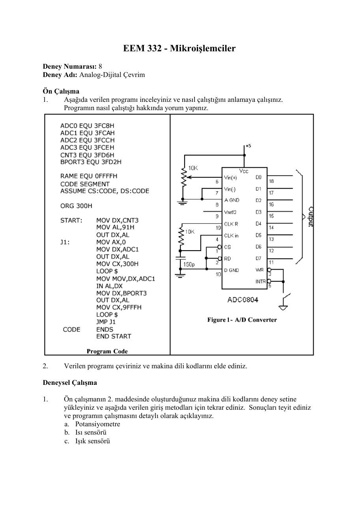
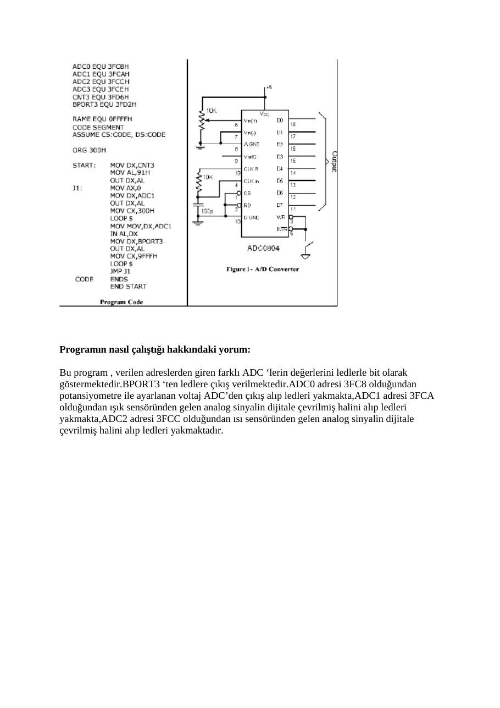

This post brings together the related notes and exercises from the Başkent University **EEM332 Microprocessors** course archive (2005–2015). It covers input-output on the SKC-86 trainer, ADC reading, sawtooth wave generation with the DAC, and lab reports. Work prepared by a friend and course documents are presented together; student names, numbers and group information have been removed. PDF archive copies of the documents and, where available, source codes can be downloaded as a ZIP at the end of the post.

## eem332_lab07

EEM 332 - Microprocessors Experiment Number: 8 Experiment Title: SKC-86 Input and Programming

Preliminary Work: The preliminary work will not be collected during the laboratory session.

### 1) Read the document titled “SKC-86 Guide” provided on the website.

### 2) Examine the program below. This program first turns off all the LEDs on the SKC-86 set,

and then, when the user presses the relevant button, lights the LED associated with that button.

```asm
;==========================================
;===== 8BIT Input/Output TEST PROGRAM =====
;=====         FOR SKC - 86           =====
;==========================================
```

```asm
CNT3                 EQU     3FD6H
APORT3               EQU     3FD0H
BPORT3               EQU     3FD2H
CPORT3               EQU     3FD4H
RAME                 EQU     0FFFFH
```

```asm
CODE          SEGMENT
```

### ASSUME         CS:CODE, DS:CODE

```asm
ORG    0
```

```asm
START:        MOV    SP,RAME
MOV    AL,90H
MOV    DX,CNT3
OUT    DX,AL
```

```asm
J1:           MOV    DX,APORT3
IN     AL,DX
NOT    AL
MOV    DX,BPORT3
OUT    DX,AL
JMP    J1
```

### CODE          ENDS

```asm
END START
```

Experimental Work

### 1) Load the Example1 program located at CS=F000:0000 on the SKC-86. To do this,

### follow the steps below

Press the “2/GO” key, enter F000:0, press the “.” key.

Observe what the program does.

### 2) Similarly, load the Example2 program located at CS=F000:0040.

### 3) Load the Example3 program by following the steps below:

Press the “OB” key, enter 3F08, press the “,” key, then “0”, then the “.” key in that order. Press “IB”, then “3F08”, then the “,” key in that order.

Note the values you see on the display. Repeat the above steps after changing the position of the potentiometer. Note the values.

### 4) Using the Turbo Debugger program, obtain the machine language codes of the program

given in the preliminary work. Load this program onto the SKC-86 using the keypad.

Note the operation that the program performs.

### 5) Make the necessary changes to the program given in the preliminary work so that it performs

the inverse of the operation (when first run, all LEDs are on, and they turn off when the relevant keys are pressed). Obtain the machine language codes of the program and load it onto the trainer.

State your program, your comments, and your observations from the previous exercises in your report.

## eem332_lab08

EEM 332 - Microprocessors Experiment Number: 8 Experiment Title: Analog-to-Digital Conversion

Preliminary Work

### 1.   Examine the program given below and try to understand how it works.

Comment on how the program works.

### 2.     Assemble the given program and obtain its machine language codes.

Experimental Work

### 1.     Load the machine language codes you created in item 2 of the preliminary work onto the

trainer and repeat for the input methods given below. Verify the results and explain the operation of the program in detail. a. Potentiometer b. Temperature sensor c. Light sensor

### 2.   Write the algorithm of the program and calculate the resolution (step size) for the

potentiometer.



## eem332_lab09

EEM 332 - Microprocessors Experiment Number: 9 Experiment Title: Digital-to-Analog Conversion

Experimental Work

### 1.     Convert the sawtooth signal generator program given below into machine language

codes.

```asm
DAC      EQU   3FD8H
RAME     EQU   0FFFFH
CODE     SEGMENT
```

### ASSUME      CS:CODE, DS:CODE

```asm
ORG 0
START:   MOV   AL,00
MOV   DX,DAC
J1:            OUT   DX,AL
INC   AL
JMP   J1
```

### CODE     ENDS

```asm
END   START
```

Load the program onto the trainer and run it. Observe the output signal at the DAC pin on the JMP5 output of the trainer.

### 2.     Simplify the program given below and obtain its machine language codes.

```asm
DAC        EQU     3FD8H
RAME       EQU     0FFFFH
```

```asm
CODE       SEGMENT
```

### ASSUME         CS:CODE,DS:CODE

```asm
ORG 0
```

```asm
START:     MOV     AL,00
MOV     DX,DAC
J1:                OUT   DX,AL
MOV     AL,128
MOV     CX,0FFFH
LOOP    $
OUT     DX,AL
MOV     AL,192
MOV     CX,0FFFH
LOOP    $
OUT     DX,AL
MOV     AL,238
MOV     CX,0FFFH
LOOP    $
OUT     DX,AL
MOV     AL,255
MOV     CX,0FFFH
LOOP    $
OUT     DX,AL
MOV     AL,238
MOV     CX,0FFFH
LOOP    $
```

```asm
OUT     DX,AL
MOV     AL,192
MOV     CX,0FFFH
LOOP    $
OUT     DX,AL
MOV     AL,128
MOV     CX,0FFFH
LOOP    $
OUT     DX,AL
MOV     AL,64
MOV     CX,0FFFH
LOOP    $
OUT     DX,AL
MOV     AL,17
MOV     CX,0FFFH
LOOP    $
OUT     DX,AL
MOV     AL,0
MOV     CX,0FFFH
LOOP    $
OUT     DX,AL
MOV     AL,17
MOV     CX,0FFFH
LOOP    $
OUT     DX,AL
MOV     AL,64
MOV     CX,0FFFH
LOOP    $
JMP     J1
```

### CODE       ENDS

```asm
END     START
```

Load the program onto the trainer and run it. Observe the output signal at the DAC pin on the JMP5 output of the trainer. Explain what the program does. Include the simplified code in your report.

### 3.   What can be done to change the frequency of the generated signals?

## mikro deney 7 rapor

Başkent University Department of Electrical and Electronics Engineering

EEM 332 – Microprocessors Laboratory

### REPORT

Experiment No:# 7 Experiment Title: SKC-86 Input and Programming Experiment Date: 05/05/2006

1-) In the first experiment we ran a sample program. To do this, we pressed the 2/go key to select which address's program would be run. We entered the address by typing F000:0. When we pressed the . key, the program started running.

### The program output after doing these

The LEDs light up one after another. After this process finishes, the LEDs start lighting in groups of four: first the first four, then the second four, and then the process returns to the beginning.

2-) We did the above procedure for the sample program at address F000:0040. This time, when we pressed the button under the LED we wanted to light, the LED connected to that button started to light.

4-)

```asm
MOV SP,RAME                  CS:0000           BCFFFF
MOV AL,90H                   CS:0003           B090
MOV DX,CNT3                  CS:0005           BAD63F
OUT DX,AL                    CS:0008           EE
```

```asm
MOV DX,APORT3                CS:0009           BAD03F
IN AL,DX                     CS:000C           EC
NOT AL                       CS:000D           F6D0
MOV DX,BPORT3                CS:000F           BAD23F
OUT DX,AL                    CS:0012           EE
JMP J1                       CS:0013           EBF4
```

We entered the hex codes above in order. First we pressed 1, then pressed 8 to set the code segment to 400, and pressed the period. We pressed 0 to set the offset to 0, then entered the hex codes byte by byte separated by commas, and pressed the period to finish. When we pressed 2, we again entered the start and end addresses of the program to be run, and ran it. Initially all of the LEDs are off. If we press the button of the LED we want to light, that LED lights up. This is the operation the program performs.

5-) In the program above we deleted the not instruction. The result was a program that turns the LEDs off when the buttons are pressed. When a button was pressed, the LED associated with that button went off.

```asm
CNT3                               EQU 3FD6H
APORT3                             EQU 3FD0H
BPORT3                             EQU 3FD2H
CPORT3                             EQU 3FD4H
RAME                               EQU 0FFFFH
```

```asm
CODE                             SEGMENT
```

### ASSUME CS:CODE, DS:CODE

```asm
ORG 0
START:                           MOV SP,RAME
MOV AL,90H
MOV DX,CNT3
OUT DX,AL
J1:                              MOV DX,APORT3
IN AL,DX
MOV DX,BPORT3
OUT DX,AL
JMP J1
```

### CODE                             ENDS

```asm
END START
```

### Machine code

```asm
MOV SP,RAME                      CS:0000          BCFFFF
MOV AL,90H                       CS:0003          B090
MOV DX,CNT3                      CS:0005          BAD63F
OUT DX,AL                        CS:0008          EE
MOV DX,APORT3                    CS:0009          BAD03F
IN AL,DX                         CS:000C          EC
MOV DX,BPORT3                    CS:000D          BAD23F
OUT DX,AL                        CS:0010          EE
JMP J1                           CS:0011          EBF6
```

## rapor8

Başkent University Department of Electrical and Electronics Engineering

EEM 332 – Microprocessors Laboratory

Report

Experiment No: #8 Experiment Title: Analog-to-Digital Conversion Experiment Date: 05/05/06

### 1) ALGORITHM OF THE PROGRAM

The program sends the values of the different ADCs entered through their addresses to the LEDs. The 8 LEDs represent 8 bits. Since the ADC0 address is 3FC8, the output of the ADC for the voltage set with the potentiometer is read and used to light the LEDs. The potentiometer is used to set a voltage between 0 and 5 volts. When the ADC input is set to 0 volts with the potentiometer, no LEDs light; when it is raised to 5 volts, all LEDs light; and at other voltage values the LEDs light according to the voltage. Since the ADC2 address is 3FCC, the LEDs light according to the digital version of the analog signal taken from the temperature sensor. As the temperature value of the temperature sensor increases, the value shown by the 8 bits increases and the LEDs light accordingly. Since the ADC1 address is 3FCA, the LEDs light according to the digital version of the analog signal taken from the light sensor. The lighting state of the LEDs changes according to the intensity of the light.

```asm
ADC0 EQU 3FC8H                       ; The addresses of the ADCs are defined
ADC1 EQU 3FCAH
ADC2 EQU 3FCCH
ADC3 EQU 3FCEH
CNT3 EQU 3FD6H
BPORT3 EQU 3FD2H                     ;Address of the port that drives the LEDs
```

```asm
RAME EQU 0FFFFH
CODE SEGMENT
```

### ASSUME CS:CODE, DS:CODE

```asm
ORG 300H
```

```asm
START:        MOV DX,CNT3
MOV AL,91H
OUT DX,AL
J1:           MOV AX,0
MOV DX,ADC1
OUT DX,AL              ;The ADC1 address is selected
MOV CX,300H            ;Wait for the signal from the ADC1 address to stabilize
LOOP $
MOV DX,ADC1
IN AL,DX               ;The signal from the ADC1 address is loaded into AL
MOV DX,BPORT3
OUT DX,AL              ;The LEDs are lit via BPORT3 according to AL
MOV CX,9FFFH
LOOP $
JMP J1                 ;Go to J1
```

### CODE ENDS

```asm
END START
```

### 2) FLOWCHART

## ön çalışma 8

### Comment on how the program works

This program displays the values of the different ADCs entered through the given addresses as bits on the LEDs. Output to the LEDs is provided from BPORT3. Since the ADC0 address is 3FC8, the voltage set with the potentiometer is taken from the ADC output and used to light the LEDs; since the ADC1 address is 3FCA, the digitized form of the analog signal from the light sensor is taken and used to light the LEDs; and since the ADC2 address is 3FCC, the digitized form of the analog signal from the temperature sensor is taken and used to light the LEDs.

### 2) MACHINE CODE OF THE GIVEN PROGRAM:

```asm
MOV DX,CNT3        CS:0300          BAD63F
MOV AL,91H         CS:0303          B091
OUT DX,AL          CS:0305          EE
MOV AX,0           CS:0306          B80000
MOV DX,ADC1        CS:0309          BACA3F
OUT DX,AL          CS:030C          EE
MOV DX,300H        CS:030D          B90003
LOOP $             CS:0310          E2FE
MOV DX,ADC1        CS:0312          BACA3F
IN AL,DX           CS:0315          EC
MOV DX,BPORT3      CS:0316          BAD23F
OUT DX,AL          CS:0319          EE
MOV CX,9FFFH       CS:031A          B9FF9F
LOOP $             CS:031D          E2FE
JMP J1             CS:031F          EBES
```



## rap

Başkent University Department of Electrical and Electronics Engineering

EEM 332 – Microprocessors Laboratory

Preliminary Work / Report

Experiment No: # 9 Experiment Title: Digital-to-Analog Conversion Experiment Date: 12/05/2006

1-)

```asm
DAC            EQU       3FD8H
RAME           EQU       0FFFFH
CODE          SEGMENT
```

### ASSUME        CS:CODE, DS:CODE

```asm
ORG 0
START:        MOV AL,00
MOV DX,DAC
J1:           OUT DX,AL
INC AL
JMP J1
```

### CODE          ENDS

```asm
END START
```

### The machine language codes are

cs:0000 B000               mov al,00 cs:0002 BAD83F             mov dx,3FD8 cs:0005 EE                 out dx,al cs:0006 FEC0               inc al cs:0008 EBFB               jmp 0005

When we loaded the program onto the trainer, ran it, and observed the output signal at the DAC pin on the JMP5 output of the trainer, we saw that the program produces a sawtooth-like signal. In the program, AL is initially assigned 0 and this value is then incremented. These increasing AL values are sent to the output. AL can reach a maximum value of FF, after which it drops back to 0. For this reason, the output signal appears as a sawtooth.

2-) The simplified version of the given program;

```asm
DATA       DB 128,192,238,255,238,192,128,64,17,00,17,64
START:
MOV       AL,00
MOV       SI,OFFSET DATA
MOV       DX,DAC
J2:       MOV       BL,00
MOV       BH,0CH
J1:       OUT       DX,AL
MOV       AL,[SI]
INC       SI
MOV       CX,0FFFH
LOOP $
```

```asm
CMP          BL,BH
JE J2
JMP J1
```

### CODE          ENDS

```asm
END           START
```

### The machine language codes are

cs:000C B000                    mov al,00 cs:000E BE0000                  mov si,0000 cs:0011 BAD83F                  mov dx,3FD8 cs:0014 B300                    mov bl,00 cs:0016 B70C                    mov bh,0C cs:0018 EE                      out dx,al cs:0019 8A04                    mov al,[si] cs:001B 46                      inc si cs:001C B9FF0F                  mov cx,0FFF cs:001F E2FE               loop 001F cs:0021 3ADF               cmp bl,bh cs:0023 74EF                    je  0014 cs:0025 EBF1               jmp 0018

When we loaded the program onto the trainer, ran it, and observed the output signal at the DAC pin on the JMP5 output of the trainer, we observed that the program produces a digital sine signal at the output. We transferred the values given in the experiment to AL one after another through SI. We kept incrementing SI inside the loop. We observed the contents of AL at the output through DX. When BH was given the value 12, that is, the total number of data entered, and compared with BL, it was checked whether the entered data had run out. With the value we gave to CX, we determined how long the signal would stay at each value. In other words, the digital signal was obtained by making waits of CX (the frequency it shows) at the output sine signal.

3-) To change the frequency of the generated signal, it is possible to change the values given to CX. Since the value we give to CX determines how long the signal stays at each value, we can change the frequency by changing this parameter. In other words, the output sine signal makes waits of CX (the frequency it shows).

## lab81

```asm
ADC0  EQU 3FC8H
ADC1 EQU 3FCAH
ADC2 EQU 3FCCH
ADC3 EQU 3FCEH
CNT3 EQU 3FD6H
BPORT3 EQU 3FD2H

RAME EQU 0FFFFH
CODE SEGMENT 
ASSUME CS:CODE,DS:CODE

ORG 300H

START:  MOV DX,CNT3
	MOV AL,91H
	OUT DX,AL
J1:	MOV AX,0
	MOV DX,ADC1
	OUT DX,AL
	MOV CX,300H
	LOOP $
	MOV DX,ADC1
	IN AL,DX
	MOV DX,BPORT3
	OUT DX,AL
	MOV CX,9FFFH
	LOOP $
	JMP J1
CODE 	ENDS
	END START
```

*Note: Although the file name of the SKC-86 handout is experiment 7, the document states “Experiment Number: 8”. The title in the file has been preserved.*
