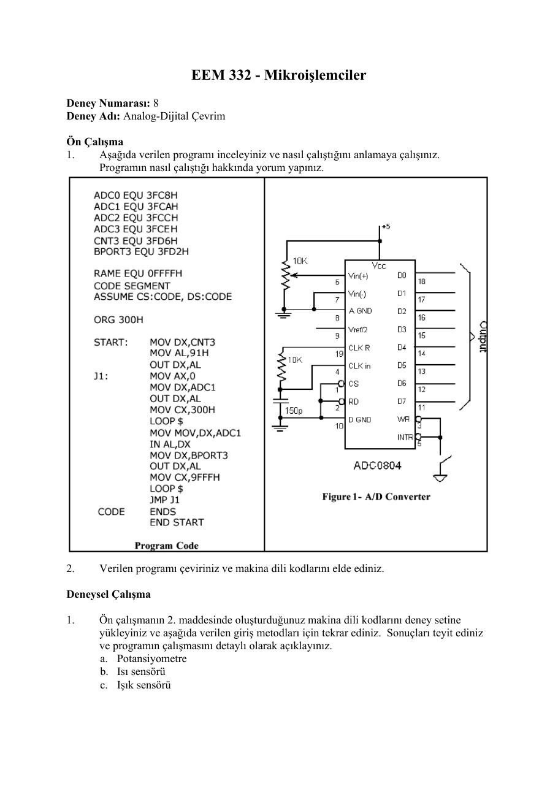
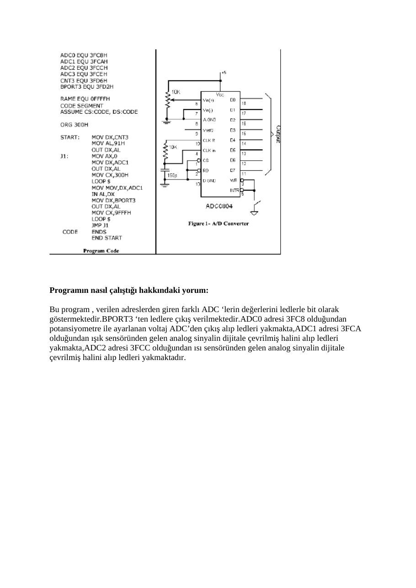

Bu yazı, Başkent Üniversitesi **EEM332 Mikroişlemciler** ders arşivindeki ilgili notları ve uygulamaları bir araya getiriyor (2005–2015). SKC-86 deney setinde giriş-çıkış, ADC okuma, DAC ile testere dişi dalga ve deney raporları. Bir arkadaşın hazırladığı çalışmalar ve ders belgeleri birlikte aktarılmış; öğrenci adları, numaraları ve grup bilgileri çıkarılmıştır. Belgelerin PDF arşiv kopyaları ve varsa kaynak kodları yazının sonunda ZIP olarak indirilebilir.

## eem332_lab07

EEM 332 - Mikroişlemciler Deney Numarası: 8 Deney Adı: SKC-86 Giriş ve Programlama

Ön Çalışma Laboratuvar saatinde ön çalışma toplanmayacaktır.

### 1) Web sitesinde verilen “SKC-86 Guide” adlı belgeyi okuyunuz.

### 2) Aşağıdaki programı inceleyiniz. Bu program önce SKC-86 setindeki LED’lerin tamamını

söndürür ve daha sonra kullanıcının ilgili butona basmasıyla, o butonla ilgili LED’i yakar.

```asm
;==========================================
;===== 8BIT Input/Output TEST PROGRAM =====
;=====         FOR SKC - 86           =====
;==========================================
```

```asm
CNT3                 EQU     3FD6H
APORT3               EQU     3FD0H
BPORT3               EQU     3FD2H
CPORT3               EQU     3FD4H
RAME                 EQU     0FFFFH
```

```asm
CODE          SEGMENT
```

### ASSUME         CS:CODE, DS:CODE

```asm
ORG    0
```

```asm
START:        MOV    SP,RAME
MOV    AL,90H
MOV    DX,CNT3
OUT    DX,AL
```

```asm
J1:           MOV    DX,APORT3
IN     AL,DX
NOT    AL
MOV    DX,BPORT3
OUT    DX,AL
JMP    J1
```

### CODE          ENDS

```asm
END START
```

Deneysel Çalışma

### 1) SKC-86’da CS=F000:0000 adresinde bulunan Örnek1 programını yükleyiniz. Bunun için

### aşağıdaki adımları takip ediniz

“2/GO” tuşuna basın F000:0 girin “.” tuşuna basın

Programın yaptığı işi gözlemleyiniz.

### 2) Benzer şekilde CS=F000:0040 adresinde bulunan Örnek2 programını yükleyiniz.

### 3) Örnek3 programını aşağıdaki adımları uygulayarak yükleyiniz:

“OB” tuşuna basın 3F08 girin Sırasıyla “,” ve “0” ve “.” tuşlarına basın Sırasıyla “IB” ve “3F08” ve “,” tuşlarına basın

Ekranda gördüğünüz değerleri not ediniz. Potansiyometrenin konumunu değiştirerek yukarıdaki işlemleri tekrar ediniz. Değerleri not ediniz.

### 4) Turbo Debugger programını kullanarak ön çalışmada verilen programın makina dili

kodlarını elde ediniz. Tuş takımını kullanarak SKC-86’ya bu programı yükleyiniz.

Programın gerçekleştirdiği işlemi not ediniz.

### 5) Ön çalışmada verilen programda gerekli değişiklikleri yaparak yapılan işlemin tersinin

yapılmasını sağlayınız (ilk çalıştırıldığında bütün LED’ler yanar ve ilgili tuşlara basılmasıyla söner). Programın makina dili kodlarını elde ediniz ve deney setine yükleyiniz.

Programınızı ve yorumlarınızı ve önceki çalışmalarda gözlemlediklerinizi raporunuzda belirtiniz.

## eem332_lab08

EEM 332 - Mikroişlemciler Deney Numarası: 8 Deney Adı: Analog-Dijital Çevrim

Ön Çalışma

### 1.   Aşağıda verilen programı inceleyiniz ve nasıl çalıştığını anlamaya çalışınız.

Programın nasıl çalıştığı hakkında yorum yapınız.

### 2.     Verilen programı çeviriniz ve makina dili kodlarını elde ediniz.

Deneysel Çalışma

### 1.     Ön çalışmanın 2. maddesinde oluşturduğunuz makina dili kodlarını deney setine

yükleyiniz ve aşağıda verilen giriş metodları için tekrar ediniz. Sonuçları teyit ediniz ve programın çalışmasını detaylı olarak açıklayınız. a. Potansiyometre b. Isı sensörü c. Işık sensörü

### 2.   Programın algoritmasını yazınız ve potansiyometre için çözünürlüğü (step size)

hesaplayınız.



## eem332_lab09

EEM 332 - Mikroişlemciler Deney Numarası: 9 Deney Adı: Dijital-Analog Çevrim

Deneysel Çalışma

### 1.     Aşağıda verilen testere dişi sinyal üreteci programını makina dili kodlarına

çeviriniz.

```asm
DAC      EQU   3FD8H
RAME     EQU   0FFFFH
CODE     SEGMENT
```

### ASSUME      CS:CODE, DS:CODE

```asm
ORG 0
START:   MOV   AL,00
MOV   DX,DAC
J1:            OUT   DX,AL
INC   AL
JMP   J1
```

### CODE     ENDS

```asm
END   START
```

Programı deney setine yükleyiniz ve çalıştırınız. Deney seti üzerinde JMP5 çıkışındaki DAC bacağından çıkış sinyalini gözlemleyiniz.

### 2.     Aşağıda verilen programı sadeleştirip, makina dili kodlarını elde ediniz.

```asm
DAC        EQU     3FD8H
RAME       EQU     0FFFFH
```

```asm
CODE       SEGMENT
```

### ASSUME         CS:CODE,DS:CODE

```asm
ORG 0
```

```asm
START:     MOV     AL,00
MOV     DX,DAC
J1:                OUT   DX,AL
MOV     AL,128
MOV     CX,0FFFH
LOOP    $
OUT     DX,AL
MOV     AL,192
MOV     CX,0FFFH
LOOP    $
OUT     DX,AL
MOV     AL,238
MOV     CX,0FFFH
LOOP    $
OUT     DX,AL
MOV     AL,255
MOV     CX,0FFFH
LOOP    $
OUT     DX,AL
MOV     AL,238
MOV     CX,0FFFH
LOOP    $
```

```asm
OUT     DX,AL
MOV     AL,192
MOV     CX,0FFFH
LOOP    $
OUT     DX,AL
MOV     AL,128
MOV     CX,0FFFH
LOOP    $
OUT     DX,AL
MOV     AL,64
MOV     CX,0FFFH
LOOP    $
OUT     DX,AL
MOV     AL,17
MOV     CX,0FFFH
LOOP    $
OUT     DX,AL
MOV     AL,0
MOV     CX,0FFFH
LOOP    $
OUT     DX,AL
MOV     AL,17
MOV     CX,0FFFH
LOOP    $
OUT     DX,AL
MOV     AL,64
MOV     CX,0FFFH
LOOP    $
JMP     J1
```

### CODE       ENDS

```asm
END     START
```

Programı deney setine yükleyip çalıştırınız. Deney seti üzerinde JMP5 çıkışındaki DAC bacağından çıkış sinyalini gözlemleyiniz. Programın ne yaptığını açıklayınız. Sadeleştirilmiş kodları raporunuza ekleyiniz.

### 3.   Üretilen sinyallerin frekansını değiştirmek için ne yapılabilir?

## mikro deney 7 rapor

Başkent Üniversitesi Elektrik - Elektonik Mühendisliği Bölümü

EEM 332 – Mikroişlemciler Laboratuvarı

### RAPOR

Deney No:# 7 Deney Adı: SKC-86 Giriş ve Programlama Deney Tarihi:05/05/2006

1-) İlk deneyde örnek olan bir programı çalıştırdık. Bunu; 2/go tuşuna basarak hangi adresteki programın çalıştırılacağını seçiyoruz. F000:0 yazarak adresi giriyoruz. . ya basınca program çalışmaya başlıyor.

### Bunları yaptıktan sonra oluşan program çıktısı

Ledler sıra sıra yanıyor.Daha sonra bu işlem bittikten sonra ledler dörderli dörderli yanmaya başlıyor,ilk dört daha sonra ikinci dört yanıyor,daha sonra tekrar işlem en başa dönüyor.

2-) Yukarda ki işlemi F000:0040 adresindeki örnek program için yaptık bu seferde hangi ledi yakmak istiyorsak o led’in altında bulunan düğmelere basarsak o düğmeye bağlı bulunan led yanmaya başladı.

4-)

```asm
MOV SP,RAME                  CS:0000           BCFFFF
MOV AL,90H                   CS:0003           B090
MOV DX,CNT3                  CS:0005           BAD63F
OUT DX,AL                    CS:0008           EE
```

```asm
MOV DX,APORT3                CS:0009           BAD03F
IN AL,DX                     CS:000C           EC
NOT AL                       CS:000D           F6D0
MOV DX,BPORT3                CS:000F           BAD23F
OUT DX,AL                    CS:0012           EE
JMP J1                       CS:0013           EBF4
```

Yukardaki hex kodlarını sıra ile girdik. Bunu Önce 1 ‘e bastık, 8’e basıp codesegmenti 400’e ayarladık ve noktaya bastık. 0 a basıp offseti 0 olarak yazdık sonra hex kodlarını virgülle byte byte yazıp, bitirmek için noktaya bastık. 2 ye bastığımızda yine çalıştırılacak olan programın başlangıç ve bitiş adreslerini girdik ve çalıştırdık. Ledlerin ilk önce hepsi sönük durumdadır.Hangi ledi yakmak istiyorsak o ledin düğmesine basarsak o led yanmış olur.programın gerçekleştirdiği işlem budur.

5-) Üsteki programda not al komutunu sildik. Ve düğmelere basınca ledleri söndüren program oldu. Düğmelere basınca o düğmeyle ilgili led söndü.

```asm
CNT3                               EQU 3FD6H
APORT3                             EQU 3FD0H
BPORT3                             EQU 3FD2H
CPORT3                             EQU 3FD4H
RAME                               EQU 0FFFFH
```

```asm
CODE                             SEGMENT
```

### ASSUME CS:CODE, DS:CODE

```asm
ORG 0
START:                           MOV SP,RAME
MOV AL,90H
MOV DX,CNT3
OUT DX,AL
J1:                              MOV DX,APORT3
IN AL,DX
MOV DX,BPORT3
OUT DX,AL
JMP J1
```

### CODE                             ENDS

```asm
END START
```

### Makine kodu

```asm
MOV SP,RAME                      CS:0000          BCFFFF
MOV AL,90H                       CS:0003          B090
MOV DX,CNT3                      CS:0005          BAD63F
OUT DX,AL                        CS:0008          EE
MOV DX,APORT3                    CS:0009          BAD03F
IN AL,DX                         CS:000C          EC
MOV DX,BPORT3                    CS:000D          BAD23F
OUT DX,AL                        CS:0010          EE
JMP J1                           CS:0011          EBF6
```

## rapor8

Başkent Üniversitesi Elektrik - Elektonik Mühendisliği Bölümü

EEM 332 – Mikroişlemciler Laboratuvarı

Rapor

Deney No: #8 Deney Adı: Analog-Dijital Çevrim Deney Tarihi:05/05/06

### 1) PROGRAMIN ALGORİTMASI

Program adreslerden giren farklı ADC’lerin değerlerinin ledlere gönderilmesini sağlamaktadır. 8 adet led 8 bit’i temsil etmektedir. ADC0 adresi 3FC8 olduğundan potansiyometre ile ayarlanan voltajın ADC’den çıkışı alınıp ledleri yakmaktadır. Potansiyometre 0 ve 5 Volt arası voltajı ayarlamakta kullanılır. ADC’nin girişi potansiyometre ile 0 Volta ayarlandığında hiç led yanmamakta, 5 Volta çıkartıldığında bütün ledler yanmakta ve diğer voltaj değerlerinde ledler voltaj durumuna göre yanmaktadır. ADC2 adresi 3FCC olduğundan ısı sensöründen alınan analog sinyalin dijital sinyale çevrilmiş haline göre ledler yanar. Isı sensörünün ısı değeri arttıkça 8 bitin gösterdiği değer artar ve ledler buna göre yanar. ADC1 adresi 3FCA olduğundan ışık sensöründen alınan analog sinyalin dijital sinyale çevrilmiş haline göre ledler yanar. Işığın şiddetine göre ledlerin yanma durumu değişmektedir.

```asm
ADC0 EQU 3FC8H                       ; ADC’lerin adresleri belirlenir
ADC1 EQU 3FCAH
ADC2 EQU 3FCCH
ADC3 EQU 3FCEH
CNT3 EQU 3FD6H
BPORT3 EQU 3FD2H                     ;Ledlerin yanmasını sağlayan portun adresi
```

```asm
RAME EQU 0FFFFH
CODE SEGMENT
```

### ASSUME CS:CODE, DS:CODE

```asm
ORG 300H
```

```asm
START:        MOV DX,CNT3
MOV AL,91H
OUT DX,AL
J1:           MOV AX,0
MOV DX,ADC1
OUT DX,AL              ;ADC1 adresi seçilir
MOV CX,300H            ;ADC1 adresinden gelen sinyalin kararlı hale gelmesi beklenir
LOOP $
MOV DX,ADC1
IN AL,DX               ;ADC1 adresinden gelen sinyal AL’ ye atılır
MOV DX,BPORT3
OUT DX,AL              ;BPORT3’den AL’ ye göre ledler yakılır
MOV CX,9FFFH
LOOP $
JMP J1                 ;J1’ e gidilir
```

### CODE ENDS

```asm
END START
```

### 2) AKIŞ ŞEMASI

## ön çalışma 8

### Programın nasıl çalıştığı hakkındaki yorum

Bu program , verilen adreslerden giren farklı ADC ‘lerin değerlerini ledlerle bit olarak göstermektedir.BPORT3 ‘ten ledlere çıkış verilmektedir.ADC0 adresi 3FC8 olduğundan potansiyometre ile ayarlanan voltaj ADC’den çıkış alıp ledleri yakmakta,ADC1 adresi 3FCA olduğundan ışık sensöründen gelen analog sinyalin dijitale çevrilmiş halini alıp ledleri yakmakta,ADC2 adresi 3FCC olduğundan ısı sensöründen gelen analog sinyalin dijitale çevrilmiş halini alıp ledleri yakmaktadır.

### 2) VERİLEN PROGRAMIN MAKİNA KODU:

```asm
MOV DX,CNT3        CS:0300          BAD63F
MOV AL,91H         CS:0303          B091
OUT DX,AL          CS:0305          EE
MOV AX,0           CS:0306          B80000
MOV DX,ADC1        CS:0309          BACA3F
OUT DX,AL          CS:030C          EE
MOV DX,300H        CS:030D          B90003
LOOP $             CS:0310          E2FE
MOV DX,ADC1        CS:0312          BACA3F
IN AL,DX           CS:0315          EC
MOV DX,BPORT3      CS:0316          BAD23F
OUT DX,AL          CS:0319          EE
MOV CX,9FFFH       CS:031A          B9FF9F
LOOP $             CS:031D          E2FE
JMP J1             CS:031F          EBES
```



## rap

Başkent Üniversitesi Elektrik - Elektonik Mühendisliği Bölümü

EEM 332 – Mikroişlemciler Laboratuvarı

Ön Çalışma/ Rapor

Deney No: # 9 Deney Adı: Dijital-Analog Çevrim Deney Tarihi: 12/05/2006

1-)

```asm
DAC            EQU       3FD8H
RAME           EQU       0FFFFH
CODE          SEGMENT
```

### ASSUME        CS:CODE, DS:CODE

```asm
ORG 0
START:        MOV AL,00
MOV DX,DAC
J1:           OUT DX,AL
INC AL
JMP J1
```

### CODE          ENDS

```asm
END START
```

### Makine dili kodları ise

cs:0000 B000               mov al,00 cs:0002 BAD83F             mov dx,3FD8 cs:0005 EE                 out dx,al cs:0006 FEC0               inc al cs:0008 EBFB               jmp 0005

Programı deney setine yükleyip çalıştırdığımız zaman ve deney seti üzerinden JMP5 çıkışındaki DAC bacağından çıkış sinyalini gözlemlediğimizde programın testere ağzı gibi bir sinyal oluşturduğunu gördük. Programda AL’ye başlangıç olarak 0 atanmakta daha sonra bu değer arttırılmaktadır. Artan bu AL değerleri çıkışa verilmektedir. AL en son FF değerini alabilmekte, bu değerden sonra yine 0’a düşmektedir. Bu yüzden çıkış sinyali testere şeklinde görülmektedir.

2-) Verilen programın sadeleştirilmiş hali;

```asm
DATA       DB 128,192,238,255,238,192,128,64,17,00,17,64
START:
MOV       AL,00
MOV       SI,OFFSET DATA
MOV       DX,DAC
J2:       MOV       BL,00
MOV       BH,0CH
J1:       OUT       DX,AL
MOV       AL,[SI]
INC       SI
MOV       CX,0FFFH
LOOP $
```

```asm
CMP          BL,BH
JE J2
JMP J1
```

### CODE          ENDS

```asm
END           START
```

### Makine dili kodları ise

cs:000C B000                    mov al,00 cs:000E BE0000                  mov si,0000 cs:0011 BAD83F                  mov dx,3FD8 cs:0014 B300                    mov bl,00 cs:0016 B70C                    mov bh,0C cs:0018 EE                      out dx,al cs:0019 8A04                    mov al,[si] cs:001B 46                      inc si cs:001C B9FF0F                  mov cx,0FFF cs:001F E2FE               loop 001F cs:0021 3ADF               cmp bl,bh cs:0023 74EF                    je  0014 cs:0025 EBF1               jmp 0018

Programı deney setine yükleyip çalıştırdığımız zaman ve deney seti üzerinde JMP5 çıkışındaki DAC bacağından çıkış sinyalini gözlemlediğimizde programın çıkışta dijital sinüs sinyali oluşturduğunu gözlemledik. Deneyde verilen değerleri sırasıyla SI aracılığı ile AL’ye aktardık. SI’yi döngü içerisinde sürekli arttırdık. AL’nin içeriğini de DX ile çıktı olarak gördük. BH’a 12 değeri yani toplam girilen veri sayısı verilip BL ile karşılaştırma yaptırdığımız zaman girilen verinin bitip bitmediğini kontrol edildi. CX’e vermiş olduğumuz değerde sinyalin ne kadar süre kalacağını belirlemiş olduk. Yani çıkıştaki sinüs sinyali CX kadar (göstermiş olduğu frekans kadar) beklemeler yaparak dijital sinyal elde edilmiş oldu.

3-) Üretilen sinyalin frekansını değiştirmek için CX’e verilen değerler değiştirilerek üretilen frekansı değiştirmek mümkündür. CX’e vermiş olduğumuz değer sinyalin ne kadar süre kalacağını belirlediği için bu paremetreyi değiştirerek frekansı değiştirebiliriz. Yani çıkıştaki sinüs sinyali CX kadar (göstermiş olduğu frekans kadar) bekleme yapmaktadır.

## lab81

```asm
ADC0  EQU 3FC8H
ADC1 EQU 3FCAH
ADC2 EQU 3FCCH
ADC3 EQU 3FCEH
CNT3 EQU 3FD6H
BPORT3 EQU 3FD2H

RAME EQU 0FFFFH
CODE SEGMENT 
ASSUME CS:CODE,DS:CODE

ORG 300H

START:  MOV DX,CNT3
	MOV AL,91H
	OUT DX,AL
J1:	MOV AX,0
	MOV DX,ADC1
	OUT DX,AL
	MOV CX,300H
	LOOP $
	MOV DX,ADC1
	IN AL,DX
	MOV DX,BPORT3
	OUT DX,AL
	MOV CX,9FFFH
	LOOP $
	JMP J1
CODE 	ENDS
	END START
```

*Not: SKC-86 föyünün dosya adı deney 7 olmasına rağmen belgede “Deney Numarası: 8” yazmaktadır. Dosyadaki başlık korunmuştur.*
