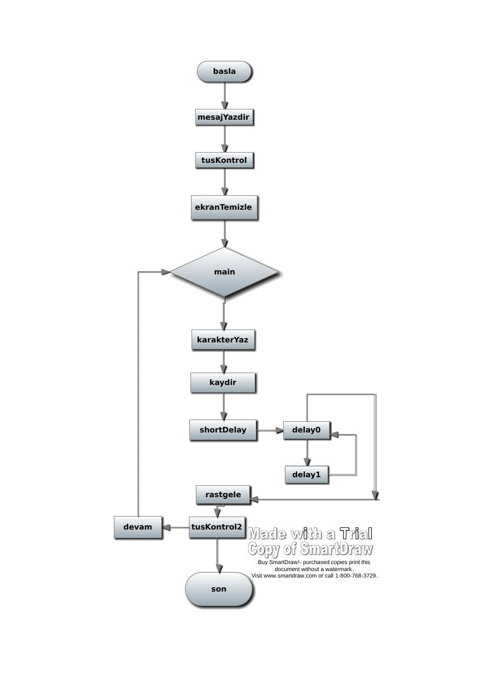
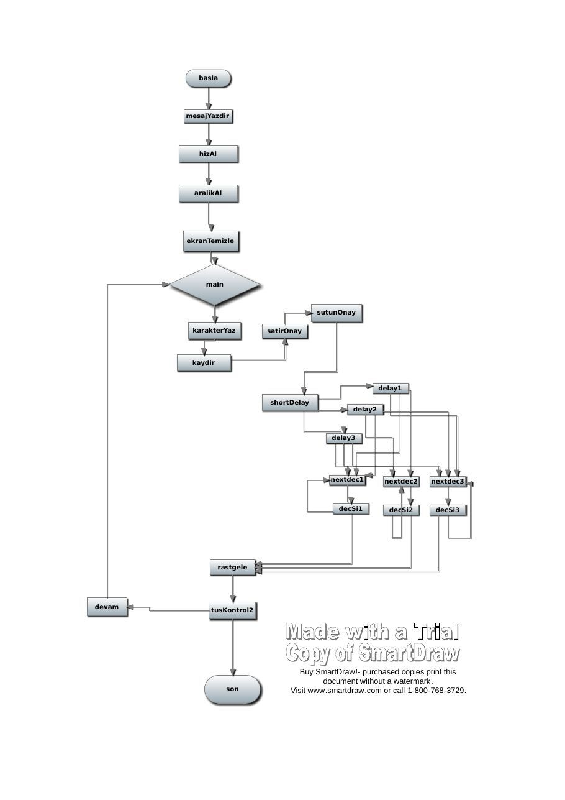

Bu yazı, Başkent Üniversitesi **EEM332 Mikroişlemciler** ders arşivindeki ilgili notları ve uygulamaları bir araya getiriyor (2011–2015). DOS ve BIOS kesmeleriyle ekran temizleme, klavye denetimi, karakter akışı ve gecikme; proje sürümleri ve akış şemaları. Bir arkadaşın hazırladığı çalışmalar ve ders belgeleri birlikte aktarılmış; öğrenci adları, numaraları ve grup bilgileri çıkarılmıştır. Belgelerin PDF arşiv kopyaları ve varsa kaynak kodları yazının sonunda ZIP olarak indirilebilir.

## 1flow

basla

mesajYazdir

tusKontrol

ekranTemizle

main

karakterYaz

kaydir

shortDelay                   delay0

delay1

rastgele

devam   tusKontrol2

Buy SmartDraw!- purchased copies print this document without a watermark . Visit www.smartdraw.com or call 1-800-768-3729.

son



## flow2-3

basla

mesajYazdir

hizAl

aralikAl

ekranTemizle

main

sutunOnay

karakterYaz          satirOnay

kaydir

delay1

shortDelay delay2

delay3

nextdec1        nextdec2   nextdec3

```asm
decSi1         decSi2     decSi3
```

rastgele

devam tusKontrol2

Buy SmartDraw!- purchased copies print this document without a watermark . son            Visit www.smartdraw.com or call 1-800-768-3729.



## aksam

```asm
	.model small
	.stack 100h
.data
	max_length equ 100
	ekranyazi db 13,10,"matrix ekran koruyucu"
		  db 13,10,""
		  db 13,10,"$"
	KARAKTER  db 'a'
	satirNo	  db 5
	sutunNo	  db 10
	aralik    db max_length dup (?)
	hiz 	  db max_length dup (?)
	ekranhiz  db 13,10,"hizi belirle"
	ekranbos  db 13,10,"bosluk belirle"


.code
Program:
	call basla
	mov dx, OFFSET ekranyazi

	call mesajYazdir
	call hizAl
	call aralikAl
	
	call tusKontrol
	call ekranTemizle

main:	
	call karakterYaz
	call kaydir
	call Shortdelay
	call rastgele
	call tusKontrol2
	jc main
	call son


PROC basla
	mov ax,@DATA
	mov ds,ax
	mov es,ax	;extra segment
ret
ENDP basla


PROC mesajYazdir
	push ax
	
	mov ah,09h	;write string to standart output
	int 21h
	
	pop ax
ret
ENDP mesajYazdir


PROC tusKontrol
	push ax
	
	mov ah,01h	;read character from standart input
	int 21h
	
	pop ax
ret
ENDP tusKontrol


PROC ekranTemizle
	push ax bx cx dx

	mov bl,0
	mov bh,0
	sub cx,cx
	mov dx,184fh	;18h = 24 satır  &  4f = 79 sütun
	mov ax,0600h	;scroll all lines up
	int 10h

	pop dx cx bx ax
ret
ENDP ekranTemizle


PROC son
	push ax

	mov ah,4ch
	int 21h
	
	pop ax
ret
ENDP son


PROC kaydir
	add satirNo,1
	add sutunNo,2

	cmp satirNo,23
	jna satirOnay	;jump not above
	mov satirNo,1
satirOnay:
	cmp sutunNo,79
	jna sutunOnay
	mov sutunNo,0
sutunOnay:
ret
ENDP kaydir


PROC rastgele
	MOV AH,2CH
	INT 21H		;GET SYSTEM TIME	;veya shr olur mu??
			;CH = HOUR		;(elimizdeki bir değer için)
			;CL = MINUTE
			;DH = SECOND
			;DL = 1/100 SECONDS
	mov satirNo,dh
	mov sutunNo,dl
	
	
ret
ENDP rastgele


PROC Shortdelay
		push si di
		cmp hiz,'1'
		je delay1
		cmp hiz,'2'
		je delay2
		cmp hiz,'3'
		je delay3
delay1:	
		mov di, 0900h
		;mov di,0100h
		cmp aralik, '1'
		jz nextdec1
		cmp aralik, '2'
		jz nextdec2
		cmp aralik,'3'
		jz nextdec3

delay2:	
		mov di, 2000h
		cmp aralik, '1'
		jz nextdec1
		cmp aralik ,'2'
		jz nextdec2
		cmp aralik,'3'
		jz nextdec3
		
delay3:		
		mov di, 4000h
		cmp aralik, '1'
		jz nextdec1
		cmp aralik, '2'
		jz nextdec2
		cmp aralik,'3'
		jz nextdec3
nextDec1:
		mov si, 2500h
		jmp decsi1
decSi1: 		
		dec si
		jnz decSi1
		dec di
		jnz nextDec1
		pop di si
		ret

nextDec2: 	
		mov si, 5000h
		jmp decsi2
decSi2: 
		dec si
		jnz decSi2
		dec di
		jnz nextDec2
		pop di si
		ret		

nextDec3: 
		mov si, 7000h
		jmp decsi3
decSi3: 		
		dec si
		jnz decSi3
		dec di
		jnz nextDec3
		pop di si
		ret		
ret
ENDP Shortdelay 


PROC tusKontrol2
	push ax
	mov ah,0Bh	;Durum kontrolü, sonuç al'de 00 veya FF ile döner
	int 21h		;
	cmp al,0
	jnz Devam
	stc		;????????????????????????????????????????????????????????????????????????????????????
Devam:	pop ax
ret
ENDP tusKontrol2


PROC karakterYaz
	push ax bx cx dx bp
	
	mov ah,13h
	mov al,01h
	xor bh,bh
	mov bp, OFFSET KARAKTER
	mov cx,1

	mov dh,satirNo
	mov dl,sutunNo

	int 10h
	pop bp dx cx bx ax
ret
ENDP karakterYaz


PROC hizAl
	MOV DX,	OFFSET ekranhiz
	MOV AH,	09H; menunun 2satiri
	INT 	21H
	MOV AH,	3FH ;hiz al
	MOV BX,	0
	MOV CX,	max_length
	MOV DX,	offset hiz 
	INT 	21H
ret
ENDP hizAl


PROC aralikAl
	MOV DX,	OFFSET ekranbos
	MOV AH,	09H; menunun 3satiri
	INT 	21H
	MOV AH,	3FH ;aralik al
	MOV BX,	0
	MOV CX,	max_length
	MOV DX,	offset aralik
	INT 	21H
ret
ENDP aralikAl


END Program
```

## aksam2

```asm
	.model small
	.stack 100h
.data
	max_length equ 100
	ekranyazi db 13,10,"matrix ekran koruyucu"
		  db 13,10,""
		  db 13,10,"$"
	KARAKTER  db 'a'
	satirNo	  db 5
	sutunNo	  db 10
	aralik    db max_length dup (?)
	hiz 	  db max_length dup (?)


.code
Program:
	call basla
	mov dx, OFFSET ekranyazi

	call mesajYazdir
	call hizAl
	call aralikAl
	
	call tusKontrol
	call ekranTemizle

main:	
	call karakterYaz
	call kaydir
	call Shortdelay
	call rastgele
	call tusKontrol2
	jc main		;tusKontrol2 döngüsündeki stc'ye bağlı olarak çalışır (bitsin mi bitmesin mi kontrolü)
	call son


PROC basla
	mov ax,@DATA
	mov ds,ax
	mov es,ax	;extra segment
ret
ENDP basla


PROC mesajYazdir
	push ax
	
	mov ah,09h	;write string to standart output
	int 21h
	
	pop ax
ret
ENDP mesajYazdir


PROC tusKontrol
	push ax
	
	mov ah,01h	;read character from standart input
	int 21h
	
	pop ax
ret
ENDP tusKontrol


PROC ekranTemizle
	push ax bx cx dx

	mov bl,0
	mov bh,0
	sub cx,cx
	mov dx,184fh	;18h = 24 satır  &  4f = 79 sütun
	mov ax,0600h	;scroll all lines up
	int 10h

	pop dx cx bx ax
ret
ENDP ekranTemizle


PROC son
	push ax

	mov ah,4ch
	int 21h
	
	pop ax
ret
ENDP son


PROC kaydir
	add satirNo,1
	add sutunNo,2

	cmp satirNo,23
	jna satirOnay	;jump not above
	mov satirNo,1
satirOnay:
	cmp sutunNo,79
	jna sutunOnay
	mov sutunNo,0
sutunOnay:
ret
ENDP kaydir


PROC rastgele
	MOV AH,2CH
	INT 21H		;GET SYSTEM TIME	;veya shr olur mu??
			;CH = HOUR		;(elimizdeki bir değer için)
			;CL = MINUTE
			;DH = SECOND
			;DL = 1/100 SECONDS
	mov satirNo,dh
	mov sutunNo,dl
	
	
ret
ENDP rastgele


PROC Shortdelay
		push si di
		cmp hiz,'1'
		je delay1
		cmp hiz,'2'
		je delay2
		cmp hiz,'3'
		je delay3
delay1:	
		mov di, 0900h
		;mov di,0100h		;???????????????
		cmp aralik, '1'
		jz nextdec1
		cmp aralik, '2'
		jz nextdec2
		cmp aralik,'3'
		jz nextdec3

delay2:	
		mov di, 2000h
		cmp aralik, '1'
		jz nextdec1
		cmp aralik ,'2'
		jz nextdec2
		cmp aralik,'3'
		jz nextdec3
		
delay3:		
		mov di, 4000h
		cmp aralik, '1'
		jz nextdec1
		cmp aralik, '2'
		jz nextdec2
		cmp aralik,'3'
		jz nextdec3
nextDec1:
		mov si, 2500h
		jmp decsi1
decSi1: 		
		dec si
		jnz decSi1
		dec di
		jnz nextDec1
		pop di si
		ret

nextDec2: 	
		mov si, 5000h
		jmp decsi2
decSi2: 
		dec si
		jnz decSi2
		dec di
		jnz nextDec2
		pop di si
		ret		

nextDec3: 
		mov si, 7000h
		jmp decsi3
decSi3: 		
		dec si
		jnz decSi3
		dec di
		jnz nextDec3
		pop di si
		ret		
ret
ENDP Shortdelay 


PROC tusKontrol2
	push ax
	mov ah,0Bh	;Durum kontrolü, sonuç al'de 00 veya FF ile döner
	int 21h		;
	cmp al,0
	jnz Devam
	stc		;Carry Flag 1 yapılır, ana döngüde devam edilip edilmeyeceği buraya bağlı
Devam:	pop ax
ret
ENDP tusKontrol2


PROC karakterYaz
	push ax bx cx dx bp
	
	mov ah,13h			;write string
	mov al,01h			;yeşil renk
	xor bh,bh			;sayfa numarası??????????
	mov bp, OFFSET KARAKTER		;yazılacak bölüm
	mov cx,1			;number of characters in string

	mov dh,satirNo			;satır numarası atanır (kural-int10)
	mov dl,sutunNo			;sütun numarası atanır (kural-int10)

	int 10h
	pop bp dx cx bx ax
ret
ENDP karakterYaz


PROC hizAl
	
	;MOV AH,09H	; menunun 2satiri	şimdilik alma!!!!!!!!!!!!!!!!!!!!!!!!!!!!!!!!!
	;INT 21H
	MOV AH,3FH 	;hiz al
	MOV BX,0
	MOV CX,max_length
	MOV DX,offset hiz 
	INT 21H
ret
ENDP hizAl


PROC aralikAl
	
	;MOV AH,09H	; menunun 3satiri	şimdilik alma!!!!!!!!!!!!!!!!!!!!!
	;INT 21H
	MOV AH,3FH 	;aralik al
	MOV BX,0
	MOV CX,max_length
	MOV DX,offset aralik
	INT 21H
ret
ENDP aralikAl


END Program
```

## aksam

```asm
	.model small
	.stack 100h
.data
	max_length equ 100
	ekranyazi db 13,10,"matrix ekran koruyucu"
		  db 13,10,""
		  db 13,10,"$"
	KARAKTER  db 'a'
	satirNo	  db 5
	sutunNo	  db 10
	aralik    db max_length dup (?)
	hiz 	  db max_lenght dup (?)
	ekranhiz  db 13,10,"hizi belirle"
	ekranbos  db 13,10,"bosluk belirle"


.code
Program:
	call basla
	mov dx, OFFSET ekranyazi

	call mesajYazdir
	call hizAl
	call aralikAl
	
	call tusKontrol
	call ekranTemizle

main:	
	call karakterYaz
	call kaydir
	call Shortdelay
	call rastgele
	call tusKontrol2
	jc main
	call son


PROC basla
	mov ax,@DATA
	mov ds,ax
	mov es,ax	;extra segment
ret
ENDP basla


PROC mesajYazdir
	push ax
	
	mov ah,09h	;write string to standart output
	int 21h
	
	pop ax
ret
ENDP mesajYazdir


PROC tusKontrol
	push ax
	
	mov ah,01h	;read character from standart input
	int 21h
	
	pop ax
ret
ENDP tusKontrol


PROC ekranTemizle
	push ax bx cx dx

	mov bl,0
	mov bh,0
	sub cx,cx
	mov dx,184fh	;18h = 24 satır  &  4f = 79 sütun
	mov ax,0600h	;scroll all lines up
	int 10h

	pop dx cx bx ax
ret
ENDP ekranTemizle


PROC son
	push ax

	mov ah,4ch
	int 21h
	
	pop ax
ret
ENDP son


PROC kaydir
	add satirNo,1
	add sutunNo,2

	cmp satirNo,23
	jna satirOnay	;jump not above
	mov satirNo,1
satirOnay:
	cmp sutunNo,79
	jna sutunOnay
	mov sutunNo,0
sutunOnay:
ret
ENDP kaydir


PROC rastgele
	MOV AH,2CH
	INT 21H		;GET SYSTEM TIME	;veya shr olur mu??
			;CH = HOUR		;(elimizdeki bir değer için)
			;CL = MINUTE
			;DH = SECOND
			;DL = 1/100 SECONDS
	mov satirNo,dh
	mov sutunNo,dl
	
	
ret
ENDP rastgele


PROC Shortdelay
		push si di
		cmp hiz,'1'
		je delay1
		cmp hiz,'2'
		je delay2
		cmp hiz,'3'
		je delay3
delay1:	
		mov di, 0900h
		;mov di,0100h
		cmp aralik, '1'
		jz nextdec1
		cmp aralik, '2'
		jz nextdec2
		cmp aralik,'3'
		jz nextdec3

delay2:	
		mov di, 2000h
		cmp aralik, '1'
		jz nextdec1
		cmp aralik ,'2'
		jz nextdec2
		cmp aralik,'3'
		jz nextdec3
		
delay3:		
		mov di, 4000h
		cmp aralik, '1'
		jz nextdec1
		cmp aralik, '2'
		jz nextdec2
		cmp aralik,'3'
		jz nextdec3
nextDec1:
		mov si, 2500h
		jmp decsi1
decSi1: 		
		dec si
		jnz decSi1
		dec di
		jnz nextDec1
		pop di si
		ret

nextDec2: 	
		mov si, 5000h
		jmp decsi2
decSi2: 
		dec si
		jnz decSi2
		dec di
		jnz nextDec2
		pop di si
		ret		

nextDec3: 
		mov si, 7000h
		jmp decsi3
decSi3: 		
		dec si
		jnz decSi3
		dec di
		jnz nextDec3
		pop di si
		ret		
ret
ENDP Shortdelay 


PROC tusKontrol2
	push ax
	mov ah,0Bh	;Durum kontrolü, sonuç al'de 00 veya FF ile döner
	int 21h		;
	cmp al,0
	jnz Devam
	stc		;????????????????????????????????????????????????????????????????????????????????????
Devam:	pop ax
ret
ENDP tusKontrol2


PROC karakterYaz
	push ax bx cx dx bp
	
	mov ah,13h
	mov al,01h
	xor bh,bh
	mov bp, OFFSET KARAKTER
	mov cx,1

	mov dh,satirNo
	mov dl,sutunNo

	int 10h
	pop bp dx cx bx ax
ret
ENDP karakterYaz


PROC hizAl
	MOV DX,	OFFSET ekranhiz
	MOV AH,	09H; menunun 2satiri
	INT 	21H
	MOV AH,	3FH ;hiz al
	MOV BX,	0
	MOV CX,	max_length
	MOV DX,	offset hiz 
	INT 	21H
ret
ENDP hizAl


PROC aralikAl
	MOV DX,	OFFSET ekranbos
	MOV AH,	09H; menunun 3satiri
	INT 	21H
	MOV AH,	3FH ;aralik al
	MOV BX,	0
	MOV CX,	max_length
	MOV DX,	offset aralik
	INT 	21H
ret
ENDP aralikAl


END Program
```

## aksam2

```asm
	.model small
	.stack 100h
.data
	max_length equ 100
	ekranyazi db 13,10,"matrix ekran koruyucu"
		  db 13,10,""
		  db 13,10,"$"
	KARAKTER  db 'a'
	satirNo	  db 5
	sutunNo	  db 10
	aralik    db max_length dup (?)
	hiz 	  db max_length dup (?)


.code
Program:
	call basla
	mov dx, OFFSET ekranyazi

	call mesajYazdir
	call hizAl
	call aralikAl
	
	call tusKontrol
	call ekranTemizle

main:	
	call karakterYaz
	call kaydir
	call Shortdelay
	call rastgele
	call tusKontrol2
	jc main
	call son


PROC basla
	mov ax,@DATA
	mov ds,ax
	mov es,ax	;extra segment
ret
ENDP basla


PROC mesajYazdir
	push ax
	
	mov ah,09h	;write string to standart output
	int 21h
	
	pop ax
ret
ENDP mesajYazdir


PROC tusKontrol
	push ax
	
	mov ah,01h	;read character from standart input
	int 21h
	
	pop ax
ret
ENDP tusKontrol


PROC ekranTemizle
	push ax bx cx dx

	mov bl,0
	mov bh,0
	sub cx,cx
	mov dx,184fh	;18h = 24 satır  &  4f = 79 sütun
	mov ax,0600h	;scroll all lines up
	int 10h

	pop dx cx bx ax
ret
ENDP ekranTemizle


PROC son
	push ax

	mov ah,4ch
	int 21h
	
	pop ax
ret
ENDP son


PROC kaydir
	add satirNo,1
	add sutunNo,2

	cmp satirNo,23
	jna satirOnay	;jump not above
	mov satirNo,1
satirOnay:
	cmp sutunNo,79
	jna sutunOnay
	mov sutunNo,0
sutunOnay:
ret
ENDP kaydir


PROC rastgele
	MOV AH,2CH
	INT 21H		;GET SYSTEM TIME	;veya shr olur mu??
			;CH = HOUR		;(elimizdeki bir değer için)
			;CL = MINUTE
			;DH = SECOND
			;DL = 1/100 SECONDS
	mov satirNo,dh
	mov sutunNo,dl
	
	
ret
ENDP rastgele


PROC Shortdelay
		push si di
		cmp hiz,'1'
		je delay1
		cmp hiz,'2'
		je delay2
		cmp hiz,'3'
		je delay3
delay1:	
		mov di, 0900h
		;mov di,0100h
		cmp aralik, '1'
		jz nextdec1
		cmp aralik, '2'
		jz nextdec2
		cmp aralik,'3'
		jz nextdec3

delay2:	
		mov di, 2000h
		cmp aralik, '1'
		jz nextdec1
		cmp aralik ,'2'
		jz nextdec2
		cmp aralik,'3'
		jz nextdec3
		
delay3:		
		mov di, 4000h
		cmp aralik, '1'
		jz nextdec1
		cmp aralik, '2'
		jz nextdec2
		cmp aralik,'3'
		jz nextdec3
nextDec1:
		mov si, 2500h
		jmp decsi1
decSi1: 		
		dec si
		jnz decSi1
		dec di
		jnz nextDec1
		pop di si
		ret

nextDec2: 	
		mov si, 5000h
		jmp decsi2
decSi2: 
		dec si
		jnz decSi2
		dec di
		jnz nextDec2
		pop di si
		ret		

nextDec3: 
		mov si, 7000h
		jmp decsi3
decSi3: 		
		dec si
		jnz decSi3
		dec di
		jnz nextDec3
		pop di si
		ret		
ret
ENDP Shortdelay 


PROC tusKontrol2
	push ax
	mov ah,0Bh	;Durum kontrolü, sonuç al'de 00 veya FF ile döner
	int 21h		;
	cmp al,0
	jnz Devam
	stc		;????????????????????????????????????????????????????????????????????????????????????
Devam:	pop ax
ret
ENDP tusKontrol2


PROC karakterYaz
	push ax bx cx dx bp
	
	mov ah,13h
	mov al,01h
	xor bh,bh
	mov bp, OFFSET KARAKTER
	mov cx,1

	mov dh,satirNo
	mov dl,sutunNo

	int 10h
	pop bp dx cx bx ax
ret
ENDP karakterYaz


PROC hizAl
	
	MOV AH,	09H; menunun 2satiri
	INT 	21H
	MOV AH,	3FH ;hiz al
	MOV BX,	0
	MOV CX,	max_length
	MOV DX,	offset hiz 
	INT 	21H
ret
ENDP hizAl


PROC aralikAl
	
	MOV AH,	09H; menunun 3satiri
	INT 	21H
	MOV AH,	3FH ;aralik al
	MOV BX,	0
	MOV CX,	max_length
	MOV DX,	offset aralik
	INT 	21H
ret
ENDP aralikAl


END Program
```

## es

```asm
	.model small
	.stack 100h
.data

	ekranyazi db 13,10,"matrix ekran koruyucu"
		  db 13,10,""
		  db 13,10,"$"
	KARAKTER  db 'a'
	satirNo	  db 5
	sutunNo	  db 10


.code
Program:
	call basla
	mov dx, OFFSET ekranyazi

	call mesajYazdir
	
	call tusKontrol
	call ekranTemizle

main:	
	call karakterYaz
	call kaydir
	call Shortdelay
	call rastgele
	call tusKontrol2
	jc main		;tusKontrol2 döngüsündeki stc'ye bağlı olarak çalışır (bitsin mi bitmesin mi kontrolü)
	call son


PROC basla
	mov ax,@DATA
	mov ds,ax
	mov es,ax	;extra segment
ret
ENDP basla


PROC mesajYazdir
	push ax
	
	mov ah,09h	;write string to standart output
	int 21h
	
	pop ax
ret
ENDP mesajYazdir


PROC tusKontrol
	push ax
	
	mov ah,01h	;read character from standart input
	int 21h
	
	pop ax
ret
ENDP tusKontrol


PROC ekranTemizle
	push ax bx cx dx

	mov bl,0
	mov bh,0
	sub cx,cx
	mov dx,184fh	;18h = 24 satır  &  4f = 79 sütun
	mov ax,0600h	;scroll all lines up
	int 10h

	pop dx cx bx ax
ret
ENDP ekranTemizle


PROC son
	push ax

	mov ah,4ch
	int 21h
	
	pop ax
ret
ENDP son


PROC kaydir
	add satirNo,1
	add sutunNo,2

	cmp satirNo,23
	jna satirOnay	;jump not above
	mov satirNo,1
satirOnay:
	cmp sutunNo,79
	jna sutunOnay
	mov sutunNo,0
sutunOnay:
ret
ENDP kaydir


PROC rastgele
	MOV AH,2CH
	INT 21H		;GET SYSTEM TIME	;veya shr olur mu??
			;CH = HOUR		;(elimizdeki bir değer için)
			;CL = MINUTE
			;DH = SECOND
			;DL = 1/100 SECONDS

	MOV AL,DL
	
	MOV AH,0	;
	MOV BX,10	;
	DIV BL		;AX DECIMAL'E ÇEVRİLDİ
	OR AX,3030H	;DECIMAL AX ASCII'YE ÇEVRİLDİ

	MOV CX,0
	MOV CL,AH
	MOV DL,AL
ret
ENDP rastgele


PROC Shortdelay
	push ax bx cx dx   ; 1 saniye gecikme
	mov cx,10h 
delay0: 
	push cx 
	mov cx, 00fffh 
delay1: 
	loop delay1 
	pop cx 
	loop delay0 
	pop dx cx bx ax 
ret
ENDP Shortdelay 


PROC tusKontrol2
	push ax
	mov ah,0Bh	;Durum kontrolü, sonuç al'de 00 veya FF ile döner
	int 21h		;
	cmp al,0
	jnz Devam
	stc		;Carry Flag 1 yapılır, ana döngüde devam edilip edilmeyeceği buraya bağlı
Devam:	pop ax
ret
ENDP tusKontrol2


PROC karakterYaz
	push ax bx cx dx bp
	
	mov ah,13h			;write string
	mov al,01h
	xor bh,bh			;sayfa numarası??????????
	mov bp, OFFSET KARAKTER		;yazılacak bölüm
	mov cx,1			;number of characters in string

	mov dh,satirNo			;satır numarası atanır (kural-int10)
	mov dl,sutunNo			;sütun numarası atanır (kural-int10)

	int 10h
	pop bp dx cx bx ax
ret
ENDP karakterYaz


END Program
```

## kahson23

```asm
	.model small
	.stack 100h
.data
	max_length equ 100
	ekranyazi db 13,10,"matrix ekran koruyucu"
		  db 13,10,""
		  db 13,10,"$"
	KARAKTER  db 'a'
	satirNo	  db 5
	sutunNo	  db 10
 	varColor  db 027h 
	aralik    db max_length dup (?)
	hiz 	  db max_length dup (?)


.code
Program:
	call basla
	mov dx, OFFSET ekranyazi

	call mesajYazdir
	call hizAl
	call aralikAl
	
	;call tusKontrol
	call ekranTemizle

main:	
	call karakterYaz
	call kaydir
	call Shortdelay
	call rastgele
	call tusKontrol2
	jc main		;tusKontrol2 döngüsündeki stc'ye bağlı olarak çalışır (bitsin mi bitmesin mi kontrolü)
	call son


PROC basla
	mov ax,@DATA
	mov ds,ax
	mov es,ax	;extra segment
ret
ENDP basla


PROC mesajYazdir
	push ax
	
	mov ah,09h	;write string to standart output
	int 21h
	
	pop ax
ret
ENDP mesajYazdir


PROC tusKontrol
	push ax
	
	mov ah,01h	;read character from standart input
	int 21h
	
	pop ax
ret
ENDP tusKontrol


PROC ekranTemizle
	push ax bx cx dx

	mov bl,0
	mov bh,0
	sub cx,cx
	mov dx,184fh	;18h = 24 satır  &  4f = 79 sütun
	mov ax,0600h	;scroll all lines up
	int 10h

	pop dx cx bx ax
ret
ENDP ekranTemizle


PROC son
	push ax

	mov ah,4ch
	int 21h
	
	pop ax
ret
ENDP son


PROC kaydir
	add satirNo,1
	add sutunNo,2

	cmp satirNo,23
	jna satirOnay	;jump not above
	mov satirNo,1
satirOnay:
	cmp sutunNo,79
	jna sutunOnay
	mov sutunNo,0
sutunOnay:
ret
ENDP kaydir


PROC rastgele
                                       push dx 
                                       mov dl, sutunNo 
                                       mov dh, satirNo
                                       shr dl,1 
                                       jnc no_XOR 
                                       shr dh,1
                                       jnc no_XOR 
                                       ;xor varColor,08H 
                               no_XOR: 
                                       inc KARAKTER 
                                       cmp KARAKTER,07 ; BELL 
                                       jnz not_Bell 
                                       inc KARAKTER ;skip Bell 
                       	     not_Bell: 
                                       pop dx 
ret
ENDP rastgele


PROC Shortdelay
		push si di
		cmp hiz,'1'
		je delay1
		cmp hiz,'2'
		je delay2
		cmp hiz,'3'
		je delay3
delay1:	
		mov di, 0900h
		;mov di,0100h		;???????????????
		cmp aralik, '1'
		jz nextdec1
		cmp aralik, '2'
		jz nextdec2
		cmp aralik,'3'
		jz nextdec3

delay2:	
		mov di, 2000h
		cmp aralik, '1'
		jz nextdec1
		cmp aralik ,'2'
		jz nextdec2
		cmp aralik,'3'
		jz nextdec3
		
delay3:		
		mov di, 4000h
		cmp aralik, '1'
		jz nextdec1
		cmp aralik, '2'
		jz nextdec2
		cmp aralik,'3'
		jz nextdec3
nextDec1:
		mov si, 2500h
		jmp decsi1
decSi1: 		
		dec si
		jnz decSi1
		dec di
		jnz nextDec1
		pop di si
		ret

nextDec2: 	
		mov si, 5000h
		jmp decsi2
decSi2: 
		dec si
		jnz decSi2
		dec di
		jnz nextDec2
		pop di si
		ret		

nextDec3: 
		mov si, 7000h
		jmp decsi3
decSi3: 		
		dec si
		jnz decSi3
		dec di
		jnz nextDec3
		pop di si
		ret		
ret
ENDP Shortdelay 


PROC tusKontrol2
	push ax
	mov ah,0Bh	;Durum kontrolü, sonuç al'de 00 veya FF ile döner
	int 21h		;
	cmp al,0
	jnz Devam
	stc		;Carry Flag 1 yapılır, ana döngüde devam edilip edilmeyeceği buraya bağlı
Devam:	pop ax
ret
ENDP tusKontrol2


PROC karakterYaz
	push ax bx cx dx bp
	
	mov ah,13h			;write string
	mov al,01h			;yeşil renk
	xor bh,bh			;sayfa numarası???????video page
	mov bp, OFFSET KARAKTER		;yazılacak bölüm
	mov bl, varColor           	; attribute 4 - magenta 
	mov cx,1			;number of characters in string

	mov dh,satirNo			;satır numarası atanır (kural-int10)
	mov dl,sutunNo			;sütun numarası atanır (kural-int10)

	int 10h
	pop bp dx cx bx ax
ret
ENDP karakterYaz


PROC hizAl
	
	;MOV AH,09H	; menunun 2satiri	şimdilik alma!!!!!!!!!!!!!!!!!!!!!!!!!!!!!!!!!
	;INT 21H
	MOV AH,3FH 	;hiz al
	MOV BX,0
	MOV CX,max_length
	MOV DX,offset hiz 
	INT 21H
ret
ENDP hizAl


PROC aralikAl
	
	;MOV AH,09H	; menunun 3satiri	şimdilik alma!!!!!!!!!!!!!!!!!!!!!
	;INT 21H
	MOV AH,3FH 	;aralik al
	MOV BX,0
	MOV CX,max_length
	MOV DX,offset aralik
	INT 21H
ret
ENDP aralikAl


END Program
```

## kahson231

```asm
	.model small
	.stack 100h
.data
	max_length equ 100
	ekranyazi db 13,10,"matrix ekran koruyucu"
		  db 13,10,""
		  db 13,10,"$"
	KARAKTER  db 'a'
	satirNo	  db 5
	sutunNo	  db 10
 	varColor  db 027h 
	aralik    db max_length dup (?)
	hiz 	  db max_length dup (?)


.code
Program:
	call basla
	mov dx, OFFSET ekranyazi

	call mesajYazdir
	call hizAl
	call aralikAl
	
	;call tusKontrol
	call ekranTemizle

main:	
	call karakterYaz
	call kaydir
	call Shortdelay
	call rastgele
	call tusKontrol2
	jc main		;tusKontrol2 döngüsündeki stc'ye bağlı olarak çalışır (bitsin mi bitmesin mi kontrolü)
	call son


PROC basla
	mov ax,@DATA
	mov ds,ax
	mov es,ax	;extra segment
ret
ENDP basla


PROC mesajYazdir
	push ax
	
	mov ah,09h	;write string to standart output
	int 21h
	
	pop ax
ret
ENDP mesajYazdir


PROC tusKontrol
	push ax
	
	mov ah,01h	;read character from standart input
	int 21h
	
	pop ax
ret
ENDP tusKontrol


PROC ekranTemizle
	push ax bx cx dx

	mov bl,0
	mov bh,0
	sub cx,cx
	mov dx,184fh	;18h = 24 satır  &  4f = 79 sütun
	mov ax,0600h	;scroll all lines up
	int 10h

	pop dx cx bx ax
ret
ENDP ekranTemizle


PROC son
	push ax

	mov ah,4ch
	int 21h
	
	pop ax
ret
ENDP son


PROC kaydir
	add satirNo,1
	add sutunNo,2

	cmp satirNo,23
	jna satirOnay	;jump not above
	mov satirNo,1
satirOnay:
	cmp sutunNo,79
	jna sutunOnay
	mov sutunNo,0
sutunOnay:
ret
ENDP kaydir


PROC rastgele
		
		MOV AH,2CH
		INT 21H	
		MOV KARAKTER,DL

ret
ENDP rastgele


PROC Shortdelay
		push si di
		cmp hiz,'1'
		je delay1
		cmp hiz,'2'
		je delay2
		cmp hiz,'3'
		je delay3
delay1:	
		mov di, 0900h
		;mov di,0100h		;???????????????
		cmp aralik, '1'
		jz nextdec1
		cmp aralik, '2'
		jz nextdec2
		cmp aralik,'3'
		jz nextdec3

delay2:	
		mov di, 2000h
		cmp aralik, '1'
		jz nextdec1
		cmp aralik ,'2'
		jz nextdec2
		cmp aralik,'3'
		jz nextdec3
		
delay3:		
		mov di, 4000h
		cmp aralik, '1'
		jz nextdec1
		cmp aralik, '2'
		jz nextdec2
		cmp aralik,'3'
		jz nextdec3
nextDec1:
		mov si, 2500h
		jmp decsi1
decSi1: 		
		dec si
		jnz decSi1
		dec di
		jnz nextDec1
		pop di si
		ret

nextDec2: 	
		mov si, 5000h
		jmp decsi2
decSi2: 
		dec si
		jnz decSi2
		dec di
		jnz nextDec2
		pop di si
		ret		

nextDec3: 
		mov si, 7000h
		jmp decsi3
decSi3: 		
		dec si
		jnz decSi3
		dec di
		jnz nextDec3
		pop di si
		ret		
ret
ENDP Shortdelay 


PROC tusKontrol2
	push ax
	mov ah,0Bh	;Durum kontrolü, sonuç al'de 00 veya FF ile döner
	int 21h		;
	cmp al,0
	jnz Devam
	stc		;Carry Flag 1 yapılır, ana döngüde devam edilip edilmeyeceği buraya bağlı
Devam:	pop ax
ret
ENDP tusKontrol2


PROC karakterYaz
	push ax bx cx dx bp
	
	mov ah,13h			;write string
	mov al,01h			;yeşil renk
	xor bh,bh			;sayfa numarası???????video page
	mov bp, OFFSET KARAKTER		;yazılacak bölüm
	mov bl, varColor           	; attribute 4 - magenta 
	mov cx,1			;number of characters in string

	mov dh,satirNo			;satır numarası atanır (kural-int10)
	mov dl,sutunNo			;sütun numarası atanır (kural-int10)

	int 10h
	pop bp dx cx bx ax
ret
ENDP karakterYaz


PROC hizAl
	
	;MOV AH,09H	; menunun 2satiri	şimdilik alma!!!!!!!!!!!!!!!!!!!!!!!!!!!!!!!!!
	;INT 21H
	MOV AH,3FH 	;hiz al
	MOV BX,0
	MOV CX,max_length
	MOV DX,offset hiz 
	INT 21H
ret
ENDP hizAl


PROC aralikAl
	
	;MOV AH,09H	; menunun 3satiri	şimdilik alma!!!!!!!!!!!!!!!!!!!!!
	;INT 21H
	MOV AH,3FH 	;aralik al
	MOV BX,0
	MOV CX,max_length
	MOV DX,offset aralik
	INT 21H
ret
ENDP aralikAl


END Program
```

## labproje7

```asm
	.model small
	.stack 100h
	.data

data	ekranyazi db 13,10,"matrix ekran koruyucu"
		  db 13,10,""
		  db 13,10,"$"
	KARAKTER  db 'a'
	SATIR 	  db 5
	SUTUN	  db 10


.code
Program:
	call basla
	mov dx, offset ekranyazi

	call mesajYazdir
	
	call tusKontrol
	call ekranTemizle

main:	
	call karakterYaz
	call kaydir
	call Shortdelay
	call rastgele
	call tusKontrol2
	jc main
	call son


PROC basla
	mov ax,@DATA
	mov ds,ax
	mov es,ax	;extra segment
ret
ENDP basla


PROC mesajYazdir
	push ax
	
	mov ah,09h	;write string to standart output
	int 21h
	
	pop ah
ret
ENDP mesajYazdir


PROC tusKontrol
	push ax
	
	mov ah,01h	;read character from standart input
	int 21h
	
	pop ax
ret
ENDP tusKontrol


PROC ekranTemizle
	push ax bx cx dx

	mov bl,0
	mov bh,0
	sub cx,cx
	mov dx,184fh	;18h = 24 satır  &  4f = 79 sütun
	mov ax,0600h	;scroll all lines up
	int 10h

	pop dx cx bx ax
ret
ENDP ekranTemizle


PROC son
	push ax

	mov ah,4ch
	int 21h
	
	pop ax
ret
ENDP son


PROC kaydir
	add satirNo,1
	add sutunNo,2

	cmp satirNo,23
	jna satirOnay	;jump not above
	mov satirNo,1
satirOnay:
	cmp sutunNo,79
	jna sutunOnay
	mov sutunNo,0
sutunOnay:
ret
ENDP kaydir


PROC rastgele
	MOV AH,2CH
	INT 21H		;GET SYSTEM TIME	;veya shr olur mu??
			;CH = HOUR		;(elimizdeki bir değer için)
			;CL = MINUTE
			;DH = SECOND
			;DL = 1/100 SECONDS

	MOV AL,DL
	
	MOV AH,0	;
	MOV BX,10	;
	DIV BL		;AX DECIMAL'E ÇEVRİLDİ
	OR AX,3030H	;DECIMAL AX ASCII'YE ÇEVRİLDİ

	MOV CX,0
	MOV CL,AH
	MOV DL,AL


PROC Shortdelay
	push ax bx cx dx   ; 1 saniye gecikme
	mov cx,10h 
delay0: 
	push cx 
	mov cx, 00fffh 
delay1: 
	loop delay1 
	pop cx 
	loop delay0 
	pop dx cx bx ax 
ret
ENDP Shortdelay 


PROC tusKontrol2
	push ax
	mov ah,0Bh	;Durum kontrolü, sonuç al'de 00 veya FF ile döner
	int 21h		;
	cmp al,0
	jnz Devam
	stc		;????????????????????????????????????????????????????????????????????????????????????
Devam:	pop ax
ret
ENDP tusKontrol2


PROC karakterYaz
	push ax bx cx dx bp
	
	mov ah,13h
	mov al,01h
	xor bh,bh
	mov bp, OFFSET KARAKTER
	mov cx,1

	mov dh,SATIR
	mov dl,SUTUN

	int 10h
	pop bp dx cx bx ax
ret
ENDP karakterYaz


END Program
```

## oy

```asm
	.model small
	.stack 100h
.data
	max_length equ 100
	ekranyazi db 13,10,"matrix ekran koruyucu"
		  db 13,10,""
		  db 13,10,"$"
	KARAKTER  db 'a'
	satirNo	  db 5
	sutunNo	  db 10
	aralik    db max_length dup (?)
	hiz 	  db max_length dup (?)


.code
Program:
	call basla
	mov dx, OFFSET ekranyazi

	call mesajYazdir
	call hizAl
	call aralikAl
	
	call tusKontrol
	call ekranTemizle

main:	
	call karakterYaz
	call kaydir
	call Shortdelay
	call rastgele
	call tusKontrol2
	jc main		;tusKontrol2 döngüsündeki stc'ye bağlı olarak çalışır (bitsin mi bitmesin mi kontrolü)
	call son


PROC basla
	mov ax,@DATA
	mov ds,ax
	mov es,ax	;extra segment
ret
ENDP basla


PROC mesajYazdir
	push ax
	
	mov ah,09h	;write string to standart output
	int 21h
	
	pop ax
ret
ENDP mesajYazdir


PROC tusKontrol
	push ax
	
	mov ah,01h	;read character from standart input
	int 21h
	
	pop ax
ret
ENDP tusKontrol


PROC ekranTemizle
	push ax bx cx dx

	mov bl,0
	mov bh,0
	sub cx,cx
	mov dx,184fh	;18h = 24 satır  &  4f = 79 sütun
	mov ax,0600h	;scroll all lines up
	int 10h

	pop dx cx bx ax
ret
ENDP ekranTemizle


PROC son
	push ax

	mov ah,4ch
	int 21h
	
	pop ax
ret
ENDP son


PROC kaydir
	add satirNo,1
	add sutunNo,2

	cmp satirNo,23
	jna satirOnay	;jump not above
	mov satirNo,1
satirOnay:
	cmp sutunNo,79
	jna sutunOnay
	mov sutunNo,0
sutunOnay:
ret
ENDP kaydir


PROC rastgele
	MOV AH,2CH
	INT 21H		;GET SYSTEM TIME	;veya shr olur mu??
			;CH = HOUR		;(elimizdeki bir değer için)
			;CL = MINUTE
			;DH = SECOND
			;DL = 1/100 SECONDS
	mov satirNo,dh
	mov sutunNo,dl
	
	
ret
ENDP rastgele


PROC Shortdelay
		push si di
		cmp hiz,'1'
		je delay1
		cmp hiz,'2'
		je delay2
		cmp hiz,'3'
		je delay3
delay1:	
		mov di, 0900h
		;mov di,0100h		;???????????????
		cmp aralik, '1'
		jz nextdec1
		cmp aralik, '2'
		jz nextdec2
		cmp aralik,'3'
		jz nextdec3

delay2:	
		mov di, 2000h
		cmp aralik, '1'
		jz nextdec1
		cmp aralik ,'2'
		jz nextdec2
		cmp aralik,'3'
		jz nextdec3
		
delay3:		
		mov di, 4000h
		cmp aralik, '1'
		jz nextdec1
		cmp aralik, '2'
		jz nextdec2
		cmp aralik,'3'
		jz nextdec3
nextDec1:
		mov si, 2500h
		jmp decsi1
decSi1: 		
		dec si
		jnz decSi1
		dec di
		jnz nextDec1
		pop di si
		ret

nextDec2: 	
		mov si, 5000h
		jmp decsi2
decSi2: 
		dec si
		jnz decSi2
		dec di
		jnz nextDec2
		pop di si
		ret		

nextDec3: 
		mov si, 7000h
		jmp decsi3
decSi3: 		
		dec si
		jnz decSi3
		dec di
		jnz nextDec3
		pop di si
		ret		
ret
ENDP Shortdelay 


PROC tusKontrol2
	push ax
	mov ah,0Bh	;Durum kontrolü, sonuç al'de 00 veya FF ile döner
	int 21h		;
	cmp al,0
	jnz Devam
	stc		;Carry Flag 1 yapılır, ana döngüde devam edilip edilmeyeceği buraya bağlı
Devam:	pop ax
ret
ENDP tusKontrol2


PROC karakterYaz
	push ax bx cx dx bp
	
	mov ah,13h			;write string
	mov al,01h
	xor bh,bh			;sayfa numarası??????????
	mov bp, OFFSET KARAKTER		;yazılacak bölüm
	mov cx,1			;number of characters in string

	mov dh,satirNo			;satır numarası atanır (kural-int10)
	mov dl,sutunNo			;sütun numarası atanır (kural-int10)

	int 10h
	pop bp dx cx bx ax
ret
ENDP karakterYaz


PROC hizAl
	
	;MOV AH,09H	; menunun 2satiri	şimdilik alma!!!!!!!!!!!!!!!!!!!!!!!!!!!!!!!!!
	;INT 21H
	MOV AH,3FH 	;hiz al
	MOV BX,0
	MOV CX,max_length
	MOV DX,offset hiz 
	INT 21H
ret
ENDP hizAl


PROC aralikAl
	
	;MOV AH,09H	; menunun 3satiri	şimdilik alma!!!!!!!!!!!!!!!!!!!!!
	;INT 21H
	MOV AH,3FH 	;aralik al
	MOV BX,0
	MOV CX,max_length
	MOV DX,offset aralik
	INT 21H
ret
ENDP aralikAl


END Program
```

## proje

```asm
	.model small
	.stack 100h
.data

	ekranyazi db 13,10,"matrix ekran koruyucu"
		  db 13,10,""
		  db 13,10,"$"
	KARAKTER  db 'a'
	satirNo	  db 5
	sutunNo	  db 10


.code
Program:
	call basla
	mov dx, OFFSET ekranyazi

	call mesajYazdir
	
	call tusKontrol
	call ekranTemizle

main:	
	call karakterYaz
	call kaydir
	call Shortdelay
	call rastgele
	call tusKontrol2
	jc main
	call son


PROC basla
	mov ax,@DATA
	mov ds,ax
	mov es,ax	;extra segment
ret
ENDP basla


PROC mesajYazdir
	push ax
	
	mov ah,09h	;write string to standart output
	int 21h
	
	pop ah
ret
ENDP mesajYazdir


PROC tusKontrol
	push ax
	
	mov ah,01h	;read character from standart input
	int 21h
	
	pop ax
ret
ENDP tusKontrol


PROC ekranTemizle
	push ax bx cx dx

	mov bl,0
	mov bh,0
	sub cx,cx
	mov dx,184fh	;18h = 24 satır  &  4f = 79 sütun
	mov ax,0600h	;scroll all lines up
	int 10h

	pop dx cx bx ax
ret
ENDP ekranTemizle


PROC son
	push ax

	mov ah,4ch
	int 21h
	
	pop ax
ret
ENDP son


PROC kaydir
	add satirNo,1
	add sutunNo,2

	cmp satirNo,23
	jna satirOnay	;jump not above
	mov satirNo,1
satirOnay:
	cmp sutunNo,79
	jna sutunOnay
	mov sutunNo,0
sutunOnay:
ret
ENDP kaydir


PROC rastgele
	MOV AH,2CH
	INT 21H		;GET SYSTEM TIME	;veya shr olur mu??
			;CH = HOUR		;(elimizdeki bir değer için)
			;CL = MINUTE
			;DH = SECOND
			;DL = 1/100 SECONDS

	MOV AL,DL
	
	MOV AH,0	;
	MOV BX,10	;
	DIV BL		;AX DECIMAL'E ÇEVRİLDİ
	OR AX,3030H	;DECIMAL AX ASCII'YE ÇEVRİLDİ

	MOV CX,0
	MOV CL,AH
	MOV DL,AL
ret
ENDP rastgele


PROC Shortdelay
	push ax bx cx dx   ; 1 saniye gecikme
	mov cx,10h 
delay0: 
	push cx 
	mov cx, 00fffh 
delay1: 
	loop delay1 
	pop cx 
	loop delay0 
	pop dx cx bx ax 
ret
ENDP Shortdelay 


PROC tusKontrol2
	push ax
	mov ah,0Bh	;Durum kontrolü, sonuç al'de 00 veya FF ile döner
	int 21h		;
	cmp al,0
	jnz Devam
	stc		;????????????????????????????????????????????????????????????????????????????????????
Devam:	pop ax
ret
ENDP tusKontrol2


PROC karakterYaz
	push ax bx cx dx bp
	
	mov ah,13h
	mov al,01h
	xor bh,bh
	mov bp, OFFSET KARAKTER
	mov cx,1

	mov dh,satirNo
	mov dl,sutunNo

	int 10h
	pop bp dx cx bx ax
ret
ENDP karakterYaz


END Program
```

## kahson

```asm
	.model small
	.stack 100h
.data
	max_length equ 100
	ekranyazi db 13,10,"matrix ekran koruyucu"
		  db 13,10,""
		  db 13,10,"$"
	KARAKTER  db 'a'
	satirNo	  db 5
	sutunNo	  db 10
 	varColor  db 027h 			;renk ayarı
	aralik    db max_length dup (?)
	hiz 	  db max_length dup (?)


.code
Program:
	call basla
	mov dx, OFFSET ekranyazi

	call mesajYazdir
	call hizAl
	call aralikAl
	
	;call tusKontrol	;zaten ayarlar girildiğinde otomatik başlıyor
	call ekranTemizle

main:	
	call karakterYaz
	call kaydir
	call Shortdelay
	call rastgele
	call tusKontrol2
	jc main		;tusKontrol2 döngüsündeki stc'ye bağlı olarak çalışır (bitsin mi bitmesin mi kontrolü)
	call son


PROC basla
	mov ax,@DATA	;tipik başlangıç işlemleri
	mov ds,ax
	mov es,ax	;extra segment
ret
ENDP basla


PROC mesajYazdir
	push ax
	
	mov ah,09h	;write string to standart output
	int 21h
	
	pop ax
ret
ENDP mesajYazdir


PROC tusKontrol
	push ax
	
	mov ah,01h	;read character from standart input
	int 21h
	
	pop ax
ret
ENDP tusKontrol


PROC ekranTemizle
	push ax bx cx dx

	mov bl,0
	mov bh,0
	sub cx,cx
	mov dx,184fh	;18h = 24 satır  &  4f = 79 sütun
	mov ax,0600h	;scroll all lines up
	int 10h

	pop dx cx bx ax
ret
ENDP ekranTemizle


PROC son
	push ax
				;tipik sonlandırma işlemleri
	mov ah,4ch
	int 21h
	
	pop ax
ret
ENDP son


PROC kaydir
	add satirNo,1
	add sutunNo,2

	cmp satirNo,23	;ekrana sığabilecek maksimum satır sayısı
	jna satirOnay	;jump not above
	mov satirNo,1
satirOnay:
	cmp sutunNo,79	;ekrana sığabilecek maksimum sütun sayısı
	jna sutunOnay
	mov sutunNo,0
sutunOnay:
ret
ENDP kaydir


PROC rastgele
		
		MOV AH,2CH	;saati kullanarak rastgele sayı üretiyor
		INT 21H	
		MOV KARAKTER,DL

ret
ENDP rastgele


PROC Shortdelay
		push si di	;kullanıcı ayarlarına göre gecikme ve sıklık ayarı
		cmp hiz,'1'
		je delay1
		cmp hiz,'2'
		je delay2
		cmp hiz,'3'
		je delay3
delay1:	
		mov di, 0900h
		;mov di,0100h		
		cmp aralik, '1'
		jz nextdec1
		cmp aralik, '2'
		jz nextdec2
		cmp aralik,'3'
		jz nextdec3

delay2:	
		mov di, 2000h
		cmp aralik, '1'
		jz nextdec1
		cmp aralik ,'2'
		jz nextdec2
		cmp aralik,'3'
		jz nextdec3
		
delay3:		
		mov di, 4000h
		cmp aralik, '1'
		jz nextdec1
		cmp aralik, '2'
		jz nextdec2
		cmp aralik,'3'
		jz nextdec3
nextDec1:
		mov si, 2500h
		jmp decsi1
decSi1: 		
		dec si
		jnz decSi1
		dec di
		jnz nextDec1
		pop di si
		ret

nextDec2: 	
		mov si, 5000h
		jmp decsi2
decSi2: 
		dec si
		jnz decSi2
		dec di
		jnz nextDec2
		pop di si
		ret		

nextDec3: 
		mov si, 7000h
		jmp decsi3
decSi3: 		
		dec si
		jnz decSi3
		dec di
		jnz nextDec3
		pop di si
		ret		
ret
ENDP Shortdelay 


PROC tusKontrol2
	push ax
	mov ah,0Bh	;Durum kontrolü, sonuç al'de 00 veya FF ile döner
	int 21h		;
	cmp al,0
	jnz Devam
	stc		;Carry Flag 1 yapılır, ana döngüde devam edilip edilmeyeceği buraya bağlı
Devam:	pop ax
ret
ENDP tusKontrol2


PROC karakterYaz
	push ax bx cx dx bp
	
	mov ah,13h			;write string
	mov al,01h			;yeşil renk
	xor bh,bh			;sayfa numarası   ///   video page
	mov bp, OFFSET KARAKTER		;yazılacak bölüm
	mov bl, varColor           	;renk ayarı
	mov cx,1			;number of characters in string

	mov dh,satirNo			;satır numarası atanır (kural-int10)
	mov dl,sutunNo			;sütun numarası atanır (kural-int10)

	int 10h
	pop bp dx cx bx ax
ret
ENDP karakterYaz


PROC hizAl
	
	MOV AH,3FH 	;hiz al
	MOV BX,0
	MOV CX,max_length
	MOV DX,offset hiz 
	INT 21H
ret
ENDP hizAl


PROC aralikAl
	
	MOV AH,3FH 	;aralik al
	MOV BX,0
	MOV CX,max_length
	MOV DX,offset aralik
	INT 21H
ret
ENDP aralikAl


END Program
```

## karisik

```asm
	.model small
	.stack 100h
.data
	max_length equ 100
	ekranyazi db 13,10,"matrix ekran koruyucu - hiz(1-2-3) & aralik(1-2-3) girin"
		  db 13,10,""
		  db 13,10,"$"
	KARAKTER  db 'a'
	satirNo	  db 5
	sutunNo	  db 10
 	varColor  db 027h 		;dolgu rengi
	aralik    db max_length dup (?)
	hiz 	  db max_length dup (?)


.code
Program:
	call basla
	mov dx, OFFSET ekranyazi

	call mesajYazdir
	call hizAl
	call aralikAl
	
	;call tusKontrol	;değerlerden sonra zaten giriş yapıyor o yüzden iptal
	call ekranTemizle

main:	
	call karakterYaz
	call kaydir
	call Shortdelay
	call rastgele
	call tusKontrol2
	jc main		;tusKontrol2 döngüsündeki stc'ye bağlı olarak çalışır (bitsin mi bitmesin mi kontrolü)
	call son


;BURADAN SONRA PROSEDÜRLER BAŞLIYOR


PROC basla
	mov ax,@DATA	;tipik başlangıç işlemleri
	mov ds,ax
	mov es,ax	;extra segment
ret
ENDP basla


PROC mesajYazdir
	push ax
	
	mov ah,09h	;write string to standart output
	int 21h
	
	pop ax
ret
ENDP mesajYazdir


PROC tusKontrol
	push ax
	
	mov ah,01h	;read character from standart input
	int 21h
	
	pop ax
ret
ENDP tusKontrol


PROC ekranTemizle
	push ax bx cx dx

	mov bl,0
	mov bh,0
	sub cx,cx
	mov dx,184fh	;18h = 24 satır  &  4f = 79 sütun
	mov ax,0600h	;scroll all lines up
	int 10h

	pop dx cx bx ax
ret
ENDP ekranTemizle


PROC son		
	push ax

	mov ah,4ch	;tipik bitiriş işlemleri
	int 21h
	
	pop ax
ret
ENDP son


PROC kaydir
	mov ah,2ch	;rastgele değer alınıyor
	int 21h

	add satirNo,dl	;rastgele değerler satır ve sütün belirliyor
	add sutunNo,dh

	cmp satirNo,23	;ekranda sığabilecek maksimum sayı ile karşılaştırılıyor
	jna satirOnay	;jump not above
	mov satirNo,dl
satirOnay:
	cmp sutunNo,79	;ekranda sığabilecek maksimum sayı ile karşılaştırılıyor
	jna sutunOnay
	mov sutunNo,dh
sutunOnay:
ret
ENDP kaydir


PROC rastgele
		
		MOV AH,2CH		;bilgisayar saati üzerinden rastgele sayı üretiliyor
		INT 21H	
		MOV KARAKTER,DL

ret
ENDP rastgele


PROC Shortdelay
		push si di		;kullanıcı seçimine göre hız ve sıklık ayarlanıyor
		cmp hiz,'1'
		je delay1
		cmp hiz,'2'
		je delay2
		cmp hiz,'3'
		je delay3
delay1:	
		mov di, 0900h
		;mov di,0100h	
		cmp aralik, '1'
		jz nextdec1
		cmp aralik, '2'
		jz nextdec2
		cmp aralik,'3'
		jz nextdec3

delay2:	
		mov di, 2000h
		cmp aralik, '1'
		jz nextdec1
		cmp aralik ,'2'
		jz nextdec2
		cmp aralik,'3'
		jz nextdec3
		
delay3:		
		mov di, 4000h
		cmp aralik, '1'
		jz nextdec1
		cmp aralik, '2'
		jz nextdec2
		cmp aralik,'3'
		jz nextdec3
nextDec1:
		mov si, 2500h
		jmp decsi1
decSi1: 		
		dec si
		jnz decSi1
		dec di
		jnz nextDec1
		pop di si
		ret

nextDec2: 	
		mov si, 5000h
		jmp decsi2
decSi2: 
		dec si
		jnz decSi2
		dec di
		jnz nextDec2
		pop di si
		ret		

nextDec3: 
		mov si, 7000h
		jmp decsi3
decSi3: 		
		dec si
		jnz decSi3
		dec di
		jnz nextDec3
		pop di si
		ret		
ret
ENDP Shortdelay 


PROC tusKontrol2
	push ax
	mov ah,0Bh	;Durum kontrolü, sonuç al'de 00 veya FF ile döner
	int 21h		;
	cmp al,0
	jnz Devam
	stc		;Carry Flag 1 yapılır, ana döngüde devam edilip edilmeyeceği buraya bağlı
Devam:	pop ax
ret
ENDP tusKontrol2


PROC karakterYaz
	push ax bx cx dx bp
	
	mov ah,13h			;write string
	mov al,01h			;yeşil renk
	xor bh,bh			;sayfa numarası  ///  video page
	mov bp, OFFSET KARAKTER		;yazılacak bölüm
	mov bl, varColor           	;renk ayarı
	mov cx,1			;number of characters in string

	mov dh,satirNo			;satır numarası atanır (kural-int10)
	mov dl,sutunNo			;sütun numarası atanır (kural-int10)

	int 10h
	pop bp dx cx bx ax
ret
ENDP karakterYaz


PROC hizAl
	
	MOV AH,3FH 	;hiz al
	MOV BX,0
	MOV CX,max_length
	MOV DX,offset hiz 
	INT 21H
ret
ENDP hizAl


PROC aralikAl
	
	MOV AH,3FH 	;aralik al
	MOV BX,0
	MOV CX,max_length
	MOV DX,offset aralik
	INT 21H
ret
ENDP aralikAl


END Program
```

## oneya

```asm
	.model small
	.stack 100h
.data
	max_length equ 100
	ekranyazi db 13,10,"matrix ekran koruyucu - hiz(1-2-3) & aralik(1-2-3) girin"
		  db 13,10,""
		  db 13,10,"$"
	KARAKTER  db 'a'
	satirNo	  db 5
	sutunNo	  db 10
 	varColor  db 027h 
	aralik    db max_length dup (?)
	hiz 	  db max_length dup (?)


.code
Program:
	call basla
	mov dx, OFFSET ekranyazi

	call mesajYazdir
	call hizAl
	call aralikAl
	
	;call tusKontrol	;değerlerden sonra zaten giriş yapıyor
	call ekranTemizle

main:	
	call karakterYaz
	call kaydir
	call Shortdelay
	call rastgele
	call tusKontrol2
	jc main		;tusKontrol2 döngüsündeki stc'ye bağlı olarak çalışır (bitsin mi bitmesin mi kontrolü)
	call son


PROC basla
	mov ax,@DATA
	mov ds,ax
	mov es,ax	;extra segment
ret
ENDP basla


PROC mesajYazdir
	push ax
	
	mov ah,09h	;write string to standart output
	int 21h
	
	pop ax
ret
ENDP mesajYazdir


PROC tusKontrol
	push ax
	
	mov ah,01h	;read character from standart input
	int 21h
	
	pop ax
ret
ENDP tusKontrol


PROC ekranTemizle
	push ax bx cx dx

	mov bl,0
	mov bh,0
	sub cx,cx
	mov dx,184fh	;18h = 24 satır  &  4f = 79 sütun
	mov ax,0600h	;scroll all lines up
	int 10h

	pop dx cx bx ax
ret
ENDP ekranTemizle


PROC son
	push ax

	mov ah,4ch
	int 21h
	
	pop ax
ret
ENDP son


PROC kaydir
	mov ah,2ch
	int 21h

	add satirNo,dl
	add sutunNo,dh

	cmp satirNo,23
	jna satirOnay	;jump not above
	mov satirNo,1
satirOnay:
	cmp sutunNo,79
	jna sutunOnay
	mov sutunNo,0
sutunOnay:
ret
ENDP kaydir


PROC rastgele
		
		MOV AH,2CH
		INT 21H	
		MOV KARAKTER,DL

ret
ENDP rastgele


PROC Shortdelay
		push si di
		cmp hiz,'1'
		je delay1
		cmp hiz,'2'
		je delay2
		cmp hiz,'3'
		je delay3
delay1:	
		mov di, 0900h
		;mov di,0100h		;???????????????
		cmp aralik, '1'
		jz nextdec1
		cmp aralik, '2'
		jz nextdec2
		cmp aralik,'3'
		jz nextdec3

delay2:	
		mov di, 2000h
		cmp aralik, '1'
		jz nextdec1
		cmp aralik ,'2'
		jz nextdec2
		cmp aralik,'3'
		jz nextdec3
		
delay3:		
		mov di, 4000h
		cmp aralik, '1'
		jz nextdec1
		cmp aralik, '2'
		jz nextdec2
		cmp aralik,'3'
		jz nextdec3
nextDec1:
		mov si, 2500h
		jmp decsi1
decSi1: 		
		dec si
		jnz decSi1
		dec di
		jnz nextDec1
		pop di si
		ret

nextDec2: 	
		mov si, 5000h
		jmp decsi2
decSi2: 
		dec si
		jnz decSi2
		dec di
		jnz nextDec2
		pop di si
		ret		

nextDec3: 
		mov si, 7000h
		jmp decsi3
decSi3: 		
		dec si
		jnz decSi3
		dec di
		jnz nextDec3
		pop di si
		ret		
ret
ENDP Shortdelay 


PROC tusKontrol2
	push ax
	mov ah,0Bh	;Durum kontrolü, sonuç al'de 00 veya FF ile döner
	int 21h		;
	cmp al,0
	jnz Devam
	stc		;Carry Flag 1 yapılır, ana döngüde devam edilip edilmeyeceği buraya bağlı
Devam:	pop ax
ret
ENDP tusKontrol2


PROC karakterYaz
	push ax bx cx dx bp
	
	mov ah,13h			;write string
	mov al,01h			;yeşil renk
	xor bh,bh			;sayfa numarası???????video page
	mov bp, OFFSET KARAKTER		;yazılacak bölüm
	mov bl, varColor           	; attribute 4 - magenta 
	mov cx,1			;number of characters in string

	mov dh,satirNo			;satır numarası atanır (kural-int10)
	mov dl,sutunNo			;sütun numarası atanır (kural-int10)

	int 10h
	pop bp dx cx bx ax
ret
ENDP karakterYaz


PROC hizAl
	
	;MOV AH,09H	; menunun 2satiri	şimdilik alma!!!!!!!!!!!!!!!!!!!!!!!!!!!!!!!!!
	;INT 21H
	MOV AH,3FH 	;hiz al
	MOV BX,0
	MOV CX,max_length
	MOV DX,offset hiz 
	INT 21H
ret
ENDP hizAl


PROC aralikAl
	
	;MOV AH,09H	; menunun 3satiri	şimdilik alma!!!!!!!!!!!!!!!!!!!!!
	;INT 21H
	MOV AH,3FH 	;aralik al
	MOV BX,0
	MOV CX,max_length
	MOV DX,offset aralik
	INT 21H
ret
ENDP aralikAl


END Program
```

## secmeyok

```asm
	.model small
	.stack 100h
.data

	ekranyazi db 13,10,"matrix ekran koruyucu"
		  db 13,10,""
		  db 13,10,"$"
	KARAKTER  db 'a'
	varColor  db 027h 	;renk ayarı
	satirNo	  db 5
	sutunNo	  db 10


.code
Program:
	call basla
	mov dx, OFFSET ekranyazi

	call mesajYazdir
	
	call tusKontrol
	call ekranTemizle

main:	
	call karakterYaz
	call kaydir
	call Shortdelay
	call rastgele
	call tusKontrol2
	jc main		;tusKontrol2 döngüsündeki stc'ye bağlı olarak çalışır (bitsin mi bitmesin mi kontrolü)
	call son


PROC basla
	mov ax,@DATA	;tipik başlangıç işlemleri
	mov ds,ax
	mov es,ax	;extra segment
ret
ENDP basla


PROC mesajYazdir
	push ax
	
	mov ah,09h	;write string to standart output
	int 21h
	
	pop ax
ret
ENDP mesajYazdir


PROC tusKontrol
	push ax
	
	mov ah,01h	;read character from standart input
	int 21h		;işleme başlamak için bir tuşa basılması bekleniyor
	
	pop ax
ret
ENDP tusKontrol


PROC ekranTemizle
	push ax bx cx dx

	mov bl,0
	mov bh,0
	sub cx,cx
	mov dx,184fh	;18h = 24 satır  &  4f = 79 sütun
	mov ax,0600h	;scroll all lines up
	int 10h

	pop dx cx bx ax
ret
ENDP ekranTemizle


PROC son
	push ax

	mov ah,4ch	;tipik sonlandırma işlemleri
	int 21h
	
	pop ax
ret
ENDP son


PROC kaydir
	add satirNo,1	;karakterleri kaydırma işlemi
	add sutunNo,2

	cmp satirNo,23	;ekrana sığabilecek maksimum satır sayısı
	jna satirOnay	;jump not above
	mov satirNo,1
satirOnay:
	cmp sutunNo,79	;ekrana sığabilecek maksimum sütun sayısı
	jna sutunOnay	
	mov sutunNo,0
sutunOnay:
ret
ENDP kaydir


PROC rastgele
		MOV AH,2CH		;saati kullanarak rastgele sayı üretiyor
		INT 21H	
		MOV KARAKTER,DL
ret
ENDP rastgele


PROC Shortdelay
	push ax bx cx dx   ; 1 saniye gecikme
	mov cx,10h 
delay0: 
	push cx 
	mov cx, 00fffh 
delay1: 
	loop delay1 
	pop cx 
	loop delay0 
	pop dx cx bx ax 
ret
ENDP Shortdelay 


PROC tusKontrol2
	push ax
	mov ah,0Bh	;Durum kontrolü, sonuç al'de 00 veya FF ile döner
	int 21h		;
	cmp al,0
	jnz Devam
	stc		;Carry Flag 1 yapılır, ana döngüde devam edilip edilmeyeceği buraya bağlı
Devam:	pop ax
ret
ENDP tusKontrol2


PROC karakterYaz
	push ax bx cx dx bp
	
	mov ah,13h			;write string
	mov al,01h			;yeşil renk
	xor bh,bh			;sayfa numarası   ///   video page
	mov bp, OFFSET KARAKTER		;yazılacak bölüm
	mov bl, varColor           	;renk ayarı 
	mov cx,1			;number of characters in string

	mov dh,satirNo			;satır numarası atanır (kural-int10)
	mov dl,sutunNo			;sütun numarası atanır (kural-int10)

	int 10h
	pop bp dx cx bx ax
ret
ENDP karakterYaz


END Program
```

## sonden

```asm
	.model small
	.stack 100h
.data
	max_length equ 100
	ekranyazi db 13,10,"matrix ekran koruyucu - hiz(1-2-3) & aralik(1-2-3) girin"
		  db 13,10,""
		  db 13,10,"$"
	KARAKTER  db 'a'
	varColor  db 027h 
	satirNo	  db 5
	sutunNo	  db 10
	aralik    db max_length dup (?)
	hiz 	  db max_length dup (?)


.code
Program:
	call basla
	mov dx, OFFSET ekranyazi

	call mesajYazdir
	call hizAl
	call aralikAl
	
	;call tusKontrol	;İPTAL EDİLDİ
	call ekranTemizle

main:	
	call karakterYaz
	call kaydir
	call Shortdelay
	call rastgele
	call tusKontrol2
	jc main		;tusKontrol2 döngüsündeki stc'ye bağlı olarak çalışır (bitsin mi bitmesin mi kontrolü)
	call son


PROC basla
	mov ax,@DATA
	mov ds,ax
	mov es,ax	;extra segment
ret
ENDP basla


PROC mesajYazdir
	push ax
	
	mov ah,09h	;write string to standart output
	int 21h
	
	pop ax
ret
ENDP mesajYazdir


PROC tusKontrol
	push ax
	
	mov ah,01h	;read character from standart input
	int 21h
	
	pop ax
ret
ENDP tusKontrol


PROC ekranTemizle
	push ax bx cx dx

	mov bl,0
	mov bh,0
	sub cx,cx
	mov dx,184fh	;18h = 24 satır  &  4f = 79 sütun
	mov ax,0600h	;scroll all lines up
	int 10h

	pop dx cx bx ax
ret
ENDP ekranTemizle


PROC son
	push ax

	mov ah,4ch
	int 21h
	
	pop ax
ret
ENDP son


PROC kaydir
	add satirNo,1
	add sutunNo,2

	cmp satirNo,23
	jna satirOnay	;jump not above
	mov satirNo,1
satirOnay:
	cmp sutunNo,79
	jna sutunOnay
	mov sutunNo,0
sutunOnay:
ret
ENDP kaydir


PROC rastgele
		MOV AH,2CH
		INT 21H	
		MOV KARAKTER,DL
ret
ENDP rastgele


PROC Shortdelay
push si di
		cmp hiz,'1'
		je delay1
		cmp hiz,'2'
		je delay2
		cmp hiz,'3'
		je delay3
delay1:	
		mov di, 0900h
		;mov di,0100h		;???????????????
		cmp aralik, '1'
		jz nextdec1
		cmp aralik, '2'
		jz nextdec2
		cmp aralik,'3'
		jz nextdec3

delay2:	
		mov di, 2000h
		cmp aralik, '1'
		jz nextdec1
		cmp aralik ,'2'
		jz nextdec2
		cmp aralik,'3'
		jz nextdec3
		
delay3:		
		mov di, 4000h
		cmp aralik, '1'
		jz nextdec1
		cmp aralik, '2'
		jz nextdec2
		cmp aralik,'3'
		jz nextdec3
nextDec1:
		mov si, 2500h
		jmp decsi1
decSi1: 		
		dec si
		jnz decSi1
		dec di
		jnz nextDec1
		pop di si
		ret

nextDec2: 	
		mov si, 5000h
		jmp decsi2
decSi2: 
		dec si
		jnz decSi2
		dec di
		jnz nextDec2
		pop di si
		ret		

nextDec3: 
		mov si, 7000h
		jmp decsi3
decSi3: 		
		dec si
		jnz decSi3
		dec di
		jnz nextDec3
		pop di si
ret	
ENDP Shortdelay 


PROC tusKontrol2
	push ax
	mov ah,0Bh	;Durum kontrolü, sonuç al'de 00 veya FF ile döner
	int 21h		;
	cmp al,0
	jnz Devam
	stc		;Carry Flag 1 yapılır, ana döngüde devam edilip edilmeyeceği buraya bağlı
Devam:	pop ax
ret
ENDP tusKontrol2


PROC karakterYaz
	push ax bx cx dx bp
	
	mov ah,13h			;write string
	mov al,01h			;yeşil renk
	xor bh,bh			;sayfa numarası???????video page
	mov bp, OFFSET KARAKTER		;yazılacak bölüm
	mov bl, varColor           	; attribute 4 - magenta 
	mov cx,1			;number of characters in string

	mov dh,satirNo			;satır numarası atanır (kural-int10)
	mov dl,sutunNo			;sütun numarası atanır (kural-int10)

	int 10h
	pop bp dx cx bx ax
ret
ENDP karakterYaz


PROC hizAl
	
	;MOV AH,09H	; menunun 2satiri	şimdilik alma!!!!!!!!!!!!!!!!!!!!!!!!!!!!!!!!!
	;INT 21H
	MOV AH,3FH 	;hiz al
	MOV BX,0
	MOV CX,max_length
	MOV DX,offset hiz 
	INT 21H
ret
ENDP hizAl


PROC aralikAl
	
	;MOV AH,09H	; menunun 3satiri	şimdilik alma!!!!!!!!!!!!!!!!!!!!!
	;INT 21H
	MOV AH,3FH 	;aralik al
	MOV BX,0
	MOV CX,max_length
	MOV DX,offset aralik
	INT 21H
ret
ENDP aralikAl


END Program
```

## kahson

```asm
	.model small
	.stack 100h
.data

	ekranyazi db 13,10,"matrix ekran koruyucu"
		  db 13,10,""
		  db 13,10,"$"
	KARAKTER  db 'a'
	satirNo	  db 5
	sutunNo	  db 10


.code
Program:
	call basla
	mov dx, OFFSET ekranyazi

	call mesajYazdir
	
	call tusKontrol
	call ekranTemizle

main:	
	call karakterYaz
	call kaydir
	call Shortdelay
	call rastgele
	call tusKontrol2
	jc main		;tusKontrol2 döngüsündeki stc'ye bağlı olarak çalışır (bitsin mi bitmesin mi kontrolü)
	call son


PROC basla
	mov ax,@DATA
	mov ds,ax
	mov es,ax	;extra segment
ret
ENDP basla


PROC mesajYazdir
	push ax
	
	mov ah,09h	;write string to standart output
	int 21h
	
	pop ax
ret
ENDP mesajYazdir


PROC tusKontrol
	push ax
	
	mov ah,01h	;read character from standart input
	int 21h
	
	pop ax
ret
ENDP tusKontrol


PROC ekranTemizle
	push ax bx cx dx

	mov bl,0
	mov bh,0
	sub cx,cx
	mov dx,184fh	;18h = 24 satır  &  4f = 79 sütun
	mov ax,0600h	;scroll all lines up
	int 10h

	pop dx cx bx ax
ret
ENDP ekranTemizle


PROC son
	push ax

	mov ah,4ch
	int 21h
	
	pop ax
ret
ENDP son


PROC kaydir
	add satirNo,1
	add sutunNo,2

	cmp satirNo,23
	jna satirOnay	;jump not above
	mov satirNo,1
satirOnay:
	cmp sutunNo,79
	jna sutunOnay
	mov sutunNo,0
sutunOnay:
ret
ENDP kaydir


PROC rastgele
                                       push dx 
                                       mov dl, sutunNo 
                                       mov dh, satirNo
                                       shr dl,1 
                                       jnc no_XOR 
                                       shr dh,1
                                       jnc no_XOR 
                                       ;xor varColor,08H 
                               no_XOR: 
                                       inc KARAKTER 
                                       cmp KARAKTER,07 ; BELL 
                                       jnz not_Bell 
                                       inc KARAKTER ;skip Bell 
                       	     not_Bell: 
                                       pop dx 
ret
ENDP rastgele


PROC Shortdelay
	push ax bx cx dx   ; 1 saniye gecikme
	mov cx,10h 
delay0: 
	push cx 
	mov cx, 00fffh 
delay1: 
	loop delay1 
	pop cx 
	loop delay0 
	pop dx cx bx ax 
ret
ENDP Shortdelay 


PROC tusKontrol2
	push ax
	mov ah,0Bh	;Durum kontrolü, sonuç al'de 00 veya FF ile döner
	int 21h		;
	cmp al,0
	jnz Devam
	stc		;Carry Flag 1 yapılır, ana döngüde devam edilip edilmeyeceği buraya bağlı
Devam:	pop ax
ret
ENDP tusKontrol2


PROC karakterYaz
	push ax bx cx dx bp
	
	mov ah,13h			;write string
	mov al,01h			;renk (yeşil)
	xor bh,bh			;sayfa numarası??????????
	mov bp, OFFSET KARAKTER		;yazılacak bölüm
	mov cx,1			;number of characters in string

	mov dh,satirNo			;satır numarası atanır (kural-int10)
	mov dl,sutunNo			;sütun numarası atanır (kural-int10)

	int 10h
	pop bp dx cx bx ax
ret
ENDP karakterYaz


END Program
```

## kahson2

```asm
	.model small
	.stack 100h
.data
	max_length equ 100
	ekranyazi db 13,10,"matrix ekran koruyucu"
		  db 13,10,""
		  db 13,10,"$"
	KARAKTER  db 'a'
	satirNo	  db 5
	sutunNo	  db 10
 	varColor  db 027h 
	aralik    db max_length dup (?)
	hiz 	  db max_length dup (?)


.code
Program:
	call basla
	mov dx, OFFSET ekranyazi

	call mesajYazdir
	call hizAl
	call aralikAl
	
	;call tusKontrol
	call ekranTemizle

main:	
	call karakterYaz
	call kaydir
	call Shortdelay
	call rastgele
	call tusKontrol2
	jc main		;tusKontrol2 döngüsündeki stc'ye bağlı olarak çalışır (bitsin mi bitmesin mi kontrolü)
	call son


PROC basla
	mov ax,@DATA
	mov ds,ax
	mov es,ax	;extra segment
ret
ENDP basla


PROC mesajYazdir
	push ax
	
	mov ah,09h	;write string to standart output
	int 21h
	
	pop ax
ret
ENDP mesajYazdir


PROC tusKontrol
	push ax
	
	mov ah,01h	;read character from standart input
	int 21h
	
	pop ax
ret
ENDP tusKontrol


PROC ekranTemizle
	push ax bx cx dx

	mov bl,0
	mov bh,0
	sub cx,cx
	mov dx,184fh	;18h = 24 satır  &  4f = 79 sütun
	mov ax,0600h	;scroll all lines up
	int 10h

	pop dx cx bx ax
ret
ENDP ekranTemizle


PROC son
	push ax

	mov ah,4ch
	int 21h
	
	pop ax
ret
ENDP son


PROC kaydir
	add satirNo,1
	add sutunNo,2

	cmp satirNo,23
	jna satirOnay	;jump not above
	mov satirNo,1
satirOnay:
	cmp sutunNo,79
	jna sutunOnay
	mov sutunNo,0
sutunOnay:
ret
ENDP kaydir


PROC rastgele
	MOV AH,2CH
	INT 21H		;GET SYSTEM TIME	;veya shr olur mu??
			;CH = HOUR		;(elimizdeki bir değer için)
			;CL = MINUTE
			;DH = SECOND
			;DL = 1/100 SECONDS
	mov satirNo,dh
	mov sutunNo,dl
	
	
ret
ENDP rastgele


PROC Shortdelay
		push si di
		cmp hiz,'1'
		je delay1
		cmp hiz,'2'
		je delay2
		cmp hiz,'3'
		je delay3
delay1:	
		mov di, 0900h
		;mov di,0100h		;???????????????
		cmp aralik, '1'
		jz nextdec1
		cmp aralik, '2'
		jz nextdec2
		cmp aralik,'3'
		jz nextdec3

delay2:	
		mov di, 2000h
		cmp aralik, '1'
		jz nextdec1
		cmp aralik ,'2'
		jz nextdec2
		cmp aralik,'3'
		jz nextdec3
		
delay3:		
		mov di, 4000h
		cmp aralik, '1'
		jz nextdec1
		cmp aralik, '2'
		jz nextdec2
		cmp aralik,'3'
		jz nextdec3
nextDec1:
		mov si, 2500h
		jmp decsi1
decSi1: 		
		dec si
		jnz decSi1
		dec di
		jnz nextDec1
		pop di si
		ret

nextDec2: 	
		mov si, 5000h
		jmp decsi2
decSi2: 
		dec si
		jnz decSi2
		dec di
		jnz nextDec2
		pop di si
		ret		

nextDec3: 
		mov si, 7000h
		jmp decsi3
decSi3: 		
		dec si
		jnz decSi3
		dec di
		jnz nextDec3
		pop di si
		ret		
ret
ENDP Shortdelay 


PROC tusKontrol2
	push ax
	mov ah,0Bh	;Durum kontrolü, sonuç al'de 00 veya FF ile döner
	int 21h		;
	cmp al,0
	jnz Devam
	stc		;Carry Flag 1 yapılır, ana döngüde devam edilip edilmeyeceği buraya bağlı
Devam:	pop ax
ret
ENDP tusKontrol2


PROC karakterYaz
	push ax bx cx dx bp
	
	mov ah,13h			;write string
	mov al,01h			;yeşil renk
	xor bh,bh			;sayfa numarası???????video page
	mov bp, OFFSET KARAKTER		;yazılacak bölüm
	mov bl, varColor           	; attribute 4 - magenta 
	mov cx,1			;number of characters in string

	mov dh,satirNo			;satır numarası atanır (kural-int10)
	mov dl,sutunNo			;sütun numarası atanır (kural-int10)

	int 10h
	pop bp dx cx bx ax
ret
ENDP karakterYaz


PROC hizAl
	
	;MOV AH,09H	; menunun 2satiri	şimdilik alma!!!!!!!!!!!!!!!!!!!!!!!!!!!!!!!!!
	;INT 21H
	MOV AH,3FH 	;hiz al
	MOV BX,0
	MOV CX,max_length
	MOV DX,offset hiz 
	INT 21H
ret
ENDP hizAl


PROC aralikAl
	
	;MOV AH,09H	; menunun 3satiri	şimdilik alma!!!!!!!!!!!!!!!!!!!!!
	;INT 21H
	MOV AH,3FH 	;aralik al
	MOV BX,0
	MOV CX,max_length
	MOV DX,offset aralik
	INT 21H
ret
ENDP aralikAl


END Program
```

## proje

```asm
	.model small
	.stack 100h
.data

	ekranyazi db 13,10,"matrix ekran koruyucu"
		  db 13,10,""
		  db 13,10,"$"
	KARAKTER  db 'a'
	satirNo	  db 5
	sutunNo	  db 10


.code
Program:
	call basla
	mov dx, OFFSET ekranyazi

	call mesajYazdir
	
	call tusKontrol
	call ekranTemizle

main:	
	call karakterYaz
	call kaydir
	call Shortdelay
	call rastgele
	call tusKontrol2
	jc main		;tusKontrol2 döngüsündeki stc'ye bağlı olarak çalışır (bitsin mi bitmesin mi kontrolü)
	call son


PROC basla
	mov ax,@DATA
	mov ds,ax
	mov es,ax	;extra segment
ret
ENDP basla


PROC mesajYazdir
	push ax
	
	mov ah,09h	;write string to standart output
	int 21h
	
	pop ax
ret
ENDP mesajYazdir


PROC tusKontrol
	push ax
	
	mov ah,01h	;read character from standart input
	int 21h
	
	pop ax
ret
ENDP tusKontrol


PROC ekranTemizle
	push ax bx cx dx

	mov bl,0
	mov bh,0
	sub cx,cx
	mov dx,184fh	;18h = 24 satır  &  4f = 79 sütun
	mov ax,0600h	;scroll all lines up
	int 10h

	pop dx cx bx ax
ret
ENDP ekranTemizle


PROC son
	push ax

	mov ah,4ch
	int 21h
	
	pop ax
ret
ENDP son


PROC kaydir
	add satirNo,1
	add sutunNo,2

	cmp satirNo,23
	jna satirOnay	;jump not above
	mov satirNo,1
satirOnay:
	cmp sutunNo,79
	jna sutunOnay
	mov sutunNo,0
sutunOnay:
ret
ENDP kaydir


PROC rastgele
	MOV AH,2CH
	INT 21H		;GET SYSTEM TIME	;veya shr olur mu??
			;CH = HOUR		;(elimizdeki bir değer için)
			;CL = MINUTE
			;DH = SECOND
			;DL = 1/100 SECONDS

	MOV AL,DL
	
	MOV AH,0	;
	MOV BX,10	;
	DIV BL		;AX DECIMAL'E ÇEVRİLDİ
	OR AX,3030H	;DECIMAL AX ASCII'YE ÇEVRİLDİ

	MOV CX,0
	MOV CL,AH
	MOV DL,AL
ret
ENDP rastgele


PROC Shortdelay
	push ax bx cx dx   ; 1 saniye gecikme
	mov cx,10h 
delay0: 
	push cx 
	mov cx, 00fffh 
delay1: 
	loop delay1 
	pop cx 
	loop delay0 
	pop dx cx bx ax 
ret
ENDP Shortdelay 


PROC tusKontrol2
	push ax
	mov ah,0Bh	;Durum kontrolü, sonuç al'de 00 veya FF ile döner
	int 21h		;
	cmp al,0
	jnz Devam
	stc		;Carry Flag 1 yapılır, ana döngüde devam edilip edilmeyeceği buraya bağlı
Devam:	pop ax
ret
ENDP tusKontrol2


PROC karakterYaz
	push ax bx cx dx bp
	
	mov ah,13h			;write string
	mov al,01h			;renk (yeşil)
	xor bh,bh			;sayfa numarası??????????
	mov bp, OFFSET KARAKTER		;yazılacak bölüm
	mov cx,1			;number of characters in string

	mov dh,satirNo			;satır numarası atanır (kural-int10)
	mov dl,sutunNo			;sütun numarası atanır (kural-int10)

	int 10h
	pop bp dx cx bx ax
ret
ENDP karakterYaz


END Program
```

## matrix

```asm
;-------------------------------------------------------------------------------- 
.model  small 
;-------------------------------------------------------------------------------- 
.data ;DATA + VARIABLES 
;-------------------------------------------------------------------------------- 
 
       MessageIntroScreen              db      13,10,"This program draws a color character" 
                                               db      13,10,"on the Screen and causes it to move." 
                                               db      13,10,"" 
                                               db      13,10,"Press ANY key to exit." 
       MessageCRLF                     db      13,10,"$" 
       varCharacter                    db      'a' 
       varColor                                db      027h 
       varRowNumber                    db      5 
       varColumnNumber         db      10 
 
;-------------------------------------------------------------------------------- 
.stack  100h  ;256-word stack; 
;-------------------------------------------------------------------------------- 
.code    ; START OF CODE 
Program: 
               ;------[ Begin main program body ]--------------------------------------------                                                  call initSegs 
                               call initSegs 
 
                               mov dx, OFFSET MessageIntroScreen 
                               call printMessage 
 
                               mov dx, OFFSET MessageCRLF 
                               call printMessage 
 
                               call Wait4KeyPress 
                               call ClearScreen 
               main_loop: 
 
                               call PrintChar 
                               call MoveChar 
                               call ShortDelay 
                               call changeChar 
                               call check4KeyPress 
                               jc main_loop 
                               call eXit 
               ;------[ End main program body ]-------------------------------------------- 
 
               ;------[ Begin PROCedures body ]-------------------------------------------- 
 
                       ;------------[ check4KeyPress ]--------------------------------- 
                       PROC check4KeyPress 
                                       push ax 
                                       mov ah, 0Bh 
                                       int 21H 
                                       cmp al,0                        ; is (al == 0) ? 
                                       jnz NoKey             ;if (al != 0) jump to NoKey label 
                                       stc                             ; else set carry flag 
                                                                       ; and return 
                       NoKey: 
                                       pop ax 
                       RET 
                       ENDP check4KeyPress 
                       ;------------[ ChangeChar ]--------------------------------- 
                       Proc changeChar 
                                       push dx 
                                       mov dl, varColumnNumber 
                                       mov dh, varRowNumber 
                                       shr dl,2 
                                       jnc no_XOR 
                                       shr dh,2 
                                       jnc no_XOR 
                                       xor varColor,08H 
                               no_XOR: 
                                       inc VarCharacter 
                                       cmp VarCharacter,07 ; BELL 
                                       jnz not_Bell 
                                       inc VarCharacter ;skip Bell 
                       not_Bell: 
                                       pop dx 
                       RET 
                       ENDP ChangeChar 
                       ;------------[ initSegs ]-------------------------------- 
                       PROC initSegs 
                               mov ax, @DATA 
                               mov ds, ax 
                               mov es,ax 
                       ret 
                       ENDP initSegs 
                       ;------------[ printMessage ]--------------------------- 
                       PROC printMessage 
                               push ax 
 
                               mov ah,09h 
                               int 21H 
 
                               pop ax 
                       ret 
                       ENDP printMessage 
               ;------------[ wait4KeyPress ]--------------------------------- 
                       PROC wait4KeyPress 
                               push ax 
 
                               mov ah, 01h           ;Clear Keyb Buffer 
                               int 21h                 ;call INT 21 
 
 
                               pop ax 
                       ret 
                       ENDP wait4KeyPress 
                       ;-------------------------[ PrintChar ]-------------------------------------- 
                       PROC PrintChar 
                               push ax bx cx dx bp 
 
                               mov ah,13h              ; function 13 - write string (Write Char if length =1!) 
                               mov al,01h              ; attrib in bl,move cursor 
                               xor bh,bh               ; video page 0 
                               mov bp, OFFSET varCharacter 
                               mov bl, varColor           ; attribute 4 - magenta 
                               mov cx,1               ; length of string (character) 
 
                               mov dh,varRowNumber           ;  row to put string 
                               mov dl,varColumnNumber            ; column to put string 
 
                               int 10h                 ; call BIOS service 
                               pop bp dx cx bx ax 
                               ret                     ; end proc 
                       ENDP PrintChar 
                       ;-------------------------[ MoveChar ]-------------------------------------- 
                       PROC MoveChar 
                                               add varRowNumber, 1 
                                               add varColumnNumber, 2 
                                               cmp VarRowNumber,23 
                                               jna RowOk 
                                               mov varRowNumber,1 
 
                                       RowOk: 
                                               cmp VarColumnNumber,79 
                                               jna ColOK 
                                               mov varColumnNumber,0 
                                       ColOK: 
 
                       RET                     ; end proc 
                       ENDP MoveChar 
                       ;-------------------------[ ClearScreen ]-------------------------------------- 
                       PROC ClearScreen 
                                              push ax bx cx dx 
 
 
                                              mov bl,0 
                                              mov bh,0 
                                              sub cx,cx 
                                              mov dx,184fh       ;18h = 24 rows, 4f = 79 coulums 
                                              mov ax,0600h 
                                              int 10h 
 
                                              pop dx cx bx ax 
                               RET 
                       ENDP ClearScreen 
 
                       ;-------------------------[ ShortDelay ]-------------------------------------- 
                       PROC ShortDelay 
                               push ax bx  cx  dx   ; creates 1 second delay 
                               mov cx,10h 
                         delay0: 
                               push cx 
                               mov cx, 00fffh 
                         delay1: 
                               loop delay1 
                               pop cx 
                               loop delay0 
                               pop dx cx bx ax 
                       RET 
                       ENDP Shortdelay 
                       ;------------[ eXit ]----------------------------------- 
                       PROC eXit 
                               push ax 
 
                               mov     ah,4ch         ;ah = code to return to DOS 
                               int     21h 
 
                               pop ax 
                       RET 
                       ENDP eXit 
                       ;------------[ END of Procedures Body ]--------------------------- 
;------[ End main program body ]-------------------------------------------- 
END Program
```

## matrix

```asm
;------------------------------------------------------------------------------------;
;                                      5x7 LED matrix                                ;
; Klavyeden girilen karakterler, önce paralel veriye dönüştürülür. Veri eğer,        ;
; gösterilebilecek bir karakterse, PIC'in EEPROM'una TUŞ KODU olarak kaydedilir.     ;
; Program EEOKU bölümüne geçtiğinde, EEPROM'a kaydedilmiş kodları sırasıyla okur.    ;
; Okunan kod, çevrim tablosu tarafından karaktere dönüştürülür. Elde edilen yeni     ;
; veri, LED display'lere gönderilir.	7 KASIM 2003 CUMA                            ;
;------------------------------------------------------------------------------------;
		LIST	P=16F84A
		INCLUDE	<P16F84A.INC>
		__CONFIG	_CP_OFF &_WDT_OFF &_PWRTE_ON &_XT_OSC
;------------------------------------------------------------------------------------;
; Register tanımlamaları                                                             ;
;------------------------------------------------------------------------------------;

TEMP		EQU	H'0F'	; Geçici register.

VERI		EQU	H'11'	; Seri verinin paralel olarak saklandığı file.
BIT_N		EQU	H'12'	; Klavyeden alınan bit sayısı.
CHAR_SUTUN	EQU	H'13'	; Karakterin sütun sayısı.
EEREAD_N	EQU	H'14'	; EEPROM'dan okunacak maximum sütun sayısı.
EEWRITE_N	EQU	H'15'	; EEPROM'a kaydedilen maximum sütun sayısı.
LINE		EQU	H'16'	; Çevrim tablosunda ulaşılacak satır no.

TIMER_H1	EQU	H'1A'	; Timer HIGH1.
TIMER_H2	EQU	H'1B'	; Timer HIGH2.
TIMA		EQU	H'1C'	; TimerA
TIMB		EQU	H'1D'	; TimerB
W_TEMP		EQU	H'1E'	; W'nin saklandığı geçici register.
STATUS_TEMP	EQU	H'1F'	; STATUS'ın saklandığı geçici register.

SUTUN1		EQU	H'21'	; Sütun 1 bilgisinin saklandığı register.
SUTUN2		EQU	H'22'	; Sütun 2 bilgisinin saklandığı register.
SUTUN3		EQU	H'23'	; Sütun 3 bilgisinin saklandığı register.
SUTUN4		EQU	H'24'	; Sütun 4 bilgisinin saklandığı register.
SUTUN5		EQU	H'25'	; Sütun 5 bilgisinin saklandığı register.
SUTUN6		EQU	H'26'	; Sütun 6 bilgisinin saklandığı register.
SUTUN7		EQU	H'27'	; Sütun 7 bilgisinin saklandığı register.
SUTUN8		EQU	H'28'	; Sütun 8 bilgisinin saklandığı register.
SUTUN9		EQU	H'29'	; Sütun 9 bilgisinin saklandığı register.
SUTUN10		EQU	H'2A'	; Sütun 10 bilgisinin saklandığı register.
SUTUN11		EQU	H'2B'	; Sütun 11 bilgisinin saklandığı register.
SUTUN12		EQU	H'2C'	; Sütun 12 bilgisinin saklandığı register.
SUTUN13		EQU	H'2D'	; Sütun 13 bilgisinin saklandığı register.
SUTUN14		EQU	H'2E'	; Sütun 14 bilgisinin saklandığı register.
SUTUN15		EQU	H'2F'	; Sütun 15 bilgisinin saklandığı register.
SUTUN16		EQU	H'30'	; Sütun 16 bilgisinin saklandığı register.
SUTUN17		EQU	H'31'	; Sütun 17 bilgisinin saklandığı register.
SUTUN18		EQU	H'32'	; Sütun 18 bilgisinin saklandığı register.
SUTUN19		EQU	H'33'	; Sütun 19 bilgisinin saklandığı register.
SUTUN20		EQU	H'34'	; Sütun 20 bilgisinin saklandığı register.
SUTUN21		EQU	H'35'	; Sütun 21 bilgisinin saklandığı register.
SUTUN22		EQU	H'36'	; Sütun 22 bilgisinin saklandığı register.
SUTUN23		EQU	H'37'	; Sütun 23 bilgisinin saklandığı register.
SUTUN24		EQU	H'38'	; Sütun 24 bilgisinin saklandığı register.

;------------------------------------------------------------------------------------;
		
		ORG	H'0000'		; RESET adresi.
		GOTO	MAIN		; Ana programa.
		
		ORG	H'0004'		; Kesme adresi.
		GOTO	KLYOKU		; Kesme alt programına.

;«»«»«»«»«»«»«»«»«»«»«»«»«»«»«»«»«»«»«»«»«»«»«»«»«»«»«»«»«»«»«»«»«»«»«»«»«»«»«»«»«»«»;
YUKLE	; PORTA ve PORTB'nin başlangıç ayarları.
;«»«»«»«»«»«»«»«»«»«»«»«»«»«»«»«»«»«»«»«»«»«»«»«»«»«»«»«»«»«»«»«»«»«»«»«»«»«»«»«»«»«»;

		BSF	STATUS,RP0	; BANK1'e geç.
		MOVLW	B'00011000'	; W'ye H'10' yükle.
		MOVWF	PORTA		; Çıkışlar: RA0=CLOCK, RA1=RESET, RA2=PRESET
					; Girişler: RA3=SCAN_END, RA4=Klavye DATA
		MOVLW	B'10000000'	; W'ye H'7F' yükle.
		MOVWF	PORTB		; RB7 giriş (Klavye CLOCK), diğerleri çıkış.
		BCF	STATUS,RP0	; BANK0'a dön.
		CLRF	PORTB		; PORTB'yi temizle.
		RETURN

;«»«»«»«»«»«»«»«»«»«»«»«»«»«»«»«»«»«»«»«»«»«»«»«»«»«»«»«»«»«»«»«»«»«»«»«»«»«»«»«»«»«»;
KLYTIMER	; Bu alt program, besleme gerilimin uygulanmasıyla birlikte,         ;
		; klavyeden gelen tanıtım bilgilerinin bitmesi için birkaç           ;
		; saniyelik bir gecikme sağlar.                                      ;
;«»«»«»«»«»«»«»«»«»«»«»«»«»«»«»«»«»«»«»«»«»«»«»«»«»«»«»«»«»«»«»«»«»«»«»«»«»«»«»«»«»«»;

		MOVLW	D'5'		; W'ye 5 yükle.
		MOVWF	TEMP		; TEMP'e gönder.
		
BEKLE		CALL	TIMER_HIGH	; Gecikme alt programını çağır.
		DECFSZ	TEMP,F		; TEMP-1, 0 mı?
		GOTO	BEKLE		; Hayır, TEMP'i eksiltmeye devam et.
		RETURN			; Alt programdan çık.

;------------------------------------------------------------------------------------;
MAIN	; Ana program.
;------------------------------------------------------------------------------------;

		CALL	YUKLE		; Portların başlangıç ayarlarını yap.
		CALL	KLYTIMER	; Klavyeden gelen parazitleri söndür.
		
		CLRF	VERI		; VERI'yi temizle.
		CLRF	EEREAD_N	; EEREAD_N'i temizle.
		CLRF	EEWRITE_N	; EEWRITE_N'i temizle.
		CLRF	EEADR		; EEADR'yi temizle.
		CLRF	PORTB		; PORTB'yi temizle.
		
		MOVLW	B'10001000'	; W'ye B'10001000' yükle.
		MOVWF	INTCON		; Genel kesme izni, PORTB kesmesi aktif.
		
;------------------------------------------------------------------------------------;
		
START		CLRF	PORTB		; PORTB'yi temizle.
		BSF	PORTA,0		; CLOCK hazır. (Düşen kenarla tetiklenir.)
		BCF	PORTA,1		; RESET=0
		BSF	PORTA,1		; RESET=1, sayıcılar saymaya hazır.
		CALL	SUTUN_TEMIZLE	; Sütun1...Sütun24'ü temizle.
		
KAYIT_SAYISI?	MOVLW	0		; W'ye 0 yaz.
		MOVWF	EEADR		; Veri sayısını okumak üzere EEADR'ye gönder.
		CALL	OKU		; Kayıt sayısını öğren ve dön.	
		MOVF	EEDATA,W	; Kayıt sayısını W'ye yaz.
		BTFSC	STATUS,Z	; Kayıt sayısı 0'dan farklı mı?
		GOTO	START		; Hayır, kayıtlı sütun sayısı "0"
		
DATA?255	MOVF	EEDATA,W	; EEDATA'yı W'ye yaz.
		SUBLW	D'255'		; 255-W
		BTFSC	STATUS,Z	; DATA, 255'ten farklı mı?
		GOTO	START		; Hayır 255, yeniden başla.
		MOVF	EEDATA,W	; EEDATA'yı W'ye yaz.
		MOVWF	EEREAD_N	; EEREAD_N register'a gönder.
		MOVWF	EEWRITE_N	; EEWRITE_N register'a gönder.
		
KAYIT_VARMI?	MOVF	EEREAD_N,W	; Okunacak karakter sayısını W'ye yaz.
		SUBLW	H'FF'		; 255-EEREAD_N
		BTFSC	STATUS,Z	; Okunacak bir kayıt var mı?
		GOTO	START		; Hayır, tüm kayıt silinmiş.

SONRAKI		INCF	EEADR,F		; EEADR+1
		CALL	OKU		; EEPROM'a kayıtlı veriyi al ve dön.
		MOVF	EEDATA,W	; EEDATA'yı W'ye yaz.
		MOVWF	VERI		; EEDATA'yı VERI'ye gönder.
		SUBLW	D'113'		; 113-VERI (Delete tuşunu kodu)
		BTFSC	STATUS,Z	; Basılan tuş DELETE'in dışında mı?
		GOTO	START		; Hayır, basılan tuş DELETE.
		
		CALL	ANALIZ		; Evet, tuşu analiz et, PORTB'den gönder.
				
		DECFSZ	EEREAD_N,F	; Kayıtlı son veri okundu mu?
		GOTO	BIR_SUTUN_BOS	; Hayır, karakter arası 1 sütun boş bırak.
		MOVLW	D'41'		; Evet.
		MOVWF	VERI		; W'ye boşluk karakterinin kodunu yaz.
		CALL	BOSLUK1		; Her CALL BOSLUK1...
		CALL	BOSLUK1		; ...komutuyla çağrılan...
		CALL	BOSLUK1		; ...alt programda 3 sütunluk...
		CALL	BOSLUK1		; ...boşluk bırakılır...
		CALL	BOSLUK1		; ...Bu, toplam olarak...
		CALL	BOSLUK1		; ...30 sütunluk boşluğa denk gelir....
		CALL	BOSLUK1		; ...24 sütun kaydırıldığında display...
		CALL	BOSLUK1		; ...söner. Bu noktadan itibaren 6 sütun...
		CALL	BOSLUK1		; ...kayma süresi kadar daha, ekran...
		CALL	BOSLUK1		; ...sönük kalacaktır.
		GOTO	START		; Ve tüm işlemleri yeniden yap.
		
BIR_SUTUN_BOS	MOVLW	H'00'		; W'ye 0 yükle.
		MOVWF	SUTUN1		; SUTUN1'e gönder.
		MOVWF	PORTB		; PORTB'den gönder.
		CALL	GOSTER		; Sütun bilgilerini göster.
		CALL	SHIFT		; 1 adım sola ötele.
		GOTO	SONRAKI		; Hayır, sonraki sütun bilgisini oku.
		
;«»«»«»«»«»«»«»«»«»«»«»«»«»«»«»«»«»«»«»«»«»«»«»«»«»«»«»«»«»«»«»«»«»«»«»«»«»«»«»«»«»«»;
SUTUN_TEMIZLE	; Sütun verisini temizle.                                            ;
;«»«»«»«»«»«»«»«»«»«»«»«»«»«»«»«»«»«»«»«»«»«»«»«»«»«»«»«»«»«»«»«»«»«»«»«»«»«»«»«»«»«»;

		CLRF	SUTUN1
		CLRF	SUTUN2
		CLRF	SUTUN3
		CLRF	SUTUN4
		CLRF	SUTUN5
		CLRF	SUTUN6
		CLRF	SUTUN7
		CLRF	SUTUN8
		CLRF	SUTUN9
		CLRF	SUTUN10
		CLRF	SUTUN11
		CLRF	SUTUN12
		CLRF	SUTUN13
		CLRF	SUTUN14
		CLRF	SUTUN15
		CLRF	SUTUN16
		CLRF	SUTUN17
		CLRF	SUTUN18
		CLRF	SUTUN19
		CLRF	SUTUN10
		CLRF	SUTUN21
		CLRF	SUTUN22
		CLRF	SUTUN23
		CLRF	SUTUN24
		RETURN

;«»«»«»«»«»«»«»«»«»«»«»«»«»«»«»«»«»«»«»«»«»«»«»«»«»«»«»«»«»«»«»«»«»«»«»«»«»«»«»«»«»«»;
OKU	; EEPROM'daki veriyi oku.
;«»«»«»«»«»«»«»«»«»«»«»«»«»«»«»«»«»«»«»«»«»«»«»«»«»«»«»«»«»«»«»«»«»«»«»«»«»«»«»«»«»«»;

		BSF	STATUS,RP0	; BANK1'e geç.
		BSF	EECON1,RD	; Girilen adresle ilgili veriyi oku.
		BCF	STATUS,RP0	; BANK0'a dön.
		RETURN

;«»«»«»«»«»«»«»«»«»«»«»«»«»«»«»«»«»«»«»«»«»«»«»«»«»«»«»«»«»«»«»«»«»«»«»«»«»«»«»«»«»«»;
SHIFT	; Sütunları 1 adım sola ötele.                                               ;
;«»«»«»«»«»«»«»«»«»«»«»«»«»«»«»«»«»«»«»«»«»«»«»«»«»«»«»«»«»«»«»«»«»«»«»«»«»«»«»«»«»«»;
		
		MOVF	SUTUN23,W	; 23. sütunu W'ye yaz.
		MOVWF	SUTUN24		; 24. sütuna gönder.
		
		MOVF	SUTUN22,W	; 22. sütunu W'ye yaz.
		MOVWF	SUTUN23		; 23. sütuna gönder.
		
		MOVF	SUTUN21,W	; 21. sütunu W'ye yaz.
		MOVWF	SUTUN22		; 22. sütuna gönder.
		
		MOVF	SUTUN20,W	; 20. sütunu W'ye yaz.
		MOVWF	SUTUN21		; 21. sütuna gönder.
		
		MOVF	SUTUN19,W	; 19. sütunu W'ye yaz.
		MOVWF	SUTUN20		; 20. sütuna gönder.
		
		MOVF	SUTUN18,W	; 18. sütunu W'ye yaz.
		MOVWF	SUTUN19		; 19. sütuna gönder.
		
		MOVF	SUTUN17,W	; 17. sütunu W'ye yaz.
		MOVWF	SUTUN18		; 18. sütuna gönder.
		
		MOVF	SUTUN16,W	; 16. sütunu W'ye yaz.
		MOVWF	SUTUN17		; 17. sütuna gönder.
		
		MOVF	SUTUN15,W	; 15. sütunu W'ye yaz.
		MOVWF	SUTUN16		; 16. sütuna gönder.

		MOVF	SUTUN14,W	; 14. sütunu W'ye yaz.
		MOVWF	SUTUN15		; 15. sütuna gönder.

		MOVF	SUTUN13,W	; 13. sütunu W'ye yaz.
		MOVWF	SUTUN14		; 14. sütuna gönder.

		MOVF	SUTUN12,W	; 12. sütunu W'ye yaz.
		MOVWF	SUTUN13		; 13. sütuna gönder.

		MOVF	SUTUN11,W	; 11. sütunu W'ye yaz.
		MOVWF	SUTUN12		; 12. sütuna gönder.

		MOVF	SUTUN10,W	; 10. sütunu W'ye yaz.
		MOVWF	SUTUN11		; 11. sütuna gönder.

		MOVF	SUTUN9,W	; 9. sütunu W'ye yaz.
		MOVWF	SUTUN10		; 10. sütuna gönder.

		MOVF	SUTUN8,W	; 8. sütunu W'ye yaz.
		MOVWF	SUTUN9		; 9. sütuna gönder.

		MOVF	SUTUN7,W	; 7. sütunu W'ye yaz.
		MOVWF	SUTUN8		; 8. sütuna gönder.

		MOVF	SUTUN6,W	; 6. sütunu W'ye yaz.
		MOVWF	SUTUN7		; 7. sütuna gönder.

		MOVF	SUTUN5,W	; 5. sütunu W'ye yaz.
		MOVWF	SUTUN6		; 6. sütuna gönder.

		MOVF	SUTUN4,W	; 4. sütunu W'ye yaz.
		MOVWF	SUTUN5		; 5. sütuna gönder.

		MOVF	SUTUN3,W	; 3. sütunu W'ye yaz.
		MOVWF	SUTUN4		; 4. sütuna gönder.

		MOVF	SUTUN2,W	; 2. sütunu W'ye yaz.
		MOVWF	SUTUN3		; 3. sütuna gönder.

		MOVF	SUTUN1,W	; 1. sütunu W'ye yaz.
		MOVWF	SUTUN2		; 2. sütuna gönder.
		RETURN

;«»«»«»«»«»«»«»«»«»«»«»«»«»«»«»«»«»«»«»«»«»«»«»«»«»«»«»«»«»«»«»«»«»«»«»«»«»«»«»«»«»«»;
GOSTER	; Tablodan alınan sütun bilgisini PORTB'den gönderme.                        ;
;«»«»«»«»«»«»«»«»«»«»«»«»«»«»«»«»«»«»«»«»«»«»«»«»«»«»«»«»«»«»«»«»«»«»«»«»«»«»«»«»«»«»;
		
		MOVF	SUTUN1,W	; 1. sütunu W'ye yaz.
		CALL	GOSTER_ALT	; Diğer işlemler için alt programı çağır.
		MOVF	SUTUN2,W	; 2. sütunu W'ye yaz.
		CALL	GOSTER_ALT	; Diğer işlemler için alt programı çağır.
		MOVF	SUTUN3,W	; 3. sütunu W'ye yaz.
		CALL	GOSTER_ALT	; Diğer işlemler için alt programı çağır.
		MOVF	SUTUN4,W	; 4. sütunu W'ye yaz.
		CALL	GOSTER_ALT	; Diğer işlemler için alt programı çağır.
		MOVF	SUTUN5,W	; 5. sütunu W'ye yaz.
		CALL	GOSTER_ALT	; Diğer işlemler için alt programı çağır.
		MOVF	SUTUN6,W	; 6. sütunu W'ye yaz.
		CALL	GOSTER_ALT	; Diğer işlemler için alt programı çağır.
		MOVF	SUTUN7,W	; 7. sütunu W'ye yaz.
		CALL	GOSTER_ALT	; Diğer işlemler için alt programı çağır.
		MOVF	SUTUN8,W	; 8. sütunu W'ye yaz.
		CALL	GOSTER_ALT	; Diğer işlemler için alt programı çağır.
		MOVF	SUTUN9,W	; 9. sütunu W'ye yaz.
		CALL	GOSTER_ALT	; Diğer işlemler için alt programı çağır.
		MOVF	SUTUN10,W	; 10. sütunu W'ye yaz.
		CALL	GOSTER_ALT	; Diğer işlemler için alt programı çağır.
		MOVF	SUTUN11,W	; 11. sütunu W'ye yaz.
		CALL	GOSTER_ALT	; Diğer işlemler için alt programı çağır.
		MOVF	SUTUN12,W	; 12. sütunu W'ye yaz.
		CALL	GOSTER_ALT	; Diğer işlemler için alt programı çağır.
		MOVF	SUTUN13,W	; 13. sütunu W'ye yaz.
		CALL	GOSTER_ALT	; Diğer işlemler için alt programı çağır.
		MOVF	SUTUN14,W	; 14. sütunu W'ye yaz.
		CALL	GOSTER_ALT	; Diğer işlemler için alt programı çağır.
		MOVF	SUTUN15,W	; 15. sütunu W'ye yaz.
		CALL	GOSTER_ALT	; Diğer işlemler için alt programı çağır.
		MOVF	SUTUN16,W	; 16. sütunu W'ye yaz.
		CALL	GOSTER_ALT	; Diğer işlemler için alt programı çağır.
		MOVF	SUTUN17,W	; 17. sütunu W'ye yaz.
		CALL	GOSTER_ALT	; Diğer işlemler için alt programı çağır.
		MOVF	SUTUN18,W	; 18. sütunu W'ye yaz.
		CALL	GOSTER_ALT	; Diğer işlemler için alt programı çağır.
		MOVF	SUTUN19,W	; 19. sütunu W'ye yaz.
		CALL	GOSTER_ALT	; Diğer işlemler için alt programı çağır.
		MOVF	SUTUN20,W	; 20. sütunu W'ye yaz.
		CALL	GOSTER_ALT	; Diğer işlemler için alt programı çağır.
		MOVF	SUTUN21,W	; 21. sütunu W'ye yaz.
		CALL	GOSTER_ALT	; Diğer işlemler için alt programı çağır.
		MOVF	SUTUN22,W	; 22. sütunu W'ye yaz.
		CALL	GOSTER_ALT	; Diğer işlemler için alt programı çağır.
		MOVF	SUTUN23,W	; 23. sütunu W'ye yaz.
		CALL	GOSTER_ALT	; Diğer işlemler için alt programı çağır.
		MOVF	SUTUN24,W	; 24. sütunu W'ye yaz.
		CALL	GOSTER_ALT	; Diğer işlemler için alt programı çağır.
		
		RETURN
		
;«»«»«»«»«»«»«»«»«»«»«»«»«»«»«»«»«»«»«»«»«»«»«»«»«»«»«»«»«»«»«»«»«»«»«»«»«»«»«»«»«»«»;
GOSTER_ALT	; Bu alt program, sütun verisini PORTB'den gönderir.                 ;
;«»«»«»«»«»«»«»«»«»«»«»«»«»«»«»«»«»«»«»«»«»«»«»«»«»«»«»«»«»«»«»«»«»«»«»«»«»«»«»«»«»«»;
		
		MOVWF	PORTB		; Sütun bilgisini PORTB'den gönder.
		CALL	TIMA_B		; Gecikme alt programını çağır.
		
		BCF	PORTA,0		; CLOCK düşen kenar.
		BSF	PORTA,0		; CLOCK yükselen kenar.
		RETURN

;«»«»«»«»«»«»«»«»«»«»«»«»«»«»«»«»«»«»«»«»«»«»«»«»«»«»«»«»«»«»«»«»«»«»«»«»«»«»«»«»«»«»;
TIMA_B	; PORTB'den LED'lere gönderilen bilgiyi gösterme süresi.                     ;
;«»«»«»«»«»«»«»«»«»«»«»«»«»«»«»«»«»«»«»«»«»«»«»«»«»«»«»«»«»«»«»«»«»«»«»«»«»«»«»«»«»«»;

		MOVLW	D'20'		; W'ye 20 yaz.
		MOVWF	TIMA		; TIMA register'a gönder.
PAUSE2		MOVLW	D'25'		; W'ye 25 yaz.
		MOVWF	TIMB		; TIMB register' gönder.
PAUSE1		DECFSZ	TIMB,F		; TIMB-1, 0'a ulaştı mı?
		GOTO	PAUSE1		; Hayır.
		DECFSZ	TIMA,F		; TIMA-1, 0'a ulaştı mı?
		GOTO	PAUSE2		; Hayır.
		RETURN			; Evet, alt programdan çık.

;«»«»«»«»«»«»«»«»«»«»«»«»«»«»«»«»«»«»«»«»«»«»«»«»«»«»«»«»«»«»«»«»«»«»«»«»«»«»«»«»«»«»;
TIMER_HIGH	; Bu alt program yaklaşık 0.2 saniyelik bir gecikme sağlar.          ;
;«»«»«»«»«»«»«»«»«»«»«»«»«»«»«»«»«»«»«»«»«»«»«»«»«»«»«»«»«»«»«»«»«»«»«»«»«»«»«»«»«»«»;
		
		MOVLW	D'255'		; W'ye 255 yaz.
		MOVWF	TIMER_H1	; TIMER_H1 register'a gönder.
		
DONGU1		MOVLW	D'255'		; W'ye 255 yaz.
		MOVWF	TIMER_H2	; TIMER_H2 register'a gönder.
		
DONGU2		DECFSZ	TIMER_H2,F	; TIMER_H2-1, 0 mı?
		GOTO	DONGU2		; Hayır.
		DECFSZ	TIMER_H1,F	; TIMER_H1-1, 0 mı?
		GOTO	DONGU1		; Hayır.
		RETURN			; Evet, alt programdan çık.


;××××××××××××××××××××××××××××××××××××××××××××××××××××××××××××××××××××××××××××××××××××;
KLYOKU	; Klavyeden gönderilen seri bilgiyi, paralel veriye dönüştürür.              ;
;××××××××××××××××××××××××××××××××××××××××××××××××××××××××××××××××××××××××××××××××××××;
		
		BCF	INTCON,GIE	; Tüm kesme işlemleri geçersiz.
		BCF	INTCON,RBIE	; PORTB'den gelecek kesmeler geçersiz.
		BCF	INTCON,RBIF	; PORTB kesme bayrağını sıfırla.

		MOVWF	W_TEMP		; W'yi W_TEMP'e gönder.
		SWAPF	STATUS,W	; Alt ve üst 4-bit'i takas et.
		MOVWF	STATUS_TEMP	; STATUS'ı STATUS_TEMP'e gönder.
		
;××××××××××××××××××××××××××××××××××××××××××××××××××××××××××××××××××××××××××××××××××××;
		
		CLRF	PORTB		; PORTB'yi temizle.
		
BASLA		CLRF	VERI		; VERI'yi, yeni bilgi için temizle.
		CALL	KLY_KONTROL	; Bit1 : START bit, değerlendirilmeyecek.
		MOVLW	D'8'		; W'ye 8 yükle.
		MOVWF	BIT_N		; BIT_N register'a gönder.

BIT_KAYDIR	RRF	VERI,F		; VERI içindeki bilgiyi, 1-bit sağa ötele.
		CALL	KLY_KONTROL	; CLOCK ve DATA sinyallerini değerlendir.
		IORWF	VERI,F		; W ve VERI'ye OR işlevi uygula.
		IORLW	B'01111111'	; W ve B'01111111'ye OR işlevi uygula.
		ANDWF	VERI,F		; Maskele.
		DECFSZ	BIT_N,F		; BIT_N-1, 0 mı?
		GOTO	BIT_KAYDIR	; Hayır.
		CALL	KLY_KONTROL	; Bit10 : EŞLİK bit'i, değerlendirilmeyecek.
		CALL	KLY_KONTROL	; Bit11 : STOP bit'i, değerlendirilmeyecek.
		
		CALL	KLY_KONTROL	; Klavyeden...
		CALL	KLY_KONTROL	; ...parmağın...
		CALL	KLY_KONTROL	; ...kaldırılması...
		CALL	KLY_KONTROL	; ...sırasında...
		CALL	KLY_KONTROL	; ...oluşan...
		CALL	KLY_KONTROL	; ...ikinci...
		CALL	KLY_KONTROL	; ...interrrupt'ın...
		CALL	KLY_KONTROL	; ...önlenmesi.
		CALL	KLY_KONTROL	; Aksi halde...
		CALL	KLY_KONTROL	; ...her karakter...
		CALL	KLY_KONTROL	; ...çift olarak gözükecektir.
		
		GOTO	KLY_MAIN 	; Seri veri, paralel veriye dönüştürüldü.

KLY_KONTROL	BTFSC	PORTB,7		; CLOCK 0 mı?
		GOTO	$ - 1		; Hayır, 0 olmasını bekle.
		BTFSS	PORTB,7		; CLOCK, 1 mi?
		GOTO	$ - 1		; Hayır, 1 olmasını bekle.
		BTFSS	PORTA,4		; DATA 1 mi?
		RETLW	B'00000000'	; Hayır, 0 ile dön.
		RETLW	B'10000000'	; Evet,  1 ile dön.

;××××××××××××××××××××××××××××××××××××××××××××××××××××××××××××××××××××××××××××××××××××;
KLY_MAIN	; Bu alt program, klavyeden gelen seri bilgiyi okur.                 ;
;××××××××××××××××××××××××××××××××××××××××××××××××××××××××××××××××××××××××××××××××××××;

DELETE?		MOVF	VERI,W		; VERI'yi W'ye yaz.
		SUBLW	D'113'		; 113-VERI
		BTFSS	STATUS,Z	; DELETE tuşuna basıldı mı?
		GOTO	HATAKONTROL	; Hayır, devam et.
		MOVLW	H'00'		; W'ye 0 yaz.
		MOVWF	EEADR		; Adres bilgisi olarak EEADR'ye gönder.
		MOVWF	EEDATA		; Veri olarak EEDATA'ya gönder.
		CALL	EEYAZ		; 0. adrese 0 yaz. (Kayıt sayısını temizle.)
		CALL	SUTUN_TEMIZLE	; Sütun bilgisini temizle.
		CLRF	EEREAD_N	; Okunacak kayıt sayısı 0
		CLRF	EEWRITE_N	; EEPROM'a kayıt sayısı 0
		GOTO	KLYCIK		; Silme işlemi tamamlandı.

HATAKONTROL	MOVF	VERI,W		; VERI'yi W'ye yaz.
		SUBLW	B'11110000'	; HATAKODU-VERI
		BTFSC	STATUS,Z	; Klavye kodu hatasız mı?
		GOTO	KLYCIK		; Hatalı, alt programdan çık.
		
SKIP		MOVF	VERI,W		; VERI'yi W'ye yaz.
		ANDLW	B'01111111'	; 7. bit'i maskele.		
		MOVWF	VERI		; Maskelenen bilgiyi yeniden VERI'ye gönder.
		
VERI_KAYDET	MOVF	VERI,W		; VERI'yi W'ye yaz.
		MOVWF	EEDATA		; EEDATA'ya gönder.
		MOVF	EEWRITE_N,W	; EEWRITE_N'i W'ye yaz.
		MOVWF	EEADR		; EEADR'ye adres bilgisi olarak gönder.
		INCF	EEADR,F		; EEADR+1
		INCF	EEWRITE_N,F	; Yazılan kayıt sayısını 1 arttır.
		CALL	EEYAZ		; EEPROM'a yaz.		

KAYIT_SAYISI	MOVLW	0		; Kayıt sayısının tutulduğu adres.
KAYDET		MOVWF	EEADR		; EEPROM'un ilk adresi.
		MOVF	EEWRITE_N,W	; Kayıtlı bellek sayısını W'ye yaz.
		MOVWF	EEDATA		; EEDATA' ya gönder.
		CALL	EEYAZ		; VERI'yi EEPROM'a kaydet.
		
KLYCIK		SWAPF	STATUS_TEMP,W	; STATUS_TEMP'i W'ye yaz.
		MOVWF	STATUS		; STATUS'ı ilk konumuna getir.
		SWAPF	W_TEMP,F	; W_TEMP'e swap işlemi uygula.
		SWAPF	W_TEMP,W	; W'yi ilk konumuna getir.

		BCF	INTCON,RBIF	; PORTB kesme bayrağını sıfırla.
		BSF	INTCON,GIE	; Yeni kesmeler kabul edilir.
		BSF	INTCON,RBIE	; PORTB'den gelecek kesmeler geçerli.
		
		RETFIE			; Alt programından çık.

;«»«»«»«»«»«»«»«»«»«»«»«»«»«»«»«»«»«»«»«»«»«»«»«»«»«»«»«»«»«»«»«»«»«»«»«»«»«»«»«»«»«»;
EEYAZ	; VERI'yi EEPROM'a kaydetme alt programı.                                    ;
;«»«»«»«»«»«»«»«»«»«»«»«»«»«»«»«»«»«»«»«»«»«»«»«»«»«»«»«»«»«»«»«»«»«»«»«»«»«»«»«»«»«»;
		
		BSF	STATUS,RP0	; BANK1'e geç.
		BCF	INTCON,GIE	; GIE pasif.
		BSF	EECON1,WREN	; Yazma işlemine izin ver.
		MOVLW	H'55'		; EEPROM...
		MOVWF	EECON2		; ...için...
		MOVLW	H'AA'		; ...standard...
		MOVWF	EECON2		; ...işlemler.
		BSF	EECON1,WR	; Yazma işlemini başlat.
SIFIRDATUT	BTFSC	EECON1,WR	; Yazma işlemi bitti mi?
		GOTO	SIFIRDATUT	; Hayır, bekle.
		BSF	EECON1,WREN	; Evet, Write Enable'ı lojik "1" yap.
		BCF	EECON1,EEIF	; EEIF'i temizle.
		BCF	STATUS,RP0	; BANK0'a dön.
		RETURN

;«»«»«»«»«»«»«»«»«»«»«»«»«»«»«»«»«»«»«»«»«»«»«»«»«»«»«»«»«»«»«»«»«»«»«»«»«»«»«»«»«»«»;
ANALIZ	; EEDATA register'ından alınan bilginin değerlendirilmesi.                   ;
;«»«»«»«»«»«»«»«»«»«»«»«»«»«»«»«»«»«»«»«»«»«»«»«»«»«»«»«»«»«»«»«»«»«»«»«»«»«»«»«»«»«»;

BIR_1		MOVF	VERI,W		; Karakter'e ait kodu W'ye yaz.
		SUBLW	D'22'		; 22-EEDATA
		BTFSS	STATUS,Z	; Basılan tuş "1" mi?
		GOTO	IKI_1		; Hayır.
		MOVLW	D'3'		; W'ye 3 yaz.
		MOVWF	LINE		; LINE register'a gönder.
		MOVLW	D'3'		; Sütun sayısını W'ye yaz.
		MOVWF	CHAR_SUTUN	; CHAR_SUTUN register'a gönder.
BIR_2		MOVLW	B'00000011'	; W'ye 3 yaz.
		CALL	COMMON2		; Ortak işlemler2.
		DECFSZ	CHAR_SUTUN,F	; Karakterin sütun sayısı-1, 0 mı?
		GOTO	BIR_2		; Hayır, diğer sütunları oku.
		RETURN

IKI_1		MOVF	VERI,W		; Karakter'e ait kodu W'ye yaz.
		SUBLW	D'30'		; 30-EEDATA
		BTFSS	STATUS,Z	; Basılan tuş "2" mi?
		GOTO	UC_1		; Hayır.
		MOVLW	D'8'		; W'ye 8 yaz.
		CALL	COMMON1		; Ortak işlemler1.
IKI_2		MOVLW	B'00000011'	; W'ye 3 yaz.
		CALL	COMMON2		; Ortak işlemler2.
		DECFSZ	CHAR_SUTUN,F	; Karakterin sütun sayısı-1, 0 mı?
		GOTO	IKI_2		; Hayır, diğer sütunları oku.
		RETURN
		
UC_1		MOVF	VERI,W		; Karakter'e ait kodu W'ye yaz.
		SUBLW	D'38'		; 38-EEDATA
		BTFSS	STATUS,Z	; Basılan tuş "3" mü?
		GOTO	DORT_1		; Hayır.
		MOVLW	D'13'		; W'ye 13 yaz.
		CALL	COMMON1		; Ortak işlemler1.
UC_2		MOVLW	B'00000011'	; W'ye 3 yaz.
		CALL	COMMON2		; Ortak işlemler2.
		DECFSZ	CHAR_SUTUN,F	; Karakterin sütun sayısı-1, 0 mı?
		GOTO	UC_2		; Hayır, diğer sütunları oku.
		RETURN
		
DORT_1		MOVF	VERI,W		; Karakter'e ait kodu W'ye yaz.
		SUBLW	D'37'		; 37-EEDATA
		BTFSS	STATUS,Z	; Basılan tuş "4" mü?
		GOTO	BES_1		; Hayır.
		MOVLW	D'18'		; W'ye 18 yaz.
		CALL	COMMON1		; Ortak işlemler1.
DORT_2		MOVLW	B'00000011'	; W'ye 3 yaz.
		CALL	COMMON2		; Ortak işlemler2.
		DECFSZ	CHAR_SUTUN,F	; Karakterin sütun sayısı-1, 0 mı?
		GOTO	DORT_2		; Hayır, diğer sütunları oku.
		RETURN
		
BES_1		MOVF	VERI,W		; Karakter'e ait kodu W'ye yaz.
		SUBLW	D'46'		; 46-EEDATA
		BTFSS	STATUS,Z	; Basılan tuş "5" mi?
		GOTO	ALTI_1		; Hayır.
		MOVLW	D'23'		; W'ye 23 yaz.
		CALL	COMMON1		; Ortak işlemler1.
BES_2		MOVLW	B'00000011'	; W'ye 3 yaz.
		CALL	COMMON2		; Ortak işlemler2.
		DECFSZ	CHAR_SUTUN,F	; Karakterin sütun sayısı-1, 0 mı?
		GOTO	BES_2		; Hayır, diğer sütunları oku.
		RETURN
		
ALTI_1		MOVF	VERI,W		; Karakter'e ait kodu W'ye yaz.
		SUBLW	D'54'		; 54-EEDATA
		BTFSS	STATUS,Z	; Basılan tuş "6" mı?
		GOTO	YEDI_1		; Hayır.
		MOVLW	D'28'		; W'ye 28 yaz.
		CALL	COMMON1		; Ortak işlemler1.
ALTI_2		MOVLW	B'00000011'	; W'ye 3 yaz.
		CALL	COMMON2		; Ortak işlemler2.
		DECFSZ	CHAR_SUTUN,F	; Karakterin sütun sayısı-1, 0 mı?
		GOTO	ALTI_2		; Hayır, diğer sütunları oku.
		RETURN
		
YEDI_1		MOVF	VERI,W		; Karakter'e ait kodu W'ye yaz.
		SUBLW	D'61'		; 61-EEDATA
		BTFSS	STATUS,Z	; Basılan tuş "7" mi?
		GOTO	SEKIZ_1		; Hayır.
		MOVLW	D'33'		; W'ye 33 yaz.
		CALL	COMMON1		; Ortak işlemler1.
YEDI_2		MOVLW	B'00000011'	; W'ye 3 yaz.
		CALL	COMMON2		; Ortak işlemler2.
		DECFSZ	CHAR_SUTUN,F	; Karakterin sütun sayısı-1, 0 mı?
		GOTO	YEDI_2		; Hayır, diğer sütunları oku.
		RETURN
		
SEKIZ_1		MOVF	VERI,W		; Karakter'e ait kodu W'ye yaz.
		SUBLW	D'62'		; 32-EEDATA
		BTFSS	STATUS,Z	; Basılan tuş "8" mi?
		GOTO	DOKUZ_1		; Hayır.
		MOVLW	D'38'		; W'ye 38 yaz.
		CALL	COMMON1		; Ortak işlemler1.
SEKIZ_2		MOVLW	B'00000011'	; W'ye 3 yaz.
		CALL	COMMON2		; Ortak işlemler2.
		DECFSZ	CHAR_SUTUN,F	; Karakterin sütun sayısı-1, 0 mı?
		GOTO	SEKIZ_2		; Hayır, diğer sütunları oku.
		RETURN
		
DOKUZ_1		MOVF	VERI,W		; Karakter'e ait kodu W'ye yaz.
		SUBLW	D'70'		; 70-EEDATA
		BTFSS	STATUS,Z	; Basılan tuş "9" mu?
		GOTO	SIFIR_1		; Hayır.
		MOVLW	D'43'		; W'ye 43 yaz.
		CALL	COMMON1		; Ortak işlemler1.
DOKUZ_2		MOVLW	B'00000011'	; W'ye 3 yaz.
		CALL	COMMON2		; Ortak işlemler2.
		DECFSZ	CHAR_SUTUN,F	; Karakterin sütun sayısı-1, 0 mı?
		GOTO	DOKUZ_2		; Hayır, diğer sütunları oku.
		RETURN
		
SIFIR_1		MOVF	VERI,W		; Karakter'e ait kodu W'ye yaz.
		SUBLW	D'69'		; 69-EEDATA
		BTFSS	STATUS,Z	; Basılan tuş "0" mı?
		GOTO	A1		; Hayır.
		MOVLW	D'48'		; W'ye 48 yaz.
		CALL	COMMON1		; Ortak işlemler1.
SIFIR_2		MOVLW	B'00000011'	; W'ye 3 yaz.
		CALL	COMMON2		; Ortak işlemler2.
		DECFSZ	CHAR_SUTUN,F	; Karakterin sütun sayısı-1, 0 mı?
		GOTO	SIFIR_2		; Hayır, diğer sütunları oku.
		RETURN

A1		MOVF	VERI,W		; Karakter'e ait kodu W'ye yaz.
		SUBLW	D'28'		; 28-EEDATA
		BTFSS	STATUS,Z	; Basılan tuş "A" mı?
		GOTO	B1		; Hayır.
		MOVLW	D'53'		; W'ye 53 yaz.
		CALL	COMMON1		; Ortak işlemler1.
A2		MOVLW	B'00000011'	; W'ye 3 yaz.
		CALL	COMMON2		; Ortak işlemler2.
		DECFSZ	CHAR_SUTUN,F	; Karakterin sütun sayısı-1, 0 mı?
		GOTO	A2		; Hayır, diğer sütunları oku.
		RETURN
		
B1		MOVF	VERI,W		; Karakter'e ait kodu W'ye yaz.
		SUBLW	D'50'		; 50-EEDATA
		BTFSS	STATUS,Z	; Basılan tuş "B" mi?
		GOTO	C1		; Hayır.
		MOVLW	D'58'		; W'ye 58 yaz.
		CALL	COMMON1		; Ortak işlemler1.
B2		MOVLW	B'00000011'	; W'ye 3 yaz.
		CALL	COMMON2		; Ortak işlemler2.
		DECFSZ	CHAR_SUTUN,F	; Karakterin sütun sayısı-1, 0 mı?
		GOTO	B2		; Hayır, diğer sütunları gönder.
		RETURN

C1		MOVF	VERI,W		; Karakter'e ait kodu W'ye yaz.
		SUBLW	D'33'		; 33-EEDATA
		BTFSS	STATUS,Z	; Basılan tuş "C" mi?
		GOTO	D1		; Hayır.
		MOVLW	D'63'		; W'ye 63 yaz.
		CALL	COMMON1		; Ortak işlemler1.
C2		MOVLW	B'00000011'	; W'ye 3 yaz.
		CALL	COMMON2		; Ortak işlemler2.
		DECFSZ	CHAR_SUTUN,F	; Karakterin sütun sayısı-1, 0 mı?
		GOTO	C2		; Hayır, diğer sütunları gönder.
		RETURN

D1		MOVF	VERI,W		; Karakter'e ait kodu W'ye yaz.
		SUBLW	D'35'		; 35-EEDATA
		BTFSS	STATUS,Z	; Basılan tuş "D" mi?
		GOTO	E1		; Hayır.
		MOVLW	D'68'		; W'ye 73 yaz.
		CALL	COMMON1		; Ortak işlemler1.
D2		MOVLW	B'00000011'	; W'ye 3 yaz.
		CALL	COMMON2		; Ortak işlemler2.
		DECFSZ	CHAR_SUTUN,F	; Karakterin sütun sayısı-1, 0 mı?
		GOTO	D2		; Hayır, diğer sütunları gönder.
		RETURN
		
E1		MOVF	VERI,W		; Karakter'e ait kodu W'ye yaz.
		SUBLW	D'36'		; 36-EEDATA
		BTFSS	STATUS,Z	; Basılan tuş "E" mi?
		GOTO	F1		; Hayır.
		MOVLW	D'72'		; W'ye 77 yaz.
		CALL	COMMON4		; Ortak işlemler4.
E2		MOVLW	B'00000011'	; W'ye 3 yaz.
		CALL	COMMON2		; Ortak işlemler2.
		DECFSZ	CHAR_SUTUN,F	; Karakterin sütun sayısı-1, 0 mı?
		GOTO	E2		; Hayır, diğer sütunları gönder.
		RETURN

F1		MOVF	VERI,W		; Karakter'e ait kodu W'ye yaz.
		SUBLW	D'43'		; 43-EEDATA
		BTFSS	STATUS,Z	; Basılan tuş "F" mi?
		GOTO	G1		; Hayır.
		MOVLW	D'76'		; W'ye 81 yaz.
		CALL	COMMON4		; Ortak işlemler4.
F2		MOVLW	B'00000011'	; W'ye 3 yaz.
		CALL	COMMON2		; Ortak işlemler2.
		DECFSZ	CHAR_SUTUN,F	; Karakterin sütun sayısı-1, 0 mı?
		GOTO	F2		; Hayır, diğer sütunları oku.
		RETURN

G1		MOVF	VERI,W		; Karakter'e ait kodu W'ye yaz.
		SUBLW	D'52'		; 52-EEDATA
		BTFSS	STATUS,Z	; Basılan tuş "G" mi?
		GOTO	H1		; Hayır.
		MOVLW	D'81'		; W'ye 86 yaz.
		CALL	COMMON1		; Ortak işlemler1.
G2		MOVLW	B'00000011'	; W'ye 3 yaz.
		CALL	COMMON2		; Ortak işlemler2.
		DECFSZ	CHAR_SUTUN,F	; Karakterin sütun sayısı-1, 0 mı?
		GOTO	G2		; Hayır, diğer sütunları oku.
		RETURN

H1		MOVF	VERI,W		; Karakter'e ait kodu W'ye yaz.
		SUBLW	D'51'		; 51-EEDATA
		BTFSS	STATUS,Z	; Basılan tuş "H" mi?
		GOTO	I1		; Hayır.
		MOVLW	D'86'		; W'ye 96 yaz.
		CALL	COMMON1		; Ortak işlemler1.
H2		MOVLW	B'00000011'	; W'ye 3 yaz.
		CALL	COMMON2		; Ortak işlemler2.
		DECFSZ	CHAR_SUTUN,F	; Karakterin sütun sayısı-1, 0 mı?
		GOTO	H2		; Hayır, diğer sütunları oku.
		RETURN

I1		MOVF	VERI,W		; Karakter'e ait kodu W'ye yaz.
		SUBLW	D'67'		; 67-EEDATA
		BTFSS	STATUS,Z	; Basılan tuş "I mı?
		GOTO	J1		; Hayır.
		MOVLW	D'87'		; W'ye 97 yaz.
		MOVWF	LINE		; LINE register'a gönder.
		MOVLW	D'1'		; I'nın sütun sayısını W'ye yaz.
		MOVWF	CHAR_SUTUN	; CHAR_SUTUN register'a gönder.
I2		MOVLW	B'00000011'	; W'ye 3 yaz.
		CALL	COMMON2		; Ortak işlemler2.
		DECFSZ	CHAR_SUTUN,F	; Karakterin sütun sayısı-1, 0 mı?
		GOTO	I2		; Hayır, diğer sütunları gönder.
		RETURN

J1		MOVF	VERI,W		; Karakter'e ait kodu W'ye yaz.
		SUBLW	D'59'		; 59-EEDATA
		BTFSS	STATUS,Z	; Basılan tuş "J mi?
		GOTO	K1		; Hayır.
		MOVLW	D'91'		; W'ye 102 yaz.
		CALL	COMMON4		; Ortak işlemler4.
J2		MOVLW	B'00000011'	; W'ye 3 yaz.
		CALL	COMMON2		; Ortak işlemler2.
		DECFSZ	CHAR_SUTUN,F	; Karakterin sütun sayısı-1, 0 mı?
		GOTO	J2		; Hayır, diğer sütunları gönder.
		RETURN

K1		MOVF	VERI,W		; Karakter'e ait kodu W'ye yaz.
		SUBLW	D'66'		; 66-EEDATA
		BTFSS	STATUS,Z	; Basılan tuş "K" mı?
		GOTO	L1		; Hayır.
		MOVLW	D'96'		; W'ye 107 yaz.
		CALL	COMMON1		; Ortak işlemler1.
K2		MOVLW	B'00000011'	; W'ye 3 yaz.
		CALL	COMMON2		; Ortak işlemler2.
		DECFSZ	CHAR_SUTUN,F	; Karakterin sütun sayısı-1, 0 mı?
		GOTO	K2		; Hayır, diğer sütunları gönder.
		RETURN

L1		MOVF	VERI,W		; Karakter'e ait kodu W'ye yaz.
		SUBLW	D'75'		; 75-EEDATA
		BTFSS	STATUS,Z	; Basılan tuş "L" mi?
		GOTO	M1		; Hayır.
		MOVLW	D'100'		; W'ye 111 yaz.
		CALL	COMMON4		; Ortak işlemler4.
L2		MOVLW	B'00000011'	; W'ye 3 yaz.
		CALL	COMMON2		; Ortak işlemler2.
		DECFSZ	CHAR_SUTUN,F	; Karakterin sütun sayısı-1, 0 mı?
		GOTO	L2		; Hayır, diğer sütunları gönder.
		RETURN

M1		MOVF	VERI,W		; Karakter'e ait kodu W'ye yaz.
		SUBLW	D'58'		; 58-EEDATA
		BTFSS	STATUS,Z	; Basılan tuş "M" mi?
		GOTO	N1		; Hayır.
		MOVLW	D'107'		; W'ye 118 yaz.
		MOVWF	LINE		; LINE register'a gönder.
		MOVLW	D'7'		; M'nin sütun sayısını W'ye yaz.
		MOVWF	CHAR_SUTUN	; CHAR_SUTUN register'a gönder.
M2		MOVLW	B'00000011'	; W'ye 3 yaz.
		CALL	COMMON2		; Ortak işlemler2.
		DECFSZ	CHAR_SUTUN,F	; Karakterin sütun sayısı-1, 0 mı?
		GOTO	M2		; Hayır, diğer sütunları gönder.
		RETURN

N1		MOVF	VERI,W		; Karakter'e ait kodu W'ye yaz.
		SUBLW	D'49'		; 49-EEDATA
		BTFSS	STATUS,Z	; Basılan tuş "M" mi?
		GOTO	O1		; Hayır.
		MOVLW	D'112'		; W'ye 123 yaz.
		CALL	COMMON1		; Ortak işlemler1.
N2		MOVLW	B'00000011'	; W'ye 3 yaz.
		CALL	COMMON2		; Ortak işlemler2.
		DECFSZ	CHAR_SUTUN,F	; Karakterin sütun sayısı-1, 0 mı?
		GOTO	N2		; Hayır, diğer sütunları gönder.
		RETURN

O1		MOVF	VERI,W		; Karakter'e ait kodu W'ye yaz.
		SUBLW	D'68'		; 68-EEDATA
		BTFSS	STATUS,Z	; Basılan tuş "O" mu?
		GOTO	P1		; Hayır.
		MOVLW	D'117'		; W'ye 128 yaz.
		CALL	COMMON1		; Ortak işlemler1.
O2		MOVLW	B'00000011'	; W'ye 3 yaz.
		CALL	COMMON2		; Ortak işlemler2.
		DECFSZ	CHAR_SUTUN,F	; Karakterin sütun sayısı-1, 0 mı?
		GOTO	O2		; Hayır, diğer sütunları gönder.
		RETURN

P1		MOVF	VERI,W		; Karakter'e ait kodu W'ye yaz.
		SUBLW	D'77'		; 77-EEDATA
		BTFSS	STATUS,Z	; Basılan tuş "P" mi?
		GOTO	Q1		; Hayır.
		MOVLW	D'122'		; W'ye 138 yaz.
		CALL	COMMON1		; Ortak işlemler1.
P2		MOVLW	B'00000011'	; W'ye 3 yaz.
		CALL	COMMON2		; Ortak işlemler2.
		DECFSZ	CHAR_SUTUN,F	; Karakterin sütun sayısı-1, 0 mı?
		GOTO	P2		; Hayır, diğer sütunları gönder.
		RETURN
		
Q1		MOVF	VERI,W		; Karakter'e ait kodu W'ye yaz.
		SUBLW	D'21'		; 21-EEDATA
		BTFSS	STATUS,Z	; Basılan tuş "Q" mu?
		GOTO	R1		; Hayır.
		MOVLW	D'127'		; W'ye 143 yaz.
		CALL	COMMON1		; Ortak işlemler1.
Q2		MOVLW	B'00000011'	; W'ye 3 yaz.
		CALL	COMMON2		; Ortak işlemler2.
		DECFSZ	CHAR_SUTUN,F	; Karakterin sütun sayısı-1, 0 mı?
		GOTO	Q2		; Hayır, diğer sütunları oku.
		RETURN

R1		MOVF	VERI,W		; Karakter'e ait kodu W'ye yaz.
		SUBLW	D'45'		; 45-EEDATA
		BTFSS	STATUS,Z	; Basılan tuş "R" mi?
		GOTO	S1		; Hayır.
		MOVLW	D'132'		; W'ye 148 yaz.
		CALL	COMMON1		; Ortak işlemler1.
R2		MOVLW	B'00000011'	; W'ye 3 yaz.
		CALL	COMMON2		; Ortak işlemler2.
		DECFSZ	CHAR_SUTUN,F	; Karakterin sütun sayısı-1, 0 mı?
		GOTO	R2		; Hayır, diğer sütunları gönder.
		RETURN

S1		MOVF	VERI,W		; Karakter'e ait kodu W'ye yaz.
		SUBLW	D'27'		; 27-EEDATA
		BTFSS	STATUS,Z	; Basılan tuş "S" mi?
		GOTO	T1		; Hayır.
		MOVLW	D'137'		; W'ye 153 yaz.
		CALL	COMMON1		; Ortak işlemler1.
S2		MOVLW	B'00000011'	; W'ye 3 yaz.
		CALL	COMMON2		; Ortak işlemler2.
		DECFSZ	CHAR_SUTUN,F	; Karakterin sütun sayısı-1, 0 mı?
		GOTO	S2		; Hayır, diğer sütunları gönder.
		RETURN

T1		MOVF	VERI,W		; Karakter'e ait kodu W'ye yaz.
		SUBLW	D'44'		; 44-EEDATA
		BTFSS	STATUS,Z	; Basılan tuş "T" mi?
		GOTO	U1		; Hayır.
		MOVLW	D'142'		; W'ye 163 yaz.
		CALL	COMMON1		; Ortak işlemler1.
T2		MOVLW	B'00000011'	; W'ye 3 yaz.
		CALL	COMMON2		; Ortak işlemler2.
		DECFSZ	CHAR_SUTUN,F	; Karakterin sütun sayısı-1, 0 mı?
		GOTO	T2		; Hayır, diğer sütunları gönder.
		RETURN

U1		MOVF	VERI,W		; Karakter'e ait kodu W'ye yaz.
		SUBLW	D'60'		; 60-EEDATA
		BTFSS	STATUS,Z	; Basılan tuş "U" mu?
		GOTO	V1		; Hayır.
		MOVLW	D'147'		; W'ye 168 yaz.
		CALL	COMMON1		; Ortak işlemler1.
U2		MOVLW	B'00000011'	; W'ye 3 yaz.
		CALL	COMMON2		; Ortak işlemler2.
		DECFSZ	CHAR_SUTUN,F	; Karakterin sütun sayısı-1, 0 mı?
		GOTO	U2		; Hayır, diğer sütunları gönder.
		RETURN

V1		MOVF	VERI,W		; Karakter'e ait kodu W'ye yaz.
		SUBLW	D'42'		; 42-EEDATA
		BTFSS	STATUS,Z	; Basılan tuş "V" mi?
		GOTO	W1		; Hayır.
		MOVLW	D'152'		; W'ye 178 yaz.
		CALL	COMMON1		; Ortak işlemler1.
V2		MOVLW	B'00000011'	; W'ye 3 yaz.
		CALL	COMMON2		; Ortak işlemler2.
		DECFSZ	CHAR_SUTUN,F	; Karakterin sütun sayısı-1, 0 mı?
		GOTO	V2		; Hayır, diğer sütunları gönder.
		RETURN
		
W1		MOVF	VERI,W		; Karakter'e ait kodu W'ye yaz.
		SUBLW	D'29'		; 29-EEDATA
		BTFSS	STATUS,Z	; Basılan tuş "W" mu?
		GOTO	X1		; Hayır.
		MOVLW	D'159'		; W'ye 185 yaz.
		MOVWF	LINE		; LINE register'a gönder.
		MOVLW	D'7'		; Sütun sayısını W'ye yaz.
		MOVWF	CHAR_SUTUN	; CHAR_SUTUN register'a gönder.
W2		MOVLW	B'00000011'	; W'ye 3 yaz.
		CALL	COMMON2		; Ortak işlemler2.
		DECFSZ	CHAR_SUTUN,F	; Karakterin sütun sayısı-1, 0 mı?
		GOTO	W2		; Hayır, diğer sütunları oku.
		RETURN
		
X1		MOVF	VERI,W		; Karakter'e ait kodu W'ye yaz.
		SUBLW	D'34'		; 34-EEDATA
		BTFSS	STATUS,Z	; Basılan tuş "X" mi?
		GOTO	Y1		; Hayır.
		MOVLW	D'164'		; W'ye 190 yaz.
		CALL	COMMON1		; Ortak işlemler1.
X2		MOVLW	B'00000011'	; W'ye 3 yaz.
		CALL	COMMON2		; Ortak işlemler2.
		DECFSZ	CHAR_SUTUN,F	; Karakterin sütun sayısı-1, 0 mı?
		GOTO	X2		; Hayır, diğer sütunları oku.
		RETURN

Y1		MOVF	VERI,W		; Karakter'e ait kodu W'ye yaz.
		SUBLW	D'53'		; 53-EEDATA
		BTFSS	STATUS,Z	; Basılan tuş "Y" mi?
		GOTO	Z1		; Hayır.
		MOVLW	D'169'		; W'ye 195 yaz.
		CALL	COMMON1		; Ortak işlemler1.
Y2		MOVLW	B'00000011'	; W'ye 3 yaz.
		CALL	COMMON2		; Ortak işlemler2.
		DECFSZ	CHAR_SUTUN,F	; Karakterin sütun sayısı-1, 0 mı?
		GOTO	Y2		; Hayır, diğer sütunları gönder.
		RETURN

Z1		MOVF	VERI,W		; Karakter'e ait kodu W'ye yaz.
		SUBLW	D'26'		; 67-EEDATA
		BTFSS	STATUS,Z	; Basılan tuş "Z" mi?
		GOTO	NOKTA1		; Hayır.
		MOVLW	D'174'		; W'ye 200 yaz.
		CALL	COMMON1		; Ortak işlemler1.
Z2		MOVLW	B'00000011'	; W'ye 3 yaz.
		CALL	COMMON2		; Ortak işlemler2.
		DECFSZ	CHAR_SUTUN,F	; Karakterin sütun sayısı-1, 0 mı?
		GOTO	Z2		; Hayır, diğer sütunları gönder.
		RETURN

NOKTA1		MOVF	VERI,W		; Karakter'e ait kodu W'ye yaz.
		SUBLW	D'74'		; 74-EEDATA
		BTFSS	STATUS,Z	; Basılan tuş "NOKTA" mı?
		GOTO	BOSLUK1		; Hayır.
		MOVLW	D'175'		; W'ye 201 yaz.
		MOVWF	LINE		; LINE register'a gönder.
		MOVLW	D'1'		; NOKTA'nın sütun sayısını W'ye yaz.
		MOVWF	CHAR_SUTUN	; CHAR_SUTUN register'a gönder.
NOKTA2		MOVLW	B'00000011'	; W'ye 3 yaz.
		CALL	COMMON2		; Ortak işlemler2.
		DECFSZ	CHAR_SUTUN,F	; Karakterin sütun sayısı-1, 0 mı?
		GOTO	NOKTA2		; Hayır, diğer sütunları gönder.
		RETURN
		
BOSLUK1		MOVF	VERI,W		; Karakter'e ait kodu W'ye yaz.
		SUBLW	D'41'		; 41-EEDATA
		BTFSS	STATUS,Z	; Basılan tuş "SPACE" mi?
		RETURN			; Hayır.
CUMLE_SONU	MOVLW	D'178'		; W'ye 204 yaz.
		MOVWF	LINE		; LINE register'a gönder.
		MOVLW	D'3'		; BOSLUK'un sütun sayısını W'ye yaz.
		MOVWF	CHAR_SUTUN	; CHAR_SUTUN register'a gönder.
BOSLUK2		MOVLW	B'00000011'	; W'ye 3 yaz.
		CALL	COMMON2		; Ortak işlemler2.
		DECFSZ	CHAR_SUTUN,F	; Karakterin sütun sayısı-1, 0 mı?
		GOTO	BOSLUK2		; Hayır, diğer sütunları gönder.
		RETURN

;«»«»«»«»«»«»«»«»«»«»«»«»«»«»«»«»«»«»«»«»«»«»«»«»«»«»«»«»«»«»«»«»«»«»«»«»«»«»«»«»«»«»;
; Karakterlerle ilgili yapılacak ortak işlemler, bu alt programda toplandı.	     ;
;«»«»«»«»«»«»«»«»«»«»«»«»«»«»«»«»«»«»«»«»«»«»«»«»«»«»«»«»«»«»«»«»«»«»«»«»«»«»«»«»«»«»;

COMMON1		MOVWF	LINE		; LINE register'a gönder.
		MOVLW	D'5'		; Sütun sayısını W'ye yaz.
		MOVWF	CHAR_SUTUN	; CHAR_SUTUN register'a gönder.
		RETURN

COMMON2		MOVWF	PCLATH		; Tabloya ulaşmak için üst bayt olarak yaz.
		MOVF	LINE,W		; Line'ı W'ye yaz.
		CALL	TABLE		; Çevrim tablosunu çağır.
		CLRF	PCLATH		; Üst bayt'ı sıfırla.
		MOVWF	SUTUN1		; Tablo bilgisini SUTUN'a gönder.
		CALL	GOSTER		; Sütun bilgisini LED göstergeye aktar.
		CALL	SHIFT		; Sütunları 1 adım sola ötele.
		DECF	LINE,F		; LINE-1
		RETURN

COMMON4		MOVWF	LINE		; LINE register'a gönder.
		MOVLW	D'4'		; Sütun sayısını W'ye yaz.
		MOVWF	CHAR_SUTUN	; CHAR_SUTUN register'a gönder.
		RETURN

;«»«»«»«»«»«»«»«»«»«»«»«»«»«»«»«»«»«»«»«»«»«»«»«»«»«»«»«»«»«»«»«»«»«»«»«»«»«»«»«»«»«»;
TABLE	; Klavyeden basılan her tuş KLYOKU alt programında 8-bit'lik paralel KOD'a   ;
	; dönüştürülür. Her karakterin sütun sayısı farklı olduğundan, karakterin    ;
	; sütun özellikleri aşağıda yer alan TABLE adlı alt programa yerleştirildi.  ;
	; Örneğin "I" karakterini oluşturmak için, 3 kez çevrim tablosundan okuma    ;
	; yapılır. "W" ya da "M" karakterini oluşturmak için ise 7 kez.              ;
;«»«»«»«»«»«»«»«»«»«»«»«»«»«»«»«»«»«»«»«»«»«»«»«»«»«»«»«»«»«»«»«»«»«»«»«»«»«»«»«»«»«»;

	ADDWF	PCL,F	; Program sayıcı+Tabloda ulaşılacak satır.

	RETLW	H'00'	; 0
_1	RETLW	H'7F'	; 1
	RETLW	H'20'	; 2
	RETLW	H'10'	; 3

_2	RETLW	H'31'	; 4
	RETLW	H'49'	; 5
	RETLW	H'49'	; 6
	RETLW	H'49'	; 7
	RETLW	H'27'	; 8

_3	RETLW	H'36'	; 9
	RETLW	H'49'	; 10
	RETLW	H'49'	; 11
	RETLW	H'41'	; 12
	RETLW	H'22'	; 13

_4	RETLW	H'04'	; 14
	RETLW	H'7F'	; 15
	RETLW	H'24'	; 16
	RETLW	H'14'	; 17
	RETLW	H'0C'	; 18

_5	RETLW	H'46'	; 19
	RETLW	H'49'	; 20
	RETLW	H'49'	; 21
	RETLW	H'49'	; 22
	RETLW	H'7A'	; 23

_6	RETLW	H'26'	; 24
	RETLW	H'49'	; 25
	RETLW	H'49'	; 26
	RETLW	H'49'	; 27
	RETLW	H'3E'	; 28

_7	RETLW	H'60'	; 29
	RETLW	H'50'	; 30
	RETLW	H'48'	; 31
	RETLW	H'47'	; 32
	RETLW	H'40'	; 33

_8	RETLW	H'36'	; 34
	RETLW	H'49'	; 35
	RETLW	H'49'	; 36
	RETLW	H'49'	; 37
	RETLW	H'36'	; 38

_9	RETLW	H'3E'	; 39
	RETLW	H'49'	; 40
	RETLW	H'49'	; 41
	RETLW	H'49'	; 42
	RETLW	H'32'	; 43

_0	RETLW	H'3E'	; 44
	RETLW	H'41'	; 45
	RETLW	H'41'	; 46
	RETLW	H'41'	; 47
	RETLW	H'3E'	; 48

_A	RETLW	H'3F'	; 49
	RETLW	H'48'	; 50
	RETLW	H'48'	; 51
	RETLW	H'48'	; 52
	RETLW	H'3F'	; 53

_B	RETLW	H'36'	; 54
	RETLW	H'49'	; 55
	RETLW	H'49'	; 56
	RETLW	H'49'	; 57
	RETLW	H'7F'	; 58

_C	RETLW	H'22'	; 59
	RETLW	H'41'	; 60
	RETLW	H'41'	; 61
	RETLW	H'41'	; 62
	RETLW	H'3E'	; 63

_D	RETLW	H'3E'	; 64
	RETLW	H'41'	; 65
	RETLW	H'41'	; 66
	RETLW	H'41'	; 67
	RETLW	H'7F'	; 68

_E	RETLW	H'41'	; 69
	RETLW	H'49'	; 70
	RETLW	H'49'	; 71
	RETLW	H'7F'	; 72

_F	RETLW	H'40'	; 73
	RETLW	H'48'	; 74
	RETLW	H'48'	; 75
	RETLW	H'7F'	; 76
	
_G	RETLW	H'2E'	; 77
	RETLW	H'49'	; 78
	RETLW	H'49'	; 79
	RETLW	H'41'	; 80
	RETLW	H'3E'	; 81

_H	RETLW	H'7F'	; 82
	RETLW	H'08'	; 83
	RETLW	H'08'	; 84
	RETLW	H'08'	; 85
	RETLW	H'7F'	; 86

_I	RETLW	H'7F'	; 87

_J	RETLW	H'7E'	; 88
	RETLW	H'01'	; 89
	RETLW	H'01'	; 90
	RETLW	H'02'	; 91

_K	RETLW	H'43'	; 92
	RETLW	H'24'	; 93
	RETLW	H'18'	; 94
	RETLW	H'08'	; 95
	RETLW	H'7F'	; 96

_L	RETLW	H'01'	; 97
	RETLW	H'01'	; 98
	RETLW	H'01'	; 99
	RETLW	H'7F'	; 100

_M	RETLW	H'3F'	; 101
	RETLW	H'40'	; 102
	RETLW	H'40'	; 103
	RETLW	H'3F'	; 104
	RETLW	H'40'	; 105
	RETLW	H'40'	; 106
	RETLW	H'3F'	; 107

_N	RETLW	H'7F'	; 108
	RETLW	H'02'	; 109
	RETLW	H'1C'	; 110
	RETLW	H'20'	; 111
	RETLW	H'7F'	; 112

_O	RETLW	H'3E'	; 113
	RETLW	H'41'	; 114
	RETLW	H'41'	; 115
	RETLW	H'41'	; 116
	RETLW	H'3E'	; 117

_P	RETLW	H'30'	; 118
	RETLW	H'48'	; 119
	RETLW	H'48'	; 120
	RETLW	H'48'	; 121
	RETLW	H'3F'	; 122

_Q	RETLW	H'3F'	; 123
	RETLW	H'43'	; 124
	RETLW	H'45'	; 125
	RETLW	H'41'	; 126
	RETLW	H'3E'	; 127

_R	RETLW	H'31'	; 128
	RETLW	H'4A'	; 129
	RETLW	H'4C'	; 130
	RETLW	H'48'	; 131
	RETLW	H'7F'	; 132

_S	RETLW	H'26'	; 133
	RETLW	H'49'	; 134
	RETLW	H'49'	; 135
	RETLW	H'49'	; 136
	RETLW	H'32'	; 137

_T	RETLW	H'40'	; 138
	RETLW	H'40'	; 139
	RETLW	H'7F'	; 140
	RETLW	H'40'	; 141
	RETLW	H'40'	; 142

_U	RETLW	H'7E'	; 143
	RETLW	H'01'	; 144
	RETLW	H'01'	; 145
	RETLW	H'01'	; 146
	RETLW	H'7E'	; 147

_V	RETLW	H'78'	; 148
	RETLW	H'06'	; 149
	RETLW	H'01'	; 150
	RETLW	H'06'	; 151
	RETLW	H'78'	; 152

_W	RETLW	H'7E'	; 153
	RETLW	H'01'	; 154
	RETLW	H'01'	; 155
	RETLW	H'7E'	; 156
	RETLW	H'01'	; 157
	RETLW	H'01'	; 158
	RETLW	H'7E'	; 159

_X	RETLW	H'41'	; 160
	RETLW	H'22'	; 161
	RETLW	H'1C'	; 162
	RETLW	H'22'	; 163
	RETLW	H'41'	; 164

_Y	RETLW	H'40'	; 165
	RETLW	H'20'	; 166
	RETLW	H'1F'	; 167
	RETLW	H'20'	; 168
	RETLW	H'40'	; 169

_Z	RETLW	H'61'	; 170
	RETLW	H'51'	; 171
	RETLW	H'49'	; 172
	RETLW	H'45'	; 173
	RETLW	H'43'	; 174

_NOKTA	RETLW	H'01'	; 175

_BOSLUK	RETLW	H'00'	; 176
	RETLW	H'00'	; 177
	RETLW	H'00'	; 178

;------------------------------------------------------------------------------------;
		END
```

## segment

```asm
CODE SEGMENT
Bu segment çalışan programı içeren segmentin adresini gösterir. Diğer bir deyişle CS ile adreslenen segment içinde makine dili komutları yer almaktadır. Segmentin ilk baytından itibaren program parçası çalıştırılmaya başlanır.

DATA SEGMENT
Data segmenti register’i olan DS geçerli data segmentinin başlangıç adresini içerir. Bu segment genel olarak program değişkenlerini tarafından kullanılır. Diğer bir deyişle bilgi işlem operasyonlarında tabii tutulan bilgiler Data Segment içindeki lokasyonlara (bölümlerde) yer alır.

STACK SEGMENT
Bu segment alt programlara giderken dönüş adreslerini saklamak program bitiminde işletim sistemine dönmek için gerekli bölgelerin saklanmasında kullanılır.

EXTRA SEGMENT
Genel olarak string operasyonları için kullanılır.


CPU registerları 

       Mikro işlemci, register adı verilen 14 adet özel lokasyon içerir. Herbiri 16 bit genişliğinde olan bu lokasyonları özel bellek birimleri olarak düşünebiliriz. Registerler, mikro işlemci tarafından özel amaçlar için kullanılır. Ayrıca, çeşitli verilerin geçici süreler için saklanması ve bu veriler üzerinde işlem yapılması için registerlerden yararlanılır. Registerler CPU chip’inin üzerinde yer aldıklarından, registerle yapılan işlemler, bellek bölgeleri üzerinde yapılan işlemlere nazaran çokdahahızlıdır. 
8086/8088 mikro işlemcisinin sahip olduğu registerleri aşağıdaki gibi guruplara ayırmamız mümkün; 

 

Segment registerleri (4 adet ) 
Genel amaçlı registerler 
a) Data registerleri (4 adet ) 
b) Pointer ve index registerleri (4 adet ) 
Instruction Pointer (1 adet ) 
Program Status word (1 adet ) 
       Yukarıda gösterilen 14 adet registerin 4 tanesi CODE, DATA, STACK VE EXTRA segmentlerin başlangıç adreslerini saklayan CS,DS,SS ve ES registerleridir. Bu dört registere genel olarak segment registerleri denilmektedir. Geriye kalanlardan 8 tanesi genel amaçlı register, 1 tanesi instruction pointer (komut göstergeci ) registeri ve sonuncusu da program status word (durum göstergeci) registeri olarak bilinmektedir. Program status word registerine flag registeri adını vereceğiz. Genel amaçlı registerler, kendi aralaronda iki guruba ayrılırlar. Her iki gurup, 4 adet registerden oluşur. Bunlardan ilk dört registere data, diğer 4 adet registereise pointer ve index registerleri adı verlir.

 

Data registerları 

       Daha çok, aritmetiksel işlemler için kullanılan DATA registerleri AX,BX,CX ve DX’dir. Herbir DATA registeri diğer registerlerden farklı olarak, bir bütün halinde veya iki parça halinde kullanılabilmektedir. Bir DATA registerini iki alt alana bölebilir, böylece registeri 16 bitlik birtek register halinde veya 8 bitlik iki ayrı register halinde kullanma imkanına sahip olabiliriz. Bu özellik şekil üzerinde gösterilmiştir. Örneğin AX registerini 16 bitlik işlemler için AX’i oluşturan AH ve AL yi ise 8 bitlik işlemler için ele alırız. 16 bit uzunluğundaki data registerlerinden herhangi birisinin yüksek seviyeli kısmı (high order) register isminin ve ‘High’ kelimesinin ilk harfi ile , alçak seviyeli kısmı (Low order) ise ,yine register isminin ve ‘Low’ kelimesinin ilk harfi ile gösterilir. Böylece AX için AH ve AL, BX için BH ve BL ,CX için CH ve CL, DX için DH ve DL olarak isimlendirilen 8-bitlik registerler elde edilir. Bu 8 bit registerlerden birinin değerinin değiştirilmesi ile, kendisini ihtiva eden 16 bit registerinin değerinin de değişeceği ve bunun tersinin de mümkün olacağı açıktır. Fakat bir 16-bit registerin herhangi bir yarımı üzerinde yapılan işlem diğer yarımı üzerinde değişikliğe yol açmayacaktır. Data registerlerinin dışında kalan registerlerinin dışında kalan registerlerin, bu şekilde alt alanlara bölenemeyeceği şekil üzerinde de gösterilmiştir. Ancak flag registerleri için daha da farklı bir kullanım söz konusudur. 

       DATA registerlerinin herhangibiri genel program amaçları için kullanılabilir. Diğer taraftan belirli data registerlerlerinin belirli işlemler sırasında operand olarak kullanılması zorunludur. Böyle bir durumda, programcının bir seçim yapması söz konusu değildir. Akümülatör olarak isimlendirilebilen AX registeri ; çarpa, bölme, giriş, çıkış, bazı string operasyonlarında word uzunluklu olarak kullanılır. AL registeri byte uzunluklu olup, bazı operasyonların sayaç registeri olarak veya desimal amaçlı aritmetiksel işlemlerde transfer alanı (alıcı alan registeri ) olorak kullanılır. Ah registeri byte uzunluklu bölme ve çarpmalarda kullanılır. Base registerolarak isimlendirilebilen BX , daha çok bellek içindeki verilerin adreslanmesinde kullanılır. CX sayaç registeridir, LOOP komutlarının veya tekrarlı! ; string operasyonlarının sayaç registeri olarak kullanılır. CL registeri shift ve rotate sayacı olarak kullanılabilir. Data registeri ismi verilen DX , word uzunluklu çarpma ve bölme operasyonlarında ,ayrıca giriş çıkış operasyonları için port numarası göstermede kullanılır. 

Segment registerları 

       8088 ve 8086 işlemcisi kullanan bilgisayarlar, programların veya dataların belleğin iki ayrı alanına yerleştirirler. Bu program ve data alanları maximum 64 K büyüklüğnde olup segment olarak isimlendirilir. 8088 işlemcisi aynı anda 4 ayrı segmente sahip olabilir. Bu segmentler CODE, DATA, STACK ve EXTRA segment olarak isimlendirilir. Bu segmentlere ait ilk byte’ın diğer bir deyişle segmentin başlangıç adresinin gösterilmesi için 4 ayrı register kullanılır. Bunlar; sırası ile CS, DS, SS ve ES olup segment registerleri olarak isimlendirilirler. Code segment registeri olan CS icra gören programı içeren segmentin başlangıç adresini gösterir. Diğer bir deyişle, CS ile adreslenen segment içinde makine dili komutları yer almaktadır. Stack segment registeri olan SS, geçerli stack segmentin başlangıç adresini içerir. Stack segmen! t,çeşitli verilerin geçici olarak saklandığı bir bellek bloğudur. Data segment registeri olan DS ,geçerli data segmentinin başlangıç adresidir. Bu segment genel olarak program değişkenleri tarafından kullanılır. Diğer bir deyişle, bilgi işlem operasyonlarına tabi tutulan bilgiler, data segment içindeki lokasyonlarda yer alırlar. Ekstra segment registeri olan ES geçerli ekstra segmentin başlangıç adresini içerir. Ekstra segment, genel olarak string operasyonları için kullanılır. Yeterli bellek büyüklüğüne sahip olan sistemlerde bu 4 segment, belleğin farklı parçalarıdır. Geniş belleğe sahip olmayan sistemlerde ise, bu segmentler üstüste gelebilir.

 

Pointer ve index registerları 

       Yukardaki şekil üzerinde degösterildiği gibi; pointer ve indeks registerleri SP, BP, SI ve DI ’dir. Ancak, IP ve BX registerlerini de birer pointer ya da indeks registeri olarak kabul etmek mümkündür. Pointer ve indeks registerleri de, data registerleri gibi aritmetiksel işlemler için kullanılabilmektedirler. Fakat bu registerlerin kullanımındaki asıl amaç çeşitli bellek bölgelerindeki verilere ulaşabilmek için adres göstericisi olarak ele alınmalarıdır. Bellek içindeki bir lokasyonun adresini gösterebilmek için, iki ayrı adres değeri kullanılır. İlk değer, işaret edilen lokasyonu içinde barındıran segmentin adresidir . bu noktada segment registerlerinden yararlanılır. Lokasyonun segment içindeki yerini gösteren ikinci adres değeri ise offset adresi olarak bilinir. Offset adreslerinin gösterilmesi için de , pointer ve indeks registerlerinden yararlan! 05;lır. 
 

       Mikro işlemci, code segment içindeki lokasyonlara erişebilmek için CS ve IP registerlerini kullanır. Stack segment içinde bulunan bir veriye ulaşmak için SS registeri ile birlikte SP ya da BP registerlerinden birini kullanmak gerekir. Data segment içindeki lokasyonlara erişmek için, data segmentin başlangıcı olan DS registerinden, lokasyonun offset adresini göstermesi için de BX, SI veya DI registerlerinden yararlanılır. Ekstra segment ya da gelişigüzel seçilen bir segment içerisindeki lokasyonlara erişebilmek için CS, DS, SS’ten yararlanabiliriz. Örneğin ES’deki değeri SS’ e ve ekstra segment içindeki lokasyonun offset adreslerini BP’ ye aktarabiliriz. 

 

Instruction pointer registerı 

       Komut göstergeci olarak isimlendirebileceğimiz IP registeri, 8088’in icra ünitesi tarafundan icra ettirilecek olan bir sonraki komutun offset adresini içerir. Offset adersi IP ile gösterilen bellek bölgesi code segmenti içindedir. Çünkü programları oluşturan komutlar bu segment içinde bulunur. IP registeri özel amaçlı bir register olması nedeniyle, programcı tarafından direkt olarak kullanılamaz. Ancak bu registerin değerini, stack üzerindeki bilgiler ile dolaylı olarak değiştirmek mümkündür. 

 

Program status word registerı 

       Program status word registeri, kısaca PSW şeklinde gösterebiliriz. Bu registere flag registeri adını vereceğiz. Flag registeri diğer registerlerden oldukça farklıdır. Herşeyden önce, ‘PSW’ gösterimi bir operand değil, sadece bu registerden bahsetmek için kullanılan bir kısaltmadır. Flag registerinin bir bütün olarak veya 16 bitlik, 8 bitlik bir sayı olarak değerlendirilmesi söz konusu değildir. Çünkü flag registerinin sayısal değeri değil, kendisini oluşturan bitlerin herbirinin değeri önem taşımaktadır. Ancak, burada da bir kısıtlama olacak ve registeri oluşturan 16 bitten sadece 9 tanesi kullanılacaktır. Bu 9 bitin herbirinin mevcut değeri çeşitli kontrol komutların icra şekline etki etmekte ya da aritmetiksel veya mantıksal işlemlerin sonucu hakkında bilgi vermektedir. Örneğin ! flag registerinin 6.biti zero flağı olarak isimlendirilir. Bu işlem sonrasında , bu bitin değerini kontrol ederek , işlem sonucunun 0 olup olmadığını kontrol edebiliriz. Bu bitin değeri 1 ise , işlemin sonucu 0 , aksi taktirde 0’dan farklıdır.
```

*Not: DOS ekran animasyonu ile PIC için 5×7 LED matris programı farklı donanım hedeflerine aittir. Sürümler ve taslaklar ayrı kaynaklar olarak korunmuştur.*

## Ekran görüntülerindeki kısa örnekler

Ekranı temizlemek için BIOS INT 10H, AH=06H kaydırma hizmetinin AL=0 seçeneği kullanılmıştır:

```asm
MOV AX,0600H
MOV BH,07H
MOV CX,0
MOV DX,184FH
INT 10H
```

Renkli dikdörtgen denemesi kaynakta “kesin değil” olarak adlandırılmıştır:

```asm
MOV AX,0600H
MOV CH,1
MOV CL,1
MOV DH,24
MOV DL,78
MOV BH,100b
INT 10H
```

DOS INT 21H, AH=0BH standart giriş durumunu sorgular: AL=00H ise karakter yok, AL=FFH ise karakter hazırdır. Tuş bekleme örneği:

```asm
MOV AH,1
INT 21H
```

Ekran görüntüleri metne aktarıldığı için ayrıca indirme dosyasına eklenmemiştir.
