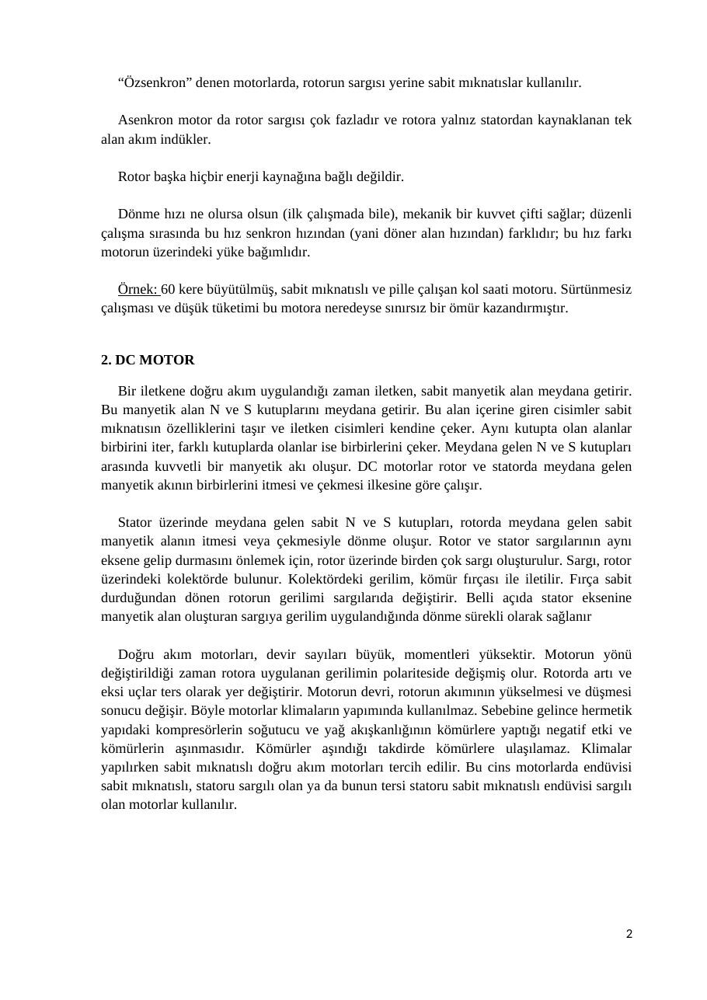

This post brings together the relevant notes and assignments from the Başkent University **EEM332 Microprocessors** course archive (2012–2012). A student compilation on motor types and their operating principles. Work prepared by a friend and course documents have been included together; student names, numbers and group information have been removed. PDF archive copies of the documents and, where available, their source code can be downloaded as a ZIP at the end of the post.

## microprocessors assignment

### 1. AC MOTOR

AC motors can be grouped into two categories: asynchronous motors (induction motors) and synchronous motors.

The basic principle of all these motors is that a mass made of metal is dragged along by means of a rotating electromagnetic field. Both groups of motors have two coaxial armature cores: the first is fixed (the stator) and the second is movable (the rotor).

The stator of a synchronous motor has the same form and structure as the stator of an asynchronous motor; it is shaped like a ring made of magnetic laminations, with a winding fed by three-phase currents placed in the slots on these laminations.

In a synchronous motor, the magnetic field is produced by a separate direct current feeding the rotor winding; here the rotor has its operating speed. In this type of motor, getting the rotor to start moving on its own is a problem.

In the so-called "self-synchronous" motors, permanent magnets are used instead of the rotor winding.

In an asynchronous motor, the rotor winding is polyphase, and the only field that induces current in the rotor comes from the stator.

The rotor is not connected to any other energy source.

Whatever the rotational speed (even at initial start-up), it provides a mechanical torque; during steady operation this speed differs from the synchronous speed (that is, the speed of the rotating field), and this speed difference depends on the load on the motor.

Example: a wristwatch motor enlarged 60 times, with a permanent magnet and battery-powered. Its frictionless operation and low consumption have given this motor an almost unlimited lifetime.

### 2. DC MOTOR

When direct current is applied to a conductor, the conductor produces a constant magnetic field. This magnetic field forms N and S poles. Objects that enter this field take on the properties of a permanent magnet and attract conductive objects. Fields of the same pole repel each other, while those of different poles attract each other. A strong magnetic flux forms between the resulting N and S poles. DC motors operate on the principle of the magnetic flux produced in the rotor and stator repelling and attracting each other.

Rotation occurs through the repulsion or attraction between the constant N and S poles formed on the stator and the constant magnetic field formed in the rotor. To prevent the rotor and stator windings from coming to rest on the same axis, multiple windings are formed on the rotor. The winding is located on the commutator on the rotor. The voltage on the commutator is conducted by the carbon brush. Since the brush is stationary, the rotating rotor also changes the voltage on the windings. When voltage is applied to the winding that creates a magnetic field at a certain angle to the stator axis, rotation is maintained continuously.

DC motors have high speeds and high torques. When the direction of the motor is reversed, the polarity of the voltage applied to the rotor is also reversed. The positive and negative terminals on the rotor swap places. The speed of the motor changes as a result of the rotor current rising and falling. Such motors are not used in air conditioners. The reason is the negative effect that the coolant and oil fluidity in hermetic compressors has on the brushes, and the wear of the brushes. Once the brushes wear out, they can no longer be reached. When air conditioners are built, permanent-magnet DC motors are preferred. In this type of motor, either the armature is a permanent magnet and the stator is wound, or conversely the stator is a permanent magnet and the armature is wound.

### 2.1. BRUSHED DC MOTORS

In DC motors with brushes, electrical conduction to the windings on the rotor is provided by a brush-commutator structure. Conductors are used to carry current to the wound section in the middle, and as the motor turns, it continues to rotate because of the changing polarization.

### 2.2. BRUSHLESS DC MOTORS

The switching (commutation) operation is performed electronically rather than mechanically. An electronic controller takes over the function of the brush-commutator structure. Current is delivered to the motor through 3 wires. Owing to their construction, they can reach higher torques and speeds.

### 2.3. SOME MEDICAL DEVICES THAT USE DC MOTORS

- Electric beds,

- Wheelchairs

- Stair lifts (chair-type)

- Microscopes

- Insulin pumps

- Fluid dispensers (such as nutrient fluids)

- Nebulizers

- Surgical instruments

- Endoscope drives and controls

- Blood Pressure Equipment

- Wound Irrigation

### 3. SERVO MOTOR

Servo motors are used in industrial electronics, particularly in many applications where precise positioning of the motor movement is required.

Servo motors can also be driven digitally, thanks to a digitally sent signal being converted by an A/D (analog/digital) converter. Servo motors come in DC or AC types.

DC servo motors were used in older machines because large currents could be driven with silicon-based rectifiers.

With the control of large currents by means of transistors (devices used to amplify electrical oscillations), or the switching of large currents at high frequency, the areas of use of AC servo motors have expanded.

### 3.1. AC SERVO MOTORS

They are generally two-phase squirrel-cage induction type motors. Two-phase asynchronous motors are built with low power ratings for use as servo motors in automatic control systems. Since there are no brushes or commutator, they are less likely to fail and are easy to maintain.

### 3.2. DC SERVO MOTORS

These motors are small in construction, and their armature cores are designed so as to minimize the pole moment of inertia.

In a DC servo motor, a strong magnetic field must be produced in order to obtain a high torque and overload capability.

```asm
Endüktör sargılarına DC akımı uyguladığımızda bir manyetik alan meydana gelir.
```

(When we apply DC current to the field windings, a magnetic field is produced.)

The current passes through the commutator and brushes. A magnetic field is also produced in the armature winding. It produces the rotary motion of the motor. The effect of the rotating magnetic field in the field winding,

```asm
endüvideki alan sebebiyle endüvinin dönmesi sağlanmış olur.
```

(the armature is made to rotate because of the field in the armature.)

For the servo motor driver circuit, the power diagram and connection of the servo motor is made with 3 phase wires and 1 neutral wire. The feedback element connection cables are connected via RS-232 or RS-485 so that information can be exchanged. In this way, the motor shaft is connected to whatever system is desired.

### 4. STEP MOTORS

Step motors (stepper motors) are electromagnetic devices that can produce analog rotational motion in response to pulse trains applied to their inputs (this can also be expressed as a digital input…).

They change the angular position of the rotor by moving in discrete steps. These steps are controlled by sending appropriate signals to the motor windings. For any given excitation, how far the rotor will move depends on the step angle of the motor.

Depending on the motor's construction, the step angle can be 90, 45, 18, 7.5, 1.8… degrees or many other angles.

The motor position can be controlled without any feedback mechanism. Step motors are similar to switched reluctance motors.

When electromagnet number 1 at the top is energized, it attracts the nearest tooth of the central wheel. When the teeth of the central wheel and electromagnet number 1 are aligned, they will be in equilibrium.

Electromagnet number 1 is turned off and electromagnet number 2 is turned on. When electromagnet number 2 is energized, it pulls the nearest tooth of the central wheel to the right, and when they are aligned they reach equilibrium. In the motor above, this rotation will be 3.6 degrees.

When electromagnet number 3 at the bottom is energized, a rotation of 3.6 degrees will occur.

When electromagnet number 4 is energized, another rotation of 3.6 degrees will occur. Since the central wheel has 25 teeth, this step motor will make one full revolution in 100 steps.

The speed of the motor can also be controlled by changing the frequency of the signals applied to it. The direction of rotation of step motors can be clockwise (CW) or counterclockwise (CCW) by changing the sequence of the applied signals.

Basic Operating Principle: In step motors, there are many toothed electromagnets around a central gear. These electromagnets are energized by an external control circuit such as a microcontroller. To move the motor shaft, first one electromagnet is energized. The teeth of this electromagnet interact with the teeth of the central wheel. When the teeth of the central wheel are aligned with the first electromagnet, the next electromagnet is energized. When the first electromagnet turns off and the second turns on, the central wheel will rotate a little further. These steps continue in the same way for the other electromagnets. Each of these small movements is called a step. Thanks to stepwise operation, movement at a desired angle can be achieved.

Advantages: Step motors respond to digital input signals, which makes them ideal devices for control with microprocessors or computers.

Being able to control values such as the direction of rotation, number of revolutions and rotational speed of step motors with the help of a microprocessor or computer makes it possible to know the direction, speed and position of these motors at any moment. Because of these properties, very precise position control can be achieved with step motors.

The fact that step motors respond to digital inputs allows them to be operated in open loop without the need for feedback. That is, with a step motor operated in open loop, speed, acceleration and position control can be achieved more simply and at lower cost. In this way, the usual stability problems are also avoided.

Step motors can be driven over a very wide speed range, depending on the frequency of the input signals.

Step motors can be stopped and started many times without any damage. (They respond excellently to a sudden stop while running or a sudden demand to run in the reverse direction.)

They are not damaged by overloading and are quite robust. There are no position errors that accumulate (cumulative) with each new step.


