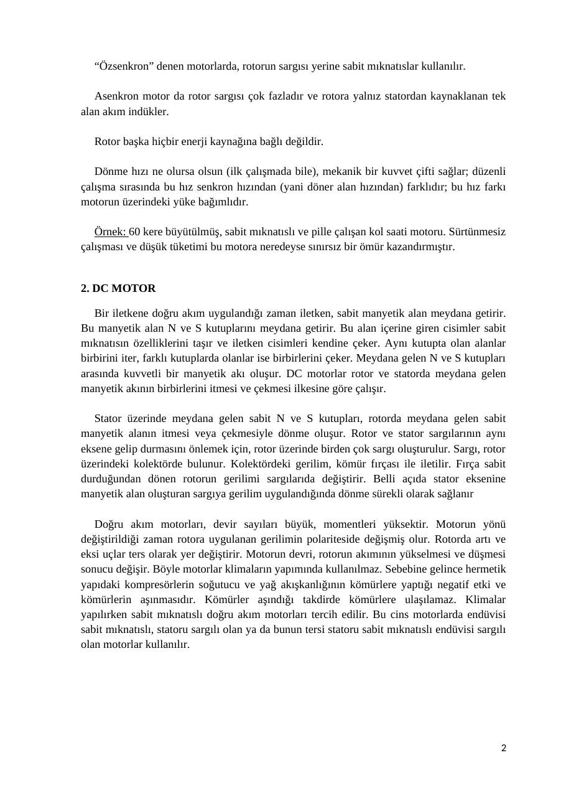

Bu yazı, Başkent Üniversitesi **EEM332 Mikroişlemciler** ders arşivindeki ilgili notları ve uygulamaları bir araya getiriyor (2012–2012). Motor türleri ve çalışma ilkeleri üzerine öğrenci derlemesi. Bir arkadaşın hazırladığı çalışmalar ve ders belgeleri birlikte aktarılmış; öğrenci adları, numaraları ve grup bilgileri çıkarılmıştır. Belgelerin PDF arşiv kopyaları ve varsa kaynak kodları yazının sonunda ZIP olarak indirilebilir.

## ödev mikro

### 1. AC MOTOR

Alternatif akım motorları iki grupta toplanabilir: asenkron motorlar (indüksiyon motorları) ve senkron motorlar.

Bütün bu motorların temel ilkesi, metalden yapılmış bir kütlenin, döner bir elektromanyetik alan yardımıyla sürüklenmesine dayanır. Bu iki grup motorlarda da eksenli iki üreteç göbeği (armatür) bulunur: bunların ilki sabit (stator), ikincisi hareketlidir(rotor).

Senkron motorun statoru asenkron motorun statoruyla aynı şekilde ve aynı yapıdadır; manyetik saçlardan oluşan bir bilezik biçimindedir; bu saçların üzerindeki yivlere üç fazlı akımlarla beslenen bir sargı sarılmıştır.

Bir senkron motorda manyetik alanı, rotorun sargısını besleyen bağımsız bir doğru akım yaratır; burada rotorun çalışma hızı vardır. Bu tip motorlarda rotorun kendi başına harekete geçmesi sorun olur.

“Özsenkron” denen motorlarda, rotorun sargısı yerine sabit mıknatıslar kullanılır.

Asenkron motor da rotor sargısı çok fazladır ve rotora yalnız statordan kaynaklanan tek alan akım indükler.

Rotor başka hiçbir enerji kaynağına bağlı değildir.

Dönme hızı ne olursa olsun (ilk çalışmada bile), mekanik bir kuvvet çifti sağlar; düzenli çalışma sırasında bu hız senkron hızından (yani döner alan hızından) farklıdır; bu hız farkı motorun üzerindeki yüke bağımlıdır.

Örnek: 60 kere büyütülmüş, sabit mıknatıslı ve pille çalışan kol saati motoru. Sürtünmesiz çalışması ve düşük tüketimi bu motora neredeyse sınırsız bir ömür kazandırmıştır.

### 2. DC MOTOR

Bir iletkene doğru akım uygulandığı zaman iletken, sabit manyetik alan meydana getirir. Bu manyetik alan N ve S kutuplarını meydana getirir. Bu alan içerine giren cisimler sabit mıknatısın özelliklerini taşır ve iletken cisimleri kendine çeker. Aynı kutupta olan alanlar birbirini iter, farklı kutuplarda olanlar ise birbirlerini çeker. Meydana gelen N ve S kutupları arasında kuvvetli bir manyetik akı oluşur. DC motorlar rotor ve statorda meydana gelen manyetik akının birbirlerini itmesi ve çekmesi ilkesine göre çalışır.

Stator üzerinde meydana gelen sabit N ve S kutupları, rotorda meydana gelen sabit manyetik alanın itmesi veya çekmesiyle dönme oluşur. Rotor ve stator sargılarının aynı eksene gelip durmasını önlemek için, rotor üzerinde birden çok sargı oluşturulur. Sargı, rotor üzerindeki kolektörde bulunur. Kolektördeki gerilim, kömür fırçası ile iletilir. Fırça sabit durduğundan dönen rotorun gerilimi sargılarıda değiştirir. Belli açıda stator eksenine manyetik alan oluşturan sargıya gerilim uygulandığında dönme sürekli olarak sağlanır

Doğru akım motorları, devir sayıları büyük, momentleri yüksektir. Motorun yönü değiştirildiği zaman rotora uygulanan gerilimin polariteside değişmiş olur. Rotorda artı ve eksi uçlar ters olarak yer değiştirir. Motorun devri, rotorun akımının yükselmesi ve düşmesi sonucu değişir. Böyle motorlar klimaların yapımında kullanılmaz. Sebebine gelince hermetik yapıdaki kompresörlerin soğutucu ve yağ akışkanlığının kömürlere yaptığı negatif etki ve kömürlerin aşınmasıdır. Kömürler aşındığı takdirde kömürlere ulaşılamaz. Klimalar yapılırken sabit mıknatıslı doğru akım motorları tercih edilir. Bu cins motorlarda endüvisi sabit mıknatıslı, statoru sargılı olan ya da bunun tersi statoru sabit mıknatıslı endüvisi sargılı olan motorlar kullanılır.

### 2.1. FIRÇALI DC MOTORLAR

Fırça içeren DC motorlarda, rotordaki sarımlara elektrik iletimi fırça-anahtar yapısı ile sağlanır. Ortadaki sarımlı bölüme akımı iletmek için iletkenler kullanılır ve motor döndükçe farklı kutuplaşma nedeni ile motorun dönmesi devam eder.

### 2.2. FIRÇASIZ DC MOTORLAR

Anahtar işlemini mekanik olarak değil elektronik olarak sağlar. Fırça-anahtar yapısının görevini elektronik bir denetleyici üstlenir. Akım 3 kablo ile motora iletilir. Yapısı nedeniyle daha yüksek tork ve devir sayılarına ulaşabilirler.

### 2.3. DC MOTOR KULLANILAN MEDİKAL CİHAZLARDAN BAZILARI

- Elektronik yataklar,

- Tekerlekli sandalyeler

- Koltuk tipi asansörler

- Mikroskoplar

- Insulin Pompası

- Sıvı dağıtıcılar (besin sıvılar gibi)

- Nebulizatörler

- Cerrahi aletler

- Endoskop sürücüleri ve kontrolleri

- Blood Pressure Equipment ( Kan basınç elemanları )

- Wound Irrigation

### 3. SERVO MOTOR

Servo motorlar endüstriyel elektronikte özellikle motor hareketinin                    hassas konumlandırılmasına ihtiyaç duyulan pek çok uygulamada kullanılmaktadırlar.

Servo motorlar dijital olarak yollanan sinyalin bir A/D (analog/sayısal) çevirici ile dönüştürülmesi sayesinde sayısal olarak da sürülebilinmektedir. Servo motorlar DC veya AC şeklinde bulunurlar.

Eski makinelerde DC servo motorlar kullanılırdı çünkü büyük akımlar silikon bazlı doğrultucalar ile sürülebilinmekteydi.

Transistör (elektrik titreşimlerini genişletmekte kullanılan alet) yardımıyla büyük akımların kontrol edilmesi veya yüksek frekansa sahip büyük akımlar ile düğmelerin (switch) değiştirilmesi ile AC servo motorların kullanım yerleri artmış oldu.

### 3.1. AC SERVO MOTORLARI

Genellikle iki fazlı sincap kafesli indüksiyon tipi motorlardır. İki fazlı asenkron motorlar, otomatik kontrol sistemlerinde servo motorlar olarak kullanılmak amacı ile küçük güçlü yapılır. Fırça ve kolektör olmadığından arıza yapma ihtimalleri az, bakımları kolaydır.

### 3.2. DC SERVO MOTORLARI

Bu motorlar küçük yapılıdır ve üreteç göbekleri kutup eylemsizlik momentini minimum yapacak şekilde tasarlanmıştır.

Doğru akım servo motorunda, yüksek bir dönme momenti ve aşırı yüklenebilirlik elde etmek için şiddetli bir manyetik alan oluşturmalıdır.

```asm
Endüktör sargılarına DC akımı uyguladığımızda bir manyetik alan meydana gelir.
```

Akım kolektör ve fırçadan geçer. Endüvi sargısında da manyetik bir alan oluşur. Motorun dönme hareketini meydana getirir. Endüktörde bulunan döner manyetik alanın tesiri,

```asm
endüvideki alan sebebiyle endüvinin dönmesi sağlanmış olur.
```

Servo motor sürücü devresi için servo motorun güç şeması ve bağlantısı; 3 faz ve 1 nötr kablo ile yapılır. Geri besleme elemanı bağlantı kabloları RS-232 ya da RS-485 ile bağlanarak bilgi alışverişinde bulunabilinmesi için bağlantı yapılır. Böylece motor mili istenildiği sisteme bağlanır.

### 4. STEP MOTORLAR

Step motorlar (adım motorları), girişlerine uygulanan darbe dizilerine karşılık (bu, dijital, sayısal giriş olarak da ifade edilebilir…), analog dönme hareketi yapabilen elektromanyetik elemanlardır.

Belirli adımlarla hareket ederek rotorun açısal konumunu değiştirirler. Bu adımlar, motor sargılarına uygun sinyaller gönderilerek kontrol edilir. Herhangi bir uyartımda, rotorun yapacağı hareketin ne kadar olacağı, motorun adım açısına bağlıdır.

Adım açısı, motorun yapısına bağlı olarak 90, 45, 18, 7,5, 1,8… derece veya çok daha değişik açılarda olabilir.

Motor pozisyonu herhangi bir geri besleme mekanizması olmadan kontrol edilebilir. Step motorlar switched reluctance motorlara benzemektedir.

En üstteki 1 numaralı elektromıknatıs açıldığında merkez çarkın en yakın dişlisini çeker. Merkez çark ve 1 numaralı elektromıknatısın dişleri hizalandığında dengeleneceklerdir.

1 numaralı elektromıknatıs kapatılır ve 2 numaralı elektromıknatıs açılır. 2 numaralı elektromıknatısı enerjilendiğinde merkez çarkın en yakın dişlisini sağa doğru çeker, aynı Hizaya geldiklerinde dengelenirler. Yukarıdaki motorda bu dönme 3,6 derece olacaktır.

En alttaki 3 numaralı elektromıknatıs enerjilendiğinde 3,6 derecelik bir dönüş gerçekleşecektir.

4 numaralı elektromıknatıs enerjilendiğinde 3,6 derecelik bir dönüş daha gerçekleşecektir. Merkez çarkta 25 diş olduğu için bu step motor 100 adımda bir tam tur atacaktır.

Motora uygulanacak sinyallerin frekansı değiştirilerek motorun hızı da kontrol edilebilir. Adım motorlarının dönüş yönü ise, uygulanan sinyallerin sırası değiştirilerek, saat ibresi yönünde (CW) veya saat ibresinin tersi yönünde (CCW) olabilir.

Temel Çalışma Mantığı: Step motorlarda merkez dişlinin etrafında çok sayıda dişli elektromıknatıslar bulunmaktadır. Bu elektromıknatıslar mikro kontrolör gibi bir dış kontrol devresiyle enerjilendirilirler. Motor şaftını hareket ettirmek için öncelikle bir elektromıknatısa enerji verilir. Bu elektromıknatısın dişleri ile merkez çarkın dişleri birbiriyle etkileşime girer. Merkez çarkın dişleri ilk elektromıknatısa hizalandığında bir sonraki elektromıknatıs enerjilendirilir. İlk elektromıknatıs kapanıp, ikincisi açıldığında merkez çark biraz daha dönecektir. Bu adımlar diğer elektromıknatıslar için aynen devam edecektir. Bu ufak hareketlerin her birine adım denir. Adımlı çalışma sayesinde istenilen bir açıda hareket sağlanabilir.

Avantajları: Step motorlar dijital giriş işaretlerine cevap verirler, bu nedenle mikroişlemci veya bilgisayarlarla kontrol için ideal elemanlardır.

Step motorların hangi yöne döneceği, devir sayısı, dönüş hızı gibi değerlerin mikroişlemci veya bilgisayar yardımı ile kontrol edilebilmesi, her an bu motorların dönüş yönü, hızı ve konumunun bilinebilmesini sağlamaktadır. Bu özelliklerinden dolayı step motorlar ile çok hassas konum kontrolü yapılabilir.

Step motorların dijital girişlere cevap vermesi, geri beslemeye ihtiyaç duyulmaksızın açık çevrim çalıştırılabilmesini sağlamaktadır. Yani açık çevrim çalıştırılan bir adım motoru ile hız, ivme ve konum kontrolü daha basit ve daha az maliyetle gerçekleştirilebilir. Böylece alışılmış kararsızlık problemlerinin de önüne geçilmiş olur.

Step motorlar, giriş işaretlerinin frekansına bağlı olarak çok geniş bir hız aralığında sürülebilirler.

Step motorlar, herhangi bir hasara yol açmadan defalarca durdurulup çalıştırılabilirler. (Sürerken aniden durdurma ya da aniden ters yönde sürme isteğine karsı mükemmel cevap verebilirler.)

Aşırı yüklenmeden hasar görmezler, oldukça dayanıklıdırlar. Her yeni adımla artan (kümülatif) konum hataları yoktur.


