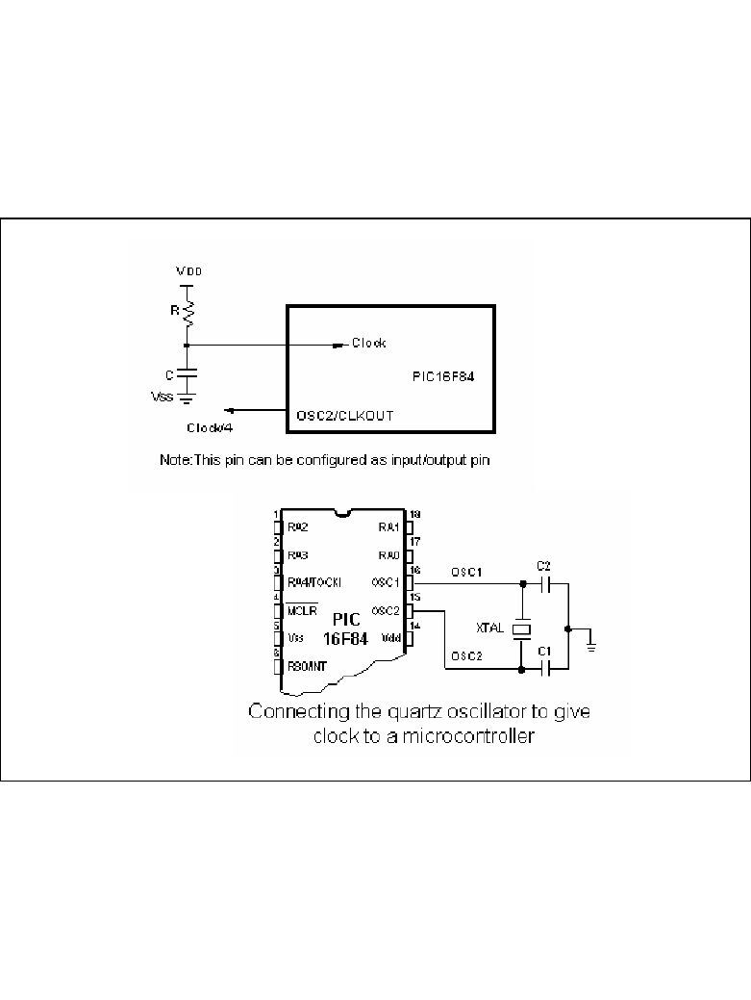
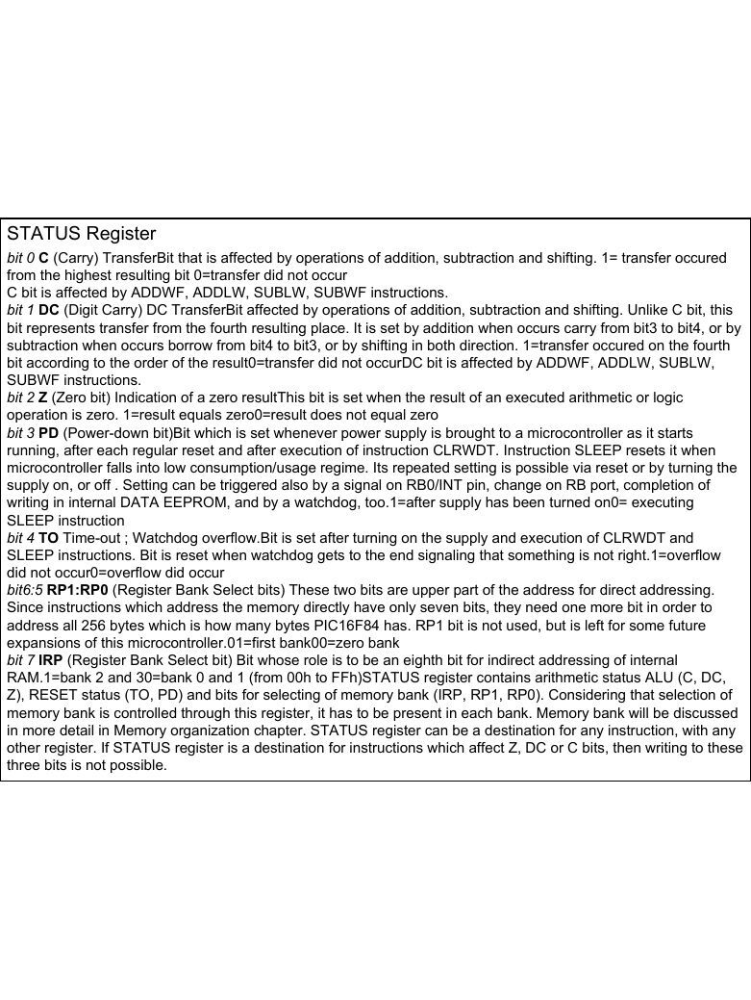
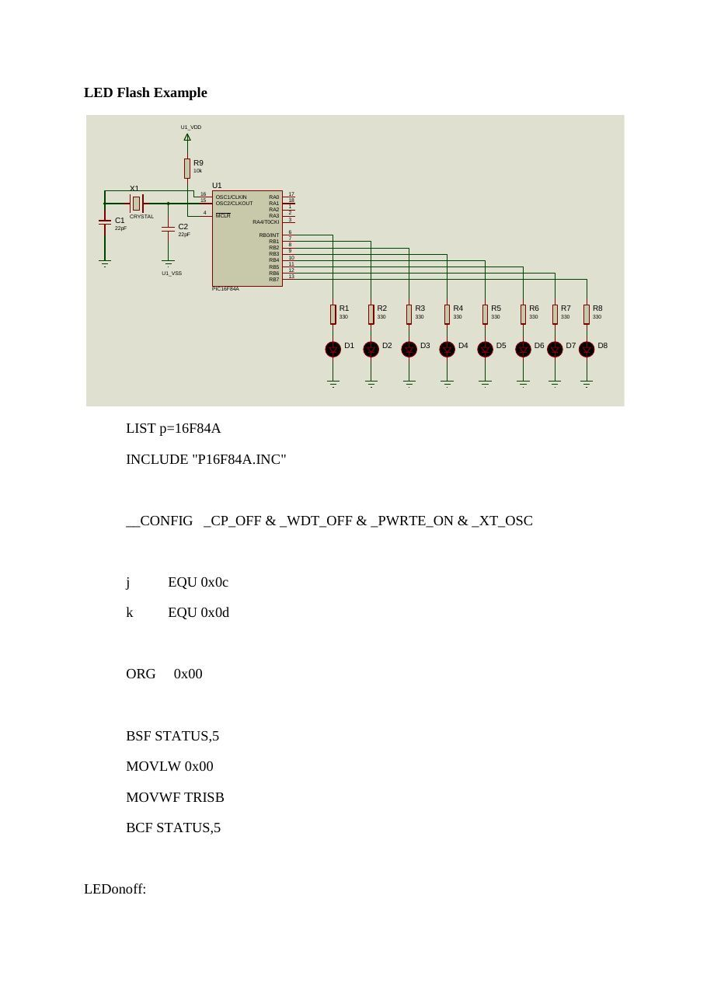
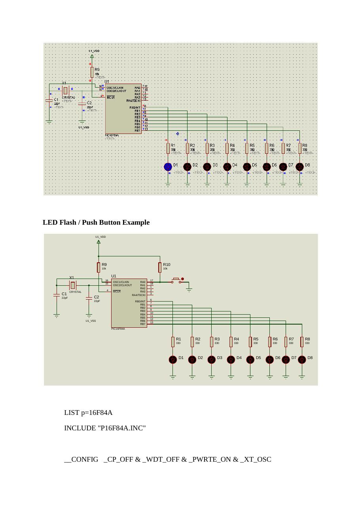
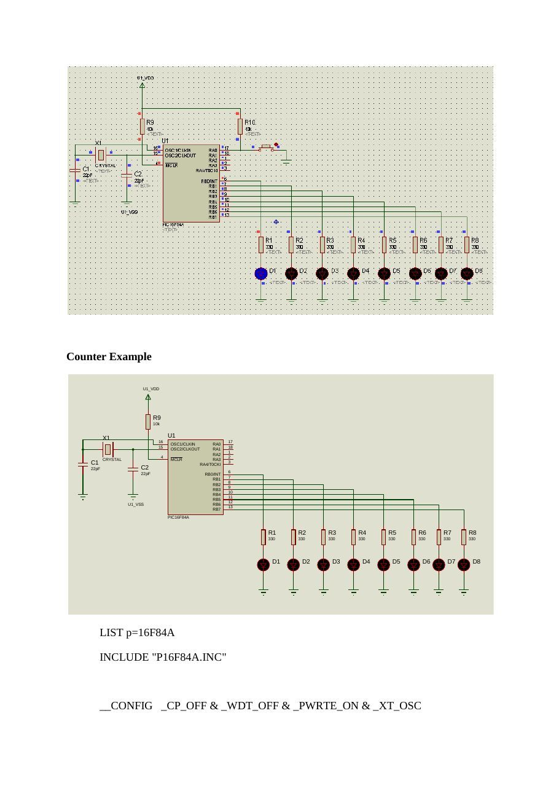

This post brings together the related notes and applications from the Başkent University **EEM332 Microprocessors** course archive (2006–2015): PIC16F84 ports, memory banks, bit tests, delay loops, and LED applications. Sources: Başkent University lecture slides and Trakya University İpsala Vocational School, Ozan Akı, PIC Assembly instructions (9 January 2009). PDF archive copies of the documents and, where available, source codes can be downloaded as a ZIP at the end of the post.

*This content belongs to a third-party source; it is shared for archival and nostalgic purposes with the source credited. It will be removed at the request of the rights holder.*

## PIC

Microchip PIC Microcontrollers EEM 332 Microprocessors

What Is a PIC?

- PIC: Peripheral Interface Controller

- Peripheral Interface Controller

- Purpose: To implement multi-function logic applications in software using a fast and inexpensive microprocessor

- The first PIC: PIC16C54 (1994)

- The most popular PIC: PIC16F(C)84

Why PIC?

Why PIC?

- Fast execution of logic applications

- Very low price

- It is an 8-bit microcontroller, with separate built-in buses for program memory and data

- Fast access to data and memory

- Other microcontrollers have a single bus carrying both data and program, whereas the PIC has separate ones; thanks to this feature, the PIC is twice as fast as other microcontrollers

- Ability to operate at high frequencies

- Very low current draw in standby mode

- Reduced instruction set (RISC structure), allowing operations to be executed faster

Why PIC?

- It can operate with only 2 capacitors, a crystal, and a resistor, without requiring any additional memory or input/output components

- The program memory is EEPROM

- It can be programmed serially with four wires without being removed from the circuit

RISC Programming

- RISC: reduced instruction set computer

- Advantages:

Instructions execute faster. RISC-based chips need fewer transistors. They are easy to design and inexpensive.

Instructions - I

- Learning 35 instructions is enough to make the PIC do what you want in assembly language

- Software can be written in Pascal, C/C++, Basic, Assembler, and even Binary

- Each instruction is 14 bits long, and except for a few exceptional instructions (such as CALL, GOTO, and the bit-testing BTFSS, INCFSZ), every instruction executes in a single cycle

Instructions - II

Instructions - III

Accumulator

- Instead of the registers used in the 8086 (AX, BX, CX, DX), the PIC uses only the W register

- Unlike the 8086, when we want to assign a value to a variable, we must always use the W register

W Register

- This register is a virtual register. Its contents cannot be accessed directly. However, all load operations are performed through this register.

- To send data to a variable, a register, or a port, you must first load the data into the W register, and then load the W register into the relevant port or variable.

- Example: Loading data into a variable:

```asm
MOVLW D'15'            ;W=15
MOVWF SAYAC           ;sayac=15
```

W Register

- Example: Loading the contents of one variable into another variable.

```asm
MOVF SAYAC1,W ;W=SAYAC1
MOVWF SAYAC2 ;SAYAC1=SAYAC2
```

!!! To load the contents of a variable or register into W, you must use the MOVF (or MOVFW) instruction. Using the MOWLW instruction, only a constant value can be loaded into W.

Input/Output Pins

```asm
Clock Uçları ve Bağlantıları
```

- The PIC has 2 pins used as the clock signal input.

- Signals obtained from different types of oscillators can be applied to these pins. RC - Resistor/Capacitor XT - Crystal or ceramic resonator (XTAL) HS - High-speed crystal or resonator (High Speed) LP - Low-frequency crystal (Low Power)

- The type of clock connected to the PIC is written to the configuration bits during programming.

```asm
Clock Uçları ve Bağlantıları
```

```asm
Clock Uçları ve Bağlantıları
```

Reset Circuit

Bank (16F84)

- Instead of the segments in the 8086, the PIC uses banks, and the special-purpose and general-purpose registers located within the banks.

Bank (16F628)

Bank (16F877)

How Is a PIC Programmed?

- What You Need to Program a PIC

An IBM-compatible computer A text editor An assembler program (MPLAB) PIC programmer hardware and software

### PIC

Assembler program (MPLAB)

- Free software

- Simulation is possible

- It can be obtained from www.microchip.com and www.baskent.edu.tr/~eemekdas/dersler/ee m332l.htm.

Status Register-1

- Status Register: Provides switching between banks.

Status Register-2

- BSF               STATUS,RP0                           ;Bit Set f

```asm
;(Status’da RP0)
```

- BSF               STATUS,5                             ;Bit Set f

```asm
;(Status’da Bit 5)
```

Program Sections

```asm
LIST                P=16F877        Başlık Bloğu
INCLUDE             P16F877.INC
```

Address and Variable #DEFINE             DEGISKEN_1                d’100’      Assignment Block #DEFINE             DEGISKEN_2                b’10010110’          ;=d’150’=0x96

```asm
DEGIS_3             EQU                       0x20      ;HAFIZADA SEÇİLEN BİR YERE
DEGIS_4             EQU                       0x21      ;ATANAN DEĞİŞKEN
```

```asm
ORG       0                         ;PROGRAMI 0X00’DAN BAŞLAT
```

Port Setup Block                 Comment Block

### BASLA

```asm
BSF       STATUS,RP0                ;BANK1’E GEÇİŞ
MOVLW     b'00000111'               ;İSTENEN I/O KONFİGURASYONU SEÇİLİR
MOVWF     TRISA                     ;TRISA REGISTER’INA ATANIR
CLRF      TRISB                     ;TRISB ÇIKIŞ MODUNA ATANIR (BÖYLECE
;PORTB’YE ATANACAK BİLGİLER ÇIKIŞ OLARAK
;GÖRÜLÜR)
BCF       STATUS,RP0                ;BANK0’A GEÇİŞ
```

```asm
MOVLW     b'00001010'               ;B PORTUNA 1010 BILGISI GONDER
MOVWF     PORTB                     ;
;         CLRF      PORTB                     DİYEREK ÇIKIŞI TAMAMEN SIFIRLAYABİLİRİZ
```

Program Block

### DONGU

```asm
GOTO DONGU                          ;SONSUZ LOOP
```

Label Block   END

Termination Block

Use of Uppercase and Lowercase Letters

- Whether PIC instructions are written in uppercase or lowercase does not matter

### yazılması önemli değildir

```asm
MoVlW=movlw=MOVLW
```

- However, labels are case-sensitive

Dongu≠DONGU

Header Block

- LIST P=16F877

Defines the PIC to be used

- INCLUDE             P16F877.INC

The register definitions of the PIC being used are stored in this file. This way, the default registers do not need to be defined one by one.

Number/Character Types Used

- Hexadecimal

```asm
STATUS       EQU     0x03
```

3         Address and Variable 03        Assignment Block 03h h’03’

```asm
MOVLW        0x03
```

h’03’ Program Block 03h

- Binary

```asm
MOVLW        b’00010110’
```

- Decimal

```asm
MOVLW        d’15’
```

- ASCII Character

```asm
RETLW        ‘A’
```

CONFIG Line Condition                        Definition Code to Write

- The configuration bits determine the conditions the PIC must comply with at the moment voltage is applied.               Code protection on               _CP_ON

Code protection off              _CP_OFF

Power-on-reset on                _PWRTE_ON

Power-on-reset off               _PWRTE_OFF

Watchdog timer enabled           _WDT_ON

Watchdog timer disabled          _WDT_OFF

Low Power Oscillator             _LP_OSC

Crystal Oscillator               _XT_OSC

High Speed Oscillator            _HS_OSC

RC Oscillator                    _RC_OSC

Example Program - 1

```asm
LIST             P=16F877
INCLUDE          P16F877.INC
```

```asm
ORG        0                    ;PROGRAMI 0X00’DAN BAŞLAT
```

```asm
BSF        STATUS,RP0           ;BANK1’E GEÇİŞ
CLRF       TRISD                ;TRISD ÇIKIŞ MODUNA ATANIR
BCF        STATUS,RP0           ;BANK0’A GEÇİŞ
```

```asm
MOVLW      b'01100110'          ;D PORTUNA 01100110 BILGISI GONDER
MOVWF      PORTD
```

### DONGU

```asm
GOTO DONGU                      ;SONSUZ LOOP
END
```

Example Program - 2

```asm
LIST           P=16F877                        CALL   BEK
INCLUDE         P16F877.INC                     MOVLW DSAYI
__CONFIG _CP_OFF & _WDT_OFF & _PWRTE_ON &            MOVWF PORTD
```

### _XT_OSC                                          CALL   BEK

```asm
;-------------------------------------------         MOVLW 0x05
```

#DEFINE    DSAYI      0xFF                           MOVWF PORTE

```asm
CNTKH      EQU        0x25                           CALL   BEK
CNTKL      EQU        0x26                           CALL   BEK
CNTKM      EQU        0x27                           GOTO   DONGU
;-------------------------------------------    ;------------------------------------------
ORG    0x00                                 BEK
```

### BASLA                                                MOVLW 0X05

```asm
CLRF   PORTA                                     MOVWF CNTKM
CLRF   PORTB                                TEKM
CLRF   PORTC                                     MOVLW 0XF0
CLRF   PORTD                                     MOVWF CNTKH
CLRF   PORTE                                TEK1
MOVLW 0XFF
BSF    STATUS,RP0                                MOVWF CNTKL
CLRF   TRISB                                TEK2
CLRF   TRISC                                     DECFSZ CNTKL,F
CLRF   TRISD                                     GOTO   TEK2
CLRF   TRISE                                     DECFSZ CNTKH,F
BCF    STATUS,RP0                                GOTO   TEK1
;-------------------------------------------         DECFSZ CNTKM,F
CALL   BEK                                       GOTO   TEKM
MOVLW b'01010101'                                RETURN
MOVWF PORTB
CALL   BEK                                  DONGU
MOVLW b'11001100'                                     GOTO BASLA
MOVWF PORTC                                           END
```

## pic_Sunum1_2013 [Compatibility Mode]

(Microcontroller)

PIC 16f84 8086 microprocessor

Pin no.1 RA2 Second pin on port A. Has no additional function Pin no.2 RA3 Third pin on port A. Has no additional function. Pin no.3 RA4 Fourth pin on port A. TOCK1 which functions as a timer is also found on this pin Pin no.4 MCLR Reset input and Vpp programming voltage of a microcontroller Pin no.5 Vss Ground of power supply. Pin no.6 RB0 Zero pin on port B. Interrupt input is an additional function. Pin no.7 RB1 First pin on port B. No additional function. Pin no.8 RB2 Second pin on port B. No additional function. Pin no.9 RB3 Third pin on port B. No additional function. Pin no.10 RB4 Fourth pin on port B. No additional function. Pin no.11 RB5 Fifth pin on port B. No additional function. Pin no.12 RB6 Sixth pin on port B. 'Clock' line in program mode. Pin no.13 RB7 Seventh pin on port B. 'Data' line in program mode. Pin no.14 Vdd Positive power supply pole. Pin no.15 OSC2 Pin assigned for connecting with an oscillator Pin no.16 OSC1 Pin assigned for connecting with an oscillator Pin no.17 RA2 Second pin on port A. No additional function Pin no.18 RA1 First pin on port A. No additional function.

Memory organization PIC16F84 has two separate memory blocks, one for data and the other for program. EEPROM memory and GPR registers in RAM memory make up a data block, and FLASH memory makes up a program block.

### Program memory

Program memory has been realized in FLASH technology which makes it possible to program a microcontroller many times before it's installed into a device, and even after its installment if eventual changes in program or process parameters should occur. The size of program memory is 1024 locations with 14 bits width where locations zero and four are reserved for reset and interrupt vector.

Data memory

Data memory consists of EEPROM and RAM memories. EEPROM memory consists of 64 eight bit locations whose contents is not lost during loosing of power supply. EEPROM is not directly addressible, but is accessed indirectly through EEADR and EEDATA registers. As EEPROM memory usually serves for storing important parameters (for example, of a given temperature in temperature regulators) , there is a strict procedure for writing in EEPROM which must be followed in order to avoid accidental writing. RAM memory for data occupies space on a memory map from location 0x0C to 0x4F which comes to 68 locations. Locations of RAM memory are also called GPR registers which is an abbreviation for General Purpose Registers. GPR registers can be accessed regardless of which bank is selected at the moment.

Osilator: RC, Crystal,..

Simple Power supply

2.2 Reset Reset is used for putting the microcontroller into a 'known' condition. That practically means that microcontroller can behave rather inaccurately under certain undesirable conditions. In order to continue its proper functioning it has to be reset, meaning all registers would be placed in a starting position. Reset is not only used when microcontroller doesn't behave the way we want it to, but can also be used when trying

```asm
out a device as an interrupt in program execution, or to get a microcontroller ready when
```

reading in a program.

SFR registers Registers (Special Function Registers) which take up first 12 locations in banks 0 and 1 are registers of specialized function assigned with certain blocks of the microcontroller

STATUS Register

I/O selection (Bidirectional ports)

### PORTB

: The example shows how pins 0, 1, 2, and 3 are declared for input, and pins 4, 5, 6, and 7 for output.

Example shows how pins 0, 1, 2, 3, and 4 are declared to be input,

### PORTA

```asm
and pins 5, 6, and 7 to be output pins.
```

STATUS Register bit 0 C (Carry) TransferBit that is affected by operations of addition, subtraction and shifting. 1= transfer occured from the highest resulting bit 0=transfer did not occur C bit is affected by ADDWF, ADDLW, SUBLW, SUBWF instructions. bit 1 DC (Digit Carry) DC TransferBit affected by operations of addition, subtraction and shifting. Unlike C bit, this bit represents transfer from the fourth resulting place. It is set by addition when occurs carry from bit3 to bit4, or by

```asm
subtraction when occurs borrow from bit4 to bit3, or by shifting in both direction. 1=transfer occured on the fourth
```

bit according to the order of the result0=transfer did not occurDC bit is affected by ADDWF, ADDLW, SUBLW,

```asm
SUBWF instructions.
```

bit 2 Z (Zero bit) Indication of a zero resultThis bit is set when the result of an executed arithmetic or logic operation is zero. 1=result equals zero0=result does not equal zero bit 3 PD (Power-down bit)Bit which is set whenever power supply is brought to a microcontroller as it starts running, after each regular reset and after execution of instruction CLRWDT. Instruction SLEEP resets it when microcontroller falls into low consumption/usage regime. Its repeated setting is possible via reset or by turning the supply on, or off . Setting can be triggered also by a signal on RB0/INT pin, change on RB port, completion of writing in internal DATA EEPROM, and by a watchdog, too.1=after supply has been turned on0= executing SLEEP instruction bit 4 TO Time-out ; Watchdog overflow.Bit is set after turning on the supply and execution of CLRWDT and SLEEP instructions. Bit is reset when watchdog gets to the end signaling that something is not right.1=overflow did not occur0=overflow did occur bit6:5 RP1:RP0 (Register Bank Select bits) These two bits are upper part of the address for direct addressing. Since instructions which address the memory directly have only seven bits, they need one more bit in order to

```asm
address all 256 bytes which is how many bytes PIC16F84 has. RP1 bit is not used, but is left for some future
```

expansions of this microcontroller.01=first bank00=zero bank bit 7 IRP (Register Bank Select bit) Bit whose role is to be an eighth bit for indirect addressing of internal RAM.1=bank 2 and 30=bank 0 and 1 (from 00h to FFh)STATUS register contains arithmetic status ALU (C, DC, Z), RESET status (TO, PD) and bits for selecting of memory bank (IRP, RP1, RP0). Considering that selection of memory bank is controlled through this register, it has to be present in each bank. Memory bank will be discussed

```asm
in more detail in Memory organization chapter. STATUS register can be a destination for any instruction, with any
```

other register. If STATUS register is a destination for instructions which affect Z, DC or C bits, then writing to these three bits is not possible.

Creating time delays in 8088/8086 based system for a delay loop Or Timer

```asm
MOV CX,N
Again: LOOP again
```

Evrey loop takes total of 17 clock pulse to be executed so the time delay is Nx17 example : system frequency is 4.7 MHZ (t=210 ns). For 100ms delay its needed N) 28000

Another way for delay generation is using of external hardware timers

### Q                             Q                          Q

### D                            D                           D

Asynchronous Counter

```asm
CLK
```

Synchronous Counter

### Q                     Q                          Q

### D                      D                           D

```asm
CLK
BUFGP
```

OPTION register (Timer)

bit 0:2 PS0, PS1, PS2 (Prescaler Rate Select bit) These three bits define prescaler rate select bit. What a prescaler is and how these bits can affect the work of a microcontroller will be explained in section on TMR0. bit 3 PSA (Prescaler Assignment bit)Bit which assigns prescaler between TMR0 and watchdog.1=prescaler is assigned to watchdog0=prescaler is assigned to a free-run timer TMR0 bit 4 T0SE (TMR0 Source Edge Select bit)If it is allowed to trigger TMR0 by impulses from the pin RA4/T0CKI, this bit determines whether this will be to the falling or rising edge of a signal.1=falling edge0=rising edge bit 5 TOCS (TMR0 Clock Source Select bit)This pin enables free-run timer to increment its state either from internal oscillator on every ¼ oscillator clock, or through external impulses on RA4/T0CKI pin.1=external impulses0=1/4 internal clock bit 6 INTEDG (Interrupt Edge Select bit)If interrupt is enabled possible this bit will determine the edge at which an interrupt will be activated on pin RB0/INT.1=rising edge0=falling edge bit 7 RBPU (PORTB Pull-up Enable bit) This bit turns on and off internal 'pull-up' resistors on port B.1= "pull-up" resistors turned off 0= "pull-up" resistors turned on

Timer

Interrupt Register (INTCON Register)

Interrupt initialization

Interrupt Register (INTCON Register)

bit 0 RBIF (RB Port Change Interrupt Flag bit) Bit which informs about changes on pins 4, 5, 6 and 7 of port B.1=at least one pin has changed its status0=no change occured on any of the pins bit 1 INTF (INT External Interrupt Flag bit) External interrupt occured.1=interrupt occured0=interrupt did not occurIf a rising or falling edge was detected on pin RB0/INT, (which is defined with bit INTEDG in OPTION register), bit INTF is set. Bit must be cleared in interrupt subprogram in order to detect the next interrupt. bit 2 T0IF (TMR0 Overflow Interrupt Flag bit) Overflow of counter TMR0.1= counter changed its status from FFh to 00h0=overflow did not occurBit must be cleared in program in order for an interrupt to be detected .bit 3 RBIE (RB port change Interrupt Enable bit) Enables interrupts to occur at the change of status of pins 4, 5, 6, and 7 of port B. 1= enables interrupts at the change of status0=interrupts disabled at the change of statusIf RBIE and RBIF were simultaneously set, an interrupt would occur. bit 4 INTE (INT External Interrupt Enable bit) Bit which enables external interrupt from pin RB0/INT.1=external interrupt enabled0=external interrupt disabledIf INTE and INTF were set simultaneously, an interrupt would occur .bit 5 T0IE (TMR0 Overflow Interrupt Enable bit) Bit which enables interrupts during counter TMR0 overflow.1=interrupt enabled0=interrupt disabledIf T0IE and T0IF were set simultaneously, interrupt would occur. Bit 6 EEIE (EEPROM Write Complete Interrupt Enable bit) Bit which enables an interrupt at the end of a writing routine to EEPROM1=interrupt enabled0=interrupt disabledIf EEIE and EEIF (which is

```asm
in EECON1 register) were set simultaneously , an interrupt would occur.
```

Bit 7 GIE (Global Interrupt Enable bit) Bit which enables or disables all interrupts.1=all interrupts are enabled0=all interrupts are disabledPIC16F84 has four interrupt sources:1. Termination of writing data to EEPROM2. TMR0 interrupt caused by timer overflow3. Interrupt during alteration on RB4, RB5, RB6 and RB7 pins of port B.4. External interrupt from RB0/INT pin of microcontroller

Instructions

### Example

Optocoupler on an input line (İzolation) The way it works is simple: when a signal arrives, the LED within the optocoupler is turned on, and it shines on the base of a photo-transistor within the same case. When the transistor is activated, the voltage between collector and emitter falls to 0.5V or less

```asm
and the microcontroller sees this as a logic zero on its RA4 pin. The example below is a
```

counter, used for counting products on production line, determining motor speed, counting the number of revolutions of an axis etc. Let the sensor be a micro-switch. Each time the switch is closed, the LED is illuminated. The LED 'transfers' the signal to the phototransistor and the operation of the photo-transistor delivers a LOW to input RA4 of a microcontroller. A program in the microcontroller will be needed to prevent false counting and an indicator connected to any of the outputs of the microcontroller will shows the current state of the counter.

(Relay control)

Seven-Segment Display (multiplexing) The segments in a 7-segment display are arranged to form a single digit from 0 to F as

### shown in the animation

Shift registers for 16f84 There are two types of shift registers: input and output. Input shift registers receive data in parallel, through 8 lines and then send it serially through two lines to a microcontroller. Output shift registers work in the opposite direction; they receive serial data and on a "latch" line signal, they turn it into parallel data. Shift registers are generally used to expand the number of input-output lines of a microcontroller. They are not so much in use any more though, because most modern microcontrollers have a large number of input/output lines. However, their use with microcontrollers such as PIC16F84 is very important.

How to connect an input shift register to a microcontroller

### Serial Communication

Connecting a microcontroller to a PC via a MAX232 line interface chip.

![pic_Sunum1_2013 [Compatibility Mode]: page 1, circuit, table, and figures](sekil-1029-01.jpg "pic_Sunum1_2013 [Compatibility Mode], page 1.")

![pic_Sunum1_2013 [Compatibility Mode]: page 4, circuit, table, and figures](sekil-1029-04.jpg "pic_Sunum1_2013 [Compatibility Mode], page 4.")

## Pic_sunum2_2013 [Compatibility Mode]

Program Example 1: Let us write a program that, at the moment power is applied to the PIC, turns off the LEDs on PORTB corresponding to the button pressed on PORTA.

Inputs

Outputs

Infinite Loop: Since the PIC16F84 has no halt instruction, a loop is used. If, instead of waiting in the program, we want to read the state of new buttons,

### BIT TESTING FOR DECISIONS

A bit in any register can be tested with the BTFSC and BTFSS instructions, and depending on the result, either execution continues from the next line or one line is skipped (the program is redirected).

```asm
BTFSC Komutu: Bu komut ingilizcede “File Register bitini test et, bu bit
```

(0) means "test the file register bit; if this bit is (0), skip to the next instruction" in English.

```asm
BTFSS Komutu: Bu komut ise BTFSC komutuna benzerdir. Ancak, file
```

The BTFSS instruction is similar to BTFSC. However, it tests whether the file register bit is (1) instead of (0). If this bit is (1), the instruction following it is skipped; otherwise, if it is (0), execution continues from the next instruction.

```asm
NOT: PORTA ve PORTB’ nin
```

*Note: It is assumed that PORTA and PORTB have been defined beforehand.*

Program Example 2: (For the same circuit as above) Let us write a program that lights the LEDs of port B (RB0,.........,RB4) when the button on bit 2 of port A is pressed.

Program 3: A program that lights the LED connected to bit 0 of PortB when the button on bit 1 of port A is pressed

```asm
LIST P=16F84
INCLUDE "P16F84.INC"
CLRF PORTB
BSF STATUS, 5
CLRF TRISB
MOVLW H'FF'
MOVWF TRISA
BCF STATUS, 5
TEST_PORTA
BTFSC PORTA, 1
GOTO TEST_PORTA
BSF PORTB, 0
DONGU
GOTO DONGU
END
```

Program Example 4: The button connected to bit 5 of PORTA is normally at (0) and sends (1) when pressed. When bit 5 of PORTA becomes 1 (RA5 = 1), all 8 LEDs connected to port B are to light up. Write the program for the PIC16F84, together with a flow chart.

### USING LOOPS

Sometimes certain operations are required to be repeated a given number of times. In such a case, a register is used as a COUNTER (SAYAC). Generally, after the number of repetitions is loaded into the counter (SAYAC), the counter is decremented by 1 each time, and the loop continues until (0) is reached. The DECFSZ instruction must be used for this purpose. Each time this instruction is executed, the register (here SAYAC) is decremented by 1, and when SAYAC = 0 the next instruction is skipped. Otherwise (if SAYAC ≠ 0), the instruction immediately following the DECFSZ instruction is executed.

In the following code fragment, SAYAC is assumed to have been defined earlier and loaded with a certain value (the number of loops). When the loop finishes, (FF) is loaded into PORTB.

### COMPARISON OPERATION AND LOOP

The counter does not always count downward. In cases where the counter increases on each loop, the counter value must be compared with a desired number. When equality is reached, the loop is terminated. As an example, let us arrange a loop (cycle) labeled tekrar that repeats (09) times: (Code fragment)

Defining a new variable and creating a delay loop

```asm
LIST P=16F84
INCLUDE "P16F84.INC"
SAYAC EQU H'0C'
CLRF PORTB
BSF STATUS, 5
CLRF TRISB
MOVLW H'FF'
MOVWF TRISA
BCF STATUS, 5
BASLA
MOVLW H'0F'
MOVWF SAYAC
TEST
DECFSZ SAYAC, F
GOTO TEST
CLRW
DONGU
GOTO DONGU
END
```

Program 12. There are 8 LEDs connected to portB. Here, one lit LED shifts along. When the shifting lit LED reaches the end, all LEDs turn off.

```asm
LIST P=16F84A               DONGU
INCLUDE "P16F84A.INC"       GOTO DONGU
SAYAC1 EQU H'0C'            GECIKME
SAYAC2 EQU H'0D'            MOVLW H'0F'
CLRF PORTB                  MOVWF SAYAC1
BCF STATUS, 0               DONGU1
BSF STATUS, 5               MOVLW H'0F'
CLRF TRISB                  MOVWF SAYAC2
BCF STATUS, 5               DONGU2
MOVLW H'01'                 DECFSZ SAYAC2, F
MOVWF PORTB                 GOTO DONGU2
```

### TEKRAR                      DECFSZ SAYAC1, F

```asm
CALL GECIKME                GOTO DONGU1
RLF PORTB, F                RETURN
BTFSS STATUS, 0             END
GOTO TEKRAR
```

Program 6: A program that lights the LED on bit 0 of port B when the button connected to bit 1 of port A is pressed 10 times.

```asm
LIST P=16F84           NOP
INCLUDE "P16F84.INC"   NOP
SAYAC EQU H'0C'        NOP
CLRF PORTB             NOP
BSF STATUS, 5          NOP
CLRF TRISB             NOP
MOVLW H'FF'            NOP
MOVWF TRISA            NOP
BCF STATUS, 5          NOP
```

### BASLA                  NOP

```asm
MOVLW D'10'            NOP
MOVWF SAYAC            NOP
TEST                   NOP
BTFSC PORTA, 1         DECFSZ SAYAC, F
GOTO TEST              GOTO TEST
NOP                    BSF PORTB, 0
NOP                    END
```

Look-up Table: A program that displays the number "5" on a 7-segment display "5"="05h"=01101101b = ‘6Dh’ LIST P=16F84A             RETLW H'5B'

```asm
INCLUDE "P16F84A.INC"    RETLW H'4F'
CLRF PORTB               RETLW H'66'
BSF STATUS, 5            RETLW H'6D'
CLRF TRISB               RETLW H'7D'
BCF STATUS, 5            RETLW H'07'
```

### BASLA                    RETLW H'7F'

```asm
MOVLW H'05'              RETLW H'6F'
CALL CEV_TAB             RETLW H'77'
MOVWF PORTB              RETLW H'7C'
```

### DONGU                    RETLW H'39'

```asm
GOTO DONGU               RETLW H'5E'
```

### CEV_TAB                  RETLW H'79'

```asm
ADDWF PCL,F              RETLW H'71'
RETLW H'3F'              RETLW H'80'
RETLW H'06'              END
```

Program 10 -- A program that, using a time delay loop, blinks all the LEDs connected to portB on and off at certain time intervals.

```asm
LIST P=16F84A           GOTO TEKRAR
INCLUDE "P16F84A.INC" GECIKME
SAYAC1 EQU H'0C'       MOVLW H'FF'
SAYAC2 EQU H'0D'      MOVWF SAYAC1
CLRF PORTB            DONGU1
BSF STATUS, 5           MOVLW H'FF'
CLRF TRISB              MOVWF SAYAC2
BCF STATUS, 5         DONGU2
```

### TEKRAR                   DECFSZ SAYAC2, F

```asm
MOVLW H'00'            GOTO DONGU2
MOVWF PORTB            DECFSZ SAYAC1, F
CALL GECIKME            GOTO DONGU1
MOVLW H'FF'             RETURN
MOVWF PORTB            END
CALL GECIKME
```

Program 22 – A program that counts from 0 to F on the 7-segment display connected to the Port B pins. A delay is used between the numbers.

```asm
RETLW H'7C'
LIST P=16F84A          MOVWF PORTB             RETLW H'39'
INCLUDE "P16F84A.INC"     INCF SAYAC, F          RETLW H'5E'
SAYAC1 EQU H'0C'        CALL GECIKME           RETLW H'79'
SAYAC2 EQU H'0D'       GOTO DONGU             RETLW H'71‘ F
SAYAC EQU H'0E'
CLRF PORTB          CEV7SEG                 GECIKME
BSF STATUS, 5          ADDWF PCL,F            MOVLW H'FF'
CLRF TRISB          RETLW H'3F‘ 0              MOVWF SAYAC1
BCF STATUS, 5       RETLW H'06‘ 1           DONGU1
```

### BASLA                  RETLW H'5B‘ 2              MOVLW H'FF'

```asm
MOVLW H'00'         RETLW H'4F‘ 3              MOVWF SAYAC2
MOVWF SAYAC         RETLW H'66‘ 4           DONGU2
```

### DONGU                 RETLW H'6D‘ 5             DECFSZ SAYAC2, F

```asm
MOVF SAYAC, W       RETLW H'7D‘…              GOTO DONGU2
ANDLW B'00001111' RETLW H'07'                  DECFSZ SAYAC1, F
CALL CEV7SEG        RETLW H'7F'               GOTO DONGU1
RETLW H'6F'               RETURN
RETLW H'77'               END
```

Program 26 -- A program that flashes the LED connected to bit 0 of PortB. The LED blink delay is produced by the TMR0 counter. The timer runs from the internal clock.

```asm
LIST P=16F84A                  CLRF PORTB
INCLUDE "P16F84A.INC"        YAK
CLRF PORTB                    BSF PORTB,0
BSF STATUS, 5                 CALL GECIKME
CLRF TRISB                   SONDUR
BCF STATUS, 5                  BCF PORTB,0
```

Basla                           CALL GECIKME

```asm
CLRWDT                         GOTO YAK
BSF STATUS,5                 GECIKME
MOVLW b’11010111’              CLRF TMR0
MOVWF OPTION_REG             TEST_BIT
BCF STATUS,5                   BTFSS TMR0,5
GOTO TEST_BIT
RETURN
END
```

Program 28 – A program that displays increasing binary numbers on the LEDs of PortB. TMR0 and its associated interrupt are used.

```asm
LIST P=16F84A                  MOVLW b’10100000’
INCLUDE "P16F84A.INC"          MOVWF INTCON
ORG h’00’                     CLRF PORTB
GOTO BASLA                   DONGU
ORG h’04’                       GOTO DONGU
GOTO LED_YAK                 LED_YAK
```

### BASLA                           BCF INTCON,T0IF

```asm
BSF STATUS,5                 INCF PORTB,F
CLRF TRISB                     MOVLW h’00’
MOVLW b’00000111’              MOVWF TMR0
MOVWF OPTION_REG               RETFIE
BCF STATUS,5                   END
MOVLW h’00
MOVWF TMR0
```

![Pic_sunum2_2013 [Compatibility Mode]: page 1, circuit, table, and figures](sekil-1025-01.jpg "Pic_sunum2_2013 [Compatibility Mode], page 1.")

![Pic_sunum2_2013 [Compatibility Mode]: page 4, circuit, table, and figures](sekil-1025-04.jpg "Pic_sunum2_2013 [Compatibility Mode], page 4.")

## pic_application

(Microcontroller)

Simple Power supply

2.2 Reset Reset is used for putting the microcontroller into a 'known' condition. That practically means that microcontroller can behave rather inaccurately under certain undesirable conditions. In order to continue its proper functioning it has to be reset, meaning all registers would be placed in a starting position. Reset is not only used when microcontroller doesn't behave the way we want it to, but can also be used when trying

```asm
out a device as an interrupt in program execution, or to get a microcontroller ready when
```

reading in a program.

I/O selection

STATUS Register bit 0 C (Carry) TransferBit that is affected by operations of addition, subtraction and shifting. 1= transfer occured from the highest resulting bit 0=transfer did not occur C bit is affected by ADDWF, ADDLW, SUBLW, SUBWF instructions. bit 1 DC (Digit Carry) DC TransferBit affected by operations of addition, subtraction and shifting. Unlike C bit, this bit represents transfer from the fourth resulting place. It is set by addition when occurs carry from bit3 to bit4, or by

```asm
subtraction when occurs borrow from bit4 to bit3, or by shifting in both direction. 1=transfer occured on the fourth
```

bit according to the order of the result0=transfer did not occurDC bit is affected by ADDWF, ADDLW, SUBLW,

```asm
SUBWF instructions.
```

bit 2 Z (Zero bit) Indication of a zero resultThis bit is set when the result of an executed arithmetic or logic operation is zero. 1=result equals zero0=result does not equal zero bit 3 PD (Power-down bit)Bit which is set whenever power supply is brought to a microcontroller as it starts running, after each regular reset and after execution of instruction CLRWDT. Instruction SLEEP resets it when microcontroller falls into low consumption/usage regime. Its repeated setting is possible via reset or by turning the supply on, or off . Setting can be triggered also by a signal on RB0/INT pin, change on RB port, completion of writing in internal DATA EEPROM, and by a watchdog, too.1=after supply has been turned on0= executing SLEEP instruction bit 4 TO Time-out ; Watchdog overflow.Bit is set after turning on the supply and execution of CLRWDT and SLEEP instructions. Bit is reset when watchdog gets to the end signaling that something is not right.1=overflow did not occur0=overflow did occur bit6:5 RP1:RP0 (Register Bank Select bits) These two bits are upper part of the address for direct addressing. Since instructions which address the memory directly have only seven bits, they need one more bit in order to

```asm
address all 256 bytes which is how many bytes PIC16F84 has. RP1 bit is not used, but is left for some future
```

expansions of this microcontroller.01=first bank00=zero bank bit 7 IRP (Register Bank Select bit) Bit whose role is to be an eighth bit for indirect addressing of internal RAM.1=bank 2 and 30=bank 0 and 1 (from 00h to FFh)STATUS register contains arithmetic status ALU (C, DC, Z), RESET status (TO, PD) and bits for selecting of memory bank (IRP, RP1, RP0). Considering that selection of memory bank is controlled through this register, it has to be present in each bank. Memory bank will be discussed

```asm
in more detail in Memory organization chapter. STATUS register can be a destination for any instruction, with any
```

other register. If STATUS register is a destination for instructions which affect Z, DC or C bits, then writing to these three bits is not possible.

OPTION register (Timer)

bit 0:2 PS0, PS1, PS2 (Prescaler Rate Select bit) These three bits define prescaler rate select bit. What a prescaler is and how these bits can affect the work of a microcontroller will be explained in section on TMR0. bit 3 PSA (Prescaler Assignment bit)Bit which assigns prescaler between TMR0 and watchdog.1=prescaler is assigned to watchdog0=prescaler is assigned to a free-run timer TMR0 bit 4 T0SE (TMR0 Source Edge Select bit)If it is allowed to trigger TMR0 by impulses from the pin RA4/T0CKI, this bit determines whether this will be to the falling or rising edge of a signal.1=falling edge0=rising edge bit 5 TOCS (TMR0 Clock Source Select bit)This pin enables free-run timer to increment its state either from internal oscillator on every ¼ oscillator clock, or through external impulses on RA4/T0CKI pin.1=external impulses0=1/4 internal clock bit 6 INTEDG (Interrupt Edge Select bit)If interrupt is enabled possible this bit will determine the edge at which an interrupt will be activated on pin RB0/INT.1=rising edge0=falling edge bit 7 RBPU (PORTB Pull-up Enable bit) This bit turns on and off internal 'pull-up' resistors on port B.1= "pull-up" resistors turned off 0= "pull-up" resistors turned on

Interrupt Register

Interrupt Register

bit 0 RBIF (RB Port Change Interrupt Flag bit) Bit which informs about changes on pins 4, 5, 6 and 7 of port B.1=at least one pin has changed its status0=no change occured on any of the pins bit 1 INTF (INT External Interrupt Flag bit) External interrupt occured.1=interrupt occured0=interrupt did not occurIf a rising or falling edge was detected on pin RB0/INT, (which is defined with bit INTEDG in OPTION register), bit INTF is set. Bit must be cleared in interrupt subprogram in order to detect the next interrupt. bit 2 T0IF (TMR0 Overflow Interrupt Flag bit) Overflow of counter TMR0.1= counter changed its status from FFh to 00h0=overflow did not occurBit must be cleared in program in order for an interrupt to be detected .bit 3 RBIE (RB port change Interrupt Enable bit) Enables interrupts to occur at the change of status of pins 4, 5, 6, and 7 of port B. 1= enables interrupts at the change of status0=interrupts disabled at the change of statusIf RBIE and RBIF were simultaneously set, an interrupt would occur. bit 4 INTE (INT External Interrupt Enable bit) Bit which enables external interrupt from pin RB0/INT.1=external interrupt enabled0=external interrupt disabledIf INTE and INTF were set simultaneously, an interrupt would occur .bit 5 T0IE (TMR0 Overflow Interrupt Enable bit) Bit which enables interrupts during counter TMR0 overflow.1=interrupt enabled0=interrupt disabledIf T0IE and T0IF were set simultaneously, interrupt would occur. Bit 6 EEIE (EEPROM Write Complete Interrupt Enable bit) Bit which enables an interrupt at the end of a writing routine to EEPROM1=interrupt enabled0=interrupt disabledIf EEIE and EEIF (which is

```asm
in EECON1 register) were set simultaneously , an interrupt would occur.
```

Bit 7 GIE (Global Interrupt Enable bit) Bit which enables or disables all interrupts.1=all interrupts are enabled0=all interrupts are disabledPIC16F84 has four interrupt sources:1. Termination of writing data to EEPROM2. TMR0 interrupt caused by timer overflow3. Interrupt during alteration on RB4, RB5, RB6 and RB7 pins of port B.4. External interrupt from RB0/INT pin of microcontroller

(Relay control)

Seven-Segment Display (multiplexing) The segments in a 7-segment display are arranged to form a single digit from 0 to F as

### shown in the animation

Serial Communication





## pic_examples

LED Flash Example

### U1_VDD

### R9

10k

### X1                             U1

16                               17

### OSC1/CLKIN       RA0

15                               18

### OSC2/CLKOUT      RA1

### RA2

4                            2

### CRYSTAL                         MCLR             RA3

### C1                                                RA4/T0CKI

22pF                 C2 22pF                                      6

### RB0/INT

### RB1

### RB2

### RB3

### RB4

### RB5

### U1_VSS                                 RB6

### RB7

### PIC16F84A

### R1    R2    R3    R4    R5    R6    R7    R8

330   330   330   330   330   330   330   330

### D1    D2    D3    D4    D5    D6    D7    D8

```asm
LIST p=16F84A
```

```asm
INCLUDE "P16F84A.INC"
```

```asm
__CONFIG _CP_OFF & _WDT_OFF & _PWRTE_ON & _XT_OSC
```

```asm
j            EQU 0x0c
```

```asm
k            EQU 0x0d
```

```asm
ORG            0x00
```

```asm
BSF STATUS,5
```

```asm
MOVLW 0x00
```

```asm
MOVWF TRISB
```

```asm
BCF STATUS,5
```

### LEDonoff

```asm
movlw b'00000001'
```

```asm
movwf PORTB
```

```asm
call delay
```

```asm
movlw b'00000000'
```

```asm
movwf PORTB
```

```asm
call delay
```

```asm
goto LEDonoff
```

### delay

```asm
movlw d'200'
```

```asm
movwf j
```

```asm
jloop:
```

```asm
movwf k
```

### kloop

```asm
decfsz k,f
```

```asm
goto kloop
```

```asm
decfsz j,f
```

```asm
goto jloop
```

```asm
return
```

```asm
End
```

LED Flash / Push Button Example

### U1_VDD

### R9                                      R10

10k                                     10k

### X1                             U1

16                               17

### OSC1/CLKIN       RA0

15                               18

### OSC2/CLKOUT      RA1

### RA2

4                            2

### CRYSTAL                         MCLR             RA3

### C1                                                RA4/T0CKI

22pF                 C2 22pF                                      6

### RB0/INT

### RB1

### RB2

### RB3

### RB4

### RB5

### U1_VSS                                 RB6

### RB7

### PIC16F84A

### R1    R2    R3    R4    R5    R6    R7    R8

330   330   330   330   330   330   330   330

### D1    D2    D3    D4    D5    D6    D7    D8

```asm
LIST p=16F84A
```

```asm
INCLUDE "P16F84A.INC"
```

```asm
__CONFIG _CP_OFF & _WDT_OFF & _PWRTE_ON & _XT_OSC
```

```asm
ORG   0x00
```

```asm
CLRF PORTB
```

```asm
BSF STATUS,5
```

```asm
MOVLW 0x00
```

```asm
MOVWF TRISB
```

```asm
MOVLW 0x01
```

```asm
MOVWF TRISA
```

```asm
BCF STATUS,5
```

### LEDcntrl

```asm
BTFSS PORTA,0
```

```asm
GOTO TURN_ON
```

```asm
BCF PORTB,0
```

```asm
GOTO LEDcntrl
```

### TURN_ON

```asm
BSF PORTB,0
```

```asm
GOTO LEDcntrl
```

```asm
End
```

Counter Example

### U1_VDD

### R9

10k

### X1                             U1

16                               17

### OSC1/CLKIN       RA0

15                               18

### OSC2/CLKOUT      RA1

### RA2

4                            2

### CRYSTAL                         MCLR             RA3

### C1                                                RA4/T0CKI

22pF                 C2 22pF                                      6

### RB0/INT

### RB1

### RB2

### RB3

### RB4

### RB5

### U1_VSS                                 RB6

### RB7

### PIC16F84A

### R1    R2    R3    R4    R5    R6    R7    R8

330   330   330   330   330   330   330   330

### D1    D2    D3    D4    D5    D6    D7    D8

```asm
LIST p=16F84A
```

```asm
INCLUDE "P16F84A.INC"
```

```asm
__CONFIG _CP_OFF & _WDT_OFF & _PWRTE_ON & _XT_OSC
```

```asm
j       EQU 0x0c
```

```asm
k       EQU 0x0d
```

```asm
ORG       0x00
```

```asm
CLRF PORTB
```

```asm
BSF STATUS,5
```

```asm
MOVLW 0x00
```

```asm
MOVWF TRISB
```

```asm
BCF STATUS,5
```

### MLOOP

```asm
INCF PORTB,F
```

```asm
CALL DELAY
```

```asm
GOTO MLOOP
```

### DELAY

```asm
movlw d'200'
```

```asm
movwf j
```

```asm
jloop:
```

```asm
movwf k
```

### kloop

```asm
decfsz k,f
```

```asm
goto kloop
```

```asm
decfsz j,f
```

```asm
goto jloop
```

```asm
return
```

```asm
End
```

```asm
Push Button Counter
```

### U1_VDD

### R9                                      R10

10k                                     10k

### X1                             U1

16                               17

### OSC1/CLKIN       RA0

15                               18

### OSC2/CLKOUT      RA1

### RA2

4                            2

### CRYSTAL                         MCLR             RA3

### C1                                                RA4/T0CKI

22pF                 C2 22pF                                      6

### RB0/INT

### RB1

### RB2

### RB3

### RB4

### RB5

### U1_VSS                                 RB6

### RB7

### PIC16F84A

### R1    R2    R3    R4    R5    R6    R7    R8

330   330   330   330   330   330   330   330

### D1    D2    D3    D4    D5    D6    D7    D8

```asm
LIST p=16F84A
```

```asm
INCLUDE "P16F84A.INC"
```

```asm
__CONFIG _CP_OFF & _WDT_OFF & _PWRTE_ON & _XT_OSC
```

```asm
SAYAC1        EQU   h'0C'
```

```asm
SAYAC2        EQU   h'0D'
```

```asm
MEM           EQU   h'0E'
```

```asm
ORG   0x00
```

```asm
CLRF PORTB
```

```asm
BSF STATUS,5
```

```asm
CLRF TRISB
```

```asm
BSF TRISA,0
```

```asm
BCF STATUS,5
```

```asm
CLRF MEM
```

### TEKRAR

```asm
BTFSC PORTA,0
```

```asm
GOTO TEKRAR
```

```asm
INCF MEM
```

```asm
MOVF MEM,W
```

```asm
SUBLW d'3'
```

```asm
BTFSC STATUS,2
```

```asm
GOTO YAK
```

```asm
CALL GECIKME
```

```asm
GOTO TEKRAR
```

### YAK

```asm
MOVLW h'00'
```

```asm
MOVWF MEM
```

```asm
MOVLW h'FF'
```

```asm
MOVWF PORTB
```

### GECIKME

```asm
movlw h'FF'
```

```asm
movwf SAYAC1
```

### DONGU1

```asm
movwf SAYAC2
```

### DONGU2

```asm
decfsz SAYAC2,F
```

```asm
goto DONGU2
```

```asm
decfsz SAYAC1,F
```

```asm
goto DONGU1
```

```asm
return
```

```asm
End
```

```asm
Seven Segment Display Example
```

### U1_VDD

### R9

10k

### X1                             U1

16                               17

### OSC1/CLKIN       RA0

15                               18

### OSC2/CLKOUT      RA1

### RA2

4                            2

### CRYSTAL                         MCLR             RA3

### C1                                                RA4/T0CKI

22pF                 C2 22pF                                      6

### RB0/INT

### RB1

### RB2

### RB3

### RB4

### RB5

### U1_VSS                                 RB6

### RB7

### PIC16F84A

```asm
LIST p=16F84A
```

```asm
INCLUDE "P16F84A.INC"
```

```asm
__CONFIG _CP_OFF & _WDT_OFF & _PWRTE_ON & _XT_OSC
```

```asm
SAYAC1       EQU 0x0C
```

```asm
SAYAC2       EQU 0x0D
```

```asm
ORG   0x00
```

```asm
CLRF PORTB
```

```asm
BSF STATUS,5
```

```asm
CLRF TRISB
```

```asm
BCF STATUS,5
```

### BASLA

```asm
MOVLW h'05'
```

```asm
CALL CEV_TAB
```

```asm
MOVWF PORTB
```

```asm
CALL GECIKME
```

```asm
MOVLW h'09'
```

```asm
CALL CEV_TAB
```

```asm
MOVWF PORTB
```

```asm
CALL GECIKME
```

```asm
GOTO BASLA
```

### GECIKME

```asm
movlw h'FF'
```

```asm
movwf SAYAC1
```

### DONGU1

```asm
movwf SAYAC2
```

### DONGU2

```asm
decfsz SAYAC2,F
```

```asm
goto DONGU2
```

```asm
decfsz SAYAC1,F
```

```asm
goto DONGU1
```

```asm
return
```

### CEV_TAB

```asm
ADDWF PCL,F
```

```asm
RETLW         h'3F'
```

```asm
RETLW         h'06'
```

```asm
RETLW         h'5B'
```

```asm
RETLW         h'4F'
```

```asm
RETLW         h'66'
```

```asm
RETLW         h'6D'
```

```asm
RETLW         h'7D'
```

```asm
RETLW         h'07'
```

```asm
RETLW         h'7F'
```

```asm
RETLW         h'6F'
```

```asm
RETLW         h'77'
```

```asm
RETLW         h'7C'
```

```asm
RETLW         h'39'
```

```asm
RETLW         h'5E'
```

```asm
RETLW         h'79'
```

```asm
RETLW         h'71'
```

```asm
RETLW         h'80'
```

```asm
END
```

Reference: Microcontroller Programming, Julio Sanchez, Maria P. Canton

Mikrodenetleyiciler ve PIC Programlama (Microcontrollers and PIC Programming), Orhan Altınbaşak







## pic-asm-komutlari2

### INSTRUCTION SET FOR THE PIC MICROCONTROLLER 16X FAMILY

- f : The memory address to be operated on, or the name of a previously defined label for a memory address.

- k : The constant given next to the instruction, to be used in the operation.

- d : Specifies the destination of the result. If 0, the destination is W; if 1, the destination is the given address itself.

- b : Specifies which bit of the data at the given address is to be operated on. It must be a value between 0 and 7.

Instruction                                                       Description                                                       Cycle   Affected * * * Data Transfer Instructions * * *

```asm
MOVLW       k      Writes the given constant k to the W register                                                                        1         -
MOVWF       f      Copies the number in the W register to the address specified by f                                                    1         -
MOVF        f,d    Copies the number at address f to the destination specified by d                                                     1         Z
```

* * * Arithmetic Instructions * * *

```asm
ADDLW       k      Adds the given constant k and the number in the W register and writes the result to the W register.                  1      C DC Z
ADDWF       f,d    Adds W and the number at address f and stores the result in the destination specified by d.                          1      C DC Z
SUBLW       k      Subtracts the number in the W register from the given constant k and writes the result to the W register             1      C DC Z
SUBWF       f,d    Subtracts the number in the W register from the number at address f and stores the result in the destination specified by d.   1      C DC Z
```

* * * Logical Instructions * * *

```asm
ANDLW       k      Performs a bitwise logical AND of the given constant k and the number in the W register and
```

### 1         Z

writes the result to the W register.

```asm
ANDWF       f,d    Performs a bitwise logical AND of the number at address f and the number in the W register and
```

### 1         Z

stores the result in the destination specified by d. IORLW       k      Performs a bitwise logical OR of the given constant k and the number in the W register and

### 1         Z

writes the result to the W register. IORWF       f,d    Performs a bitwise logical OR of the number at address f and the number in the W register and stores the result in

### 1         Z

the destination specified by d. XORLW       k      Performs a bitwise logical XOR (exclusive OR) of the given constant k and the number in the W register

### 1         Z

and writes the result to the W register. Performs a bitwise logical XOR (exclusive OR) of the number at address f and the number in the W register XORWF       f,d                                                                                                                         1         Z and stores the result in the destination specified by d. * * * Bit-Level Instructions * * *

```asm
BCF         f,b    Clears the b-th bit of the number at address f                                                                       1         -
BSF         f,b    Sets the b-th bit of the number at address f to one                                                                  1         -
```

Shifts the bits of the number at address f one bit to the left. The C (Carry) bit is copied into the new rightmost bit,

```asm
RLF         f,d                                                                                                                         1         C
```

and the bit shifted out from the left is copied into the C (Carry) bit. The result is stored in the destination specified by d. Shifts the bits of the number at address f one bit to the right. The C (Carry) bit is copied into the new leftmost bit,

```asm
RRF         f,d                                                                                                                         1         C
```

and the bit shifted out from the right is copied into the C (Carry) bit. The result is stored in the destination specified by d. Complements each bit of the number at address f individually (turns zeros into ones and ones into zeros) and stores the result in the COMF        f,d                                                                                                                         1         Z destination specified by d. Swaps the upper four bits and the lower four bits of the number at address f and stores the result in the destination specified by d.

```asm
SWAPF       f,d                                                                                                                         1         -
```

* * * Clear / Increment / Decrement Instructions * * *

```asm
CLRW               Clears the W register                                                                                                1         Z
CLRF        f      Clears the number at address f                                                                                       1         Z
DECF        f,d    Decrements the number at address f by one and stores the result in the destination specified by d.                   1         Z
INCF        f,d    Increments the number at address f by one and stores the result in the destination specified by d.                   1         Z
```

* * * Branch Instructions (Instructions That Change Program Flow) * * *

```asm
GOTO        k      Branches unconditionally to the address or address label defined by k.                                               2         -
```

Increments the number at address f by one, stores the result in the destination specified by d, and checks whether this result is zero.

```asm
INCFSZ f,d         If the result is zero, it skips the instruction that follows; otherwise, execution continues                        1(2)       -
```

normally. Decrements the number at address f by one, stores the result in the destination specified by d, and checks whether this result is zero.

```asm
DECFSZ f,d         If the result is zero, it skips the instruction that follows; otherwise, execution continues                        1(2)       -
```

normally.

```asm
BTFSC       f,b    Checks the b-th bit of the number at address f. If it is zero, it skips the instruction that follows.                1(2)       -
```

Otherwise, execution continues normally. Checks the b-th bit of the number at address f.

```asm
BTFSS       f,b    If it is one, it skips the instruction that follows.                                                                1(2)       -
```

Otherwise, execution continues normally. * * * Subroutine Call Instructions * * *

```asm
CALL        k      Branches to the subroutine at the address or address label defined by k, to return afterwards                        2         -
RETURN             Returns from the subroutine to the point where it was called                                                         2         -
RETLW       k      Writes the given constant k to the W register and returns from the subroutine to the point where it was called       2         -
RETFIE             Return-from-interrupt instruction.                                                                                   2         -
```

* * * Special-Purpose Instructions * * * Clears the "Watchdog Timer", which resets the microcontroller if it locks up. (If the timer is not cleared within a certain period,

```asm
CLRWDT             the microcontroller is reset)                                                                                        1       TO PD
```

SLEEP              Puts the processor into sleep mode

```asm
NOP                Does nothing. It only consumes one cycle of time.                                                                    1         -
```

T.Ü.Ipsala M.Y.O ~ Ozan AKI ©09012009
