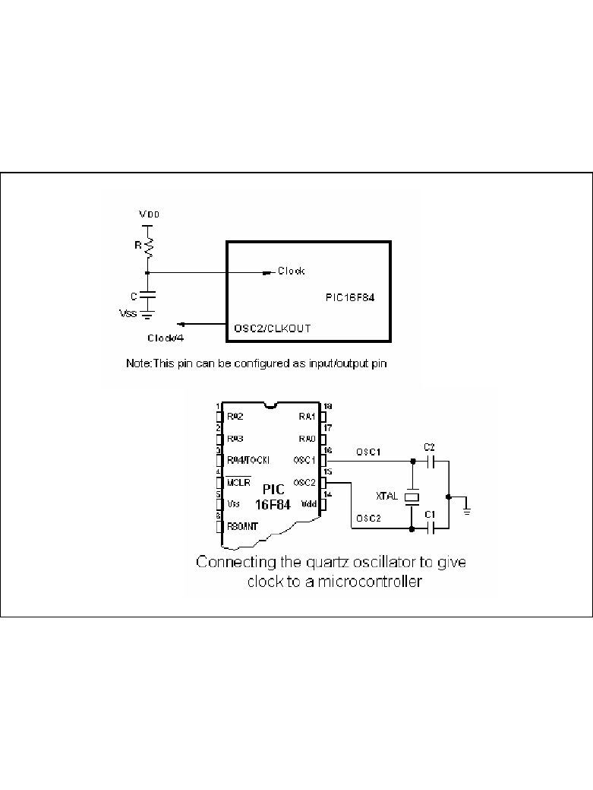
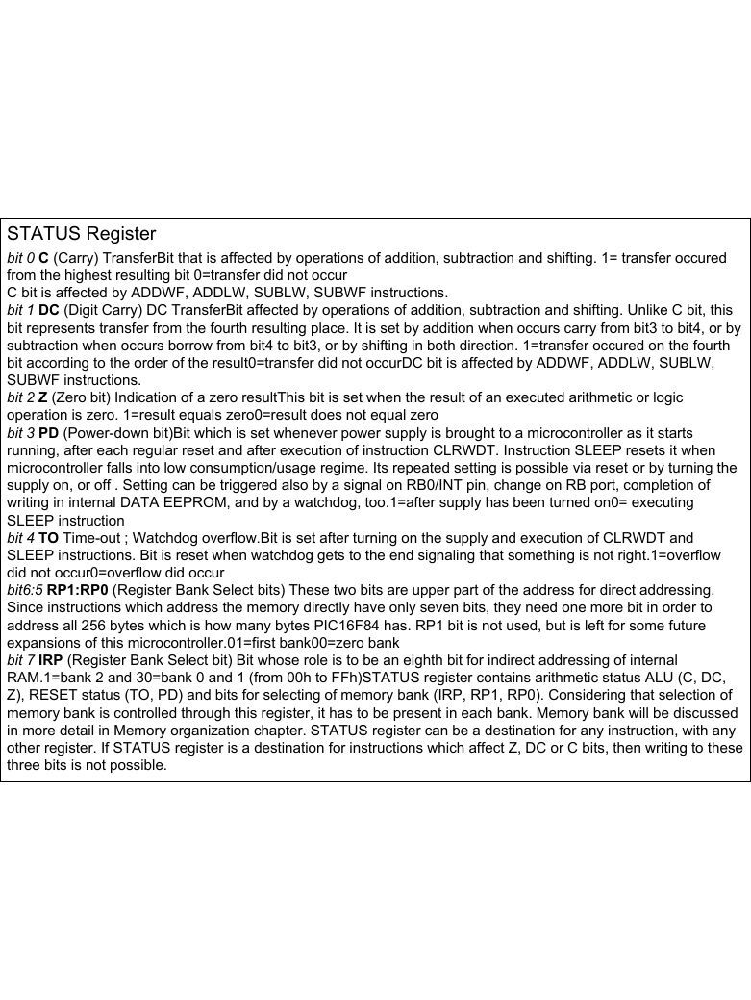
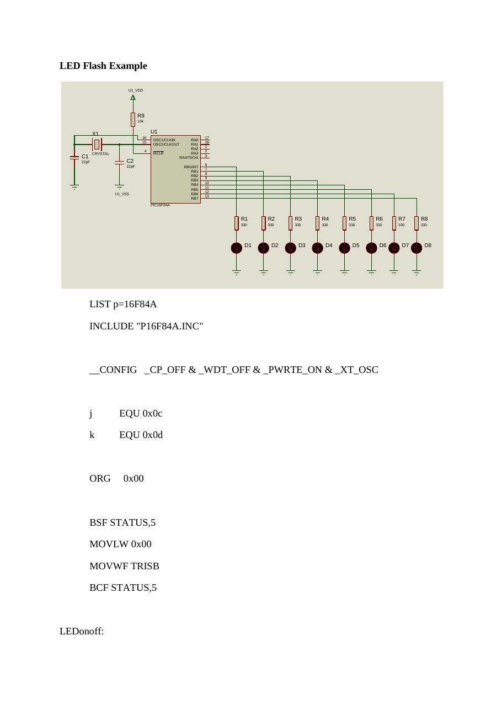
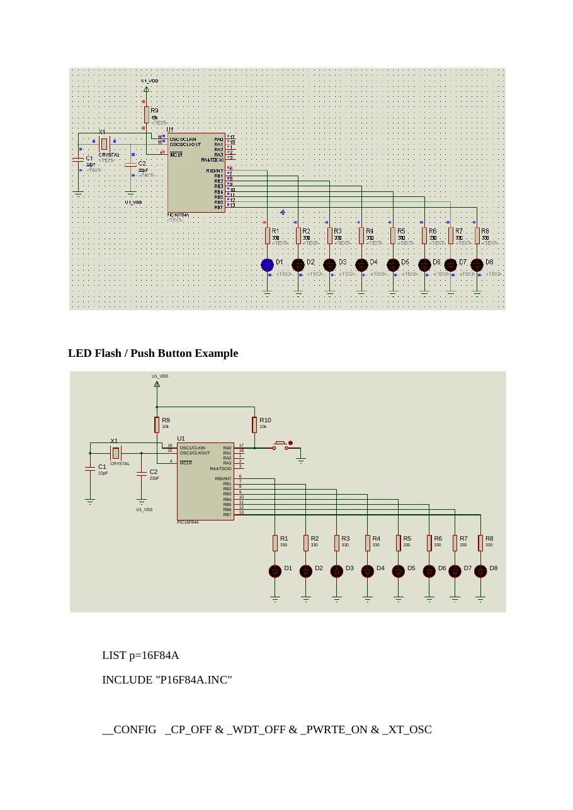
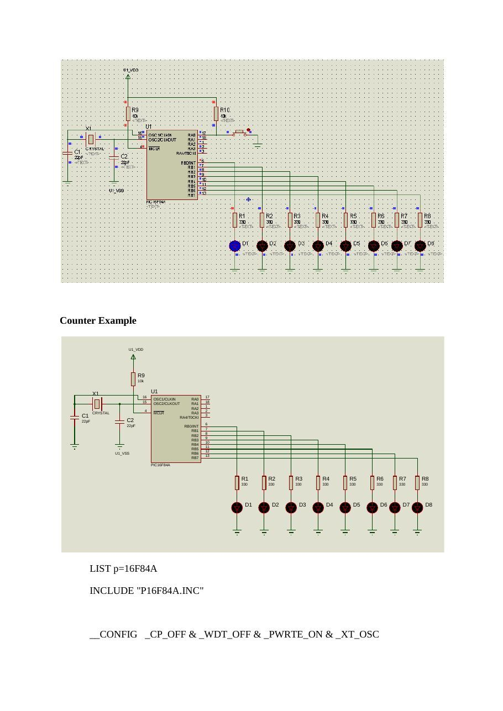

Bu yazı, Başkent Üniversitesi **EEM332 Mikroişlemciler** ders arşivindeki ilgili notları ve uygulamaları bir araya getiriyor (2006–2015). PIC16F84 portları, bellek bankaları, bit testleri, gecikme döngüleri ve LED uygulamaları. Kaynak: Başkent Üniversitesi ders sunumları ve Trakya Üniversitesi İpsala MYO, Ozan Akı, PIC Assembly komutları (9 Ocak 2009). Belgelerin PDF arşiv kopyaları ve varsa kaynak kodları yazının sonunda ZIP olarak indirilebilir.

*Bu içerik üçüncü taraf bir kaynağa aittir; arşiv ve nostalji amacıyla kaynak belirtilerek paylaşılmıştır. Hak sahibinin talebi hâlinde kaldırılır.*

## PIC

Microchip PIC Mikrodenetleyicileri EEM 332 Mikroişlemciler

PIC Nedir?

- PIC:Peripheral Interface Controller

- Çevresel Arayüz Birimi Denetleyicisi

- Amacı: Çok fonksiyonlu logic uygulamalarının

hızlı ve ucuz bir mikroişlemci ile yazılım yoluyla karşılanmasıdır

- İlk PIC: PIC16C54 (1994)

- En Popüler PIC: PIC16F(C)84

Neden PIC?

Neden PIC?

- Lojik uygulamalarının hızlı olması

- Fiyatının oldukça ucuz olması

- 8 bitlik mikrodenetleyici olması, bellek ve veri için ayrı

yerleşik bus’ ların kullanılması

- Veri ve belleğe hızlı olarak erişimin sağlanması

- PIC’e göre diğer mikrodenetleyicilerde veri ve programı

taşıyan bir tek bus bulunması, dolayısıyla PIC’ in bu özelliği ile diğer mikrodenetleyicilerden iki kat daha hızlı olması

- Yüksek frekanslarda çalışabilme özelliği

- Standby durumunda çok düşük akım çekmesi

- Azaltılmış kod yapısı (RISC yapısı) ile işlemleri daha

hızlı gerçekleştirebilmesi

Neden PIC?

- Herhangi bir ek bellek veya giriş/çıkış

elemanı gerektirmeden sadece 2 kondansatör, bir kristal ve bir direnç ile çalışabilmeleri

- Program belleğinin Eeprom olması

- Seri olarak dört adet kabloyla bulunduğu

devreden sökülmeden programlanabilmesi

RISC Programlama

- RISC: reduced instruction set computer

- Avantajları:

Komutlar daha hızlı çalıştırılır RISC tabanlı çipler daha az transistor’e ihtiyac duyar. Tasarlanması kolay ve maliyeti ucuzdur.

Komutlar - I

- Assembly dili ile PIC’e istediklerinizi yaptırmak

için 35 komut öğrenmek yeterlidir

- Yazılım Pascal, C/C++, Basic, Assembler ve

hatta Binary olarak yazılabilir

- Her komut 14 bit uzunluğundadır ve istisnai bir

kaç komut dışında (CALL, GOTO ve bit test eden BTFSS, INCFSZ gibi) her komut tek çevrimde çalışır

Komutlar - II

Komutlar - III

Accumulator

- 8086’daki kullanılan yazmaçlar

(AX,BX,CX,DX) yerine PIC yalnızca W Yazmacı’nı kullanır

- 8086’dakinin aksine, bir değeri bir

değişkene atmak istediğimizde mutlaka W yazmacını kullanmak zorundayız

W Yazmacı (W Register)

- Bu register sanal bir saklayıcıdır. İçeriğine direk ulaşmak

mümkün değildir. Ancak bütün yükleme işlemleri bu register yardımıyla yapılmaktadır.

- Bir değişkene, bir registere yada bir porta bilgi göndermek için,

önce bu bilgiyi W registerine, daha sonra W registerini ilgili porta ya da değişkene yüklemek yolunu kullanmak şarttır.

- Örnek: Bir değişkene bilgi yükleme:

```asm
MOVLW D'15'            ;W=15
MOVWF SAYAC           ;sayac=15
```

W Yazmacı (W Register)

- Örnek: Bir değişken içeriğini başka bir değişkene yükleme.

```asm
MOVF SAYAC1,W ;W=SAYAC1
MOVWF SAYAC2 ;SAYAC1=SAYAC2
```

!!! Bir değişken ya da register içeriğini W'e yüklemek için MOVF (ya da MOVFW) komutunu kullanmak şarttır. MOWLW komutunu kullanarak W'e sadece sabit bir değer yüklenebilir.

Giriş Çıkış Bacakları

```asm
Clock Uçları ve Bağlantıları
```

- PIC’in clock sinyal girişi olarak kullanılan 2 ucu vardır.

- Bu uçlara farklı tipte osilatörlerden elde edilen sinyaller

uygulanabilir. RC-Direnç/Kondansatör XT-Kristal veya seramik resonatör (XTAL) HS-Yüksek hızlı kristal veya resonatör (High Speed) LP-Düşük frekanslı kristal (Low Power)

- PIC’e bağlanan clock’un tipi programlama sırasında

konfigurasyon bitlerine yazılır.

```asm
Clock Uçları ve Bağlantıları
```

```asm
Clock Uçları ve Bağlantıları
```

Reset Devresi

Bank (16F84)

- 8086’daki

Segment’ler yerine PIC’te Bank’lar ve bankların içinde bulunan özel ve genel amaçlı Register’lar kullanılır.

Bank (16F628)

Bank (16F877)

PIC Nasıl Programlanır ?

- PIC Programlamak İçin Gerekenler

IBM uyumlu bilgisayar Metin editörü Assembler programı (MPLAB) PIC programlayıcı donanım ve yazılım

### PIC

Assembler programı (MPLAB)

- Ücretsiz bir yazılım

- Simulasyon yapılabilir

- www.microchip.com ve

www.baskent.edu.tr/~eemekdas/dersler/ee m332l.htm adreslerinden edinilebilir.

Status Yazmacı-1

- Status Yazmacı: Bank’lar arasındaki geçişi

sağlar.

Status Yazmacı-2

- BSF               STATUS,RP0                           ;Bit Set f

```asm
;(Status’da RP0)
```

- BSF               STATUS,5                             ;Bit Set f

```asm
;(Status’da Bit 5)
```

Program Bölümleri

```asm
LIST                P=16F877        Başlık Bloğu
INCLUDE             P16F877.INC
```

Adres ve Değişken #DEFINE             DEGISKEN_1                d’100’      Atama Bloğu #DEFINE             DEGISKEN_2                b’10010110’          ;=d’150’=0x96

```asm
DEGIS_3             EQU                       0x20      ;HAFIZADA SEÇİLEN BİR YERE
DEGIS_4             EQU                       0x21      ;ATANAN DEĞİŞKEN
```

```asm
ORG       0                         ;PROGRAMI 0X00’DAN BAŞLAT
```

Port Durumu Belirleme Bloğu                  Açıklama Bloğu

### BASLA

```asm
BSF       STATUS,RP0                ;BANK1’E GEÇİŞ
MOVLW     b'00000111'               ;İSTENEN I/O KONFİGURASYONU SEÇİLİR
MOVWF     TRISA                     ;TRISA REGISTER’INA ATANIR
CLRF      TRISB                     ;TRISB ÇIKIŞ MODUNA ATANIR (BÖYLECE
;PORTB’YE ATANACAK BİLGİLER ÇIKIŞ OLARAK
;GÖRÜLÜR)
BCF       STATUS,RP0                ;BANK0’A GEÇİŞ
```

```asm
MOVLW     b'00001010'               ;B PORTUNA 1010 BILGISI GONDER
MOVWF     PORTB                     ;
;         CLRF      PORTB                     DİYEREK ÇIKIŞI TAMAMEN SIFIRLAYABİLİRİZ
```

Program Bloğu

### DONGU

```asm
GOTO DONGU                          ;SONSUZ LOOP
```

Etiket Bloğu   END

Sonlandırma Bloğu

Büyük ve Küçük Harf Kullanımı

- PIC Komutlarının büyük veya küçük harfle

### yazılması önemli değildir

```asm
MoVlW=movlw=MOVLW
```

- Ancak etiketler harf büyüklüğüne duyarlıdır

Dongu≠DONGU

Başlık Bloğu

- LIST P=16F877

Kullanılacak PIC’i tanımlar

- INCLUDE             P16F877.INC

Kullanılan PIC’teki Yazmaç tanımlamaları bu dosyada saklanır. Böylece ‘Default’ olan yazmaçların teker teker tanımlanması gerekmez.

Kullanılan Sayı/Karakter Tipleri

- Hexadecimal

```asm
STATUS       EQU     0x03
```

3         Adres ve Değişken 03        Atama Bloğu 03h h’03’

```asm
MOVLW        0x03
```

h’03’ Program Bloğu 03h

- Binary

```asm
MOVLW        b’00010110’
```

- Decimal

```asm
MOVLW        d’15’
```

- ASCII Character

```asm
RETLW        ‘A’
```

CONFIG Satırı Koşul                        Yazılacak Tanım Kodu

- Konfigurasyon bit’leri, PIC’e

gerilim uygulandığı anda               Kod koruma var               _CP_ON

PIC’in uyması gereken                  Kod koruma yok               _CP_OFF

koşulları belirler.                    Power-on-reset var           _PWRTE_ON

Power-on-reset yok           _PWRTE_OFF

Watchdog timer devrede       _WDT_ON

Watchdog timer devrede yok   _WDT_OFF

Low Power Osilatör           _LP_OSC

Kristal Osilatör             _XT_OSC

High Speed Osilatör          _HS_OSC

RC Osilatör                  _RC_OSC

Örnek Program - 1

```asm
LIST             P=16F877
INCLUDE          P16F877.INC
```

```asm
ORG        0                    ;PROGRAMI 0X00’DAN BAŞLAT
```

```asm
BSF        STATUS,RP0           ;BANK1’E GEÇİŞ
CLRF       TRISD                ;TRISD ÇIKIŞ MODUNA ATANIR
BCF        STATUS,RP0           ;BANK0’A GEÇİŞ
```

```asm
MOVLW      b'01100110'          ;D PORTUNA 01100110 BILGISI GONDER
MOVWF      PORTD
```

### DONGU

```asm
GOTO DONGU                      ;SONSUZ LOOP
END
```

Örnek Program - 2

```asm
LIST           P=16F877                        CALL   BEK
INCLUDE         P16F877.INC                     MOVLW DSAYI
__CONFIG _CP_OFF & _WDT_OFF & _PWRTE_ON &            MOVWF PORTD
```

### _XT_OSC                                          CALL   BEK

```asm
;-------------------------------------------         MOVLW 0x05
```

#DEFINE    DSAYI      0xFF                           MOVWF PORTE

```asm
CNTKH      EQU        0x25                           CALL   BEK
CNTKL      EQU        0x26                           CALL   BEK
CNTKM      EQU        0x27                           GOTO   DONGU
;-------------------------------------------    ;------------------------------------------
ORG    0x00                                 BEK
```

### BASLA                                                MOVLW 0X05

```asm
CLRF   PORTA                                     MOVWF CNTKM
CLRF   PORTB                                TEKM
CLRF   PORTC                                     MOVLW 0XF0
CLRF   PORTD                                     MOVWF CNTKH
CLRF   PORTE                                TEK1
MOVLW 0XFF
BSF    STATUS,RP0                                MOVWF CNTKL
CLRF   TRISB                                TEK2
CLRF   TRISC                                     DECFSZ CNTKL,F
CLRF   TRISD                                     GOTO   TEK2
CLRF   TRISE                                     DECFSZ CNTKH,F
BCF    STATUS,RP0                                GOTO   TEK1
;-------------------------------------------         DECFSZ CNTKM,F
CALL   BEK                                       GOTO   TEKM
MOVLW b'01010101'                                RETURN
MOVWF PORTB
CALL   BEK                                  DONGU
MOVLW b'11001100'                                     GOTO BASLA
MOVWF PORTC                                           END
```

## pic_Sunum1_2013 [Uyumluluk Modu]

(Microcontroller)

PIC 16f84 8086 microprocessor

Pin no.1 RA2 Second pin on port A. Has no additional function Pin no.2 RA3 Third pin on port A. Has no additional function. Pin no.3 RA4 Fourth pin on port A. TOCK1 which functions as a timer is also found on this pin Pin no.4 MCLR Reset input and Vpp programming voltage of a microcontroller Pin no.5 Vss Ground of power supply. Pin no.6 RB0 Zero pin on port B. Interrupt input is an additional function. Pin no.7 RB1 First pin on port B. No additional function. Pin no.8 RB2 Second pin on port B. No additional function. Pin no.9 RB3 Third pin on port B. No additional function. Pin no.10 RB4 Fourth pin on port B. No additional function. Pin no.11 RB5 Fifth pin on port B. No additional function. Pin no.12 RB6 Sixth pin on port B. 'Clock' line in program mode. Pin no.13 RB7 Seventh pin on port B. 'Data' line in program mode. Pin no.14 Vdd Positive power supply pole. Pin no.15 OSC2 Pin assigned for connecting with an oscillator Pin no.16 OSC1 Pin assigned for connecting with an oscillator Pin no.17 RA2 Second pin on port A. No additional function Pin no.18 RA1 First pin on port A. No additional function.

Memory organization PIC16F84 has two separate memory blocks, one for data and the other for program. EEPROM memory and GPR registers in RAM memory make up a data block, and FLASH memory makes up a program block.

### Program memory

Program memory has been realized in FLASH technology which makes it possible to program a microcontroller many times before it's installed into a device, and even after its installment if eventual changes in program or process parameters should occur. The size of program memory is 1024 locations with 14 bits width where locations zero and four are reserved for reset and interrupt vector.

Data memory

Data memory consists of EEPROM and RAM memories. EEPROM memory consists of 64 eight bit locations whose contents is not lost during loosing of power supply. EEPROM is not directly addressible, but is accessed indirectly through EEADR and EEDATA registers. As EEPROM memory usually serves for storing important parameters (for example, of a given temperature in temperature regulators) , there is a strict procedure for writing in EEPROM which must be followed in order to avoid accidental writing. RAM memory for data occupies space on a memory map from location 0x0C to 0x4F which comes to 68 locations. Locations of RAM memory are also called GPR registers which is an abbreviation for General Purpose Registers. GPR registers can be accessed regardless of which bank is selected at the moment.

Osilator: RC, Crystal,..

Simple Power supply

2.2 Reset Reset is used for putting the microcontroller into a 'known' condition. That practically means that microcontroller can behave rather inaccurately under certain undesirable conditions. In order to continue its proper functioning it has to be reset, meaning all registers would be placed in a starting position. Reset is not only used when microcontroller doesn't behave the way we want it to, but can also be used when trying

```asm
out a device as an interrupt in program execution, or to get a microcontroller ready when
```

reading in a program.

SFR registers Registers (Special Function Registers) which take up first 12 locations in banks 0 and 1 are registers of specialized function assigned with certain blocks of the microcontroller

STATUS Register

I/O selection (Bidirectional ports)

### PORTB

: The example shows how pins 0, 1, 2, and 3 are declared for input, and pins 4, 5, 6, and 7 for output.

Example shows how pins 0, 1, 2, 3, and 4 are declared to be input,

### PORTA

```asm
and pins 5, 6, and 7 to be output pins.
```

STATUS Register bit 0 C (Carry) TransferBit that is affected by operations of addition, subtraction and shifting. 1= transfer occured from the highest resulting bit 0=transfer did not occur C bit is affected by ADDWF, ADDLW, SUBLW, SUBWF instructions. bit 1 DC (Digit Carry) DC TransferBit affected by operations of addition, subtraction and shifting. Unlike C bit, this bit represents transfer from the fourth resulting place. It is set by addition when occurs carry from bit3 to bit4, or by

```asm
subtraction when occurs borrow from bit4 to bit3, or by shifting in both direction. 1=transfer occured on the fourth
```

bit according to the order of the result0=transfer did not occurDC bit is affected by ADDWF, ADDLW, SUBLW,

```asm
SUBWF instructions.
```

bit 2 Z (Zero bit) Indication of a zero resultThis bit is set when the result of an executed arithmetic or logic operation is zero. 1=result equals zero0=result does not equal zero bit 3 PD (Power-down bit)Bit which is set whenever power supply is brought to a microcontroller as it starts running, after each regular reset and after execution of instruction CLRWDT. Instruction SLEEP resets it when microcontroller falls into low consumption/usage regime. Its repeated setting is possible via reset or by turning the supply on, or off . Setting can be triggered also by a signal on RB0/INT pin, change on RB port, completion of writing in internal DATA EEPROM, and by a watchdog, too.1=after supply has been turned on0= executing SLEEP instruction bit 4 TO Time-out ; Watchdog overflow.Bit is set after turning on the supply and execution of CLRWDT and SLEEP instructions. Bit is reset when watchdog gets to the end signaling that something is not right.1=overflow did not occur0=overflow did occur bit6:5 RP1:RP0 (Register Bank Select bits) These two bits are upper part of the address for direct addressing. Since instructions which address the memory directly have only seven bits, they need one more bit in order to

```asm
address all 256 bytes which is how many bytes PIC16F84 has. RP1 bit is not used, but is left for some future
```

expansions of this microcontroller.01=first bank00=zero bank bit 7 IRP (Register Bank Select bit) Bit whose role is to be an eighth bit for indirect addressing of internal RAM.1=bank 2 and 30=bank 0 and 1 (from 00h to FFh)STATUS register contains arithmetic status ALU (C, DC, Z), RESET status (TO, PD) and bits for selecting of memory bank (IRP, RP1, RP0). Considering that selection of memory bank is controlled through this register, it has to be present in each bank. Memory bank will be discussed

```asm
in more detail in Memory organization chapter. STATUS register can be a destination for any instruction, with any
```

other register. If STATUS register is a destination for instructions which affect Z, DC or C bits, then writing to these three bits is not possible.

Creating time delays in 8088/8086 based system for a delay loop Or Timer

```asm
MOV CX,N
Again: LOOP again
```

Evrey loop takes total of 17 clock pulse to be executed so the time delay is Nx17 example : system frequency is 4.7 MHZ (t=210 ns). For 100ms delay its needed N) 28000

Another way for delay generation is using of external hardware timers

### Q                             Q                          Q

### D                            D                           D

Asynchronous Counter

```asm
CLK
```

Synchronous Counter

### Q                     Q                          Q

### D                      D                          D

```asm
CLK
BUFGP
```

OPTION register (Timer)

bit 0:2 PS0, PS1, PS2 (Prescaler Rate Select bit) These three bits define prescaler rate select bit. What a prescaler is and how these bits can affect the work of a microcontroller will be explained in section on TMR0. bit 3 PSA (Prescaler Assignment bit)Bit which assigns prescaler between TMR0 and watchdog.1=prescaler is assigned to watchdog0=prescaler is assigned to a free-run timer TMR0 bit 4 T0SE (TMR0 Source Edge Select bit)If it is allowed to trigger TMR0 by impulses from the pin RA4/T0CKI, this bit determines whether this will be to the falling or rising edge of a signal.1=falling edge0=rising edge bit 5 TOCS (TMR0 Clock Source Select bit)This pin enables free-run timer to increment its state either from internal oscillator on every ¼ oscillator clock, or through external impulses on RA4/T0CKI pin.1=external impulses0=1/4 internal clock bit 6 INTEDG (Interrupt Edge Select bit)If interrupt is enabled possible this bit will determine the edge at which an interrupt will be activated on pin RB0/INT.1=rising edge0=falling edge bit 7 RBPU (PORTB Pull-up Enable bit) This bit turns on and off internal 'pull-up' resistors on port B.1= "pull-up" resistors turned off 0= "pull-up" resistors turned on

Timer

İnterrupt Register (INTCON Register )

Interrupt initialization

İnterrupt Register (INTCON Register )

bit 0 RBIF (RB Port Change Interrupt Flag bit) Bit which informs about changes on pins 4, 5, 6 and 7 of port B.1=at least one pin has changed its status0=no change occured on any of the pins bit 1 INTF (INT External Interrupt Flag bit) External interrupt occured.1=interrupt occured0=interrupt did not occurIf a rising or falling edge was detected on pin RB0/INT, (which is defined with bit INTEDG in OPTION register), bit INTF is set. Bit must be cleared in interrupt subprogram in order to detect the next interrupt. bit 2 T0IF (TMR0 Overflow Interrupt Flag bit) Overflow of counter TMR0.1= counter changed its status from FFh to 00h0=overflow did not occurBit must be cleared in program in order for an interrupt to be detected .bit 3 RBIE (RB port change Interrupt Enable bit) Enables interrupts to occur at the change of status of pins 4, 5, 6, and 7 of port B. 1= enables interrupts at the change of status0=interrupts disabled at the change of statusIf RBIE and RBIF were simultaneously set, an interrupt would occur. bit 4 INTE (INT External Interrupt Enable bit) Bit which enables external interrupt from pin RB0/INT.1=external interrupt enabled0=external interrupt disabledIf INTE and INTF were set simultaneously, an interrupt would occur .bit 5 T0IE (TMR0 Overflow Interrupt Enable bit) Bit which enables interrupts during counter TMR0 overflow.1=interrupt enabled0=interrupt disabledIf T0IE and T0IF were set simultaneously, interrupt would occur. Bit 6 EEIE (EEPROM Write Complete Interrupt Enable bit) Bit which enables an interrupt at the end of a writing routine to EEPROM1=interrupt enabled0=interrupt disabledIf EEIE and EEIF (which is

```asm
in EECON1 register) were set simultaneously , an interrupt would occur.
```

Bit 7 GIE (Global Interrupt Enable bit) Bit which enables or disables all interrupts.1=all interrupts are enabled0=all interrupts are disabledPIC16F84 has four interrupt sources:1. Termination of writing data to EEPROM2. TMR0 interrupt caused by timer overflow3. Interrupt during alteration on RB4, RB5, RB6 and RB7 pins of port B.4. External interrupt from RB0/INT pin of microcontroller

Instructions

### Example

Optocoupler on an input line (İzolation) The way it works is simple: when a signal arrives, the LED within the optocoupler is turned on, and it shines on the base of a photo-transistor within the same case. When the transistor is activated, the voltage between collector and emitter falls to 0.5V or less

```asm
and the microcontroller sees this as a logic zero on its RA4 pin. The example below is a
```

counter, used for counting products on production line, determining motor speed, counting the number of revolutions of an axis etc. Let the sensor be a micro-switch. Each time the switch is closed, the LED is illuminated. The LED 'transfers' the signal to the phototransistor and the operation of the photo-transistor delivers a LOW to input RA4 of a microcontroller. A program in the microcontroller will be needed to prevent false counting and an indicator connected to any of the outputs of the microcontroller will shows the current state of the counter.

(Relay control)

Seven-Segment Display (multiplexing) The segments in a 7-segment display are arranged to form a single digit from 0 to F as

### shown in the animation

Shift registers for 16f84 There are two types of shift registers: input and output. Input shift registers receive data in parallel, through 8 lines and then send it serially through two lines to a microcontroller. Output shift registers work in the opposite direction; they receive serial data and on a "latch" line signal, they turn it into parallel data. Shift registers are generally used to expand the number of input-output lines of a microcontroller. They are not so much in use any more though, because most modern microcontrollers have a large number of input/output lines. However, their use with microcontrollers such as PIC16F84 is very important.

How to connect an input shift register to a microcontroller

### Serial Communication

Connecting a microcontroller to a PC via a MAX232 line interface chip.

![pic_Sunum1_2013 [Uyumluluk Modu]: sayfa 1, devre, tablo ve şekiller](sekil-1029-01.jpg "pic_Sunum1_2013 [Uyumluluk Modu], sayfa 1.")

![pic_Sunum1_2013 [Uyumluluk Modu]: sayfa 4, devre, tablo ve şekiller](sekil-1029-04.jpg "pic_Sunum1_2013 [Uyumluluk Modu], sayfa 4.")

## Pic_sunum2_2013 [Uyumluluk Modu]

Program Örneği 1: PIC’ e enerji verildiği anda PORTA da basılı bütona karşılık gelen B Portundaki LED’ leri söndüren bir program yazalım.

Inputs

Outputs

Sonsuz Döngü: PIC16F84 de duraklama komutu olmadığı için Döngü kullanılmaktadır. Programda bekleme yerine yeni butonların durumu okunmak isterse,

### KARAR İÇİN BİT TEST ETME İŞLEMİ

Herhangi bir register içindeki bir bit BTFSC ve BTFSS komutları ile test edilip sonuca göre ya bir sonraki (sıradaki) satırdan devam edebilir yada bir satır atlanabilir (Program Yönlendirilir).

```asm
BTFSC Komutu: Bu komut ingilizcede “File Register bitini test et, bu bit
```

(0) ise bir sonraki komuta atla” anlamına gelmektedir.

```asm
BTFSS Komutu: Bu komut ise BTFSC komutuna benzerdir. Ancak, file
```

register bitinin (0) yerine (1) olduğunu test etmektedir. Bu bit eğer (1) ise komuttan sonraki (sıradaki) komut atlanmakta; değilse (0) ise sıradaki komuttan devam edilmektedir.

```asm
NOT: PORTA ve PORTB’ nin
```

önceden tanımlandığı kabul edilmiştir.

Program Örneği 2: ( Yukarıdaki aynı devre için) A portunun 2. bitindeki butona basınca B portunun (RB0,.........,RB4) LED’ lerini yakan bir program yazalım.

Program3: PortB’nin 0. Bitine bağlı LED’I, A portunun 1. Bit’indeki butona basınca yakan program

```asm
LIST P=16F84
INCLUDE "P16F84.INC"
CLRF PORTB
BSF STATUS, 5
CLRF TRISB
MOVLW H'FF'
MOVWF TRISA
BCF STATUS, 5
TEST_PORTA
BTFSC PORTA, 1
GOTO TEST_PORTA
BSF PORTB, 0
DONGU
GOTO DONGU
END
```

Program Örneği 4: PORTA’ nın 5. bitine bağlı buton normalde (0) durumunda olup butona basılınca (1) gönderilmektedir. PORTA’ nın 5. bitine 1 (RA5 = 1) gelince B portuna bağlı 8 LED’ in tamamının yanması istenmektedir. Akış diyagramı ile birlikte programı PIC16F84 için yazınız.

### DÖNGÜ KULLANMAK

Bazen belli işlem ya da işlemlerin belirli sayıda tekrarlanması istenebilir. Böyle bir durumda bir register SAYAÇ olarak kullanılır. Genellikle tekrar sayısı ( SAYAÇ)’ a yüklendikten sonra her seferinde ( SAYAÇ ) 1 azaltılarak ( 0 )’ a ulaşılana kadar Döngü devamı ettirilir. Bu amaçla DECFSZ komutu kullanılması gerekir. Bu komut her icra edildiğinde bu register ( burada SAYAC ) 1 azaltılır ve SAYAC =0 olunca bir sonraki komuta atlanır. Aksi halde ( SAYAC ≠0 ise )

```asm
DECFSZ komutundan hemen sonraki (sıradaki) komut icra edilir.
```

Aşağıdaki program parçasında SAYAC’ ın daha önce tanımladığı ve belli bir değerle ( döngü sayısı ) yüklendiği farz edilmiştir. Döngü bitince PORTB’ ye ( FF ) yüklenmektedir.

### KARŞILAŞTIRMA İŞLEMİ VE DÖNGÜ

SAYAC her zaman azalan yönde çalışmaz. Her döngüde SAYAC’ ın arttığı durumlarda SAYAC değeri istenen bir sayı ile karşılaştırılmalıdır. Eşitlik sağlanınca döngü sona erdirilir. Örnek olarak ( 09 ) kere tekrarlanan tekrar etiketli bir döngü ( çevrim ) düzenleyelim: ( Program parçası )

Yeni değişken atama ve gecikme döngüsü oluşturma

```asm
LIST P=16F84
INCLUDE "P16F84.INC"
SAYAC EQU H'0C'
CLRF PORTB
BSF STATUS, 5
CLRF TRISB
MOVLW H'FF'
MOVWF TRISA
BCF STATUS, 5
BASLA
MOVLW H'0F'
MOVWF SAYAC
TEST
DECFSZ SAYAC, F
GOTO TEST
CLRW
DONGU
GOTO DONGU
END
```

Program12. portB’ye bağlı 8 LED vardır.. Burada bir LED’ın yanışı kayarak devam eder.. Yanarak kayan LED en sona geldiğinde tüm LED’ler söner.

```asm
LIST P=16F84A               DONGU
INCLUDE "P16F84A.INC"       GOTO DONGU
SAYAC1 EQU H'0C'            GECIKME
SAYAC2 EQU H'0D'            MOVLW H'0F'
CLRF PORTB                  MOVWF SAYAC1
BCF STATUS, 0               DONGU1
BSF STATUS, 5               MOVLW H'0F'
CLRF TRISB                  MOVWF SAYAC2
BCF STATUS, 5               DONGU2
MOVLW H'01'                 DECFSZ SAYAC2, F
MOVWF PORTB                 GOTO DONGU2
```

### TEKRAR                      DECFSZ SAYAC1, F

```asm
CALL GECIKME                GOTO DONGU1
RLF PORTB, F                RETURN
BTFSS STATUS, 0             END
GOTO TEKRAR
```

Program6: A portunun 1.bitine bağlı butona 10 defa basılınca B portunun 0.bitindeki LED’I yakan program.

```asm
LIST P=16F84           NOP
INCLUDE "P16F84.INC"   NOP
SAYAC EQU H'0C'        NOP
CLRF PORTB             NOP
BSF STATUS, 5          NOP
CLRF TRISB             NOP
MOVLW H'FF'            NOP
MOVWF TRISA            NOP
BCF STATUS, 5          NOP
```

### BASLA                  NOP

```asm
MOVLW D'10'            NOP
MOVWF SAYAC            NOP
TEST                   NOP
BTFSC PORTA, 1         DECFSZ SAYAC, F
GOTO TEST              GOTO TEST
NOP                    BSF PORTB, 0
NOP                    END
```

Look up Table: 7 segment üzerinde “5” sayısını gösteren program “5”=“05h”=01101101b = ‘6Dh’ LIST P=16F84A             RETLW H'5B'

```asm
INCLUDE "P16F84A.INC"    RETLW H'4F'
CLRF PORTB               RETLW H'66'
BSF STATUS, 5            RETLW H'6D'
CLRF TRISB               RETLW H'7D'
BCF STATUS, 5            RETLW H'07'
```

### BASLA                    RETLW H'7F'

```asm
MOVLW H'05'              RETLW H'6F'
CALL CEV_TAB             RETLW H'77'
MOVWF PORTB              RETLW H'7C'
```

### DONGU                    RETLW H'39'

```asm
GOTO DONGU               RETLW H'5E'
```

### CEV_TAB                  RETLW H'79'

```asm
ADDWF PCL,F              RETLW H'71'
RETLW H'3F'              RETLW H'80'
RETLW H'06'              END
```

Program10--Zaman gecikme döngüsü kullanarak, porB’ye bağlı olan tüm LED’leri belirli zaman aralıklarıyla yakıp-söndüren program.

```asm
LIST P=16F84A           GOTO TEKRAR
INCLUDE "P16F84A.INC" GECIKME
SAYAC1 EQU H'0C'       MOVLW H'FF'
SAYAC2 EQU H'0D'      MOVWF SAYAC1
CLRF PORTB            DONGU1
BSF STATUS, 5           MOVLW H'FF'
CLRF TRISB              MOVWF SAYAC2
BCF STATUS, 5         DONGU2
```

### TEKRAR                   DECFSZ SAYAC2, F

```asm
MOVLW H'00'            GOTO DONGU2
MOVWF PORTB            DECFSZ SAYAC1, F
CALL GECIKME            GOTO DONGU1
MOVLW H'FF'             RETURN
MOVWF PORTB            END
CALL GECIKME
```

Program 22–Port B uçlarına bağlı 7 segment display’de 0-F arasında saydıran program. Sayılar arası gecikme kullanılmıştır.

```asm
RETLW H'7C'
LIST P=16F84A          MOVWF PORTB             RETLW H'39'
INCLUDE "P16F84A.INC"     INCF SAYAC, F          RETLW H'5E'
SAYAC1 EQU H'0C'        CALL GECIKME           RETLW H'79'
SAYAC2 EQU H'0D'       GOTO DONGU             RETLW H'71‘ F
SAYAC EQU H'0E'
CLRF PORTB          CEV7SEG                 GECIKME
BSF STATUS, 5          ADDWF PCL,F            MOVLW H'FF'
CLRF TRISB          RETLW H'3F‘ 0              MOVWF SAYAC1
BCF STATUS, 5       RETLW H'06‘ 1           DONGU1
```

### BASLA                  RETLW H'5B‘ 2              MOVLW H'FF'

```asm
MOVLW H'00'         RETLW H'4F‘ 3              MOVWF SAYAC2
MOVWF SAYAC         RETLW H'66‘ 4           DONGU2
```

### DONGU                 RETLW H'6D‘ 5             DECFSZ SAYAC2, F

```asm
MOVF SAYAC, W       RETLW H'7D‘…              GOTO DONGU2
ANDLW B'00001111' RETLW H'07'                  DECFSZ SAYAC1, F
CALL CEV7SEG        RETLW H'7F'               GOTO DONGU1
RETLW H'6F'               RETURN
RETLW H'77'               END
```

Program 26--PortB’nin 0. Bitine bağlı LED’ı flash yaptıran program.LED’in yanıp sönme gecikmesini, TMR0 sayıcısı yapmaktadır. Timer ,dahili clock ile çalışır.

```asm
LIST P=16F84A                  CLRF PORTB
INCLUDE "P16F84A.INC"        YAK
CLRF PORTB                    BSF PORTB,0
BSF STATUS, 5                 CALL GECIKME
CLRF TRISB                   SONDUR
BCF STATUS, 5                  BCF PORTB,0
```

Basla                           CALL GECIKME

```asm
CLRWDT                         GOTO YAK
BSF STATUS,5                 GECIKME
MOVLW b’11010111’              CLRF TMR0
MOVWF OPTION_REG             TEST_BIT
BCF STATUS,5                   BTFSS TMR0,5
GOTO TEST_BIT
RETURN
END
```

Program28– PortB’deki LED’lerin binary olarak artan sayıların gösterilmesini sağlayan program. TMR0 ve ilgili kesme kullanılmıştır.

```asm
LIST P=16F84A                  MOVLW b’10100000’
INCLUDE "P16F84A.INC"          MOVWF INTCON
ORG h’00’                     CLRF PORTB
GOTO BASLA                   DONGU
ORG h’04’                       GOTO DONGU
GOTO LED_YAK                 LED_YAK
```

### BASLA                           BCF INTCON,T0IF

```asm
BSF STATUS,5                 INCF PORTB,F
CLRF TRISB                     MOVLW h’00’
MOVLW b’00000111’              MOVWF TMR0
MOVWF OPTION_REG               RETFIE
BCF STATUS,5                   END
MOVLW h’00
MOVWF TMR0
```

![Pic_sunum2_2013 [Uyumluluk Modu]: sayfa 1, devre, tablo ve şekiller](sekil-1025-01.jpg "Pic_sunum2_2013 [Uyumluluk Modu], sayfa 1.")

![Pic_sunum2_2013 [Uyumluluk Modu]: sayfa 4, devre, tablo ve şekiller](sekil-1025-04.jpg "Pic_sunum2_2013 [Uyumluluk Modu], sayfa 4.")

## pic_application

(Microcontroller)

Simple Power supply

2.2 Reset Reset is used for putting the microcontroller into a 'known' condition. That practically means that microcontroller can behave rather inaccurately under certain undesirable conditions. In order to continue its proper functioning it has to be reset, meaning all registers would be placed in a starting position. Reset is not only used when microcontroller doesn't behave the way we want it to, but can also be used when trying

```asm
out a device as an interrupt in program execution, or to get a microcontroller ready when
```

reading in a program.

I/O selection

STATUS Register bit 0 C (Carry) TransferBit that is affected by operations of addition, subtraction and shifting. 1= transfer occured from the highest resulting bit 0=transfer did not occur C bit is affected by ADDWF, ADDLW, SUBLW, SUBWF instructions. bit 1 DC (Digit Carry) DC TransferBit affected by operations of addition, subtraction and shifting. Unlike C bit, this bit represents transfer from the fourth resulting place. It is set by addition when occurs carry from bit3 to bit4, or by

```asm
subtraction when occurs borrow from bit4 to bit3, or by shifting in both direction. 1=transfer occured on the fourth
```

bit according to the order of the result0=transfer did not occurDC bit is affected by ADDWF, ADDLW, SUBLW,

```asm
SUBWF instructions.
```

bit 2 Z (Zero bit) Indication of a zero resultThis bit is set when the result of an executed arithmetic or logic operation is zero. 1=result equals zero0=result does not equal zero bit 3 PD (Power-down bit)Bit which is set whenever power supply is brought to a microcontroller as it starts running, after each regular reset and after execution of instruction CLRWDT. Instruction SLEEP resets it when microcontroller falls into low consumption/usage regime. Its repeated setting is possible via reset or by turning the supply on, or off . Setting can be triggered also by a signal on RB0/INT pin, change on RB port, completion of writing in internal DATA EEPROM, and by a watchdog, too.1=after supply has been turned on0= executing SLEEP instruction bit 4 TO Time-out ; Watchdog overflow.Bit is set after turning on the supply and execution of CLRWDT and SLEEP instructions. Bit is reset when watchdog gets to the end signaling that something is not right.1=overflow did not occur0=overflow did occur bit6:5 RP1:RP0 (Register Bank Select bits) These two bits are upper part of the address for direct addressing. Since instructions which address the memory directly have only seven bits, they need one more bit in order to

```asm
address all 256 bytes which is how many bytes PIC16F84 has. RP1 bit is not used, but is left for some future
```

expansions of this microcontroller.01=first bank00=zero bank bit 7 IRP (Register Bank Select bit) Bit whose role is to be an eighth bit for indirect addressing of internal RAM.1=bank 2 and 30=bank 0 and 1 (from 00h to FFh)STATUS register contains arithmetic status ALU (C, DC, Z), RESET status (TO, PD) and bits for selecting of memory bank (IRP, RP1, RP0). Considering that selection of memory bank is controlled through this register, it has to be present in each bank. Memory bank will be discussed

```asm
in more detail in Memory organization chapter. STATUS register can be a destination for any instruction, with any
```

other register. If STATUS register is a destination for instructions which affect Z, DC or C bits, then writing to these three bits is not possible.

OPTION register (Timer)

bit 0:2 PS0, PS1, PS2 (Prescaler Rate Select bit) These three bits define prescaler rate select bit. What a prescaler is and how these bits can affect the work of a microcontroller will be explained in section on TMR0. bit 3 PSA (Prescaler Assignment bit)Bit which assigns prescaler between TMR0 and watchdog.1=prescaler is assigned to watchdog0=prescaler is assigned to a free-run timer TMR0 bit 4 T0SE (TMR0 Source Edge Select bit)If it is allowed to trigger TMR0 by impulses from the pin RA4/T0CKI, this bit determines whether this will be to the falling or rising edge of a signal.1=falling edge0=rising edge bit 5 TOCS (TMR0 Clock Source Select bit)This pin enables free-run timer to increment its state either from internal oscillator on every ¼ oscillator clock, or through external impulses on RA4/T0CKI pin.1=external impulses0=1/4 internal clock bit 6 INTEDG (Interrupt Edge Select bit)If interrupt is enabled possible this bit will determine the edge at which an interrupt will be activated on pin RB0/INT.1=rising edge0=falling edge bit 7 RBPU (PORTB Pull-up Enable bit) This bit turns on and off internal 'pull-up' resistors on port B.1= "pull-up" resistors turned off 0= "pull-up" resistors turned on

İnterrupt Register

İnterrupt Register

bit 0 RBIF (RB Port Change Interrupt Flag bit) Bit which informs about changes on pins 4, 5, 6 and 7 of port B.1=at least one pin has changed its status0=no change occured on any of the pins bit 1 INTF (INT External Interrupt Flag bit) External interrupt occured.1=interrupt occured0=interrupt did not occurIf a rising or falling edge was detected on pin RB0/INT, (which is defined with bit INTEDG in OPTION register), bit INTF is set. Bit must be cleared in interrupt subprogram in order to detect the next interrupt. bit 2 T0IF (TMR0 Overflow Interrupt Flag bit) Overflow of counter TMR0.1= counter changed its status from FFh to 00h0=overflow did not occurBit must be cleared in program in order for an interrupt to be detected .bit 3 RBIE (RB port change Interrupt Enable bit) Enables interrupts to occur at the change of status of pins 4, 5, 6, and 7 of port B. 1= enables interrupts at the change of status0=interrupts disabled at the change of statusIf RBIE and RBIF were simultaneously set, an interrupt would occur. bit 4 INTE (INT External Interrupt Enable bit) Bit which enables external interrupt from pin RB0/INT.1=external interrupt enabled0=external interrupt disabledIf INTE and INTF were set simultaneously, an interrupt would occur .bit 5 T0IE (TMR0 Overflow Interrupt Enable bit) Bit which enables interrupts during counter TMR0 overflow.1=interrupt enabled0=interrupt disabledIf T0IE and T0IF were set simultaneously, interrupt would occur. Bit 6 EEIE (EEPROM Write Complete Interrupt Enable bit) Bit which enables an interrupt at the end of a writing routine to EEPROM1=interrupt enabled0=interrupt disabledIf EEIE and EEIF (which is

```asm
in EECON1 register) were set simultaneously , an interrupt would occur.
```

Bit 7 GIE (Global Interrupt Enable bit) Bit which enables or disables all interrupts.1=all interrupts are enabled0=all interrupts are disabledPIC16F84 has four interrupt sources:1. Termination of writing data to EEPROM2. TMR0 interrupt caused by timer overflow3. Interrupt during alteration on RB4, RB5, RB6 and RB7 pins of port B.4. External interrupt from RB0/INT pin of microcontroller

(Relay control)

Seven-Segment Display (multiplexing) The segments in a 7-segment display are arranged to form a single digit from 0 to F as

### shown in the animation

Serial Communication





## pic_examples

LED Flash Example

### U1_VDD

### R9

10k

### X1                             U1

16                               17

### OSC1/CLKIN       RA0

15                               18

### OSC2/CLKOUT      RA1

### RA2

4                            2

### CRYSTAL                         MCLR             RA3

### C1                                                RA4/T0CKI

22pF                 C2 22pF                                      6

### RB0/INT

### RB1

### RB2

### RB3

### RB4

### RB5

### U1_VSS                                 RB6

### RB7

### PIC16F84A

### R1    R2    R3    R4    R5    R6    R7    R8

330   330   330   330   330   330   330   330

### D1    D2    D3    D4    D5    D6    D7    D8

```asm
LIST p=16F84A
```

```asm
INCLUDE "P16F84A.INC"
```

```asm
__CONFIG _CP_OFF & _WDT_OFF & _PWRTE_ON & _XT_OSC
```

```asm
j            EQU 0x0c
```

```asm
k            EQU 0x0d
```

```asm
ORG            0x00
```

```asm
BSF STATUS,5
```

```asm
MOVLW 0x00
```

```asm
MOVWF TRISB
```

```asm
BCF STATUS,5
```

### LEDonoff

```asm
movlw b'00000001'
```

```asm
movwf PORTB
```

```asm
call delay
```

```asm
movlw b'00000000'
```

```asm
movwf PORTB
```

```asm
call delay
```

```asm
goto LEDonoff
```

### delay

```asm
movlw d'200'
```

```asm
movwf j
```

```asm
jloop:
```

```asm
movwf k
```

### kloop

```asm
decfsz k,f
```

```asm
goto kloop
```

```asm
decfsz j,f
```

```asm
goto jloop
```

```asm
return
```

```asm
End
```

LED Flash / Push Button Example

### U1_VDD

### R9                                      R10

10k                                     10k

### X1                             U1

16                               17

### OSC1/CLKIN       RA0

15                               18

### OSC2/CLKOUT      RA1

### RA2

4                            2

### CRYSTAL                         MCLR             RA3

### C1                                                RA4/T0CKI

22pF                 C2 22pF                                      6

### RB0/INT

### RB1

### RB2

### RB3

### RB4

### RB5

### U1_VSS                                 RB6

### RB7

### PIC16F84A

### R1    R2    R3    R4    R5    R6    R7    R8

330   330   330   330   330   330   330   330

### D1    D2    D3    D4    D5    D6    D7    D8

```asm
LIST p=16F84A
```

```asm
INCLUDE "P16F84A.INC"
```

```asm
__CONFIG _CP_OFF & _WDT_OFF & _PWRTE_ON & _XT_OSC
```

```asm
ORG   0x00
```

```asm
CLRF PORTB
```

```asm
BSF STATUS,5
```

```asm
MOVLW 0x00
```

```asm
MOVWF TRISB
```

```asm
MOVLW 0x01
```

```asm
MOVWF TRISA
```

```asm
BCF STATUS,5
```

### LEDcntrl

```asm
BTFSS PORTA,0
```

```asm
GOTO TURN_ON
```

```asm
BCF PORTB,0
```

```asm
GOTO LEDcntrl
```

### TURN_ON

```asm
BSF PORTB,0
```

```asm
GOTO LEDcntrl
```

```asm
End
```

Counter Example

### U1_VDD

### R9

10k

### X1                             U1

16                               17

### OSC1/CLKIN       RA0

15                               18

### OSC2/CLKOUT      RA1

### RA2

4                            2

### CRYSTAL                         MCLR             RA3

### C1                                                RA4/T0CKI

22pF                 C2 22pF                                      6

### RB0/INT

### RB1

### RB2

### RB3

### RB4

### RB5

### U1_VSS                                 RB6

### RB7

### PIC16F84A

### R1    R2    R3    R4    R5    R6    R7    R8

330   330   330   330   330   330   330   330

### D1    D2    D3    D4    D5    D6    D7    D8

```asm
LIST p=16F84A
```

```asm
INCLUDE "P16F84A.INC"
```

```asm
__CONFIG _CP_OFF & _WDT_OFF & _PWRTE_ON & _XT_OSC
```

```asm
j       EQU 0x0c
```

```asm
k       EQU 0x0d
```

```asm
ORG       0x00
```

```asm
CLRF PORTB
```

```asm
BSF STATUS,5
```

```asm
MOVLW 0x00
```

```asm
MOVWF TRISB
```

```asm
BCF STATUS,5
```

### MLOOP

```asm
INCF PORTB,F
```

```asm
CALL DELAY
```

```asm
GOTO MLOOP
```

### DELAY

```asm
movlw d'200'
```

```asm
movwf j
```

```asm
jloop:
```

```asm
movwf k
```

### kloop

```asm
decfsz k,f
```

```asm
goto kloop
```

```asm
decfsz j,f
```

```asm
goto jloop
```

```asm
return
```

```asm
End
```

```asm
Push Button Counter
```

### U1_VDD

### R9                                      R10

10k                                     10k

### X1                             U1

16                               17

### OSC1/CLKIN       RA0

15                               18

### OSC2/CLKOUT      RA1

### RA2

4                            2

### CRYSTAL                         MCLR             RA3

### C1                                                RA4/T0CKI

22pF                 C2 22pF                                      6

### RB0/INT

### RB1

### RB2

### RB3

### RB4

### RB5

### U1_VSS                                 RB6

### RB7

### PIC16F84A

### R1    R2    R3    R4    R5    R6    R7    R8

330   330   330   330   330   330   330   330

### D1    D2    D3    D4    D5    D6    D7    D8

```asm
LIST p=16F84A
```

```asm
INCLUDE "P16F84A.INC"
```

```asm
__CONFIG _CP_OFF & _WDT_OFF & _PWRTE_ON & _XT_OSC
```

```asm
SAYAC1        EQU   h'0C'
```

```asm
SAYAC2        EQU   h'0D'
```

```asm
MEM           EQU   h'0E'
```

```asm
ORG   0x00
```

```asm
CLRF PORTB
```

```asm
BSF STATUS,5
```

```asm
CLRF TRISB
```

```asm
BSF TRISA,0
```

```asm
BCF STATUS,5
```

```asm
CLRF MEM
```

### TEKRAR

```asm
BTFSC PORTA,0
```

```asm
GOTO TEKRAR
```

```asm
INCF MEM
```

```asm
MOVF MEM,W
```

```asm
SUBLW d'3'
```

```asm
BTFSC STATUS,2
```

```asm
GOTO YAK
```

```asm
CALL GECIKME
```

```asm
GOTO TEKRAR
```

### YAK

```asm
MOVLW h'00'
```

```asm
MOVWF MEM
```

```asm
MOVLW h'FF'
```

```asm
MOVWF PORTB
```

### GECIKME

```asm
movlw h'FF'
```

```asm
movwf SAYAC1
```

### DONGU1

```asm
movwf SAYAC2
```

### DONGU2

```asm
decfsz SAYAC2,F
```

```asm
goto DONGU2
```

```asm
decfsz SAYAC1,F
```

```asm
goto DONGU1
```

```asm
return
```

```asm
End
```

```asm
Seven Segment Display Example
```

### U1_VDD

### R9

10k

### X1                             U1

16                               17

### OSC1/CLKIN       RA0

15                               18

### OSC2/CLKOUT      RA1

### RA2

4                            2

### CRYSTAL                         MCLR             RA3

### C1                                                RA4/T0CKI

22pF                 C2 22pF                                      6

### RB0/INT

### RB1

### RB2

### RB3

### RB4

### RB5

### U1_VSS                                 RB6

### RB7

### PIC16F84A

```asm
LIST p=16F84A
```

```asm
INCLUDE "P16F84A.INC"
```

```asm
__CONFIG _CP_OFF & _WDT_OFF & _PWRTE_ON & _XT_OSC
```

```asm
SAYAC1       EQU 0x0C
```

```asm
SAYAC2       EQU 0x0D
```

```asm
ORG   0x00
```

```asm
CLRF PORTB
```

```asm
BSF STATUS,5
```

```asm
CLRF TRISB
```

```asm
BCF STATUS,5
```

### BASLA

```asm
MOVLW h'05'
```

```asm
CALL CEV_TAB
```

```asm
MOVWF PORTB
```

```asm
CALL GECIKME
```

```asm
MOVLW h'09'
```

```asm
CALL CEV_TAB
```

```asm
MOVWF PORTB
```

```asm
CALL GECIKME
```

```asm
GOTO BASLA
```

### GECIKME

```asm
movlw h'FF'
```

```asm
movwf SAYAC1
```

### DONGU1

```asm
movwf SAYAC2
```

### DONGU2

```asm
decfsz SAYAC2,F
```

```asm
goto DONGU2
```

```asm
decfsz SAYAC1,F
```

```asm
goto DONGU1
```

```asm
return
```

### CEV_TAB

```asm
ADDWF PCL,F
```

```asm
RETLW         h'3F'
```

```asm
RETLW         h'06'
```

```asm
RETLW         h'5B'
```

```asm
RETLW         h'4F'
```

```asm
RETLW         h'66'
```

```asm
RETLW         h'6D'
```

```asm
RETLW         h'7D'
```

```asm
RETLW         h'07'
```

```asm
RETLW         h'7F'
```

```asm
RETLW         h'6F'
```

```asm
RETLW         h'77'
```

```asm
RETLW         h'7C'
```

```asm
RETLW         h'39'
```

```asm
RETLW         h'5E'
```

```asm
RETLW         h'79'
```

```asm
RETLW         h'71'
```

```asm
RETLW         h'80'
```

```asm
END
```

Reference: Microcontroller Programming, Julio Sanchez, Maria P. Canton

Mikrodenetleyiciler ve PIC Programlama, Orhan Altınbaşak







## pic-asm-komutlari2

### PIC MİKRODENETLERİCİLERİ 16X AİLESİ İÇİN KOMUT SETİ (INSTRUCTION SET)

- f : İşlem görecek bellek adresi veya bellek adresinin önceden tanımlanmış etiket ismi.

- k : Komutun yanında verilen ve işleme tabi tutulacak sabit sayı.

- d : İşlem sonucunun yazılacağı hedefi belirtir. 0 ise hedef W, 1 ise hedef verilen adresin kendisi olur.

- b : Verilen adresteki bilginin kaçıncı bitinin işlem göreceğini belirtir. 0..7 arasında bir değer olmalıdır.

Komut                                                             Açıklama                                                          Cycle   Etkilenen * * * Veri Transfer Komutları * * *

```asm
MOVLW       k      Verilen k sabit sayısını W kaydedicisine yazar                                                                       1         -
MOVWF       f      W kaydedicisindeki sayıyı f ile belirtilen adrese kopyalar                                                           1         -
MOVF        f,d    f adresindeki sayıyı d ile belirtilen hedefe kopyalar                                                                1         Z
```

* * * Aritmetik İşlem Komutları * * *

```asm
ADDLW       k      Verilen k sabit sayısı ile W kaydedicisindeki sayıyı toplar ve sonucu W kaydedicisine yazar.                         1      C DC Z
ADDWF       f,d    W ile f adresindeki sayıyı toplar ve sonucu d ile belirtilen hedefe kaydeder.                                        1      C DC Z
SUBLW       k      Verilen k sabit sayısından W kaydedicisindeki sayıyı çıkarır ve sonucu W kaydedicisine yazar                         1      C DC Z
SUBWF       f,d    f adresindeki sayıdan W kaydedicisindeki sayıyı çıkartır ve sonucu d ile belirtilen hedefe kaydeder.                 1      C DC Z
```

* * * Mantıksal (Lojik) İşlem Komutları * * *

```asm
ANDLW       k      Verilen   k sabit sayısı ile W kaydedicisindeki  sayıyı bit bit lojik AND (VE) işlemine tabi tutar ve
```

### 1         Z

sonucu W kaydedicisine yazar.

```asm
ANDWF       f,d    f adresindeki sayı ile W kaydedicisindeki sayıyı bit bit lojik AND (VE) işlemine tabi tutar ve sonucu d
```

### 1         Z

ile belirtilen hedefe kaydeder. IORLW       k      Verilen   k sabit sayısı ile W kaydedicisindeki sayıyı bit bit lojik OR (VEYA) işlemine tabi tutar ve

### 1         Z

sonucu W kaydedicisine yazar. IORWF       f,d    f adresindeki sayı ile W kaydedicisindeki sayıyı bit bit lojik OR (VEYA) işlemine tabi tutar ve sonucu

### 1         Z

d ile belirtilen hedefe kaydeder. XORLW       k      Verilen k sabit sayısı ile W kaydedicisindeki sayıyı bit bit lojik XOR (ÖZEL VEYA) işlemine tabi

### 1         Z

tutar ve sonucu W kaydedicisine yazar f adresindeki sayı ile W kaydedicisindeki sayıyı bit bit lojik XOR (ÖZEL-VEYA) işlemine tabi tutar XORWF       f,d                                                                                                                         1         Z ve sonucu d ile belirtilen hedefe kaydeder. * * * Bit Düzeyinde İşlemYapan Komutlar * * *

```asm
BCF         f,b    f adresindeki sayının b ninci bitini sıfırlar                                                                        1         -
BSF         f,b    f adresindeki sayının b ninci bitini bir yapar                                                                       1         -
```

f adresindeki sayının bitlerini bir bit sola kaydırır. C (Carry) biti, en sağdaki yeni bitin yerine

```asm
RLF         f,d                                                                                                                         1         C
```

kopyalanır ve en soldan çıkan bit C (Carry) bitine kopyalanır. Sonuç d ile belirtilen hedefe kaydedilir. f adresindeki sayının bitlerini bir bit sağa kaydırır. C (Carry) biti, en soldaki yeni bitin yerine

```asm
RRF         f,d                                                                                                                         1         C
```

kopyalanır ve en sağdan çıkan bit C (Carry) bitine kopyalanır. Sonuç d ile belirtilen hedefe kaydedilir. f adresindeki sayının bitlerin her birinin tek tek tersini alır. (sıfırları bir, birleri sıfır yapar) ve sonucu d COMF        f,d                                                                                                                         1         Z ile belirtilen hedefe kaydeder. f adresindeki sayının ilk dört biti ile son dört bitinin yerini değiştirir ve sonucu d ile belirtilen hedefe

```asm
SWAPF       f,d                                                                                                                         1         -
kaydeder.
```

* * * Sıfırlama / Arttırma / EksiltmeKomutları * * *

```asm
CLRW               W kaydedicisini sıfırlar                                                                                             1         Z
CLRF        f      f adresindeki sayıyı sıfırlar                                                                                        1         Z
DECF        f,d    f adresindeki sayıyı bir eksiltir ve sonucu d ile belirtilen hedefe kaydeder.                                        1         Z
INCF        f,d    f adresindeki sayıyı bir arttırır ve sonucu d ile belirtilen hedefe kaydeder.                                        1         Z
```

* * * Dallanma Komutları (Program Akışını Değiştiren Komutlar) * * *

```asm
GOTO        k      k ile tanımlanan adrese yada adres etiketine koşulsuz dallanır.                                                      2         -
```

f adresindeki sayıyı bir arttırarak sonucu d ile belirtilen hedefe kaydeder ve bu sonucun sıfır olup

```asm
INCFSZ f,d         olmadığını kontrol eder. Eğer sonuç sıfır ise kendisinden sonra gelen komutun üzerinden atlar, değilse              1(2)       -
```

normal çalışmaya devam eder. f adresindeki sayıyı bir eksiltirek sonucu d ile belirtilen hedefe kaydeder ve bu sonucun sıfır olup

```asm
DECFSZ f,d         olmadığını kontrol eder. Eğer sonuç sıfır ise kendisinden sonra gelen komutun üzerinden atlar, değilse              1(2)       -
```

normal çalışmaya devam eder.

```asm
BTFSC       f,b    f adresindeki sayının b ninci bitini kontrol eder. Eğer sıfır ise, kendisinden sonra gelen komutun                  1(2)       -
```

üzerinden atlar. Değilse normal çalışmaya devam eder. f adresindeki sayının b ninci bitini kontrol eder.

```asm
BTFSS       f,b    Eğer bir ise, kendisinden sonra gelen komutun üzerinden atlar.                                                      1(2)       -
```

Değilse normal çalışmaya devam eder. * * * Alt Program Çağırma ile İlgili Komutlar* * *

```asm
CALL        k      k ile tanımlanan adrese yada adres etiketindeki alt programa geri dönmek üzere dallanır                              2         -
RETURN             Alt programdan çağırıldığı noktaya geri döner                                                                        2         -
RETLW       k      Verilen k sabit sayısını W kaydedicisine yazarak alt programdan çağrıldığı noktaya geri döner                        2         -
RETFIE             İnterrupttan (kesmeden) geri dönüş komutudur.                                                                        2         -
```

* * * Özel Amaçlı Komutlar* * * Mikrodenetleyicinin kilitlenmesi durumunda resetlenmesini sağlayan “Watchdog Timer”

```asm
CLRWDT             zamanlayıcısını sıfırlar. (Zamanlayıcı belirli bir süre boyunca sıfırlanmazsa mikrodenetleyici                       1       TO PD
```

resetlenir) SLEEP              İşlemciyi uyku moduna sokar, işlemciyi uyutur                                                                        1       TO PD

```asm
NOP                Hiçbir şey yapmaz. Sadece 1 periyotluk zaman harcanır.                                                               1         -
```

T.Ü.Ipsala M.Y.O ~ Ozan AKI ©09012009
