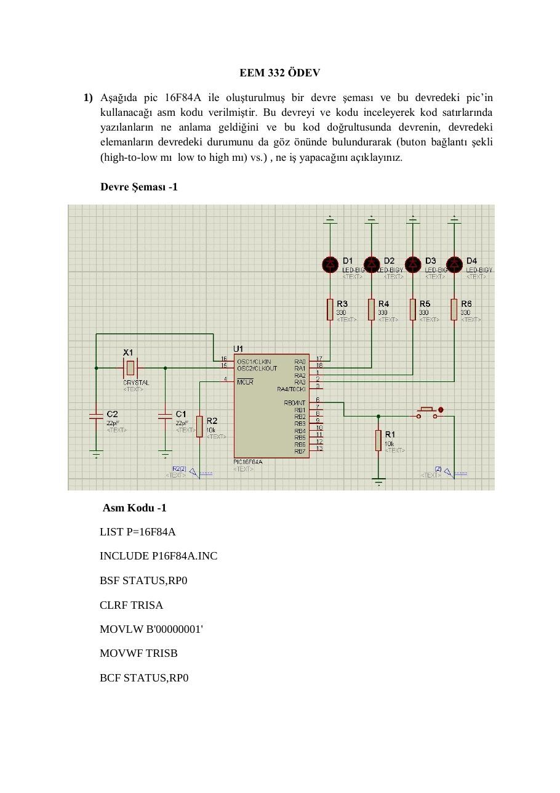
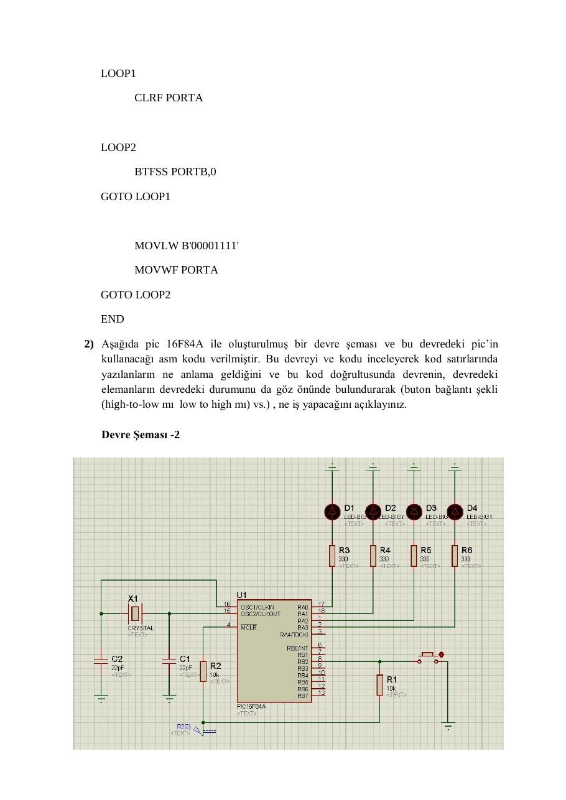
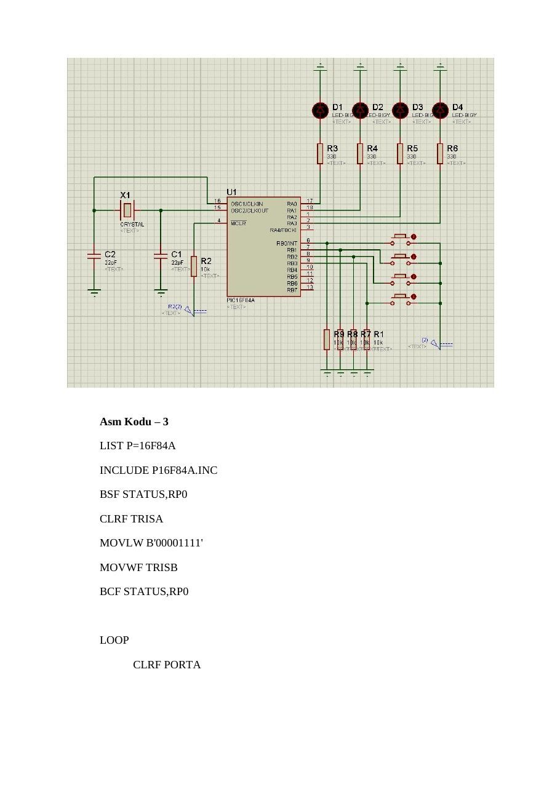

This post brings together the relevant notes and applications from the Başkent University **EEM332 Microprocessors** course archive (2013–2015). 2013 PIC assignment: TRIS direction setting, BTFSC/BTFSS and LED outputs depending on button state. Works prepared by a friend and course documents have been included together; student names, numbers and group information have been removed. PDF archive copies of the documents and, where available, source code are available for download as a ZIP at the end of the post.

## EEM332_odev

### EEM 332 ASSIGNMENT

### 1) A circuit schematic built with a PIC16F84A and the asm code that the PIC in this circuit will use are given below. Examine the circuit and the code, and explain what the code lines mean and what the circuit will do in line with this code, taking into account the state of the circuit elements (how the button is connected (high-to-low or low-to-high), etc.).

Circuit Schematic -1

Asm Code -1

```asm
LIST P=16F84A
```

```asm
INCLUDE P16F84A.INC
```

```asm
BSF STATUS,RP0
```

```asm
CLRF TRISA
```

```asm
MOVLW B'00000001'
```

```asm
MOVWF TRISB
```

```asm
BCF STATUS,RP0
```

```asm
LOOP1
```

```asm
CLRF PORTA
```

```asm
LOOP2
```

```asm
BTFSS PORTB,0
```

```asm
GOTO LOOP1
```

```asm
MOVLW B'00001111'
```

```asm
MOVWF PORTA
```

```asm
GOTO LOOP2
```

```asm
END
```

### 2) A circuit schematic built with a PIC16F84A and the asm code that the PIC in this circuit will use are given below. Examine the circuit and the code, and explain what the code lines mean and what the circuit will do in line with this code, taking into account the state of the circuit elements (how the button is connected (high-to-low or low-to-high), etc.).

Circuit Schematic -2

Asm Code – 2

```asm
LIST P=16F84A
```

```asm
INCLUDE P16F84A.INC
```

```asm
BSF STATUS,RP0
```

```asm
CLRF TRISA
```

```asm
MOVLW B'00000100'
```

```asm
MOVWF TRISB
```

```asm
BCF STATUS,RP0
```

```asm
LOOP1
```

```asm
MOVLW B'00000101'
```

```asm
MOVWF PORTA
```

```asm
LOOP2
```

```asm
BTFSC PORTB,2
```

```asm
GOTO LOOP1
```

```asm
MOVLW B'00001010'
```

```asm
MOVWF PORTA
```

```asm
GOTO LOOP2
```

```asm
END
```

### 3) A circuit schematic built with a PIC16F84A and the asm code that the PIC in this circuit will use are given below. Examine the circuit and the code, and explain what the code lines mean and what the circuit will do in line with this code, taking into account the state of the circuit elements (how the button is connected (high-to-low or low-to-high), etc.).

Circuit Schematic – 3 ↓ (on the next page) ↓

Asm Code – 3

```asm
LIST P=16F84A
```

```asm
INCLUDE P16F84A.INC
```

```asm
BSF STATUS,RP0
```

```asm
CLRF TRISA
```

```asm
MOVLW B'00001111'
```

```asm
MOVWF TRISB
```

```asm
BCF STATUS,RP0
```

```asm
LOOP
```

```asm
CLRF PORTA
```

### TEST1

```asm
BTFSC PORTB,0
```

```asm
GOTO LOOP1
```

### TEST2

```asm
BTFSC PORTB,1
```

```asm
GOTO LOOP2
```

### TEST3

```asm
BTFSC PORTB,2
```

```asm
GOTO LOOP3
```

### TEST4

```asm
BTFSC PORTB,3
```

```asm
GOTO LOOP4
```

```asm
GOTO LOOP
```

```asm
LOOP1
```

```asm
MOVLW B'00000001'
```

```asm
MOVWF PORTA
```

```asm
GOTO TEST1
```

```asm
LOOP2
```

```asm
MOVLW B'00000010'
```

```asm
MOVWF PORTA
```

```asm
GOTO TEST2
```

```asm
LOOP3
```

```asm
MOVLW B'00000100'
```

```asm
MOVWF PORTA
```

```asm
GOTO TEST3
```

```asm
LOOP4
```

```asm
MOVLW B'00001000'
```

```asm
MOVWF PORTA
```

```asm
GOTO TEST4
```

```asm
END
```







## EEM332_odev_aciklama

### EXPLANATION REGARDING THE EEM332 COURSE ASSIGNMENT

The EEM332 course assignments have been uploaded to the relevant link. Those whose student number ends in

0, 1, 2 or 3 are responsible for assignment 1, those ending in 4, 5 or 6 for assignment 2, and those ending in 7, 8 or 9 for assignment 3.

The schematic and source code given in the relevant assignment will be used to briefly explain what is being implemented. The work will be done individually. Assignments that are identical (for both those who provide the work and those who receive it) will be graded 0. Assignments will be submitted as printouts during class on Wednesday, 8 May 2013.

## ödevlab

When the program starts, with the button connected to the second bit of portB (RB2) "high" (not pressed);

- The LEDs on bit zero of portA (RA0 – lamp D1) and bit two of portA (RA2 – lamp D3) were lit.

When the program starts, with the button connected to the second bit of portB (RB2) "low" (pressed);

- The LEDs on bit one of portA (RA1 – lamp D2) and bit three of portA (RA3 – lamp D4) were lit.

The purpose of the program is to light the odd-numbered LEDs (D1–D3) when the button is high, and the even-numbered LEDs (D2–D4) when the button is low.

When HIGH;

When LOW;

## ODEV

```asm
	LIST P=16F84A
INCLUDE "P16F84A.INC"
	ORG 0X00                 ;Starts the program at '0x00'.
	BSF STATUS,RP0           ;Set bit 5 of STATUS to 1 to switch to BANK1, where TRISA and TRISB are located.
	CLRF TRISA               ;Made all bits of TRISA outputs.
	MOVLW B'00000100'        ;Loaded a value into the Working Register.
	MOVWF TRISB              ;Using the value in the Working R., made bit 2 of TRISB (RB2) an input.
	BCF STATUS,RP0           ;Clear bit 5 of STATUS to 0 to switch to BANK0.
LOOP1                        ;The LOOP1 loop runs when the button is not pressed (high).
	MOVLW B'00000101'        ;Loaded the value B'00000101'(H'05') into the Working R.
	MOVWF PORTA              ;Moved the value in the Working R. to PORTA. Set bits RA0 and RA2 to 1 and the lamps lit.
LOOP2                        ;The LOOP2 loop runs when the button is pressed (low).
	BTFSC PORTB,2            ;Checks bit 2 of the value at the PORTB address. If it is zero (low), it skips the instruction that follows. Otherwise (high), it continues with the GOTO LOOP1 instruction.
	GOTO LOOP1               ;Goes to the LOOP1 loop.
	MOVLW B'00001010'        ;Loaded the value B'00001010'(H'10') into the Working R.
	MOVWF PORTA              ;Moved the value in the Working R. to PORTA. Set bits RA1 and RA3 to 1 and the lamps lit.
	GOTO LOOP2               ;Continues from the LOOP2 loop, continuing by checking the button on bit 2 of PORTB (RB2).
	END                      ;Termination instruction.
```

## ÖDEV

```asm
	LIST P=16F84A
INCLUDE "P16F84A.INC"
	ORG 0X00
	BSF STATUS,RP0
	CLRF TRISA
	MOVLW B'00000100'
	MOVWF TRISB
	BCF STATUS,RP0
LOOP1
	MOVLW B'00000101'
	MOVWF PORTA
LOOP2
	BTFSC PORTB,2
	GOTO LOOP1
	MOVLW B'00001010'
	MOVWF PORTA
	GOTO LOOP2
	END
```

## 1

```asm
LIST p=16F84A 
  INCLUDE "P16F84A.INC" 
 
  __CONFIG   _CP_OFF & _WDT_OFF & _PWRTE_ON & _XT_OSC 
 
  j  EQU 0x0c 
  k  EQU 0x0d 
   
  ORG     0x00 
   
  BSF STATUS,5 
  MOVLW 0x00 
  MOVWF TRISB 
  BCF STATUS,5 
   
LEDonoff:
movlw b'00000001'  
  movwf PORTB 
  call delay 
   
  movlw b'00000000' 
  movwf PORTB 
  call delay 
  goto LEDonoff 
   
   
delay: 
  movlw d'200' 
  movwf j  
jloop: 
  movwf k  
kloop: 
  decfsz k,f 
  goto kloop 
  decfsz j,f 
  goto jloop 
return 
 
End
```
