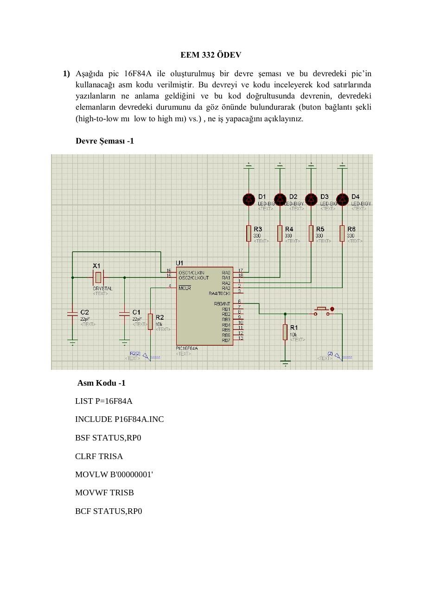
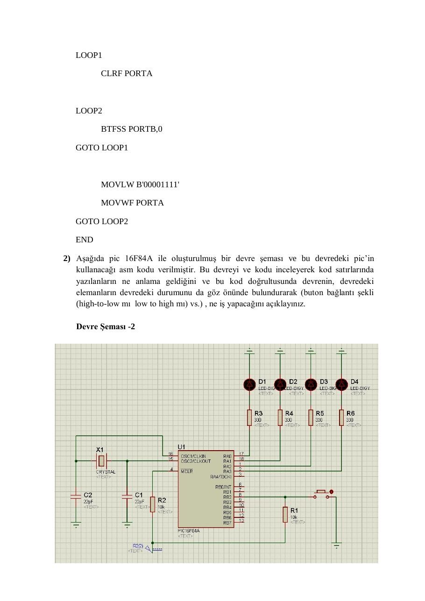
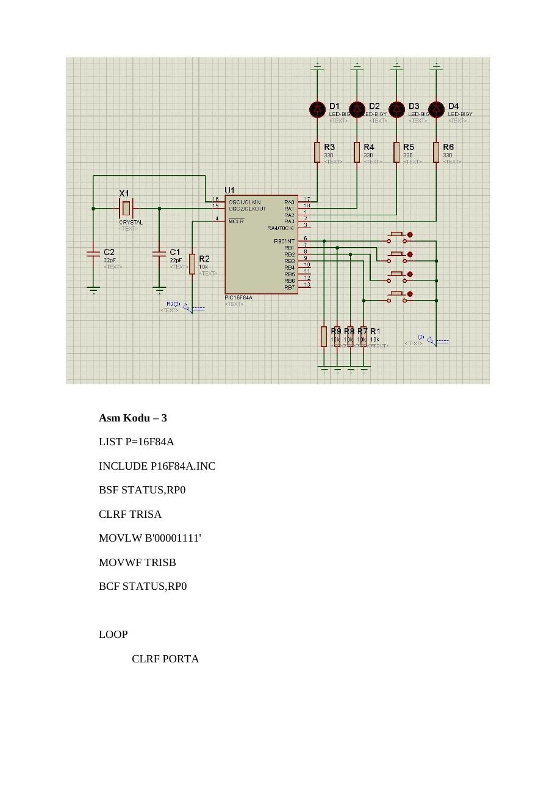

Bu yazı, Başkent Üniversitesi **EEM332 Mikroişlemciler** ders arşivindeki ilgili notları ve uygulamaları bir araya getiriyor (2013–2015). 2013 PIC ödevi: TRIS yönlendirmesi, BTFSC/BTFSS ve buton durumuna göre LED çıkışları. Bir arkadaşın hazırladığı çalışmalar ve ders belgeleri birlikte aktarılmış; öğrenci adları, numaraları ve grup bilgileri çıkarılmıştır. Belgelerin PDF arşiv kopyaları ve varsa kaynak kodları yazının sonunda ZIP olarak indirilebilir.

## EEM332_odev

### EEM 332 ÖDEV

### 1) Aşağıda pic 16F84A ile oluşturulmuş bir devre şeması ve bu devredeki pic’in

kullanacağı asm kodu verilmiştir. Bu devreyi ve kodu inceleyerek kod satırlarında yazılanların ne anlama geldiğini ve bu kod doğrultusunda devrenin, devredeki elemanların devredeki durumunu da göz önünde bulundurarak (buton bağlantı şekli (high-to-low mı low to high mı) vs.) , ne iş yapacağını açıklayınız.

Devre Şeması -1

Asm Kodu -1

```asm
LIST P=16F84A
```

```asm
INCLUDE P16F84A.INC
```

```asm
BSF STATUS,RP0
```

```asm
CLRF TRISA
```

```asm
MOVLW B'00000001'
```

```asm
MOVWF TRISB
```

```asm
BCF STATUS,RP0
```

```asm
LOOP1
```

```asm
CLRF PORTA
```

```asm
LOOP2
```

```asm
BTFSS PORTB,0
```

```asm
GOTO LOOP1
```

```asm
MOVLW B'00001111'
```

```asm
MOVWF PORTA
```

```asm
GOTO LOOP2
```

```asm
END
```

### 2) Aşağıda pic 16F84A ile oluşturulmuş bir devre şeması ve bu devredeki pic’in

kullanacağı asm kodu verilmiştir. Bu devreyi ve kodu inceleyerek kod satırlarında yazılanların ne anlama geldiğini ve bu kod doğrultusunda devrenin, devredeki elemanların devredeki durumunu da göz önünde bulundurarak (buton bağlantı şekli (high-to-low mı low to high mı) vs.) , ne iş yapacağını açıklayınız.

Devre Şeması -2

Asm Kodu – 2

```asm
LIST P=16F84A
```

```asm
INCLUDE P16F84A.INC
```

```asm
BSF STATUS,RP0
```

```asm
CLRF TRISA
```

```asm
MOVLW B'00000100'
```

```asm
MOVWF TRISB
```

```asm
BCF STATUS,RP0
```

```asm
LOOP1
```

```asm
MOVLW B'00000101'
```

```asm
MOVWF PORTA
```

```asm
LOOP2
```

```asm
BTFSC PORTB,2
```

```asm
GOTO LOOP1
```

```asm
MOVLW B'00001010'
```

```asm
MOVWF PORTA
```

```asm
GOTO LOOP2
```

```asm
END
```

### 3) Aşağıda pic 16F84A ile oluşturulmuş bir devre şeması ve bu devredeki pic’in

kullanacağı asm kodu verilmiştir. Bu devreyi ve kodu inceleyerek kod satırlarında yazılanların ne anlama geldiğini ve bu kod doğrultusunda devrenin, devredeki elemanların devredeki durumunu da göz önünde bulundurarak (buton bağlantı şekli (high-to-low mı low to high mı) vs.) , ne iş yapacağını açıklayınız.

Devre Şeması – 3 ↓ (sonraki sayfada) ↓

Asm Kodu – 3

```asm
LIST P=16F84A
```

```asm
INCLUDE P16F84A.INC
```

```asm
BSF STATUS,RP0
```

```asm
CLRF TRISA
```

```asm
MOVLW B'00001111'
```

```asm
MOVWF TRISB
```

```asm
BCF STATUS,RP0
```

```asm
LOOP
```

```asm
CLRF PORTA
```

### TEST1

```asm
BTFSC PORTB,0
```

```asm
GOTO LOOP1
```

### TEST2

```asm
BTFSC PORTB,1
```

```asm
GOTO LOOP2
```

### TEST3

```asm
BTFSC PORTB,2
```

```asm
GOTO LOOP3
```

### TEST4

```asm
BTFSC PORTB,3
```

```asm
GOTO LOOP4
```

```asm
GOTO LOOP
```

```asm
LOOP1
```

```asm
MOVLW B'00000001'
```

```asm
MOVWF PORTA
```

```asm
GOTO TEST1
```

```asm
LOOP2
```

```asm
MOVLW B'00000010'
```

```asm
MOVWF PORTA
```

```asm
GOTO TEST2
```

```asm
LOOP3
```

```asm
MOVLW B'00000100'
```

```asm
MOVWF PORTA
```

```asm
GOTO TEST3
```

```asm
LOOP4
```

```asm
MOVLW B'00001000'
```

```asm
MOVWF PORTA
```

```asm
GOTO TEST4
```

```asm
END
```







## EEM332_odev_aciklama

### EEM332 DERSİ ÖDEVİ İLE İLGİLİ AÇIKLAMA

EEM332 dersi ödevleri ilgili bağlantıya yüklenmiştir. Okul numarasının son hanesi

0, 1, 2 veya 3 olanlar 1 numaralı 4, 5 veya 6 olanlar 2 numaralı 7, 8 veya 9 olanlar 3 numaralı

çalışmadan sorumludur. İlgili çalışmada verilen şema ve kaynak kod ile neyin gerçekleştirildiği kısaca açıklanacaktır. Çalışmalar bireysel olarak yapılacaktır. Aynı olan çalışmaların (çalışmayı verenler ve alanlar için) değerlendirme notu 0 olarak verilecektir. Ödevler 8 Mayıs 2013 Çarşamba günü ders saatinde çıktı olarak teslim edilecektir.

## ödevlab

Program açıldığında, portB’nin ikinci bitine(RB2) bağlı buton “high” iken(basılı değil);

-PortA’nın sıfırıncı bitindeki(RA0-D1 lambası) ve portA’nın ikinci bitindeki(RA2-D3 lambası) led lambalar yandı.

Program açıldığında, portB’nin ikinci bitine(RB2) bağlı buton “low” iken(basılı);

-PortA’nın birinci bitindeki(RA1-D2 lambası) ve portA’nın üçüncü bitindeki(RA3-D4 lambası) led lambalar yandı.

Programın amacı, buton high değerinde iken tek değerdeki led lambalarını (Dl-D3), buton low değerinde iken çift değerdeki led lambalarını(D2-D4) yakar.

HİGH iken;

LOW iken;

## ODEV

```asm
	LIST P=16F84A
INCLUDE "P16F84A.INC"
	ORG 0X00                 ;Programı '0x00' dan başlatır.
	BSF STATUS,RP0           ;STATUS'ün beşinci bitini 1 yaparak TRISA VE TRISB'nin olduğu BANK1'e geçtik.
	CLRF TRISA               ;TRISA'nın tüm bitlerini output yaptık.
	MOVLW B'00000100'        ;Working Registera değer aldık.
	MOVWF TRISB              ;Working R. daki değer ile TRISB'nin ikinci bitini(RB2) input yaptık.
	BCF STATUS,RP0           ;STATUS'ün beşinci bitini 0 yaparak BANK0'a geçtik.
LOOP1                        ;LOOP1 döngüsü butona basılı değil iken (high) çalışır.
	MOVLW B'00000101'        ;Working R. 'a B'00000101'(H'05') değerini aldık.
	MOVWF PORTA              ;Working R.'daki değeri PORTA'ya attık.RA0 ve RA2 bitlerini 1 değeri yaptık ve lambalar yandı.
LOOP2                        ;LOOP2 döngüsü butona basılı iken (low) çalışır.
	BTFSC PORTB,2            ;PORTB adresindeki sayının ikinci bitini kontrol eder. Eğer sıfır(low) ise, kendisinden sonra gelen komutun üzerinden atlar. Değilse (high) GOTO LOOP1 komutundan devam eder.
	GOTO LOOP1               ;LOOP1 döngüsüne gider.
	MOVLW B'00001010'        ;Working R. 'a B'00001010'(H'10') değerini aldık.
	MOVWF PORTA              ;Working R.'daki değeri PORTA'ya attık.RA1 ve RA3 bitlerini 1 değeri yaptık ve lambalar yandı.
	GOTO LOOP2               ;LOOP2 döngüsünden devam eder.PORTB 'nin ikinci bitindeki (RB2) butonunu kontrol ederek devam eder.
	END                      ;Sonlandırma komutu.
```

## ÖDEV

```asm
	LIST P=16F84A
INCLUDE "P16F84A.INC"
	ORG 0X00
	BSF STATUS,RP0
	CLRF TRISA
	MOVLW B'00000100'
	MOVWF TRISB
	BCF STATUS,RP0
LOOP1
	MOVLW B'00000101'
	MOVWF PORTA
LOOP2
	BTFSC PORTB,2
	GOTO LOOP1
	MOVLW B'00001010'
	MOVWF PORTA
	GOTO LOOP2
	END
```

## 1

```asm
LIST p=16F84A 
  INCLUDE "P16F84A.INC" 
 
  __CONFIG   _CP_OFF & _WDT_OFF & _PWRTE_ON & _XT_OSC 
 
  j  EQU 0x0c 
  k  EQU 0x0d 
   
  ORG     0x00 
   
  BSF STATUS,5 
  MOVLW 0x00 
  MOVWF TRISB 
  BCF STATUS,5 
   
LEDonoff:
movlw b'00000001'  
  movwf PORTB 
  call delay 
   
  movlw b'00000000' 
  movwf PORTB 
  call delay 
  goto LEDonoff 
   
   
delay: 
  movlw d'200' 
  movwf j  
jloop: 
  movwf k  
kloop: 
  decfsz k,f 
  goto kloop 
  decfsz j,f 
  goto jloop 
return 
 
End
```
