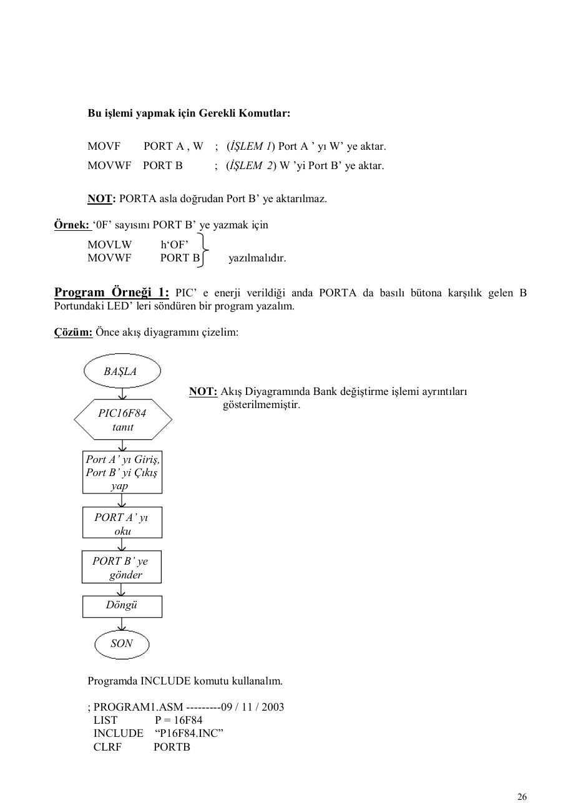
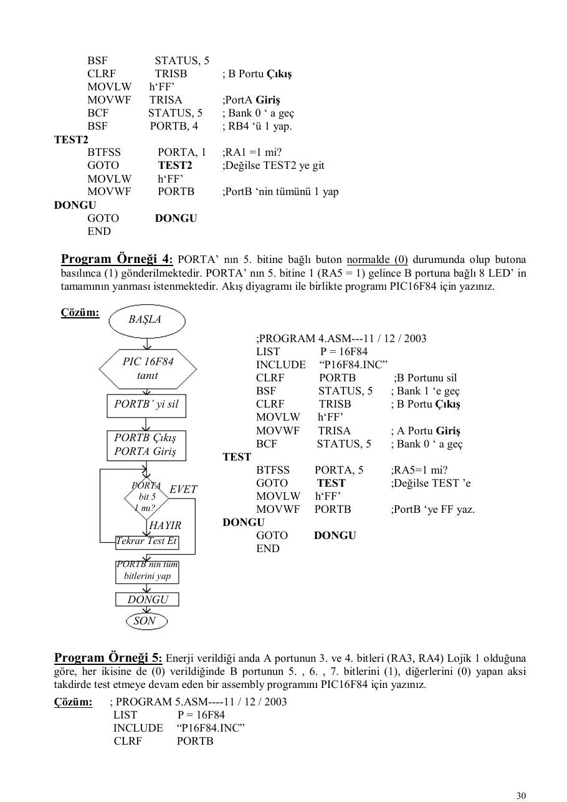

This post brings together the relevant notes and applications from the Başkent University **EEM332 Microprocessors** course archive (2003–2003). It covers INCLUDE files, port settings, bit testing, LED and delay subroutines. Source: Assoc. Prof. Dr. Hakan Ündil, Microprocessors and Microcontrollers 1 lecture notes, 2003. PDF archive copies of the documents and, where available, source codes can be downloaded as a ZIP at the end of the post.

*Note: This content belongs to a third-party source; it is shared for archival and nostalgic purposes with attribution. It will be removed at the request of the rights holder.*

## help2 (1)

MICROPROCESSORS AND MICROCONTROLLERS 1 - LECTURE NOTES (Part 3) Assoc. Prof. Dr. Hakan Ündil

Program Example 9: Draw a flow diagram and write the necessary assembly program for the PIC 16F84 for a program that uses a delay subroutine to turn all LEDs connected to Port B on and off.

Solution: ; PROGRAM9 . ASM-----15 / 12 / 2003

```asm
LIST       P = 16F84
INCLUDE    “ P16F84.INC”
SAYAC1 EQU          h‘0C’ ;16F84 de genel amaçlı RAM (Veri Hafızasında) ilk adres
SAYAC2 EQU          h‘0D’
BSF         STATUS,5
CLRF        TRISB                             BAŞLA
BCF        STATUS,5
DEVAM
MOVLW      h‘00’                              16F84’ ü
MOVWF      PORTB                            tanıt, PORTB
CALL       GECİKME                              çıkış
MOVLW      h‘FF’
```

### MOWF       PORTB

Clear PORTB

```asm
CALL       GECİKME
GOTO       DEVAM
```

### GECİKME                                            CALL GECİKME

```asm
MOVLW      h‘FF’
```

### MOWF       SAYAC1

PORTB       h‘FF’

### TEKRAR1 MOWF        SAYAC2

### TEKRAR2 DECFSZ      SAYAC2, F

```asm
GOTO       TEKRAR2                        CALL GECİKME
DECFSZ     SAYAC1, F
GOTO       TEKRAR1
RETURN
END
```

Program Example 10: A button connected to bit 0 of PORTA, which produces ( 0 ) when pressed, is to be pressed 8 times; then, if the button on bit 1 of PORTA is pressed 2 times, all the LEDs connected to PORTB are to light up ( the DELAY subroutine will be used after each key press ). Draw the necessary flow diagram and write the program.

Solution:                             ; PROGRAM10.ASM-------22 / 12 / 2003

```asm
LIST        P = 16F84
INCLUDE     “ P16F84.INC”
GECİK1     EQU          h‘0C’
GECİK2     EQU          h‘0D’
SAYAC1     EQU          h‘0E’
SAYAC2     EQU          h‘0F’
CLRF        PORTB         ; PORTB yi sıfırla
BSF         STATUS,5 ;Bank1’ e geç
CLRF        TRISB         ;PORTB çıkış
BSF         TRISA, 0
BSF         TRISA, 1 ;RA0veRA1 Giriş
BCF         STATUS,5 ; Bank0’ a geç
MOVLW      h‘03’
MOVWF       SAYAC1 ; SAYAC1’e 03 yaz
MOVLW       h‘02’
```

### BAŞLA

```asm
MOVWF      SAYAC2 ;SAYAC2’ye 02 yaz
```

Define the 16F84          TEKRAR    BTFSC     PORTA, 0 ; RA0 = 0 mı? Port A input                   GOTO        TEKRAR ;Değilse TEKRAR’a Port B output                  CALL       GECİKME ;Evetse GECIKMEye

```asm
DECFSZ     SAYAC1       ;SAYAC1’i 1 azalt
```

SAYAC1           03                GOTO       TEKRAR       ; Sonuç 0 değilse SAYAC2 “         02       DEVAM     BTFSC     PORTA, 1 ; RA1 = 0 mı?

```asm
GOTO       DEVAM         ; Değilse DEVAM’a
CALL      GECİKME ;Evetse GECIKMEye
```

RA0 = 0                       DECFSZ     SAYAC2        ; SAYAC2’i 1 azalt NO     ?                         GOTO       DEVAM         ;Sonuç 0 değilse YES                      MOVLW      h‘FF’

```asm
MOVWF      PORTB         ;PORTB’ye FF yükle
GECİKME
; GECİKME ALT PROGRAMI
GECİKME
```

Decrement SAYAC1 by 1                    MOVLW     h‘FF’

```asm
MOVWF     GECİK1       ;GECIK1’e FF yükle
```

DONGU1    MOVLW     h‘FF’ SAYAC1                        MOVWF     GECİK2       ;GECIK2’ye FF yükle 0 ? NO DONGU2    DECFSZ   GECIK2, F ; GECIK2’yi 1 azalt

```asm
GOTO      DONGU2 ;Sonuç 0 değilse
```

YES                DECFSZ    GECİK1,F ;GECIK1’i 1 azalt RA1 = 0                        GOTO     DONGU1 ; DONGU1 ‘e git. NO     ?                         RETURN    ; Alt Programdan dön

```asm
END       ; SON
GECİKME
```

Decrement SAYAC2 by 1

### SAYAC2

0 ? NO

### YES

Write FF to PORTB

### END

### LOGIC OPERATION INSTRUCTIONS

```asm
RLF Komutu (Bir bit Sola Kaydırma)
```

The RLF instruction (Rotate Left by One Bit) shifts the bits in a file register one bit to the left. In this case, the leftmost bit ( bit 7 ) moves into the C ( carry ) flag, and the bit previously in C moves into the rightmost bit ( bit 0 ). The instruction format is;

RFL        FILE REGISTER        ,    d           W or F ( Destination of the result )

If we show the instruction schematically;

Program Example 11: With a program, first set only bit 0 of port B (RB0) to 1. Then shift this bit to the left once. To make this operation easier to observe, use the DELAY subroutine twice in succession.

Solution:                          ; PROGRAM 11 . ASM_ DATE

```asm
LIST        P = 16F84
INCLUDE     “ P16F84.INC”
BASLA
GECİK1   EQU         h‘0C’
GECİK2   EQU         h‘0D’
BCF          STATUS, 0 ; Elde yi sıfırla
```

Define the 16F84               BSF         STATUS, 5 ; Bank1’e geç Port B output                  CLRF        TRISB       ; PORTB Çıkış

```asm
BCF         STATUS, 5 ; Bank0’a geç
MOVLW        h‘01’
```

### PORTB        01

```asm
MOVWF        PORTB      ;PORTB’ ye 01 yaz
CALL         GECIKME_ALTPROG
CALL GECIKME                  CALL         GECIKME_ALTPROG
```

### BEKLE   GOTO         BEKLE

```asm
CALL GECIKME
```

GECIKME_ALTPROG              ; Önceki Gecikme Alt Prog ile aynı

```asm
RLF PORT B
MOVLF                h‘FF’
MOVWF                GECIK1
```

DONGU 1 MOVLW                h‘FF’

### END

```asm
MOVWF                GECIK2
```

### DONGU2 DECFSZ                GECIK2, F

```asm
GOTO                  DONGU2
DECFSZ               GECIK1, F
GOTO                 DONGU1
RETURN
END
```

```asm
RRF Komutu (Bir Bit Sağa Kaydırma)
RRF komutu da RLF komutuna benzer olup fark bu defa kaydırma işleminin sağa olması
```

The RRF instruction is similar to the RLF instruction; the difference is that this time the shift is to the right, so the rightmost bit will move into the C ( carry ) flag. The bit previously in the C flag will in turn move into the leftmost bit (bit 7). The instruction format is;

```asm
RRF FİLE REGISTER         ,   d          Sonucun gideceği yer
```

W or F For example, write the hex number 30 into a file register named MEM. If the C flag is also set at the same time (C= 1), the state before and after executing the

```asm
RRF komutunun icrasından önce ve sonraki durum:
```

### The program instructions to be used for this operation 

```asm
MOVLW           h‘49’      ; W Registerine (49)16 yükle
MOVWF           MEM        ; W ‘ yi MEM adresine sakla
RRF             MEM, F     ; MEM ’ i Sağa bir bit ötele.
```

will be as follows.

Program Example 12: First set the C flag to (1) and shift the PORT B, which has been cleared at the start, to the left one bit at a time. Send the program to the DELAY subroutine between each shift. End the program when the C flag becomes (1) again.

```asm
NOT: GECIKME_ALTPROG Gösterilmeyecektir.
```

### Solution

```asm
; PROGRAM 12.ASM----------Tarih
```

### START                 INCLUDE    “PIC16F84.INC”

```asm
BSF         STATUS, 5           ; Bank1’e geç
CLRF        TRISB               ; PORTB Çıkış
```

Define the 16F84             BCF         STATUS, 5           ; Bank0’ a geç Port B output            KAYDIR

```asm
RLF          PORTB               ; PORTB yi sola kaydır
```

### C         1               CALL         GECIKME_ALTPROG

```asm
BTFSS        STATUS, 0                ; C bayrağı 1 mi?
```

PORTB             00          GOTO         KAYDIR                   ; Değilse KAYDIR’a

### DONGU

```asm
RLF PORTB                   GOTO DONGU       ; Evetse burada bekle
END
CALL GECIKME
```

C=1 ?

### END

COMF and SWAPF Instructions With the COMF instruction, the (0)s in a desired file register can be made (1) and the (1)s can be made (0) [the one's complement operation!..]. The instruction format is;

COMF      FILE REGISTER            ,       d           Destination of the result ( destination ) ( W or F is written )

Example: After loading ( 1F )16 into a register named HAFIZA1, store its inverse ( E0 )16 in HAFIZA2. Write the necessary routine (program segment) for this.

### Solution

### HAFIZA1

0001 1111

```asm
MOVLW          h‘0F’
MOVWF          HAFIZA1                                       HAFIZA2
```

### COMF           HAFIZA1, W

```asm
MOVWF          HAFIZA2                                      1110 0000
```

```asm
SWAPF komutu ise bir file register içindeki ilk dört bit (Yüksek anlamlı Nibble) ile son dört
```

The SWAPF instruction exchanges the positions of the first four bits (high-order nibble) and the last four bits (low-order nibble) in a file register. The instruction format is;

```asm
SWAPF       FİLE REGISTER ,                    d         şeklindedir.
```

Example: Write a program segment that, after writing ( 3F ) to PORTB, swaps the first and last nibbles and writes the result to W.

```asm
MOVLW          h‘3F’
MOVWF          PORTB
SWAPF          PORTB, W
```

```asm
ANDLW Komutu
```

The ANDLW instruction performs a logical AND operation between the contents of the W register and a constant. It writes the result back to W. As is known, at the end of the operation, the bits that are 1-1 in both numbers result in 1; the others result in 0. The instruction format is;

```asm
ANDLW              Sabit sayı
şeklindedir.
```

With this instruction, the desired bits of a number ( data ) are made ( 0 ) while the others are left as they are. For this, when selecting the constant ( mask ), the bits to be zeroed should be chosen as ( 0 ) and the others as ( 1 ).

Example: Let the number (3C) be in W. Let us write the instruction that makes bits 2, 3 and 6 of this number (0) and leaves the others unchanged. What is the number in the result? First, without looking at the number in W at all, let us choose a mask in which bits 2, 3, 6 are 0 and the other bits are 1. 7   6   5   4    3   2       1   0

### 1 0 1        1 0      0 1 1         = (B3)16

### The instruction needed to apply logical AND between the number in W (3C) and this mask

```asm
ANDLW                h’B3’                  olacaktır.
```

To find the result, since the number in W is given as (3C)16, we need to write this number with its bits 2, 3 and 6 cleared. This is obtained as (30)16. [Since bit 6 of 3C is already 0, write 3C in binary and clear its bits 2 and 3]

```asm
ANDWF Komutu
```

This instruction is similar to the ANDLW instruction; this time a logical AND operation is performed between W and any file register. The result is written either to W or to F. The instruction format is:

File Register

```asm
ANDWF                                    ,d       (Sonucun yeri, W ya da F)
şeklindedir.
```

Example: Let the number b’00101100’ be in the PORTB register. Let us also place the value b’11011111’ (mask) in the W register. Let us apply a logical AND operation to these two numbers and write the result back to PORTB.

### The program segment needed for this 

```asm
MOVLW            b’00101100’ ; W Registerine 2C yükle.
ANDWF            PORTB , F ; PORTB ile W yi AND (VE) işlemine tabi tut
; ve sonucu yine PORTB ye yaz.
```

IORLW Instruction This instruction is used to set a desired bit to 1 while leaving the others unchanged. It performs a logical OR operation between the given constant and the W register and writes the result back to the W register. Instruction Format:

IORLW                 Constant                        as follows.

In the constant to be selected for this purpose (the mask), the bits to be set to (1) should be chosen as (1) and the bits not to be changed should be chosen as (0).

Example: Suppose that bits 5, 6, 7 of the number in the W register are to be set to 1 while the other bits are left unchanged. First, let us choose our mask; 7    6   5    4   3    2   1   0

1    1       1 0 0 0 0 0                          = E0 (Bits to be set to 1 in the number are 1)

In this case, the necessary program segment (instruction) will be

IORLW               b’1110 0000’                        .

```asm
NOT: Maske seçimi işlemi için W da bulunan sayının bilinmesine gerek yoktur. Hangi sıradaki
```

Knowing the number in W is not necessary for selecting the mask. It is sufficient to know which bits (here 5, 6, 7) are to be set to 1. Since the problem says “the number is in W”, there is no need for a load instruction into W in the program segment.

Example: What would the result be if the number in W in the above example were (04)16?

OR operation between W and the mask: (the result will be E4) Bit No:      7    6        5       4   3      2     1    0 W Reg.       0    0        0       0   0      1     0    0 Mask        1    1        1       0   0      0     0    0 Result        1    1        1       0   0      1     0    0

IORWF Instruction This instruction is also similar to the IORLW instruction; the only difference is that the mask is held in a file register instead of a constant. The result can be written either to W or to the File Register.

### Instruction Format

IORWF            File Register         , d     (Destination of the result, W or F)

XORLW            Instruction This instruction performs an EXOR (Exclusive OR) operation between the W register and the given constant and

### writes the result to W. Instruction Format

XORLW                Constant         as follows.

This instruction can also be used to invert the desired bits of the 8-bit number in the W register while leaving the other bits unchanged. For this purpose, in the mask byte to be determined, the bits to be inverted should be chosen as (1) and the others as (0).

Example: After first loading the number (3B)16 into W, give the instructions needed to invert only bits 1, 3, 5, 7 of this number and write the result to PORTA. What is the result in this case?

```asm
MOVLW           h ‘3B’             ;W ye 3b yaz
```

XORLW           b’10101010’        ; maskede 7,5,3,1. bitler 1, yapıldı

```asm
MOVWF           PORTA              ; Sonuç PORTA ya yazıldı.
```

Between W and the constant (EXOR operation) Bit No:          7     6       5   4   3     2     1    0 W Reg. (3B)     0     0       1   1   1     0     1    1 Mask (AA)       1     0       1   0   1     0     1    0 Result (91)       1     0       0   1   0     0     0    1

XORWF            Instruction This instruction is also similar to the XORLW instruction; here the actual number is in the W register and the mask is in the file register. Since the order of operation is not important, it is also possible to write the mask to W and the actual number to the File Register.

```asm
NOT: XORLW ve XORWF iki tane 8 bitlik sayının aynı olup olmadıklarını test etmek için
```

Note: XORLW and XORWF can be used to test whether two 8-bit numbers are the same. If the numbers are the same, the result of the EXOR will be (00)16, so the Z flag will be (1). Otherwise, the Z flag will remain (0). [Remember that the Z flag is bit 2 of STATUS]

Example: If the one-byte number on PORTA differs from (09)16, testing of Port A will continue; if it is equal to (09)16, this number is to be written to PORTB. Necessary program segment:

```asm
MOVLW         h’09’
TEST
```

XORWF         PORTA,W        ; W ile PortA ya Lojik EXOR işlemi uygula

```asm
BTFSS         STATUS,2       ; Z bayrağı 1 mi?
GOTO          TEST           ; Değilse TEST ‘e git
MOVF          PORTA , W      ; Evetse PortA yı W ye aktar.
MOVWF         PORTB          ; W yi PortB ye yaz.
```

For example, if the number arriving at PORTA were (07)16 and the XORWF operation were performed with (09)16;

0000 0111     (07) 0000 1001     (09) 0000 1110     (0E)    Result    Since the result is different from 0, continue testing.

Similarly, the IORLW and IORWF instructions can be used to compare a one-byte data with zero.

Example: Write a program segment, using an IOR-type instruction, that tests whether the number on PORTA is (00)16, jumps to address ILERI if it is zero, and otherwise continues testing.

```asm
TEST
MOVF          PORTA ,W       ; PortA yı W ye kopyala (yaz)
```

IORLW         h’00’          ; W ile 00 arasında Lojik VEYA uygula

```asm
BTFSS         STATUS , 2     ; Sonuç=0 mı ( Z=1 mi?)
GOTO          TEST           ; Değilse TEST ‘e git
GOTO          ILERI          ; Evetse ILERI adresine git.
```

Program Example 13 : Normally all bits of PORTA are (1); write an assembly program, drawing a flow diagram first, that loads (0F)16 into PORTB when all of bits 0, 1, 2 of PORTA (RA0, RA1, RA2) are pressed, and otherwise continues testing. Mask:          0001 1000 [the first 3 bits (0) do not exist in PORTA, the last three bits (0) will be tested]

```asm
; PROGRAM13.ASM-------TARİH
LIST     P=16F84
INCLUDE  “P16F84.INC”
CLRF     PORTB
BSF      STATUS,5
MOVLW    h’FF’
MOVWF    TRISA          ;PortA Giriş
CLRF     TRISB          ;PortB Çıkış
BCF      STATUS,5 ;Bank0 a geç
TEST
MOVLW    b’00011000’ ;Maskeyi W ye
```

XORWF    PORTA,W ;PortA ile EXOR

```asm
BTFSS    STATUS,2 ; Z bayrağı 1 mi?
GOTO     TEST           ;Değilse TEST e
MOVLW    h’0F’     ;Evetse W ‘ ye 0F yaz
MOVWF    PORTB          ; PortB ye aktar
END
```

### VARIOUS EXAMPLES

### 1)      For a PIC16F84 that is energized by applying logic 0 to bit 0 of PORTA (RA0), if (FF)16 is subsequently applied to the whole of PORTA, all bits of PORTB will be set to (1); otherwise PORTA will continue to be tested. Draw a flow diagram and write the necessary assembly program.

```asm
test edilmeye devam edilecektir. Akış diyagramı çizerek gerekli assembly programını yazınız.
; ORNEK1.ASM
LIST           P=16F84
INCLUDE        “P16F84.INC”
CLRF           PORTB
BSF            STATUS,5
MOVLW          h’FF’
MOVWF          TRISA
CLRF           TRISB
BCF            STATUS,5
TEST
BTFSC          PORTA,0 ; RA0=0 mı?
GOTO           TEST       ; Değilse TEST’e
BEKLE
```

XORWF          PORTA,W ; W ile PORTA aynı mı?

```asm
BTFSS          STATUS,2 ; Z bayrağı 1 mi?
GOTO           BEKLE          ; Değilse BEKLE ’ye
MOVLW          h’FF’
MOVWF          PORTB          ; Aynıysa PORTB ye FF yaz
END                           ; Son
```

### 2) Write a program that ends by writing (01)16 to the W register if logic (0) from a logic circuit is applied to bit 1 of PORTA (RA1) twice in succession.

The interval between key presses will be obtained by executing 10 NOP instructions approximately 255 times. If the second (0) signal does not arrive immediately after the delay, the test will start over from the beginning. (That is, two (0)s will be awaited again. A subroutine will not be used for the delay.) Write the necessary assembly program.

```asm
;ORNEK2.ASM
LIST               P=16F84
INCLUDE            “P16F84.INC”
SAYAC     EQU                h’0C’       ; SAYAC için 1 bayt yer ayır.
BSF                STATUS,5 ; Bank1 ‘e geç
MOVLW              h’FF’
MOVWF              TRISA       ; PORTA yı Giriş yap
BCF                STATUS,5 ; Bank0 ‘a geç
TEST
BTFSC              PORTA,1        ; RA1=0 mı?
GOTO               TEST           ; Değilse TEST ‘e git
MOVLW              h’FF’          ; Evetse W ‘ye FF yükle
MOVWF              SAYAC          ; Sayaca W deki FF sayısını yaz
GECIKME
NOP
NOP
NOP
.
```

. .

```asm
NOP                          ; 10 tane NOP komutu
DECFSZ         SAYAC,F       ; Sayacı 1 azalt
GOTO           GECIKME       ; SAYAC sıfırdan farklıysa GECIKME’ye
BTFSC          PORTA,1       ; SAYAC sıfırsa, tekrar RA1=0 mı? bak
GOTO           TEST          ; Değilse TEST ‘e git, yeniden iki 0 bekle
MOVLW          h’01’         ; İstenen (01) sayısını W ‘ye yükle
END                          ; Son
```

### 3) Write in assembly language a program that, after the 8-bit (1-byte) number on PORTA is shifted left twice, writes (01) to PORTB if the resulting number is (6C)16; otherwise writes (02) to PORTB.

```asm
NOT: Başlangıçta C bayrağı (0) yapılacaktır.
```

```asm
;ORNEK3.ASM
LIST            P=16F84
INCLUDE         “P16F84.INC”
BSF             STATUS,5
MOVLW           h’FF’
MOVWF           TRISA       ; PortA Giriş
CLRF            TRISB       ; PortB Çıkış
BCF             STATUS,5 ; Bank0 ‘a geç
BCF             STATUS,0 ; C Bayrağı sıfır yapıldı.
RLF             PORTA,F     ; PortA ‘yı 1 bit sola ötele
RLF             PORTA,F     ; PortA ‘yı 1 bit (kere daha) sola ötele
MOVLW           h’FF’       ; W registerine FF yükle
```

XORWF           PORTA,W ; W deki (FF) ile PortA daki sayı aynı mı?

```asm
BTFSS           STATUS,2 ; Z bayrağı 1 ise bir satır atla.
GOTO            GIT         ; Değilse GIT etiketine git.
MOVLW           h’01’
```

YAZ MOVWF            PORTB       ; PortB ye (01) yaz

```asm
GOTO            SON         ; SON etiketine git.
```

GIT MOVLW            h’02’

```asm
MOVWF           PORTB       ; PortB ye (02) yaz
```

### END

### REFERENCES

1- Microprocessors Lecture Notes 1 - 2 (6502), Assoc. Prof. Dr. Hakan ÜNDİL 2- Microcontrollers and PIC Programming, Orhan ALTINBAŞ 3- Step by Step PIC Programming, Yaşar BODUR 4- PIC Microcontroller Application Circuits, Gökhan DİNÇER 5- PIC16F8X, Microchip PIC Data Sheet, (www.microchip.com)

, page 1.")

, page 3.")

## help3

MICROPROCESSORS AND MICROCONTROLLERS 1 - LECTURE NOTES (Part 2) Assoc. Prof. Dr. Hakan Ündil

```asm
INCLUDE Files
```

When writing assembly programs, defining the register addresses with the (EQU) directive made the program both easier to write and easier to understand. However, repeating these definitions every time is unnecessary. By using an Include file instead, we avoid redoing in every program these definitions, which are fixed for every PIC of the same name. For example, the P16F84.INC file contains the definitions required for the PIC16F84 and must be located in the MPASM folder, in the same place as our (.asm) file. In addition to the register address definitions, the Include file also defines the RAM region and describes some bits called Configuration Bits. To use an Include file in our program (for the PIC16F84), it is enough to write the line INCLUDE “P16F84.INC”.

```asm
Thanks to the include file, since each bit of (for example) the STATUS register has been given a name:
```

```asm
BCF STATUS, 5                instead of
BCF STATUS, RP0              it is possible to write. The same applies to other registers such as INTCON and OPTION.
```

Since the (EQU) directives used for each File Register are no longer needed, our source (assembly) program becomes considerably shorter and simpler. We may need to write an EQU directive only for a variable (such as SAYAC) that we will use in the General Purpose RAM region.

### CONFIGURATION BITS

These bits determine the rules that apply at the moment power is applied to the PIC. For example, if we are going to use the clock (oscillator) of our PIC circuit as an RC type, we must declare this in the program. Similarly, these configuration bits are used to enable or disable the Watchdog timer, to enable or disable the Power-on Reset feature, and to enable or disable code protection. In fact, the configuration bits can also be set directly during programming without being written in the program. This is because all programmer software offers this facility. If we want to give the Configuration Bits as a line within the program, an example of how this directive is written is as follows

### can be given

### _CONFIG _CP_ OFF & WDT_OFF & PWRTE_OFF & RC_OSC

Code Protection Off   Watchdog Timer OFF   Power-on Reset Off   Oscillator Type (RC)

&    : means “and”. _    : The underscore is used in place of a space. OFF :    means none, disabled.

### DATA TRANSFER OPERATIONS

In the PIC, data transfer operations are carried out through the W register.

### Example

### OPERATION 1              OPERATION 2

W Reg.

### PORTB

### PORTA

### Commands required to perform this operation

```asm
MOVF         PORT A , W    ; (OPERATION 1) Transfer Port A to W.
MOVWF        PORT B        ; (OPERATION 2) Transfer W to Port B.
```

```asm
NOTE: PORTA is never transferred directly to Port B.
```

Example: To write the number ‘0F’ to PORT B

```asm
MOVLW           h‘OF’
MOVWF           PORT B        must be written.
```

Program Example 1: Let us write a program that, at the moment power is applied to the PIC, turns off the LEDs on Port B that correspond to the buttons pressed on PORTA.

### Solution: First let us draw the flow diagram

### START

```asm
NOTE: The details of the Bank switching operation are not
shown in the Flow Diagram.
PIC16F84
declare
```

Make Port A input, Port B output

Read PORT A

Send to PORT B

Loop

### END

Let us use the INCLUDE directive in the program.

```asm
; PROGRAM1.ASM ---------09 / 11 / 2003
LIST    P = 16F84
INCLUDE “P16F84.INC”
CLRF    PORTB
```

```asm
BSF          STATUS,5                    ; Switch to BANK 1
CLRF         TRISB                       ; Port B all output
MOVLW        h‘FF’
MOVWF        TRISA                           ; Load FF into TRISA, PORTA fully Input.
BCF          STATUS,5                        ; Switch to BANK 0
OKU
MOVF    PORTA,W                              ; Read PORTA and write the result to W
MOVWF   PORTB                                ; Write W to PORT B (copy)
DONGU
GOTO DONGU                                    ; Infinite Loop, it could also be called GOTO OKU
END                                          ; End
```

### Steps Required for Practical Implementation

### 1) Write the program and save it as PROGRAM1.ASM.

### 2) Compile with MPASM to obtain the (PROGRAM1.hex) file. Paying attention to the configuration bits, insert the PIC into the programmer and load the program. For the configuration bits, the following can be written: Oscillator type : RC       PWRT : ON WDT           : OFF      CP   : OFF

```asm
Note: Since an INCLUDE (.INC) file is used, do not forget to make sure that the 16F84.INC file is also in the same folder (directory).
```

### 3) Build the circuit as shown below.

```asm
NOTE 1: The RA0 and RA3 inputs are also connected to the (+) supply. That is, they receive Logic 1.
NOTE 2: In PIC circuits, the supply voltage (+ 5V) must be connected to ground with a capacitor of at least 0.1 F.
```

### 4) Without powering the circuit, press the A1, A2, A4 buttons singly or together.

### 5) Examine the relationship between the pressed button and the LED beside it.

```asm
NOTE: If no button is pressed, it will be seen that the Port A bits light the LEDs because of the external pull-up resistors (10k).
```

This is because port A is normally (1) and becomes (0) when pressed.

### 6) When changing the state, first press the buttons you want, then RESET.

Infinite Loop: Since the PIC16F84 has no halt instruction, a Loop is used. If, instead of waiting in the program, we want the states of the buttons to be read again,

### DONGU

```asm
GOTO DONGU                        instead of the command
```

```asm
GOTO OKU         we can write. Now, without needing a RESET, we will see the LEDs change as we press the buttons.
```

### BIT TESTING FOR DECISIONS

A bit in any register can be tested with the BTFSC and BTFSS instructions, and depending on the result, the program may either continue from the next (following) line or skip one line (the program is Branched).

```asm
BTFSC Instruction: In English, this instruction means “Test the File Register bit; if this bit is (0), skip the
```

next instruction.”

Instruction Format:                  7, 6, 5, 4, 3, 2, 1, 0

```asm
BTFSC     File Register           ,
```

f                     b   (a number from 0 to 7)

Let us examine how the instruction works, together with a flow diagram, for an example program fragment:

```asm
:
```

This program fragment tests bit 3 (RA3) of PORTA; if this bit is (0), it sets bit 5 of PORTB to (1); otherwise, it continues testing.

### PORTA,                       TEST

Yes bit 3                                  BTFSC PORTA, 3 is 0?                                  GOTO TEST

```asm
BSF   PORTB, 5
No
```

Test Again                     NOTE: It is assumed that PORTA and PORTB have been defined beforehand.

Set bit 5 of PORTB to (1)

```asm
BTFSS Instruction: This instruction is similar to the BTFSC instruction. However, it tests whether the file register bit is (1) instead of (0). If this bit is (1), the instruction following (next to) the instruction is skipped; if not (0), execution continues from the next instruction.
```

Program Example 2: (For the same circuit as above)

Let us write a program that lights the LEDs (RB0,.........,RB4) of port B when the button on bit 2 of port A is pressed.

### Solution

```asm
; PROGRAM 2.ASM------08 / 12 / 2003
LIST     P = 16F84
INCLUDE “P16F84.INC”
```

### START                                CLRF     PORTB

```asm
BSF     STATUS, 5
CLRF    TRISA
MOVLW   h‘FF’
```

Declare the PIC16F84

```asm
MOVWF   TRISA
BCF     STATUS, 5
TEST
```

Clear port B                            BTFSC   PORTA, 2

```asm
GOTO    TEST
MOVLW h‘0F’
```

Make PORT A Input,

```asm
MOVWF PORTB
```

PORT B Output

```asm
END
```

Is bit 2 of PORT A 0?   Yes   No   Test again

### RB0,.....RB4

Set to (1)

### END

Program Example 3: Write a program that, after power is applied with the button connected to bit 1 (RA1) of PORTA held pressed, lights the LED connected to RB4 (LED4) of PORTB, and then, when the button is released, lights all the LEDs of PORTB. [When the button is not pressed, the inputs of PORTA are assumed to be (1).]

( Continued on the Next Page)

### -;PROGRAM3.ASM----08/12/ 2003

```asm
LIST     P = 16F84
INCLUDE  “P16F84.INC”
```

```asm
BSF             STATUS, 5
CLRF            TRISB          ; Port B Output
MOVLW          h‘FF’
MOVWF          TRISA           ;Port A Input
BCF            STATUS, 5       ; Switch to Bank 0
BSF            PORTB, 4        ; Set RB4 to 1.
TEST2
BTFSS             PORTA, 1     ;Is RA1 =1?
GOTO              TEST2        ;If not, go to TEST2
MOVLW             h‘FF’
MOVWF             PORTB        ;Set all of Port B to 1
DONGU
GOTO             DONGU
END
```

Program Example 4: The button connected to bit 5 of PORTA is normally in the (0) state and sends (1) when pressed. When bit 5 of PORTA becomes 1 (RA5 = 1), all 8 LEDs connected to port B are to light. Write the program for the PIC16F84 together with the flow diagram.

### Solution

### START

```asm
;PROGRAM 4.ASM---11 / 12 / 2003
LIST     P = 16F84
```

### PIC 16F84                     INCLUDE “P16F84.INC”

declare                       CLRF     PORTB          ;Clear Port B

```asm
BSF      STATUS, 5     ; Switch to Bank 1
```

Clear PORTB                  CLRF     TRISB         ; Port B Output

```asm
MOVLW    h‘FF’
MOVWF    TRISA         ; Port A Input
```

PORTB Output

```asm
BCF     STATUS, 5      ; Switch to Bank 0
```

PORTA Input            TEST

```asm
BTFSS           PORTA, 5         ;Is RA5=1?
```

PORTA YES              GOTO            TEST             ;If not, go to TEST bit 5                  MOVLW           h‘FF’ is 1?                   MOVWF           PORTB            ;Write FF to PortB.

### NO           DONGU

Test Again             GOTO            DONGU

```asm
END
```

Make all bits of PORTB

### DONGU

### END

Program Example 5: Given that bits 3 and 4 of port A (RA3, RA4) are Logic 1 at the moment power is applied, write an assembly program for the PIC16F84 that sets bits 5, 6, 7 of port B to (1) and the others to (0) when both of them are given (0), and otherwise continues testing. Solution:      ; PROGRAM 5.ASM----11 / 12 / 2003

```asm
LIST     P = 16F84
INCLUDE “P16F84.INC”
CLRF     PORTB
```

```asm
BSF             STATUS, 5         ; Switch to Bank 1
CLRF            TRISB             ; PORTB all Output
MOVLW           h‘FF’
MOVWF           TRISA             ; PORTA Input
BCF             STATUS            ; Switch to BANK 0
TEST
BTFSC          PORTA, 3          ; Is bit 3 of PORTA 0?
GOTO           TEST
BTFSC          PORTA, 4          ; Is bit 4 of PORTA 0?
GOTO           TEST
MOVLW          b‘11100000’       ; Load h‘E0’ into W.
MOVWF          PORTB             ; Load (E0) into PortB
DONGU
GOTO            DONGU
END
```

### USING LOOPS

Sometimes it may be desired to repeat a certain operation or operations a specific number of times. In such a case, a register is used as a COUNTER. Generally, after the repeat count is loaded into the (SAYAC), the Loop is continued by decrementing (SAYAC) by 1 each time until (0) is reached. For this purpose the

```asm
DECFSZ instruction must be used.
```

Each time this instruction is executed, this register (here SAYAC) is decremented by 1, and when SAYAC = 0 the next instruction is skipped. Otherwise (if SAYAC ≠ 0) the instruction immediately following (next to) the DECFSZ instruction is executed.

### The format of this instruction

```asm
DECFSZ                 Counter       ,      d          W or F       is as shown.
```

In the program fragment below, it is assumed that SAYAC has been defined earlier and loaded with a certain value (the number of loops). When the loop ends, (FF) is loaded into PORTB.

.

### SAYAC = SAYAC - 1                                            .

### TEKRAR

```asm
DECFSZ SAYAC, F
```

### SAYAC      YES                             GOTO   TEKRAR

is 0?                                      MOVLW h‘FF’

### NO                                 MOVWF PORTB

Repeat                                . . Set Port B to FF

Program Example 6: It is desired that the LED connected to bit 0 of PORTB be lit after the button connected to bit 2 of PORTA has been pressed 10 times (a wait of 25 periods is desired between each button press. In this way, the noise arising from the button is prevented, and counting 10 times at once on a single press is avoided). Write the required program in assembly language for the PIC 16F84.

Solution: :    ; PROGRAM 6.ASM-----20 / 12 / 2003

```asm
LIST            P = 16F84
INCLUDE         “P16F84.INC”
SAYAC       EQU             h‘0C’     ; First address of general purpose RAM
CLRF            PORTB
BSF             STATUS, 5
CLRF            TRISB
MOVLW           h‘FF’
```

```asm
MOVWF           TRISA
BCF             STATUS, 5
BASLA
MOVLW           d‘10’
MOVWF           SAYAC
TEST
BTFSC               PORTA, 2        ; Is RA2= 0?
GOTO               TEST             ; If not, keep testing
NOP                                 ; Do nothing
.
```

.                                ; .                                ;(NOP : No operation. For a 1-period delay) . .

```asm
NOP                                 ; There are 25 NOP instructions in total.
DECFSZ               SAYAC, F        ; Decrement the counter by 1; is the result 0?
GOTO                 TEST            ; If not, go to TEST
BSF                  PORT B, 0       ; If yes, set bit 0 of PORTB to 1.
DONGU
GOTO                DONGU
END
```

In the example above, 25 NOPs were used. In such a system, if the wait time between two presses is to be increased, this number is increased. However, in this case we run into a problem such as unnecessarily filling the memory. Instead, by defining a second counter, a small number of NOPs (3 in the example below) can be executed many times (for example 255 times). For this, the bit 2 of STATUS, which is

Set SAYAC 2 to FF

3 NOP instructions

### SAYAC2 =

### SAYAC2 - 1

### NO

### SAYAC 2

is 0?

### YES

Decrementing SAYAC1 and the rest are the same; there is one more loop on the outside

### COMPARISON OPERATION AND LOOPS

The SAYAC does not always count downward. In cases where SAYAC increases in each loop, the SAYAC value must be compared with a desired number. When equality is achieved, the loop is terminated. As an example, let us arrange a loop (cycle) labeled tekrar that is repeated ( 09 ) times: ( Program fragment )

............ ............ Clear SAYAC          CLRF          SAYAC

### TEKRAR

Increment SAYAC by 1          INCF          SAYAC, F              ; Increment SAYAC by 1

```asm
MOVLW         h‘09’
SUBWF         SAYAC, W              ; Subtract W from SAYAC
```

W       h‘09’           BTFSS         STATUS, 2             ; Is the Z flag 0?

```asm
GOTO          TEKRAR                ; If not, go to TEKRAR
```

Subtract SAYAC from W     DONGU

```asm
GOTO         DONGU                  ; If yes, wait here
STATUS
END
```

NO Is bit 2 1?

### YES

### END

In the program, SAYAC indicates the number of repetitions up to that point. With the subtraction instruction SUBWF, the Z (Zero flag) and C (Carry flag) located in the STATUS register are affected.

2            0

### STATUS

Register                 Z            C            Carry flag

Zero flag

```asm
SUBWF Instruction:
```

This instruction subtracts the contents of the W register from the contents of the File register at that moment and writes the result to W or the file register. Instruction Format;

```asm
SUBWF          File register       , W or f
```

As a result of the subtraction, the values of the Z and C flags carry the information about the relationship between the two numbers subtracted. If File register > W then Z = 0 C = 1; if File register = W then Z = 1 C = 0; if File register < W then Z = 0 C = 0. Branching is performed according to the values of these flags.

```asm
SUBLW Instruction:
```

```asm
The SUBLW instruction is similar to the SUBWF instruction; with this instruction the contents of W are subtracted from a constant number. The result is written to the W register.
```

The instruction format is given below.

```asm
SUBLW       k         ; Here k represents the constant number.
```

Example: First, let us write the number h‘35’ at a previously defined address called HAFIZA. If this number is smaller or larger than the number loaded into W, let us set bit 0 of PORTB to ( 1 ). Otherwise,

### send to the (GIT) address. The required program fragment

### Solution

```asm
MOVLW      h‘35’
MOVWF     HAFIZA
MOVLW     ( SAYI )
```

### HAFIZA >             SUBWF      HAFIZA, W

### < SAYI                                   HAFIZA = SAYI

if               BTFSC     STATUS, 2             if

```asm
GOTO      GIT
BSF       PORTB, 0
NOTE
```

- A one-byte number such as h‘28’, h‘35’, h‘4A’ will be written in place of ( SAYI ).

- The GIT address is elsewhere in the program.

Example: After writing h‘60’ into the W register, let us subtract the number in W from the number h‘50’. If the C flag is ( 0 ), let ( 1 ) be loaded into bits 3, 4, and 5 of PORTB. Otherwise, let us write a program fragment that branches to the GIT address.

### Solution

```asm
MOVLW      h‘60’
SUBWF      h‘50’
BTFSC      STATUS, 0
GOTO       GIT
MOVLW      b‘00111000’
MOVWF      PORTB
```

Program Example 7: Write a program for the PIC 16F84 that subtracts the number h‘09’ from the number h‘1A’ and writes the difference to PORTB. Also transfer the contents of the STATUS register to W. Solution:             ;PROGRAM 7.ASM---08 / 12 / 2003

```asm
LIST     P = 16F84
INCLUDE “P16F84.INC”
CLRF     PORTB
BSF     STATUS, 5      ; Switch to Bank 1
CLRF    TRISB         ; Port B output
BCF     STATUS, 5      ; Switch to Bank 1
BASLA
MOVLW    h‘09’
SUBLW    h‘1A’         ; Subtract the 09 in W from the number 1A
MOVWF    PORTB          ; The difference was written to Port B
MOVF     STATUS, W ; The STATUS Reg. was transferred to W
DONGU
GOTO     DONGU
END
```

### STATUS REGISTER

### This register is located at addresses 0x03 and 0x83 for the PIC 16F84. The bits it contains are as follows

C ( bit 0 ) : Called the Carry Flag. ( It becomes 1 if there is an overflow out of the leftmost bit 7 ). DC ( bit 1) : Called the Digit Carry Flag. It becomes ( 1 ) when there is a carry or borrow from the lower 4 bits ( nibble ) to bit 5. Z ( bit 2 ) : Called the Zero flag. If the result of an arithmetic or logic instruction is ( 0 ), this flag becomes ( 1 ). PD ( bit 3) : Power-down bit.

- It becomes ( 1 ) when power is applied to the PIC or when the CLRWDT instruction is executed.

- It becomes ( 0 ) with the SLEEP instruction.

TD ( bit 4 ) : Time-out bit.

- It becomes ( 1 ) when power is applied to the PIC and with the CLR WDT and SLEEP instructions.

- It becomes (0) when the WDT timer's time expires.

RP1 – RPO ( bit 6 – bit 5 ) : Bank select bits. If set to ( 00 ), Bank 0 is selected; if set to ( 01 ), Bank 1 is selected ( in the 16F84, RP1 = 0 must always be maintained ). IRP ( bit 7 ) : Not used in the PIC 16F84 and must always remain ( 0 ).

Program Example 8: Write a program in assembly language for the PIC16F84 that writes to PORT B the numbers counted ( like a counter ) from ( 00 )16 up to ( 08 )16 ( 00, 01, 02, ........., 08 ).

Solution:      ; PROGRAM8.ASM----08 / 12 / 2003

```asm
LIST     P = 16F84
INCLUDE “P16F84.INC”
SAYAC        EQU      h‘0E’         ; Let the counter be at ( 0E ) in general purpose RAM.
CLRF     PORTB         ; Switch to Bank 1
BSF      STATUS, 5
CLRF     TRISB           ; Port B all output
BCF      STATUS, 5       ; Switch to Bank 0
BASLA
CLRF           SAYAC
TEKRAR
MOVF          SAYAC, W          ; Load SAYAC into W
MOVWF         PORT B           ; Send out from Port B
INCF          SAYAC, F          ; Increment SAYAC by 1
MOVLW         h‘09’
SUBWF         SAYAC, W          ; Write ( SAYAC – W ) to W
BTFSS         STATUS, Z        ; Is the Z flag 1?
GOTO          TEKRAR            ; If not, to TEKRAR
DONGU
GOTO          DONGU            ; Wait
END
```

### TIME DELAY LOOPS

It was stated earlier that in some programs a DELAY block is used, that is, nothing is done for a while. To delay time, either software or hardware facilities must be used. When software is used, the execution time of each instruction must be known and the total DELAY must be calculated accordingly. When an RC-type oscillator is used, it is not possible to obtain a precise delay time because the values of these components change with temperature. In such a case, using a crystal / resonator is essential.

Instruction Period: The PIC16F84 is generally run at 4 MHz, and this frequency is divided by 4 internally to obtain an internal frequency of f = 1 MHz. This gives an instruction execution time of T = 1/f = 1/1 MHz = 1 μs.

### Some instructions are executed in 2 periods. These are 

```asm
GOTO                                          RETFIE
CALL                                          INCFSZ ( 1 period if Counter ≠ 0 )
RETURN                                        BTFSC ( 1 period if Bit is 1 )
DECFSZ ( 1 period if Counter ≠ 0 )           BTFSS ( 1 period if Bit is 1 )
RETLW                                         Instructions that write data to the PC (Program Counter)
```

Maximum and Minimum Delay with a Single Loop If we write “FF” for a counter, the maximum delay is obtained; if we write “01”, the minimum delay is obtained. In the program below, the maximum delay ( N = FF = 255 ) is achieved.

Instruction                                                Number of Periods

```asm
MOVLW                 h‘FF’                                 1
MOVWF                 SAYAC                                 1                 N-1
TEKRAR
DECFSZ                SAYAC, F                              1 x 254 + 2
GOTO                  TEKRAR                               2 x 254
```

Total : 766 periods

Example : Let us write a DELAY routine (program fragment) to provide a 250 μs delay in a PIC 16F84 driven from a 4 MHz oscillator. 4 MHz / 4 = 1 MHz            1μs      One internal instruction period

Instruction                                      Number of Periods

```asm
MOVLW    h‘52’                                     1                             MOVWF
```

### SAYAC                                1

```asm
NOP                                                  1             ( 56 )16 = ( 82 )16
NOP                                                  1
NOP                                                  1
TEKRAR
DECFSZ   SAYAC, F                                    1 x 81 + 2
GOTO     TEKRAR                                      2 x 81
```

250 periods 1 x 250 = 250 μs delay time

Delay with Two Nested Loops Even when SAYAC was loaded with ( FF ), a delay of 766 periods was obtained. This time may be too short. In this case, 2 or more nested loops can be used. Let us make the flow diagram and program for a double-loop routine to be used for this purpose ( with the maximum time ). The Program Algorithm and Program using two nested Loops are given below. The approximate Delay time that can be obtained for such a program is also given in the table.

SAYAC 1        h‘FF’

SAYAC 2        h‘FF’

### NO

SAYAC 2            Is SAYAC 2 0?               Decrement by 1

### YES

### NO

SAYAC 1            Is SAYAC 1 0?               Decrement by 1

### YES

Instruction                                 Number of Periods

```asm
MOVLW        h‘FF’                          1
MOVWF        SAYAC 1                        1
TEKRAR1
MOVLW            h‘FF’                            1 x 255
MOVWF            SAYAC 2                          1 x 255
TEKRAR2
DECFSZ            SAYAC2, F                       1 x 255 x 255
GOTO              TEKRAR2                         2 x 255 x 255
DECFSZ            SAYAC1, F                       1 x 255
GOTO              TEKRAR1                         2 x 255
```

Total : 196606 periods

For an internal instruction period of 1 μs (microsecond), 196606 μs = 0.196 seconds of delay is obtained, approximately. SAYAC 1 and SAYAC 2 can also be different. In this case, instead of ( 255 ), the decimal number corresponding to that number must be used in the calculation.

### SUBROUTINES

If there are routines (program fragments) that will be used more than once within a program, they are not written again ( saving memory! ). In this case, the program fragments to be reused are arranged as a SUBROUTINE. The Main Program goes to the Subroutine with the CALL instruction and returns with the RETURN instruction. When jumping with the CALL instruction, the return address must be saved. For this, a special register called the STACK REGISTER is used. Since this is done automatically, the programmer does not need to deal with it.

If we draw the operation of a subroutine schematically and show the numbered operations that take place

### as follows 

Main           CALL ALTP Program                                           STACK REG

```asm
END
```

First Instruction

Subroutine

```asm
RETURN
```

If we write these operations in order;

### 1. The main program runs from the beginning.

### 2. With the CALL _ ALTP instruction, execution jumps to the first instruction of the Subroutine.

### 3. The address of departure from the main program is automatically saved in the STACK Register.

### 4. The subroutine is executed starting from the first instruction.

### 5. When the RETURN instruction is encountered, it is understood that the Subroutine has ended, and execution returns to where we left off in the Main program.

### 6. The departure address saved in the STACK Register is retrieved.

### 7. The main program continues and ends normally with the END instruction.

The stages of the Subroutine are obtained in this way. Here the Programmer is only responsible for writing the CALL instruction and the subroutine and making sure their names (labels) are the same. Writing RETURN at the end of the Subroutine and having the END instruction at the very bottom of the whole program (main and subroutine) are mandatory. The other operations are done automatically.




