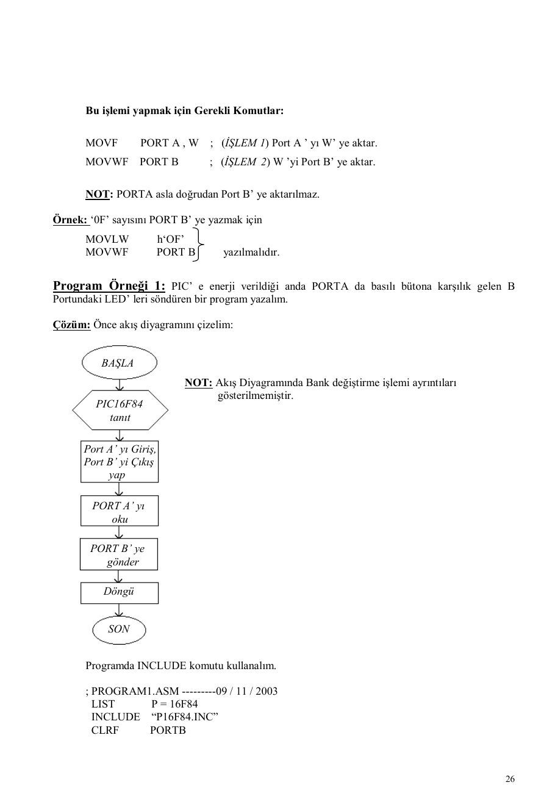
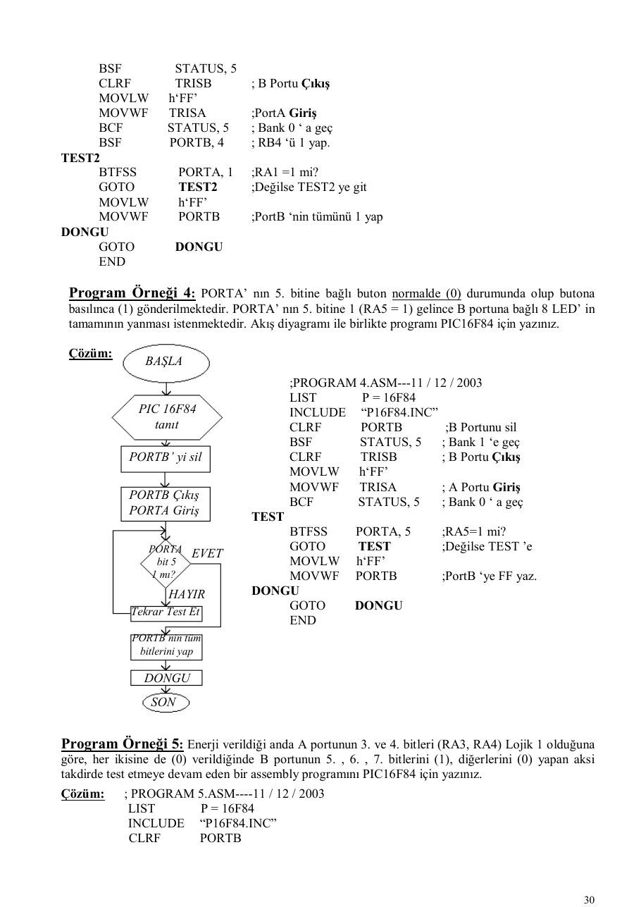

Bu yazı, Başkent Üniversitesi **EEM332 Mikroişlemciler** ders arşivindeki ilgili notları ve uygulamaları bir araya getiriyor (2003–2003). INCLUDE dosyaları, port ayarları, bit testi, LED ve gecikme alt programları. Kaynak: Doç. Dr. Hakan Ündil, Mikroişlemciler ve Mikrodenetleyiciler 1 ders notları, 2003. Belgelerin PDF arşiv kopyaları ve varsa kaynak kodları yazının sonunda ZIP olarak indirilebilir.

*Bu içerik üçüncü taraf bir kaynağa aittir; arşiv ve nostalji amacıyla kaynak belirtilerek paylaşılmıştır. Hak sahibinin talebi hâlinde kaldırılır.*

## help2 (1)

MİKROİŞLEMCİLER VE MİKRODENETLEYİCİLER 1 - DERS NOTLARI (Kısım 3) Doç. Dr. Hakan Ündil

Program Örneği 9 : Gecikme altprogramı kullanarak Port B’ ye bağlı tüm LED’ leri yakıp söndüren bir program için akış diyagramı çizerek gerekli assembly programını PIC 16F84 için yapınız.

Çözüm: ; PROGRAM9 . ASM-----15 / 12 / 2003

```asm
LIST       P = 16F84
INCLUDE    “ P16F84.INC”
SAYAC1 EQU          h‘0C’ ;16F84 de genel amaçlı RAM (Veri Hafızasında) ilk adres
SAYAC2 EQU          h‘0D’
BSF         STATUS,5
CLRF        TRISB                             BAŞLA
BCF        STATUS,5
DEVAM
MOVLW      h‘00’                              16F84’ ü
MOVWF      PORTB                            tanıt, PORTB
CALL       GECİKME                              çıkış
MOVLW      h‘FF’
```

### MOWF       PORTB

PORTB’ yi sıfırla

```asm
CALL       GECİKME
GOTO       DEVAM
```

### GECİKME                                            CALL GECİKME

```asm
MOVLW      h‘FF’
```

### MOWF       SAYAC1

PORTB       h‘FF’

### TEKRAR1 MOWF        SAYAC2

### TEKRAR2 DECFSZ      SAYAC2, F

```asm
GOTO       TEKRAR2                        CALL GECİKME
DECFSZ     SAYAC1, F
GOTO       TEKRAR1
RETURN
END
```

Program Örneği 10: PORTA’ nın 0. bitine bağlı ve basıldığında ( 0 ) üreten bir bütona 8 kere basıldıktan sonra yine PORTA’ nın 1. bitine 2 kere basılırsa PORTB’ ye bağlı bütün LED’lerin yanması isteniyor ( Her tuşa basıldıktan sonra GECİKME alt programı kullanılacaktır ). Gerekli akış diyagramını çizerek programı yazınız.

Çözüm:                             ; PROGRAM10.ASM-------22 / 12 / 2003

```asm
LIST        P = 16F84
INCLUDE     “ P16F84.INC”
GECİK1     EQU          h‘0C’
GECİK2     EQU          h‘0D’
SAYAC1     EQU          h‘0E’
SAYAC2     EQU          h‘0F’
CLRF        PORTB         ; PORTB yi sıfırla
BSF         STATUS,5 ;Bank1’ e geç
CLRF        TRISB         ;PORTB çıkış
BSF         TRISA, 0
BSF         TRISA, 1 ;RA0veRA1 Giriş
BCF         STATUS,5 ; Bank0’ a geç
MOVLW      h‘03’
MOVWF       SAYAC1 ; SAYAC1’e 03 yaz
MOVLW       h‘02’
```

### BAŞLA

```asm
MOVWF      SAYAC2 ;SAYAC2’ye 02 yaz
```

16F84’ ü tanıt          TEKRAR    BTFSC     PORTA, 0 ; RA0 = 0 mı? A portu giriş                   GOTO        TEKRAR ;Değilse TEKRAR’a B portu çıkış                   CALL       GECİKME ;Evetse GECIKMEye

```asm
DECFSZ     SAYAC1       ;SAYAC1’i 1 azalt
```

SAYAC1           03                GOTO       TEKRAR       ; Sonuç 0 değilse SAYAC2 “         02       DEVAM     BTFSC     PORTA, 1 ; RA1 = 0 mı?

```asm
GOTO       DEVAM         ; Değilse DEVAM’a
CALL      GECİKME ;Evetse GECIKMEye
```

RA0 = 0                       DECFSZ     SAYAC2        ; SAYAC2’i 1 azalt HAYIR     mı?                         GOTO       DEVAM         ;Sonuç 0 değilse EVET                      MOVLW      h‘FF’

```asm
MOVWF      PORTB         ;PORTB’ye FF yükle
GECİKME
; GECİKME ALT PROGRAMI
GECİKME
```

SAYAC1’i 1 azalt                    MOVLW     h‘FF’

```asm
MOVWF     GECİK1       ;GECIK1’e FF yükle
```

DONGU1    MOVLW     h‘FF’ SAYAC1                        MOVWF     GECİK2       ;GECIK2’ye FF yükle 0 mı? HAYIR DONGU2    DECFSZ   GECIK2, F ; GECIK2’yi 1 azalt

```asm
GOTO      DONGU2 ;Sonuç 0 değilse
```

EVET                DECFSZ    GECİK1,F ;GECIK1’i 1 azalt RA1 = 0                        GOTO     DONGU1 ; DONGU1 ‘e git. HAYIR     mı?                         RETURN    ; Alt Programdan dön

```asm
END       ; SON
GECİKME
```

SAYAC2’yi 1 azalt

### SAYAC2

0 mı? HAYIR

### EVET

PORTB’ ye FF yaz

### SON

### LOJİK İŞLEM KOMUTLARI

```asm
RLF Komutu (Bir bit Sola Kaydırma)
```

Bir file register içinde bulunan bitlerin birer bit sola kaydırılması işlemidir. Bu durumda en solda bulunan ( 7. bit ) C ( elde ) bayrağına geçmekte, daha önce C’ de bulunan bit ise en sağdaki ( 0.) bite geçmektedir. Komutun formatı;

RFL        FİLE REGISTER        ,    d           W yada F ( Sonucun Yeri )

Komutu şematik gösterirsek;

Program Örneği 11: Bir programla önce B portunun sadece 0. bitini (RB0) 1 yapın. Daha sonra 1 defa bu biti sola kaydırın. Bu işlemin daha iyi görülebilmesi için üst üste 2 kere GECIKME alt programı kullanın.

Çözüm:                          ; PROGRAM 11 . ASM_ TARİH

```asm
LIST        P = 16F84
INCLUDE     “ P16F84.INC”
BASLA
GECİK1   EQU         h‘0C’
GECİK2   EQU         h‘0D’
BCF          STATUS, 0 ; Elde yi sıfırla
```

16F84’ ü tanıt               BSF         STATUS, 5 ; Bank1’e geç PORTB çıkış                  CLRF        TRISB       ; PORTB Çıkış

```asm
BCF         STATUS, 5 ; Bank0’a geç
MOVLW        h‘01’
```

### PORTB        01

```asm
MOVWF        PORTB      ;PORTB’ ye 01 yaz
CALL         GECIKME_ALTPROG
CALL GECIKME                  CALL         GECIKME_ALTPROG
```

### BEKLE   GOTO         BEKLE

```asm
CALL GECIKME
```

GECIKME_ALTPROG              ; Önceki Gecikme Alt Prog ile aynı

```asm
RLF PORT B
MOVLF                h‘FF’
MOVWF                GECIK1
```

DONGU 1 MOVLW                h‘FF’

### SON

```asm
MOVWF                GECIK2
```

### DONGU2 DECFSZ                GECIK2, F

```asm
GOTO                  DONGU2
DECFSZ               GECIK1, F
GOTO                 DONGU1
RETURN
END
```

```asm
RRF Komutu (Bir Bit Sağa Kaydırma)
RRF komutu da RLF komutuna benzer olup fark bu defa kaydırma işleminin sağa olması
```

dolayısıyla en sağdaki bit C ( elde ) bayrağına geçecektir. Daha önce C bayrağında bulunan bit ise bu sefer en soldaki (7.( bite geçecektir. Komut formatı;

```asm
RRF FİLE REGİSTER         ,   d          Sonucun gideceği yer
```

W yada F Mesela MEM adlı bir file registere hex 30 sayısını yazın. Aynı anda C bayrağı da (C= 1) ise

```asm
RRF komutunun icrasından önce ve sonraki durum:
```

### Bu işlem için kullanılacak program komutları 

```asm
MOVLW           h‘49’      ; W Registerine (49)16 yükle
MOVWF           MEM        ; W ‘ yi MEM adresine sakla
RRF             MEM, F     ; MEM ’ i Sağa bir bit ötele.
```

şeklinde olacaktır.

Program Örneği 12: Önce C bayrağını (1) yapın ve başlangıçta sıfırlanmış PORT B üzerinden birer bit sola kaydırın. Her kaydırma arasında GECIKME alt programına gönderin. C bayrağı tekrar ( 1 ) olunca programı bitirin.

```asm
NOT: GECIKME_ALTPROG Gösterilmeyecektir.
```

### Çözüm

```asm
; PROGRAM 12.ASM----------Tarih
```

### BAŞLA                 INCLUDE    “PIC16F84.INC”

```asm
BSF         STATUS, 5           ; Bank1’e geç
CLRF        TRISB               ; PORTB Çıkış
```

16F84’ ü tanıt             BCF         STATUS, 5           ; Bank0’ a geç PORTB çıkış            KAYDIR

```asm
RLF          PORTB               ; PORTB yi sola kaydır
```

### C         1               CALL         GECIKME_ALTPROG

```asm
BTFSS        STATUS, 0                ; C bayrağı 1 mi?
```

PORTB             00          GOTO         KAYDIR                   ; Değilse KAYDIR’a

### DONGU

```asm
RLF PORTB                   GOTO DONGU       ; Evetse burada bekle
END
CALL GECIKME
```

C=1 mi?

### SON

COMF ve SWAPF Komutları COMF komutu ile istenen bir file register içinde (0) lar (1) ve (1) ler (0) yapılabilir [1’ e göre tümleyen işlemi !.. ] . Komut formatı;

COMF      FİLE REGİSTER            ,       d           Sonucun gideceği yer ( destination ) ( W yada F yazılır )

şeklindedir. Örnek: HAFIZA1 adlı registere ( 1F )16 yüklendikten sonra bunun tersi olan ( E0 )16 ’ ı HAFIZA2’ ye saklayın. Bunun için gerekli rutini (Program Parçasını) yazın.

### Çözüm

### HAFIZA1

0001 1111

```asm
MOVLW          h‘0F’
MOVWF          HAFIZA1                                       HAFIZA2
```

### COMF           HAFIZA1, W

```asm
MOVWF          HAFIZA2                                      1110 0000
```

```asm
SWAPF komutu ise bir file register içindeki ilk dört bit (Yüksek anlamlı Nibble) ile son dört
```

bitlerin (Düşük anlamlı Nibble) yerlerini değiştirir. Komut formatı;

```asm
SWAPF       FİLE REGİSTER ,                    d         şeklindedir.
```

Örnek: PORTB’ ye ( 3F ) yazdıktan sonra ilk ve son bitlerin yerini değiştiren ve sonucu W ye yazan Program parçası yazın.

```asm
MOVLW          h‘3F’
MOVWF          PORTB
SWAPF          PORTB, W
```

```asm
ANDLW Komutu
```

W registerinin içeriğini sabit bir sayı ile Lojik AND (VE) işlemine tabi tutar. Sonucu tekrar W ’ye yazar. Bilindiği gibi işlemin sonunda her iki sayıda 1-1 olan bitler 1; diğerleri 0 olarak neticelenecektir. Komut formatı;

```asm
ANDLW              Sabit sayı
şeklindedir.
```

Bu komutla bir sayının ( veri ) istenen bitleri ( 0 ) yapılırken diğerleri olduğu gibi bırakılır. Bunun için sabit sayı ( maske ) seçilirken sıfır yapılmak istenenler ( 0 ), diğerleri ( 1 ) olarak seçilmelidir.

Örnek: W içinde (3C) sayısı olsun. Bu sayının 2.,3. ve 6. bitlerini (0) yapıp diğerlerini aynen bırakan komutu yazalım. Sonuçta sayı ne olur? Önce W deki sayıya hiç bakmadan 2.,3.,6. bitleri 0, öteki bitleri 1 olan bir maske seçelim. 7   6   5   4    3   2       1   0

### 1 0 1        1 0      0 1 1         = (B3)16

### Bu maskeyle W deki sayıyı (3C yi) Lojik VE işlemine tabi tutmak için gerekli komut

```asm
ANDLW                h’B3’                  olacaktır.
```

Sonucu bulmak için ise, W deki sayı (3C)16 verildiğine göre bu sayının 2.,3. ve 6. bitlerinin sıfırlanmış halini yazmamız gerekir. O da (30)16 olarak elde edilecektir. [ 3C de 6. bit zaten 0 olduğuna göre, 3C yi binary yazın ve 2. ve 3. bitlerini sıfırlayın]

```asm
ANDWF Komutu
```

Bu komut ANDLW komutuna benzer olup bu defa W ile herhangi bir file register arasında Lojik AND (ve) işlemi gerçekleştirilir. Sonuç ise ya W ‘ye ya da F ‘e yazılır. Komut formatı:

File Register

```asm
ANDWF                                    ,d       (Sonucun yeri, W ya da F)
şeklindedir.
```

Örnek: PORTB registerinin içinde b’00101100’ sayısı olsun. W Registerine de b’11011111’ değerini (maske) yerleştirelim. Bu iki sayıyı Lojik AND işlemine tabi tutarak neticeyi yine PORTB ye yazalım.

### Bunun için gerekli program parçası 

```asm
MOVLW            b’00101100’ ; W Registerine 2C yükle.
ANDWF            PORTB , F ; PORTB ile W yi AND (VE) işlemine tabi tut
; ve sonucu yine PORTB ye yaz.
```

IORLW Komutu Bu komut istenen bir biti 1 yapıp diğerlerini aynen bırakmak için kullanılır. Verilen sabit sayı ile W registeri Lojik OR (VEYA) işlemini yapar ve sonucu yine W registerine yazar. Komut Formatı:

IORLW                 Sabit sayı                        şeklindedir.

Bu amaçla seçilecek sabit sayıda (Maske’de), (1) yapılmak istenen bitler (1), değiştirilmesi istenmeyen bitler (0) seçilmelidir.

Örnek: W Registerinde bulunan sayının 5.,6.,7. bitleri 1 yapılıp diğer bitler aynen bırakılmak istensin. Önce Maskemizi seçelim; 7    6   5    4   3    2   1   0

1    1       1 0 0 0 0 0                          = E0 (Sayıda 1 yapılacak bitler 1)

Bu durumda gerekli program parçası (komut)

IORLW               b’1110 0000’                        olacaktır.

```asm
NOT: Maske seçimi işlemi için W da bulunan sayının bilinmesine gerek yoktur. Hangi sıradaki
```

bitlerin (burada 5,6,7 idi) 1 yapılacağının bilinmesi yeterlidir. Soruda “sayı W dadır” denildiği için program parçasında W ‘ya yükleme komutuna ihtiyaç yoktur.

Örnek: Yukarıdaki örnekte W daki sayımız (04)16 olsaydı sonuç ne olurdu?

W ile Maske arasında OR işlemi: (sonuç E4 olacaktır) Bit No:      7    6        5       4   3      2     1    0 W Reg.       0    0        0       0   0      1     0    0 Maske        1    1        1       0   0      0     0    0 Sonuç        1    1        1       0   0      1     0    0

IORWF Komutu Bu komut da IORLW komutuna benzer olup fark, maskenin sabit sayı yerine bir file registerde bulunmuş olmasından ibarettir. Sonuç ise ister W ‘ye , ister File Register ’a yazılabilir.

### Komut Formatı

IORWF            File Register         , d     (Sonucun yeri, W ya da F)

XORLW            Komutu Bu komut ise W Registeri ile verilen sabit sayı arasında EXOR ( Özel VEYA) işlemi gerçekleştirerek

### sonucu W ‘ye yazar. Komut Formatı

XORLW                Sabit Sayı         şeklindedir.

Bu komut da W Registerde bulunan 8 bitlik sayının istenen bitlerinin tersini almak diğer bitleri aynen bırakmak için kullanılabilir. Bu maksatla belirlenecek Maske baytında tersi alınmak istenen bitler (1), diğerleri (0) seçilmelidir.

Örnek: Önce W ‘ya (3B)16 sayısını yükledikten sonra bu sayının sadece 1. , 3. , 5. , 7. bitlerinin tersini alıp neticeyi PORTA ya yazmak için gerekli komutları verin. Bu durumda sonuç ne olur?

```asm
MOVLW           h ‘3B’             ;W ye 3b yaz
```

XORLW           b’10101010’        ; maskede 7,5,3,1. bitler 1, yapıldı

```asm
MOVWF           PORTA              ; Sonuç PORTA ya yazıldı.
```

W ile sabit sayı arasında (EXOR işlemi) Bit No:          7     6       5   4   3     2     1    0 W Reg.de(3B)     0     0       1   1   1     0     1    1 Maske (AA)       1     0       1   0   1     0     1    0 Sonuç (91)       1     0       0   1   0     0     0    1

XORWF            Komutu Bu komut da XORLW komutuna benzer olup burada asıl sayı W registerde, maske ise file registerde bulunur. İşlem sırası önemli olmadığı için maskeyi W’ya asıl sayıyı File Registere yazmak da mümkündür.

```asm
NOT: XORLW ve XORWF iki tane 8 bitlik sayının aynı olup olmadıklarını test etmek için
```

kullanılabilir. Sayılar aynı ise EXOR lanınca sonuç (00)16 olacağından Z bayrağı (1) olacaktır. Aksi takdirde Z bayrağı (0) kalacaktır. [ Z bayrağının STATUS ‘un 2. biti olduğunu hatırlayın]

Örnek: PORTA da bulunan bir baytlık sayı (09)16 dan farklı ise A Portu test edilmeye devam edilecek, (09)16 ‘a eşit ise bu sayı PORTB ‘ye yazılsın isteniyor. Gerekli Program Parçası:

```asm
MOVLW         h’09’
TEST
```

XORWF         PORTA,W        ; W ile PortA ya Lojik EXOR işlemi uygula

```asm
BTFSS         STATUS,2       ; Z bayrağı 1 mi?
GOTO          TEST           ; Değilse TEST ‘e git
MOVF          PORTA , W      ; Evetse PortA yı W ye aktar.
MOVWF         PORTB          ; W yi PortB ye yaz.
```

Mesela, PORTA ya gelen sayı (07)16 olsa ve (09)16 ile XORWF işlemi yapıldığında;

0000 0111     (07) 0000 1001     (09) 0000 1110     (0E)    Sonuç 0 ‘dan farklı olduğuna göre test etmeye devam et.

Benzer şekilde bir baytlık veriyi sıfır sayısı ile karşılaştırmak için IORLW ve IORWF komutları kullanılabilir.

Örnek: PORTA daki sayının (00)16 olup olmadığını test eden, sıfır ise ILERI adresine atlayan aksi takdirde test etmeye devam eden bir program parçasını IOR türü bir komutla yazın.

```asm
TEST
MOVF          PORTA ,W       ; PortA yı W ye kopyala (yaz)
```

IORLW         h’00’          ; W ile 00 arasında Lojik VEYA uygula

```asm
BTFSS         STATUS , 2     ; Sonuç=0 mı ( Z=1 mi?)
GOTO          TEST           ; Değilse TEST ‘e git
GOTO          ILERI          ; Evetse ILERI adresine git.
```

Program Örneği 13 : PORTA nın bütün bitleri normalde (1) iken PORTA da 0,1,2. bitlerin (RA0,RA1,RA2) hepsine basılınca PORTB ye (0F)16 yükleyen aksi halde test etmeye devam eden bir program için akış diyagramı çizerek assembly programı yazınız. Maske:          0001 1000 [ilk 3 bit(0) PORTA da yok, son üç bit(0) test edilecek]

```asm
; PROGRAM13.ASM-------TARİH
LIST     P=16F84
INCLUDE  “P16F84.INC”
CLRF     PORTB
BSF      STATUS,5
MOVLW    h’FF’
MOVWF    TRISA          ;PortA Giriş
CLRF     TRISB          ;PortB Çıkış
BCF      STATUS,5 ;Bank0 a geç
TEST
MOVLW    b’00011000’ ;Maskeyi W ye
```

XORWF    PORTA,W ;PortA ile EXOR

```asm
BTFSS    STATUS,2 ; Z bayrağı 1 mi?
GOTO     TEST           ;Değilse TEST e
MOVLW    h’0F’     ;Evetse W ‘ ye 0F yaz
MOVWF    PORTB          ; PortB ye aktar
END
```

### ÇEŞİTLİ ÖRNEKLER

### 1)      PORTA ‘nın 0. bitine (RA0) Lojik 0 uygulanarak enerji verilen bir PIC16F84’e daha sonra

PORTA ‘nın tamamına (FF)16 uygulanırsa PORTB nin tüm bitleri (1) yapılacak aksi takdirde PORTA

```asm
test edilmeye devam edilecektir. Akış diyagramı çizerek gerekli assembly programını yazınız.
; ORNEK1.ASM
LIST           P=16F84
INCLUDE        “P16F84.INC”
CLRF           PORTB
BSF            STATUS,5
MOVLW          h’FF’
MOVWF          TRISA
CLRF           TRISB
BCF            STATUS,5
TEST
BTFSC          PORTA,0 ; RA0=0 mı?
GOTO           TEST       ; Değilse TEST’e
BEKLE
```

XORWF          PORTA,W ; W ile PORTA aynı mı?

```asm
BTFSS          STATUS,2 ; Z bayrağı 1 mi?
GOTO           BEKLE          ; Değilse BEKLE ’ye
MOVLW          h’FF’
MOVWF          PORTB          ; Aynıysa PORTB ye FF yaz
END                           ; Son
```

### 2) PORTA nın 1. bitine (RA1) 2 kere üstüste bir Lojik devreden (0) uygulandığı takdirde W

Registerine (01)16 yazıp son bulan bir program yazınız. Tuşa basılmalar arasında 10 tane NOP komutunun yaklaşık 255 defa icrası ile elde edilecektir. Gecikmeden hemen sonra ikinci (0) işareti gelmediği halde test işlemine baştan başlanacaktır. (Yani, yeniden iki (0) beklenecektir, Gecikme için Alt Program kullanılmayacaktır.) Gerekli assembly programını yazınız.

```asm
;ORNEK2.ASM
LIST               P=16F84
INCLUDE            “P16F84.INC”
SAYAC     EQU                h’0C’       ; SAYAC için 1 bayt yer ayır.
BSF                STATUS,5 ; Bank1 ‘e geç
MOVLW              h’FF’
MOVWF              TRISA       ; PORTA yı Giriş yap
BCF                STATUS,5 ; Bank0 ‘a geç
TEST
BTFSC              PORTA,1        ; RA1=0 mı?
GOTO               TEST           ; Değilse TEST ‘e git
MOVLW              h’FF’          ; Evetse W ‘ye FF yükle
MOVWF              SAYAC          ; Sayaca W deki FF sayısını yaz
GECIKME
NOP
NOP
NOP
.
```

. .

```asm
NOP                          ; 10 tane NOP komutu
DECFSZ         SAYAC,F       ; Sayacı 1 azalt
GOTO           GECIKME       ; SAYAC sıfırdan farklıysa GECIKME’ye
BTFSC          PORTA,1       ; SAYAC sıfırsa, tekrar RA1=0 mı? bak
GOTO           TEST          ; Değilse TEST ‘e git, yeniden iki 0 bekle
MOVLW          h’01’         ; İstenen (01) sayısını W ‘ye yükle
END                          ; Son
```

### 3) PORTA ‘da bulunan 8 bitlik (1 baytlık) sayı 2 kere sola ötelendikten sonra ortaya çıkan sayı

(6C)16 ise PORTB ‘ye (01) ; aksi takdirde yine PORTB ‘ye (02) yazan bir programı assembly dilinde yazınız.

```asm
NOT: Başlangıçta C bayrağı (0) yapılacaktır.
```

```asm
;ORNEK3.ASM
LIST            P=16F84
INCLUDE         “P16F84.INC”
BSF             STATUS,5
MOVLW           h’FF’
MOVWF           TRISA       ; PortA Giriş
CLRF            TRISB       ; PortB Çıkış
BCF             STATUS,5 ; Bank0 ‘a geç
BCF             STATUS,0 ; C Bayrağı sıfır yapıldı.
RLF             PORTA,F     ; PortA ‘yı 1 bit sola ötele
RLF             PORTA,F     ; PortA ‘yı 1 bit (kere daha) sola ötele
MOVLW           h’FF’       ; W registerine FF yükle
```

XORWF           PORTA,W ; W deki (FF) ile PortA daki sayı aynı mı?

```asm
BTFSS           STATUS,2 ; Z bayrağı 1 ise bir satır atla.
GOTO            GIT         ; Değilse GIT etiketine git.
MOVLW           h’01’
```

YAZ MOVWF            PORTB       ; PortB ye (01) yaz

```asm
GOTO            SON         ; SON etiketine git.
```

GIT MOVLW            h’02’

```asm
MOVWF           PORTB       ; PortB ye (02) yaz
```

### SON END

### KAYNAKLAR

1- Mikroişlemciler Ders Notları 1 - 2 (6502) , Doç. Dr. Hakan ÜNDİL 2- Mikrodenetleyiciler ve PIC Programlama, Orhan ALTINBAŞ 3- Adım Adım PIC Programlama, Yaşar BODUR 4- PIC Microcontroller Uygulama Devreleri, Gökhan DİNÇER 5- PIC16F8X, Microchip PIC Data Sheet, (www.microchip.com)

, sayfa 1.")

, sayfa 3.")

## help3

MİKROİŞLEMCİLER VE MİKRODENETLEYİCİLER 1 - DERS NOTLARI (Kısım 2) Doç. Dr. Hakan Ündil

```asm
INCLUDE Dosyalar
```

Assembly programlarını yazarken kullanılacak register adreslerini (EQU) komutu ile tanımlamak hem kolaylık sağlamakta hem de anlaşılırlığı arttırmakta idi. Ancak her sefer bu tanımları tekrar tekrar yapmak gereksiz gibidir. Bunun yerine Include Dosya kullanarak aynı isimli her PIC için sabit olan bu tanımları her programda yeniden yapmaktan kurtulmuş oluruz. Mesela; P16F84.INC dosyası PIC16F84 için gerekli tanımları içerir ve MPASM klasörü içinde ( .asm) dosyamızla aynı yerde bulunmalıdır. Include dosyası içinde Register adres tanımlarının yanı sıra RAM bölgesinin tanımı ve Konfigüration Bitleri denilen bazı bitlerin tarifi de yapılmaktadır. Programımız içinde Include Dosyası kullanabilmemiz için (PIC16F84 de) INCLUDE “P16F84.INC” satırını yazmamız yeterlidir.

```asm
Include dosya sayesinde (örneğin) STATUS registerinin her bir bitine isim verildiği için:
```

```asm
BCF STATUS, 5                yerine
BCF STATUS, RP0              yazmak mümkündür. Aynı şeyler INTCON, OPTION gibi diğer
```

registerler içinde geçerlidir. Artık her File Register için kullanılan (EQU) komutları kalktığı için kaynak (assembly) programımız önemli ölçüde kısalıp sadeleşecektir. Sadece Genel Amaçlı RAM bölgesinde kullanacağımız bir değişken için (SAYAC gibi) EQU komutu yazmamız gerekebilecektir.

### KONFİGÜRASYON BİTLERİ

Bu bitler PIC’ e gerilim verildiği anda geçerli kuralları belirlemek içindir. Mesela; PIC devremizin saatini (osilatörünü) RC tipi olarak kullanacaksak bunu programda bildirmemiz lazımdır. Benzer şekilde; Watchdog timer’ i devreye sokmak veya çıkarmak, Power-on Reset özelliğini devreye sokmak ya da çıkarmak, Kod korumayı devreye almak veya almamak için bu konfigürasyon bitleri kullanılır. Aslında konfigürasyon bitleri programa yazılmadan programlama esnasında da doğrudan belirlenebilir. Zira bütün programlayıcı programları bu imkanı vermektedir. Eğer program içersinde bir satır olarak Konfigürasyon Bitlerini vermek istersek bu komutun yazılışına ait bir örnek şöyle

### verilebilir

### _CONFIG _CP_ OFF & WDT_OFF & PWRTE_OFF & RC_OSC

Kod Komut Yok   Watchdog Timer OFF Power-on Reset Yok   Osilatör Tipi (RC)

&    : “ve” demektir. _    : Alt çizgi boşluk yerine kullanılıyor. OFF :    Yok, devre dışı anlamına gelir.

### VERİ AKTARMA İŞLEMLERİ

PIC’ de veri aktarma (transfer) işlemleri W registeri üzerinden yapılmaktadır.

### Örnek

### İŞLEM 1              İŞLEM 2

W Reg.

### PORTB

### PORTA

### Bu işlemi yapmak için Gerekli Komutlar

```asm
MOVF         PORT A , W    ; (İŞLEM 1) Port A ’ yı W’ ye aktar.
MOVWF        PORT B        ; (İŞLEM 2) W ’yi Port B’ ye aktar.
```

```asm
NOT: PORTA asla doğrudan Port B’ ye aktarılmaz.
```

Örnek: ‘0F’ sayısını PORT B’ ye yazmak için

```asm
MOVLW           h‘OF’
MOVWF           PORT B        yazılmalıdır.
```

Program Örneği 1: PIC’ e enerji verildiği anda PORTA da basılı bütona karşılık gelen B Portundaki LED’ leri söndüren bir program yazalım.

### Çözüm: Önce akış diyagramını çizelim

### BAŞLA

```asm
NOT: Akış Diyagramında Bank değiştirme işlemi ayrıntıları
gösterilmemiştir.
PIC16F84
tanıt
```

Port A’ yı Giriş, Port B’ yi Çıkış yap

PORT A’ yı oku

PORT B’ ye gönder

Döngü

### SON

Programda INCLUDE komutu kullanalım.

```asm
; PROGRAM1.ASM ---------09 / 11 / 2003
LIST    P = 16F84
INCLUDE “P16F84.INC”
CLRF    PORTB
```

```asm
BSF          STATUS,5                    ; BANK 1’ e geç
CLRF         TRISB                       ; B portu tümü çıkış
MOVLW        h‘FF’
MOVWF        TRISA                           ; TRISA’ yı FF yükle, PORTA tamamen Giriş.
BCF          STATUS,5                        ; BANK 0’ a geç
OKU
MOVF    PORTA,W                              ; PORTA’ yı oku sonucu W’ ye yaz
MOVWF   PORTB                                ; W ‘ yi PORT B’ ye yaz (kopyala)
DONGU
GOTO DONGU                                    ; Sonsuz Döngü, GOTO OKU da denebilir.
END                                          ; Son
```

### Pratik Gerçekleştirme İçin Gerekli Adımlar

### 1) Programı yazıp PROGRAM1.ASM olarak kayıt (save) ediniz.

### 2) MPASM ile derleme yapıp (PROGRAM1.hex) dosyasını elde ediniz. Konfigürasyon bitlerine

dikkat ederek programlayıcıya PIC’ i yerleştirip programı yükleyiniz. Konfigürasyon bitleri için Osilatör tipi : RC       PWRT : ON WDT           : OFF      CP   : OFF               yazılabilir.

```asm
Not: INCLUDE ( .INC) dosya kullanıldığı için 16F84.INC dosyasının da aynı klasör (directory)
```

içinde bulunmasını sağlamayı ihmal etmeyin.

### 3) Devreyi aşağıdaki gibi kurun.

```asm
NOT 1: RA0, RA3 girişleri de (+) beslemeye bağlıdır. Yani Lojik 1 almaktadır.
NOT 2: PIC devrelerinde besleme gerilimi (+ 5V) en az 0,1 F bir kondansatör ile şaseye
bağlanmalıdır.
```

### 4) Devreye enerji vermeden A1, A2, A4 butonlarına tek yada birlikte basınız.

### 5) Basılan buton ve yana LED ilişkisini inceleyin.

```asm
NOT: Hiçbir butona basılmazsa PortA bitlerinin harici pull-up dirençleri (10k) dolayısıyla LED’ leri
```

yaktığı görülecektir. Zira A portu normalde (1) olup basınca (0) olmaktadır.

### 6) Durum değiştirirken önce istediğiniz butonlara basın sonra RESET yapın.

Sonsuz Döngü: PIC16F84 de duraklama komutu olmadığı için Döngü kullanılmaktadır. Programda bekleme yerine yeni butonların durumu okunmak isterse,

### DONGU

```asm
GOTO DONGU                        komutu yerine
```

```asm
GOTO OKU         yazabiliriz. Artık RESET ‘e gerek kalmadan tuşlara bastıkça LED
```

değişmelerini göreceğiz.

### KARAR İÇİN BİT TEST ETME İŞLEMİ

Herhangi bir register içindeki bir bit BTFSC ve BTFSS komutları ile test edilip sonuca göre ya bir sonraki (sıradaki) satırdan devam edebilir yada bir satır atlanabilir (Program Yönlendirilir).

```asm
BTFSC Komutu: Bu komut ingilizcede “File Register bitini test et, bu bit (0) ise bir
```

sonraki komuta atla” anlamına gelmektedir.

Komut Formatı:                  7, 6, 5, 4, 3, 2, 1, 0

```asm
BTFSC     File Register           ,
```

f                     b   (0,........,7 arası bir sayı)

şeklindedir. Bir örnek program parçası için akış diyagramı ile birlikte komutun çalışmasını

```asm
inceleyelim:
```

Bu program parçası PORTA’ nın 3. bitini (RA3) test etmekte bu bit (0) ise PORTB’ nin 5. bitini (1) yapmakta ; aksi halde test etmeye devam etmektedir.

### PORTA,                       TEST

Evet bit 3                                  BTFSC PORTA, 3 0 mı?                                  GOTO TEST

```asm
BSF   PORTB, 5
Hayır
```

Tekrar Test                     NOT: PORTA ve PORTB’ nin önceden tanımlandığı kabul edilmiştir.

PORTB’nin 5. bitini (1) yap

```asm
BTFSS Komutu: Bu komut ise BTFSC komutuna benzerdir. Ancak, file register bitinin (0)
```

yerine (1) olduğunu test etmektedir. Bu bit eğer (1) ise komuttan sonraki (sıradaki) komut atlanmakta; değilse (0) ise sıradaki komuttan devam edilmektedir.

Program Örneği 2: ( Yukarıdaki aynı devre için)

A portunun 2. bitindeki bütona basınca B portunun (RB0,.........,RB4) LED’ lerini yakan bir program yazalım.

### Çözüm

```asm
; PROGRAM 2.ASM------08 / 12 / 2003
LIST     P = 16F84
INCLUDE “P16F84.INC”
```

### BAŞLA                                CLRF     PORTB

```asm
BSF     STATUS, 5
CLRF    TRISA
MOVLW   h‘FF’
```

PIC16F84’ ü

```asm
MOVWF   TRISA
tanıt
BCF     STATUS, 5
TEST
```

B portunu sil                            BTFSC   PORTA, 2

```asm
GOTO    TEST
MOVLW h‘0F’
```

PORT A Giriş,

```asm
MOVWF PORTB
```

PORT B Çıkış yap

```asm
END
```

PORT A’ nın   Evet 2.biti 0 mı? Hayır Tekrar test et

### RB0,.....RB4

(1) yap

### SON

Program Örneği 3: PORTA’ nın 1. bitine (RA1) bağlı bütonuna basılı olarak enerji verildikten sonra PORTB’ deki RB4’ e bağlı (LED4) yakacak, daha sonra bütondan el çekilince PORTB’ nin tüm LED’ lerini yakan bir program yapınız. [Bütona basılı değilken PORTA ‘nın girişlerinin (1) kabul edilmektedir.]

( Devamı Yan Tarafta)

### -;PROGRAM3.ASM----08/12/ 2003

```asm
LIST     P = 16F84
INCLUDE  “P16F84.INC”
```

```asm
BSF             STATUS, 5
CLRF            TRISB          ; B Portu Çıkış
MOVLW          h‘FF’
MOVWF          TRISA           ;PortA Giriş
BCF            STATUS, 5       ; Bank 0 ‘ a geç
BSF            PORTB, 4        ; RB4 ‘ü 1 yap.
TEST2
BTFSS             PORTA, 1     ;RA1 =1 mi?
GOTO              TEST2        ;Değilse TEST2 ye git
MOVLW             h‘FF’
MOVWF             PORTB        ;PortB ‘nin tümünü 1 yap
DONGU
GOTO             DONGU
END
```

Program Örneği 4: PORTA’ nın 5. bitine bağlı buton normalde (0) durumunda olup butona basılınca (1) gönderilmektedir. PORTA’ nın 5. bitine 1 (RA5 = 1) gelince B portuna bağlı 8 LED’ in tamamının yanması istenmektedir. Akış diyagramı ile birlikte programı PIC16F84 için yazınız.

### Çözüm

### BAŞLA

```asm
;PROGRAM 4.ASM---11 / 12 / 2003
LIST     P = 16F84
```

### PIC 16F84                     INCLUDE “P16F84.INC”

tanıt                       CLRF     PORTB          ;B Portunu sil

```asm
BSF      STATUS, 5     ; Bank 1 ‘e geç
```

PORTB’ yi sil                  CLRF     TRISB         ; B Portu Çıkış

```asm
MOVLW    h‘FF’
MOVWF    TRISA         ; A Portu Giriş
```

PORTB Çıkış

```asm
BCF     STATUS, 5      ; Bank 0 ‘ a geç
```

PORTA Giriş            TEST

```asm
BTFSS           PORTA, 5         ;RA5=1 mi?
```

PORTA EVET              GOTO            TEST             ;Değilse TEST ’e bit 5                  MOVLW           h‘FF’ 1 mı?                   MOVWF           PORTB            ;PortB ‘ye FF yaz.

### HAYIR           DONGU

Tekrar Test Et             GOTO            DONGU

```asm
END
```

PORTB nin tüm bitlerini yap

### DONGU

### SON

Program Örneği 5: Enerji verildiği anda A portunun 3. ve 4. bitleri (RA3, RA4) Lojik 1 olduğuna göre, her ikisine de (0) verildiğinde B portunun 5. , 6. , 7. bitlerini (1), diğerlerini (0) yapan aksi takdirde test etmeye devam eden bir assembly programını PIC16F84 için yazınız. Çözüm:      ; PROGRAM 5.ASM----11 / 12 / 2003

```asm
LIST     P = 16F84
INCLUDE “P16F84.INC”
CLRF     PORTB
```

```asm
BSF             STATUS, 5         ; Bank 1’ e geç
CLRF            TRISB             ; PORTB tamamı Çıkış
MOVLW           h‘FF’
MOVWF           TRISA             ; PORTA Giriş
BCF             STATUS            ; BANK 0’ a geç
TEST
BTFSC          PORTA, 3          ; PORTA’ nın 3. biti 0 mı?
GOTO           TEST
BTFSC          PORTA, 4          ; PORTA’ nın 4. biti 0 mı?
GOTO           TEST
MOVLW          b‘11100000’       ; W ‘ye h‘E0’ yükle.
MOVWF          PORTB             ; PortB ‘ye (E0) yükle
DONGU
GOTO            DONGU
END
```

### DÖNGÜ KULLANMAK

Bazen belli işlem ya da işlemlerin belirli sayıda tekrarlanması istenebilir. Böyle bir durumda bir register SAYAÇ olarak kullanılır. Genellikle tekrar sayısı ( SAYAÇ)’ a yüklendikten sonra her seferinde ( SAYAÇ ) 1 azaltılarak ( 0 )’ a ulaşılana kadar Döngü devamı ettirilir. Bu amaçla

```asm
DECFSZ komutu kullanılması gerekir.
```

Bu komut her icra edildiğinde bu register ( burada SAYAC ) 1 azaltılır ve SAYAC =0 olunca bir sonraki komuta atlanır. Aksi halde ( SAYAC  0 ise ) DECFSZ komutundan hemen sonraki (sıradaki) komut icra edilir.

### Bu komutun formatı

```asm
DECFSZ                 Sayaç       ,      d          W yada F       şeklindedir.
```

Aşağıdaki program parçasında SAYAC’ ın daha önce tanımladığı ve belli bir değerle ( döngü sayısı ) yüklendiği farz edilmiştir. Döngü bitince PORTB’ ye ( FF ) yüklenmektedir.

.

### SAYAC = SAYAC - 1                                            .

### TEKRAR

```asm
DECFSZ SAYAC, F
```

### SAYAC      EVET                             GOTO   TEKRAR

0 mı?                                      MOVLW h‘FF’

### HAYIR                                 MOVWF PORTB

Tekrar Et                                . . Port B’ yi FF yap

Program Örneği 6: PORTA’ nın 2. bitine bağlı butona 10 kere basıldıktan sonra PORTB’ nin 0. bitine bağlı LED’ in yakılması isteniyor ( Her butona basılması arasında 25 peryot beklenmesi arzu edilmektedir. Böylelikle butondan doğan parazitler engellenmiş ve bir basışta 10 kereyi birden saymasının önüne geçilmiş olacaktır ). Gerekli programı PIC 16F84 için assembly dili ile yazınız.

Çözüm: :    ; PROGRAM 6.ASM-----20 / 12 / 2003

```asm
LIST            P = 16F84
INCLUDE         “P16F84.INC”
SAYAC       EQU             h‘0C’     ; Genel amaçlı RAM ilk adresi
CLRF            PORTB
BSF             STATUS, 5
CLRF            TRISB
MOVLW           h‘FF’
```

```asm
MOVWF           TRISA
BCF             STATUS, 5
BASLA
MOVLW           d‘10’
MOVWF           SAYAC
TEST
BTFSC               PORTA, 2        ; RA2= 0 mı?
GOTO               TEST             ; Değilse TEST etmeye devam et
NOP                                 ; İşlem yapma
.
```

.                                ; .                                ;(NOP : İşlem yapma. 1 peryot bekleme için ) . .

```asm
NOP                                 ; Toplam 25 adet NOP komutu var.
DECFSZ               SAYAC, F        ; Sayacı 1 azalt sonuç 0 mı?
GOTO                 TEST            ; Değilse TEST ‘e git
BSF                  PORT B, 0       ; Evetse, PORTB nin 0. bitini 1 yap.
DONGU
GOTO                DONGU
END
```

Yukarıdaki örnekte 25 adet NOP kullanılmıştır. Böyle bir sistemde iki basma arasında bekleme süresi arttırılmak istenirse bu sayı arttırılır. Ancak bu durumda hafızanın gereksiz dolması gibi bir sorunla karşılaşırız. Bunun yerine 2. bir sayaç tanımlayarak az sayıda (aşağıdaki örnekte 3 tane ) NOP’ un defalarca icrası ( mesela 255 kere) sağlanabilir. Bunun için STATUS ‘un 2. bitini olan

SAYAC 2’ yi FF yap

3 tane NOP komutu

### SAYAC2 =

### SAYAC2 - 1

### HAYIR

### SAYAC 2

0 mı?

### EVET

SAYAC1 ‘i azaltma ve diğerleri aynı, Dış ta bir çevrim daha var

### KARŞILAŞTIRMA İŞLEMİ VE DÖNGÜ

SAYAC her zaman azalan yönde çalışmaz. Her döngüde SAYAC’ ın arttığı durumlarda SAYAC değeri istenen bir sayı ile karşılaştırılmalıdır. Eşitlik sağlanınca döngü sona erdirilir. Örnek olarak ( 09 ) kere tekrarlanan tekrar etiketli bir döngü ( çevrim ) düzenleyelim: ( Program parçası )

............ ............ SAYAC’ ı sıfırla          CLRF          SAYAC

### TEKRAR

SAYAC’ ı 1 arttır          INCF          SAYAC, F              ; SAYAC ‘ı 1 arttır

```asm
MOVLW         h‘09’
SUBWF         SAYAC, W              ; SAYACdan W yi çıkart
```

W       h‘09’           BTFSS         STATUS, 2             ; Z bayrağı 0 mı?

```asm
GOTO          TEKRAR                ; Değilse TEKRAR ‘a git
```

W’ den SAYACI çıkart     DONGU

```asm
GOTO         DONGU                  ; Evetse burada   bekle
STATUS
END
```

HAYIR 2 biti 1 mi?

### EVET

### SON

Programda SAYAC o ana kadar ki tekrar sayısını belirtir. Çıkarma komutu SUBWF ile STATUS registerinde bulunan Z ( Sıfır bayrağı ) ve C ( Elde bayrağı ) etkilenir.

2            0

### STATUS

Register                 Z            C            Elde bayrağı

Sıfır bayrağı

```asm
SUBWF Komutu:
```

Bu komut o andaki File registerinin içeriğini W registerinden çıkarır ve sonucu W yada file registerine yazar.Komut Formatı;

```asm
SUBWF          File registeri       , W yada f
```

Çıkarma sonucunda Z ve C bayraklarının değeri çıkartılan iki sayı arasındaki ilişki bilgisini taşır. File registeri > W ise Z = 0 C = 1 File registeri = W ise Z = 1 C = 0 File registeri < W ise Z = 0 C = 0 olur. Bu bayrakların değerine göre dallanma gerçekleştirilir.

```asm
SUBLW Komutu:
```

```asm
SUBLW komutuna benzer olup bu komutla sabit sayıdan W nin içeriği çıkarılır. Sonuç W registerine
```

yazılır. Komut formatı aşağıda verilmiştir.

```asm
SUBLW       k         ; Burada k sabit sayıyı temsil etmektedir.
```

Örnek: Önce HAFIZA adı verilen ve daha önce tanımlanmış bir adreste h‘35’ sayısını yazalım. Bu sayı W’ ye yüklenen sayıdan küçük yada büyük ise PORTB’ nin 0. bitini ( 1 ) yapalım. Aksi takdirde

### (GIT) adresine gönderelim. Gerekli program parçası

### Çözüm

```asm
MOVLW      h‘35’
MOVWF     HAFIZA
MOVLW     ( SAYI )
```

### HAFIZA >             SUBWF      HAFIZA, W

### < SAYI                                   HAFIZA = SAYI

ise               BTFSC     STATUS, 2             ise

```asm
GOTO      GIT
BSF       PORTB, 0
NOT
```

- ( SAYI ) yerine h‘28’, h‘35’, h‘4A’ gibi bir baytlık sayı yazılacaktır.

- GIT adresi programda başka yerdedir.

Örnek: W registerine h‘60’ yazdıktan sonra, h‘50’ sayısından W ’de bulunan sayıyı çıkartalım. C bayrağı ( 0 ) ise PORTB’ nin 3., 4., ve 5. bitlerine ( 1 ) yüklensin. Aksi halde GIT adresine dallanmak üzere bir program parçası yazalım.

### Çözüm

```asm
MOVLW      h‘60’
SUBWF      h‘50’
BTFSC      STATUS, 0
GOTO       GIT
MOVLW      b‘00111000’
MOVWF      PORTB
```

Program Örneği 7: PIC 16F84 için bir program yazarak h‘1A’ sayısından h‘09’ sayısını çıkarınız ve farkı PORTB’ ye yazınız. STATUS registerinin içeriğini de W’ ye aktarınız. Çözüm:             ;PROGRAM 7.ASM---08 / 12 / 2003

```asm
LIST     P = 16F84
INCLUDE “P16F84.INC”
CLRF     PORTB
BSF     STATUS, 5      ; Bank 1’ e geç
CLRF    TRISB         ; B portu çıkış
BCF     STATUS, 5      ; Bank 1’ e geç
BASLA
MOVLW    h‘09’
SUBLW    h‘1A’         ; 1A sayısından W deki 09 u çıkar
MOVWF    PORTB          ; Fark Port B’ ye yazıldı
MOVF     STATUS, W ; STATUS Reg.’ i W’ ye aktarıldı
DONGU
GOTO     DONGU
END
```

### STATUS REGİSTER

### Bu register PIC 16F84 için 0x03 ve 0x83 adreslerinde bulunur. İçerdiği bitler şunlardır

C ( bit 0 ) :Elde Bayrağı denir. ( En soldaki 7. bitte taşma varsa 1 olur ). DC ( bit 1) : Dijit Elde Bayrağı adını alır. Alt 4 bit ( nibble )’ den 5. bite elde ya da borç geçişinde ( 1 ) olur. Z ( bit 2 ) : Sıfır bayrağı denir. Bir aritmetik yada mantık komutun sonucu ( 0 ) ise bu bayrak ( 1 ) olur. PD ( bit 3) :Enerji kesilme biti.

- PIC’ e enerji verilince yada CLRWDT komutu çalışınca ( 1 ) olur.

- SLEEP komutu ile ( 0 ) olur.

TD ( bit 4 ) : Zaman doldu biti.

- PIC’ e enerji verildiğinde CLR WDT ve SLEEP komutu ile ( 1 ) olur.

- WDT zamanlayıcısı zamanı dolduğu vakit (0) olur.

RP1 – RPO ( bit 6 – bit 5 ) : Bank seçme bitleridir. ( 00 ) yapılırsa Bank 0, ( 01 ) yapılırsa Bank 1 seçilir ( 16F84’ de daima RP1 = 0 kalmalıdır). IRP ( bit 7 ) : PIC 16F84’ de kullanılmaz ve daima ( 0 ) kalmalıdır.

Program Örneği 8: PORT B’ ye ( 00 )16’ dan başlayarak ( 08 )16’ e kadar sayılan ( 00, 01, 02, ........., 08 ) ( sayıcı gibi ) yazan bir program PIC16F84 için assembly dilinde yazınız.

Çözüm:      ; PROGRAM8.ASM----08 / 12 / 2003

```asm
LIST     P = 16F84
INCLUDE “P16F84.INC”
SAYAC        EQU      h‘0E’         ; Sayaç genel amaçlı RAM de ( 0E ) de olsun.
CLRF     PORTB         ; Bank 1 e geç
BSF      STATUS, 5
CLRF     TRISB           ; Port B tamamı çıkış
BCF      STATUS, 5       ; Bank 0 a geç
BASLA
CLRF           SAYAC
TEKRAR
MOVF          SAYAC, W          ; SAYAC ‘yı W ‘ ye yükle
MOVWF         PORT B           ; Port B den yolla
INCF          SAYAC, F          ; SAYAC’ ı 1 arttır
MOVLW         h‘09’
SUBWF         SAYAC, W          ; ( SAYAC – W ) yi W ye yaz
BTFSS         STATUS, Z        ; Z bayrağı 1 mı?
GOTO          TEKRAR            ; Değilse TEKRAR’ a
DONGU
GOTO          DONGU            ; Bekle
END
```

### ZAMAN GECİKTİRME DÖNGÜLERİ

Bazı programlarda GECİKME bloğu kullanıldığı yani hiçbir şey yapmadan bir süre beklenmesi gerektiği daha önce belirtilmişti. Zaman geciktirme için ya yazılım ya da donanım imkanlarından yararlanmak gerekir. Yazılım kullanıldığında her komutun icra süresi bilinmeli ve ona göre toplam GECİKME hesaplanmalıdır. RC tipi osilatör kullanıldığında bu elemanların sıcaklığa bağlı değer değiştirilmelerinden dolayı hassas bir gecikme süresi elde etmek mümkün olmaz. Böyle bir durumda kristal / rezonatör kullanılması şarttır.

Komut Peryodu: PIC16F84 genellikle 4 MHz’ de çalıştırılır ve bu frekans içerde 4’ e bölünerek f = 1 MHz’ lik dahili frekans elde edilir. Bu da 1    1 T          1μs bir komut icra süresidir. f 1MHz

### Bazı komutlar ise 2 peryotta icra edilir. Bunlar 

```asm
GOTO                                          RETFIE
CALL                                          INCFSZ ( Sayaç  0 ise 1 peryot )
RETURN                                        BTFSC ( Bit 1 ise 1 peryot )
DECFSZ ( Sayaç  0 ise 1 peryot )             BTFSS ( Bit 1 ise 1 peryot )
RETLW                                         PC’ye (Prog. Sayacına) veri yazan komutla
```

Tek Döngü İle Maksimum ve Minimum Gecikme Bir sayaç için “FF” yazarsak maksimum, “01” yazarsak minimum gecikme elde edilir. Aşağıdaki programda maksimum gecikme ( N = FF = 255 ) sağlanmaktadır.

Komut                                                Peryot Sayısı

```asm
MOVLW                 h‘FF’                                 1
MOVWF                 SAYAC                                 1                 N-1
TEKRAR
DECFSZ                SAYAC, F                              1 x 254 + 2
GOTO                  TEKRAR                               2 x 254
```

Toplam : 766 peryot

Örnek : 4 MHz bir osilatörden beslenen PIC 16F84’ de 250 s gecikme sağlamak için bir GECİKME rutini ( program parçası ) yazalım. 4 MHz 1MHz            1μs      Bir dahili komut peryodu

Komut                                      Peryot Sayısı

```asm
MOVLW    h‘52’                                     1                             MOVWF
```

### SAYAC                                1

```asm
NOP                                                  1             ( 56 )16 = ( 82 )16
NOP                                                  1
NOP                                                  1
TEKRAR
DECFSZ   SAYAC, F                                    1 x 81 + 2
GOTO     TEKRAR                                      2 x 81
```

250 peryot 1 x 250 = 250 s gecikme süresi

İçiçe İki Döngü İle Gecikme SAYAC ( FF ) ile yüklense bile 766 peryot gecikme sağlanmakta idi. Bu süre az gelebilir. Bu durumda içiçe 2 yada daha fazla döngü kullanılabilir. Bu amaçla kullanılacak bir çift döngü rutin için akış diyagramı ve programı yapalım ( süre maximum olsun ). İçiçe iki Döngü kullanan Program Algoritması ve Programı aşağıda verilmiştir. Böyle bir program için elde edilebilecek yaklaşık Gecikme süresi de tabloda verilmiştir.

SAYAC 1        h‘FF’

SAYAC 2        h‘FF’

### HAYIR

SAYAC 2            SAYAC 2’ yi 0 mı?               1 azalt

### EVET

### HAYIR

SAYAC 1            SAYAC 1’ i 0 mı?               1 azalt

### EVET

Komut                                 Peryot Sayısı

```asm
MOVLW        h‘FF’                          1
MOVWF        SAYAC 1                        1
TEKRAR1
MOVLW            h‘FF’                            1 x 255
MOVWF            SAYAC 2                          1 x 255
TEKRAR2
DECFSZ            SAYAC2, F                       1 x 255 x 255
GOTO              TEKRAR2                         2 x 255 x 255
DECFSZ            SAYAC1, F                       1 x 255
GOTO              TEKRAR1                         2 x 255
```

Toplam : 196606 peryot

1 s (mikro saniye)dahili komut peryodu için 196606.s = 0,196 saniye yaklaşık gecikme elde edilir. SAYAC 1 ile SAYAC 2 farklı da olabilir. Bu durumda ( 255 ) yerine o sayının karşılığı olan desimal sayı hesaba katılmalıdır.

### ALT PROGRAMLAR

Program içerisinde birden fazla kullanılacak rutinler ( program parçaları ) varsa bunlar tekrar yazılmaz ( Hafıza tasarrufu ! ). Bu durumda tekrar kullanılacak program parçaları ALTPROGRAM olarak düzenlenir . Ana (asıl) Programdan Alt Programa CALL komutu ile gidilir, RETURN komutu ile geri dönülür. CALL komutuyla atlanırken geri dönüş adresinin saklanması gerekir. Bunun için STACK REGISTER denilen özel bir registerden faydalanılır. Bu işlem otomatik yapıldığı için programcının bununla ilgilenmesi gerekmez.

Bir alt programın çalışmasını şematik çizersek ve numaralanmış olarak gerçekleşen

### işlemleri gösterirsek 

Ana           CALL ALTP Program                                           STACK REG

```asm
END
```

İlk Komut

Alt Program

```asm
RETURN
```

Bu işlemleri sırayla yazarsak;

### 1. Ana program başlangıçtan itibaren çalışır.

### 2. CALL _ ALTP komutu ile Alt programın ilk komutuna atlanır.

### 3. Ana programdan ayrılma adresi STACK Registere otomatik olarak saklanır.

### 4. Alt program ilk komuttan itibaren icra edilir.

### 5. RETURN komutu ile karşılaşınca Alt programın bittiği anlaşılır ve Ana programda

kaldığımız yere geri dönülür.

### 6. STACK Registerde saklanmış ayrılma adresi alınır.

### 7. Ana program devam eder ve normal olarak END komutu ile son bulur.

Şeklinde Alt Programa ait aşamalar elde edilir. Burada Programcı sadece CALL komutunu ve alt programı yazmak ve bunların isimlerinin (etiketin) aynı olmasını sağlamakla yükümlüdür. Alt Program sonuna RETURN yazılması, tüm programın (ana ve alt Programın) en altında END komutu bulunması zorunludur. Diğer işlemler otomatik olarak yapılmaktadır.




