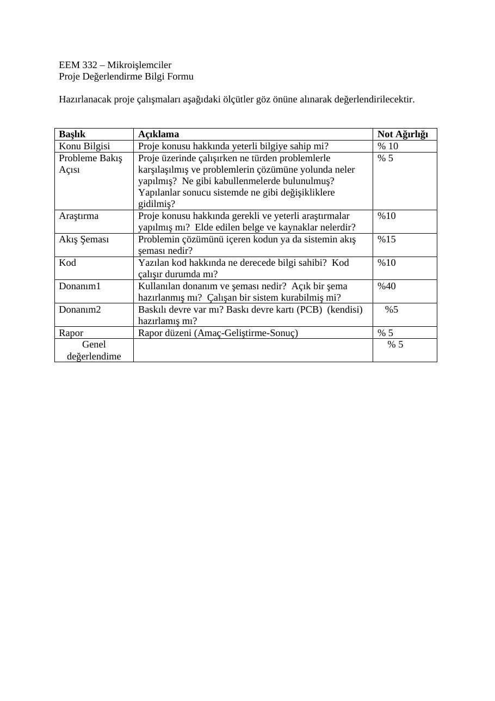
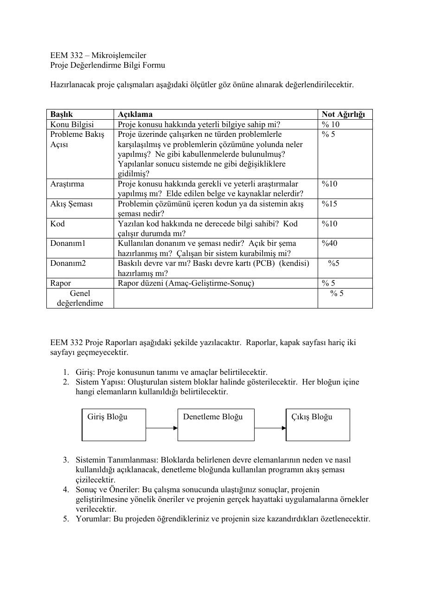

This post brings together the related notes and applications from the Başkent University **EEM332 Microprocessors** course archive (2005–2016). Project descriptions for counters, timers, displays, light shows, alarms and communication; student assignments removed. PDF archive copies of the documents and, where available, source code can be downloaded as a ZIP at the end of the post.

## EEM332-Project

Başkent University Department of Electrical and Electronics Engineering EEM 332 – Microprocessors Project Topics

### 1. Up/Down Counter Counting People Entering and Leaving Through a Door (1 Person)

A circuit will be designed that counts from 00 to FF based on the information received from two slotted optocouplers and shows the output on two 7-segment displays. By examining the order in which the optocouplers are interrupted, the counter will be incremented or decremented (person entering – person leaving). Thus, the number on the display will show the number of people inside.

### 2. Password-Protected Lock (2 People)

A circuit will be designed that checks whether a 4-character password entered from the user panel (a keypad with a 4x3 matrix structure) matches a 4-character password preloaded into the microcontroller. After the password is entered, the comparison will be performed by pressing the enter key. When a match occurs, a green LED will light; in all other cases, a red LED will light. If a match is not achieved three times, the system will become inoperative for a period of time. Changing the password in the system will also be done from the user panel. After the correct password is entered (while the green LED is on), the password change mode will be entered by pressing the change key. Here, the old password will be entered once more for confirmation, and the new password will be entered twice and loaded into the system.

### 3. Digital Clock (1 Person)

A digital clock design will be made that shows hours and minutes in two digits each on 7-segment displays and operates on a 24-hour system. The change of seconds will be indicated by a single LED. For the clock to operate, the hour and minute values will be entered after pressing the reset button, and the enter key will be pressed.

### 4. Serial Data Transmission (2 People)

Asynchronous serial (single communication channel) data communication will be established between two PIC microcontrollers. The information entered in parallel will first be monitored on a display connected to PIC1, then sent serially by pressing the send key, and will be shown on an LCD connected to the receiver (PIC2).

### 5. Multi-Switch LED Control for a Quiz Show (1 Person)

In a quiz show with 3 contestants, there is a separate LED for each desk. To answer a question, contestants press the buttons on their own desks and light the LEDs on their own desks. If the buttons are pressed together, only the LED that was triggered first will light. After each question, the host will be able to turn off the lit LED by pressing a special switch.

### 6. Elevator System Simulation (2 People)

A simulation of the elevator system of a three-story building will be made. The project consists of three parts. The first represents the interior of the elevator. This part will contain the buttons needed to enter the command to go to the desired floor, and the second part will contain the call buttons on the floors. In the third part, each floor will be represented by one LED to track which floor the elevator is on, and which floor the elevator is on will be indicated by lighting that floor's LED.

Başkent University Department of Electrical and Electronics Engineering EEM 332 – Microprocessors Project Topics

The system will be a simulation of a real elevator system with a two-direction call system. E.g.: If the down call button is pressed while the elevator is going up, the elevator will not stop; it will stop during its downward movement.

### 7. 3-Seven-Segment Precision Stopwatch (1 Person)

A stopwatch circuit that can count up to 9'59".999 will be designed. The circuit has two inputs: Start/Stop and Pause/Clear. While the stopwatch is running, it will show only minutes and seconds. When one of the Stop or Pause buttons is pressed, it will alternately show minutes/seconds and milliseconds.

### 8. Tic-Tac-Toe Game Board (1 Person)

A game board and circuit will be designed on which two people can play tic-tac-toe against each other. The game board has a 3x3 matrix structure, and each square will have 2 LEDs and one switch. The program ends the game when one of the players forms an "x-x-x or o-o-o" sequence or when there are no moves left, determines the winner at the end of the game, and shows the total score. Starting a new game is up to the player.

### 9. Writing Text on an LCD Using a Keypad (1 Person)

The information entered from a 4x4 matrix keypad will be stored in memory and written to the LCD with a delay.

### 10. Scrolling Text on an LCD (1 Person)

The information entered from the keypad will be written to the LCD scrolling to the right and to the left. The scrolling direction will be changeable by the user.

### 11. Writing Information Stored in EEPROM to the LCD (1 Person)

By encoding a 4x4 keypad, certain words stored in the EEPROM will be written to the LCD according to the keys pressed.

### 12. Serial Communication with a Computer-I (1 Person)

The information loaded into the PIC will be sent to the computer using the computer's serial port and observed.

### 13. Frequency Counter Circuit (1 Person)

A system will be designed that displays the frequency of the signal connected to the circuit input on a 7-segment display.

### 14. Changing Message on an LCD (1 Person)

A moving message will be written on the LCD. When an interrupt arrives, a second message will be written (for a short time), and then the program will continue from where it left off.

### 15. Electronic Dice (1 Person)

Random numbers will be generated by simulating two dice.

### 16. Light Shows (1 Person)

5 predefined light shows will be prepared for 8 LEDs. The desired show will be selected through switches.

Başkent University Department of Electrical and Electronics Engineering EEM 332 – Microprocessors Project Topics

### 17. Timer Adjustable in Minutes (1 Person)

A counter will be built that outputs through 3 seven-segment displays and a seconds indicator and counts down from the set value.

### 18. Smart Home System Control Unit (Light Saver) (1 Person)

A system will be designed that turns the lights in a house on and off at specified times.

### 19. 7-Segment Scrolling Text (1 Person)

A system will be designed that performs scrolling text to the right and left on 5 seven-segment displays.

### 20. Light Control for a Four-Way Intersection (1 Person)

Traffic lights will be designed for a four-way intersection. The roads meeting at the intersection are denoted "North-South" and "East-West". Accordingly, the on-times and the states of the lights to be lit will be as follows. The clock signal required for timing will be obtained from a push-button switch.

On Time (pulse)                      State of the Lights 0-1                                 N/S: Red E/W: Red 2-3                                 N/S: Yellow E/W: Red 4-9                                 N/S: Green E/W: Red 10-11                               N/S: Yellow E/W: Red 12-13                               N/S: Red E/W: Red 14-15                               N/S: Red E/W: Yellow 16-21                               N/S: Red E/W: Green 22-23                               N/S: Red E/W: Yellow

### 21. Burglar Alarm System (1 Person)

A simulation of an alarm system used in homes will be made. For this purpose, the detection of the door, windows, and movements inside a room is required. The system will give both a visual and an audible warning when there is an unauthorized entry.

### 22. Que-matic (2 People)

A simulation of a queue management machine used in banks will be made. A queue machine will issue queue numbers for 3 different transactions. For the call system, 3 counters will be used, and the counters will have the authority to determine the type of transaction and to advance the queue number.

### 23. Apartment Building Automation (1 Person)

A simulation of the staircase lighting automation of a three-story building will be made. In the circuit, built with 3 push-buttons and one LED, the LED will light when any button is pressed and will turn off after a certain time. If a button is pressed while the LED is on, the remaining on-time will not change.

Başkent University Department of Electrical and Electronics Engineering EEM 332 – Microprocessors Project Topics

### 24. Car Turn Signal Control (1 Person)

A simulation of a car's turn signal control will be made. Using a 3-position switch, the LEDs indicating the right and left signals will be made to blink. The operation of the hazard signal will be controlled with a second switch (while the hazard signal is operating, the position of the other switch will have no effect).

### 25. Load/Count Up-Down Counter (1 Person)

A desired 4-bit number can be loaded serially into a counter circuit by means of one two-position switch and one push-button, and the circuit will count up or down starting from this value. The counting direction will be determined by a separate two-position switch, and the clock pulses required for counting will be obtained using a separate push-button. The output values will be monitored on a 7-segment display.

### 26. Sequence Detector (1 Person)

A "sequence detector" will be designed that outputs 1 each time a 0101 sequence is detected at its input (arrival order from left to right) and outputs 0 otherwise. Sequences may be overlapping. The input bits will be set with one two-position switch, and the input operation will be carried out by means of a push-button. The output bits will be read through an LED.

### 27. Limited Up-Down Counter (1 Person)

A counter that can count up and down and be stopped at a desired value will be designed. The output will be shown on a 7-segment display in the range 0-FF. Commands will be given to the system with six push-buttons. Information about the functions of the switches to be used is given below.

### Functions of the switches are given below

Start:         When this switch is pressed, the counter will begin counting down. Stop:          When this switch is pressed, counting will stop (regardless of whether it is counting down or up). Up:            When this switch is pressed, the counter will begin counting up if it is not counting down. Down:          When this switch is pressed, the counter will begin counting down if it is not counting up. Upper Limit:   When this switch is pressed, counting will stop if the counter is counting up. Lower Limit:   When this switch is pressed, counting will stop if the counter is counting down.

### 28. Thermometer (1 Person)

A system will be designed that displays the information received from a temperature sensor on a 7-segment display.

Başkent University Department of Electrical and Electronics Engineering EEM 332 – Microprocessors Project Topics

### 29. LCD Clock (1 Person)

A system will be designed that displays the time as HH:MM:SS on an LCD. After the system is reset, the hour, minute, and second information will be entered, and the clock will start running when the start key is pressed.

### 30. Stepper Motor Control (2 People)

A system providing stepper motor control will be designed. The system will be controlled with 2 push-buttons. The first button will rotate the motor in the forward direction, and each time the button is pressed the motor speed will increase step by step. The second button will control the reverse rotation of the motor in the same way. If the control button for the direction opposite to the motor's direction of motion is pressed, the speed will decrease by one step. The motor speed will be increased or decreased in 5 steps.

## EEM332_Projects_2016_assignment

### EEM332 COURSE SEMESTER PROJECTS

1.Entry/Exit Counter: Write a program that counts the people entering and leaving through a door and shows the number of people inside on a 7-segment display. (Note that the number of people inside cannot be less than zero.)

2.Quiz Show: Write a program that displays on a 7-segment display which of 3 buttons was pressed first.

3.Apartment Building Automation: Write a program that lights an LED for 3 seconds when a button is pressed, and that is not affected in its on-time when another button is pressed during this time.

4.Up/Down Counter: Write a program that starts counting up on a 7-segment display when button 1 is pressed, stops and counts down when button 2 is pressed, and stops counting and turns off the 7-segment display when button 3 is pressed.

5.New Year Tree Decoration: Write a program that lights all LEDs every 4 seconds when the button is pressed once, goes down to once every 3 seconds on the 2nd press, lights at 2-second intervals on the 3rd press and at 1-second intervals on the 4th press, and returns to the initial state on the 5th press.

### 6. Digital potentiometer: When the + and – buttons are pressed (by holding them down continuously), the increase and decrease of the number on the 7-segment

display will be seen.

### 7. The internal timer will start counting when a button is pressed, and the counted number will be shown on the 7-segment display. When a second button is pressed, the timer will be reset.

### 8. The duration of a button press will be measured using a timer.

### 9. 7-Segment Light Show: Write a program that turns off one of the a-b-c-d-e-f-g

connections that are lit in sequence on the 7-segment display.

### 10. 7-Segment Light Show: Write a program that lights the a-b-g-e-d-c-g-f connections on the

7-segment display in that order.

### 11. 7-Segment Light Show: Write a program that lights the necessary LEDs in sequence so as to form a 0 on the

7-segment display and, after writing the 0, turns them off in the same way.

### 12. 7-Segment Light Show: Write a program that rotates the 7-segment display through the cycle gced-fecd-afed-bafe-gbaf-egba-degb-gced

.

### 13. LED Light Show: Write a repetitive program that shows the upper LEDs on for half a second and off for half a second three times, and then repeats the same operation for the lower ones.

### 14. LED Light Show: Write a repetitive program that shows the upper LEDs on for half a second and off for half a second once, then performs the same operation for the lower ones, then lights the upper LEDs twice at quarter-second intervals, and then performs the same operation for the lower ones.

### 15. LED Light Show: Write a repetitive program that lights the upper LEDs in sequence toward the left, then lights the lower LEDs in sequence toward the right, then turns off the lit upper LEDs in sequence toward the right and turns off the lower LEDs toward the left.

### 16. LED Light Show: Write a repetitive program that lights and turns off seven LEDs in sequence and then keeps the eighth LED continuously lit, then does the same for the 7th, 6th ... and 1st LEDs and turns them all off.

### 17. LED Light Show: Write a repetitive program that lights and turns off the upper four LEDs in sequence toward the right and then lights and turns off the lower LEDs in sequence toward the left.

### 18. LED Light Show: Write a repetitive program that lights the LEDs in the order 1-8-2-7-3-6-4-5-4-6-3-7-2-8-1. (LED arrangement: top row from left to right 1 2 3 4, bottom row from right to left 5 6 7 8)

### 19. Buzzer: In a system with two inputs, sounds of different frequencies will be produced from the buzzer when different inputs are pressed. If both buttons are pressed together, a third frequency will be generated to obtain a different sound. (A timer will be used)

### 20. 7-Segment Counting Game: The 7-segment display will count by itself at a certain speed. In the system with two buttons, the counting speed will be increased/decreased when the buttons are pressed.

### 21. LED Light Show: The LEDs will blink in sequence. In the system with two buttons, the blinking speed will be increased/decreased when the buttons are pressed.

### 22. LED Light Show: The LEDs will be lit by sending the values 55H and AAH to them in turn. In the system with two buttons, all of the LEDs will be lit as long as one of the buttons is held down. All of the LEDs will be turned off as long as the other button is held down. When the buttons are not pressed, the LEDs will continue to light in sequence with the values 55H and AAH.

### General Notes on the Projects

- Each group, consisting of 2 people, will send an e-mail to eguner@baskent.edu.tr listing the 3 projects they want in order of preference.

- The e-mail may be sent by one group member, stating the name of the other member.

- The assignment of groups to projects will be made according to the chronological order of the e-mails received.

- Care will be taken that students who have taken the course before do not choose the project they did previously.

- The results of the project assignments will be published at

the project assignment link given on the page http://www.baskent.edu.tr/~eguner/index.php?page=courses.

- You can find additional information that may be useful during the project work in the files named "proje_ek_bilgi" and

"Pickart".

- You can obtain the printed circuit boards you will use in the project work from the laboratory assistants.

- The project will contribute 12% to the course grade.

- The project and report submission date will be announced in the coming days.

## evaluation

EEM 332 – Microprocessors Project Evaluation Information Form

The project work to be prepared will be evaluated considering the criteria below.

Title              Description                                                    Grade Weight Subject Knowledge        Does the student have sufficient knowledge about the project subject?             10% Problem Perspective      What kinds of problems were encountered while working on the project, and what was done to solve them? What assumptions were made? What changes were made to the system as a result of what was done?            5% Research           Has necessary and sufficient research been done on the project subject? What documents and sources were obtained?       10% Flowchart         What is the flowchart of the code or system that contains the solution to the problem?         15% Code                 How much knowledge does the student have of the code written? Is the code working?          10% Hardware1            What is the hardware used and its schematic? Has a clear schematic been prepared? Has a working system been built?           40% Hardware2            Is there a printed circuit? Has the student prepared the printed circuit board (PCB) themselves?       5% Report               Report layout (Purpose-Development-Conclusion)                        5% Overall assessment                                                                       5%

## EEM%20332%20Project%20Evaluation

EEM 332 – Microprocessors Project Evaluation Information Form

The project work to be prepared will be evaluated considering the criteria below.

Title              Description                                                    Grade Weight Subject Knowledge        Does the student have sufficient knowledge about the project subject?             10% Problem Perspective      What kinds of problems were encountered while working on the project, and what was done to solve them? What assumptions were made? What changes were made to the system as a result of what was done?            5% Research           Has necessary and sufficient research been done on the project subject? What documents and sources were obtained?       10% Flowchart         What is the flowchart of the code or system that contains the solution to the problem?         15% Code                 How much knowledge does the student have of the code written? Is the code working?          10% Hardware1            What is the hardware used and its schematic? Has a clear schematic been prepared? Has a working system been built?           40% Hardware2            Is there a printed circuit? Has the student prepared the printed circuit board (PCB) themselves?       5% Report               Report layout (Purpose-Development-Conclusion)                        5% Overall assessment                                                                       5%

EEM 332 project reports will be written as follows. Reports will not exceed two pages, excluding the cover page.

### 1. Introduction: The definition of the project subject and the objectives will be stated.

### 2. System Structure: The system built will be shown in blocks. The components used in each block will be stated.

Input Block                Control Block                 Output Block

### 3. Description of the System: Why and how the circuit components specified in the blocks are used will be explained, and the flowchart of the program used in the control block will be drawn.

### 4. Conclusion and Recommendations: The results you reached as a result of this work, recommendations for developing the project, and examples of real-life applications of the project will be given.

### 5. Comments: What you learned from this project and what the project gave you will be summarized.

