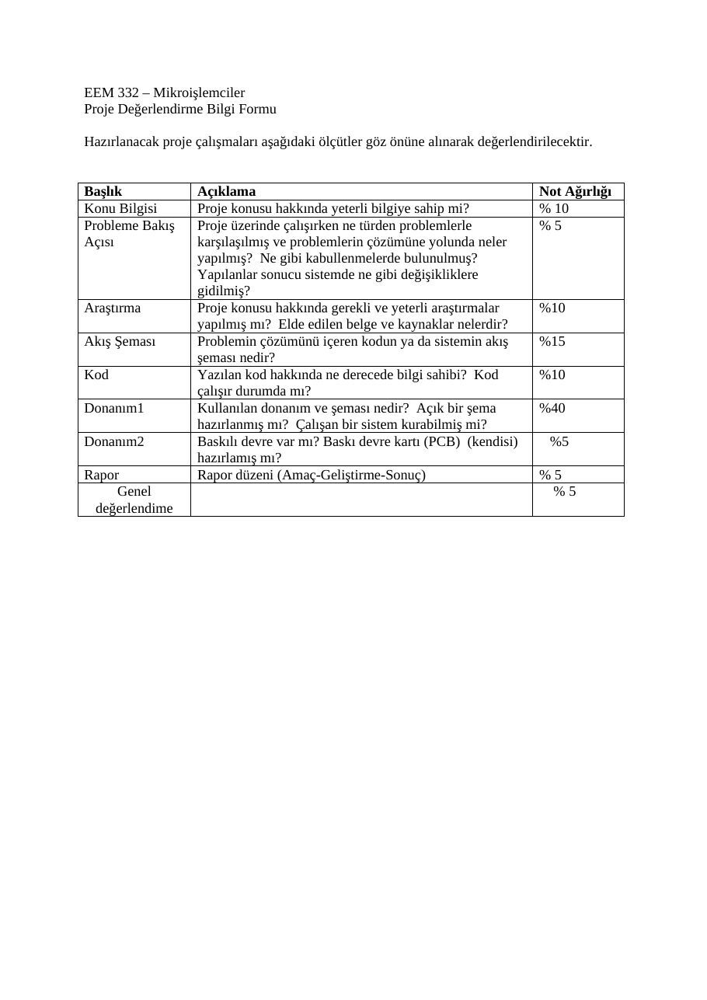
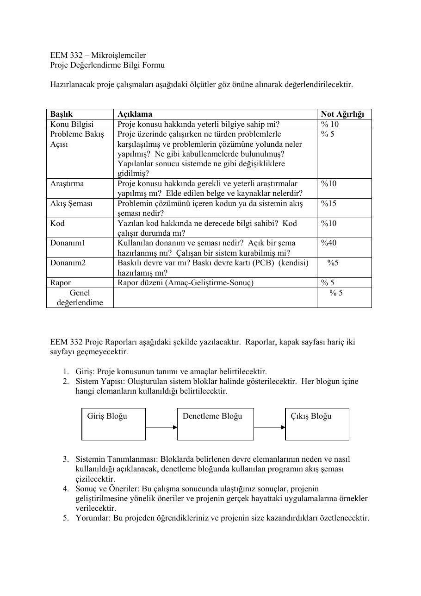

Bu yazı, Başkent Üniversitesi **EEM332 Mikroişlemciler** ders arşivindeki ilgili notları ve uygulamaları bir araya getiriyor (2005–2016). Sayaç, zamanlayıcı, gösterge, ışık oyunu, alarm ve iletişim proje tanımları; öğrenci atamaları çıkarıldı. Belgelerin PDF arşiv kopyaları ve varsa kaynak kodları yazının sonunda ZIP olarak indirilebilir.

## EEM332-Proje

Başkent Üniversitesi Elektrik-Elektronik Mühendisliği Bölümü EEM 332 – Mikroişlemciler Proje Konuları

### 1. Bir Kapıdan Giriş-Çıkış Yapanları Sayan Yukarı/Aşağı Sayaç (1 Kişi)

İki adet yarıklı optocouplerdan alınan bilgiye göre 00-FF arası sayabilen ve çıkışı iki adet 7-segment display’de gösteren bir devre tasarlanacaktır. Optocoupler’lardan geçilme sırasına bakılarak sayacın artması veya azalması (giren kişi – çıkan kişi) sağlanacaktır. Böylece göstergedeki sayı, içerideki insan sayısını gösterecektir.

### 2. Şifreli Kilit (2 Kişi)

Kullanıcı panelinden (4x3 matris yapıda tuş takımı) girilecek 4 karakterli şifrenin, mikrodenetleyiciye önceden yüklenmiş 4 karakterli şifre ile uyumunu kontrol eden devre tasarlanacaktır. Şifre girildikten sonra giriş tuşuna basılarak karşılaştırma işlemi yapılacaktır. Eşleşme sağlandığında yeşil, diğer durumlarda kırmızı LED yanacaktır.           Üç kez eşleşme sağlanamaması durumunda sistem bir süreliğine çalışmaz hale gelecektir. Sistemdeki şifrenin değiştirilmesi de kullanıcı panelinden sağlanacaktır. Doğru şifre girildikten sonra (yeşil LED yanarken) değiştirme tuşuna basılarak, şifre değiştirme moduna geçilecektir. Burada eski şifre bir kez daha girilerek onay alınacak ve yeni şifre iki gez girilerek sisteme yüklenecektir.

### 3. Dijital Saat (1 Kişi)

İki haneli olarak saat ve dakikayı 7-segment display’de gösteren ve 24 saat sistemine göre çalışan dijital saat tasarımı yapılacaktır. Saniye değişimi tek bir LED ile gösterilecektir. Saatin çalışması için reset düğmesine basıldıktan sonra saat ve dakika değerleri girilecek ve giriş tuşuna basılacaktır.

### 4. Seri Veri İletimi (2 Kişi)

İki PIC mikrodenetleyici arasında senkronize olmayan seri (tek iletişim kanallı) veri iletişimi sağlanacaktır. Paralel olarak girilen bilgiler önce PIC1’e bağlı bir ekrandan takip edilecek, daha sonra gönder tuşuna basılarak seri olarak gönderilecek ve alıcıda (PIC2) LCD ekrana bağlanacaktır.

### 5. Bilgi Yarışması İçin Çok Anahtarlı LED Kontrolü (1 Kişi)

3 yarışmacısı olan yarışmada, her masa için ayrı bir LED bulunmaktadır. Yarışmacılar soruya yanıt verebilmek için kendi masalarında bulunan düğmelere basarak yine kendi masalarında bulunan LED’leri yakarlar. Düğmelere birlikte basılması durumunda, sadece ilk tetiklenen LED yanacaktır. Yönetmen, her sorunun ardından özel bir anahtara basarak yanan LED’i söndürebilecektir.

### 6. Asansör Sistemi Benzetimi (2 Kişi)

Üç katlı bir binanın asansör sisteminin benzetimi yapılacaktır. Proje üç kısımdan oluşmaktadır. Birincisi asansörün içini temsil etmektedir. Bu kısımda istenen kata gitme komutunu girmek için gereken butonlar ve ikinci kısımda katlardaki çağrı butonları bulunacaktır.        Üçüncü kısımda ise asansörün hangi katta olduğunu takip edebilmek için her kat birer adet LED ile temsil edilecek ve asansörün hangi katta olduğu, o katın LED’inin yakılmasıyla

Başkent Üniversitesi Elektrik-Elektronik Mühendisliği Bölümü EEM 332 – Mikroişlemciler Proje Konuları belirtilecektir. Sistem, çift yönlü çağırma sistemi bulunan gerçek bir asansör sisteminin benzetimi olacaktır. Ör: Asansör yukarı çıkarken aşağı çağırma tuşuna basıldığında asansör durmayacak, aşağı hareketi sırasında duracaktır.

### 7. 3 Seven-Segment Hassas Kronometre (1 Kişi)

9’59’’.999 değerine kadar sayabilen bir kronometre devresi tasarlanacaktır. Devrenin girişleri: Başla/Bitir ve Durakla/Sil olmak üzere iki tanedir. Kronometre çalışırken sadece dakika ve saniyeyi gösterecektir. Bitir veya Durakla düğmelerinden birisine basıldığında ise dönüşümlü olarak dakika/saniye ve milisaniye’yi gösterecektir.

### 8. Tic-Tac-Toe Oyun Tahtası (1 Kişi)

Karşılıklı iki kişinin tic-tac-toe oyunu oynayabileceği bir oyun tahtası ve devresi tasarlanacaktır. Oyun tahtası 3x3 matris yapıdadır ve her bir karede 2 adet LED ve bir adet anahtar olacaktır. Program, oyunculardan birisi “x-x-x veya o- o-o” sırası oluşturduğunda veya oynayacak hamle kalmadığında oyunu sonlandırır, oyun sonunda kazananı belirler ve toplam skoru belirtir. Yeni bir oyuna başlanması oyuncunun isteğine bağlıdır.

### 9. Keypad Kullanarak LCD’ye Yazı Yazma (1 Kişi)

4x4 matris yapıda tuş takımından girilen bilgi hafızada tutulup, LCD ekrana gecikmeli olarak yazdırılacaktır.

### 10. LCD’de Kayan Yazı (1 Kişi)

Tuş takımından girilen bilgi, LCD ekrana sağa ve sola kayarak yazdırılacaktır. Kayma yönü kullanıcı tarafından değiştirilebilir olacaktır.

### 11. EEPROM’daki Bilginin LCD’ye yazılması (1 Kişi)

4x4 tuş takımı kodlanarak, basılan tuşlara göre EEPROM’da saklanan belirli kelimelerin LCD ekrana yazılması sağlanacaktır.

### 12. Bilgisayar ile seri haberleşme-I (1 Kişi)

PIC’e yüklenecek bilginin bilgisayarın seri portu kullanılarak bilgisayara gönderilmesi ve gözlenmesi sağlanacaktır.

### 13. Frekans sayıcı devre (1 Kişi)

Devre girişine bağlanacak sinyalin frekansını 7-parçalı ekrana yazdıran sistem tasarlanacaktır.

### 14. LCD’de Değişen Mesaj (1 Kişi)

LCD’de hareketli mesaj yazılacaktır. Kesme (Interrupt) gelince ikinci mesaj yazılacaktır (kısa süre) daha sonra program kaldığı yerden devam edecektir.

### 15. Elektronik Zar (1 Kişi)

İki adet zarın benzetimi yapılarak rasgele sayı üretilecektir

### 16. Işık Oyunları (1 Kişi)

8 adet LED için önceden belirlenmiş 5 adet ışık oyunu hazırlanacaktır. Anahtarlar aracılığıyla istenen oyun seçilecektir.

Başkent Üniversitesi Elektrik-Elektronik Mühendisliği Bölümü EEM 332 – Mikroişlemciler Proje Konuları

### 17. Dakika Cinsinden Ayarlanabilir Zamanlayıcı (1 Kişi)

3 tane 7-segment ve bir saniye göstergesi ile çıkış veren ve ayarlanan değerden geri sayan sayaç yapılacaktır.

### 18. Akıllı Ev Sistemi Kontrol Ünitesi (Light saver) (1 Kişi)

Evdeki ışıkların belirlenen zamanlarda açılıp kapanmasını sağlayan sistem tasarlanacaktır.

### 19. 7-segment kayan yazı (1 Kişi)

5 adet 7-segment’te sağa ve sola kayan yazı işlemini gerçekleştirecek sistem tasarlanacaktır.

### 20. Dörtlü kavşak için ışık denetimi (1 Kişi)

Dörtlü bir kavşak için trafik ışıkları tasarlanacaktır. Kavşağın bağlı olduğu yollar “Kuzey-Güney” ve “Doğu-Batı” olarak simgelenmiştir. Buna göre, yanma süreleri ile yakılacak ışıkların durumu aşağıdaki şekilde olacaktır. Zamanlama için gerekli saat sinyali, bir adet basmalı (push-button) anahtardan elde edilecektir.

Yanma Süresi (pulse)                      Işıkların Durumu 0-1                                 K/G:Kırmızı D/B:Kırmızı 2-3                                 K/G:Sarı D/B:Kırmızı 4-9                                 K/G:Yeşil D/B:Kırmızı 10-11                               K/G:Sarı D/B:Kırmızı 12-13                               K/G:Kırmızı D/B:Kırmızı 14-15                               K/G:Kırmızı D/B:Sarı 16-21                               K/G:Kırmızı D/B:Yeşil 22-23                               K/G:Kırmızı D/B:Sarı

### 21. Soygun Alarm Sistemi (1 Kişi)

Evlerde kullanılan alarm sisteminin benzetimi yapılacaktır. Bunun için bir odada bulunan kapı, pencereler ve oda içindeki hareketlerin algılanması istenmektedir. Sistem, izinsiz bir giriş olduğunda hem ışıklı hem de sesli uyarı verecektir.

### 22. Que-matic (2 Kişi)

Bankalarda kullanılan sıralandırma makinasının benzetimi yapılacaktır. Bir sıra makinasından 3 farklı işlem için sıra numarası verilecektir. Çağrı sistemi için ise 3 adet banko kullanılacak ve bankolar yapılacak işlem türünü belirleme ve sıra arttırma yetkisine sahip olacaktır.

### 23. Apartman Otomatiği (1 Kişi)

Üç katlı bir binanın apartman otomatiğinin benzetimi yapılacaktır. 3 tane basmalı-anahtar (push-button) ve bir LED ile gerçekleştirilen devrede herhangi bir düğmeye basıldığında LED yanacak ve belirli bir süre sonra sönecektir. LED yanarken düğmeye basılması durumunda kalan yanma süresi değişmeyecektir.

Başkent Üniversitesi Elektrik-Elektronik Mühendisliği Bölümü EEM 332 – Mikroişlemciler Proje Konuları

### 24. Araba Sinyal Kontrolü (1 Kişi)

Bir arabanın sinyal kontrolünün benzetimi yapılacaktır. 3 konumlu anahtar kullanılarak sağ ve sol sinyali gösteren LED’lerin yanıp sönmesi sağlanacaktır. İkinci bir anahtar ile acil durum sinyalinin çalışması kontrol edilecektir (acil durum sinyali çalışırken diğer anahtarın konumunun bir etkisi olmayacaktır).

### 25. Yükle/Say Yukarı-Aşağı Sayıcı (Load/Count Up-Down Counter) (1 Kişi)

Bir sayaç devresine istenen 4-bitlik sayı, 1 adet iki konumlu ve bir adet basmalı anahtar (push-button) aracılığı ile seri olarak yüklenebilecek, devre bu değerden başlayarak yukarı veya aşağı sayacaktır. Sayma yönü ayrı bir iki konumlu anahtarla belirlenecek, sayma işlemi için gerekli saat vuruları da ayrı bir basmalı anahtar kullanılarak elde edilecektir. Çıkış değerleri 7-parçalı ekran üzerinden izlenecektir.

### 26. Dizi Algılayıcı (1 kişi)

Girişinde her 0101 dizisi (geliş sırası soldan sağa doğru) algılandığında 1 çıktısı, bunun dışında da 0 çıktısı veren bir “sequence detector” tasarlanacaktır. Diziler iç içe geçmiş (overlapping) olabilir. Giriş bitleri bir adet iki konumlu anahtar ile belirlenecek ve giriş işlemi bir basmalı (push-button) anahtar aracılığı ile gerçekleştirilecektir. Çıktı bitleri bir LED aracılığı ile okunacaktır.

### 27. Sınırlandırılmış İleri-Geri Sayaç (1 Kişi)

İleri-geri sayabilen ve istenilen değerde durdurulan sayaç tasarlanacaktır. Çıkış 0-FF aralığında 7-parçalı ekran üzerinde gösterilecektir. Sisteme altı tane basmalı anahtar ile komutlar verilecektir. Kullanılacak anahtarların

### işlevleriyle ilgili bilgi aşağıdadır

Başla:         Bu anahtara basıldığında sayaç aşağı doğru saymaya başlayacaktır. Dur:           Bu anahtara basıldığında sayma işlemi duracaktır (aşağı veya yukarı doğru sayma durumlarından bağımsızdır). Yukarı:        Bu anahtara basıldığında sayaç aşağı doğru saymıyorsa yukarı doğru saymaya başlayacaktır. Aşağı:         Bu anahtara basıldığında sayaç yukarı doğru saymıyorsa aşağı doğru saymaya başlayacaktır. Üst Sınır:     Bu anahtara basıldığında sayaç yukarı doğru sayıyorsa sayma işlemi duracaktır. Alt Sınır:     Bu anahtara basıldığında sayaç aşağı doğru sayıyorsa sayma işlemi duracaktır.

### 28. Termometre (1 Kişi)

Sıcaklık algılayıcısından alınan bilgiyi 7-parçalı ekrana yazdıran sistem tasarlanacaktır.

Başkent Üniversitesi Elektrik-Elektronik Mühendisliği Bölümü EEM 332 – Mikroişlemciler Proje Konuları

### 29. LCD Saat (1 Kişi)

Saat bilgisini HH:MM:SS olarak LCD ekranda gösteren sistem tasarlanacaktır. Sistem sıfırlandıktan sonra saat, dakika ve saniye bilgileri girilecek ve başlama tuşuna basılmasıyla saat çalışmaya başlayacaktır.

### 30. Adım Motor Denetimi (2 Kişi)

Adım (step) motor denetimi sağlayan sistem tasarlanacaktır. Sistem 2 adet basmalı anahtar ile kontrol edilecektir. Birinci anahtar motoru ileri yönde döndürecek ve anahtara her basıldığında motor hızı kademeli olarak artacaktır.    İkinci anahtar aynı şekilde motorun geri dönüşünü kontrol edecektir. Eğer motorun hareket yönüne ters yöndeki kontrol düğmesine basılırsa hız bir kademe azalacaktır. Motorun hızı 5 kademeli olarak arttırılacak veya azaltılacaktır.

## EEM332_Projeler_2016_atama

### EEM332 DERSİ DÖNEM PROJELERİ

1.Giriş/Çıkış Sayacı: Bir kapıdan giriş ve çıkış yapanları sayan ve içerideki insan sayısını 7 segment üzerinde gösteren programı yazınız. (Sıfırdan daha küçük sayıda içeride kişi olmayacağına dikkat ediniz.)

2.Bilgi Yarışması: 3 butondan hangisinin daha önce basıldığını 7 segmente bastıran programı yazınız.

3.Apartman Otomatiği: Bir butona basıldığında bir LED’i 3 saniye yakacak, bu süre içinde bir başka butona basıldığında yanma süresini etkilemeyecek programı yazınız.

4.İleri/Geri Sayaç: 1. butona basıldığında 7 segment üzerinden yukarı doğru saymaya başlayan, 2. butona basıldığında durup aşağı doğru sayan ve 3. butona basıldığında saymayı bırakıp 7 segmenti söndüren programı yazınız.

5.Yılbaşı Ağacı Süsü: Butona bir kere basıldığında 4 saniyede bir bütün LED’leri yakan, 2. basılışta 3 saniyede bire inen, 3. basılışta 2 saniye ve 4. basılışta 1 saniye aralıklı yanan, 5. basılışta ise ilk duruma dönen programı yazınız.

### 6. Dijital potansiyometre: + ve – butonlarına basılınca (sürekli basılı tutularak) 7 segment

göstergedeki sayı artışı ve azalması görülecektir.

### 7. Dahili timer bir butona basıldığında saymaya başlayacak, sayılan sayı 7 segment göstergede

gösterilecektir. İkinci bir butona basıldığında zamanlayıcı sıfırlanacaktır.

### 8. Bir butona basılma süresi zamanlayıcı kullanılarak ölçülecektir.

### 9. 7-Segment Işık Oyunu: 7-segment üzerinde sırasıyla yanık olan a-b-c-d-e-f-g

bağlantılarından birisini söndüren programı yazınız.

### 10. 7-Segment Işık Oyunu: 7-segment üzerinde sırasıyla a-b-g-e-d-c-g-f bağlantılarını yakan

programı yazınız.

### 11. 7-Segment Işık Oyunu: 7-segment üzerinde sırasıyla 0 oluşturacak şekilde gerekli

LED’leri yakacak ve 0 yazdıktan sonra aynı şekilde söndürecek programı yazınız.

### 12. 7-Segment Işık Oyunu: 7-segment üzerinde gced-fecd-afed-bafe-gbaf-egba-degb-gced

döngüsü içinde çevirecek programı yazınız.

### 13. LED Işık Oyunu: Üst taraftaki LED’leri üç kere yarım saniye açık, yarım saniye kapalı

gösterip daha sonra alttakilere aynı işlemi yinelemeli olarak yapan programı yazınız.

### 14. LED Işık Oyunu: Üst taraftaki LED’leri bir kere yarım saniye açık, yarım saniye kapalı

gösterip daha sonra alttakilere aynı işlemi yaptıktan sonra üstteki LED’leri çeyrek saniyelik aralıklarla iki kere yakan ve daha sonra alttakilere aynı işlemi gerçekleştiren yinelemeli programı yazınız.

### 15. LED Işık Oyunu: Üstteki LED’leri sola doğru sırasıyla yaktıktan sonra alttaki LED’leri

sağa doğru sırasıyla yakan daha sonra üstteki yanık LED’leri sağa doğru sırasıyla söndürüp alttaki LED’leri sola doğru söndüren yinelemeli programı yazınız.

### 16. LED Işık Oyunu: Yedi LED’i sırasıyla yakıp söndürdükten sonra sekizinci LED’i sürekli

yakan, daha sonra 7., 6. ... ve 1. LED’ler için aynısını yapıp hepsini söndüren yinelemeli programı yazınız.

### 17. LED Işık Oyunu: Üstteki dört LED’i sırasıyla sağa doğru yakıp söndürdükten sonra alttaki

LED’leri sırasıyla sola doğru yakıp söndüren yinelemeli programı yazınız.

### 18. LED Işık Oyunu: LED’leri sırasıyla 1-8-2-7-3-6-4-5-4-6-3-7-2-8-1 şeklinde yakan

yinelemeli programı yazınız. (LED dizisi: Üst sıra soldan sağa doğru 1 2 3 4, alt sıra sağdan sola doğru 5 6 7 8)

### 19. Buzzer: İki girişli bir sistemde, farklı girişlere basıldığında buzzerdan farklı frekansta ses

üretilecektir. İki butona birlikte basılması durumunda, üçüncü frekans üretilerek farklı bir ses elde edilecektir. (Timer kullanılacaktır)

### 20. 7-Segment Sayma Oyunu: 7 Segment belli bir hızla kendiliğinden sayacaktır. İki buton

kullanılacak olan sistemde, butonlara basıldığında sayma hızı arttırılıp/azaltılacaktır.

### 21. LED Işık Oyunu: Ledler sırayla yanıp sönecektir. İki buton kullanılacak olan sistemde,

butonlara basıldığında yanıp sönme hızı arttırılıp/azaltılacaktır.

### 22. LED Işık Oyunu: Ledlere sırasıyla 55H ve AAH değerleri gönderilerek yanmaları

sağlanacaktır. İki buton kullanılacak olan sistemde, butonlardan birine basılı tutulduğu sürece Ledlerin tümünün yanması sağlanacaktır. Diğer butona basılı tutulduğu sürece Ledlerin

tümünün sönmesi sağlanacaktır. Butonlara basılmadığı durumda, Ledler 55H ve AAH değerleri ile sıralı olarak yanmaya devam edecektir.

### Projelerle İlgili Genel Açıklama

- Her grup 2 kişi olacak şekilde, istediği 3 projeyi istek sırasına göre sıralayarak

eguner@baskent.edu.tr adresine e-posta gönderecektir.

- E-posta bir grup üyesi tarafından diğer üyenin ismi belirtilerek gönderilebilir.

- Grupların projelere atanması gelen maillerin zaman olarak önceliğine bakılarak

yapılacaktır.

- Dersi önceden almış olan öğrencilerin, yapmış oldukları projeyi seçmemelerine dikkat

edilecektir.

- Proje atamalarının sonuçları;

http://www.baskent.edu.tr/~eguner/index.php?page=courses sayfasında verilen proje atama linkinde yayınlanacaktır.

- Proje çalışması sırasında faydalanabileceğiniz ek bilgilere “proje_ek_bilgi” ve

“Pickart” isimli dosyadan ulaşabilirsiniz.

- Proje çalışmasında kullanacağınız baskı devre kartlarını laboratuvar asistanlarından

alabilirsiniz.

- Projenin derse katkısı %12 oranında olacaktır.

- Proje ve raporlarının teslim tarihi ilerleyen günlerde açıklanacaktır.

## degerlendirme

EEM 332 – Mikroişlemciler Proje Değerlendirme Bilgi Formu

Hazırlanacak proje çalışmaları aşağıdaki ölçütler göz önüne alınarak değerlendirilecektir.

Başlık              Açıklama                                                    Not Ağırlığı Konu Bilgisi        Proje konusu hakkında yeterli bilgiye sahip mi?             % 10 Probleme Bakış      Proje üzerinde çalışırken ne türden problemlerle            %5 Açısı               karşılaşılmış ve problemlerin çözümüne yolunda neler yapılmış? Ne gibi kabullenmelerde bulunulmuş? Yapılanlar sonucu sistemde ne gibi değişikliklere gidilmiş? Araştırma           Proje konusu hakkında gerekli ve yeterli araştırmalar       %10 yapılmış mı? Elde edilen belge ve kaynaklar nelerdir? Akış Şeması         Problemin çözümünü içeren kodun ya da sistemin akış         %15 şeması nedir? Kod                 Yazılan kod hakkında ne derecede bilgi sahibi? Kod          %10 çalışır durumda mı? Donanım1            Kullanılan donanım ve şeması nedir? Açık bir şema           %40 hazırlanmış mı? Çalışan bir sistem kurabilmiş mi? Donanım2            Baskılı devre var mı? Baskı devre kartı (PCB) (kendisi)       %5 hazırlamış mı? Rapor               Rapor düzeni (Amaç-Geliştirme-Sonuç)                        %5 Genel                                                                       %5 değerlendime

## EEM%20332%20Proje%20De%f0erlendirme

EEM 332 – Mikroişlemciler Proje Değerlendirme Bilgi Formu

Hazırlanacak proje çalışmaları aşağıdaki ölçütler göz önüne alınarak değerlendirilecektir.

Başlık              Açıklama                                                    Not Ağırlığı Konu Bilgisi        Proje konusu hakkında yeterli bilgiye sahip mi?             % 10 Probleme Bakış      Proje üzerinde çalışırken ne türden problemlerle            %5 Açısı               karşılaşılmış ve problemlerin çözümüne yolunda neler yapılmış? Ne gibi kabullenmelerde bulunulmuş? Yapılanlar sonucu sistemde ne gibi değişikliklere gidilmiş? Araştırma           Proje konusu hakkında gerekli ve yeterli araştırmalar       %10 yapılmış mı? Elde edilen belge ve kaynaklar nelerdir? Akış Şeması         Problemin çözümünü içeren kodun ya da sistemin akış         %15 şeması nedir? Kod                 Yazılan kod hakkında ne derecede bilgi sahibi? Kod          %10 çalışır durumda mı? Donanım1            Kullanılan donanım ve şeması nedir? Açık bir şema           %40 hazırlanmış mı? Çalışan bir sistem kurabilmiş mi? Donanım2            Baskılı devre var mı? Baskı devre kartı (PCB) (kendisi)       %5 hazırlamış mı? Rapor               Rapor düzeni (Amaç-Geliştirme-Sonuç)                        %5 Genel                                                                       %5 değerlendime

EEM 332 Proje Raporları aşağıdaki şekilde yazılacaktır. Raporlar, kapak sayfası hariç iki sayfayı geçmeyecektir.

### 1. Giriş: Proje konusunun tanımı ve amaçlar belirtilecektir.

### 2. Sistem Yapısı: Oluşturulan sistem bloklar halinde gösterilecektir. Her bloğun içine

hangi elemanların kullanıldığı belirtilecektir.

Giriş Bloğu                Denetleme Bloğu                 Çıkış Bloğu

### 3. Sistemin Tanımlanması: Bloklarda belirlenen devre elemanlarının neden ve nasıl

kullanıldığı açıklanacak, denetleme bloğunda kullanılan programın akış şeması çizilecektir.

### 4. Sonuç ve Öneriler: Bu çalışma sonucunda ulaştığınız sonuçlar, projenin

geliştirilmesine yönelik öneriler ve projenin gerçek hayattaki uygulamalarına örnekler verilecektir.

### 5. Yorumlar: Bu projeden öğrendikleriniz ve projenin size kazandırdıkları özetlenecektir.

