This post brings together the related notes and exercises from the Başkent University **EEM332 Microprocessors** course archive (2006–2006). The scanned quizzes contain assembly programs, memory, input-output, and PIC questions. PDF archive copies of the documents and, where available, source code can be downloaded as a ZIP at the end of the post.

## 332q2

Başkent University Department of Electrical and Electronics Engineering EEM 332 — Microprocessors Quiz 2 (A)

### Student Name-Surname: Answer, Anabter Student No

### 1) Answer the following questions.

7a. When the CBW instruction is executed with AL= -122d, what are the values of AX and DX in hexadecimal? (The initial value of DX is 0O00H)

```
AX=FFS6
```

PA ; Dx = 0000 7 . “ b. When the CWD instruction is executed with AX= F667h, what are the values of AX and DX in hexadecimal? (The initial value of DX is OO00H)

```
AX= FLET
```

### DX - ERER

### 2) Write the program segment given below in its simplest form. (AL=05H, CL=07H)

```asm
MOV BL, AL XekG AL, CL
MOV AH, CL
MOV CL, BL
MOV AL, AH
```

### 3) It is known that the value A5 is a signed byte. Find the corresponding

decimal number.

### EM

### 4) When the MUL CL and IMUL CL instructions are executed separately with AL=20h and CL=80h,

what is the content of AX? Explain the difference between the two instructions. Wuc ci. 4 AXsl00o Wu cu > AX=FOOO

Başkent University Department of Electrical and Electronics Engineering EEM 332 — Microprocessors Quiz 2 (B)

### Student Name-Surname: Coop Anerter Student No

### 1) Answer the following questions.

29 a. When the CWD instruction is executed with AX= F676h, what are the values of AX and DX in hexadecimal? (The initial value of DX is OOOOH) Axs F636 ae Dx >FEFE © b. When the CBW instruction is executed with AL= -121d, what are the values of AX and DX in hexadecimal? (The initial value of DX is 0O00H)

### AKS FER

Dx = 0060

### 2) Write the program segment given below in its simplest form. (BL=07H, DL=05H)

```asm
MOV AL, BL >
MOV BH, DL XCHE BL DL
MOV DL, AL
MOV BL, BH
```

### 3) When the MUL CL and IMUL CL instructions are executed separately with AL=80h and CL=20h,

what is the content of AX? Explain the difference between the two instructions.

YMULCL>3 AX= (ooo

WUL cc AX= Fooo

### 4) It is known that the value BA is a signed byte. Find the corresponding

decimal number.

imi <5

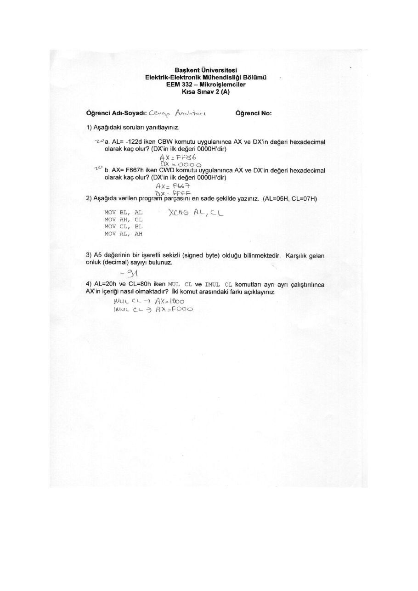

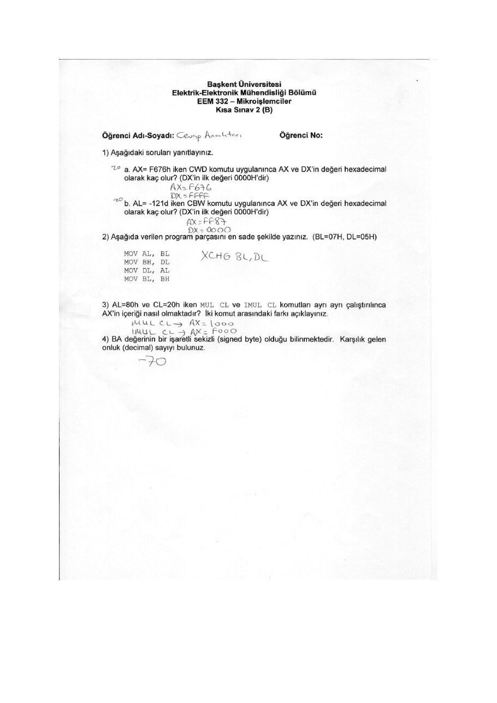

## 332q3

mea

### A

### A Student Name-Surname: Cp Analaterı Student No

### 4) After the instructions given below are executed, show the contents of the registers named in the instructions and of CF, ZF,

PF.

a”

a. MOV AX, GAB3 X (2 a] CE ze PE

```asm
MOV BX, 98F1 wx fseler S2 PP
ADD AL,BL #
```

ADC AH,BH zadd with carry

b. o DATA DB 4CH

```asm
DATA2 DB 6EH
DATA3 DB ? idata3 is empty and located in memory
```

```asm
MOV DH, DATAL
SUB DH, DATA2
```

```asm
INC NEXT (lie
NOT DH 31's complement ave ı
INC DH increase one
```

```asm
NEXT:MOV DATA3, DH
```

### 2) Complete the code that adds the numbers -2 and -7 and writes the result to the CL register. At the end of the code's

execution, show the state of the CL register and of CF, ZF, PF, AF, SF.

```asm
MOVAL,FE Mi Ş
MOVCL, £2 CızFr et nen 2 ihe ve
ADD CI, AL 1
```

### 3) A section of the memory of a CPU-based system is given. Accordingly, what are the changes in the relevant register and physical addresses as a result of each operation? (05-0040, SI- 0090h, BP = 0002h)

EE = a) Mov AX, [st] AX 7725 00491h | 78 b) MOV AX, [SI+1] AX5 8299

00492h | B2 ©) Mov aX, (SI) [BP] Ax39 C82

podsan sc] (9) Mov (SI~BP][3],AX 00494 382 0049239 00494h| OA e) Mov [94],AK QO 45,5 82 e

### 4) Write the assembly code required to perform the operations requested in the following questions. (AL=OFH)

Mev CU a. Using the SHL instruction, make the content of AL equal to FO. In this case, what should the CF value be? SHUAL,ci. NC

Mev cuk Rok AL, cL

b. Using the ROR instruction, make the content of AL equal to FO. In this case, what should the CF value be? pc.

### 5) After the first three of the instructions given below are executed, what are the Stack Segment contents, and after the second three are executed, what are the values of the registers? (SP=1245, AX=1122, BX-3344, CX-5568, OX=7788)

```asm
Stack Segment
PUSH AX SS:123E
PUSH CX
PUSH BX
```

Registers AX ss be

### B

### Student Name-Surname

PF.

a. MOV AX, 6AB3

### B

### Student No

### 1) After the instructions given below are executed, show the contents of the registers named in the instructions and of CF, ZF,

= ep afla) CF PERE ® oa

```asm
MOV BX, F198
ADD AL, BL
```

### ADC AH, BH

b. DATA1 DB 4CH

```asm
DATA2 DB 6EH
DATA3 DB ?
MOV DH, DATAİ
SUB DH, DATA2
```

### NC NEXT

```asm
NOT DH
INC DH
```

```asm
NEXT:MOV DATA3, DH
```

iadd with carry

```asm
;data3 is empty and located in memory
jdatal=4ch
;data2-6eh
```

#JUMP if not carry 71's complement

```asm
jincrease one o 9 Fe tee
```

### 2) Complete the code that adds the numbers -3 and -6 and writes the result to the CL register. At the end of the code's

execution, show the state of the CL register and of CF, ZF, PF, AF, SF.

```asm
MOV AL, £0. Yay 4
MOVCL TA BUL C4, NE, PO,AC,NG
ADD CL , Ac AG. e OE
```

### 3) A section of the memory of a CPU-based system is given. Accordingly, what are the changes in the relevant register and physical addresses as a result of each operation? (DS=0040, SI- 0090h, BP

= 0002h) a a) MoV AX, [ST] Ax İCOA 00490h| 0A ra b) Mov AX, [SI+1] Ax > 62 00491h | 9c oe 00492h | B2 6) Mov AX, [SI] (BPJAX-> ; 00493h | 78 d) MOV [SI-BP][3],AK oo R2 00492 78 00494h | 35 e) MOV [94],AX 0064362 00445 535,

### 4) Write the assembly code required to perform the operations requested in the following questions. (AL<OFH)

```asm
Movcu,y a. Using the ROR instruction, make the content of AL equal to FO. In this case, what should the CF value be?
```

Roc ALCL WC b. © Using the SHL instruction, make the content of AL equal to FO. In this case, what should the CF value be?

```asm
Mov CL
```

```asm
SAL ALA NC
```

### 5) After the first three of the instructions given below are executed, what are the Stack Segment contents, and after the second three are executed, what are the values of the registers? (SP=1245, AX=8877, BX=6655, CX=4433, DX=2211)

(Stack Segment — |

zy i Registers

### 33 4YS3

UT) Fits eae 4433

### BS 4655

1245

PE Pete 2 İN

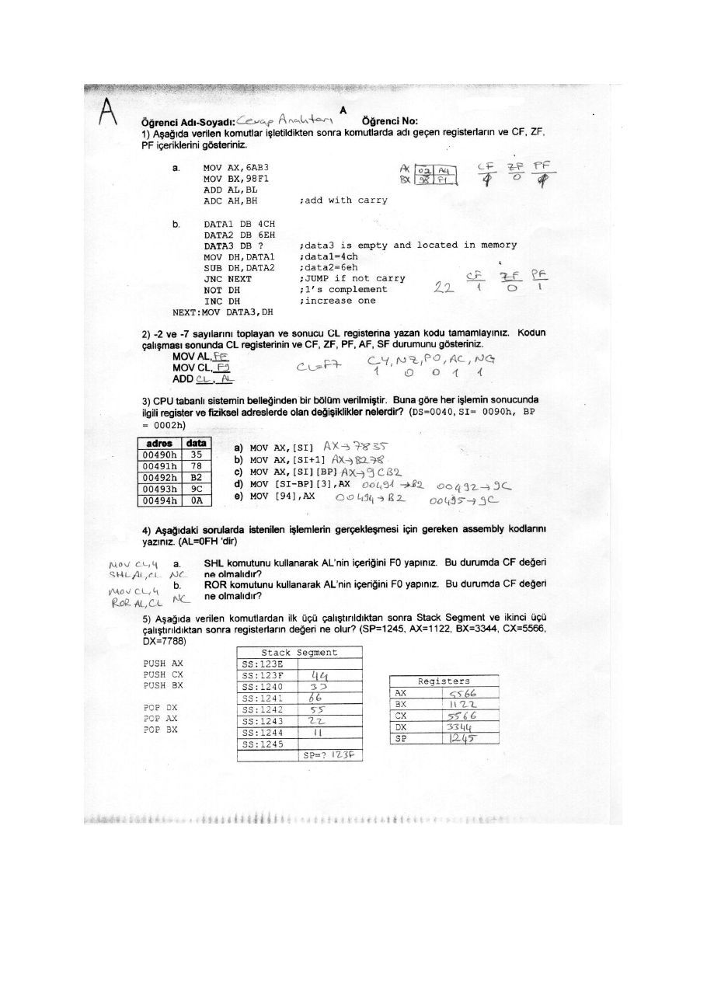

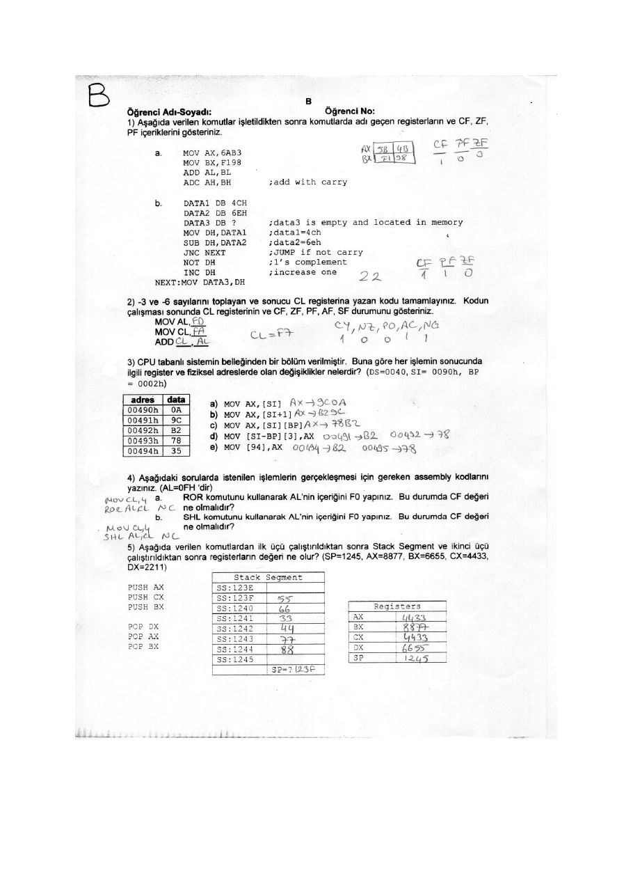

## 332q4

EEM 332 Quiz 4 (A)

### Student Name-Surname: Cosco Analterı Student No

### 1) 8 LEDs are connected to the output of the given I/O circuit. Write the hex values that must be on the bus at A0-A7 and D0-D7

so that the first four LEDs are ON and the other four are OFF.

MS DEPO veye oF ate Rep R m LEDs Az toettloot <AStt w — to : q "| av iw

### 2) Write the number of ports that can be used for each I/O operation.

A) MOV DX, port # 5/4 B) IN dast,source 25 6

```asm
IN AL, port # IN AL, DX
```

### 3) Compare the polling and interrupt methods in I/O operations.

### 4) In the given circuit, write the address of the port, the hex equivalent of the data that must be written to the control register, and the address of each port.

| [rms Le a Pact A: HOW

iow—| ABS

```asm
jeg mim ——>>—: Pek B . BUH
```

| an er Port C? MLK Ar ot mm a ee a Contest: ASH ei

a ee oe oo Pi

Group A Group 8

Porte Por C

(Upper: PCT - PCA) (Lower: PC - PCO)

1 = put 0 = output Pol

1 = put, 0 output

O= Mose 0 1 Mode 1

Figure 11-12 8255 Control Word Format (VO Mode)

EEM 332 Quiz 4 (B)

### Student Name-Surname: Cop fnelleri Student No

### 1) 8 LEDs are connected to the output of the given /O circuit. Write the hex values that must be on the bus at A0-A7 and D0-D7 so that the first four LEDs are ON and the other four are OFF.

### SN

Ze w pi % D= Fo anys oF nn P LEDs üs Az (001 4004 -55 w — = " G i ar Di

### 2) Write the number of ports that can be used for each /O operation.

A) MOV DX, port # B) IN dast,source

```asm
IN AL, port # IN AL, DX
```

### 3) Compare the polling and interrupt methods in I/O operations.

### 4) In the given circuit, write the address of the port, the hex equivalent of the data that must be written to the control register, and the address of each port. Pot A: Bok Bet R- 3041 a2 Ni erke: 3024 ine Contre so att Be >

### AEN

[ere [oe [o [ope [oo | ei

Group 8 Pore Lower. PC3- PCO) T= input 0 = out Pole 1 input 0 = output ‘Mode Seleciion | 0x Mace 0 1s Moe

Figure 11-12 6255 Control Word Format (VO Mode)

3/

TJO temlertnde Mterupt Külli, Tlo porkundeki ota tlen Telerinin bri va Vila islediği belirtmek Tela si sth

Mar. Bü sinedin Fe Sen işlemek dase p Shyal eSadvenr aueit fle. reeds Bunun fein Saceden isleri bilgiler, rep Sint ie kak yerden diva gimesi a saklamak durumundadır. Salla tele,.leri iin Kosladan yazalım, Palrrupk Tara Se Çazladın dönemim

e Çer UL yeworg Te Mrterruptlen Lar sce Santa iii meye bl w TU asıl Ki yo gerer olur.

Polka, nkevtade öle? Gür Tle kn Teni Liberty Letra emele teta teborteker Lontsal edir, öğe gözlen

gelme, sasi ve sıtclığı ole alınmış tee Telencd vella con

pallies ‘le gecnece Maden performers düşer

FOLNG Meryem Dio Y ie —Tlo ANİ shechus regis ter the kayar

a Ne Leds. Newt aes olarak tow gs « kon tee! ©

_ leben os

Avontefleri: ği = wat EE Ed Ge Tet keli ge “b As 3 bis

şe ponte (lr

### Desewon teri

«Gok farla CRU tron bode br.

\WTec2urt clue To: ee e We TM ay whi processor a Choe. ayran, iken girtrerek 9 anda ae olam al up bandi Rk

agrı.

Puan tajlens = = = Kullancı elemi saclece interrveh gliğirde. kesik, (CPU asma, sedece

o semen barcanr)

Deneyen ayl n

Grek agit girenin (iat görür meki, Ma age)

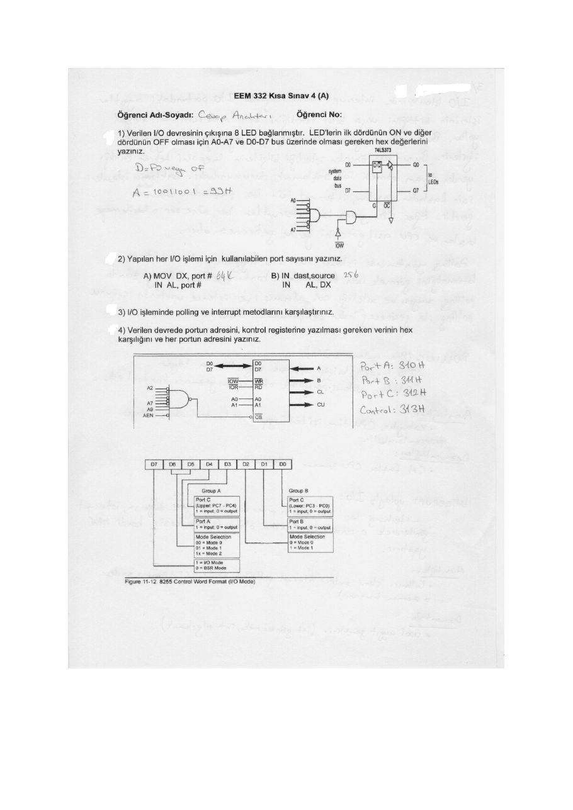

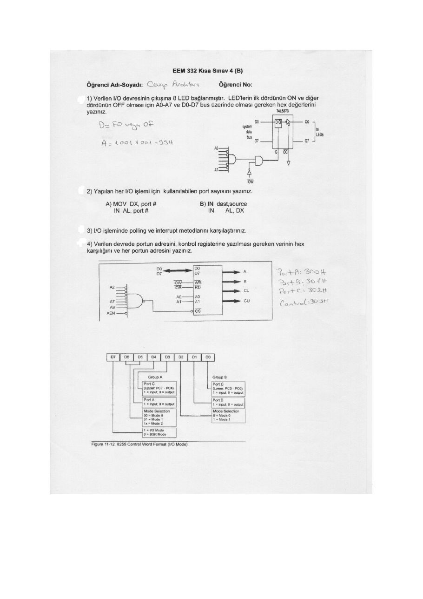

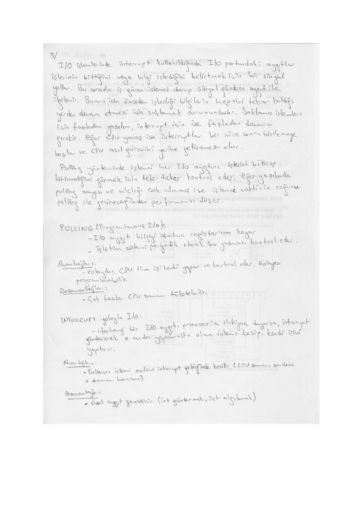

## 332q5

EEM 332 Quiz 5 (B)

### Student Name-Surname: Covey Avatarı Student No

### 1) 7 Volts is applied to the input of a 10-bit ADC (Analog-to-Digital Converter) with a reference voltage of 10 Volts. Find the digital value obtained at the output. What is the resolution of this ADC?

r ADC | 10 bit Hz ge m ws > lo Gözlü İZ -326.V

### 2) When IF (interrupt flag)=0, which hardware interrupt can be active?

Nr

### 3) When an interrupt occurs, how many bytes of data in total are pushed onto the stack?

6 eye

### 4) When an interrupt occurs, which data are automatically pushed onto the stack?

CS,IP, Flag va = ‘ 5 o MACK

### 5) Write two differences between CALL and a software interrupt.

### MT

OS? CSI Fle ;

### 6) How many interrupts are there in total in the 8086?

256 Adır

### 7) Write two interrupts that are automatically active by the CPU in an 8086-based system.

Deo ve Re

tdi i illini

EEM 332 Quiz 5 (A)

### Student Name-Surname: Camp Araltarı Student No

### 1) 3 Volts is applied to the input of a 10-bit ADC (Analog-to-Digital Converter) with a reference voltage of 10 Volts. Find the digital value obtained at the output. What is the resolution of this ADC?

a Miers ADC | 10 bit 8 2“P AF gi seye vin ——> Te Ver Göründü = İ2,- 126m8

ze

### 2) When an interrupt occurs, which data are automatically pushed onto the stack?

Cİ Flag yerede

### 3) How many interrupts are there in total in the 8086?

156 ode*

### 4) When IF (interrupt flag)=0, which hardware interrupt can be active?

### NME

### 5) Write two interrupts that are automatically active by the CPU in an 8086-based system.

Divide error ve NMT

### 6) When an interrupt occurs, how many bytes of data in total are pushed onto the stack?

6 Lote

### 7) Write two differences between CALL and a software interrupt.

```asm
Call INT
```

Ra cde \Rev x CIP

CSIP, Flog Re

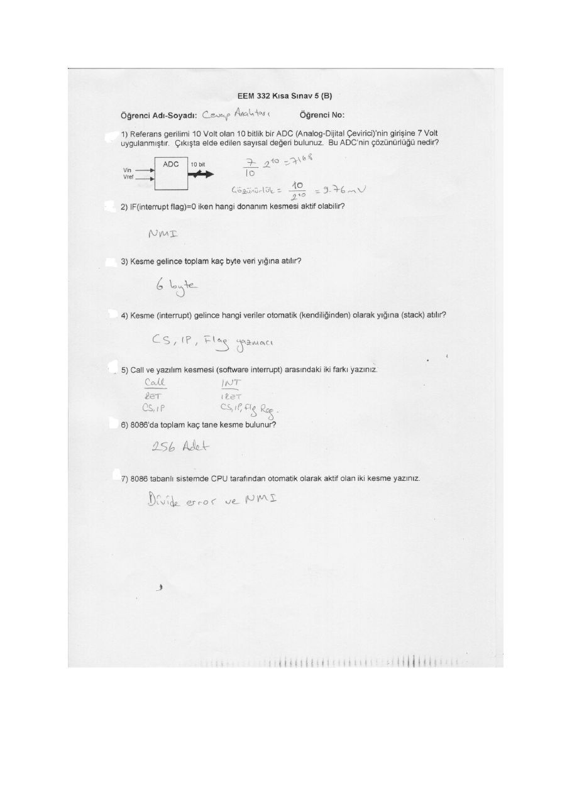

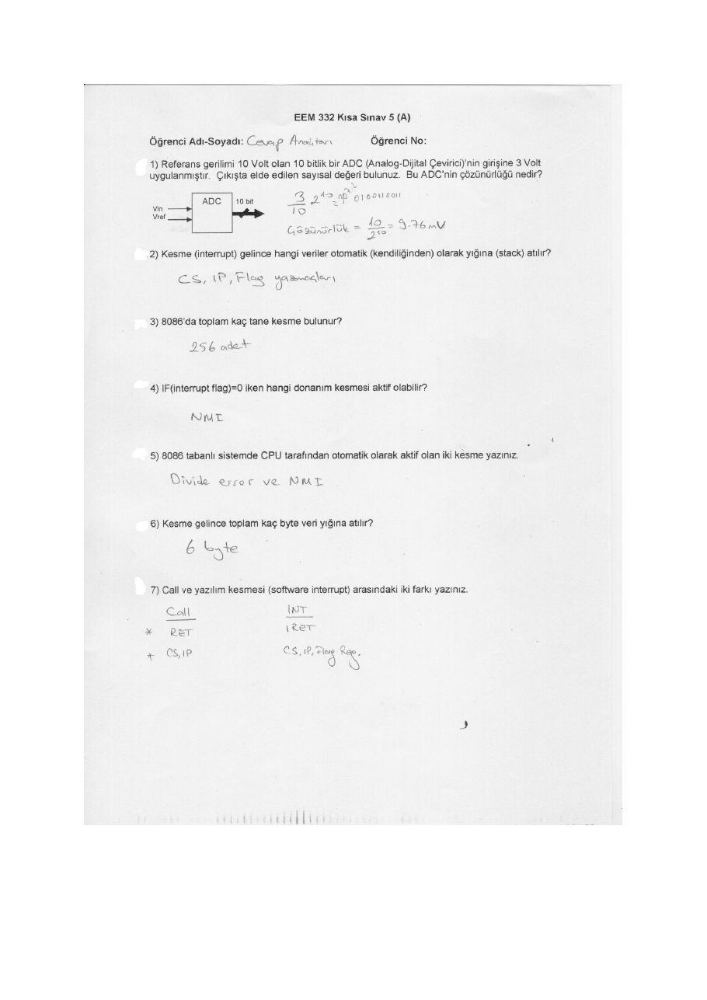

## 332q6

EEM 332 Quiz 6

### Student Name-Surname: Cano Analtarı Student No

### 1. In an ON-OFF operation, the required delay time can be provided by using a delay loop or a timer. Write the differences between the methods used from the CPU's point of view. Gecikme döngölünde Tslemcd baska, bir is may ee ia kt Bide, Times veya Yatar ela, tse fslenen gedkme sOreainee lark işlemler

### 2. How is the total delay time calculated in the given delay loop? a ile

The required values can be chosen as K, M, L. çi i.

```asm
MOV CX,N —5 K sCrestnda ‘elettltr
again: LOOP again A4 süresine Teletlir.
```

Topl geceme — (awe jee

### 3. How is the clock pulse required for the timer provided?

= Kristel, 26 ont sert fezonater

### 4. Write the difference between half-duplex and full-duplex in serial communication.

Hettiseler >Tek tel | Full-dupleas GÜÇ telt

### 5. What information is included in the data sent in serial asynchronous communication?

Start dorta;stoo itleri

### 6. Do you think music can be produced with a CPU-based system by using a timer? Explain.

Get, deşik seslere dank gelen Kelam ee fee lesipleaian ve

### 7. When does an interrupt become active in serial communication? W. we. imera, aot only,

Ry veye Te ett hin ee

### 8. In the given figure, a microcontroller communicates with a PC. Explain the reason for using the MAX232 in this circuit. ste he re ğine BV ie acılığır.

PIC TT sevdesind çalışır meat b Acadatr çekim ae çbmak Tah yr KARI Vu Uenclir $U8-D 9-pin e 4 mea 4 Shae mierasantraller = Lye ws Ye a sate es 7 | ee ee Ss e gi = piç © kJ 2 hi we sarma İZE a eşi wp room ay Sp er > iz eh E MASE + ğa ak

Serial ceki an 1)

Receives data (Ba) =) Sends data ÇT) =

```asm
SUB-0 9-pin connector an PC
```

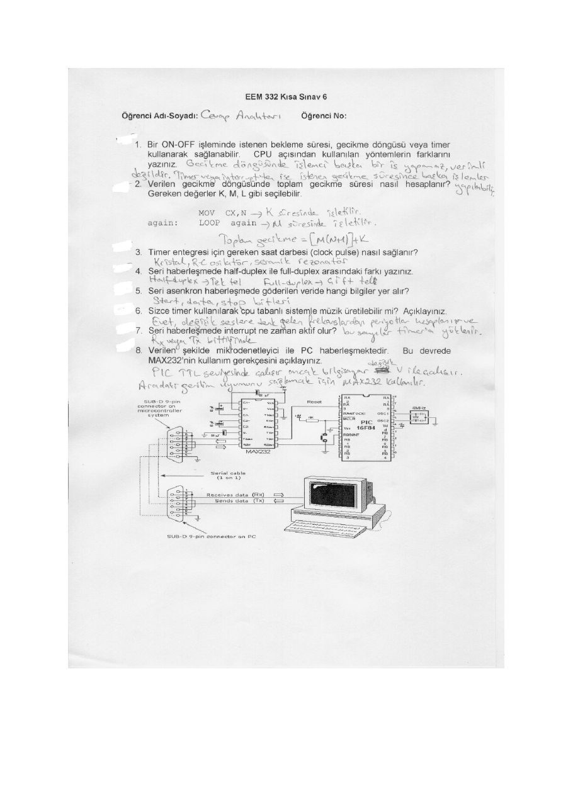

## 332q7

EEM 332 Quiz 7 (A)

### Student Name-Surname: Student No

### 1) Mark the statements as T (true) or F (false). (2 wrong answers cancel out one correct answer.)

. Mele içinde bulunan sayaçlar (timer) dahili ve harici CLK (saat darbesi) ile çalışabilir... 5.

* Timer için kullanılan harici CLK (saat darbesi) yükselen kenar veya düşen kenar olarak seçebilir... ©...

Harici kesme (int) yükselen kenar veya düşen kenar için seçilebilir. ii 5

PIC mikrodenetleyicide sadece 2 yazılım kesmesi vardır...1...

PIC mikrodenetleyicide vektör tabanlı kesme (int) metodu kullanılır Mie

PIC mikrodenetleyicide portlar bit bazında yönlendirilebilir. Örneğin PortB'de PB, ve PB, giriş ve geri kalan pinler çıkış olarak atanabilir. 12.

Osilatör devresinde RC devresi kullanılabilir... ©

PIC mikrodenetleyicinin PC ile RS232 üzerinden haberleşmesi için gerilim uygunlaştırıcı devre kullanılır... A2...

* PIC mikrodenetleyici harici kesme gelince program sayacı sabit adrese gider...

» Mikrodenetleyici reset devresi kurulmadan çalışabilir...İ)..

### 2) In the circuits shown in the figure, a program has been written to make the LED connected to the microcontroller blink continuously. Mark the working circuit.

“ * 9 Tai

ai

### 3) What is required, in terms of software and hardware, to make a microcontroller operational?

List them as items.

~PC xd - NeHn etre {x XTAL ~ Assembler (Pc As) ARK

- Pie Pragtonleuncer donemi Yazılan Gön Kayes!

### 4) In the PIC 16F84, what must be done on the interrupt register (INTCON) for the external interrupt to be enabled?

Gie 9-9 dynpilmale

Inte

### 5) In general, state which modules are found inside microcontrollers besides the CPU. (e.g., ADC)

RAM Do, Pum. Ade, UACT, USAR, TME0 __

EEM 332 Quiz 7 (A)

### 6) Explain the difference between the 16F84 and the 16C84 controllers.

Çaflask ([kişisel bilgi çıkarıldı] (ts Pres]

ç şEmo3 (bir dete prog)

### 7) In the given switch circuit, write which is High and which is Low when the switch is closed.

— out

o

### 8) Compare a microprocessor with a microcontroller.

### 9) Explain the criteria by which you selected the controller used in your project.

### 10) When switch S is closed (active low), the LED will light continuously (active high). Accordingly, considering all hardware connections, mark the working circuits among the circuits given below.

### 11) State two methods for detecting the closing of the switch in the question above.

Polin, laterrvet

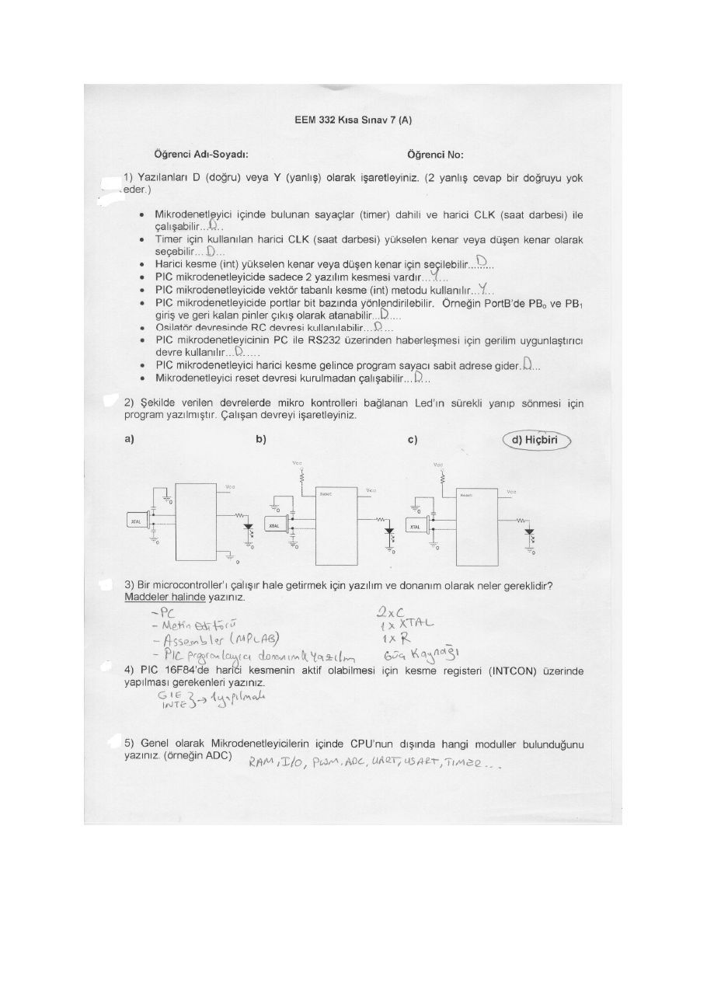

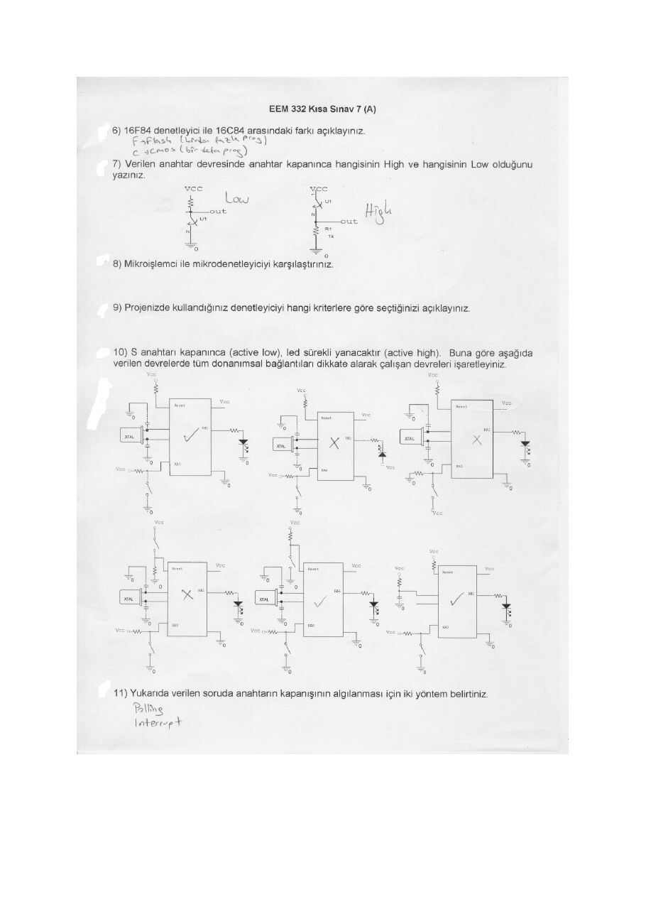

*Note: The questions and legible answers on the scanned pages have been transcribed into text. Where OCR leaves ambiguity in instructions and symbols, the scanned page should be taken as authoritative.*

## Additional Annotation from the Photographs: Polling and Interrupts

The photographic copies of the quiz pages contain the same questions. A separate handwritten solution explains that, in programmed input/output (polling), the CPU repeatedly reads the ready or busy status of the device. The method is simple and easy to program; continuous polling consumes CPU time.

In interrupt-based input/output, the device sends an interrupt request when it requires service. The processor executes the interrupt routine and, with the appropriate return, resumes its previous work. This requires interrupt support and preservation of context. Too-frequent interrupts also place a load on the processor. The photographs are not included in the download package.
