Bu yazı, Başkent Üniversitesi **EEM332 Mikroişlemciler** ders arşivindeki ilgili notları ve uygulamaları bir araya getiriyor (2006–2006). Taranmış kısa sınavlarda assembly programları, bellek, giriş-çıkış ve PIC soruları. Belgelerin PDF arşiv kopyaları ve varsa kaynak kodları yazının sonunda ZIP olarak indirilebilir.

## 332q2

Başkent Üniversitesi Elektrik-Elektronik Mühendisliği Bölümü EEM 332 — Mikroişlemciler Kısa Sınav 2 (A)

### Öğrenci Adı-Soyadı: Cevap, Anabter Öğrenci No

### 1) Aşağıdaki soruları yanıtlayınız.

7a. AL= -122d iken CBW komutu uygulanınca AX ve DX'in değeri hexadecimal olarak kaç olur? (DX'in ilk değeri 0O00H'dir)

```
AX=FFS6
```

PA ; Dx = 0000 7 . “ b. AX= F667h iken CWD komutu uygulanınca AX ve DX'in değeri hexadecimal olarak kaç olur? (DX'in ilk değeri OO00H'dir)

```
AX= FLET
```

### DX - ERER

### 2) Aşağıda verilen program parçasını en sade şekilde yazınız. (AL=05H, CL=07H)

```asm
MOV BL, AL XekG AL, CL
MOV AH, CL
MOV CL, BL
MOV AL, AH
```

### 3) A5 değerinin bir işaretli sekizli (signed byte) olduğu bilinmektedir. Karşılık gelen

onluk (decimal) sayıyı bulunuz.

### EM

### 4) AL=20h ve CL=80h iken MUL CL ve IMUL CL komutları ayrı ayrı çalıştırılınca

AX'in içeriği nasıl olmaktadır? İki komut arasındaki farkı açıklayınız. Wuc ci. 4 AXsl00o Wu cu > AX=FOOO

Başkent Üniversitesi Elektrik-Elektronik Mühendisliği Bölümü EEM 332 — Mikroişlemciler Kısa Sınav 2 (B)

### Öğrenci Adı-Soyadı: Coop Anerter Öğrenci No

### 1) Aşağıdaki soruları yanıtlayınız.

29 a. AX= F676h iken CWD komutu uygulanınca AX ve DX'in değeri hexadecimal olarak kaç olur? (DX'in ilk değeri OOOOH'dir) Axs F636 ae Dx >FEFE © b. AL= -121d iken CBW komutu uygulanınca AX ve DX'in değeri hexadecimal olarak kaç olur? (DX'in ilk değeri 0O00H'dir)

### AKS FER

Dx = 0060

### 2) Aşağıda verilen program parçasını en sade şekilde yazınız. (BL=07H, DL=05H)

```asm
MOV AL, BL >
MOV BH, DL XCHE BL DL
MOV DL, AL
MOV BL, BH
```

### 3) AL=80h ve CL=20h iken MUL CL ve IMUL CL komutları ayrı ayrı çalıştırılınca

AX'in içeriği nasıl olmaktadır? İki komut arasındaki farkı açıklayınız.

YMULCL>3 AX= (ooo

WUL cc AX= Fooo

### 4) BA değerinin bir işaretli sekizli (signed byte) olduğu bilinmektedir. Karşılık gelen

onluk (decimal) sayıyı bulunuz.

imi <5

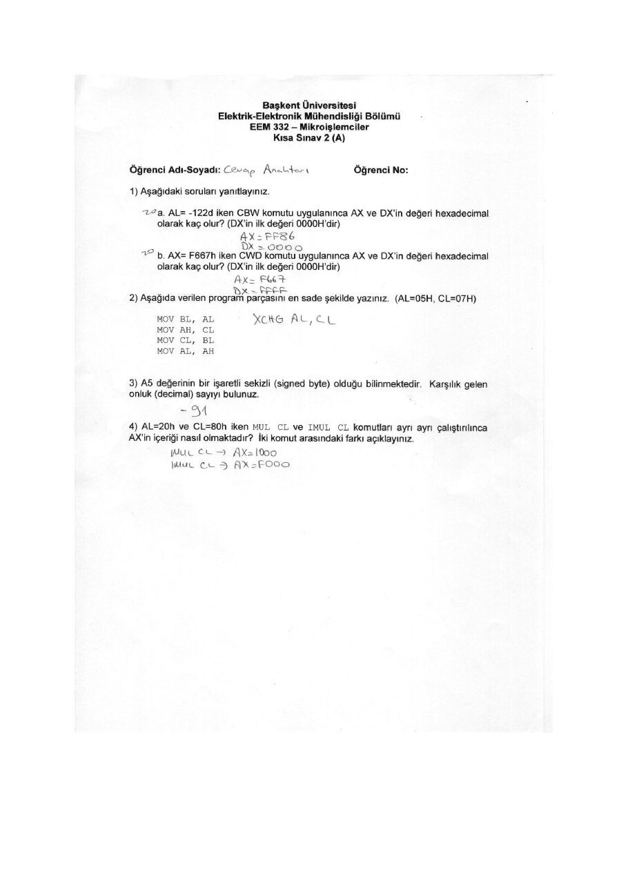

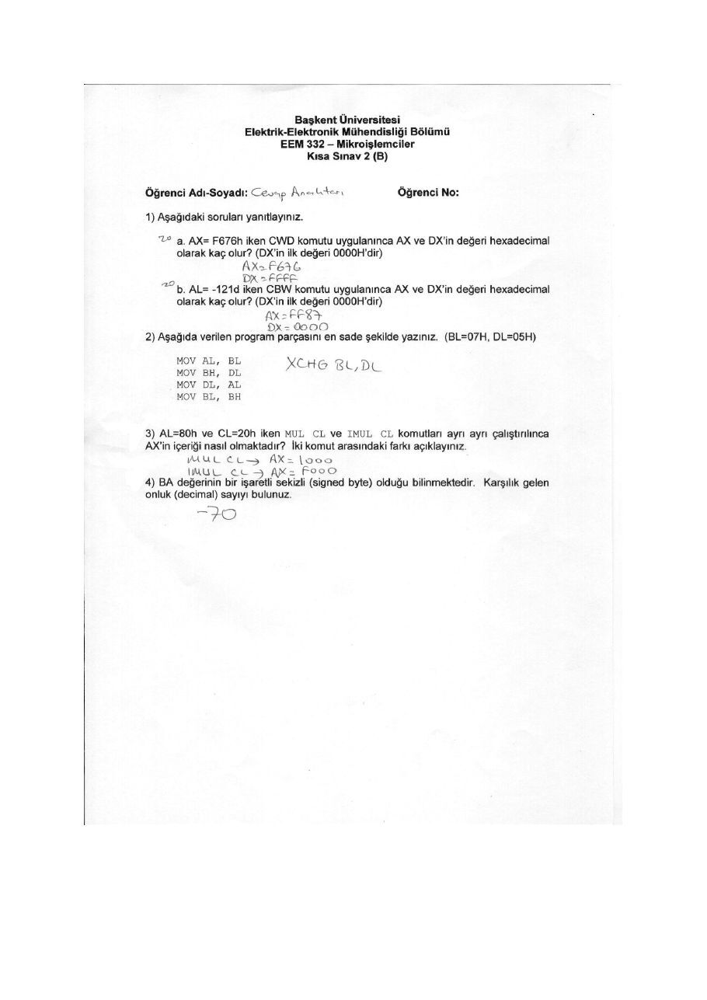

## 332q3

mea

### A

### A Öğrenci Adı-Soyadı: Cp Analaterı Öğrenci No

### 4) Aşağıda verilen komutlar işletildikten sonra komutlarda adı geçen registerların ve CF, ZF,

PF içeriklerini gösteriniz.

a”

a. MOV AX, GAB3 X (2 a] CE ze PE

```asm
MOV BX, 98F1 wx fseler S2 PP
ADD AL,BL #
```

ADC AH,BH zadd with carry

b. o DATA DB 4CH

```asm
DATA2 DB 6EH
DATA3 DB ? idata3 is empty and located in memory
```

```asm
MOV DH, DATAL
SUB DH, DATA2
```

```asm
INC NEXT (lie
NOT DH 31's complement ave ı
INC DH increase one
```

```asm
NEXT:MOV DATA3, DH
```

### 2) -2 ve -7 sayılarını toplayan ve sonucu CL registerina yazan kodu tamamlayınız. Kodun

çalışması sonunda CL registerinin ve CF, ZF, PF, AF, SF durumunu gösteriniz.

```asm
MOVAL,FE Mi Ş
MOVCL, £2 CızFr et nen 2 ihe ve
ADD CI, AL 1
```

### 3) CPU tabanlı sistemin belleğinden bir bölüm verilmiştir. Buna göre her işlemin sonucunda

ilgili register ve fiziksel adreslerde olan değişiklikler nelerdir? (05-0040, SI- 0090h, BP = 0002h)

EE = a) Mov AX, [st] AX 7725 00491h | 78 b) MOV AX, [SI+1] AX5 8299

00492h | B2 ©) Mov aX, (SI) [BP] Ax39 C82

podsan sc] (9) Mov (SI~BP][3],AX 00494 382 0049239 00494h| OA e) Mov [94],AK QO 45,5 82 e

### 4) Aşağıdaki sorularda istenilen işlemlerin gerçekleşmesi için gereken assembly kodlarını

yazınız. (AL=OFH 'dir)

Mev CU a SHL komutunu kullanarak AL'nin içeriğini FO yapınız. Bu durumda CF değeri SHUAL,ci. NC ne olmalıdır?

Mev cuk Rok AL, cL

b. ROR komutunu kullanarak AL'nin içeriğini FO yapınız. Bu durumda CF değeri pc. ne olmalıdır?

### 5) Aşağıda verilen komutlardan ilk üçü çalıştırıldıktan sonra Stack Segment ve ikinci üçü

çalıştırıldıktan sonra registerların değeri ne olur? (SP=1245, AX=1122, BX-3344, CX-5568, OX=7788)

```asm
Stack Segment
PUSH AX SS:123E
PUSH CX
PUSH BX
```

Registers AX ss be

### B

### Öğrenci Adı-Soyadı

PF içeriklerini gösteriniz.

a. MOV AX, 6AB3

### B

### Öğrenci No

### 1) Aşağıda verilen komutlar işletildikten sonra komutlarda adı gegen registerların ve CF, ZF,

= ep afla) CF PERE ® oa

```asm
MOV BX, F198
ADD AL, BL
```

### ADC AH, BH

b. DATA1 DB 4CH

```asm
DATA2 DB 6EH
DATA3 DB ?
MOV DH, DATAİ
SUB DH, DATA2
```

### NC NEXT

```asm
NOT DH
INC DH
```

```asm
NEXT:MOV DATA3, DH
```

iadd with carry

```asm
;data3 is empty and located in memory
jdatal=4ch
;data2-6eh
```

#JUMP if not carry 71's complement

```asm
jincrease one o 9 Fe tee
```

### 2) -3 ve -6 sayılarını toplayan ve sonucu CL registerina yazan kodu tamamlayınız. Kodun

çalışması sonunda CL registerinin ve CF, ZF, PF, AF, SF durumunu gösteriniz.

```asm
MOV AL, £0. Yay 4
MOVCL TA BUL C4, NE, PO,AC,NG
ADD CL , Ac AG. e OE
```

### 3) CPU tabanlı sistemin belleğinden bir bölüm verilmiştir. Buna göre her işlemin sonucunda

ilgili register ve fiziksel adreslerde olan değişiklikler nelerdir? (DS=0040, SI- 0090h, BP

= 0002h) a a) MoV AX, [ST] Ax İCOA 00490h| 0A ra b) Mov AX, [SI+1] Ax > 62 00491h | 9c oe 00492h | B2 6) Mov AX, [SI] (BPJAX-> ; 00493h | 78 d) MOV [SI-BP][3],AK oo R2 00492 78 00494h | 35 e) MOV [94],AX 0064362 00445 535,

### 4) Aşağıdaki sorularda istenilen işlemlerin gerçekleşmesi için gereken assembiy kodlarını

yazınız. (AL<OFH ‘dir)

```asm
Movcu,y a ROR komutunu kullanarak AL'nin içeriğini FO yapınız. Bu durumda CF değeri
```

Roc ALCL WC ne olmalıdır? b. © SHL komutunu kullanarak AL’nin içeriğini FO yapınız. Bu durumda CF değeri

```asm
Mov CL ne olmalıdır?
```

```asm
SAL ALA NC
```

### 5) Aşağıda verilen komutlardan ilk üçü çalıştırıldıktan sonra Stack Segment ve ikinci üçü

çalıştırıldıktan sonra registerların değeri ne olur? (SP=1245, AX=8877, BX=6655, CX=4433, DX=2211)

(Stack Segment — |

zy i Registers

### 33 4YS3

UT) Fits eae 4433

### BS 4655

1245

PE Pete 2 İN

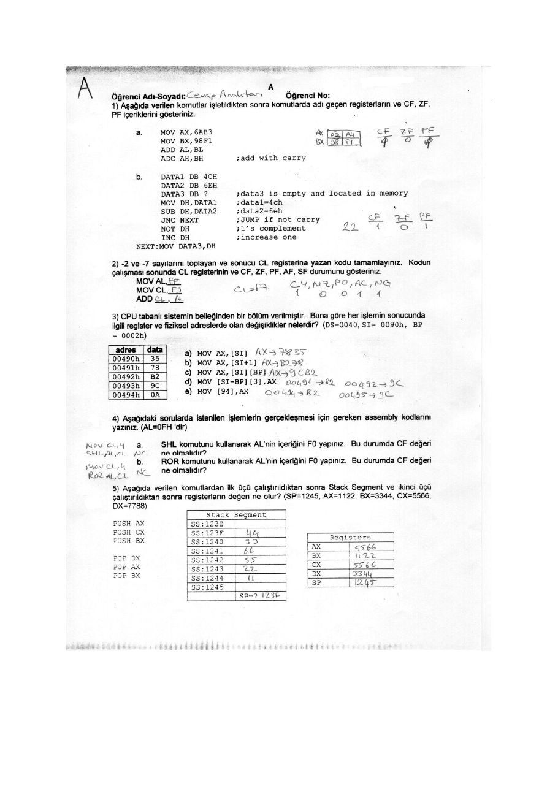

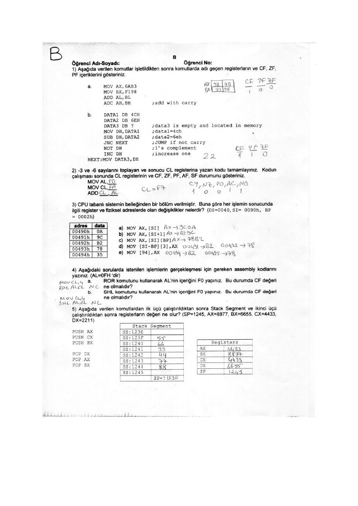

## 332q4

EEM 332 Kısa Sınav 4 (A)

### Öğrenci Adı-Soyadı: Cosco Analterı Öğrenci No

### 1) Verilen I/O devresinin çıkışına 8 LED bağlanmıştır. LED'lerin ilk dördünün ON ve diğer

dördünün OFF olması için AO-A7 ve DO-D7 bus üzerinde olması gereken hex değerlerini

yazınız. MS DEPO veye oF ate Rep R m LEDs Az toettloot <AStt w — to : q "| av iw

### 2) Yapılan her 1/O işlemi için kullanılabilen port sayısını yazınız.

A) MOV DX, port # 5/4 B)IN dast,source 25 6

```asm
IN AL, port # IN AL, DX
```

### 3) 1/0 işleminde polling ve interrupt metodlarını karşılaştırınız.

### 4) Verilen devrede portun adresini, kontrol registerine yazılması gereken verinin hex

karşılığını ve her portun adresini yazınız.

| [rms Le a Pact A: HOW

iow—| ABS

```asm
jeg mim ——>>—: Pek B . BUH
```

| an er Port C? MLK Ar ot mm a ee a Contest: ASH ei

a ee oe oo Pi

Group A Group 8

Porte Por C

(Upper: PCT - PCA) (Lower: PC - PCO)

1 = put 0 = output Pol

1 = put, 0 output

O= Mose 0 1 Mode 1

Figure 11-12 8255 Control Word Format (VO Mode)

EEM 332 Kısa Sınav 4 (B)

### Öğrenci Adı-Soyadı: Cop fnelleri Öğrenci No

### 1) Verilen /O devresinin çıkışına 8 LED bağlanmıştır. LED'lerin ilk dördünün ON ve diğer

dördünün OFF olması için AO-A7 ve DO-D7 bus üzerinde olması gereken hex değerlerini yazınız.

### SN

Ze w pi % D= Fo anys oF nn P LEDs üs Az (001 4004 -55 w — = " G i ar Di

### 2) Yapılan her /O işlemi için kullanılabilen port sayısını yazınız.

A) MOV DX, port # B) IN dast,source

```asm
IN AL, port # IN AL, DX
```

### 3) I/O işleminde polling ve interrupt metodlarını karşılaştırınız.

### 4) Verilen devrede portun adresini, kontrol registerine yazılması gereken verinin hex

karşılığını ve her portun adresini yazınız. Pot A: Bok Bet R- 3041 a2 Ni erke: 3024 ine Contre so att Be >

### AEN

[ere [oe [o [ope [oo | ei

Group 8 Pore Lower. PC3- PCO) T= input 0 = out Pole 1 input 0 = output ‘Mode Seleciion | 0x Mace 0 1s Moe

Figure 11-12 6255 Control Word Format (VO Mode)

3/

TJO temlertnde Mterupt Külli, Tlo porkundeki ota tlen Telerinin bri va Vila islediği belirtmek Tela si sth

Mar. Bü sinedin Fe Sen işlemek dase p Shyal eSadvenr aueit fle. reeds Bunun fein Saceden isleri bilgiler, rep Sint ie kak yerden diva gimesi a saklamak durumundadır. Salla tele,.leri iin Kosladan yazalım, Palrrupk Tara Se Çazladın dönemim

e Çer UL yeworg Te Mrterruptlen Lar sce Santa iii meye bl w TU asıl Ki yo gerer olur.

Polka, nkevtade öle? Gür Tle kn Teni Liberty Letra emele teta teborteker Lontsal edir, öğe gözlen

gelme, sasi ve sıtclığı ole alınmış tee Telencd vella con

pallies ‘le gecnece Maden performers düşer

FOLNG Meryem Dio Y ie —Tlo ANİ shechus regis ter the kayar

a Ne Leds. Newt aes olarak tow gs « kon tee! ©

_ leben os

Avontefleri: ği = wat EE Ed Ge Tet keli ge “b As 3 bis

şe ponte (lr

### Desewon teri

«Gok farla CRU tron bode br.

\WTec2urt clue To: ee e We TM ay whi processor a Choe. ayran, iken girtrerek 9 anda ae olam al up bandi Rk

agrı.

Puan tajlens = = = Kullancı elemi saclece interrveh gliğirde. kesik, (CPU asma, sedece

o semen barcanr)

Deneyen ayl n

Grek agit girenin (iat görür meki, Ma age)

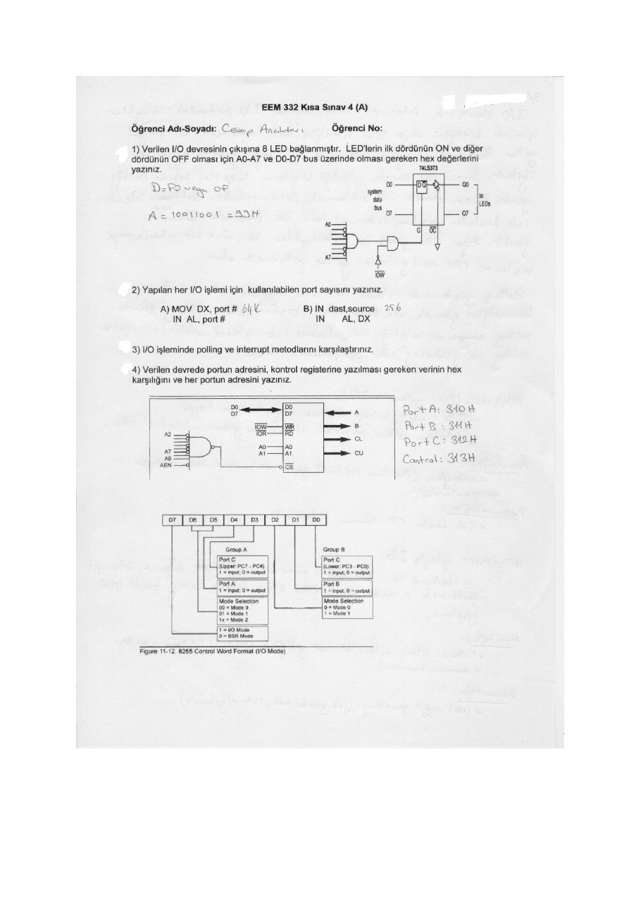

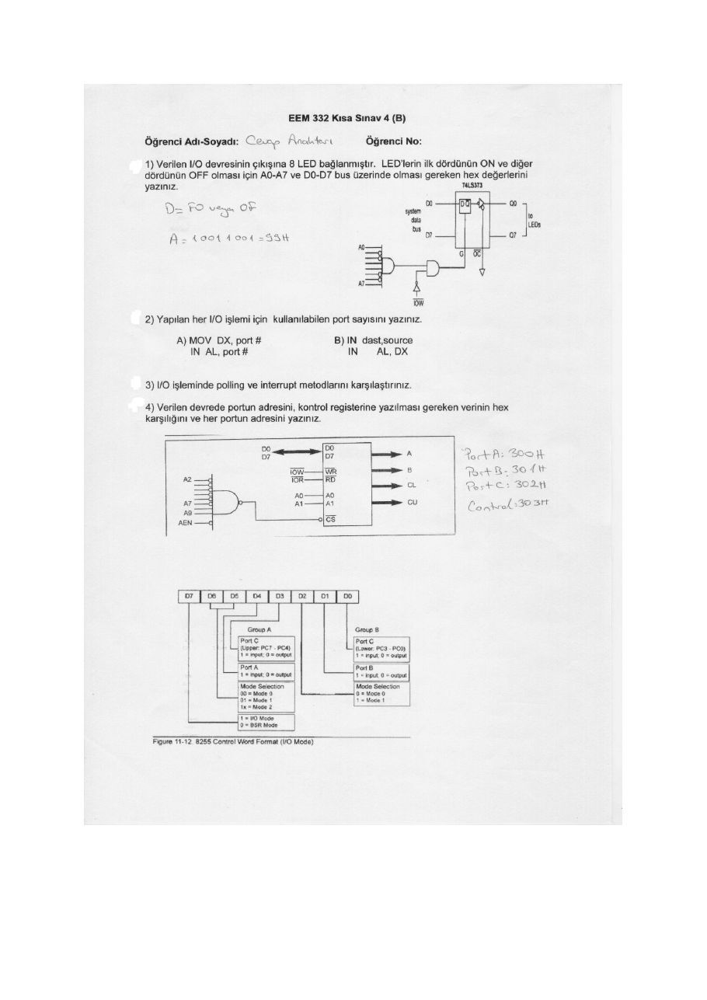

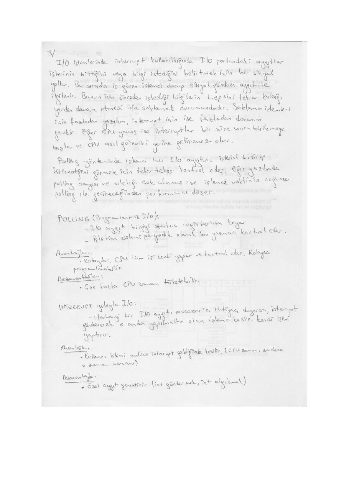

## 332q5

EEM 332 Kısa Sınav 5 (B)

### Öğrenci Adı-Soyadı: Covey Avatarı Öğrenci No

### 1) Referans gerilimi 10 Volt olan 10 bitlik bir ADC (Analog-Dijital Çevirici)'nin girişine 7 Volt

uygulanmıştır. Çıkışta elde edilen sayısal değeri bulunuz. Bu ADC'nin çözünürlüğü nedir?

r ADC | 10 bit Hz ge m ws > lo Gözlü İZ -326.V

### 2) IF(interrupt flag)=0 iken hangi donanım kesmesi aktif olabilir?

Nr

### 3) Kesme gelince toplam kaç byte veri yığına atılır?

6 eye

### 4) Kesme (interrupt) gelince hangi veriler otomatik (kendiliğinden) olarak yigina (stack) atılır?

CS,IP, Flag va = ‘ 5 o MACK

### 5) Call ve yazılım kesmesi (software interrupt) arasındaki iki farkı yazınız.

### MT

OS? CSI Fle ;

### 6) 8086'da toplam kaç tane kesme bulunur?

256 Adır

### 7) 8086 tabanlı sistemde CPU tarafından otomatik olarak aktif olan iki kesme yazınız.

Deo ve Re

tdi i illini

EEM 332 Kısa Sınav 5 (A)

### Öğrenci Adı-Soyadı: Camp Araltarı Öğrenci No

### 1) Referans gerilimi 10 Volt olan 10 bitlik bir ADC (Analog-Dijital Geviriciy'nin girişine 3 Volt

uygulanmıştır. Çıkışta elde edilen sayısal değeri bulunuz. Bu ADC'nin çözünürlüğü nedir?

a Miers ADC | 10 bit 8 2“P AF gi seye vin ——> Te Ver Göründü = İ2,- 126m8

ze

### 2) Kesme (interrupt) gelince hangi veriler otomatik (kendiliğinden) olarak yığına (stack) atılır?

Cİ Flag yerede

### 3) 8086'da toplam kaç tane kesme bulunur?

156 ode*

### 4) IF (interrupt flag)=0 iken hangi donanım kesmesi aktif olabilir?

### NME

### 5) 8086 tabanlı sistemde CPU tarafından otomatik olarak aktif olan iki kesme yazınız.

Divide error ve NMT

### 6) Kesme gelince toplam kaç byte veri yığına atılır?

6 Lote

### 7) Call ve yazılım kesmesi (software interrupt) arasındaki iki farkı yazınız.

```asm
Call INT
```

Ra cde \Rev x CIP

CSIP, Flog Re

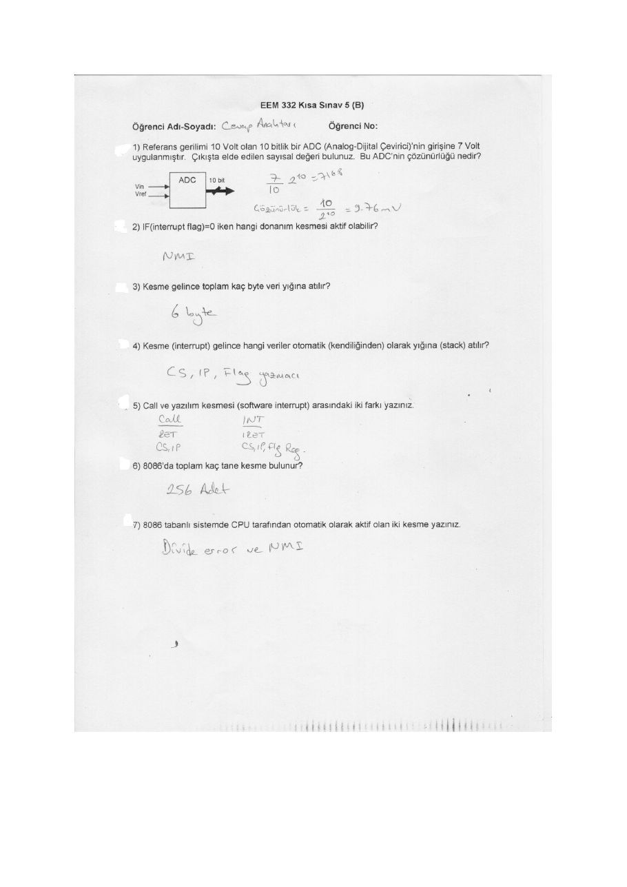

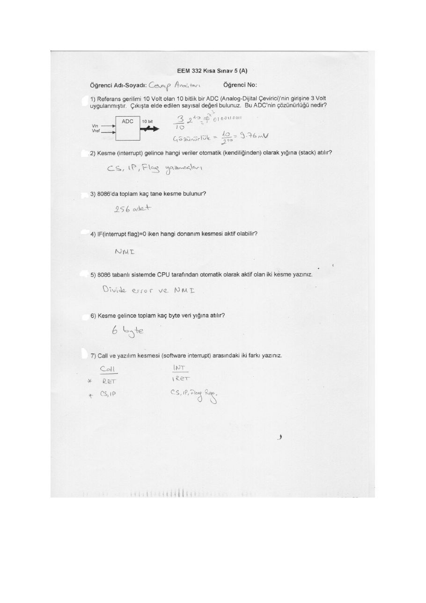

## 332q6

EEM 332 Kısa Sınav 6

### Öğrenci Adı-Soyadı: Cano Analtarı Öğrenci No

### 1. Bir ON-OFF işleminde istenen bekleme süresi, gecikme döngüsü veya timer

kullanarak sağlanabilir. CPU açısından kullanılan yöntemlerin farklarını yazınız. Gecikme döngölünde Tslemcd baska, bir is may ee ia kt Bide, Times veya Yatar ela, tse fslenen gedkme sOreainee lark işlemler

### 2. Verilen gecikme döngüsünde toplam gecikme süresi nasıl hesaplanır? a ile

Gereken değerler K, M, L gibi seçilebilir. çi i.

```asm
MOV CX,N —5 K sCrestnda ‘elettltr
again: LOOP again A4 süresine Teletlir.
```

Topl geceme — (awe jee

### 3. Timer gay için gereken saat darbesi (clock pulse) nasıl sağlanır?

= Kristel, 26 ont sert fezonater

### 4. ted haberleşmede half-duplex ile full-duplex arasındaki farkı yazınız.

Hettiseler >Tek tel | Full-dupleas GÜÇ telt

### 5. Seri asenkron haberleşmede göderilen veride hangi bilgiler yer alır?

Start dorta;stoo itleri

### 6. Sizce timer kullanılarak cpu tabanlı sistemle müzik üretilebilir mi? Açıklayınız.

Get, deşik seslere dank gelen Kelam ee fee lesipleaian ve

### 7. Seri haberleş mede interrupt ne zaman aktif olur? W. we. imera, aot only,

Ry veye Te ett hin ee

### 8. Verilen” şekilde miktodenetleyici ile PC haberleşmektedir. Bu devrede

MAX232'nin kullanım gerekçesini açıklayınız. ste he re ğine BV ie acılığır.

PIC TT sevdesind çalışır meat b Acadatr çekim ae çbmak Tah yr KARI Vu Uenclir $U8-D 9-pin e 4 mea 4 Shae mierasantraller = Lye ws Ye a sate es 7 | ee ee Ss e gi = piç © kJ 2 hi we sarma İZE a eşi wp room ay Sp er > iz eh E MASE + ğa ak

Serial ceki an 1)

Receives data (Ba) =) Sends data ÇT) =

```asm
SUB-0 9-pin connector an PC
```

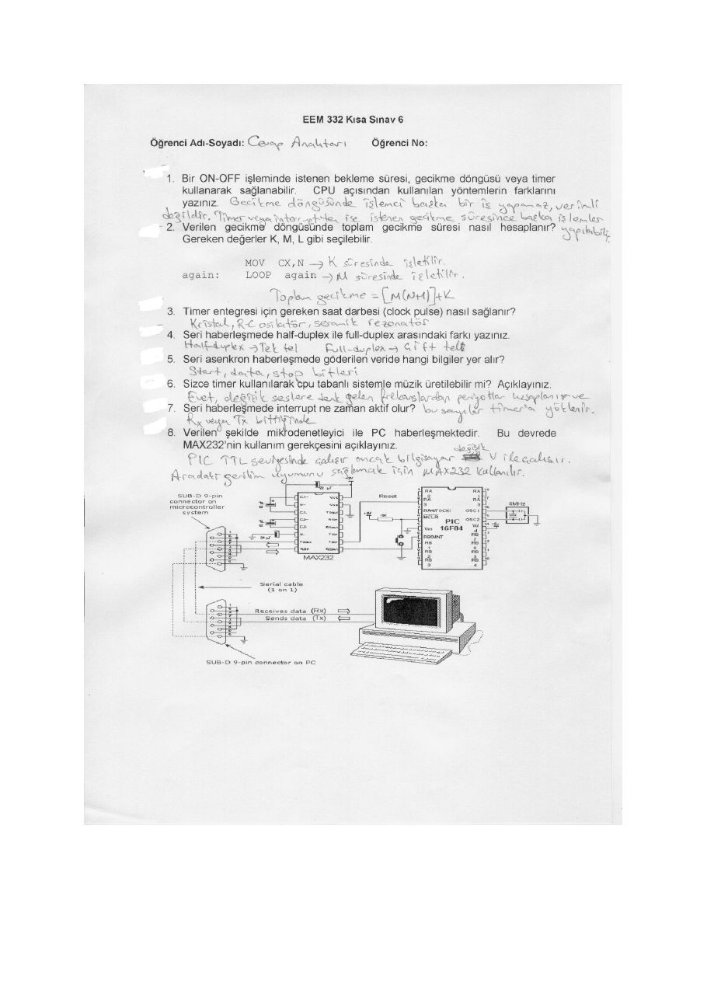

## 332q7

EEM 332 Kısa Sınav 7 (A)

### Öğrenci Adı-Soyadı: Öğrenci No

### 1) Yazılanları D (doğru) veya Y (yanlış) olarak işaretleyiniz. (2 yanlış cevap bir doğruyu yok

-eder.)

. Mele içinde bulunan sayaçlar (timer) dahili ve harici CLK (saat darbesi) ile çalışabilir... 5.

* Timer için kullanılan harici CLK (saat darbesi) yükselen kenar veya düşen kenar olarak seçebilir... ©...

Harici kesme (int) yükselen kenar veya düşen kenar için seçilebilir. ii 5

PIC mikrodenetleyicide sadece 2 yazılım kesmesi vardır...1...

PIC mikrodenetleyicide vektör tabanlı kesme (int) metodu kullanılır Mie

PIC mikrodenetleyicide portlar bit bazında yönlendirilebilir. Örneğin PortB'de PB, ve PB, giriş ve geri kalan pinler çıkış olarak atanabilir. 12.

Osilatör devresinde RC devresi kullanılabilir... ©

PIC mikrodenetleyicinin PC ile RS232 üzerinden haberleşmesi için gerilim uygunlaştırıcı devre kullanılır... A2...

* PIC mikrodenetleyici harici kesme gelince program sayacı sabit adrese gider...

» Mikrodenetleyici reset devresi kurulmadan çalışabilir...İ)..

### 2) Şekilde verilen devrelerde mikro kontrolleri bağlanan Led'ın sürekli yanıp sönmesi için

program yazılmıştır. Çalışan devreyi işaretleyiniz.

“ * 9 Tai

ai

### 3) Bir microcontroller’ çalışır hale getirmek için yazılım ve donanım olarak neler gereklidir?

Maddeler halinde yazınız.

~PC xd - NeHn etre {x XTAL ~ Assembler (Pc As) ARK

- Pie Pragtonleuncer donemi Yazılan Gön Kayes!

### 4) PIC 16F84'de hariti kesmenin aktif olabilmesi için kesme registeri (INTCON) üzerinde

yapılması gerekenleri yazınız.

Gie 9-9 dynpilmale

Inte

### 5) Genel olarak Mikrodenetleyicilerin işinde CPU'nun dışında hangi moduller bulunduğunu

yazınız. (örneğin ADC) RAM Do, Pum. Ade, UACT, USAR, TME0 __

EEM 332 Kısa Sınav 7 (A)

### 6) 16F84 denetleyici ile 16C84 arasındaki farkı açıklayınız.

Çaflask ([kişisel bilgi çıkarıldı] (ts Pres]

ç şEmo3 (bir dete prog)

### 7) Verilen anahtar devresinde anahtar kapaninca hangisinin High ve hangisinin Low oldugunu

yazınız.

— out

o

### 8) Mikroişlemci ile mikrodenetleyiciyi karşılaştırınız.

### 9) Projenizde kullandığınız denetleyiciyi hangi kriterlere göre seçtiğinizi açıklayınız.

### 10) S anahtarı kapanınca (active low), led sürekli yanacaktır (active high). Buna göre aşağıda

verilen devrelerde tüm donanımsal bağlantıları dikkate alarak çalışan devreleri işaretleyiniz.

### 11) Yukarıda verilen soruda anahtarın kapanışının algılanması için iki yöntem belirtiniz.

Polin, laterrvet

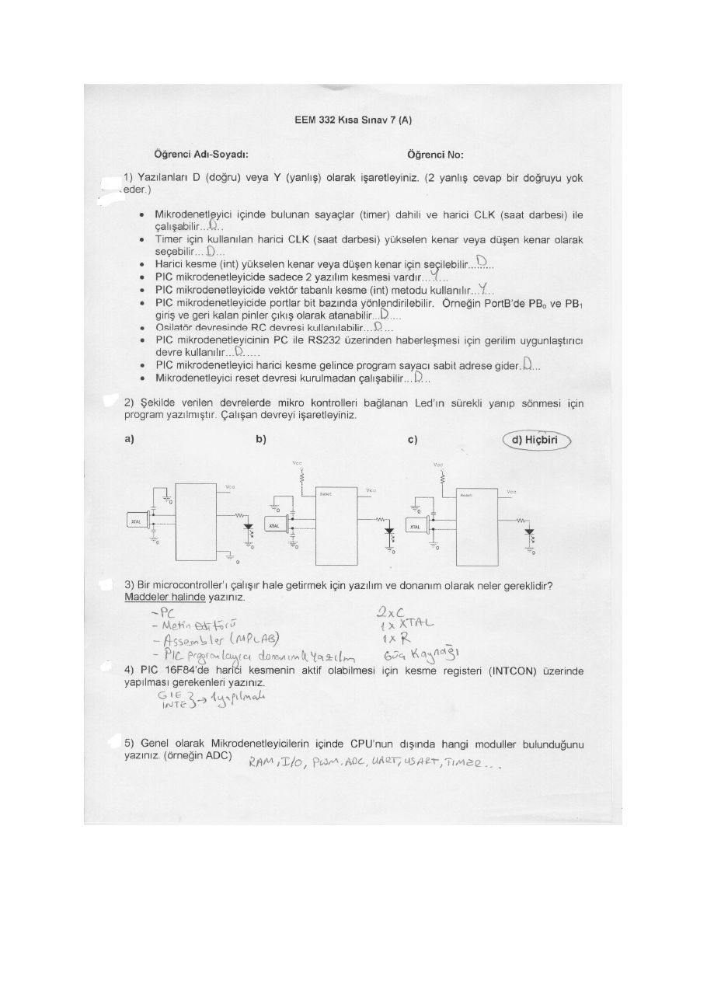

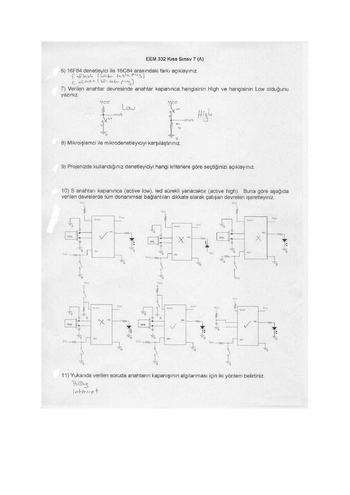

*Not: Taranmış sayfalardaki sorular ve okunabilen cevaplar metne aktarılmıştır. OCR kaynaklı komut ve sembol belirsizliklerinde taranmış sayfa esas alınmalıdır.*

## Fotoğraflardaki ek açıklama: polling ve kesme

Quiz sayfalarının fotoğraf kopyaları aynı soruları içerir. Ayrı el yazısı çözüm, programlanmış giriş/çıkışta (polling) CPU’nun aygıtın hazır veya meşgul durumunu tekrar tekrar okuduğunu anlatır. Yöntem basit ve programlanması kolaydır; sürekli sorgulama CPU zamanı tüketir.

Kesme tabanlı giriş/çıkışta aygıt işlem gerektiğinde kesme isteği gönderir. İşlemci kesme yordamını yürütüp uygun dönüşle önceki işine devam eder. Bunun için kesme desteği ve bağlamın korunması gerekir. Çok sık kesme gelmesi de işlemciye yük getirir. Fotoğraflar indirme paketine eklenmemiştir.
