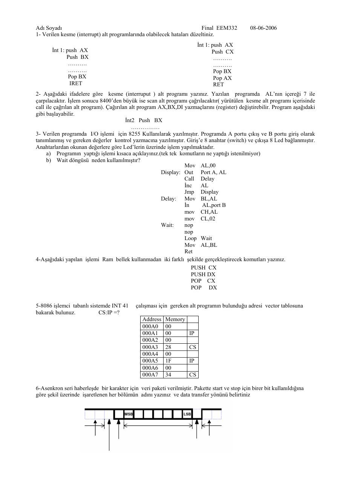
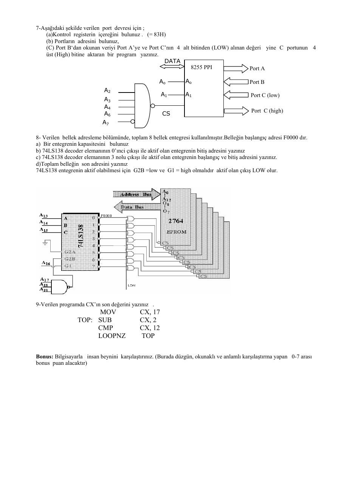
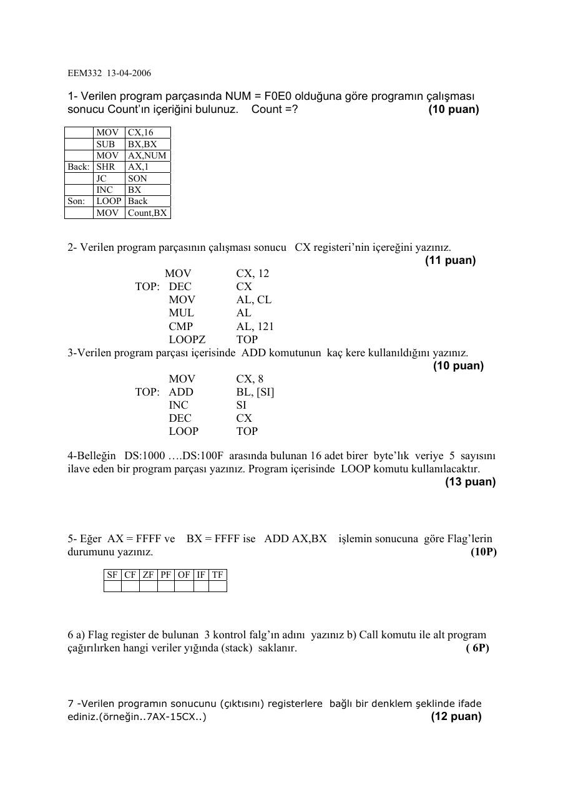
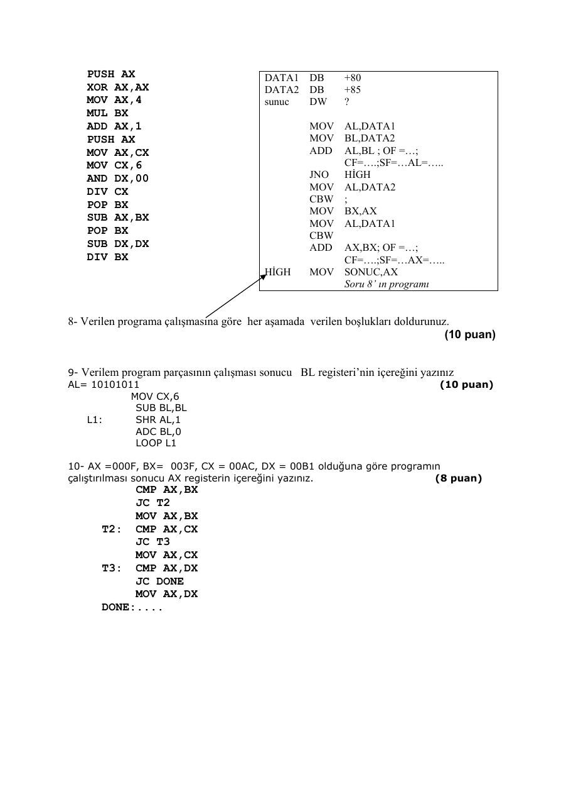

This post brings together the related notes and exercises from the Başkent University **EEM332 Microprocessors** course archive (2006–2006). 2006 midterm and final: instruction tracing, flags, interrupts, memory addressing and peripheral design. PDF archive copies of the documents and, where available, their source code can be downloaded as a ZIP at the end of the post.

## EEM332_06final

Name Surname                                                              Final EEM332            08-06-2006 1- Correct the errors that may exist in the given interrupt subroutines.

```asm
İnt 1: push AX
İnt 1: push AX                                                          Push CX
Push BX                                                                 .
```

.                                                                . .                                                          Pop BX

```asm
Pop BX                                                           Pop AX
```

### IRET                                                             RET

2- Write an interrupt subroutine according to the following statements. In the program, the contents of AL will be multiplied by 7. If the result is greater than 8400, the scan subroutine will be called (a subroutine called with

```asm
call inside the interrupt subroutine being executed). The called subroutine may change the AX, BX, DI registers. The program may start as follows
```

below. Int2 Push BX

3- The given program is written for I/O operations using an 8255. In the program, port A is defined as output and port B as input, and the required values are written to the control register. 8 switches are connected to the input and 8 LEDs to the output. Operations are performed on the LEDs according to the values read from the switches. a) Briefly explain what the program does (the function of each individual instruction is not required). b) Why is the Wait loop used?

```asm
Mov AL,00
Display: Out Port A, AL
Call Delay
İnc    AL
Jmp Display
Delay: Mov BL,AL
İn      AL,port B
mov CH,AL
mov CL,02
Wait:     nop
nop
Loop Wait
Mov AL,BL
Ret
```

4- Write the instructions that perform the operation below in two different ways without using RAM.

```asm
PUSH CX
PUSH DX
POP CX
POP DX
```

5- In an 8086 processor-based system, find the address of the subroutine required for INT 41 to run by looking at the vector table.           CS:IP =?

```asm
Address Memory
```

### 000A0 00

### 000A1 00       IP

### 000A2 00

### 000A3 28       CS

### 000A4 00

### 000A5 1F       IP

### 000A6 00

### 000A7 34       CS

6- A data packet for one character in asynchronous serial communication is given. Given that one bit each is used for start and stop in the packet, write the name of each section marked on the figure and indicate the direction of data transfer.

7- For the port circuit given in the figure below; (a) Find the contents of the control register (= 83H). (b) Find the addresses of the ports. (c) Write a program that transfers the data read from Port B to Port A, and transfers the value taken from the 4 lower (LOW) bits of Port C to the 4 upper (High) bits of Port C.

### DATA

8255 PPI               Port A

Ao         Ao                          Port B

### A2

A1        A1                          Port C (low)

### A3

### A4

Port C (high)

### A6                      CS

### A7

8- In the given memory addressing section, a total of 8 memory chips are used. The starting address of the memory is F0000. a) Find the capacity of one chip. b) Write the ending address of the chip activated by output 0 of the 74LS138 decoder. c) Write the starting and ending addresses of the chip activated by output 3 of the 74LS138 decoder. d) Write the last address of the total memory. For the 74LS138 to be enabled, G2B = low and G1 = high must hold; the active output goes LOW.

9- Write the final value of CX in the given program.

```asm
MOV                   CX, 17
TOP: SUB                   CX, 2
CMP                   CX, 12
LOOPNZ                TOP
```

Bonus: Compare the computer with the human brain. (Here, a student who makes a neat, legible and meaningful comparison will receive 0–7 bonus points.)





## 2006 midterm

### EEM332 13-04-2006

1- Given that NUM = F0E0 in the given program fragment, find the contents of Count as a result of running the program. Count =?                      (10 points)

```asm
MOV CX,16
SUB BX,BX
MOV AX,NUM
Back: SHR AX,1
JC  SON
INC BX
Son: LOOP Back
MOV Count,BX
```

2- Write the contents of the CX register as a result of running the given program fragment. (11 points)

```asm
MOV             CX, 12
TOP: DEC              CX
MOV            AL, CL
MUL            AL
CMP            AL, 121
LOOPZ          TOP
```

3- Write how many times the ADD instruction is used in the given program fragment. (10 points)

```asm
MOV            CX, 8
TOP: ADD              BL, [SI]
INC            SI
DEC            CX
LOOP           TOP
```

4- Write a program fragment that adds the number 5 to the 16 one-byte data items located between DS:1000 and DS:100F of memory. The LOOP instruction will be used in the program. (13 points)

5- If AX = FFFF and BX = FFFF, write the state of the flags according to the result of the ADD AX,BX operation.                                                                      (10P)

### SF CF ZF PF OF IF TF

6 a) Write the names of the 3 control flags in the flag register. b) Which data are saved on the stack when a subroutine is called with the CALL instruction?                                     ( 6P)

7 - Express the result (output) of the given program as an equation in terms of the registers. (for example..7AX-15CX..)                                                (12 points)

```asm
PUSH AX                              DATA1 DB        +80
XOR AX,AX                            DATA2 DB        +85
MOV AX,4                             sunuc DW        ?
MUL BX
ADD AX,1                                      MOV AL,DATA1
PUSH AX                                       MOV BL,DATA2
MOV AX,CX                                     ADD AL,BL ; OF = ;
MOV CX,6                                          CF= .;SF= AL= ..
AND DX,00                                     JNO HİGH
DIV CX                                        MOV AL,DATA2
```

### CBW ;

```asm
POP BX
MOV BX,AX
SUB AX,BX
MOV AL,DATA1
POP BX                                        CBW
SUB DX,DX                                     ADD AX,BX; OF = ;
DIV BX                                            CF= .;SF= AX= ..
```

### HİGH     MOV SONUC,AX

Program for Question 8

8- Fill in the blanks given at each stage according to the operation of the given program. (10 points)

9- Write the contents of the BL register as a result of running the given program fragment. AL= 10101011                                                                  (10 points)

```asm
MOV CX,6
SUB BL,BL
L1:       SHR AL,1
```

### ADC BL,0

```asm
LOOP L1
```

10- Given AX =000F, BX= 003F, CX = 00AC, DX = 00B1, write the contents of the AX register as a result of running the program.             (8 points)

```asm
CMP AX,BX
JC T2
MOV AX,BX
T2: CMP AX,CX
JC T3
MOV AX,CX
T3: CMP AX,DX
JC DONE
MOV AX,DX
```

### DONE:....





## Result check of the annotated copies

The handwritten attachments of the 2006 midterm contain a loop that counts zero bits for NUM=F0E0H; the result is Count=9. For the program that starts with CX=12 and applies DEC CX, MOV AL,CL, MUL AL, CMP AL,121 and LOOPZ, the final value of CX is 8. It is seen that CX is decremented by both DEC and LOOP, and that in the other loop starting with CX=8 the ADD instruction runs four times.

*Note: In the handwritten answers, 10 is read for the first loop and AX=00B1H for the last comparison. Since LOOPZ also decrements CX, the first result is 8. In the CMP/JC comparison chain that keeps the smaller value, for AX=000FH, BX=003FH, CX=00ACH, DX=00B1H the final AX remains 000FH.*

The sum FFFFH+FFFFH is FFFEH: CF=1, SF=1, ZF=0, PF=0 and OF=0. IF and TF are not changed by this addition. The eight-bit sum of +80 and +85 is A5H, and the word sum after the separate CBW extensions is 00A5H.

*Note: The PF=1 and OF=1 answers in the handwriting are not correct for this addition. The source copy has been preserved; the check results are stated separately here. The notes transcribed from the photograph are not included in the download ZIP.*

## Handwritten solutions of the 2006 final

In the interrupt routine question, it is written that the order PUSH AX, PUSH BX must be restored in the reverse order with POP BX, POP AX. In the second routine, the counterpart of PUSH CX should be POP CX; IRET must be used instead of RET.

*Note: In the question that multiplies AL by 7 and calls a subroutine if the result is greater than 8400, if AL is taken as an unsigned eight-bit value, the maximum product is 255×7=1785. In this case the stated threshold cannot be exceeded. The condition in the source has been preserved.*

The explanation in the 8255 and eight-LED question states that a binary count from 00H to FFH is performed on the PORTA output. The delay routine saves the current AL into BL; it loads the value read from PORTB into CH and 02H into CL, determining the delay time through CX. The Wait loop allows the LED states to be observed by eye; AL is restored on return.

Two solutions are given for exchanging CX and DX without using the stack:

```asm
XCHG CX,DX
```

```asm
MOV AX,CX
MOV CX,DX
MOV DX,AX
```

The second solution does not preserve the previous contents of AX.

In the INT 41 question, the handwritten calculation finds the vector start 41×4=164=00A4H. In the table, the bytes at addresses 00A4–00A7 are 00H, 1FH, 00H and 34H, respectively. In the handwriting, 0034:001F is written for CS:IP.

*Note: Read correctly with the 8086 little-endian layout, CS:IP=3400H:1F00H. The number 41 is interpreted here as decimal; INT 41H is a different vector.*

In the asynchronous serial data drawing, the start bit is on the right, followed by the data bits beginning with the LSB; the parity and stop bits are marked on the left.

*Note: Although the transfer arrow in the photograph is drawn to the right, in this layout the time order runs from right to left: start → data from LSB to MSB → parity → stop.*

The handwritten control word for the port circuit is 83H: mode 0, A output, B input, C lower four bits input and upper four bits output. In the answer, the A/B/C/control addresses are given as 3CH/3DH/3EH/3FH; the steps of transferring data from PORTB to PORTA, reading PORTC, and selecting the lower four bits with AND AL,0FH are written.

*Note: In the schematic, A2, A3, A4, A6 and inverted A7 appear to be connected to the decoder. Based on these labels, the base addresses would be 5CH–5FH; since A5 is not decoded, 7CH–7FH also selects the same device. The handwritten answer of 3CH–3FH is consistent with A5 being connected instead of A6. Also, to transfer the lower half of C to the upper half, the masked value must be shifted left by four bits; AND and OUT alone are not sufficient.*

In the 2764 EPROM question, A0–A12 give thirteen address lines: one chip is 8 KiB, and eight chips total 64 KiB. For a start of F0000H, the end of block zero is F1FFFH; the start of the third block is F6000H and its end is F7FFFH; the end of the whole memory is FFFFFH. In the LOOPNZ question, the answer of final CX=11 is given and is verified by instruction tracing.
