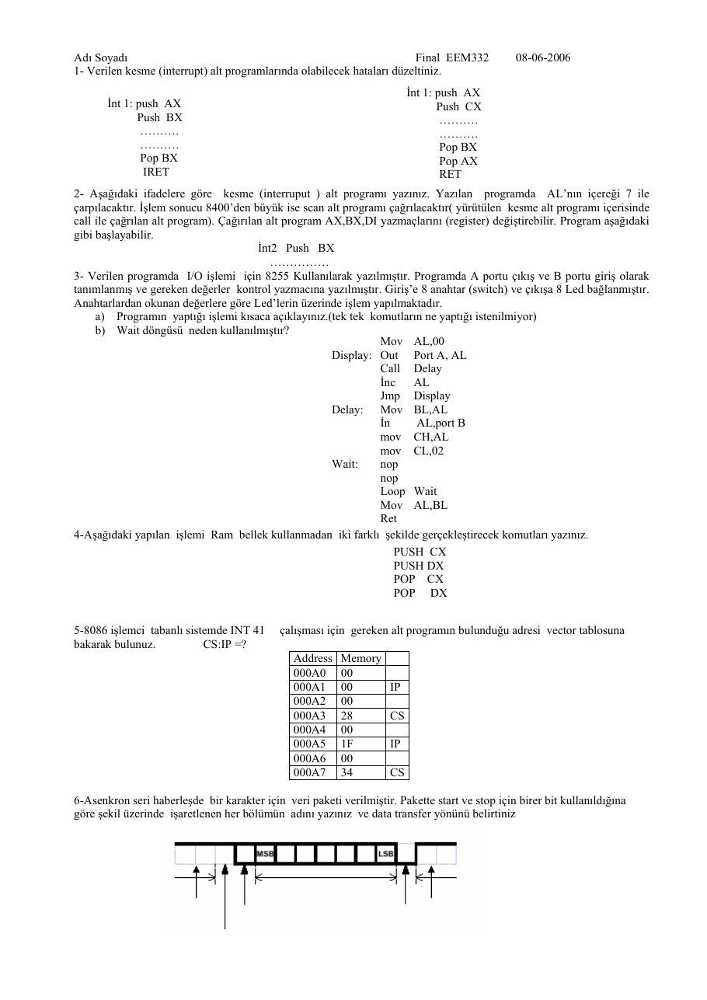
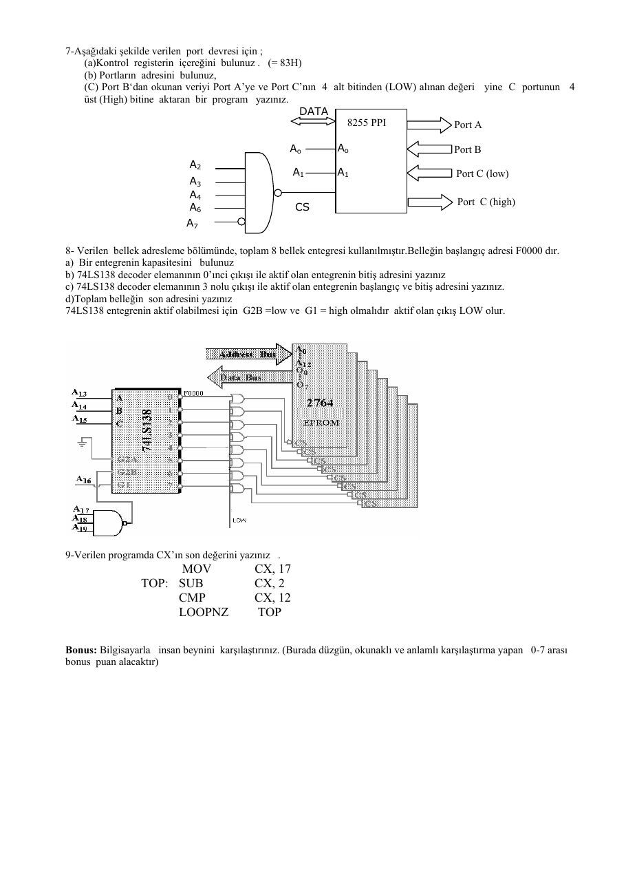
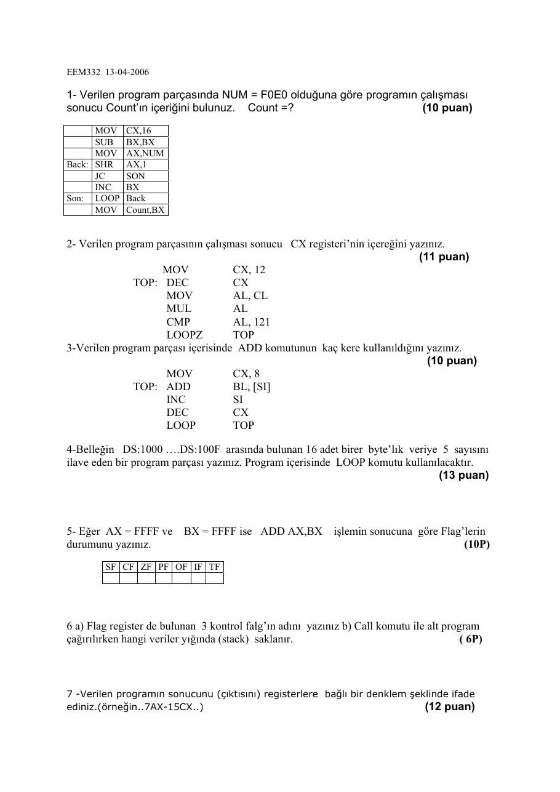
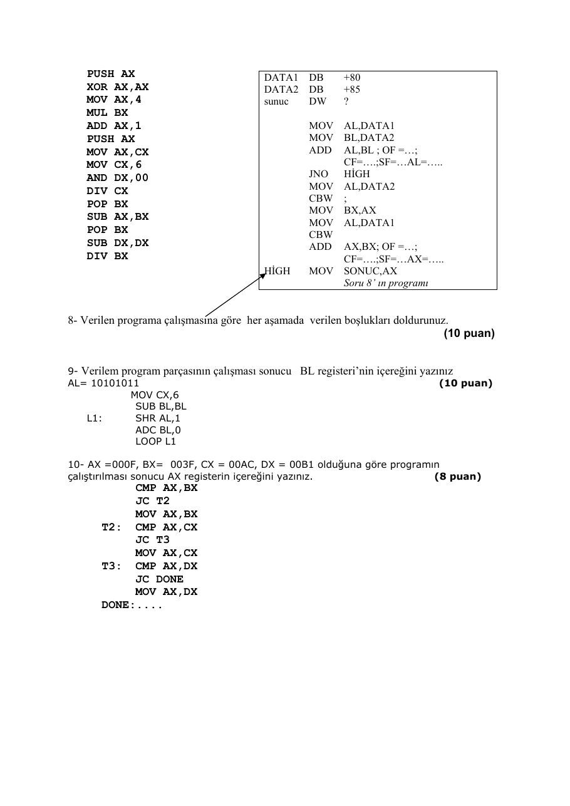

Bu yazı, Başkent Üniversitesi **EEM332 Mikroişlemciler** ders arşivindeki ilgili notları ve uygulamaları bir araya getiriyor (2006–2006). 2006 vize ve finali: komut izleme, bayraklar, kesmeler, bellek adresleme ve çevrebirim tasarımı. Belgelerin PDF arşiv kopyaları ve varsa kaynak kodları yazının sonunda ZIP olarak indirilebilir.

## EEM332_06final

Adı Soyadı                                                              Final EEM332            08-06-2006 1- Verilen kesme (interrupt) alt programlarında olabilecek hataları düzeltiniz.

```asm
İnt 1: push AX
İnt 1: push AX                                                          Push CX
Push BX                                                                 .
```

.                                                                . .                                                          Pop BX

```asm
Pop BX                                                           Pop AX
```

### IRET                                                             RET

2- Aşağıdaki ifadelere göre kesme (interruput ) alt programı yazınız. Yazılan programda AL’nın içereği 7 ile çarpılacaktır. İşlem sonucu 8400’den büyük ise scan alt programı çağrılacaktır( yürütülen kesme alt programı içerisinde

```asm
call ile çağrılan alt program). Çağırılan alt program AX,BX,DI yazmaçlarını (register) değiştirebilir. Program aşağıdaki
```

gibi başlayabilir. İnt2 Push BX

3- Verilen programda I/O işlemi için 8255 Kullanılarak yazılmıştır. Programda A portu çıkış ve B portu giriş olarak tanımlanmış ve gereken değerler kontrol yazmacına yazılmıştır. Giriş’e 8 anahtar (switch) ve çıkışa 8 Led bağlanmıştır. Anahtarlardan okunan değerlere göre Led’lerin üzerinde işlem yapılmaktadır. a) Programın yaptığı işlemi kısaca açıklayınız.(tek tek komutların ne yaptığı istenilmiyor) b) Wait döngüsü neden kullanılmıştır?

```asm
Mov AL,00
Display: Out Port A, AL
Call Delay
İnc    AL
Jmp Display
Delay: Mov BL,AL
İn      AL,port B
mov CH,AL
mov CL,02
Wait:     nop
nop
Loop Wait
Mov AL,BL
Ret
```

4-Aşağıdaki yapılan işlemi Ram bellek kullanmadan iki farklı şekilde gerçekleştirecek komutları yazınız.

```asm
PUSH CX
PUSH DX
POP CX
POP DX
```

5-8086 işlemci tabanlı sistemde INT 41       çalışması için gereken alt programın bulunduğu adresi vector tablosuna bakarak bulunuz.           CS:IP =?

```asm
Address Memory
```

### 000A0 00

### 000A1 00       IP

### 000A2 00

### 000A3 28       CS

### 000A4 00

### 000A5 1F       IP

### 000A6 00

### 000A7 34       CS

6-Asenkron seri haberleşde bir karakter için veri paketi verilmiştir. Pakette start ve stop için birer bit kullanıldığına göre şekil üzerinde işaretlenen her bölümün adını yazınız ve data transfer yönünü belirtiniz

7-Aşağıdaki şekilde verilen port devresi için ; (a)Kontrol registerin içereğini bulunuz . (= 83H) (b) Portların adresini bulunuz, (C) Port B‘dan okunan veriyi Port A’ye ve Port C’nın 4 alt bitinden (LOW) alınan değeri yine C portunun 4 üst (High) bitine aktaran bir program yazınız.

### DATA

8255 PPI               Port A

Ao         Ao                          Port B

### A2

A1        A1                          Port C (low)

### A3

### A4

Port C (high)

### A6                      CS

### A7

8- Verilen bellek adresleme bölümünde, toplam 8 bellek entegresi kullanılmıştır.Belleğin başlangıç adresi F0000 dır. a) Bir entegrenin kapasitesini bulunuz b) 74LS138 decoder elemanının 0’ınci çıkışı ile aktif olan entegrenin bitiş adresini yazınız c) 74LS138 decoder elemanının 3 nolu çıkışı ile aktif olan entegrenin başlangıç ve bitiş adresini yazınız. d)Toplam belleğin son adresini yazınız 74LS138 entegrenin aktif olabilmesi için G2B =low ve G1 = high olmalıdır aktif olan çıkış LOW olur.

9-Verilen programda CX’ın son değerini yazınız .

```asm
MOV                   CX, 17
TOP: SUB                   CX, 2
CMP                   CX, 12
LOOPNZ                TOP
```

Bonus: Bilgisayarla insan beynini karşılaştırınız. (Burada düzgün, okunaklı ve anlamlı karşılaştırma yapan 0-7 arası bonus puan alacaktır)





## 2006 vize

### EEM332 13-04-2006

1- Verilen program parçasında NUM = F0E0 olduğuna göre programın çalışması sonucu Count’ın içeriğini bulunuz. Count =?                      (10 puan)

```asm
MOV CX,16
SUB BX,BX
MOV AX,NUM
Back: SHR AX,1
JC  SON
INC BX
Son: LOOP Back
MOV Count,BX
```

2- Verilen program parçasının çalışması sonucu CX registeri’nin içereğini yazınız. (11 puan)

```asm
MOV             CX, 12
TOP: DEC              CX
MOV            AL, CL
MUL            AL
CMP            AL, 121
LOOPZ          TOP
```

3-Verilen program parçası içerisinde ADD komutunun kaç kere kullanıldığını yazınız. (10 puan)

```asm
MOV            CX, 8
TOP: ADD              BL, [SI]
INC            SI
DEC            CX
LOOP           TOP
```

4-Belleğin DS:1000 .DS:100F arasında bulunan 16 adet birer byte’lık veriye 5 sayısını ilave eden bir program parçası yazınız. Program içerisinde LOOP komutu kullanılacaktır. (13 puan)

5- Eğer AX = FFFF ve      BX = FFFF ise ADD AX,BX           işlemin sonucuna göre Flag’lerin durumunu yazınız.                                                                      (10P)

### SF CF ZF PF OF IF TF

6 a) Flag register de bulunan 3 kontrol falg’ın adını yazınız b) Call komutu ile alt program çağırılırken hangi veriler yığında (stack) saklanır.                                     ( 6P)

7 -Verilen programın sonucunu (çıktısını) registerlere bağlı bir denklem şeklinde ifade ediniz.(örneğin..7AX-15CX..)                                                (12 puan)

```asm
PUSH AX                              DATA1 DB        +80
XOR AX,AX                            DATA2 DB        +85
MOV AX,4                             sunuc DW        ?
MUL BX
ADD AX,1                                      MOV AL,DATA1
PUSH AX                                       MOV BL,DATA2
MOV AX,CX                                     ADD AL,BL ; OF = ;
MOV CX,6                                          CF= .;SF= AL= ..
AND DX,00                                     JNO HİGH
DIV CX                                        MOV AL,DATA2
```

### CBW ;

```asm
POP BX
MOV BX,AX
SUB AX,BX
MOV AL,DATA1
POP BX                                        CBW
SUB DX,DX                                     ADD AX,BX; OF = ;
DIV BX                                            CF= .;SF= AX= ..
```

### HİGH     MOV SONUC,AX

Soru 8’ ın programı

8- Verilen programa çalışmasına göre her aşamada verilen boşlukları doldurunuz. (10 puan)

9- Verilem program parçasının çalışması sonucu BL registeri’nin içereğini yazınız AL= 10101011                                                                  (10 puan)

```asm
MOV CX,6
SUB BL,BL
L1:       SHR AL,1
```

### ADC BL,0

```asm
LOOP L1
```

10- AX =000F, BX= 003F, CX = 00AC, DX = 00B1 olduğuna göre programın çalıştırılması sonucu AX registerin içereğini yazınız.             (8 puan)

```asm
CMP AX,BX
JC T2
MOV AX,BX
T2: CMP AX,CX
JC T3
MOV AX,CX
T3: CMP AX,DX
JC DONE
MOV AX,DX
```

### DONE:....





## Açıklamalı kopyaların sonuç kontrolü

2006 vizesinin el yazısı eklerinde NUM=F0E0H için sıfır bitlerini sayan döngü bulunur; sonuç Count=9’dur. CX=12 ile başlayıp DEC CX, MOV AL,CL, MUL AL, CMP AL,121 ve LOOPZ uygulayan programın son CX değeri 8’dir. CX’in hem DEC hem LOOP tarafından azaltıldığı, CX=8 ile başlayan başka döngüde ADD komutunun dört kez çalıştığı görülür.

*Not: El yazısı cevaplarda ilk döngü için 10 ve son karşılaştırma için AX=00B1H okunmaktadır. LOOPZ de CX’i azalttığından ilk sonuç 8’dir. CMP/JC ile küçük değeri tutan karşılaştırma zincirinde AX=000FH, BX=003FH, CX=00ACH, DX=00B1H için son AX=000FH kalır.*

FFFFH+FFFFH toplamı FFFEH’dir: CF=1, SF=1, ZF=0, PF=0 ve OF=0. IF ve TF bu toplama tarafından değiştirilmez. +80 ile +85’in sekiz bit toplamı A5H, ayrı CBW genişletmelerinden sonraki word toplamı 00A5H’dir.

*Not: El yazısındaki PF=1 ve OF=1 cevapları bu toplama için doğru değildir. Kaynak kopya korunmuş; kontrol sonuçları burada ayrıca belirtilmiştir. Fotoğraftan aktarılan notlar indirme ZIP’ine eklenmemiştir.*

## 2006 finalinin el yazısı çözümleri

Kesme yordamı sorusunda PUSH AX, PUSH BX sırasının POP BX, POP AX ile ters sırada geri alınması gerektiği yazılmıştır. İkinci yordamda PUSH CX’in karşılığı POP CX olmalı; RET yerine IRET kullanılmalıdır.

*Not: AL’yi 7 ile çarpıp 8400’den büyükse alt program çağıran soruda, AL işaretsiz sekiz bit kabul edilirse en büyük çarpım 255×7=1785’tir. Bu durumda belirtilen eşik aşılamaz. Kaynaktaki koşul korunmuştur.*

8255 ve sekiz LED sorusundaki açıklama, PORTA çıkışında 00H’den FFH’ye doğru ikili sayım yapıldığını belirtir. Gecikme yordamı mevcut AL’yi BL’ye saklar; PORTB’den okunan değeri CH’ye, 02H’yi CL’ye yükleyerek bekleme süresini CX ile belirler. Wait döngüsü LED durumlarının gözle izlenebilmesini sağlar; dönüşte AL geri yüklenir.

CX ve DX’i yığın kullanmadan değiştirmek için iki çözüm verilmiştir:

```asm
XCHG CX,DX
```

```asm
MOV AX,CX
MOV CX,DX
MOV DX,AX
```

İkinci çözüm AX’in eski içeriğini korumaz.

INT 41 sorusunda el yazısı hesap 41×4=164=00A4H vektör başlangıcını bulur. Tabloda 00A4–00A7 adreslerinin baytları sırasıyla 00H, 1FH, 00H ve 34H’dir. El yazısında CS:IP için 0034:001F yazılmıştır.

*Not: 8086 little-endian düzeniyle doğru okuma CS:IP=3400H:1F00H olur. Sayısal 41 burada onluk yorumlanmıştır; INT 41H farklı bir vektördür.*

Asenkron seri veri çiziminde sağda start, ardından LSB’den başlayan veri bitleri; solda parite ve stop işaretlenmiştir.

*Not: Fotoğraftaki aktarım oku sağa çizilmiş olsa da bu yerleşimde zaman sırası sağdan sola ilerler: start → LSB’den MSB’ye veri → parite → stop.*

Port devresi için el yazısı kontrol sözcüğü 83H’dir: mod 0, A çıkış, B giriş, C alt dört bit giriş ve üst dört bit çıkış. Cevapta A/B/C/kontrol adresleri 3CH/3DH/3EH/3FH verilmiş; PORTB’den PORTA’ya veri taşıma, PORTC’yi okuma ve AND AL,0FH ile alt dört biti seçme adımları yazılmıştır.

*Not: Şemada kod çözücüye A2, A3, A4, A6 ve terslenmiş A7 bağlanmış görünmektedir. Bu etiketler esas alınırsa temel adresler 5CH–5FH olur; A5 çözülmediği için 7CH–7FH de aynı aygıtı seçer. El yazısındaki 3CH–3FH cevabı A6 yerine A5 bağlanmasıyla uyumludur. Ayrıca C’nin alt yarısını üst yarıya aktarmak için maskelenen değer dört bit sola kaydırılmalıdır; yalnız AND ve OUT yeterli değildir.*

2764 EPROM sorusunda A0–A12 on üç adres hattı verir: bir entegre 8 KiB, sekiz entegre toplam 64 KiB’dir. F0000H başlangıcı için sıfırıncı bloğun sonu F1FFFH; üçüncü bloğun başlangıcı F6000H, sonu F7FFFH; tüm belleğin sonu FFFFFH olur. LOOPNZ sorusunda son CX=11 cevabı verilmiştir ve komut izleme ile doğrulanır.
