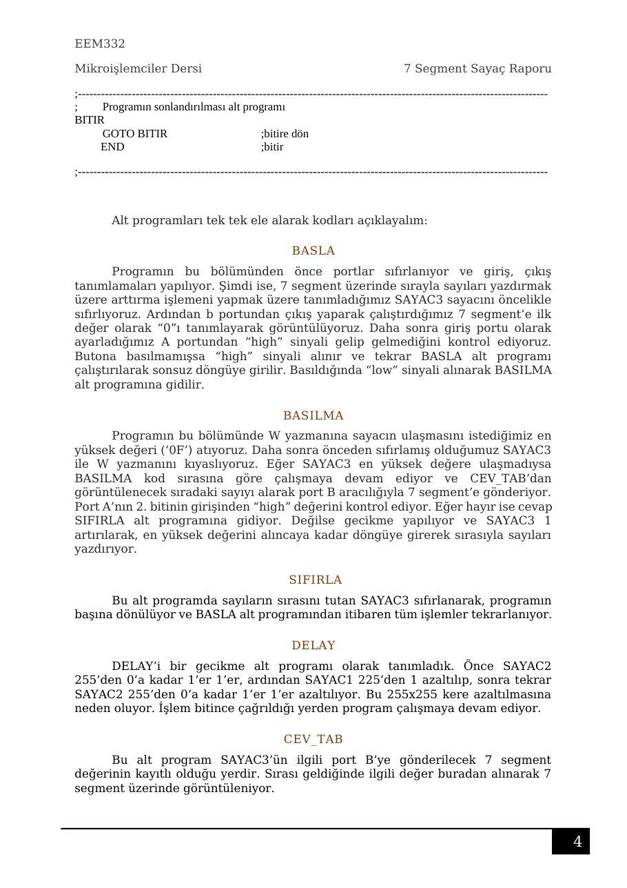
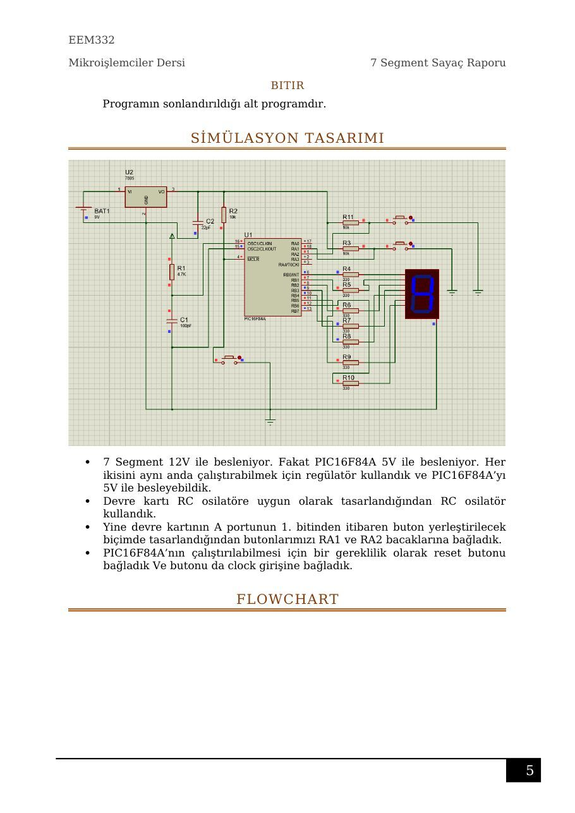

This post brings together the related notes and applications from the Başkent University **EEM332 Microprocessors** course archive (2007–2016). Counting, reset, delay and seven-segment conversion table with the PIC16F84(A); reports and source codes. Work prepared by a friend and course documents are presented together; student names, numbers and group information have been removed. PDF archive copies of the documents and, where available, the source codes can be downloaded as a ZIP at the end of the post.

## 332RAPOR copy

### EEM332

Microprocessors Course                                                                                        7 Segment Counter Report

### TABLE OF CONTENTS

DEFINITION OF THE PROJECT.............................................................................................................2 OPERATING PRINCIPLE......................................................................................................................2 CODE EMBEDDED IN THE PIC 16F84A..................................................................................................2 BASLA....................................................................................................................................................3 BASILMA...............................................................................................................................................3 SIFIRLA..................................................................................................................................................4 DELAY....................................................................................................................................................4 CEV_TAB...............................................................................................................................................4 BITIR......................................................................................................................................................4 SIMULATION DESIGN..........................................................................................................................4 FLOWCHART......................................................................................................................................5 MATERIALS USED...............................................................................................................................5

### EEM332

Microprocessors Course                                                                7 Segment Counter Report

```asm
7 SEGMENT COUNTER
```

### DEFINITION OF THE PROJECT

The aim of our project is to build a counter that starts counting when a built-in button is pressed, displays the numbers

```asm
on a 7 segment display, and stops counting when a second button is pressed.
```

### OPERATING PRINCIPLE

There are three independent buttons. One of the buttons starts counting from 0 to 9 on the 7 segment display at the speed of the 1 MHz processor clock frequency. Another stops the counting and returns the counter to the 0 position, provided that it is held pressed within the 1 MHz delay time. In addition, there is a reset button that is not affected by the 1 MHz delay time.

### CODE EMBEDDED IN THE PIC 16F84A

The MPLAB IDE v8.83 editor was used for programming.

### The written code is as follows

```asm
;-------332PROJE.ASM---------------------------------24/5/2016--------------------------------------------------
LIST P=16F84
;--------------------------------------------------------------------------------------------------------------------------
INCLUDE "P16F84.INC"                      ;16F84A kütüphane bilgisi çağrıldı
__config _CP_OFF&_WDT_OFF&_PWRTE_ON&_RC_OSC
;--------------------------------------------------------------------------------------------------------------------------
;      Adres tanımlama bloğu
SAYAC1 EQU h'0C'                          ;gecikmeyi sağlamak için tanımlanan ilk sayaç değişkeni
SAYAC2 EQU h'0D'                          ;gecikmeyi sağlamak için tanımlanan ikinci sayaç değişkeni
SAYAC3 EQU h'0E'                          ;sayaç için tanımlanan sayaç değişkeni
;--------------------------------------------------------------------------------------------------------------------------
ORG 0x00                                  ;programı 0x00’dan başlat
;--------------------------------------------------------------------------------------------------------------------------
;      Portların durumunu belirleme bloğu
CLRF PORTB                                ;port B’nin içini sıfırla
BSF STATUS,5                              ;BANK2’e geç
CLRF TRISB                                ;port B’nin uçlarını çıkış yap
BSF TRISA,1                               ;port A’nın 1. biti giriş
BCF STATUS,5                              ;BANK2’ye geç
;--------------------------------------------------------------------------------------------------------------------------
;      Program Bloğu
```

### EEM332

Microprocessors Course                                                                7 Segment Counter Report

### BASLA

```asm
CLRF SAYAC3                               ;sayac3’ün içini sıfırla
MOVLW 0x0F                                ;W yazmanına 0x0F’i yükle
MOVLW B'00111111'                         ;W yazmanına h’3F’ yükle
MOVWF PORTB                               ;port B’de 1 olan yerleri high yap
BTFSS PORTA,1                             ;port A’nın 1. bitini 1 mi?
GOTO BASILMA                              ;hayır, basılmaya git
BTFSC PORTA,1                             ;port A’nın 1. Biti 0 mı?
GOTO BASLA                                ;başlaya git
;--------------------------------------------------------------------------------------------------------------------------
;      Sayacın başlatılması alt programı
BASILMA
MOVLW 0x0F                                ;W yazmanına 0x0F’i yükle
ANDWF SAYAC3,W                            ;sayac3 ile W yazmanını test et
CALL CEV_TAB                              ;cev_tab’ı çağır
MOVWF PORTB                               ;W’daki değerleri port B çıkışına gönder
BTFSS PORTA,2                             ;port A’nın 2. biti 1 (set) mi?
GOTO SIFIRLA                              ;hayır, sıfırla’ya git
CALL DELAY                                ;delay’i çağır
INCF SAYAC3,F                             ;sayac3’ü 1 artır
GOTO BASILMA                              ;basılmaya git
;--------------------------------------------------------------------------------------------------------------------------
;      Sayacın sıfırlanması alt programı
SIFIRLA
CLRF SAYAC3
GOTO BASLA
;--------------------------------------------------------------------------------------------------------------------------
;      Gecikme alt programı
DELAY:
MOVLW d'255'                              ;gecikme süresini ver
MOVWF SAYAC1                              ;sayac1’e yükle
JLOOP:
MOVWF SAYAC2                              ;sayac2’ye yükle
KLOOP:
DECFSZ SAYAC2,F                           ;sayac2’yi 1 azalt
GOTO KLOOP                                ;kloop’a geri dön
DECFSZ SAYAC1,F                           ;sayac1’i 1 azalt
GOTO JLOOP                                ;jloop’a geri dön
RETURN                                    ;geri dön
;--------------------------------------------------------------------------------------------------------------------------
;      7 segment değerleri alt programı
CEV_TAB
ADDWF PCL,F                               ;pcl’ye w’yu yükle
RETLW B'00111111'                         ;0
RETLW B'00000110'                         ;1
RETLW B'01011011'                         ;2
RETLW B'01001111'                         ;3
RETLW B'01100110'                         ;4
RETLW B'01101101'                         ;5
RETLW B'01111101'                         ;6
RETLW B'00000111'                         ;7
RETLW B'01111111'                         ;8
RETLW B'01101111'                         ;9
GOTO BASLA                                ;başlaya dön
```

### EEM332

Microprocessors Course                                                                7 Segment Counter Report

```asm
;--------------------------------------------------------------------------------------------------------------------------
;      Programın sonlandırılması alt programı
BITIR
GOTO BITIR                                ;bitire dön
END                                       ;bitir
```

```asm
;--------------------------------------------------------------------------------------------------------------------------
```

### Let us go through the subroutines one by one and explain the code

### BASLA

Before this section of the program, the ports are cleared and the input/output definitions are made. Now, first of all, we clear the SAYAC3 counter, which we defined for performing the increment operation so that the numbers are written on the 7 segment display in sequence. Then we output through port B to the 7 segment display we are driving, defining "0" as the initial value and displaying it. Next, we check whether a "high" signal is coming from port A, which we configured as the input port. If the button has not been pressed, a "high" signal is received and the BASLA subroutine is run again, entering an infinite loop. When the button is pressed, a "low" signal is received and the program goes to the BASILMA subroutine.

### BASILMA

In this section of the program, we load into the W register the highest value ('0F') we want the counter to reach. Then we compare the previously cleared SAYAC3 with the W register. If SAYAC3 has not reached the highest value, BASILMA continues to run in code order, takes the next number to be displayed from CEV_TAB and sends it to the 7 segment display via port B. It checks the "high" value at the input of bit 2 of port A. If not, the answer goes to the SIFIRLA subroutine. Otherwise, a delay is performed and SAYAC3 is incremented by 1, looping until it reaches its highest value and writing the numbers in sequence.

### SIFIRLA

In this subroutine, SAYAC3, which keeps the order of the numbers, is cleared, the program returns to the beginning, and all operations are repeated starting from the BASLA subroutine.

### DELAY

We defined DELAY as a delay subroutine. First SAYAC2 is decremented by 1 from 255 down to 0, then SAYAC1 is decremented by 1 from 225, and then SAYAC2 is again decremented by 1 from 255 down to 0. This causes 255x255 decrements. When the operation is finished, the program continues running from where it was called.

### CEV_TAB

This subroutine is where the 7 segment value to be sent to the relevant port B for SAYAC3 is stored. When its turn comes, the relevant value is taken from here and displayed on the 7 segment display.

### EEM332

Microprocessors Course                                   7 Segment Counter Report

### BITIR

This is the subroutine in which the program is terminated.

### SIMULATION DESIGN

- The 7 Segment is powered with 12V. However, the PIC16F84A is powered with 5V. To be able to run both at the same time, we used a regulator and were able to power the PIC16F84A with 5V.

- Since the circuit board was designed for an RC oscillator, we used an RC oscillator.

- Again, since the circuit board was designed so that buttons would be placed starting from bit 1 of port A, we connected our buttons to the RA1 and RA2 pins.

- As a requirement for the PIC16F84A to operate, we connected a reset button. And we also connected the button to the clock input.

### FLOWCHART





## 7 segment Project Report

### BAŞKENT UNIVERSITY

### ELECTRICAL-ELECTRONICS ENGINEERING

### DEPARTMENT

### EEM 332~MICROPROCESSORS

### PIC PROJECT REPORT

Project Topic

```asm
7 segment light show - a program that lights the a-b-g-d-e-c-f-g connections on the 7 segment in sequence.
```

Source Code

```asm
LIST p=16F84A
INCLUDE "P16F84A.inc"
```

```asm
__CONFIG       _CP_OFF &_WDT_OFF &_PWRTE_ON &_RC_OSC
```

```asm
ORG 0X00
```

```asm
S1 EQU H'21'
S2 EQU H'22'
S3 EQU H'23'
CNTR EQU H'24'
```

### BASLA

```asm
CLRF    PORTB
CLRF    CNTR
BSF     STATUS,5
CLRF    TRISB
BCF     STATUS,5
SHOW
MOVLW B'00100000'
MOVWF PORTB
CALL DLY
```

```asm
MOVLW B'00010000'
MOVWF PORTB
CALL DLY
```

```asm
MOVLW B'10000000'
MOVWF PORTB
CALL DLY
```

```asm
MOVLW B'00000001'
MOVWF PORTB
CALL DLY
```

```asm
MOVLW B'00000010'
MOVWF PORTB
CALL DLY
```

```asm
MOVLW B'00000100'
MOVWF PORTB
CALL    DLY
```

```asm
MOVLW B'10000000'
MOVWF PORTB
CALL DLY
```

```asm
MOVLW B'01000000'
MOVWF PORTB
CALL DLY
```

```asm
GOTO    SHOW
```

### DLY

```asm
MOVLW D'5'
```

```asm
MOVWF S1
L1
MOVLW D'250'
MOVWF S2
L2
MOVLW         D'250'
MOVWF S3
L3
DECFSZ        S3,F
GOTO L3
DECFSZ        S2,F
GOTO L2
DECFSZ        S1,F
GOTO L1
RETURN
END
```

Flowchart

### START

Define the PIC 16F84A

Clear PORTB

Light the LEDs

Delay

Delay

Assign the Required Values to S1, S2 and S3

Run the L1, L2 and L3 Loops Until the Variables Reach 0

```asm
Return
```

## asd

```asm
	LIST p=16F84A
	INCLUDE "P16F84A.INC"
	__CONFIG _CP_OFF & _WDT_OFF & _PWRTE_ON & _XT_OSC
	ORG 0x00
	CLRF PORTB ; B Portu çıkışının sıfırlanması
	BSF STATUS,5
	MOVLW 0x00
	MOVWF TRISB
	MOVLW 0x01
	MOVWF TRISA
	BCF STATUS,5

LEDcntrl:
	BTFSS PORTA,0
	GOTO TURN_ON
	GOTO TURN_OFF
	BCF PORTB,0
	GOTO LEDcntrl

TURN_ON
	MOVLW B'10101010'
	MOVWF PORTB
	GOTO LEDcntrl

TURN_OFF
	MOVLW B'01010101'
	MOVWF PORTB
	GOTO LEDcntrl

End
```

## program

```asm
	LIST P=16F84
	INCLUDE "P16F84.INC"

	__config _CP_OFF&_WDT_OFF&_PWRTE_ON&_RC_OSC 

SAYAC1  EQU h'0C'
SAYAC2  EQU h'0D'
SAYAC   EQU h'OE'

	CLRF PORTB
	BSF STATUS,5 
	CLRF TRISB 
	MOVLW 0x11 
	MOVWF TRISA 
	BCF STATUS,5 
MAIN
	CLRF PORTB 
	CLRF TMR0
	CLRWDT  
	BSF STATUS,5 
	MOVLW h'00' 
	MOVWF SAYAC 
	MOVF SAYAC, W
	ANDLW B'00001111'
	CALL CEV7SEG
	MOVWF PORTB
	INCF SAYAC, F
	CALL GECIKME
	GOTO DONGU
	BCF STATUS,5  
	CLRF PORTB 
CEV7SEG
	ADDWF PLC,F
	RETLW h'3F'
	RETLW h'06'
	RETLW h'5B'
	RETLW h'4F'
	RETLW h'66'
	RETLW h'6D'
	RETLW h'7D'
	RETLW h'07'
	RETLW h'7P'
GECIKME
	MOVLW h'FF'
	MOVWF SAYAC1
DONGU1
	MOVLW h'FF'
	MOVWF SAYAC2
DONGU2
	DECFSZ SAYAC2, F
	GOTO DONGU2
	DECFSZ SAYAC1, F
	GOTO DONGU1
	RETURN
	END
```

## LIST p=16F84A

```asm
LIST p=16F84A
INCLUDE "P16F84A.INC"
__CONFIG _CP_OFF & _WDT_OFF & _PWRTE_ON & _XT_OSC
ORG 0x00
SAYAC3 EQU H'0C'
SAYAC4 EQU H'0D'
SAYACY EQU H'0E'
SAYAC EQU H'0E'
CLRF PORTB
BSF STATUS,5
CLRF TRISB
BCF STATUS,5
BCF PORTB,0


BUTTONTEST1
BTFSS PORTA,1
GOTO BUTTONTEST2
GOTO DONGU1

BUTTONTEST2
BTFSS PORTA,2
GOTO BUTTONTEST1
GOTO DONGU2


DONGU1
MOVF SAYAC,W
ANDLW B'00001111'
CALL YUKARI
MOVWF PORTB
INCF SAYAC,F
CALL GECIKME
GOTO BUTTONTEST1

DONGU2
MOVF SAYACY,W
ANDLW B'00001111'
CALL ASAGI
MOVWF PORTB
INCF SAYACY,F
CALL GECIKME
GOTO BUTTONTEST1

ASAGI
ADDWF PCL,F
RETLW H'71'
RETLW H'79'
RETLW H'5E'
RETLW H'39'
RETLW H'7C'
RETLW H'77'
RETLW H'6F'
RETLW H'7F'
RETLW H'07'
RETLW H'7D'
RETLW H'6D'
RETLW H'66'
RETLW H'4F'
RETLW H'5B'
RETLW H'06'
RETLW H'3F'
GOTO BUTTONTEST1


YUKARI
ADDWF PCL,F
RETLW H'3F'
RETLW H'06'
RETLW H'5B'
RETLW H'4F'
RETLW H'66'
RETLW H'6D'
RETLW H'7D'
RETLW H'07'
RETLW H'7F'
RETLW H'6F'
RETLW H'77'
RETLW H'7C'
RETLW H'39'
RETLW H'5E'
RETLW H'79'
RETLW H'71'
GOTO BUTTONTEST1

GECIKME
MOVLW H'FF'
MOVWF SAYAC3

DONGU3
MOVLW H'FF'
MOVWF SAYAC4

DONGU4
DECFSZ SAYAC4,F
GOTO DONGU4
DECFSZ SAYAC3,F
GOTO DONGU3
RETURN 
END
```

## calisma-1064

```asm
LIST p=16F84A
INCLUDE "P16F84A.INC"
__CONFIG _CP_OFF & _WDT_OFF & _PWRTE_ON & _XT_OSC
ORG 0x00
MEM EQU h'0E'
SAYAC1 EQU H'0C'
SAYAC2 EQU H'0D'
SAYAC EQU H'0E'
CLRF PORTB
BSF STATUS,5
MOVWF TRISA
CLRF TRISB
BCF STATUS,5

BASLA
MOVLW H'00'
MOVWF SAYAC
BCF PORTB,0

BTNCNTRL
BTFSS PORTA,1
GOTO BTNCNTRL1
GOTO DONGUU

BTNCNTRL1
BTFSS PORTA,2
GOTO BTNCNTRL
GOTO DONGUU2

DONGUU
MOVF SAYAC,W
ANDLW B'00001111'
CALL YUKARI
MOVWF PORTB
INCF SAYAC,F
CALL GECIKME
GOTO DONGUU

YUKARI
ADDWF PCL,F
RETLW H'3F'
RETLW H'06'
RETLW H'5B'
RETLW H'4F'
RETLW H'66'
RETLW H'6D'
RETLW H'7D'
RETLW H'07'
RETLW H'7F'
RETLW H'6F'
RETLW H'77'
RETLW H'7C'
RETLW H'39'
RETLW H'5E'
RETLW H'79'
RETLW H'71'
GOTO BTNCNTRL

DONGUU2
MOVF SAYAC,W
ANDLW B'00001111'
CALL ASAGI
MOVWF PORTB
INCF SAYAC,F
CALL GECIKME
GOTO DONGUU2

ASAGI
ADDWF PCL,F
RETLW H'71'
RETLW H'79'
RETLW H'5E'
RETLW H'39'
RETLW H'7C'
RETLW H'77'
RETLW H'6F'
RETLW H'7F'
RETLW H'07'
RETLW H'7D'
RETLW H'6D'
RETLW H'66'
RETLW H'4F'
RETLW H'5B'
RETLW H'06'
RETLW H'3F'

GOTO BTNCNTRL

GECIKME
MOVLW H'FF'
MOVWF SAYAC1
DONGU1
MOVLW H'FF'
MOVWF SAYAC2
DONGU2
DECFSZ SAYAC2,F
GOTO DONGU2
DECFSZ SAYAC1,F
GOTO DONGU1
RETURN 

END
```

## asagi

```asm
LIST p=16F84A
INCLUDE "P16F84A.INC"
__CONFIG _CP_OFF & _WDT_OFF & _PWRTE_ON & _XT_OSC
ORG 0x00
SAYAC3 EQU H'0C'
SAYAC4 EQU H'0D'
SAYACY EQU H'0E'
CLRF PORTB
BSF STATUS,5
CLRF TRISB
BCF STATUS,5

BUTTONTEST
BTFSS PORTA,2
GOTO BASLA
BCF PORTB,0
GOTO BUTTONTEST


BASLA
MOVLW H'00'
MOVWF SAYACY

DONGU
MOVF SAYACY,W
ANDLW B'00001111'
CALL ASAGI
MOVWF PORTB
INCF SAYACY,F
CALL GECIKME
GOTO DONGU

ASAGI
ADDWF PCL,F
RETLW H'71'
RETLW H'79'
RETLW H'5E'
RETLW H'39'
RETLW H'7C'
RETLW H'77'
RETLW H'6F'
RETLW H'7F'
RETLW H'07'
RETLW H'7D'
RETLW H'6D'
RETLW H'66'
RETLW H'4F'
RETLW H'5B'
RETLW H'06'
RETLW H'3F'

GECIKME
MOVLW H'FF'
MOVWF SAYAC3

DONGU3
MOVLW H'FF'
MOVWF SAYAC4

DONGU4
DECFSZ SAYAC4,F
GOTO DONGU4
DECFSZ SAYAC3,F
GOTO DONGU3
RETURN 
END
```

## calisma-1078

```asm
LIST p=16F84A
INCLUDE "P16F84A.INC"
__CONFIG _CP_OFF & _WDT_OFF & _PWRTE_ON & _RC_OSC
ORG 0x00
MEM EQU h'0E'
SAYAC1 EQU H'0C'
SAYAC2 EQU H'0D'
SAYAC EQU H'0E'
CLRF PORTB
BSF STATUS,5
MOVWF TRISA
CLRF TRISB
BCF STATUS,5

BASLA
MOVLW H'00'
MOVWF SAYAC

KONTROL:
BTFSC PORTA,1
GOTO ikinci
GOTO DONGU1

ikinci:
BTFSC PORTA,2
GOTO ucuncu
GOTO DONGU2

ucuncu:
BTFSC PORTA,4
GOTO KONTROL
GOTO DONGU3


DONGU1
MOVF SAYAC,W
ANDLW B'00001111'
CALL CEV7SEG
MOVWF PORTB
INCF SAYAC,F
CALL GECIKME
GOTO DONGU1

CEV7SEG
ADDWF PCL,F
RETLW H'01000001'
RETLW H'01101101'
RETLW H'01100111'
RETLW H'01001100'
RETLW H'01101111'

GOTO KONTROL


DONGU2
MOVF SAYAC,W
ANDLW B'00001111'
CALL CEV7SEG2
MOVWF PORTB
INCF SAYAC,F
CALL GECIKME
GOTO DONGU2

CEV7SEG2
ADDWF PCL,F
RETLW H'11111110'
RETLW H'00111101'
RETLW H'01001011'
RETLW H'01110111'
RETLW H'01111111'

GOTO KONTROL

DONGU3
MOVF SAYAC,W
ANDLW B'00001111'
CALL CEV7SEG3
MOVWF PORTB
INCF SAYAC,F
CALL GECIKME
GOTO DONGU3

CEV7SEG3
ADDWF PCL,F
RETLW H'11111110'
RETLW H'01000001'
RETLW H'00111101'
RETLW H'01101101'
RETLW H'01001011'
RETLW H'01100111'
RETLW H'01110111'
RETLW H'01001100'
RETLW H'01111111'
RETLW H'01101111'

GOTO KONTROL

GECIKME
MOVLW H'FF'
MOVWF SAYAC1
DONGU1
MOVLW H'FF'
MOVWF SAYAC2
DONGU2
DECFSZ SAYAC2,F
GOTO DONGU2
DECFSZ SAYAC1,F
GOTO DONGU1
RETURN 

END
```

## calisma-1079

```asm
LIST p=16F84A
INCLUDE "P16F84A.INC"
__CONFIG _CP_OFF & _WDT_OFF & _PWRTE_ON & _XT_OSC
ORG 0x00
MEM EQU h'0E'
SAYAC1 EQU H'0C'
SAYAC2 EQU H'0D'
SAYAC EQU H'0E'
CLRF PORTB
BSF STATUS,5
MOVWF TRISA
CLRF TRISB
BCF STATUS,5

BASLA
MOVLW H'00'
MOVWF SAYAC

LEDcntrl:
BTFSS PORTA,1
GOTO ikinci
GOTO DONGUU

ikinci:
BTFSS PORTA,2
GOTO ucuncu
GOTO DONGUU2

ucuncu:
BTFSS PORTA,4
GOTO LEDcntrl
GOTO DONGU


DONGU
MOVF SAYAC,W
ANDLW B'00001111'
CALL CEV7SEG
MOVWF PORTB
INCF SAYAC,F
CALL GECIKME
GOTO DONGU

CEV7SEG
ADDWF PCL,F
RETLW H'3F'
RETLW H'06'
RETLW H'5B'
RETLW H'4F'
RETLW H'66'
RETLW H'6D'
RETLW H'7D'
RETLW H'07'
RETLW H'7F'
RETLW H'6F'
RETLW H'77'
RETLW H'7C'
RETLW H'39'
RETLW H'5E'
RETLW H'79'
RETLW H'71'
GOTO LEDcntrl


DONGUU
MOVF SAYAC,W
ANDLW B'00001111'
CALL CEV7SEG2
MOVWF PORTB
INCF SAYAC,F
CALL GECIKME
GOTO DONGUU

CEV7SEG2
ADDWF PCL,F

RETLW H'06'

RETLW H'4F'

RETLW H'6D'

RETLW H'07'

RETLW H'6F'

RETLW H'7C'

RETLW H'5E'

RETLW H'71'
GOTO LEDcntrl


DONGUU2
MOVF SAYAC,W
ANDLW B'00001111'
CALL CEV7SEG3
MOVWF PORTB
INCF SAYAC,F
CALL GECIKME
GOTO DONGUU2

CEV7SEG3
ADDWF PCL,F
RETLW H'3F'

RETLW H'5B'

RETLW H'66'

RETLW H'7D'

RETLW H'7F'

RETLW H'77'

RETLW H'39'

RETLW H'79'

GOTO LEDcntrl


GECIKME
MOVLW H'FF'
MOVWF SAYAC1
DONGU1
MOVLW H'FF'
MOVWF SAYAC2
DONGU2
DECFSZ SAYAC2,F
GOTO DONGU2
DECFSZ SAYAC1,F
GOTO DONGU1
RETURN 

END
```

## yukari

```asm
LIST p=16F84A
INCLUDE "P16F84A.INC"
__CONFIG _CP_OFF & _WDT_OFF & _PWRTE_ON & _XT_OSC
ORG 0x00
SAYAC1 EQU H'0C'
SAYAC2 EQU H'0D'
SAYAC EQU H'0E'
CLRF PORTB
BSF STATUS,5
CLRF TRISB
BCF STATUS,5

BUTTONTEST
BTFSS PORTA,1
GOTO BASLA
BCF PORTB,0
GOTO BUTTONTEST


BASLA
MOVLW H'00'
MOVWF SAYAC

DONGU
MOVF SAYAC,W
ANDLW B'00001111'
CALL YUKARI
MOVWF PORTB
INCF SAYAC,F
CALL GECIKME
GOTO DONGU

YUKARI
ADDWF PCL,F
RETLW H'3F'
RETLW H'06'
RETLW H'5B'
RETLW H'4F'
RETLW H'66'
RETLW H'6D'
RETLW H'7D'
RETLW H'07'
RETLW H'7F'
RETLW H'6F'
RETLW H'77'
RETLW H'7C'
RETLW H'39'
RETLW H'5E'
RETLW H'79'
RETLW H'71'


GECIKME
MOVLW H'FF'
MOVWF SAYAC1
DONGU1
MOVLW H'FF'
MOVWF SAYAC2
DONGU2
DECFSZ SAYAC2,F
GOTO DONGU2
DECFSZ SAYAC1,F
GOTO DONGU1
RETURN 
END
```

## code

```asm

	LIST p=16F84A; Kullanılacak PIC'in tanımlanması
	INCLUDE "P16F84A.INC"; Kullanılan PIC’teki yazmaç tanımlamaları bu dosyada saklanır. 
	;Böylece yazmaç değerlerinin teker teker tanımlanması gerekmez.

	__CONFIG _CP_OFF &_WDT_OFF &_PWRTE_ON &_XT_OSC; Konfigürasyon bitlerinin ayarlanması
	;	Kod koruma yok & watch dog timer kapalı& power on reset açık & kristal osilatör

	ORG     0x00; Programı 0x00'dan başlat
	
	CLRF PORTB; PortB'ye bağlı pinleri sıfırla
	BSF STATUS,5; Bank1'e geç
	MOVLW 0x00; 00h değerini
	MOVWF TRISB; TrisB yazmacına ata. B portunun tüm pinleri çıkış olarak atanmış olur.
	MOVLW 0x01; 01 değerini
	MOVWF TRISA; TrisB yazmacına ata. A portunun ilk pini (RA0) giriş olarak atanmış olur.
	BCF STATUS,5; Bank0'a geç
	
LEDcntrl:
	BTFSS PORTA,0; PortA'nın sıfırıncı bitinin (RA0 pini) 1 olup olmadığını kontrol et.
	GOTO TURN_ON; 1 ise TURN_ON etiketli yere git.
 
	BCF PORTB,0; RA0 pini 1 değilse PortB'nin 0. bitini (RB0 pini) 0 yap.
	GOTO LEDcntrl; LEDcntrl etiketli yere git. 
	
TURN_ON
	BSF PORTB,0; PortB'nin 0. bitini (RB0 pini) 1 yap.
	GOTO LEDcntrl; LEDcntrl etiketli yere git. 
	
End; Programı bitir.
```

## devre

The Proteus circuit source is included in the download package. File and path entries containing personal names have been anonymized.

## devre

The Proteus circuit source is included in the download package. File and path entries containing personal names have been anonymized.

## calisma-1060

The Proteus circuit source is included in the download package. File and path entries containing personal names have been anonymized.

## Seven Segment Display

The Proteus circuit source is included in the download package. File and path entries containing personal names have been anonymized.

## prog1

The Proteus circuit source is included in the download package. File and path entries containing personal names have been anonymized.

## son

The Proteus circuit source is included in the download package. File and path entries containing personal names have been anonymized.

*Note: The counter report mentions a "1 MHz delay time"; MHz is a unit of frequency. The software delay of the code depends on the instruction cycles and the oscillator frequency. Also, BSF STATUS,5 selects bank 1 and BCF STATUS,5 selects bank 0; the BANK2 expressions in the source comments have been preserved. The separate trial code also contains typographical problems such as PLC/PCL, h'OE'/h'0E', and an undefined DONGU label. The sources have not been run.*
