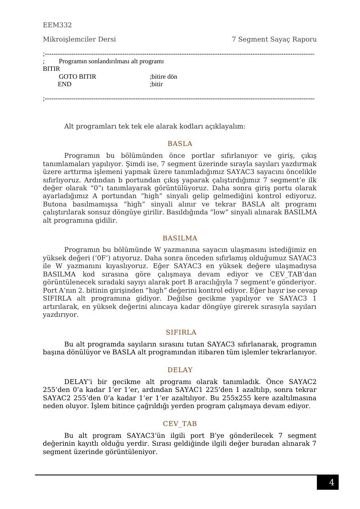
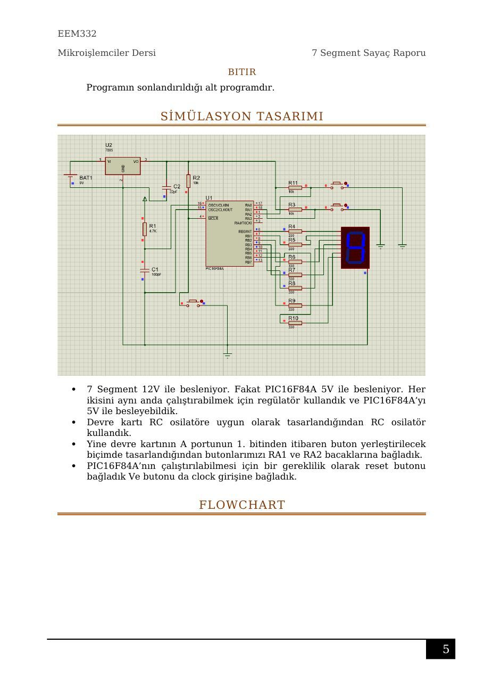

Bu yazı, Başkent Üniversitesi **EEM332 Mikroişlemciler** ders arşivindeki ilgili notları ve uygulamaları bir araya getiriyor (2007–2016). PIC16F84(A) ile sayma, sıfırlama, gecikme ve yedi segment dönüşüm tablosu; raporlar ve kaynak kodları. Bir arkadaşın hazırladığı çalışmalar ve ders belgeleri birlikte aktarılmış; öğrenci adları, numaraları ve grup bilgileri çıkarılmıştır. Belgelerin PDF arşiv kopyaları ve varsa kaynak kodları yazının sonunda ZIP olarak indirilebilir.

## 332RAPOR kopya

### EEM332

Mikroişlemciler Dersi                                                                                        7 Segment Sayaç Raporu

### İÇİNDEKİLER TABLOSU

PROJENİN TANIMI.............................................................................................................................2 ÇALIŞMA PRENSİBİ............................................................................................................................2 PIC 16F84A İÇERİSİNE GÖMÜLEN KOD...............................................................................................2 BASLA....................................................................................................................................................3 BASILMA...............................................................................................................................................3 SIFIRLA..................................................................................................................................................4 DELAY....................................................................................................................................................4 CEV_TAB...............................................................................................................................................4 BITIR......................................................................................................................................................4 SİMÜLASYON TASARIMI....................................................................................................................4 FLOWCHART......................................................................................................................................5 KULLANILAN MALZEMELER...............................................................................................................5

### EEM332

Mikroişlemciler Dersi                                                                7 Segment Sayaç Raporu

```asm
7 SEGMENT SAYAÇ
```

### PROJENİN TANIMI

Projemizin amacı dahili bir butona basıldığında saymaya başlayan, sayıları

```asm
7 segment üzerinde gösteren ve ikinci bir butona basılmasıyla sayımı durduran
```

sayaç yapmaktır.

### ÇALIŞMA PRENSİBİ

Birbirinden bağımsız üç buton bulunmaktadır. Butonlardan biri 7 segment üzerinde 0’dan 9’a kadar 1Mhz’lik işlemcinin saat frekansı hızında saydırmaya başlayacak, diğeri ise 1Mhz’lik gecikme zamanı içerisinde basılı tutulmak koşuluyla sayım işlemini durdurarak sayacı 0 konumuna getirecektir. Ayrıca 1Mhz’lik gecikme zamanından etkilenmeyen bir de sıfırlama butonu bulunmaktadır.

### PIC 16F84A İÇERİSİNE GÖMÜLEN KOD

Programlama yapılmak için MPLAB IDE v8.83 editörü kullanılmıştır.

### Yazılan kod aşağıdaki gibidir

```asm
;-------332PROJE.ASM---------------------------------24/5/2016--------------------------------------------------
LIST P=16F84
;--------------------------------------------------------------------------------------------------------------------------
INCLUDE "P16F84.INC"                      ;16F84A kütüphane bilgisi çağrıldı
__config _CP_OFF&_WDT_OFF&_PWRTE_ON&_RC_OSC
;--------------------------------------------------------------------------------------------------------------------------
;      Adres tanımlama bloğu
SAYAC1 EQU h'0C'                          ;gecikmeyi sağlamak için tanımlanan ilk sayaç değişkeni
SAYAC2 EQU h'0D'                          ;gecikmeyi sağlamak için tanımlanan ikinci sayaç değişkeni
SAYAC3 EQU h'0E'                          ;sayaç için tanımlanan sayaç değişkeni
;--------------------------------------------------------------------------------------------------------------------------
ORG 0x00                                  ;programı 0x00’dan başlat
;--------------------------------------------------------------------------------------------------------------------------
;      Portların durumunu belirleme bloğu
CLRF PORTB                                ;port B’nin içini sıfırla
BSF STATUS,5                              ;BANK2’e geç
CLRF TRISB                                ;port B’nin uçlarını çıkış yap
BSF TRISA,1                               ;port A’nın 1. biti giriş
BCF STATUS,5                              ;BANK2’ye geç
;--------------------------------------------------------------------------------------------------------------------------
;      Program Bloğu
```

### EEM332

Mikroişlemciler Dersi                                                                7 Segment Sayaç Raporu

### BASLA

```asm
CLRF SAYAC3                               ;sayac3’ün içini sıfırla
MOVLW 0x0F                                ;W yazmanına 0x0F’i yükle
MOVLW B'00111111'                         ;W yazmanına h’3F’ yükle
MOVWF PORTB                               ;port B’de 1 olan yerleri high yap
BTFSS PORTA,1                             ;port A’nın 1. bitini 1 mi?
GOTO BASILMA                              ;hayır, basılmaya git
BTFSC PORTA,1                             ;port A’nın 1. Biti 0 mı?
GOTO BASLA                                ;başlaya git
;--------------------------------------------------------------------------------------------------------------------------
;      Sayacın başlatılması alt programı
BASILMA
MOVLW 0x0F                                ;W yazmanına 0x0F’i yükle
ANDWF SAYAC3,W                            ;sayac3 ile W yazmanını test et
CALL CEV_TAB                              ;cev_tab’ı çağır
MOVWF PORTB                               ;W’daki değerleri port B çıkışına gönder
BTFSS PORTA,2                             ;port A’nın 2. biti 1 (set) mi?
GOTO SIFIRLA                              ;hayır, sıfırla’ya git
CALL DELAY                                ;delay’i çağır
INCF SAYAC3,F                             ;sayac3’ü 1 artır
GOTO BASILMA                              ;basılmaya git
;--------------------------------------------------------------------------------------------------------------------------
;      Sayacın sıfırlanması alt programı
SIFIRLA
CLRF SAYAC3
GOTO BASLA
;--------------------------------------------------------------------------------------------------------------------------
;      Gecikme alt programı
DELAY:
MOVLW d'255'                              ;gecikme süresini ver
MOVWF SAYAC1                              ;sayac1’e yükle
JLOOP:
MOVWF SAYAC2                              ;sayac2’ye yükle
KLOOP:
DECFSZ SAYAC2,F                           ;sayac2’yi 1 azalt
GOTO KLOOP                                ;kloop’a geri dön
DECFSZ SAYAC1,F                           ;sayac1’i 1 azalt
GOTO JLOOP                                ;jloop’a geri dön
RETURN                                    ;geri dön
;--------------------------------------------------------------------------------------------------------------------------
;      7 segment değerleri alt programı
CEV_TAB
ADDWF PCL,F                               ;pcl’ye w’yu yükle
RETLW B'00111111'                         ;0
RETLW B'00000110'                         ;1
RETLW B'01011011'                         ;2
RETLW B'01001111'                         ;3
RETLW B'01100110'                         ;4
RETLW B'01101101'                         ;5
RETLW B'01111101'                         ;6
RETLW B'00000111'                         ;7
RETLW B'01111111'                         ;8
RETLW B'01101111'                         ;9
GOTO BASLA                                ;başlaya dön
```

### EEM332

Mikroişlemciler Dersi                                                                7 Segment Sayaç Raporu

```asm
;--------------------------------------------------------------------------------------------------------------------------
;      Programın sonlandırılması alt programı
BITIR
GOTO BITIR                                ;bitire dön
END                                       ;bitir
```

```asm
;--------------------------------------------------------------------------------------------------------------------------
```

### Alt programları tek tek ele alarak kodları açıklayalım

### BASLA

Programın bu bölümünden önce portlar sıfırlanıyor ve giriş, çıkış tanımlamaları yapılıyor. Şimdi ise, 7 segment üzerinde sırayla sayıları yazdırmak üzere arttırma işlemeni yapmak üzere tanımladığımız SAYAC3 sayacını öncelikle sıfırlıyoruz. Ardından b portundan çıkış yaparak çalıştırdığımız 7 segment’e ilk değer olarak “0”ı tanımlayarak görüntülüyoruz. Daha sonra giriş portu olarak ayarladığımız A portundan “high” sinyali gelip gelmediğini kontrol ediyoruz. Butona basılmamışsa “high” sinyali alınır ve tekrar BASLA alt programı çalıştırılarak sonsuz döngüye girilir. Basıldığında “low” sinyali alınarak BASILMA alt programına gidilir.

### BASILMA

Programın bu bölümünde W yazmanına sayacın ulaşmasını istediğimiz en yüksek değeri (‘0F’) atıyoruz. Daha sonra önceden sıfırlamış olduğumuz SAYAC3 ile W yazmanını kıyaslıyoruz. Eğer SAYAC3 en yüksek değere ulaşmadıysa BASILMA kod sırasına göre çalışmaya devam ediyor ve CEV_TAB’dan görüntülenecek sıradaki sayıyı alarak port B aracılığıyla 7 segment’e gönderiyor. Port A’nın 2. bitinin girişinden “high” değerini kontrol ediyor. Eğer hayır ise cevap SIFIRLA alt programına gidiyor. Değilse gecikme yapılıyor ve SAYAC3 1 artırılarak, en yüksek değerini alıncaya kadar döngüye girerek sırasıyla sayıları yazdırıyor.

### SIFIRLA

Bu alt programda sayıların sırasını tutan SAYAC3 sıfırlanarak, programın başına dönülüyor ve BASLA alt programından itibaren tüm işlemler tekrarlanıyor.

### DELAY

DELAY’i bir gecikme alt programı olarak tanımladık. Önce SAYAC2 255’den 0’a kadar 1’er 1’er, ardından SAYAC1 225’den 1 azaltılıp, sonra tekrar SAYAC2 255’den 0’a kadar 1’er 1’er azaltılıyor. Bu 255x255 kere azaltılmasına neden oluyor. İşlem bitince çağrıldığı yerden program çalışmaya devam ediyor.

### CEV_TAB

Bu alt program SAYAC3’ün ilgili port B’ye gönderilecek 7 segment değerinin kayıtlı olduğu yerdir. Sırası geldiğinde ilgili değer buradan alınarak 7 segment üzerinde görüntüleniyor.

### EEM332

Mikroişlemciler Dersi                                   7 Segment Sayaç Raporu

### BITIR

Programın sonlandırıldığı alt programdır.

### SİMÜLASYON TASARIMI

- 7 Segment 12V ile besleniyor. Fakat PIC16F84A 5V ile besleniyor. Her

ikisini aynı anda çalıştırabilmek için regülatör kullandık ve PIC16F84A’yı 5V ile besleyebildik.

- Devre kartı RC osilatöre uygun olarak tasarlandığından RC osilatör

kullandık.

- Yine devre kartının A portunun 1. bitinden itibaren buton yerleştirilecek

biçimde tasarlandığından butonlarımızı RA1 ve RA2 bacaklarına bağladık.

- PIC16F84A’nın çalıştırılabilmesi için bir gereklilik olarak reset butonu

bağladık Ve butonu da clock girişine bağladık.

### FLOWCHART





## 7 segmentProje Raporu

### BAŞKENT ÜNİVERSİTESİ

### ELEKTRİK-ELEKTRONİK MÜHENDİSLİĞİ

### BÖLÜMÜ

### EEM 332~MİKROİŞLEMCİLER

### PIC PROJESİ RAPORU

Proje Konusu

```asm
7 segment ışık oyunu -7 segment üzerinde sırasıyla a-b-g-d-e-c-f-g bağlantıları yakan
program.
```

Kaynak Kod

```asm
LIST p=16F84A
INCLUDE "P16F84A.inc"
```

```asm
__CONFIG       _CP_OFF &_WDT_OFF &_PWRTE_ON &_RC_OSC
```

```asm
ORG 0X00
```

```asm
S1 EQU H'21'
S2 EQU H'22'
S3 EQU H'23'
CNTR EQU H'24'
```

### BASLA

```asm
CLRF    PORTB
CLRF    CNTR
BSF     STATUS,5
CLRF    TRISB
BCF     STATUS,5
SHOW
MOVLW B'00100000'
MOVWF PORTB
CALL DLY
```

```asm
MOVLW B'00010000'
MOVWF PORTB
CALL DLY
```

```asm
MOVLW B'10000000'
MOVWF PORTB
CALL DLY
```

```asm
MOVLW B'00000001'
MOVWF PORTB
CALL DLY
```

```asm
MOVLW B'00000010'
MOVWF PORTB
CALL DLY
```

```asm
MOVLW B'00000100'
MOVWF PORTB
CALL    DLY
```

```asm
MOVLW B'10000000'
MOVWF PORTB
CALL DLY
```

```asm
MOVLW B'01000000'
MOVWF PORTB
CALL DLY
```

```asm
GOTO    SHOW
```

### DLY

```asm
MOVLW D'5'
```

```asm
MOVWF S1
L1
MOVLW D'250'
MOVWF S2
L2
MOVLW         D'250'
MOVWF S3
L3
DECFSZ        S3,F
GOTO L3
DECFSZ        S2,F
GOTO L2
DECFSZ        S1,F
GOTO L1
RETURN
END
```

Flowchart (Akış Şeması)

### BAŞLA

PIC 16F84A’yı Tanımla

PORTB ’yi Sil

LEDleri Yak

Gecikme

Gecikme

S1,S2 ve S3 ’e Gerekli Değerleri Ata

L1,L2 ve L3 Döngülerini, Değişkenleri 0 Olana Kadar İşle

```asm
Return
```

## asd

```asm
	LIST p=16F84A
	INCLUDE "P16F84A.INC"
	__CONFIG _CP_OFF & _WDT_OFF & _PWRTE_ON & _XT_OSC
	ORG 0x00
	CLRF PORTB ; B Portu çıkışının sıfırlanması
	BSF STATUS,5
	MOVLW 0x00
	MOVWF TRISB
	MOVLW 0x01
	MOVWF TRISA
	BCF STATUS,5

LEDcntrl:
	BTFSS PORTA,0
	GOTO TURN_ON
	GOTO TURN_OFF
	BCF PORTB,0
	GOTO LEDcntrl

TURN_ON
	MOVLW B'10101010'
	MOVWF PORTB
	GOTO LEDcntrl

TURN_OFF
	MOVLW B'01010101'
	MOVWF PORTB
	GOTO LEDcntrl

End
```

## program

```asm
	LIST P=16F84
	INCLUDE "P16F84.INC"

	__config _CP_OFF&_WDT_OFF&_PWRTE_ON&_RC_OSC 

SAYAC1  EQU h'0C'
SAYAC2  EQU h'0D'
SAYAC   EQU h'OE'

	CLRF PORTB
	BSF STATUS,5 
	CLRF TRISB 
	MOVLW 0x11 
	MOVWF TRISA 
	BCF STATUS,5 
MAIN
	CLRF PORTB 
	CLRF TMR0
	CLRWDT  
	BSF STATUS,5 
	MOVLW h'00' 
	MOVWF SAYAC 
	MOVF SAYAC, W
	ANDLW B'00001111'
	CALL CEV7SEG
	MOVWF PORTB
	INCF SAYAC, F
	CALL GECIKME
	GOTO DONGU
	BCF STATUS,5  
	CLRF PORTB 
CEV7SEG
	ADDWF PLC,F
	RETLW h'3F'
	RETLW h'06'
	RETLW h'5B'
	RETLW h'4F'
	RETLW h'66'
	RETLW h'6D'
	RETLW h'7D'
	RETLW h'07'
	RETLW h'7P'
GECIKME
	MOVLW h'FF'
	MOVWF SAYAC1
DONGU1
	MOVLW h'FF'
	MOVWF SAYAC2
DONGU2
	DECFSZ SAYAC2, F
	GOTO DONGU2
	DECFSZ SAYAC1, F
	GOTO DONGU1
	RETURN
	END
```

## LIST p=16F84A

```asm
LIST p=16F84A
INCLUDE "P16F84A.INC"
__CONFIG _CP_OFF & _WDT_OFF & _PWRTE_ON & _XT_OSC
ORG 0x00
SAYAC3 EQU H'0C'
SAYAC4 EQU H'0D'
SAYACY EQU H'0E'
SAYAC EQU H'0E'
CLRF PORTB
BSF STATUS,5
CLRF TRISB
BCF STATUS,5
BCF PORTB,0


BUTTONTEST1
BTFSS PORTA,1
GOTO BUTTONTEST2
GOTO DONGU1

BUTTONTEST2
BTFSS PORTA,2
GOTO BUTTONTEST1
GOTO DONGU2


DONGU1
MOVF SAYAC,W
ANDLW B'00001111'
CALL YUKARI
MOVWF PORTB
INCF SAYAC,F
CALL GECIKME
GOTO BUTTONTEST1

DONGU2
MOVF SAYACY,W
ANDLW B'00001111'
CALL ASAGI
MOVWF PORTB
INCF SAYACY,F
CALL GECIKME
GOTO BUTTONTEST1

ASAGI
ADDWF PCL,F
RETLW H'71'
RETLW H'79'
RETLW H'5E'
RETLW H'39'
RETLW H'7C'
RETLW H'77'
RETLW H'6F'
RETLW H'7F'
RETLW H'07'
RETLW H'7D'
RETLW H'6D'
RETLW H'66'
RETLW H'4F'
RETLW H'5B'
RETLW H'06'
RETLW H'3F'
GOTO BUTTONTEST1


YUKARI
ADDWF PCL,F
RETLW H'3F'
RETLW H'06'
RETLW H'5B'
RETLW H'4F'
RETLW H'66'
RETLW H'6D'
RETLW H'7D'
RETLW H'07'
RETLW H'7F'
RETLW H'6F'
RETLW H'77'
RETLW H'7C'
RETLW H'39'
RETLW H'5E'
RETLW H'79'
RETLW H'71'
GOTO BUTTONTEST1

GECIKME
MOVLW H'FF'
MOVWF SAYAC3

DONGU3
MOVLW H'FF'
MOVWF SAYAC4

DONGU4
DECFSZ SAYAC4,F
GOTO DONGU4
DECFSZ SAYAC3,F
GOTO DONGU3
RETURN 
END
```

## calisma-1064

```asm
LIST p=16F84A
INCLUDE "P16F84A.INC"
__CONFIG _CP_OFF & _WDT_OFF & _PWRTE_ON & _XT_OSC
ORG 0x00
MEM EQU h'0E'
SAYAC1 EQU H'0C'
SAYAC2 EQU H'0D'
SAYAC EQU H'0E'
CLRF PORTB
BSF STATUS,5
MOVWF TRISA
CLRF TRISB
BCF STATUS,5

BASLA
MOVLW H'00'
MOVWF SAYAC
BCF PORTB,0

BTNCNTRL
BTFSS PORTA,1
GOTO BTNCNTRL1
GOTO DONGUU

BTNCNTRL1
BTFSS PORTA,2
GOTO BTNCNTRL
GOTO DONGUU2

DONGUU
MOVF SAYAC,W
ANDLW B'00001111'
CALL YUKARI
MOVWF PORTB
INCF SAYAC,F
CALL GECIKME
GOTO DONGUU

YUKARI
ADDWF PCL,F
RETLW H'3F'
RETLW H'06'
RETLW H'5B'
RETLW H'4F'
RETLW H'66'
RETLW H'6D'
RETLW H'7D'
RETLW H'07'
RETLW H'7F'
RETLW H'6F'
RETLW H'77'
RETLW H'7C'
RETLW H'39'
RETLW H'5E'
RETLW H'79'
RETLW H'71'
GOTO BTNCNTRL

DONGUU2
MOVF SAYAC,W
ANDLW B'00001111'
CALL ASAGI
MOVWF PORTB
INCF SAYAC,F
CALL GECIKME
GOTO DONGUU2

ASAGI
ADDWF PCL,F
RETLW H'71'
RETLW H'79'
RETLW H'5E'
RETLW H'39'
RETLW H'7C'
RETLW H'77'
RETLW H'6F'
RETLW H'7F'
RETLW H'07'
RETLW H'7D'
RETLW H'6D'
RETLW H'66'
RETLW H'4F'
RETLW H'5B'
RETLW H'06'
RETLW H'3F'

GOTO BTNCNTRL

GECIKME
MOVLW H'FF'
MOVWF SAYAC1
DONGU1
MOVLW H'FF'
MOVWF SAYAC2
DONGU2
DECFSZ SAYAC2,F
GOTO DONGU2
DECFSZ SAYAC1,F
GOTO DONGU1
RETURN 

END
```

## asagi

```asm
LIST p=16F84A
INCLUDE "P16F84A.INC"
__CONFIG _CP_OFF & _WDT_OFF & _PWRTE_ON & _XT_OSC
ORG 0x00
SAYAC3 EQU H'0C'
SAYAC4 EQU H'0D'
SAYACY EQU H'0E'
CLRF PORTB
BSF STATUS,5
CLRF TRISB
BCF STATUS,5

BUTTONTEST
BTFSS PORTA,2
GOTO BASLA
BCF PORTB,0
GOTO BUTTONTEST


BASLA
MOVLW H'00'
MOVWF SAYACY

DONGU
MOVF SAYACY,W
ANDLW B'00001111'
CALL ASAGI
MOVWF PORTB
INCF SAYACY,F
CALL GECIKME
GOTO DONGU

ASAGI
ADDWF PCL,F
RETLW H'71'
RETLW H'79'
RETLW H'5E'
RETLW H'39'
RETLW H'7C'
RETLW H'77'
RETLW H'6F'
RETLW H'7F'
RETLW H'07'
RETLW H'7D'
RETLW H'6D'
RETLW H'66'
RETLW H'4F'
RETLW H'5B'
RETLW H'06'
RETLW H'3F'

GECIKME
MOVLW H'FF'
MOVWF SAYAC3

DONGU3
MOVLW H'FF'
MOVWF SAYAC4

DONGU4
DECFSZ SAYAC4,F
GOTO DONGU4
DECFSZ SAYAC3,F
GOTO DONGU3
RETURN 
END
```

## calisma-1078

```asm
LIST p=16F84A
INCLUDE "P16F84A.INC"
__CONFIG _CP_OFF & _WDT_OFF & _PWRTE_ON & _RC_OSC
ORG 0x00
MEM EQU h'0E'
SAYAC1 EQU H'0C'
SAYAC2 EQU H'0D'
SAYAC EQU H'0E'
CLRF PORTB
BSF STATUS,5
MOVWF TRISA
CLRF TRISB
BCF STATUS,5

BASLA
MOVLW H'00'
MOVWF SAYAC

KONTROL:
BTFSC PORTA,1
GOTO ikinci
GOTO DONGU1

ikinci:
BTFSC PORTA,2
GOTO ucuncu
GOTO DONGU2

ucuncu:
BTFSC PORTA,4
GOTO KONTROL
GOTO DONGU3


DONGU1
MOVF SAYAC,W
ANDLW B'00001111'
CALL CEV7SEG
MOVWF PORTB
INCF SAYAC,F
CALL GECIKME
GOTO DONGU1

CEV7SEG
ADDWF PCL,F
RETLW H'01000001'
RETLW H'01101101'
RETLW H'01100111'
RETLW H'01001100'
RETLW H'01101111'

GOTO KONTROL


DONGU2
MOVF SAYAC,W
ANDLW B'00001111'
CALL CEV7SEG2
MOVWF PORTB
INCF SAYAC,F
CALL GECIKME
GOTO DONGU2

CEV7SEG2
ADDWF PCL,F
RETLW H'11111110'
RETLW H'00111101'
RETLW H'01001011'
RETLW H'01110111'
RETLW H'01111111'

GOTO KONTROL

DONGU3
MOVF SAYAC,W
ANDLW B'00001111'
CALL CEV7SEG3
MOVWF PORTB
INCF SAYAC,F
CALL GECIKME
GOTO DONGU3

CEV7SEG3
ADDWF PCL,F
RETLW H'11111110'
RETLW H'01000001'
RETLW H'00111101'
RETLW H'01101101'
RETLW H'01001011'
RETLW H'01100111'
RETLW H'01110111'
RETLW H'01001100'
RETLW H'01111111'
RETLW H'01101111'

GOTO KONTROL

GECIKME
MOVLW H'FF'
MOVWF SAYAC1
DONGU1
MOVLW H'FF'
MOVWF SAYAC2
DONGU2
DECFSZ SAYAC2,F
GOTO DONGU2
DECFSZ SAYAC1,F
GOTO DONGU1
RETURN 

END
```

## calisma-1079

```asm
LIST p=16F84A
INCLUDE "P16F84A.INC"
__CONFIG _CP_OFF & _WDT_OFF & _PWRTE_ON & _XT_OSC
ORG 0x00
MEM EQU h'0E'
SAYAC1 EQU H'0C'
SAYAC2 EQU H'0D'
SAYAC EQU H'0E'
CLRF PORTB
BSF STATUS,5
MOVWF TRISA
CLRF TRISB
BCF STATUS,5

BASLA
MOVLW H'00'
MOVWF SAYAC

LEDcntrl:
BTFSS PORTA,1
GOTO ikinci
GOTO DONGUU

ikinci:
BTFSS PORTA,2
GOTO ucuncu
GOTO DONGUU2

ucuncu:
BTFSS PORTA,4
GOTO LEDcntrl
GOTO DONGU


DONGU
MOVF SAYAC,W
ANDLW B'00001111'
CALL CEV7SEG
MOVWF PORTB
INCF SAYAC,F
CALL GECIKME
GOTO DONGU

CEV7SEG
ADDWF PCL,F
RETLW H'3F'
RETLW H'06'
RETLW H'5B'
RETLW H'4F'
RETLW H'66'
RETLW H'6D'
RETLW H'7D'
RETLW H'07'
RETLW H'7F'
RETLW H'6F'
RETLW H'77'
RETLW H'7C'
RETLW H'39'
RETLW H'5E'
RETLW H'79'
RETLW H'71'
GOTO LEDcntrl


DONGUU
MOVF SAYAC,W
ANDLW B'00001111'
CALL CEV7SEG2
MOVWF PORTB
INCF SAYAC,F
CALL GECIKME
GOTO DONGUU

CEV7SEG2
ADDWF PCL,F

RETLW H'06'

RETLW H'4F'

RETLW H'6D'

RETLW H'07'

RETLW H'6F'

RETLW H'7C'

RETLW H'5E'

RETLW H'71'
GOTO LEDcntrl


DONGUU2
MOVF SAYAC,W
ANDLW B'00001111'
CALL CEV7SEG3
MOVWF PORTB
INCF SAYAC,F
CALL GECIKME
GOTO DONGUU2

CEV7SEG3
ADDWF PCL,F
RETLW H'3F'

RETLW H'5B'

RETLW H'66'

RETLW H'7D'

RETLW H'7F'

RETLW H'77'

RETLW H'39'

RETLW H'79'

GOTO LEDcntrl


GECIKME
MOVLW H'FF'
MOVWF SAYAC1
DONGU1
MOVLW H'FF'
MOVWF SAYAC2
DONGU2
DECFSZ SAYAC2,F
GOTO DONGU2
DECFSZ SAYAC1,F
GOTO DONGU1
RETURN 

END
```

## yukari

```asm
LIST p=16F84A
INCLUDE "P16F84A.INC"
__CONFIG _CP_OFF & _WDT_OFF & _PWRTE_ON & _XT_OSC
ORG 0x00
SAYAC1 EQU H'0C'
SAYAC2 EQU H'0D'
SAYAC EQU H'0E'
CLRF PORTB
BSF STATUS,5
CLRF TRISB
BCF STATUS,5

BUTTONTEST
BTFSS PORTA,1
GOTO BASLA
BCF PORTB,0
GOTO BUTTONTEST


BASLA
MOVLW H'00'
MOVWF SAYAC

DONGU
MOVF SAYAC,W
ANDLW B'00001111'
CALL YUKARI
MOVWF PORTB
INCF SAYAC,F
CALL GECIKME
GOTO DONGU

YUKARI
ADDWF PCL,F
RETLW H'3F'
RETLW H'06'
RETLW H'5B'
RETLW H'4F'
RETLW H'66'
RETLW H'6D'
RETLW H'7D'
RETLW H'07'
RETLW H'7F'
RETLW H'6F'
RETLW H'77'
RETLW H'7C'
RETLW H'39'
RETLW H'5E'
RETLW H'79'
RETLW H'71'


GECIKME
MOVLW H'FF'
MOVWF SAYAC1
DONGU1
MOVLW H'FF'
MOVWF SAYAC2
DONGU2
DECFSZ SAYAC2,F
GOTO DONGU2
DECFSZ SAYAC1,F
GOTO DONGU1
RETURN 
END
```

## code

```asm

	LIST p=16F84A; Kullanılacak PIC'in tanımlanması
	INCLUDE "P16F84A.INC"; Kullanılan PIC’teki yazmaç tanımlamaları bu dosyada saklanır. 
	;Böylece yazmaç değerlerinin teker teker tanımlanması gerekmez.

	__CONFIG _CP_OFF &_WDT_OFF &_PWRTE_ON &_XT_OSC; Konfigürasyon bitlerinin ayarlanması
	;	Kod koruma yok & watch dog timer kapalı& power on reset açık & kristal osilatör

	ORG     0x00; Programı 0x00'dan başlat
	
	CLRF PORTB; PortB'ye bağlı pinleri sıfırla
	BSF STATUS,5; Bank1'e geç
	MOVLW 0x00; 00h değerini
	MOVWF TRISB; TrisB yazmacına ata. B portunun tüm pinleri çıkış olarak atanmış olur.
	MOVLW 0x01; 01 değerini
	MOVWF TRISA; TrisB yazmacına ata. A portunun ilk pini (RA0) giriş olarak atanmış olur.
	BCF STATUS,5; Bank0'a geç
	
LEDcntrl:
	BTFSS PORTA,0; PortA'nın sıfırıncı bitinin (RA0 pini) 1 olup olmadığını kontrol et.
	GOTO TURN_ON; 1 ise TURN_ON etiketli yere git.
 
	BCF PORTB,0; RA0 pini 1 değilse PortB'nin 0. bitini (RB0 pini) 0 yap.
	GOTO LEDcntrl; LEDcntrl etiketli yere git. 
	
TURN_ON
	BSF PORTB,0; PortB'nin 0. bitini (RB0 pini) 1 yap.
	GOTO LEDcntrl; LEDcntrl etiketli yere git. 
	
End; Programı bitir.
```

## devre

Proteus devre kaynağı indirme paketinde yer alır. Kişisel ad taşıyan dosya ve yol kayıtları anonimleştirilmiştir.

## devre

Proteus devre kaynağı indirme paketinde yer alır. Kişisel ad taşıyan dosya ve yol kayıtları anonimleştirilmiştir.

## calisma-1060

Proteus devre kaynağı indirme paketinde yer alır. Kişisel ad taşıyan dosya ve yol kayıtları anonimleştirilmiştir.

## Seven Segment Display

Proteus devre kaynağı indirme paketinde yer alır. Kişisel ad taşıyan dosya ve yol kayıtları anonimleştirilmiştir.

## prog1

Proteus devre kaynağı indirme paketinde yer alır. Kişisel ad taşıyan dosya ve yol kayıtları anonimleştirilmiştir.

## son

Proteus devre kaynağı indirme paketinde yer alır. Kişisel ad taşıyan dosya ve yol kayıtları anonimleştirilmiştir.

*Not: Sayaç raporunda “1 MHz gecikme zamanı” ifadesi geçmektedir; MHz frekans birimidir. Kodun yazılım gecikmesi, komut çevrimleri ve osilatör frekansına bağlıdır. Ayrıca BSF STATUS,5 bank 1’i, BCF STATUS,5 bank 0’ı seçer; kaynak yorumlarındaki BANK2 ifadeleri korunmuştur. Ayrı deneme kodunda PLC/PCL, h'OE'/h'0E' ve tanımsız DONGU etiketi gibi yazım sorunları da vardır. Kaynaklar çalıştırılmamıştır.*
