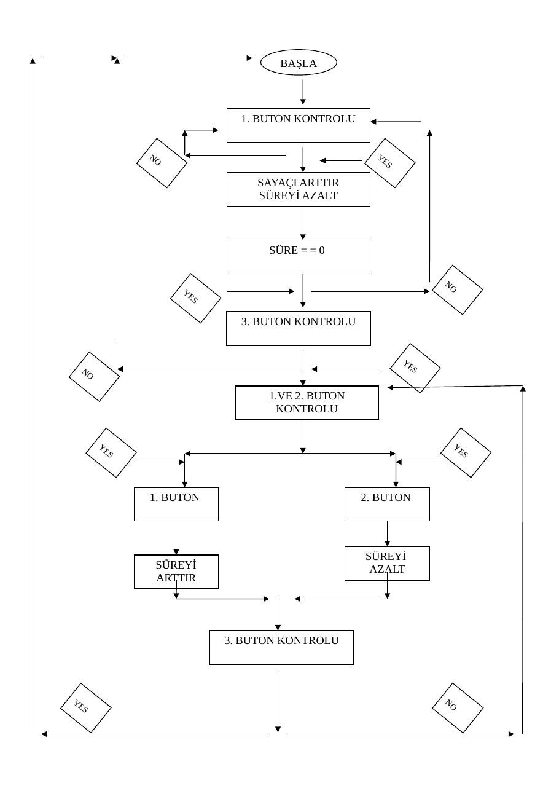

Bu yazı, Başkent Üniversitesi **EEM332 Mikroişlemciler** ders arşivindeki ilgili notları ve uygulamaları bir araya getiriyor (2008–2008). Üç butonla süreyi başlatma, değiştirme ve geri sayım; akış şeması ve assembly kodları. Bir arkadaşın hazırladığı çalışmalar ve ders belgeleri birlikte aktarılmış; öğrenci adları, numaraları ve grup bilgileri çıkarılmıştır. Belgelerin PDF arşiv kopyaları ve varsa kaynak kodları yazının sonunda ZIP olarak indirilebilir.

## SS

### BAŞLA

### 1. BUTON KONTROLU

### NO                                 YE

### S

### SAYAÇI ARTTIR

### SÜREYİ AZALT

### SÜRE = = 0

### NO

### YE

### S

### 3. BUTON KONTROLU

### YE

### NO                                                    S

### 1.VE 2. BUTON

### KONTROLU

### YE                                                    YE

### S                                                     S

### 1. BUTON                         2. BUTON

### SÜREYİ

### SÜREYİ                           AZALT

### ARTTIR

### 3. BUTON KONTROLU

### YE                                                          NO

### S




## proje rapor 1

### PROJE

Bu projede 3 adet butonum bulunmaktadır. 1 nolu butona basıldığında default olarak belirlediğimiz 4 saniye değeri azalmaya başlamakta ve sayaç ise 1 nolu butona basılma sayısını tutmaktadır. 4 saniye değerimiz bittiği zaman basılma sayısı seven segment de görülmektedir. 4 saniye default süreyi kendi isteğimizle değistirebilmekteyiz. 3 nolu butona bastığımızda seven segment de ayar çizgisi çıkmakta ve devremiz süre ayarına hazır hale gelmektedir. 1 ve 2 nolu butonlardan ise süre ayarını azaltıp, arttırabilmekteyiz. Bu işlemlerden sonra tekrar 3 nolu butona bastığımızda devre tekrar en başa dönmektedir.

### KOD

```asm
LIST    p=16F84;
INCLUDE"P16F84.INC"
SAYAC1         EQU        H'0C'   ;Değişkenleri tanımladık
SAYAC2         EQU        H'0D'
HAFIZA         EQU        H'0E'
SANIYE         EQU        H'0F'   ;EQU deyimi bir hex adresi belirlenen
SURE           EQU        H'10'   ;etikete atar(s1,s2,s3…)
```

```asm
ORG H'00'
GOTO ILKDEGER                     ;Program ILKDEGER den başlıyor
ORG H'04'
GOTO INTP                         ;Interrupt geldiğinde INTP ye gider
```

### ILKDEGER

```asm
CLRF    PORTB
BSF     STATUS,5                    ;PORTB output PORTA input yapıldı
CLRF    TRISB                       ;TRISB 0 oldu ve output oldu
MOVLW   H'FF'
MOVWF   TRISA                       ;TRISA 1 oldu ve giriş oldu
BCF     STATUS,5
CLRF    HAFIZA                      ;HAFIZA yı sıfırladık
```

```asm
MOVLW   H'04'                       ;SANİYE 4 olarak atandı
MOVWF   SANIYE                      ;Default saniye değeri
MOVLW   H'3D'
MOVWF   SURE                        ;SURE değeri 3D(61) olarak atandı
```

### BASLA

```asm
BTFSC   PORTA,1                     ;PORTA nın 1.butonuna basılırsa
GOTO    BASLA                       ;devam et basılmassa BASLA ya git
```

```asm
BSF     STATUS,5          ;Pigde ayar yapmak için status 5 oldu(bank 1)
MOVLW   B'10010111'       ;256 ile carpmak için 111 oldu
MOVWF   OPTION_REG        ;Timer için ayar(256 cycle da timer 1 artar)
MOVLW   B'10100000'       ;İNTERRUPT ile ilgili
```

```asm
MOVWF   INTCON
BCF     STATUS,5
MOVLW   H'00'      ;TMR0 sıfırlandı (Timer)
MOVWF   TMR0        ;Timer 00 dan FF e sayacak
MOVFW   SANIYE      ;belirlediğimiz saniyeyi yazdırdık(default 4)
CALL     YAZDIR
MOVLW    h'00'     ;Ekran sıfırlandı
CALL     YAZDIR
```

### KAYIT

```asm
BTFSC   PORTA,1
GOTO    KAYIT              ;butona basıldıysa devam et
```

```asm
INCF    HAFIZA             ;basıldıkça hafıza değeri arttı
MOVFW   HAFIZA             ;değer hafızaya atıldı
CALL     YAZDIR            ;değer yazdırıldı
GOTO     KAYIT             ;tekrar başa dönüldü
DONGU
BTFSC   PORTA,4            ;3. butona basılmayı kontrol ediyor
GOTO    DONGU              ;basılırsa devam ediyor ve çizgi
UYARI
MOVLW   H'40'              ;saniye ayarına geçti uyarısıdır
MOVWF   PORTB              ;ortada çizgi cıkıyor
CALL    GECIKME
BAK1
BTFSC   PORTA,1    ;1. butona basılıp basılmadığının kontrolü
GOTO    BAK2       ;1. butona basmaz isek BAK2 ye git
INCF    SANIYE     ;1. butona basarsak saniyeyi arttır
MOVFW   SANIYE
ANDLW   H'07'      ;Saniye 7 yi gemcesin diye and yaptık
MOVWF   SANIYE
CALL    YAZDIR
BAK2
BTFSC   PORTA,2    ; 2. butona basılıp basılmadığının kontrolü
GOTO    BAK3       ; 2. butona basmaz isek BAK2 ye git
DECF    SANIYE     ; 2. butona basarsak saniyeyi azalt
MOVFW   SANIYE
ANDLW   H'07'      ; Saniye 7 yi gemcesin diye and yaptık
MOVWF   SANIYE
CALL    YAZDIR
BAK3
BTFSC   PORTA,4    ; 3. butona basılıp basılmadığının kontrolü
GOTO    BAK1       ; 3. butona basmaz isek BAK1 e git
```

```asm
MOVLW   H'00'            ;W yi sıfırlarız
SUBWF   SANIYE,W         ;Saniyeden W yi cıkartırız
BTFSS   STATUS,2         ;İşlem sonucu sıfır ise statusun 2.biti
GOTO    SIFIR            ;0 oluyor işlem sıfır ise sıfır a git
```

```asm
GOTO    DONGU              ;işlem sıfır degilse donguye git
SIFIR
CLRF    HAFIZA
GOTO    BASLA        ; süre ayarı için olan döngüden çıkar
; ve tekrar başa döner
GECIKME
MOVLW   H'FF'        ;Gecikmeyi arttırmak için FF yaptık (256)
MOVWF   SAYAC1
```

DONGU1                        ;Buton arklarını engellemek için

```asm
MOVLW    H'FF'
MOVWF    SAYAC2
DONGU2
DECFSZ SAYAC2,1
GOTO     DONGU2
DECFSZ SAYAC1,1
GOTO     DONGU1
RETURN
SEVENSEGMENT
ADDWF PCL,1             ;PCL<---W(H'05')        ;Seven Segment de gösterim
RETLW h'3f'              ; 0
RETLW h'06'              ; 1
RETLW h'5b'              ; 2
RETLW h'4f'              ; 3
RETLW h'66'              ; 4
RETLW h'6d'              ; 5
RETLW h'7d'              ; 6
RETLW h'07'              ; 7
RETLW h'7f'              ; 8
RETLW h'6f'              ; 9
INTP
BCF      INTCON,T0IF
DECFSZ SURE
RETFIE                   ;İnterrupt sağlanır
CALL     SURE_INDIR      ;Timer FF den 00 a gelmiş ise buraya gelinir
RETFIE                   ;Böylece Timerin sıfırlandığı anlaşılır
SURE_INDIR
MOVLW    H'3D'
MOVWF    SURE            ;Süre ‘3D’ hex değeri kadar dönüyor
DECFSZ SANIYE,1          ;0 değilse 1 azalt
RETURN
GOTO     DONGU
YAZDIR
ANDLW B'00001111'       ; Mod 16 yaptık çünkü seven segment 15 e
CALL    SEVENSEGMENT    ; kadar gösteriyor
MOVWF PORTB
CALL   GECIKME
RETURN
```


## proje yeni 1

```asm
LIST    p=16F84;
INCLUDE"P16F84.INC"
SAYAC1         EQU        H'0C'   ;Değişkenleri tanımladık
SAYAC2         EQU        H'0D'
HAFIZA         EQU        H'0E'
SANIYE         EQU        H'0F'   ;EQU deyimi bir hex adresi belirlenen
SURE           EQU        H'10'   ;etikete atar(s1,s2,s3…)
```

```asm
ORG H'00'
GOTO ILKDEGER                      ;Program ILKDEGER den başlıyor
ORG H'04'
GOTO INTP                          ;Interrupt geldiğinde INTP ye gider
```

### ILKDEGER

```asm
CLRF    PORTB
BSF     STATUS,5                     ;PORTB output PORTA input yapıldı
CLRF    TRISB                        ;TRISB 0 oldu ve output oldu
MOVLW   H'FF'
MOVWF   TRISA                        ;TRISA 1 oldu ve giriş oldu
BCF     STATUS,5
CLRF    HAFIZA                       ;HAFIZA yı sıfırladık
```

```asm
MOVLW   H'04'                        ;SANİYE 4 olarak atandı
MOVWF   SANIYE                       ;Default saniye değeri
MOVLW   H'3D'
MOVWF   SURE                         ;SURE değeri 3D(61) olarak atandı
```

### BASLA

```asm
BTFSC   PORTA,1                      ;PORTA nın 1.butonuna basılırsa
GOTO    BASLA                        ;devam et basılmassa BASLA ya git
```

```asm
BSF     STATUS,5          ;Pigde ayar yapmak için status 5 oldu(bank 1)
MOVLW   B'10010111'       ;256 ile carpmak için 111 oldu
MOVWF   OPTION_REG        ;Timer için ayar(256 cycle da timer 1 artar)
MOVLW   B'10100000'       ;İNTERRUPT ile ilgili
MOVWF   INTCON
BCF     STATUS,5
MOVLW   H'00'             ;TMR0 sıfırlandı (Timer)
MOVWF   TMR0               ;Timer 00 dan FF e sayacak
MOVFW   SANIYE             ;belirlediğimiz saniyeyi yazdırdık(default 4)
CALL     YAZDIR
MOVLW    h'00'            ;Ekran sıfırlandı
CALL     YAZDIR
```

### KAYIT

```asm
BTFSC   PORTA,1
GOTO    KAYIT                     ;butona basıldıysa devam et
```

```asm
INCF    HAFIZA            ;basıldıkça hafıza değeri arttı
MOVFW   HAFIZA            ;değer hafızaya atıldı
CALL     YAZDIR           ;değer yazdırıldı
GOTO     KAYIT            ;tekrar başa dönüldü
```

### DONGU

```asm
BTFSC   PORTA,4           ;3. butona basılmayı kontrol ediyor
GOTO    DONGU             ;basılırsa devam ediyor ve çizgi
;4 saniye bitiminde buraya geliyor
UYARI
MOVLW   H'40'             ;saniye ayarına geçti uyarısıdır
MOVWF   PORTB             ;ortada çizgi cıkıyor
CALL    GECIKME
```

### BAK1

```asm
BTFSC   PORTA,1    ;1. butona basılıp basılmadığının kontrolü
GOTO    BAK2       ;1. butona basmaz isek BAK2 ye git
INCF    SANIYE     ;1. butona basarsak saniyeyi arttır
MOVFW   SANIYE
ANDLW   H'07'      ;Saniye 7 yi gemcesin diye and yaptık
MOVWF   SANIYE
CALL    YAZDIR
BAK2
BTFSC   PORTA,2    ; 2. butona basılıp basılmadığının kontrolü
GOTO    BAK3       ; 2. butona basmaz isek BAK2 ye git
DECF    SANIYE     ; 2. butona basarsak saniyeyi azalt
MOVFW   SANIYE
ANDLW   H'07'      ; Saniye 7 yi gemcesin diye and yaptık
MOVWF   SANIYE
CALL    YAZDIR
BAK3
BTFSC   PORTA,4    ; 3. butona basılıp basılmadığının kontrolü
GOTO    BAK1       ; 3. butona basmaz isek BAK1 e git
```

```asm
MOVLW   H'00'           ;W yi sıfırlarız
SUBWF   SANIYE,W        ;Saniyeden W yi çıkartırız
BTFSS   STATUS,2        ;İşlem sonucu sıfır ise statusun 2.biti
GOTO    SIFIR           ;0 oluyor işlem sıfır ise sıfır a git
GOTO    DONGU           ;işlem sıfır değilse döngüye git
```

### SIFIR

```asm
CLRF    HAFIZA
GOTO    BASLA      ; süre ayarı için olan döngüden çıkar
; ve tekrar başa döner
```

### GECIKME

```asm
MOVLW    H'FF'            ;Gecikmeyi arttırmak için FF yaptık (256)
MOVWF    SAYAC1
```

DONGU1                            ;Buton arklarını engellemek için

```asm
MOVLW      H'FF'
MOVWF      SAYAC2
DONGU2
DECFSZ     SAYAC2,1
GOTO       DONGU2
DECFSZ     SAYAC1,1
GOTO       DONGU1
RETURN
SEVENSEGMENT
```

```asm
ADDWF    PCL,1              ;PCL<---W(H'05')       ;Seven Segment de gösterim
RETLW    h'3f'               ; 0
RETLW    h'06'               ; 1
RETLW    h'5b'               ; 2
RETLW    h'4f'               ; 3
RETLW    h'66'               ; 4
RETLW    h'6d'               ; 5
RETLW    h'7d'               ; 6
RETLW    h'07'               ; 7
RETLW    h'7f'               ; 8
RETLW    h'6f'               ; 9
```

### INTP

```asm
BCF    INTCON,T0IF
DECFSZ SURE
RETFIE                    ;İnterrupt sağlanır
CALL   SURE_INDIR         ;Timer FF den 00 a gelmiş ise buraya gelinir
RETFIE                    ;Böylece Timerin sıfırlandığı anlaşılır
```

### SURE_INDIR

```asm
MOVLW      H'3D'
MOVWF      SURE             ;Süre ‘3D’ hex değeri kadar dönüyor
DECFSZ     SANIYE,1         ;0 değilse 1 azalt
RETURN
GOTO       DONGU
```

### YAZDIR

```asm
ANDLW    B'00001111'      ; Mod 16 yaptık çünkü seven segment 15 e
CALL     SEVENSEGMENT     ; kadar gösteriyor
MOVWF   PORTB
CALL    GECIKME
RETURN
```

## proje yeni

```asm
INCF    HAFIZA            ;basıldıkça hafıza değeri arttı
MOVFW   HAFIZA            ;değer hafızaya atıldı
CALL     YAZDIR           ;değer yazdırıldı
GOTO     KAYIT            ;tekrar başa dönüldü
```

### DONGU

```asm
BTFSC   PORTA,4            ;3. butona basılmayı kontrol ediyor
GOTO    DONGU              ;basılırsa devam ediyor ve çizgi
;4 saniye bitiminde buraya geliyor
UYARI
MOVLW   H'40'             ;saniye ayarına geçti uyarısıdır
MOVWF   PORTB             ;ortada çizgi cıkıyor
CALL    GECIKME
```

### BAK1

```asm
BTFSC   PORTA,1    ;1. butona basılıp basılmadığının kontrolü
GOTO    BAK2       ;1. butona basmaz isek BAK2 ye git
INCF    SANIYE     ;1. butona basarsak saniyeyi arttır
MOVFW   SANIYE
ANDLW   H'07'      ;Saniye 7 yi gemcesin diye and yaptık
MOVWF   SANIYE
CALL    YAZDIR
BAK2
BTFSC   PORTA,2    ; 2. butona basılıp basılmadığının kontrolü
GOTO    BAK3       ; 2. butona basmaz isek BAK2 ye git
DECF    SANIYE     ; 2. butona basarsak saniyeyi azalt
MOVFW   SANIYE
ANDLW   H'07'      ; Saniye 7 yi gemcesin diye and yaptık
MOVWF   SANIYE
CALL    YAZDIR
BAK3
BTFSC   PORTA,3    ; 3. butona basılıp basılmadığının kontrolü
GOTO    BAK1       ; 3. butona basmaz isek BAK1 e git
```

```asm
GOTO    BASLA      ; süre ayarı için olan döngüden çıkar
; ve tekrar başa döner
GECIKME
MOVLW     H'FF'      ;Gecikmeyi arttırmak için FF yaptık (256)
MOVWF     SAYAC1
```

DONGU1                     ;Buton arklarını engellemek için

```asm
MOVLW     H'FF'
MOVWF     SAYAC2
DONGU2
DECFSZ    SAYAC2,1
GOTO      DONGU2
DECFSZ    SAYAC1,1
GOTO      DONGU1
RETURN
```

### SEVENSEGMENT

```asm
ADDWF    PCL,1             ;PCL<---W(H'05')       ;Seven Segment de gösterim
RETLW    h'3f'              ; 0
RETLW    h'06'              ; 1
RETLW    h'5b'              ; 2
RETLW    h'4f'              ; 3
RETLW    h'66'              ; 4
RETLW    h'6d'              ; 5
RETLW    h'7d'              ; 6
RETLW    h'07'              ; 7
RETLW    h'7f'              ; 8
RETLW    h'6f'              ; 9
```

### INTP

```asm
BCF    INTCON,T0IF
DECFSZ SURE
RETFIE                    ;İnterrupt sağlanır
CALL   SURE_INDIR         ;Timer FF den 00 a gelmiş ise buraya gelinir
RETFIE                    ;Böylece Timerin sıfırlandığı anlaşılır
```

### SURE_INDIR

```asm
MOVLW      H'3D'
MOVWF      SURE            ;Süre ‘3D’ hex değeri kadar dönüyor
DECFSZ     SANIYE,1        ;0 değilse 1 azalt
RETURN
GOTO       DONGU
```

### YAZDIR

```asm
ANDLW    B'00001111'     ; Mod 16 yaptık çünkü seven segment 15 e
CALL     SEVENSEGMENT    ; kadar gösteriyor
MOVWF   PORTB
CALL    GECIKME
RETURN
```

## proje

```asm
LIST    p=16F84;
INCLUDE"P16F84.INC"
SAYAC1         EQU          H'0C'   ;DEĞİŞKENLER BELİRTİLEN
SAYAC2         EQU          H'0D'   ;ADRESLERDE TANIMLANIYOR
HAFIZA         EQU          H'0E'
SANIYE         EQU          H'0F'
SURE           EQU          H'10'
```

```asm
ORG H'00'
GOTO ILKDEGER                        ;PROGRAM ILKDEGERDEN BASLAR
ORG H'04'                            ;INTERRUPT GELDIGINDE INTP
GOTO INTP                            ;BOLUMUNE DALLANIR
```

### ILKDEGER

```asm
CLRF      PORTB
BSF       STATUS,5          ;PORTB OUTPUT PORTA INPUT YAPILDI
CLRF      TRISB
MOVLW     H'FF'
MOVWF     TRISA             ;KLASİK İŞLEMLER HER PROGRAMDA
YAPILIR
BCF       STATUS,5
CLRF      HAFIZA
```

```asm
MOVLW   H'05'             ;SANIYE DEĞİŞKENİNİN DEGERİ 05
MOVWF   SANIYE            ;DEFAULT SANİYE DEGERİ
```

```asm
MOVLW   H'0B'
MOVWF   SURE              ;SURE DEĞİŞKENİNİN DEĞERİ   0B
```

### BASLA

```asm
BTFSC   PORTA,4           ;PORTANIN 4.BUTONUNA BASILIRSA
TIME
GOTO    BASLA             ;BOLUMUNE GEÇER YOKSA SUREKLİ
KONTROL
EDER
```

### TIME

```asm
BSF     STATUS,5
MOVLW   B'10010110'
MOVWF   OPTION_REG        ;INTERREUPT İÇİN KLASİK İŞLEMLER
MOVLW   B'10100000'
MOVWF   INTCON
BCF     STATUS,5
MOVLW   H'00'             ;TMR0 SIFIRLANDI
MOVWF   TMR0
MOVFW   SANIYE            ;belirlediğimiz saniye yazdırıldı
CALL     YAZDIR
movlw    h'00'             ;EKRAN SIFIRLANDI
```

```asm
CALL    YAZDIR
KAYIT
BTFSC   PORTA,1
GOTO    KAYIT        ;butona kaçkez basıldıgını bulmak
için
INCF    HAFIZA       ;basıldıkça hafıza değeri artar
MOVFW   HAFIZA
CALL     YAZDIR      ;ve yazdırılır
GOTO     KAYIT
```

### DONGU    MOVLW   H'20'       ;SANİYE BİTTİ UYARİSİ VERİR

```asm
MOVWF   PORTB
BTFSC   PORTA,4
GOTO    DONGU
UYAR
MOVLW   H'80'       ;SANİYE AYARİNA GECTİ UYARİ CİZGİSİ
MOVWF   PORTB
CALL    GECIKME
```

### BAK1

```asm
BTFSC    PORTA,1
GOTO     BAK2         ;BAK1 1.BUTONA BASILIRSA SANİYE
DEGERİNİ
ARTTIRIR
INCF     SANIYE
MOVFW    SANIYE
ANDLW    H'07'
MOVWF    SANIYE
CALL     YAZDIR
```

### BAK2

```asm
BTFSC    PORTA,2
GOTO     BAK3
DECF     SANIYE
MOVFW    SANIYE      ;BAK2 2.BUTONA BASILIRSA SANİYE
DEĞERİNİ
AZALTIR
ANDLW    H'07'
MOVWF    SANIYE
CALL     YAZDIR
```

### BAK3

```asm
BTFSC   PORTA,4
GOTO    BAK1
MOVLW   H'00'      ;4.BUTONA BASILDI MI DİYE BAKAR.TEKRAR
BASA
DÖNER
SUBWF   SANIYE,W   ;AYNI İŞLEMLERİ YAPMAK İÇİN
```

```asm
BTFSS   STATUS,2
GOTO    SIFIR
GOTO    DONGU
```

### SIFIR

```asm
CLRF    HAFIZA
GOTO    BASLA
```

### GECIKME

```asm
MOVLW   H'AA'
MOVWF   SAYAC1             ;BUTON ARCLARINI ÖNLEMEK VE LEDLERİN
YANIP
```

### DONGU1                             ;SÖNMESİNİ GÖRMEK İÇİN BÖYLE BİR

### GECİKME

```asm
MOVLW     H'AA'              ;DÖNGÜSÜ TASARLADIK..AA VERİNCE YETERLİ
MOVWF     SAYAC2             ;GECIKME SAĞLANDI
DONGU2
DECFSZ    SAYAC2,1
GOTO      DONGU2
DECFSZ    SAYAC1,1
GOTO      DONGU1
RETURN
```

### SEVENSEGMENT

```asm
ADDWF PCL,1             ;PCL<---W(H'05')
RETLW h'3f'
RETLW h'06'
RETLW h'5b'
RETLW h'4f'
RETLW h'66'
RETLW h'6d'                        ;SEVENSEGMENNTE YAZDIRMAK İÇİN GEREKLİ
STANDART
RETLW h'7d'                        ;SATIRLAR..RETLWW İÇERİSİNE DEĞER
```

### ATARAK GERİ DÖNDERİR

```asm
RETLW h'07'
RETLW h'7f'
RETLW h'6f'
RETLW h'77'
RETLW h'7c'
RETLW h'39'
RETLW h'5e'
RETLW h'79'
RETLW h'71'
RETLW h'80'
```

### INTP

```asm
BCF     INTCON,T0IF
```

```asm
DECFSZ SURE
RETFIE                  ;İNTERUPT SAĞLANIR
CALL   SURE_INDIR
RETFIE
```

### SURE_INDIR

```asm
MOVLW     H'0B'
MOVWF     SURE
DECFSZ    SANIYE,1
RETURN
GOTO      DONGU
```

### YAZDIR

```asm
ANDLW    B'00001111'
CALL     SEVENSEGMENT      ;SEVENSEGMENTTE GÖSTERMEK İÇİN
MOVWF    PORTB
CALL     GECIKME
RETURN
```
