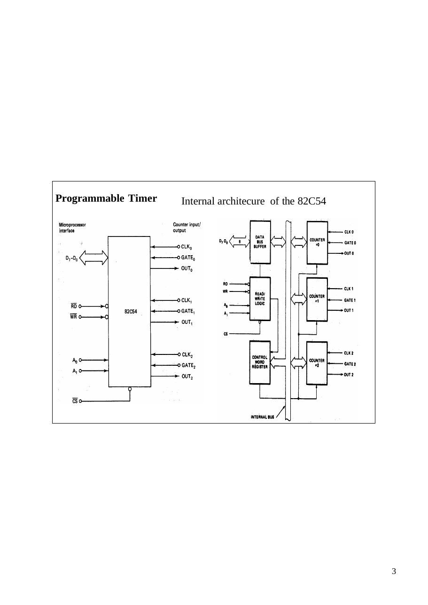
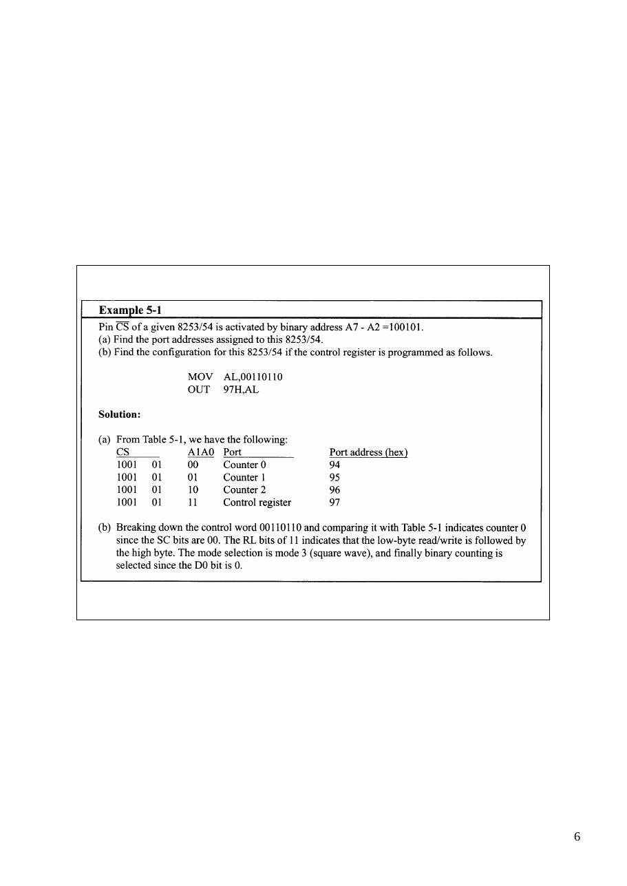

Bu yazı, Başkent Üniversitesi **EEM332 Mikroişlemciler** ders arşivindeki ilgili notları ve uygulamaları bir araya getiriyor (2005–2015). Programlanabilir sayıcıların kipleri, zaman gecikmesi ve seri veri aktarımı. Belgelerin PDF arşiv kopyaları ve varsa kaynak kodları yazının sonunda ZIP olarak indirilebilir.

## cpu12

Asynchronous Counter

### Q                   Q                        Q

### D                     D                        D

```asm
CLK
```

Synchronous Counter

### Q              Q                     Q

### D             D                  D

```asm
CLK
BUFGP
```

8253/54 Timer programmable Interval Timer

Creating time delays in 8088/8086 based system for a delay loop

```asm
MOV CX,N
Again: LOOP again
```

Evrey loop takes total of 17 clk pulse to be executed so the time delay is Nx17 example : system frequency is 4.7 MHZ (t=210 ns). For 100ms delay its needed N) 28000 another way for delay generation is using of external hardware timers

Programmable Interval Timer - 8254

Programmable Timer   Internal architecure of the 82C54

```asm
CLK
CLK is the input clock frequency, which can range between 0 and 2 MHz for
```

the 8253. for input frequencies higher than 2 MHz, the 8254 must be used; the 8254 can go as high as 8 MHz, and the 8254-2 can go as high as 10 MHz.

```asm
OUT
```

Although the input frequency is a square wave of 33% duty cycle, the shape of the output frequency coming from the OUT pin after being divided can be programmed. Among the options are square-wave, one-shot, and other square- shape waves of various duty cycles but no sine-wave or saw-tooth shapes.

### GATE

This pin is use to enable or disable the counter. Putting HIGH (5 V) on GATE enables the counter, whereas LOW (0 V) disables it ýn some modes a 0-to-1 pulse must be applied to GATE to enable the counter.

### D0 – D7

The D0 –D7 data bus of the 8253/54 is a bidirectional bus connected to D0 –D7 of the system data bus. The data bus allows the CPU to access various registers inside the 8253/54 for both read and write operations. RD and WR (both active low) are connected to IOR and LOW control of the system bus.

Pin Description of 8253/54 CS   A1   A0   Port

0    0    0    Counter 0

0    0    1    Counter 1 A0, A1, and CS                         0    1    0    Counter 2

0    1    1    Control register

- Inside the 8253/54 timer, there

1    x    x    8253/54 is not selected are 3 counters.

- Each timer works independently

```asm
and programmed separately.
```

- Each counter is assigned an

individual port address.

- The control register common to

all 3 counters and has its own port.


Control word format of the 82C54

Operation Modes

Mode 0 Interrupt on terminal count Mode 1 Programmable one-shot Mode 2 Rate Generator Mode 3 Square wave rate generator Mode 4 Software triggered strobe Mode 5 Hardware trigger strobe

Accessing the register of the 82c54    Interface

Base adress is 40H

```asm
MOV   AL, 30H ; set up counter 0
```

Bsed on last figure load : OUT   43H, AL

```asm
MOV   AL, 55H ; set up counter 1
```

counter0=1234H,            OUT   43H, AL Binary counter in mode 0   MOV   AL, B8H; set up counter 2

```asm
OUT   43H, AL
```

Counter1 =0100h,           MOV   AL,34H; load counter 0 with 1234H BCD counter in mode 2      OUT   40H, AL

```asm
MOV   AL,12H
```

counter 2=1FFFh            OUT   40H, AL Binary counter in mode3    MOV   AL,00H; load counter 1 with 100H

```asm
OUT   41H, AL
MOV   AL,01H
OUT   41H, AL
MOV   AL,FFH; load counter 2 with 1FFFH
OUT   42H, AL
MOV   AL,1FH
OUT   42H, AL
```

Content of each register could be read at any time.

### Methods of reading the state of a counter while counting 

1-Employ a read from the input port associated with the counter. The counter must be temporarily paused. 2-Using the 8254’s counter latch command. This command is selected by clearing bits 5

```asm
and 4 in the control word for a particular counter. This causes the 8254 to transfer a
```

copy of the selected count register into an output latch 3-The third technique uses a read-back command to read the state of 3counter with a single command. The read-back command is issued by setting bits 7 and 6 . Example: Write an instruction sequence to read the contebt of counter 2. The content is to be loaded into the AX register. The base adress of timer is 40H . (latch command)

```asm
Mov AL, 1000xxxxB
OUT 43 H, AL
IN AL, 42H
MOV BL,AL; READ THE LOW BYTE
IN     AL,42H, READ THE HÝGH BYTE
MOV AH,AL
MOV AL,BL, AX =COUNTER2 VALUE
```

Mode 0: interrupt on terminal count The output in this mode is initially low, and will remain low for the duration of the count if GATR = 1. The width of the low output is as follows. Width of low pulse = N × T Where N is the clock count loaded into counter, and T is the clock period of the CLK input. When the terminal count is reached, the output will go high and remain high until a new control word or new count number is loaded. Mode 1: programmable one-shot This mode is also called hardware triggerable one-shot. The triggering must be done through the GATE input by sending a 0-to-1 pulse to it. In 8253/54 modes that are programmable (triggerable) such as mode1, the following two steps must be performed for the counter to work.

### 1. Load the count register.

### 2. A 0-to-1 pulse must be sent to the GATE input to trigger the counter.

Mode 2: rate generator Mode 2 is also called divide-by-N counter. In this mode, if GATE = 1, OUT will be high for the N x T clock period, goes low only for one clock pulse, then the count is reloaded automatically, and the process continues indefinitely. This mode in effect produces a divide-by-N counter. In this mode, the period of OUT is equal to (N + 1) x T where for N x T, OUT is high and 1 clock pulse, OUT is low.

Mode 3: square wave rate generator

```asm
In this mode if GATE = 1, OUT is a square wave the high pulse is equal to the low pulse if N is
```

an even number. In that case, the high part and low part of the pulse have the same duration and are equal to (N/2) x T where N is the clock count and T is the CLK period. In this mode, the count is reloaded automatically when the terminal count is reached, thereby producing a continuous square wave with frequency of 1/N of the CLK frequenc y. Mode 3 is similar to mode 2, except that OUT in mode 3 is a square wave of 50% duty cycle . If an odd number is loaded into counter, the time for high position is (N+1)/2 and the time for low position is (N-1)/2 Mode 4: software triggered strobe

```asm
In this mode if GATE = 1, the output will go high upon loading the count. It will stay high for the
```

duration of N x T, where N is the count and T is the clock period. After the count reaches zero (terminal count), it becomes low for one clock pulse, then goes high again and stays high until a new command word or new count is loaded. To repeat the strobe, the count must be reloaded again. In other words, this mode does not automatically reload the count upon reaching the terminal count. Mode 4 is similar to mode 2, except the counter is not reloaded automatically. In this mode, if the GATE input becomes low, the count will stop and the output will be high. The count resumes only when the gate becomes high again. Mode 5: hardware triggered storbe This mode is similar to mode 4 except the triggering must be done with the GATE input. In this mode, the count begins only when a 0-to-1 pulse is sent to the GATE input. This is unlike mode 4 where the counter started upon loading the count, as GATE = 1.

Operating modes of 82C54

Mode 0     Mode 2 The gate is fixed to high for square wave Software   generation (software)

Mode 1     Mode 3The gate is fixed to high for square wave generation Hardware   Software

Mode 4 (is similar to mode 2, except the counter is not reloaded automatically)

Mode 2

Adress of Counter0=94H, Counter 1 =95H, Counter2=96H, Control register=97H

Adress of Counter0=94H, Counter 1 =95H, Counter2=96H, Control register=97H

8253/54 Timer Connections and Programming


Mode 2

Mode 3






## cpu12_06T

Counter and Timers: programmable Interval Timer 8253/54 Timer

Asynchronous Counter

### Q               Q                         Q

### D                  D                        D

```asm
CLK           Synchronous Counter
```

### Q          Q                      Q

### D         D                   D

```asm
CLK
BUFGP
```

Creating time delays in 8088/8086 based system for a delay loop

```asm
MOV CX,N
Again: LOOP again
```

Evrey loop takes total of 17 clock pulse to be executed so the time delay is Nx17 example : system frequency is 4.7 MHZ (t=210 ns). For 100ms delay its needed N) 28000 another way for delay generation is using of external hardware timers

Programmable Interval Timer - 8254

```asm
CLK
CLK is the input clock frequency, which can range between 0 and 2 MHz for
```

the 8253. for input frequencies higher than 2 MHz, the 8254 must be used; the 8254 can go as high as 8 MHz, and the 8254-2 can go as high as 10 MHz.

```asm
OUT
```

Although the input frequency is a square wave of 33% duty cycle, the shape of the output frequency coming from the OUT pin after being divided can be programmed. Among the options are square-wave, one-shot, and other square- shape waves of various duty cycles but no sine-wave or saw-tooth shapes.

### GATE

This pin is use to enable or disable the counter. Putting HIGH (5 V) on GATE enables the counter, whereas LOW (0 V) disables it ın some modes a 0-to-1 pulse must be applied to GATE to enable the counter.

### D0 – D7

The D0 –D7 data bus of the 8253/54 is a bidirectional bus connected to D0 –D7 of the system data bus. The data bus allows the CPU to access various registers inside the 8253/54 for both read and write operations. RD and WR (both active low) are connected to IOR and LOW control of the system bus.

Pin Description of 8253/54 CS   A1   A0   Port

0    0    0    Counter 0

0    0    1    Counter 1 A0, A1, and CS                         0    1    0    Counter 2

- Inside the 8253/54 timer, there      0    1    1    Control register

are 3 counters.                        1    x    x    8253/54 is not selected

- Each timer works independently

```asm
and programmed separately.
```

- Each counter is assigned an

individual port address.

- The control register common to

all 3 counters and has its own port.

Control word format of the 82C54

Operation Modes (Six operation modes)

Mode 0 Interrupt on terminal count Mode 1 Programmable one-shot Mode 2 Rate Generator Mode 3 Square wave rate generator Mode 4 Software triggered strobe Mode 5 Hardware trigger strobe

Accessing the register of the 82C54    Interface

Base adress is 40H

```asm
MOV    AL, 30H ; set up counter 0
Example:                  OUT    43H, AL
MOV    AL, 55H ; set up counter 1
```

Bsed on last figure load : OUT   43H, AL counter0=1234H,           MOV    AL, B8H; set up counter 2

```asm
OUT    43H, AL
```

Binary counter in mode 0 MOV     AL,34H; load counter 0 with 1234H Counter1 =0100h,          OUT    40H, AL

```asm
MOV    AL,12H
```

BCD counter in mode 2     OUT    40H, AL counter 2=1FFFh           MOV    AL,00H; load counter 1 with 100H

```asm
OUT    41H, AL
```

Binary counter in mode3   MOV    AL,01H

```asm
OUT    41H, AL
MOV    AL,FFH; load counter 2 with 1FFFH
OUT    42H, AL
MOV    AL,1FH
OUT    42H, AL
```

Content of each register could be read at any time.

### Methods of reading the state of a counter while counting 

1-Employ a read from the input port associated with the counter. The counter must be temporarily paused. 2-Using the 8254’s counter latch command. This command is selected by clearing bits 5

```asm
and 4 in the control word for a particular counter. This causes the 8254 to transfer a
```

copy of the selected count register into an output latch 3-The third technique uses a read-back command to read the state of 3counter with a single command. The read-back command is issued by setting bits 7 and 6 . Example: Write an instruction sequence to read the contebt of counter 2. The content is to be loaded into the AX register. The base adress of timer is 40H . (latch command)

```asm
Mov AL, 1000xxxxB
OUT 43 H, AL
IN AL, 42H
MOV BL,AL; READ THE LOW BYTE
IN     AL,42H, READ THE HİGH BYTE
MOV AH,AL
MOV AL,BL, AX =COUNTER2 VALUE
```

8253/54 Timer Connections and Programming (adress decoding)

Mode 4

Mode 5

## cpu12_06d

Counter and Timers: programmable Interval Timer 8253/54 Timer

Asynchronous Counter

### Q                                Q                               Q

### D                                D                               D

```asm
CLK                        Synchronous Counter
```

### Q                      Q                          Q

### D                     D                          D

```asm
CLK
BUFGP
```

Creating time delays in 8088/8086 based system for a delay loop

```asm
MOV CX,N
Again: LOOP again
```

Evrey loop takes total of 17 clock pulse to be executed so the time delay is Nx17 example : system frequency is 4.7 MHZ (t=210 ns). For 100ms delay its needed N) 28000 another way for delay generation is using of external hardware timers

Programmable Interval Timer - 8254

Programmable Timer             Internal architecure of the 82C54

```asm
CLK
CLK is the input clock frequency, which can range between 0 and 2 MHz for
```

the 8253. for input frequencies higher than 2 MHz, the 8254 must be used; the 8254 can go as high as 8 MHz, and the 8254-2 can go as high as 10 MHz.

```asm
OUT
```

Although the input frequency is a square wave of 33% duty cycle, the shape of the output frequency coming from the OUT pin after being divided can be programmed. Among the options are square-wave, one-shot, and other square- shape waves of various duty cycles but no sine-wave or saw-tooth shapes.

### GATE

This pin is use to enable or disable the counter. Putting HIGH (5 V) on GATE enables the counter, whereas LOW (0 V) disables it ın some modes a 0-to-1 pulse must be applied to GATE to enable the counter.

### D0 – D7

The D0 –D7 data bus of the 8253/54 is a bidirectional bus connected to D0 –D7 of the system data bus. The data bus allows the CPU to access various registers inside the 8253/54 for both read and write operations. RD and WR (both active low) are connected to IOR and LOW control of the system bus.

Pin Description of 8253/54 CS   A1   A0   Port

0    0    0    Counter 0

0    0    1    Counter 1 A0, A1, and CS                         0    1    0    Counter 2

- Inside the 8253/54 timer, there      0    1    1    Control register

are 3 counters.                        1    x    x    8253/54 is not selected

- Each timer works independently

```asm
and programmed separately.
```

- Each counter is assigned an

individual port address.

- The control register common to

all 3 counters and has its own port.

Control word format of the 82C54

Operation Modes (Six operation modes)

Mode 0 Interrupt on terminal count Mode 1 Programmable one-shot Mode 2 Rate Generator Mode 3 Square wave rate generator Mode 4 Software triggered strobe Mode 5 Hardware trigger strobe

Accessing the register of the 82C54                    Interface

Base adress is 40H

```asm
MOV         AL, 30H ; set up counter 0
Example:                  OUT         43H, AL
MOV         AL, 55H ; set up counter 1
```

Bsed on last figure load : OUT        43H, AL counter0=1234H,           MOV         AL, B8H; set up counter 2

```asm
OUT         43H, AL
```

Binary counter in mode 0 MOV          AL,34H; load counter 0 with 1234H Counter1 =0100h,          OUT         40H, AL

```asm
MOV         AL,12H
```

BCD counter in mode 2     OUT         40H, AL counter 2=1FFFh           MOV         AL,00H; load counter 1 with 100H

```asm
OUT         41H, AL
```

Binary counter in mode3   MOV         AL,01H

```asm
OUT         41H, AL
MOV         AL,FFH; load counter 2 with 1FFFH
OUT         42H, AL
MOV         AL,1FH
OUT         42H, AL
```

Content of each register could be read at any time.

### Methods of reading the state of a counter while counting 

1-Employ a read from the input port associated with the counter. The counter must be temporarily paused. 2-Using the 8254’s counter latch command. This command is selected by clearing bits 5

```asm
and 4 in the control word for a particular counter. This causes the 8254 to transfer a
```

copy of the selected count register into an output latch 3-The third technique uses a read-back command to read the state of 3counter with a single command. The read-back command is issued by setting bits 7 and 6 . Example: Write an instruction sequence to read the contebt of counter 2. The content is to be loaded into the AX register. The base adress of timer is 40H . (latch command)

```asm
Mov AL, 1000xxxxB
OUT 43 H, AL
IN AL, 42H
MOV BL,AL; READ THE LOW BYTE
IN     AL,42H, READ THE HİGH BYTE
MOV AH,AL
MOV AL,BL, AX =COUNTER2 VALUE
```

Mode 0: interrupt on terminal count The output in this mode is initially low, and will remain low for the duration of the count if GATR = 1. The width of the low output is as follows. Width of low pulse = N × T Where N is the clock count loaded into counter, and T is the clock period of the CLK input. When the terminal count is reached, the output will go high and remain high until a new control word or new count number is loaded. Mode 1: programmable one-shot This mode is also called hardware triggerable one-shot. The triggering must be done through the GATE input by sending a 0-to-1 pulse to it. In 8253/54 modes that are programmable (triggerable) such as mode1, the following two steps must be performed for the counter to work.

### 1. Load the count register.

### 2. A 0-to-1 pulse must be sent to the GATE input to trigger the counter.

Mode 2: rate generator Mode 2 is also called divide-by-N counter. In this mode, if GATE = 1, OUT will be high for the N x T clock period, goes low only for one clock pulse, then the count is reloaded automatically, and the process continues indefinitely. This mode in effect produces a divide-by-N counter. In this mode, the period of OUT is equal to (N + 1) x T where for N x T, OUT is high and 1 clock pulse, OUT is low.

Mode 3: square wave rate generator

```asm
In this mode if GATE = 1, OUT is a square wave the high pulse is equal to the low pulse if N is
```

an even number. In that case, the high part and low part of the pulse have the same duration and are equal to (N/2) x T where N is the clock count and T is the CLK period. In this mode, the count is reloaded automatically when the terminal count is reached, thereby producing a continuous square wave with frequency of 1/N of the CLK frequency. Mode 3 is similar to mode 2, except that OUT in mode 3 is a square wave of 50% duty cycle. If an odd number is loaded into counter, the time for high position is (N+1)/2 and the time for low position is (N-1)/2 Mode 4: software triggered strobe

```asm
In this mode if GATE = 1, the output will go high upon loading the count. It will stay high for the
```

duration of N x T, where N is the count and T is the clock period. After the count reaches zero (terminal count), it becomes low for one clock pulse, then goes high again and stays high until a new command word or new count is loaded. To repeat the strobe, the count must be reloaded again. In other words, this mode does not automatically reload the count upon reaching the terminal count. Mode 4 is similar to mode 2, except the counter is not reloaded automatically. In this mode, if the GATE input becomes low, the count will stop and the output will be high. The count resumes only when the gate becomes high again. Mode 5: hardware triggered storbe This mode is similar to mode 4 except the triggering must be done with the GATE input. In this mode, the count begins only when a 0-to-1 pulse is sent to the GATE input. This is unlike mode 4 where the counter started upon loading the count, as GATE = 1.

Operating modes of 82C54

Mode 0                                                Mode 2 The gate is fixed to high for square wave Software                                              generation (software)

Mode 1                                                Mode 3The gate is fixed to high for square wave generation Hardware                                              Software

Mode 4 (is similar to mode 2, except the counter is not reloaded automatically)

Mode 2

Adress of Counter0=94H, Counter 1 =95H, Counter2=96H, Control register=97H

Adress of Counter0=94H, Counter 1 =95H, Counter2=96H, Control register=97H

8253/54 Timer Connections and Programming (adress decoding)

Mode 2

Mode 3

Mode 4

Mode 5

## cpu13_07

Serial Communication Interface

CPU based systems transfer data in two ways:          parallel and serial.

```asm
In parallel data transfers, often 8 or more lines (write conductors) are used to transfer
```

data to a device that is only a few feet a way. Examples of parallel transfer are printers

```asm
and hard disks using cables with many wire strips. Although in such cases a lot of data
```

can be transferred in a short amount of time by using many wires in parallel, the distance cannot be great. To transfer to a device located many meters away, the serial method is used. In serial communication, the data is sent one bit at a time, in contrast to parallel communication in which the data is sent a byte or more at a time.

Half-and full-duplex transmission

```asm
In data transmission if the data can be transmitted and received, it is a duplex transmission. This is
in contrast to simplex transmissions such as printers, in which the computer only sends data.
```

Duplex transmissions can be half or full duplex, depending on whether or not the data transfer can be simultaneous. If data is transmitted one way at a time, it is referred to as half duplex. If the data can go both ways at the same time, it is full duplex. Of course, full duplex requires two wire conductors for the data lines (in addition to ground), one for transmission and one for reception, in

```asm
order to transfer and receive data simultaneously. See Figure
```

The data coming in at the receiving end of the data line in a serial data transfer is all 0s

```asm
and 1s; it is difficult to make sense of the data unless the sender and receiving agree on
```

a set of rules, a protocol, on how the data is packed, how many bits constitute a character, and when the data beings and ends.

For serial data communication to work, the byte of data must be grabbed from the 8-bit data bus of the microprocessor and converted to serial bits using a parallel-in-serial-out shift register; then it can be transmitted over a single data line. This also means that at the receiving end there must be a serial-in-parallel-out shift register to receive the serial data and pack them into a byte and present it to the system at the receiving end. Serial data communication uses two method, Asynchronous : This method transfers a single byte at time Synchronous : This method transfers a block of data (characters) at a time ( common clock pulse)

It is possible to write software to use either of these methods, but the programs can be tedious and long. For this reason, there are special IC chips made by many manufactures for serial data communications. These chips are commonly referred to as UART (universal asynchronous receiver-transmitter) and USART (universal synchronous receiver-transmitter).

```asm
In sychronous communication, the receiver and transmitter sections must run
```

synchronously. As shown in fig ,the interface must includes a clock line. The format used for synchronous communication of data is shown in figure. 1- The transmitter first sends out synchronization characters to receiver 2- The receiver reads the synchronization bit pattern and compare it to a known sync pattern 3- The receiver begins to read charracter data of the data line

### Example

### I2C

### SPI

Asynchronous serial ;Start and stop bits Asynchronous serial data communication is widely used for character-oriented transmissions, and block-oriented data transfers use the sychnochrounous method. In the asynchronous method, each character is put in between start and stop bits. This is called framing. In data framing for asynchronous communications, the data, such as ASCII characters, are packed in between a start bit and a stop bit. The start bit is always one bit but the stop bit can be one or two bits. The start bit is always a 0 (low) and the stop bit(s) is 1 (high). For example, look at Figure where the ASCII character ‘’A’’, binary 0100 0001, is farmed in between the start bit and 2 stop bits. Notice that the LSB is out first. When there is no transfer the signal is 1 (high), which is referred to as mark. The 0 (low) is referred to as space. Notice that the transmission beings with a start bit followed by D0, the LSB, then the rest of the bits until the MSB (D7), and finally, the 2 stop bits indicating the end of the character ‘’A’’.

The format of a typical asynchronous character is the following ; Start bit (1 bit) : a logical 0 (also called a space) that is used to indicate the beginning of a character Data bits (7- 8 bits) : they contain the information that is being transmitted. The data wordlength can be either 7 or 8 bits Parity bit (1- 0 bits) : optional, used for error checking. If odd parity is used, the parity bit is set to 1 or 0 such that the total number of 1- bits, including the data bits and the parity bit, is odd. Stop bit (1- 2 bits) : a logical 1 (also called a mark) that is used to indicate the end of the transmission

### Example 1

Calculate the total number of bits used in transferring 5 pages, each with 80x25

### characters. Assume 8 bits per character and 1 stop bit. Solution

For each character, a total of 10 bits is used, 8 bits for each character, 1 stop bit, and 1 start bit. There for, the total number of bits is 80 x 25 x 10 = 20,000 bits per. For 5 pages, 100,000 bits will be transferred. Data transfer rate The rate of data transfer in serial data communication is stated in bps (bits per second). Another widely used terminology for bps is baud rate. However, the baud and bps rates are not necessarily equal. This is due to the fact that baud rate is the modem terminology and is defined as number of signal changes per second. In modems, there are occasions when a single change of signal transfers several bits of data. As far as the conductor wire is concerned, the baud rate and bps are the same, Bits per second (bps) Measures the rate at which information flows across a data link. Bit rate reveals the actual number of data bits transferred in a given period of time

### Example 2

### Calculate the time it takes to transfer the entire 5 pages of data in last example

### for 2400 bps

100,000/2400 = 41.67 seconds

Programming the 8251 (Programmable communication interface controller )

### Control register of 8251

7      6      5        4           3     2      1        0 Number of    Parity    Parity       Character    Baud rate Stop bits              Enable       Length

00-invalid   0-0dd     0-disable    00-5 bits    00-syn mode 01-1 bit     1-even    1-enable     01-6 bits    01-x 1 clock 10-invalid                          10-7 bits    10-x 16 clock 11-2 bits                           11-8 bits    11- x 64 clock

Setting the serial port parameters, When setting up a serial port, several

### parameters must be specified. The most common are

1- Bit rate selection 2- Character length:The number of data bits/ character, usually five to eight. 3-Parity selection and generation (odd, even, or no parity) 4- Number of stop bits ( usually one).

A simple connection for interface of microcontroller and PC MAX 232 is used for voltage level converter: ( RS232 t0 TTL logic converter)

```asm
In RS 232 data communication: Logic 1 level is –3 to –25 and Logic 0 voltage
```

level is +3 to +25

### 1. CD (Carrier Detect)2. RXD

(Receive Data)3. TXD (Transmit Data)4. DTR (Data terminal Ready)5. GND (Ground)6. DSR (Data Set Ready)7. RTS (Request To Send)8. CTS (Clear To Bit rate = The number of bits of data transferred per second,   Send)9. RI (Ring Indicator)

9600 bit rate Example: The total time is observed for data transfer in a. Communication is 0.833 ms what is the baud rate? Solution = 1/0.833 = 1200 bps

## cpu13_06

Serial Communication Interface

CPU based systems transfer data in two ways:          parallel and serial.

```asm
In parallel data transfers, often 8 or more lines (write conductors) are used to transfer
```

data to a device that is only a few feet a way. Examples of parallel transfer are printers

```asm
and hard disks using cables with many wire strips. Although in such cases a lot of data
```

can be transferred in a short amount of time by using many wires in parallel, the distance cannot be great. To transfer to a device located many meters away, the serial method is used. In serial communication, the data is sent one bit at a time, in contrast to parallel communication in which the data is sent a byte or more at a time.

For serial data communication to work, the byte of data must be grabbed from the 8-bit data bus of the microprocessor and converted to serial bits using a parallel-in-serial-out shift register; then it can be transmitted over a single data line. This also means that at the receiving end there must be a serial-in-parallel-out shift register to receive the serial data and pack them into a byte and present it to the system at the receiving end. Serial data communication uses two method, Asynchronous : This method transfers a single byte at time Synchronous : This method transfers a block of data (characters) at a time

It is possible to write software to use either of these methods, but the programs can be tedious and long. For this reason, there are special IC chips made by many manufactures for serial data communications. These chips are commonly referred to as UART (universal asynchronous receiver-transmitter) and USART (universal synchronous receiver-transmitter).

Half-and full-duplex transmission

```asm
In data transmission if the data can be transmitted and received, it is a duplex transmission. This is
in contrast to simplex transmissions such as printers, in which the computer only sends data.
```

Duplex transmissions can be half or full duplex, depending on whether or not the data transfer can be simultaneous. If data is transmitted one way at a time, it is referred to as half duplex. If the data can go both ways at the same time, it is full duplex. Of course, full duplex requires two wire conductors for the data lines (in addition to ground), one for transmission and one for reception, in

```asm
order to transfer and receive data simultaneously. See Figure
```

The data coming in at the receiving end of the data line in a serial data transfer is all 0s

```asm
and 1s; it is difficult to make sense of the data unless the sender and receiving agree on
```

a set of rules, a protocol, on how the data is packed, how many bits constitute a character, and when the data beings and ends.

```asm
In sychronous communication, the receiver and transmitter sections must run
```

synchronously. As shown in fig ,the interface must includes a clock line. The format used for synchronous communication of data is shown in figure. 1- The transmitter first sends out synchronization characters to receiver 2- The receiver reads the synchronization bit pattern and compare it to a known sync pattern 3- The receiver begins to read charracter data of the data line

Asynchronous serial ;Start and stop bits Asynchronous serial data communication is widely used for character-oriented transmissions, and block-oriented data transfers use the sychnochrounous method. In the asynchronous method, each character is put in between start and stop bits. This is called framing. In data framing for asynchronous communications, the data, such as ASCII characters, are packed in between a start bit and a stop bit. The start bit is always one bit but the stop bit can be one or two bits. The start bit is always a 0 (low) and the stop bit(s) is 1 (high). For example, look at Figure where the ASCII character ‘’A’’, binary 0100 0001, is farmed in between the start bit and 2 stop bits. Notice that the LSB is out first. When there is no transfer the signal is 1 (high), which is referred to as mark. The 0 (low) is referred to as space. Notice that the transmission beings with a start bit followed by D0, the LSB, then the rest of the bits until the MSB (D7), and finally, the 2 stop bits indicating the end of the character ‘’A’’.

The format of a typical asynchronous character is the following ; Start bit (1 bit) : a logical 0 (also called a space) that is used to indicate the beginning of a character Data bits (7- 8 bits) : they contain the information that is being transmitted. The data wordlength can be either 7 or 8 bits Parity bit (1- 0 bits) : optional, used for error checking. If odd parity is used, the parity bit is set to 1 or 0 such that the total number of 1- bits, including the data bits and the parity bit, is odd. Stop bit (1- 2 bits) : a logical 1 (also called a mark) that is used to indicate the end of the transmission

### Example 1

Calculate the total number of bits used in transferring 5 pages, each with 80x25

### characters. Assume 8 bits per character and 1 stop bit. Solution

For each character, a total of 10 bits is used, 8 bits for each character, 1 stop bit, and 1 start bit. There for, the total number of bits is 80 x 25 x 10 = 20,000 bits per. For 5 pages, 100,000 bits will be transferred. Data transfer rate The rate of data transfer in serial data communication is stated in bps (bits per second). Another widely used terminology for bps is baud rate. However, the baud and bps rates are not necessarily equal. This is due to the fact that baud rate is the modem terminology and is defined as number of signal changes per second. In modems, there are occasions when a single change of signal transfers several bits of data. As far as the conductor wire is concerned, the baud rate and bps are the same, Bits per second (bps) Measures the rate at which information flows across a data link. Bit rate reveals the actual number of data bits transferred in a given period of time

### Example 2

### Calculate the time it takes to transfer the entire 5 pages of data in last example

### for 2400 bps

100,000/2400 = 41.67 seconds

Programming the 8251 (Programmable communication interface controlles )

### Control register of 8251

7      6      5        4           3     2      1        0 Number of     Parity   Parity      Character     Baud rate Stop bits              Enable      Length

00-invalid    0-0dd    0-disable   00-5 bits     00-syn mode 01-1 bit      1-even   1-enable    01-6 bits     01-x 1 clock 10-1.5 bits                        10-7 bits     10-x 16 clock 11-2 bits                          11-8 bits     11- x 64 clock

Setting the serial port parameters, When setting up a serial port, several

### parameters must be specified. The most common are

1- Bit rate selection 2- Character length:The number of data bits/ character, usually five to eight. 3-Parity selection and generation (odd, even, or no parity) 4- Number of stop bits ( usually one).

A simple connection for interface of microcontroller and pc MAX 232 is used for voltage level converter: ( RS232 t0 TTL logic converter)

```asm
In RS 232 data communication: Logic 1 level is –3 to –25 and Logic 0 voltage
```

level is +3 to +25

### 1. CD (Carrier Detect)2. RXD

(Receive Data)3. TXD (Transmit Data)4. DTR (Data terminal Ready)5. GND (Ground)6. DSR (Data Set Ready)7. RTS (Request To Send)8. CTS (Clear To Bit rate = The number of bits of data transferred per second,   Send)9. RI (Ring Indicator)

9600 bit rate Example: The total time is observed for data transfer in a. Communication is 0.833 ms what is the baud rate? Solution = 1/0.833 = 1200 bps
