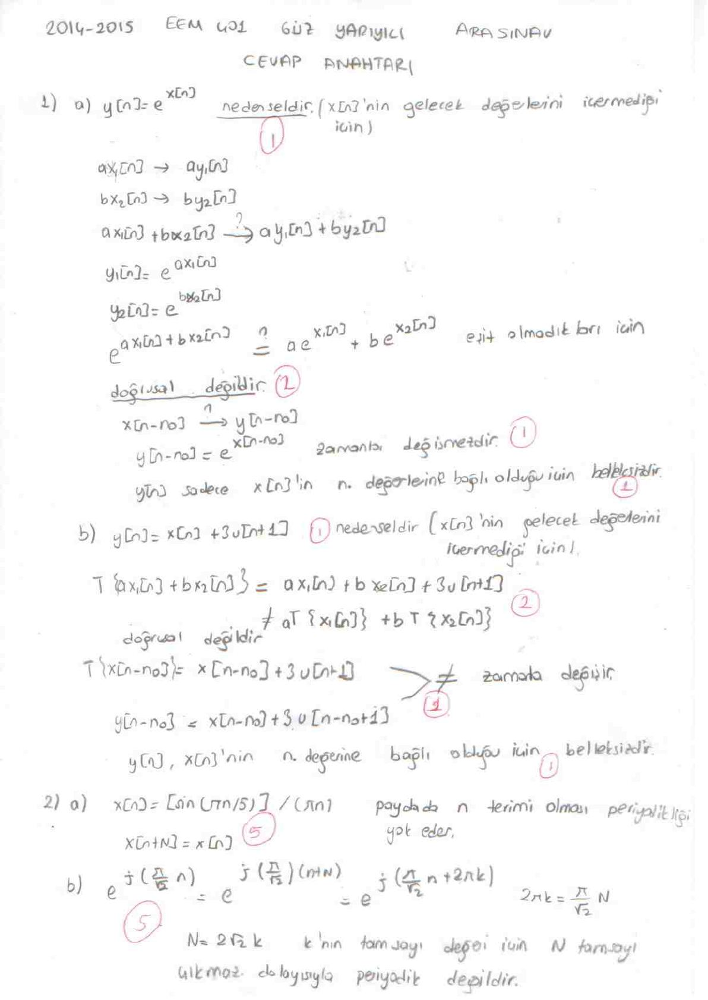
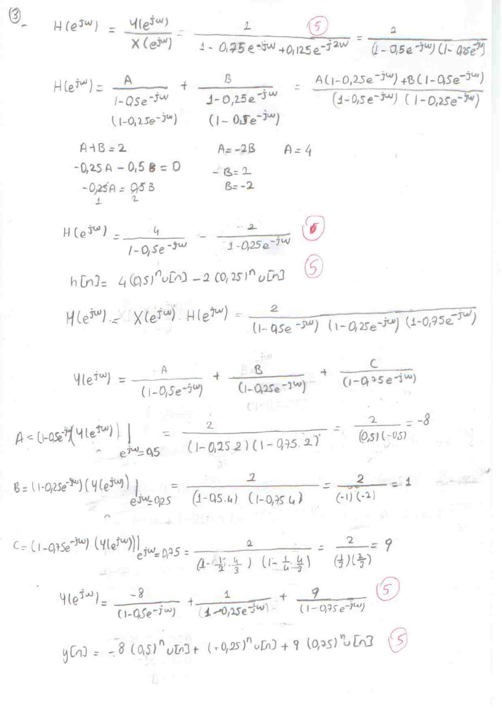
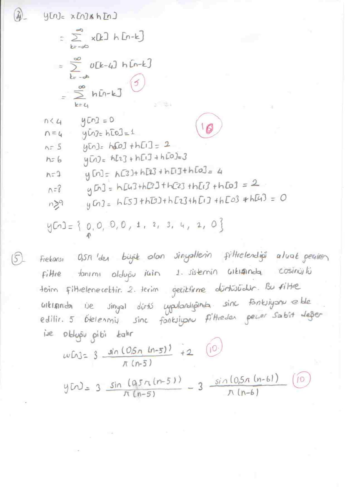
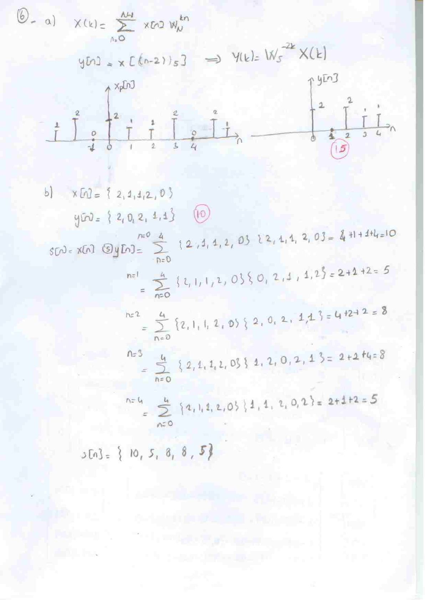

A scanned, handwritten four-page sheet titled "2014-2015 Fall Semester Midterm Exam Answer Key" for the course **EEM401 Digital Signal Processing** (taught by Asst. Prof. Dr. Selda Güney). The exam paper itself is not in the file; the questions are inferred from the solutions, so they are brief and deduced. The red circles are point values. The scanned PDF can be downloaded at the end of the post.

## 1. System properties

**a) y[n] = e^(x[n])**
- Causal: it does not involve future values of x[n].
- Not linear: for the input a·x1 + b·x2, e^(a·x1 + b·x2) ≠ a·e^(x1) + b·e^(x2).
- Time-invariant: the input x[n − n0] gives e^(x[n − n0]) = y[n − n0].
- Memoryless: y[n] depends only on the value of x[n] at the same n.

**b) y[n] = x[n] + 3u[n + 1]**
- Causal (does not involve future values of x).
- Not linear: T{a·x1 + b·x2} = a·x1 + b·x2 + 3u[n+1] ≠ a·T{x1} + b·T{x2}.
- Time-varying: T{x[n − n0]} = x[n − n0] + 3u[n + 1] ≠ y[n − n0] = x[n − n0] + 3u[n − n0 + 1].
- Memoryless.

## 2. Periodicity

**a)** x[n] = sin(πn/5) / (πn): since there is an n term in the denominator, x[n + N] = x[n] cannot be satisfied; it is not periodic.
**b)** e^(j(π/√2)n): for periodicity we need (π/√2)N = 2πk, i.e. N = 2√2·k; N is not an integer for any integer k, so it is not periodic.

## 3. Impulse response from the frequency response

Frequency response H(e^jω) = Y(e^jω)/X(e^jω) = 2 / (1 − 0.75e^(−jω) + 0.125e^(−j2ω)) = 2 / [(1 − 0.5e^(−jω))(1 − 0.25e^(−jω))].
Partial fractions: A + B = 2, −0.25A − 0.5B = 0 ⇒ A = 4, B = −2:

H(e^jω) = 4/(1 − 0.5e^(−jω)) − 2/(1 − 0.25e^(−jω)) ⇒ **h[n] = 4(0.5)ⁿu[n] − 2(0.25)ⁿu[n]**.

For the input X(e^jω) = 1/(1 − 0.75e^(−jω)) (i.e. x[n] = (0.75)ⁿu[n]):
Y(e^jω) = 2 / [(1 − 0.5e^(−jω))(1 − 0.25e^(−jω))(1 − 0.75e^(−jω))] = A/(1 − 0.5e^(−jω)) + B/(1 − 0.25e^(−jω)) + C/(1 − 0.75e^(−jω)) and A = −8, B = 1, C = 9:

**y[n] = [−8(0.5)ⁿ + (0.25)ⁿ + 9(0.75)ⁿ]·u[n]**. Check: y[0] = −8 + 1 + 9 = 2 = H(∞)·x[0] ✓.

## 4. Convolution

y[n] = x[n] * h[n] = Σ x[k]h[n − k]; for x[k] = u[k − 4] (a step starting at 4), y[n] = Σ_{k=4}^{∞} h[n − k]. For n < 4, y[n] = 0; n = 4: h[0] = 1; n = 5: h[0] + h[1] = 2; n = 6: 3; n = 7: 4; n = 8: 2; n ≥ 9: 0. Result: **y[n] = {0, 0, 0, 0, 1, 2, 3, 4, 2, 0}** (n = 0 … 9, the first element indicated by the arrow on the paper is n = 0).

## 5. Ideal low-pass filter

Since the filter is defined as a low-pass filter that rejects signals with frequencies greater than 0.5π, the cosine term will be filtered out at the output of the first system. The second term is a delayed impulse; when an impulse is applied, the output of this filter is a sinc function. The constant value that passes through the sinc function shifted by 5 remains as it is:

w[n] = 3·sin(0.5π(n − 5)) / (π(n − 5)) + 2

Output: **y[n] = 3·sin(0.5π(n − 5)) / (π(n − 5)) − 3·sin(0.5π(n − 6)) / (π(n − 6))**.

## 6. Circular shift and circular convolution (N = 5)

**a)** X(k) = Σ_{n=0}^{N−1} x[n]·W_N^{kn}. For the circular shift y[n] = x[((n − 2))₅], Y(k) = W₅^{−2k}·X(k) is written and the periodically extended sequence is sketched (for x[n] = {2, 1, 1, 2, 0}, y[n] = {2, 0, 2, 1, 1}).
*Note: With the definition W_N = e^(−j2π/N), a circular delay of n0 gives Y(k) = W_N^{kn0}·X(k); the sign of the exponent on the paper is inconsistent with this definition (for n0 = 2 it should be W₅^{2k}).*

**b)** The 5-point circular convolution of the sequences x[n] = {2, 1, 1, 2, 0} and y[n] = {2, 0, 2, 1, 1}, s[n] = x[n] ⊛ y[n]: **s[n] = {10, 5, 8, 8, 5}** (for example, s[0] = 2·2 + 1·1 + 1·1 + 2·2 + 0 = 10).

