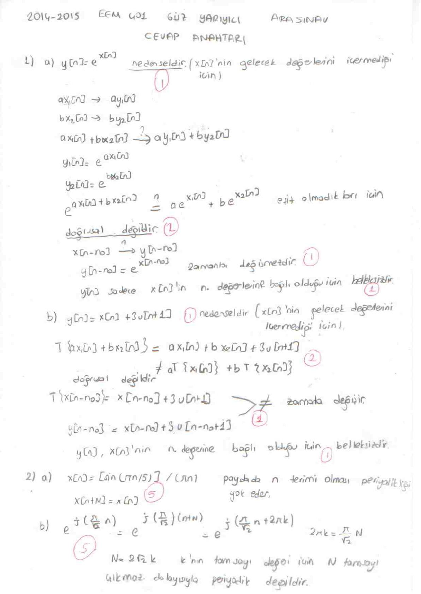
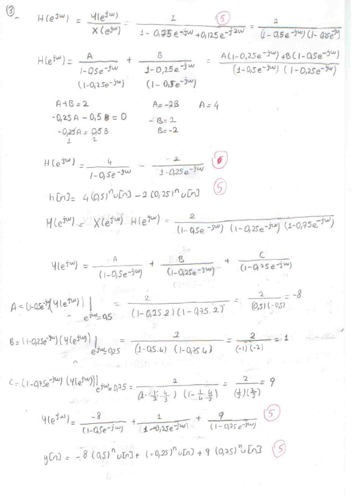
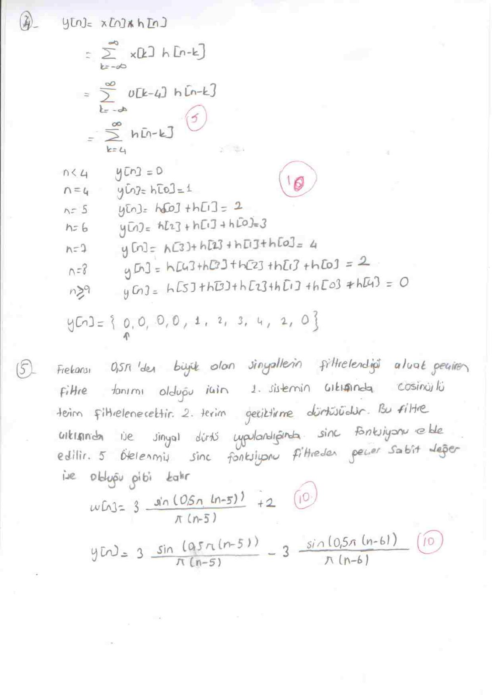
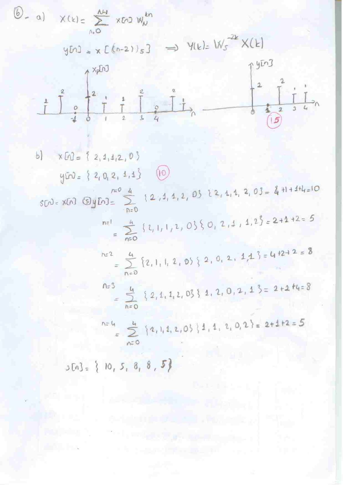

**EEM401 Sayısal İşaret İşleme** dersinin "2014-2015 Güz Yarıyılı Ara Sınav Cevap Anahtarı" başlıklı, el yazısı dört sayfalık taranmış kâğıdı (Yrd. Doç. Dr. Selda Güney'in dersi). Soru kâğıdı dosyada yok; sorular çözümlerden çıkarıldığı için kısa ve çıkarımsaldır. Kırmızı yuvarlaklar puanlardır. Taranmış PDF yazının sonunda indirilebilir.

## 1. Sistem özellikleri

**a) y[n] = e^(x[n])**
- Nedensel: x[n]'in gelecek değerlerini içermez.
- Doğrusal değil: a·x1 + b·x2 girişi için e^(a·x1 + b·x2) ≠ a·e^(x1) + b·e^(x2).
- Zamanla değişmez: x[n − n0] girişi e^(x[n − n0]) = y[n − n0] verir.
- Belleksiz: y[n] yalnızca x[n]'in aynı n'deki değerine bağlıdır.

**b) y[n] = x[n] + 3u[n + 1]**
- Nedensel (x'in gelecek değerini içermez).
- Doğrusal değil: T{a·x1 + b·x2} = a·x1 + b·x2 + 3u[n+1] ≠ a·T{x1} + b·T{x2}.
- Zamanla değişen: T{x[n − n0]} = x[n − n0] + 3u[n + 1] ≠ y[n − n0] = x[n − n0] + 3u[n − n0 + 1].
- Belleksiz.

## 2. Periyodiklik

**a)** x[n] = sin(πn/5) / (πn): paydada n terimi olduğundan x[n + N] = x[n] sağlanamaz; periyodik değildir.
**b)** e^(j(π/√2)n): periyodiklik için (π/√2)N = 2πk, yani N = 2√2·k; hiçbir tamsayı k için N tamsayı çıkmaz, periyodik değildir.

## 3. Frekans yanıtından dürtü cevabı

Frekans yanıtı H(e^jω) = Y(e^jω)/X(e^jω) = 2 / (1 − 0,75e^(−jω) + 0,125e^(−j2ω)) = 2 / [(1 − 0,5e^(−jω))(1 − 0,25e^(−jω))].
Kısmi kesirler: A + B = 2, −0,25A − 0,5B = 0 ⇒ A = 4, B = −2:

H(e^jω) = 4/(1 − 0,5e^(−jω)) − 2/(1 − 0,25e^(−jω)) ⇒ **h[n] = 4(0,5)ⁿu[n] − 2(0,25)ⁿu[n]**.

Giriş X(e^jω) = 1/(1 − 0,75e^(−jω)) (yani x[n] = (0,75)ⁿu[n]) için:
Y(e^jω) = 2 / [(1 − 0,5e^(−jω))(1 − 0,25e^(−jω))(1 − 0,75e^(−jω))] = A/(1 − 0,5e^(−jω)) + B/(1 − 0,25e^(−jω)) + C/(1 − 0,75e^(−jω)) ve A = −8, B = 1, C = 9:

**y[n] = [−8(0,5)ⁿ + (0,25)ⁿ + 9(0,75)ⁿ]·u[n]**. Kontrol: y[0] = −8 + 1 + 9 = 2 = H(∞)·x[0] ✓.

## 4. Evrişim

y[n] = x[n] * h[n] = Σ x[k]h[n − k]; x[k] = u[k − 4] (4'ten başlayan basamak) için y[n] = Σ_{k=4}^{∞} h[n − k]. n < 4 için y[n] = 0; n = 4: h[0] = 1; n = 5: h[0] + h[1] = 2; n = 6: 3; n = 7: 4; n = 8: 2; n ≥ 9: 0. Sonuç: **y[n] = {0, 0, 0, 0, 1, 2, 3, 4, 2, 0}** (n = 0 … 9, kâğıtta okla gösterilen ilk eleman n = 0).

## 5. İdeal alçak geçiren süzgeç

Frekansı 0,5π'den büyük olan sinyalleri atan bir alçak geçiren süzgeç tanımlı olduğundan, birinci sistemin çıkışında kosinüslü terim süzülecektir. İkinci terim gecikme dürtüsüdür; bu süzgeç çıkışında dürtü uygulandığında sinc fonksiyonu elde edilir. 5 ötelenmiş sinc fonksiyonu geçen sabit değer ise olduğu gibi kalır:

w[n] = 3·sin(0,5π(n − 5)) / (π(n − 5)) + 2

Çıkış: **y[n] = 3·sin(0,5π(n − 5)) / (π(n − 5)) − 3·sin(0,5π(n − 6)) / (π(n − 6))**.

## 6. Dairesel kaydırma ve dairesel evrişim (N = 5)

**a)** X(k) = Σ_{n=0}^{N−1} x[n]·W_N^{kn}. y[n] = x[((n − 2))₅] dairesel kaydırması için Y(k) = W₅^{−2k}·X(k) yazılmış ve periyodik uzatılmış dizi çizilmiştir (x[n] = {2, 1, 1, 2, 0} için y[n] = {2, 0, 2, 1, 1}).
*Not: W_N = e^(−j2π/N) tanımıyla n0 kadar dairesel gecikme, Y(k) = W_N^{kn0}·X(k) verir; kâğıttaki üs işareti bu tanımla uyuşmaz (n0 = 2 için W₅^{2k} olmalı).*

**b)** x[n] = {2, 1, 1, 2, 0} ve y[n] = {2, 0, 2, 1, 1} dizilerinin 5 noktalı dairesel evrişimi s[n] = x[n] ⊛ y[n]: **s[n] = {10, 5, 8, 8, 5}** (örneğin s[0] = 2·2 + 1·1 + 1·1 + 2·2 + 0 = 10).

