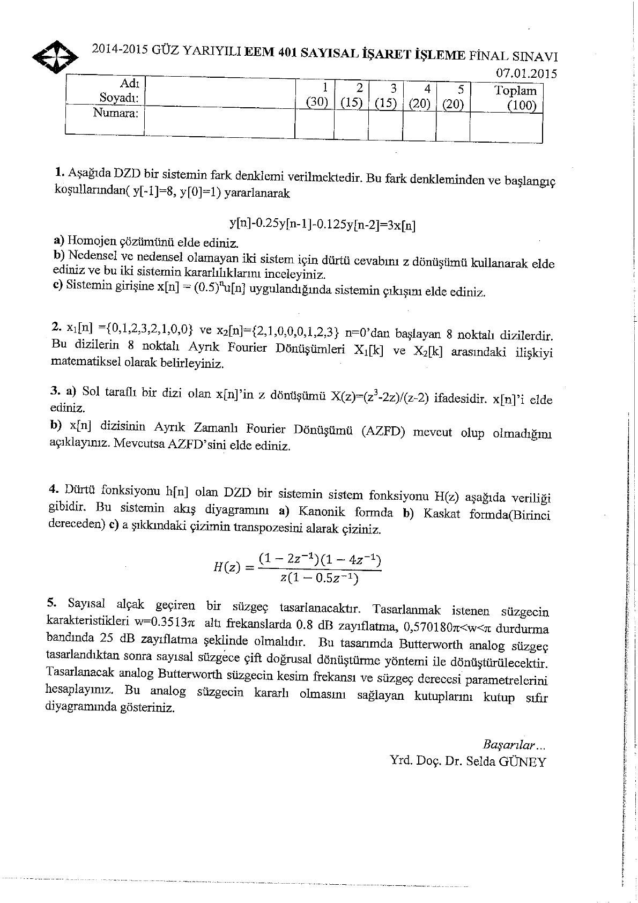
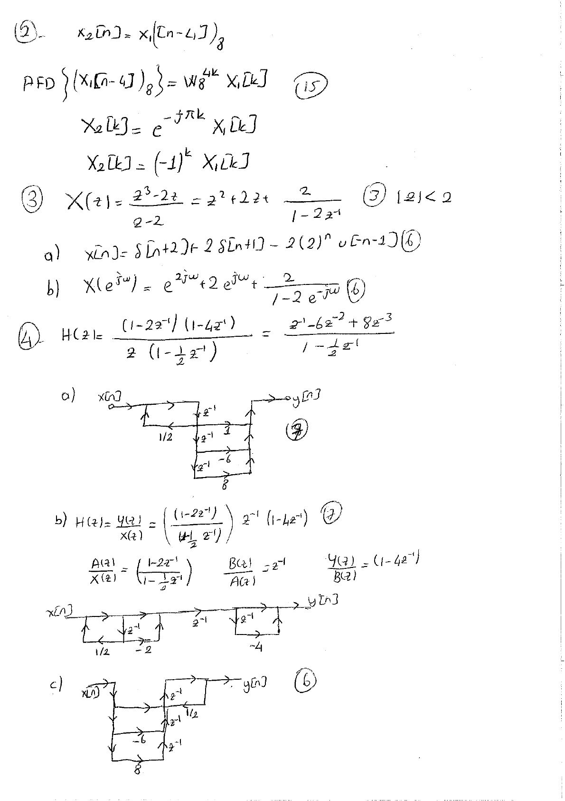
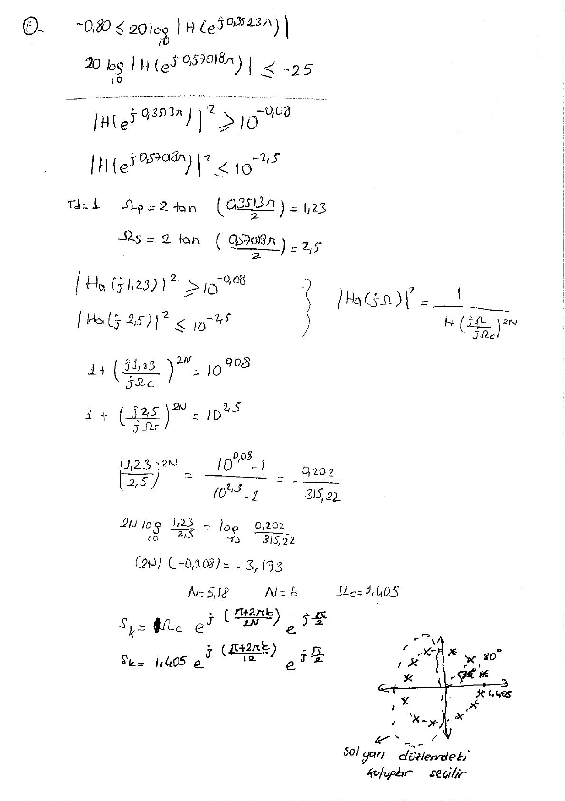

**EEM401 Digital Signal Processing** **final exam** of the 2014–2015 fall semester (07.01.2015, Asst. Prof. Dr. Selda Güney) and my handwritten solution (the "final exam solutions" obtained after the exam). The name and number fields are blank. The scanned PDF can be downloaded at the end of the post.

## Questions

1. The difference equation of an LTI system is y[n] − 0.25y[n−1] − 0.125y[n−2] = 3x[n], with initial conditions y[−1] = 8, y[0] = 1. (30 points)
   a) Obtain the homogeneous solution.
   b) Obtain the impulse response for a causal and a non-causal system using the z-transform, and examine the stability of these two systems.
   c) Obtain the output when the input x[n] = (0.5)ⁿu[n] is applied to the system.
2. x1[n] = {0, 1, 2, 3, 2, 1, 0, 0} and x2[n] = {2, 1, 0, 0, 0, 1, 2, 3} are 8-point sequences starting at n = 0. Determine mathematically the relationship between their 8-point DFTs X1[k] and X2[k]. (15 points)
3. a) The z-transform of a left-sided sequence x[n] is X(z) = (z³ − 2z)/(z − 2). Obtain x[n]. b) Explain whether the DTFT of x[n] exists; if it does, obtain it. (15 points)
4. Draw the flow graph of the system function H(z) = (1 − 2z⁻¹)(1 − 4z⁻¹) / [z(1 − 0.5z⁻¹)] in a) canonical form, b) cascade form (first-order sections), c) by taking the transpose of the drawing in part a. (20 points)
5. Digital low-pass filter: 0.8 dB attenuation at frequencies below ω = 0.3513π, and 25 dB attenuation in the stopband 0.57018π < ω < π. An analog Butterworth filter will be designed and converted to a digital filter using the **bilinear transform** method. Calculate the cutoff frequency and order of the analog filter; show the poles that ensure stability on the pole-zero diagram. (20 points)

## Solution

**1a.** Characteristic equation: λ² − 0.25λ − 0.125 = 0, so λ = 0.5 and λ = −0.25. y_h[n] = A1(0.5)ⁿ + A2(−0.25)ⁿ. For n = 1, y[1] = 0.25·y[0] + 0.125·y[−1] = 0.25 + 1 = 1.25. y_h[0] = A1 + A2 = 1 and y_h[1] = 0.5A1 − 0.25A2 = 1.25 ⇒ A2 = −1, A1 = 2:
**y_h[n] = 2(0.5)ⁿ − (−0.25)ⁿ**.

**1b.** H(z) = 3 / (1 − ¼z⁻¹ − ⅛z⁻²) = 3 / [(1 + ¼z⁻¹)(1 − ½z⁻¹)] = 1/(1 + ¼z⁻¹) + 2/(1 − ½z⁻¹).
- Causal (|z| > 1/2): **h[n] = [(−¼)ⁿ + 2(½)ⁿ]u[n]**; the poles are inside the unit circle, so it is **stable**.
- Non-causal (|z| < 1/4): **h[n] = [−(−¼)ⁿ − 2(½)ⁿ]u[−n−1]**; the ROC does not include the unit circle, so it is **unstable**.

**1c.** Y(z) = X(z)H(z) = 3 / [(1 + ¼z⁻¹)(1 − ½z⁻¹)²] = A/(1 + ¼z⁻¹) + B/(1 − ½z⁻¹)² + C/(1 − ½z⁻¹); A = 1/3, B = 2, C = 2/3:
**y[n] = [(1/3)(−¼)ⁿ + 2(n + 1)(½)ⁿ + (2/3)(½)ⁿ]u[n]**. Check: y[0] = 1/3 + 2 + 2/3 = 3 = 3x[0] ✓.

**2.** x2[n] = x1[((n − 4))₈] (circular shift by 4 samples). By the circular shift property, X2[k] = W₈^{4k}·X1[k] = e^{−jπk}·X1[k]:
**X2[k] = (−1)ᵏ·X1[k]**.

**3a.** X(z) = (z³ − 2z)/(z − 2) = z² + 2z + 2/(1 − 2z⁻¹), ROC: |z| < 2 (left-sided). **x[n] = δ[n + 2] + 2δ[n + 1] − 2·2ⁿ·u[−n − 1]**.
*Note: On the paper the third term is written as "−2(2)ⁿu[n−1]"; for a left-sided ROC the correct expression is u[−n−1].*
**3b.** Since the ROC (|z| < 2) includes the unit circle, the DTFT exists: **X(e^jω) = e^{j2ω} + 2e^{jω} + 2/(1 − 2e^{−jω})**.

**4.** H(z) = (1 − 2z⁻¹)(1 − 4z⁻¹) / [z(1 − 0.5z⁻¹)] = (z⁻¹ − 6z⁻² + 8z⁻³)/(1 − 0.5z⁻¹).
- a) Canonical form: a single feedback branch (coefficient 1/2) and feedforward branches with z⁻¹, −6 z⁻², 8 z⁻³ (that is, coefficients 1, −6, 8).
- b) Cascade form: [(1 − 2z⁻¹)/(1 − ½z⁻¹)]·z⁻¹·(1 − 4z⁻¹); first a first-order section with 1/2 feedback and a −2 feedforward branch, then a delay, then an FIR section with coefficient −4.
- c) Transposed form: all branches of the flow graph in part a) are reversed, and the input and output are interchanged. (The drawings are on page 3.)

**5.** Requirements: |H(e^{j0.3513π})|² ≥ 10^{−0.08} and |H(e^{j0.57018π})|² ≤ 10^{−2.5}. With Td = 1, prewarping: Ωp = 2·tan(0.3513π/2) = 1.23; Ωs = 2·tan(0.57018π/2) = 2.5. With |Ha(jΩ)|² = 1/(1 + (Ω/Ωc)^{2N}):
(1.23/2.5)^{2N} = (10^{0.08} − 1)/(10^{2.5} − 1) = 0.202/315.22 ⇒ 2N·log10(1.23/2.5) = log10(0.202/315.22) ⇒ N = 5.18 ⇒ **N = 6**, **Ωc = 1.405**. The poles are s_k = Ωc·e^{j(π + 2πk)/12}·e^{jπ/2}; only the 6 poles in the left half-plane are selected (for stability), and they lie on a circle of radius Ωc = 1.405.

