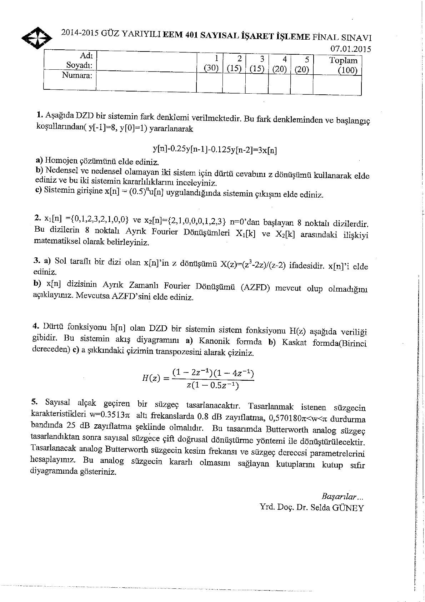
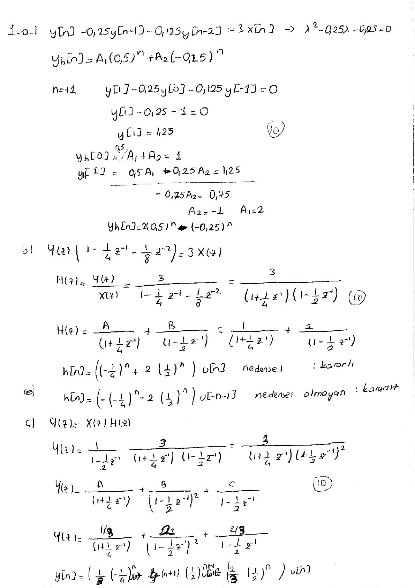
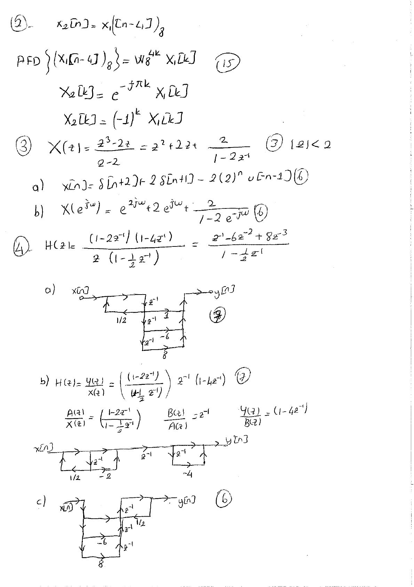
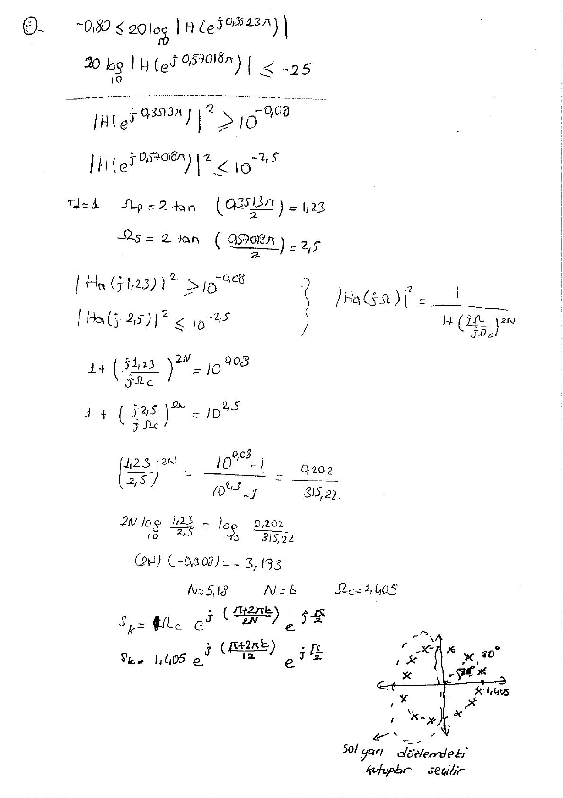

**EEM401 Sayısal İşaret İşleme** dersinin 2014–2015 güz yarıyılı **final sınavı** (07.01.2015, Yrd. Doç. Dr. Selda Güney) ve el yazısı çözümüm (sınav sonrası alınan "final soru çözümleri"). Ad ve numara alanları boştur. Taranmış PDF yazının sonunda indirilebilir.

## Sorular

1. DZD bir sistemin fark denklemi y[n] − 0,25y[n−1] − 0,125y[n−2] = 3x[n], başlangıç koşulları y[−1] = 8, y[0] = 1. (30 puan)
   a) Homojen çözümünü elde ediniz.
   b) Nedensel ve nedensel olmayan iki sistem için dürtü cevabını z dönüşümü kullanarak elde ediniz ve bu iki sistemin kararlılıklarını inceleyiniz.
   c) Sistemin girişine x[n] = (0,5)ⁿu[n] uygulandığında çıkışı elde ediniz.
2. x1[n] = {0, 1, 2, 3, 2, 1, 0, 0} ve x2[n] = {2, 1, 0, 0, 0, 1, 2, 3}, n = 0'dan başlayan 8 noktalı dizilerdir. Bu dizilerin 8 noktalı AFD'leri X1[k] ve X2[k] arasındaki ilişkiyi matematiksel olarak belirleyiniz. (15 puan)
3. a) Sol taraflı bir dizi olan x[n]'in z dönüşümü X(z) = (z³ − 2z)/(z − 2). x[n]'i elde ediniz. b) x[n]'in AZFD'sinin mevcut olup olmadığını açıklayınız; mevcutsa elde ediniz. (15 puan)
4. H(z) = (1 − 2z⁻¹)(1 − 4z⁻¹) / [z(1 − 0,5z⁻¹)] sistem fonksiyonunun akış diyagramını a) kanonik formda, b) kaskat formda (birinci dereceden), c) a şıkkındaki çizimin transpozesini alarak çiziniz. (20 puan)
5. Sayısal alçak geçiren süzgeç: ω = 0,3513π altı frekanslarda 0,8 dB zayıflatma, 0,57018π < ω < π durdurma bandında 25 dB zayıflatma. Butterworth analog süzgeç tasarlanıp **çift doğrusal dönüşüm** yöntemiyle sayısal süzgece dönüştürülecektir. Analog süzgecin kesim frekansı ve derecesini hesaplayınız; kararlılığı sağlayan kutupları kutup-sıfır diyagramında gösteriniz. (20 puan)

## Çözüm

**1a.** Karakteristik denklem λ² − 0,25λ − 0,125 = 0, λ = 0,5 ve λ = −0,25. y_h[n] = A1(0,5)ⁿ + A2(−0,25)ⁿ. n = 1 için y[1] = 0,25·y[0] + 0,125·y[−1] = 0,25 + 1 = 1,25. y_h[0] = A1 + A2 = 1 ve y_h[1] = 0,5A1 − 0,25A2 = 1,25 ⇒ A2 = −1, A1 = 2:
**y_h[n] = 2(0,5)ⁿ − (−0,25)ⁿ**.

**1b.** H(z) = 3 / (1 − ¼z⁻¹ − ⅛z⁻²) = 3 / [(1 + ¼z⁻¹)(1 − ½z⁻¹)] = 1/(1 + ¼z⁻¹) + 2/(1 − ½z⁻¹).
- Nedensel (|z| > 1/2): **h[n] = [(−¼)ⁿ + 2(½)ⁿ]u[n]**; kutuplar birim çember içinde, **kararlı**.
- Nedensel olmayan (|z| < 1/4): **h[n] = [−(−¼)ⁿ − 2(½)ⁿ]u[−n−1]**; ROC birim çemberi içermez, **kararsız**.

**1c.** Y(z) = X(z)H(z) = 3 / [(1 + ¼z⁻¹)(1 − ½z⁻¹)²] = A/(1 + ¼z⁻¹) + B/(1 − ½z⁻¹)² + C/(1 − ½z⁻¹); A = 1/3, B = 2, C = 2/3:
**y[n] = [(1/3)(−¼)ⁿ + 2(n + 1)(½)ⁿ + (2/3)(½)ⁿ]u[n]**. Kontrol: y[0] = 1/3 + 2 + 2/3 = 3 = 3x[0] ✓.

**2.** x2[n] = x1[((n − 4))₈] (4 örnek dairesel kaydırma). Dairesel kaydırma özelliğiyle X2[k] = W₈^{4k}·X1[k] = e^{−jπk}·X1[k]:
**X2[k] = (−1)ᵏ·X1[k]**.

**3a.** X(z) = (z³ − 2z)/(z − 2) = z² + 2z + 2/(1 − 2z⁻¹), ROC: |z| < 2 (sol taraflı). **x[n] = δ[n + 2] + 2δ[n + 1] − 2·2ⁿ·u[−n − 1]**.
*Not: Kâğıtta üçüncü terim "−2(2)ⁿu[n−1]" gibi yazılmış; sol taraflı ROC için doğru ifade u[−n−1]'dir.*
**3b.** ROC (|z| < 2) birim çemberi içerdiğinden AZFD mevcuttur: **X(e^jω) = e^{j2ω} + 2e^{jω} + 2/(1 − 2e^{−jω})**.

**4.** H(z) = (1 − 2z⁻¹)(1 − 4z⁻¹) / [z(1 − 0,5z⁻¹)] = (z⁻¹ − 6z⁻² + 8z⁻³)/(1 − 0,5z⁻¹).
- a) Kanonik form: tek geri besleme kolu (katsayı 1/2) ve ileri kollar z⁻¹, −6 z⁻², 8 z⁻³ katsayılı (bu: katsayılar 1, −6, 8).
- b) Kaskat form: [(1 − 2z⁻¹)/(1 − ½z⁻¹)]·z⁻¹·(1 − 4z⁻¹); önce 1/2 geribeslemeli ve −2 ileri kollu birinci derece bölüm, ardından bir gecikme, ardından −4 katsayılı FIR bölümü.
- c) Transpoze form: a) şıkkındaki akış şemasının tüm dalları ters çevrilip giriş ile çıkış yer değiştirilir. (Çizimler sayfa 3'tedir.)

**5.** Gereksinimler: |H(e^{j0,3513π})|² ≥ 10^{−0,08} ve |H(e^{j0,57018π})|² ≤ 10^{−2,5}. Td = 1 için ön bükme: Ωp = 2·tan(0,3513π/2) = 1,23; Ωs = 2·tan(0,57018π/2) = 2,5. |Ha(jΩ)|² = 1/(1 + (Ω/Ωc)^{2N}) ile:
(1,23/2,5)^{2N} = (10^{0,08} − 1)/(10^{2,5} − 1) = 0,202/315,22 ⇒ 2N·log10(1,23/2,5) = log10(0,202/315,22) ⇒ N = 5,18 ⇒ **N = 6**, **Ωc = 1,405**. Kutuplar s_k = Ωc·e^{j(π + 2πk)/12}·e^{jπ/2}; yalnızca sol yarı düzlemdeki 6 kutup seçilir (kararlılık için), Ωc = 1,405 yarıçaplı çember üzerindedir.

