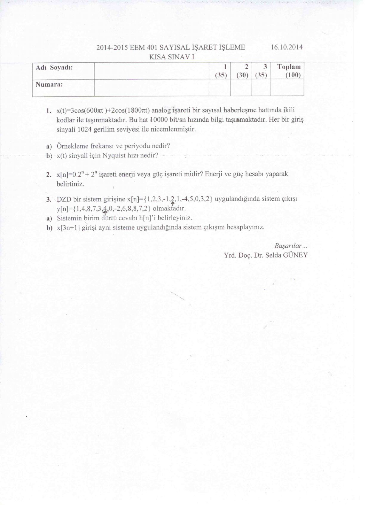
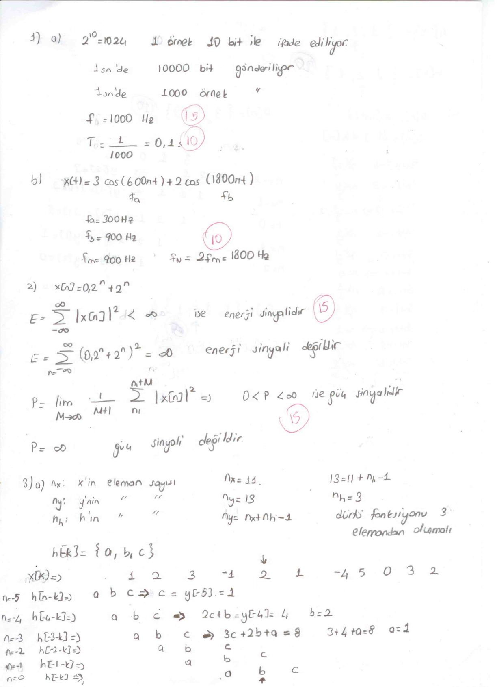
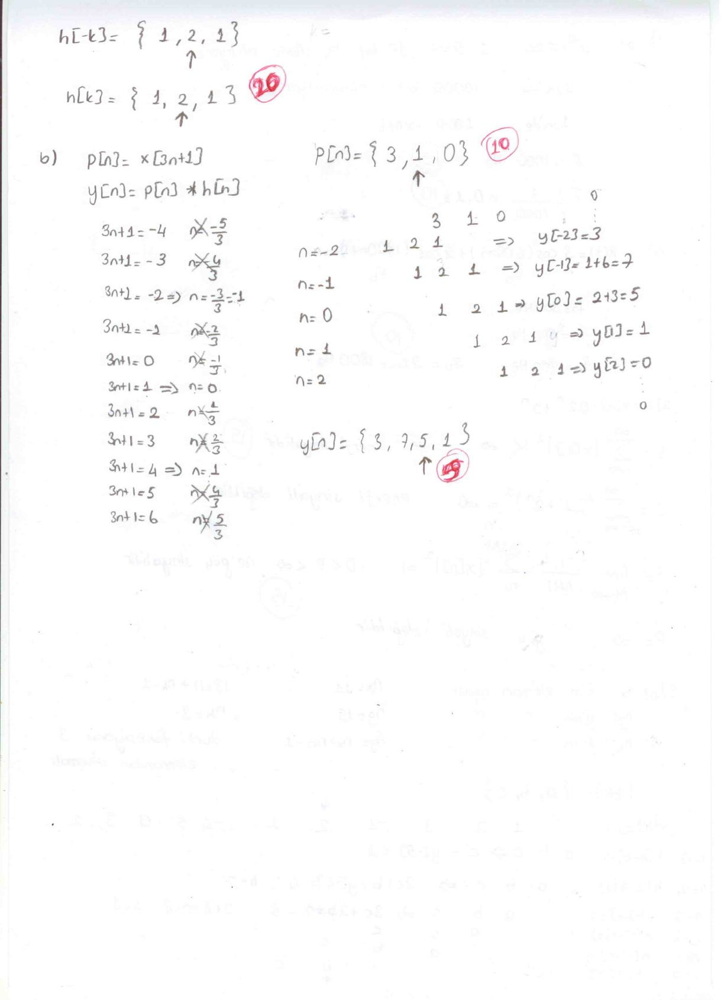

**EEM401 Digital Signal Processing**, 2014–2015 fall semester **Quiz I** (16.10.2014, Asst. Prof. Dr. Selda Güney) and my annotated handwritten paper. The name and student number fields on the exam paper are blank. The scanned PDF can be downloaded at the end of the post.

## Questions

1. The analog signal x(t) = 3cos(600πt) + 2cos(1800πt) is carried over a digital communication link using binary codes. This link carries information at a rate of 10,000 bit/s. Each input sample is quantized with 1024 voltage levels. (35 points)
   - a) What are the sampling frequency and the sampling period?
   - b) What is the Nyquist rate for the signal x(t)?
2. Is the signal x[n] = 0.2ⁿ + 2ⁿ an energy signal or a power signal? Determine by computing the energy and the power. (30 points)
3. When the input x[n] = {1, 2, 3, −1, **2**, 1, −4, 5, 0, 3, 2} is applied to an LTI system, the system output is y[n] = {1, 4, 8, 7, 3, **4**, 0, −2, 6, 8, 8, 7, 2} (the bold number is at n = 0). (35 points)
   - a) Determine the unit impulse response h[n] of the system.
   - b) Compute the system output when the input x[3n + 1] is applied to the same system.

## Solution

**1a.** Since 2¹⁰ = 1024, each sample is represented with 10 bits. Since the link carries 10,000 bits per second, 1000 samples are sent per second: **fs = 1000 Hz**; the period is Ts = 1/fs.
*Note: Ts = 1/1000 = 0.001 s = 1 ms; the handwritten paper says "0.1 s", the correct value is 1 ms.*

**1b.** x(t) = 3cos(600πt) + 2cos(1800πt): fa = 300 Hz, fb = 900 Hz, the highest frequency is fm = 900 Hz, so the **Nyquist rate is fN = 2fm = 1800 Hz**.
*Note: Since the link's sampling frequency (1000 Hz) is lower than the Nyquist rate, this signal is transmitted over this link with aliasing.*

**2.** The energy is E = Σ |x[n]|² = Σ (0.2ⁿ + 2ⁿ)² = ∞ (0.2ⁿ diverges as n → −∞ and 2ⁿ diverges as n → +∞); therefore it is not an energy signal. The power is P = lim 1/(2M+1) Σ |x[n]|² = ∞, so it is not a power signal either: the signal is neither an energy signal nor a power signal.

**3a.** The sequence x has 11 elements and y has 13 elements. Since n_y = n_x + n_h − 1, we have 13 = 11 + n_h − 1 and **n_h = 3**. From the indices where the convolution begins (y[−5] = 1 = c, y[−4] = 4 = 2c + b, y[−3] = 8 = 3c + 2b + a), h = {a, b, c} is found: c = 1, b = 2, a = 1. The impulse response is **h[n] = {1, **2**, 1}** (n = −1, 0, 1).

**3b.** p[n] = x[3n + 1]: the integers n for which 3n + 1 falls within the domain of x are n = −1 (x[−2] = 3), n = 0 (x[1] = 1) and n = 1 (x[4] = 0). So p[n] = {3, **1**, 0}. Computing y[n] = p[n] * h[n]: y[−2] = 3, y[−1] = 3·2 + 1·1 = 7, y[0] = 3·1 + 1·2 + 0 = 5, y[1] = 1·1 + 0·2 = 1, y[2] = 0. So **y[n] = {3, 7, 5, 1}** (n = −2 … 1).

