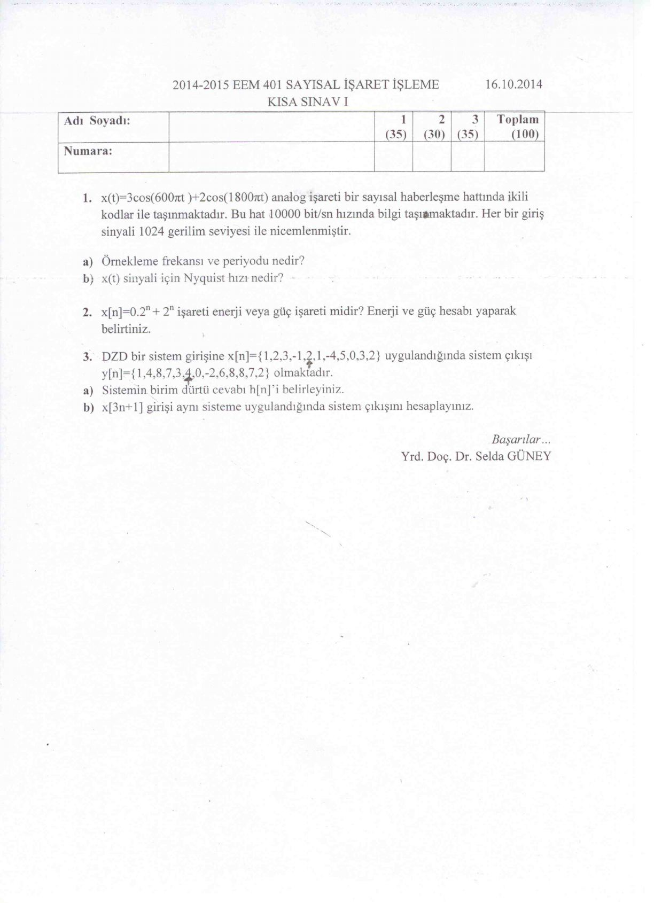
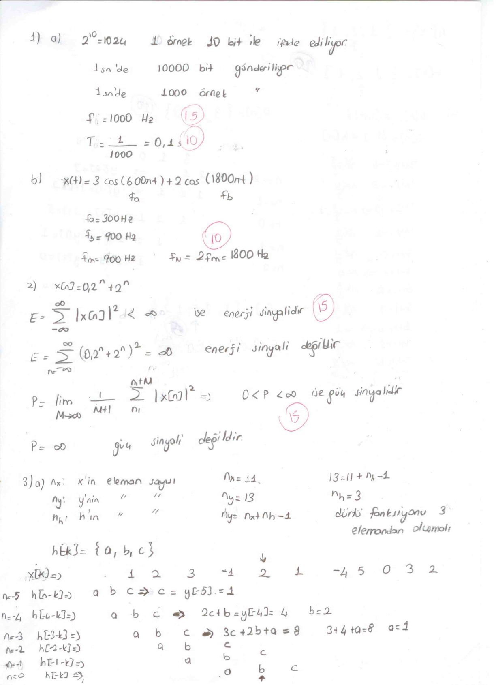
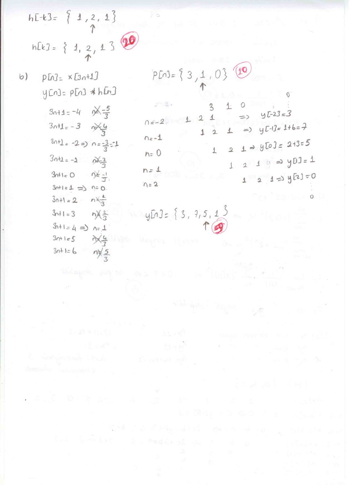

**EEM401 Sayısal İşaret İşleme** dersinin 2014–2015 güz yarıyılı **Kısa Sınav I**'i (16.10.2014, Yrd. Doç. Dr. Selda Güney) ve benim notlandırılmış el yazısı kâğıdım. Sınav kâğıdının ad ve numara alanları boştur. Taranmış PDF yazının sonunda indirilebilir.

## Sorular

1. x(t) = 3cos(600πt) + 2cos(1800πt) analog işareti bir sayısal haberleşme hattında ikili kodlarla taşınmaktadır. Bu hat 10.000 bit/sn hızında bilgi taşımaktadır. Her bir giriş sinyali 1024 gerilim seviyesi ile nicemlenmiştir. (35 puan)
   - a) Örnekleme frekansı ve periyodu nedir?
   - b) x(t) sinyali için Nyquist hızı nedir?
2. x[n] = 0,2ⁿ + 2ⁿ işareti enerji veya güç işareti midir? Enerji ve güç hesabı yaparak belirtiniz. (30 puan)
3. DZD bir sistemin girişine x[n] = {1, 2, 3, −1, **2**, 1, −4, 5, 0, 3, 2} uygulandığında sistem çıkışı y[n] = {1, 4, 8, 7, 3, **4**, 0, −2, 6, 8, 8, 7, 2} olmaktadır (kalın rakam n = 0). (35 puan)
   - a) Sistemin birim dürtü cevabı h[n]'i belirleyiniz.
   - b) x[3n + 1] girişi aynı sisteme uygulandığında sistem çıkışını hesaplayınız.

## Çözüm

**1a.** 2¹⁰ = 1024 olduğundan her örnek 10 bitle ifade edilir. Hat saniyede 10.000 bit taşıdığına göre saniyede 1000 örnek gönderilir: **fs = 1000 Hz**; periyot Ts = 1/fs.
*Not: Ts = 1/1000 = 0,001 s = 1 ms'dir; el yazısı kâğıtta "0,1 s" yazılmıştır, doğrusu 1 ms.*

**1b.** x(t) = 3cos(600πt) + 2cos(1800πt): fa = 300 Hz, fb = 900 Hz, en yüksek frekans fm = 900 Hz, **Nyquist hızı fN = 2fm = 1800 Hz**.
*Not: Hattın örnekleme frekansı (1000 Hz) Nyquist hızından düşük olduğu için bu işaret bu hatta örtüşmeyle iletilir.*

**2.** Enerji E = Σ |x[n]|² = Σ (0,2ⁿ + 2ⁿ)² = ∞ (n → −∞'da 0,2ⁿ, n → +∞'da 2ⁿ ıraksar); bu yüzden enerji işareti değildir. Güç P = lim 1/(2M+1) Σ |x[n]|² = ∞ olduğundan güç işareti de değildir: işaret ne enerji ne güç işaretidir.

**3a.** x dizisinin 11 elemanı, y'nin 13 elemanı vardır. n_y = n_x + n_h − 1 olduğundan 13 = 11 + n_h − 1 ve **n_h = 3**. Evrişimin başladığı indekslerden (y[−5] = 1 = c, y[−4] = 4 = 2c + b, y[−3] = 8 = 3c + 2b + a) h = {a, b, c} bulunur: c = 1, b = 2, a = 1. Dürtü cevabı **h[n] = {1, **2**, 1}** (n = −1, 0, 1).

**3b.** p[n] = x[3n + 1]: 3n + 1 değerinin x'in tanım aralığında kalan tamsayı n'leri n = −1 (x[−2] = 3), n = 0 (x[1] = 1) ve n = 1 (x[4] = 0). Yani p[n] = {3, **1**, 0}. y[n] = p[n] * h[n] hesaplanınca: y[−2] = 3, y[−1] = 3·2 + 1·1 = 7, y[0] = 3·1 + 1·2 + 0 = 5, y[1] = 1·1 + 0·2 = 1, y[2] = 0. Yani **y[n] = {3, 7, 5, 1}** (n = −2 … 1).

