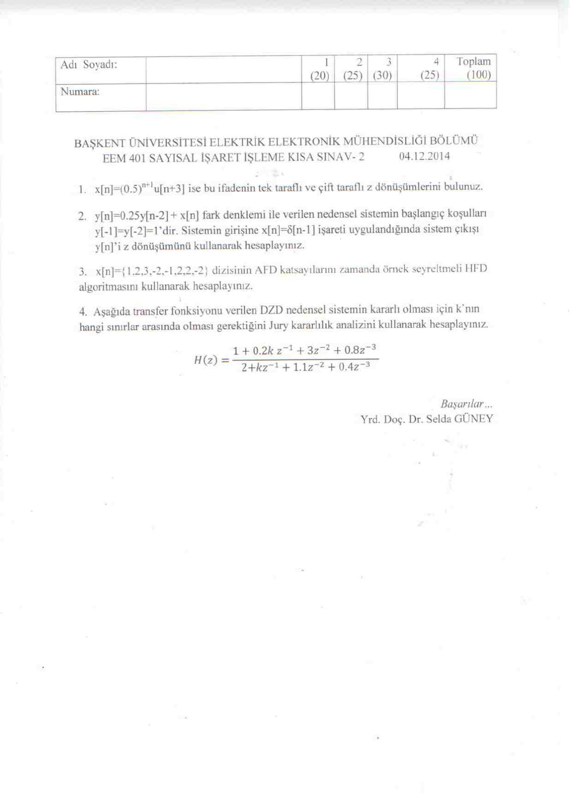
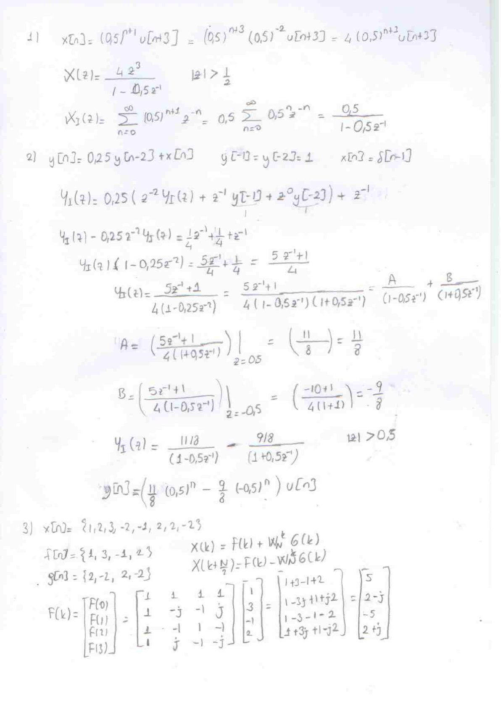
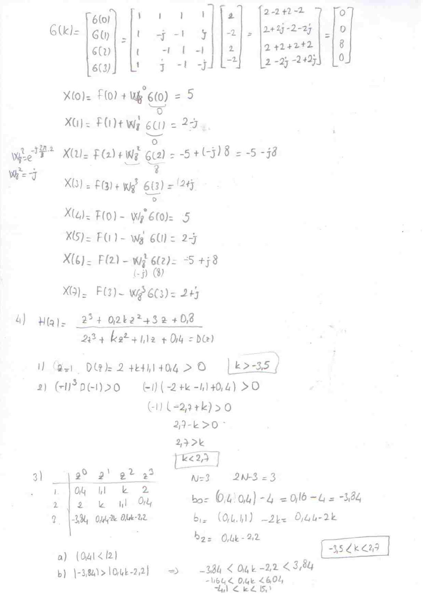

**Quiz 2** of the **EEM401 Digital Signal Processing** course (04.12.2014, Başkent University Electrical and Electronics Engineering, Asst. Prof. Dr. Selda Güney) and my handwritten solution. The name and number fields are blank. The scanned PDF can be downloaded at the end of the post.

## Questions

1. If x[n] = (0.5)^(n+1)·u[n+3], find the one-sided and two-sided z-transforms of this expression. (20 points)
2. The causal system given by the difference equation y[n] = 0.25·y[n−2] + x[n] has initial conditions y[−1] = y[−2] = 1. When the signal x[n] = δ[n−1] is applied to the system input, compute the system output y[n] using the z-transform. (25 points)
3. Compute the DFT coefficients of the sequence x[n] = {1, 2, 3, −2, −1, 2, 2, −2} using the decimation-in-time FFT algorithm. (30 points)
4. Using Jury stability analysis, determine the limits between which k must lie for the causal LTI system whose transfer function is given below to be stable. (25 points)
   H(z) = (1 + 0.2k·z⁻¹ + 3z⁻² + 0.8z⁻³) / (2 + k·z⁻¹ + 1.1z⁻² + 0.4z⁻³)

## Solution

**1.** x[n] = (0.5)^(n+3)·(0.5)^(−2)·u[n+3] = 4·(0.5)^(n+3)·u[n+3]. Two-sided: **X(z) = 4z³ / (1 − 0.5z⁻¹), |z| > 1/2**. One-sided (n ≥ 0): X_I(z) = Σ_{n=0}^{∞} (0.5)^(n+1) z⁻ⁿ = 0.5 / (1 − 0.5z⁻¹).

**2.** Using the one-sided z-transform with the initial conditions:
Y_I(z) = 0.25·(z⁻²Y_I(z) + z⁻¹y[−1] + y[−2]) + z⁻¹, i.e. Y_I(z)(1 − 0.25z⁻²) = (5z⁻¹ + 1)/4.
Y_I(z) = (5z⁻¹ + 1) / [4(1 − 0.5z⁻¹)(1 + 0.5z⁻¹)] = A/(1 − 0.5z⁻¹) + B/(1 + 0.5z⁻¹), A = 11/8, B = −9/8. Hence (|z| > 0.5):

**y[n] = [(11/8)(0.5)ⁿ − (9/8)(−0.5)ⁿ]·u[n]**

Check: y[0] = 11/8 − 9/8 = 0.25; from the difference equation, y[0] = 0.25·y[−2] + x[0] = 0.25 + 0 = 0.25 ✓.

**3.** For N = 8, x[n] is split into two 4-point sequences by even and odd indices: f[n] = {1, 3, −1, 2} (even indices) and g[n] = {2, −2, 2, −2} (odd indices). X(k) = F(k) + W₈ᵏ·G(k), X(k + 4) = F(k) − W₈ᵏ·G(k), k = 0, 1, 2, 3. Using the 4×4 DFT matrix:
F(k) = {5, 2 − j, −5, 2 + j}, G(k) = {0, 0, 8, 0}. Since W₈² = −j,
X(0) = 5, X(1) = 2 − j, X(2) = −5 − j8, X(3) = 2 + j, X(4) = 5, X(5) = 2 − j, X(6) = −5 + j8, X(7) = 2 + j.

**4.** Characteristic polynomial D(z) = 2z³ + k·z² + 1.1z + 0.4. Jury conditions:
1. D(1) = 2 + k + 1.1 + 0.4 > 0 ⇒ **k > −3.5**.
2. (−1)³·D(−1) > 0: D(−1) = −2 + k − 1.1 + 0.4 = k − 2.7 ⇒ **k < 2.7**.
3. Jury table (N = 3): row 1: 0.4, 1.1, k, 2; row 2 (reversed): 2, k, 1.1, 0.4; row 3: b0 = 0.4·0.4 − 2·2 = −3.84; b1 = 0.4·1.1 − 2k = 0.44 − 2k; b2 = 0.4k − 2.2. Conditions: |0.4| < |2| and |b0| > |b2| ⇒ −4.1 < k < 15.1.

Combining all three: **−3.5 < k < 2.7**.

