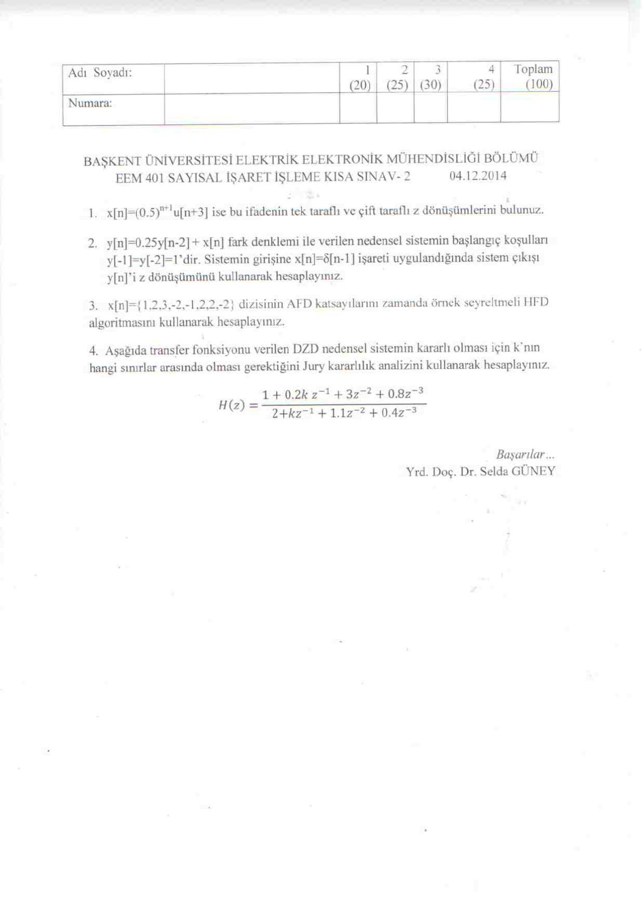
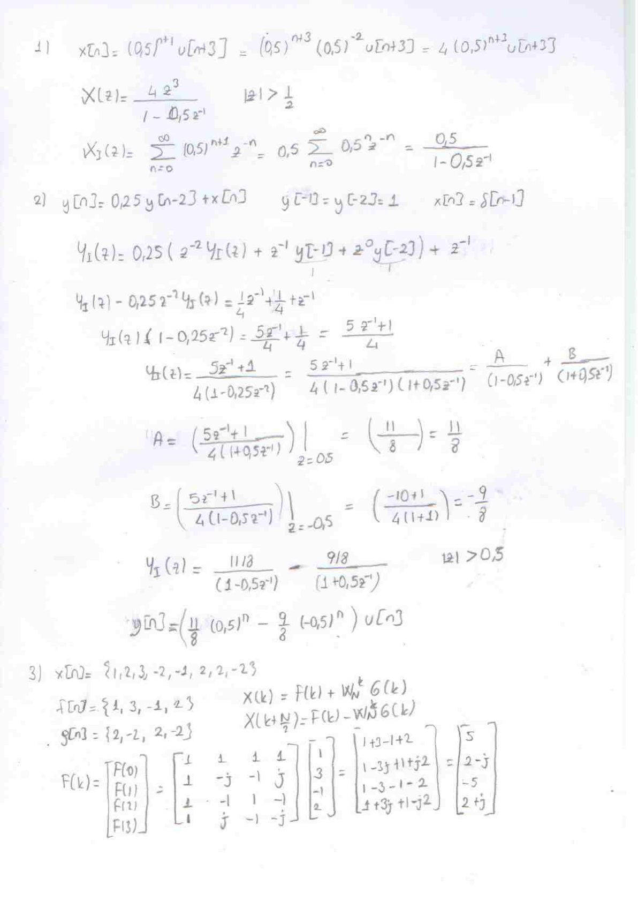
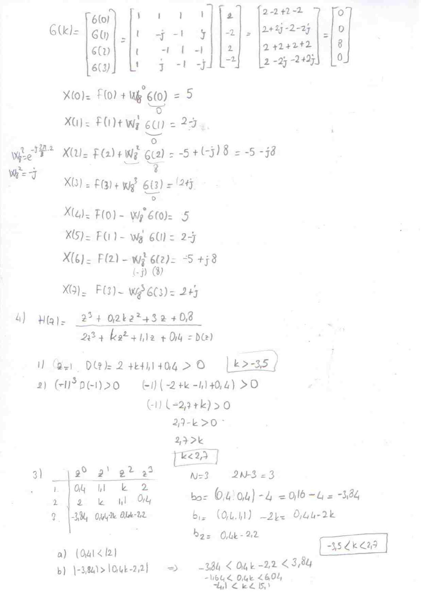

**EEM401 Sayısal İşaret İşleme** dersinin **Kısa Sınav 2**'si (04.12.2014, Başkent Üniversitesi Elektrik-Elektronik Mühendisliği, Yrd. Doç. Dr. Selda Güney) ve el yazısı çözümüm. Ad ve numara alanları boştur. Taranmış PDF yazının sonunda indirilebilir.

## Sorular

1. x[n] = (0,5)^(n+1)·u[n+3] ise bu ifadenin tek taraflı ve çift taraflı z dönüşümlerini bulunuz. (20 puan)
2. y[n] = 0,25·y[n−2] + x[n] fark denklemi ile verilen nedensel sistemin başlangıç koşulları y[−1] = y[−2] = 1'dir. Sistemin girişine x[n] = δ[n−1] işareti uygulandığında sistem çıkışı y[n]'i z dönüşümünü kullanarak hesaplayınız. (25 puan)
3. x[n] = {1, 2, 3, −2, −1, 2, 2, −2} dizisinin AFD katsayılarını zamanda örnek seyreltmeli HFD algoritmasını kullanarak hesaplayınız. (30 puan)
4. Aşağıda transfer fonksiyonu verilen DZD nedensel sistemin kararlı olması için k'nın hangi sınırlar arasında olması gerektiğini Jury kararlılık analizini kullanarak hesaplayınız. (25 puan)
   H(z) = (1 + 0,2k·z⁻¹ + 3z⁻² + 0,8z⁻³) / (2 + k·z⁻¹ + 1,1z⁻² + 0,4z⁻³)

## Çözüm

**1.** x[n] = (0,5)^(n+3)·(0,5)^(−2)·u[n+3] = 4·(0,5)^(n+3)·u[n+3]. Çift taraflı: **X(z) = 4z³ / (1 − 0,5z⁻¹), |z| > 1/2**. Tek taraflı (n ≥ 0): X_I(z) = Σ_{n=0}^{∞} (0,5)^(n+1) z⁻ⁿ = 0,5 / (1 − 0,5z⁻¹).

**2.** Tek taraflı z dönüşümü ve başlangıç koşulları ile:
Y_I(z) = 0,25·(z⁻²Y_I(z) + z⁻¹y[−1] + y[−2]) + z⁻¹, yani Y_I(z)(1 − 0,25z⁻²) = (5z⁻¹ + 1)/4.
Y_I(z) = (5z⁻¹ + 1) / [4(1 − 0,5z⁻¹)(1 + 0,5z⁻¹)] = A/(1 − 0,5z⁻¹) + B/(1 + 0,5z⁻¹), A = 11/8, B = −9/8. Buradan (|z| > 0,5):

**y[n] = [(11/8)(0,5)ⁿ − (9/8)(−0,5)ⁿ]·u[n]**

Kontrol: y[0] = 11/8 − 9/8 = 0,25; fark denkleminden y[0] = 0,25·y[−2] + x[0] = 0,25 + 0 = 0,25 ✓.

**3.** N = 8 için x[n] çift ve tek indisli iki 4 noktalı diziye ayrılır: f[n] = {1, 3, −1, 2} (çift indisler) ve g[n] = {2, −2, 2, −2} (tek indisler). X(k) = F(k) + W₈ᵏ·G(k), X(k + 4) = F(k) − W₈ᵏ·G(k), k = 0, 1, 2, 3. 4×4 DFT matrisiyle:
F(k) = {5, 2 − j, −5, 2 + j}, G(k) = {0, 0, 8, 0}. W₈² = −j olduğundan
X(0) = 5, X(1) = 2 − j, X(2) = −5 − j8, X(3) = 2 + j, X(4) = 5, X(5) = 2 − j, X(6) = −5 + j8, X(7) = 2 + j.

**4.** Karakteristik polinom D(z) = 2z³ + k·z² + 1,1z + 0,4. Jury koşulları:
1. D(1) = 2 + k + 1,1 + 0,4 > 0 ⇒ **k > −3,5**.
2. (−1)³·D(−1) > 0: D(−1) = −2 + k − 1,1 + 0,4 = k − 2,7 ⇒ **k < 2,7**.
3. Jury tablosu (N = 3): satır 1: 0,4, 1,1, k, 2; satır 2 (ters): 2, k, 1,1, 0,4; satır 3: b0 = 0,4·0,4 − 2·2 = −3,84; b1 = 0,4·1,1 − 2k = 0,44 − 2k; b2 = 0,4k − 2,2. Koşullar: |0,4| < |2| ve |b0| > |b2| ⇒ −4,1 < k < 15,1.

Üçü birlikte: **−3,5 < k < 2,7**.

