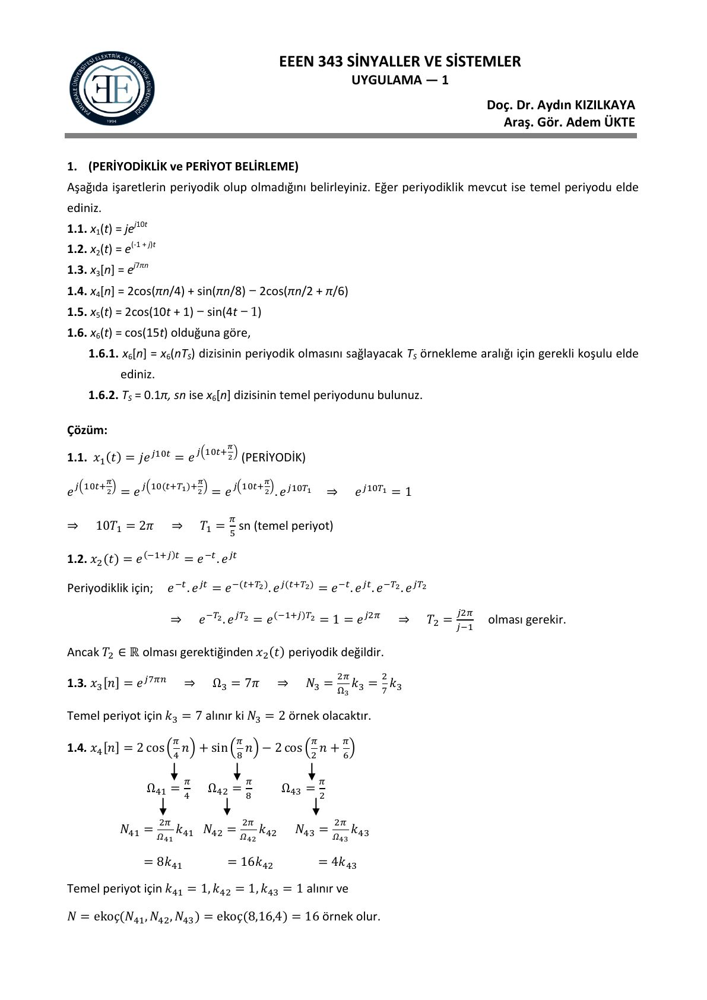
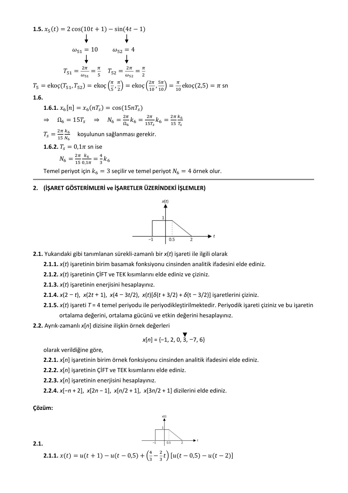
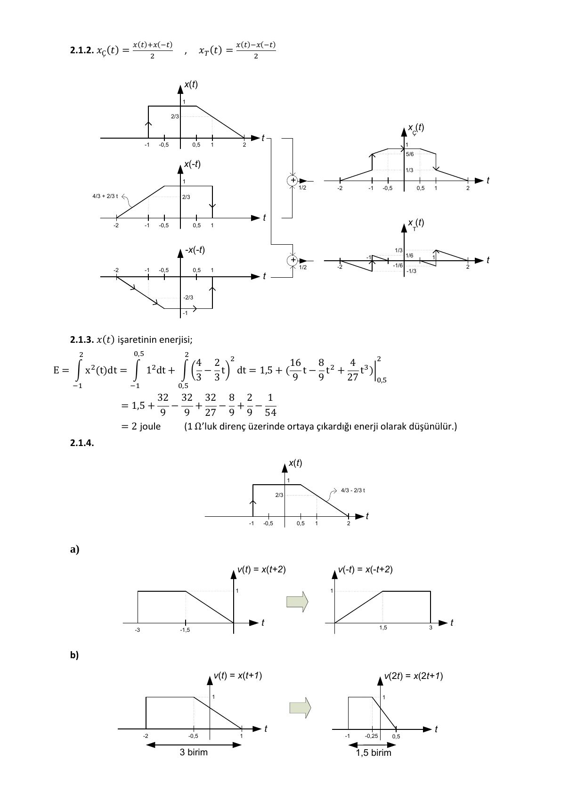
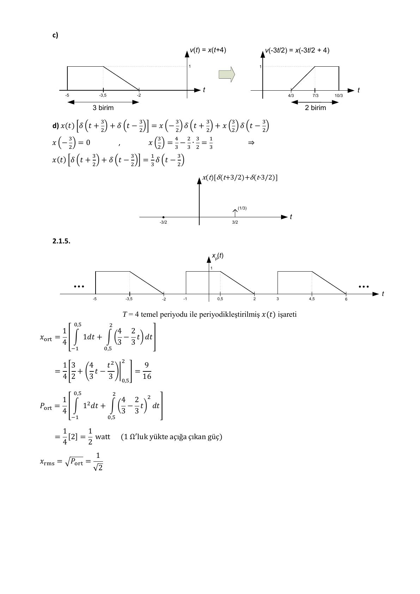
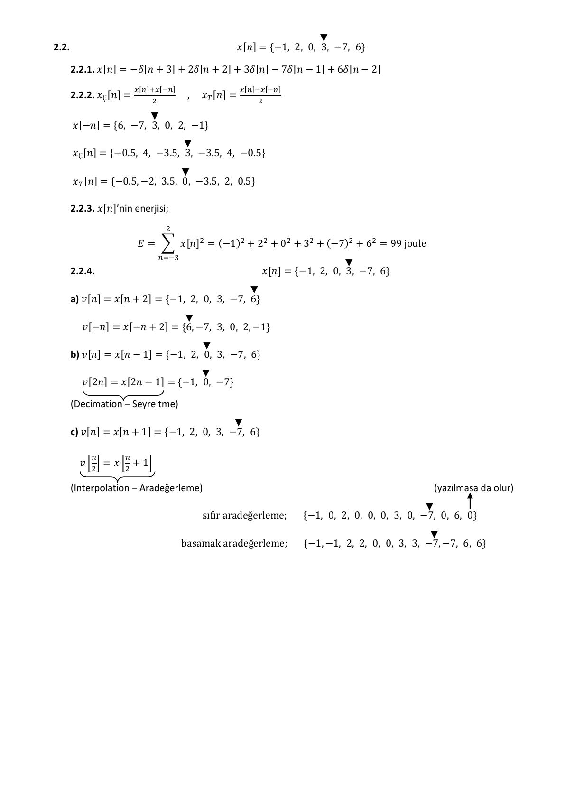
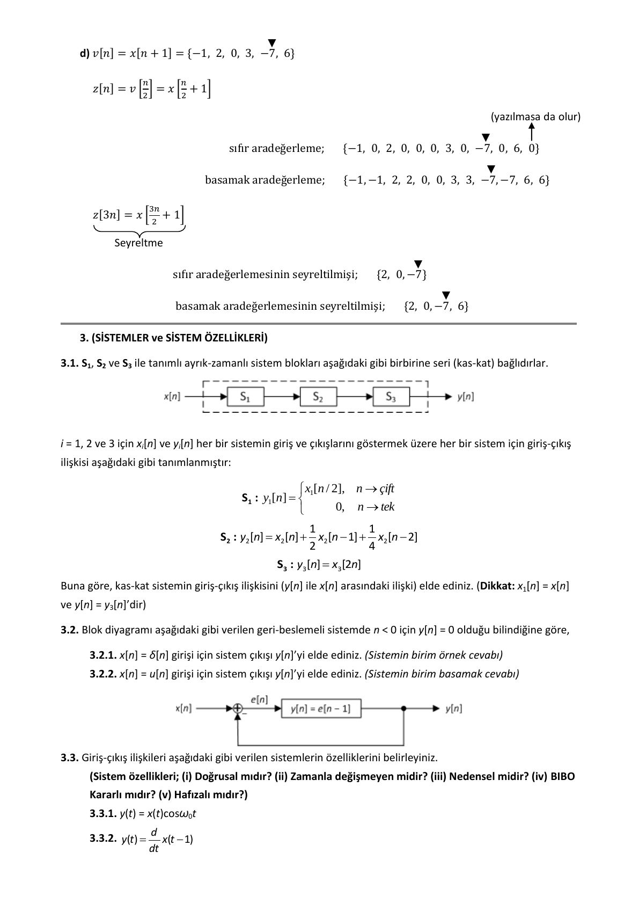
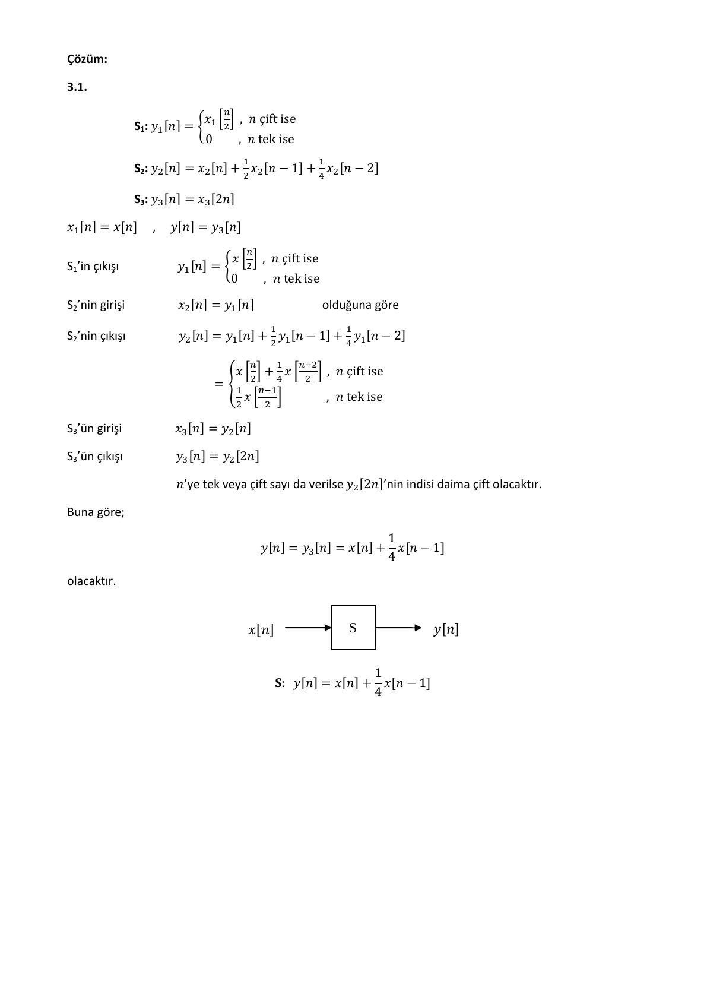
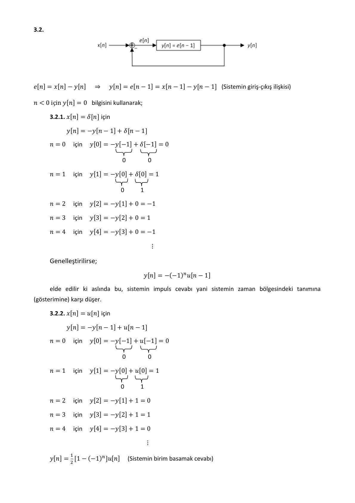
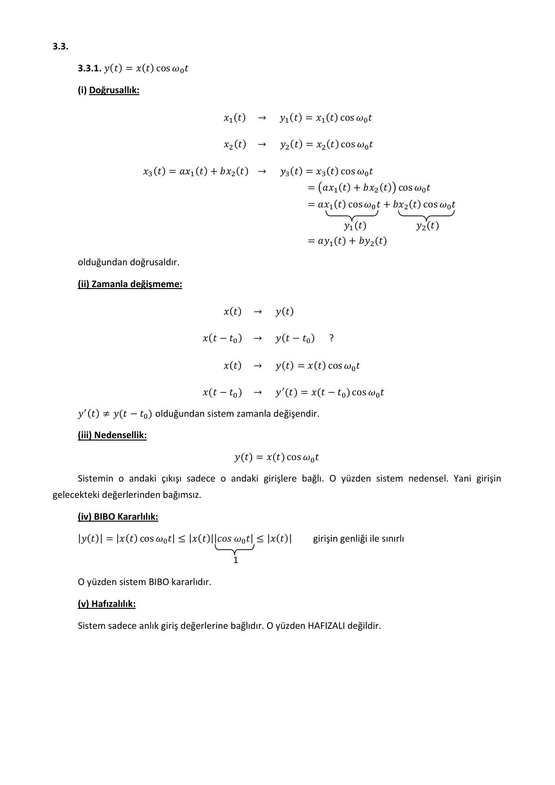
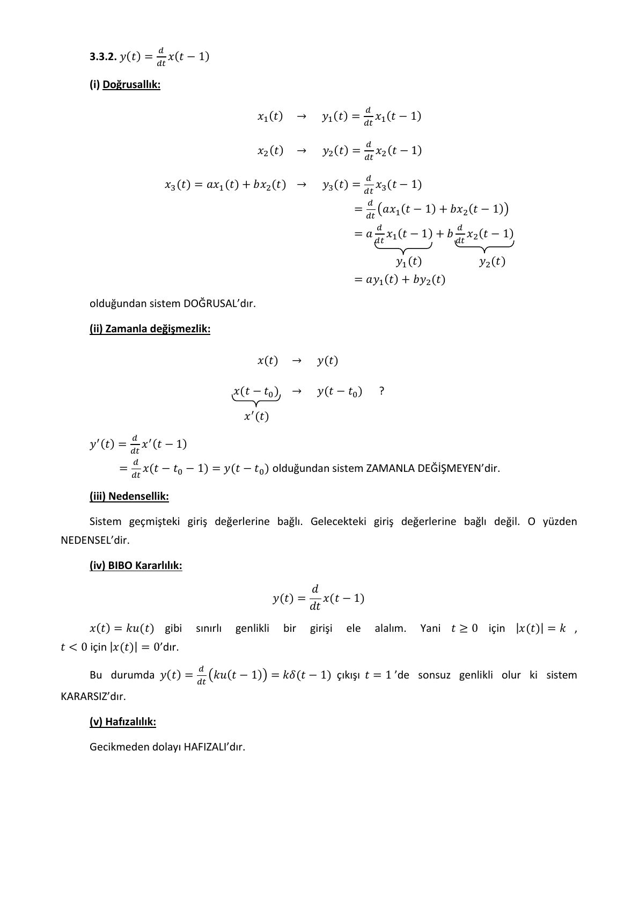

This 10-page document, located in the EEM401 folder, is not EEM401's own note; according to the document's title, it is the solved problem sheet for **Tutorial 1** of the **EEEN 343 Signals and Systems** course (instructor **Assoc. Prof. Dr. Aydın Kızılkaya**, research assistant **Res. Asst. Adem Ükte**; PDF creation date 29 June 2011, the institution is not stated in the document). It is included in this course because it is prerequisite material for digital signal processing. The pages are shown below; since the equations are embedded as images, the text transcription contains only the problem headings. The PDF can be downloaded at the end of the post.

*This content belongs to a third-party source; it is shared for archival and nostalgic purposes with the source credited. It will be removed at the request of the rights holder.*

## Problems

**1. (Periodicity and determining the period)** Determine whether the following signals are periodic; if periodic, find the fundamental period.

- 1.1 x1(t) = j·e^{j10t}
- 1.2 x2(t) = e^{(−1 + j)t}
- 1.3 x3[n] = e^{j7πn}
- 1.4 x4[n] = 2cos(πn/4) + sin(πn/8) − 2cos(πn/2 + π/6)
- 1.5 x5(t) = 2cos(10t + 1) − sin(4t − 1)
- 1.6 Given x6(t) = cos(15t), (1.6.1) find the condition on the sampling interval Ts that makes the sequence x6[n] = x6(nTs) periodic; (1.6.2) if Ts = 0.1π s, find the fundamental period of x6[n].

In the solution: 1.1 is periodic; 1.2 is not periodic (the exponential term is damped); in 1.3, 1.4 and 1.5 the fundamental period is found as the LCM of the component periods; in 1.6, periodicity requires the ratio 15·Ts / (2π) to be rational.

**2. (Signal representations and operations)** For a piecewise-defined continuous-time signal x(t): its expression in terms of the unit step function; finding and plotting its even and odd parts; its energy (as the energy dissipated in a 1 Ω resistor); plotting x(2 − t), x(2t + 1), x(4 − 3t/2) and x(t)[δ(t + 3/2) + δ(t − 3/2)]; plotting the signal made periodic with fundamental period T = 4, and its average value, average power and rms value.

For the discrete-time sequence x[n] = {−1, 2, 0, 3, −7, 6}: its expression in terms of the unit sample function; its even and odd parts; its energy (1 + 4 + 0 + 9 + 49 + 36 = **99**); obtaining the sequences x[−n + 2], x[2n − 1] (decimation), x[n/2 + 1] (interpolation) and x[3n/2 + 1].

**3. (Systems and system properties)**

3.1 Three discrete-time systems are connected in cascade:
S1: y1[n] = x1[n/2] (n even), 0 (n odd); S2: y2[n] = x2[n] + ½x2[n − 1] + ¼x2[n − 2]; S3: y3[n] = x3[2n]. Find the relationship between y[n] and x[n] for the cascaded system.

Solution: The output of S1 is the input of S2, and that of S2 is the input of S3. The output of S3 is y3[n] = y2[2n], and since the index at the output of S2 is always even, the odd-indexed S1 outputs (0) have no effect; consequently y[n] = y2[2n] = y1[2n] + ½·y1[2n − 1] + ¼·y1[2n − 2], and since the odd-indexed S1 outputs are zero, **y[n] = x[n] + ¼·x[n − 1]** is obtained (steps in the sheet).

3.2 Given that y[n] = 0 for n < 0 in a system with feedback, find (3.2.1) the output for x[n] = δ[n] (the unit sample response) and (3.2.2) the output for x[n] = u[n] (the unit step response). In the solution, the input-output relation of the system is run recursively and the general term is written; the unit sample response corresponds to the time-domain description of the system.

3.3 System properties (i linear? ii time-invariant? iii causal? iv BIBO stable? v with memory?):

- 3.3.1 y(t) = x(t)·cos(ω0t): **linear**, **time-varying**, **causal**, **BIBO stable**, **memoryless** (depends only on the instantaneous input).
- 3.3.2 y(t) = d/dt x(t − 1): **linear**, **time-invariant**, **causal** (depends on the past input), **BIBO unstable** (the derivative of a bounded-amplitude input, for example a discontinuous step input, has infinite amplitude), **with memory** (due to the delay).

## Pages of the Sheet

