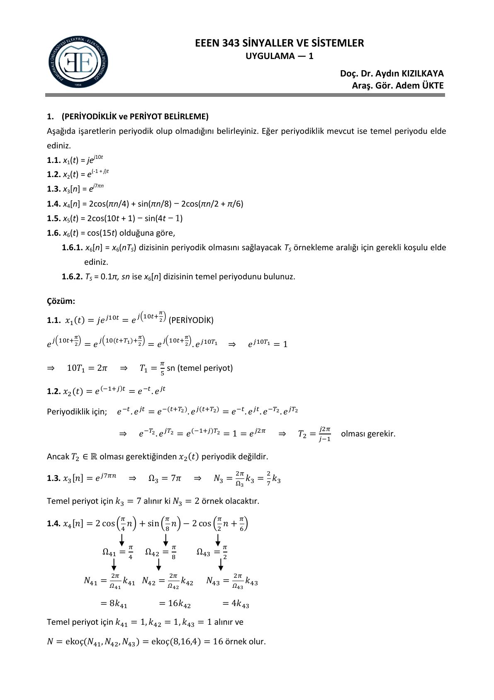
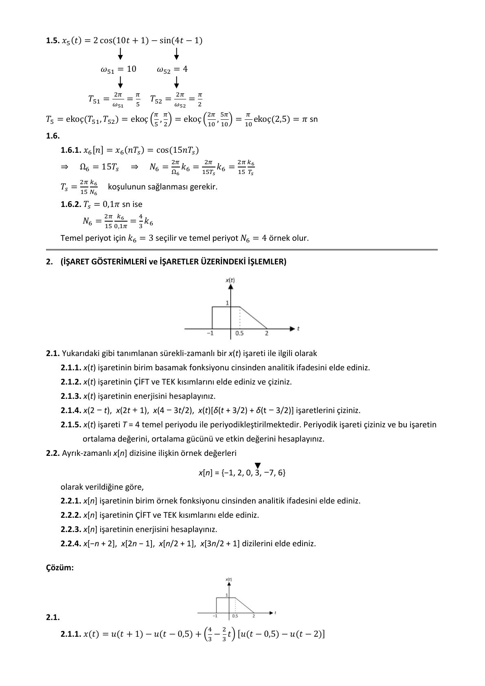
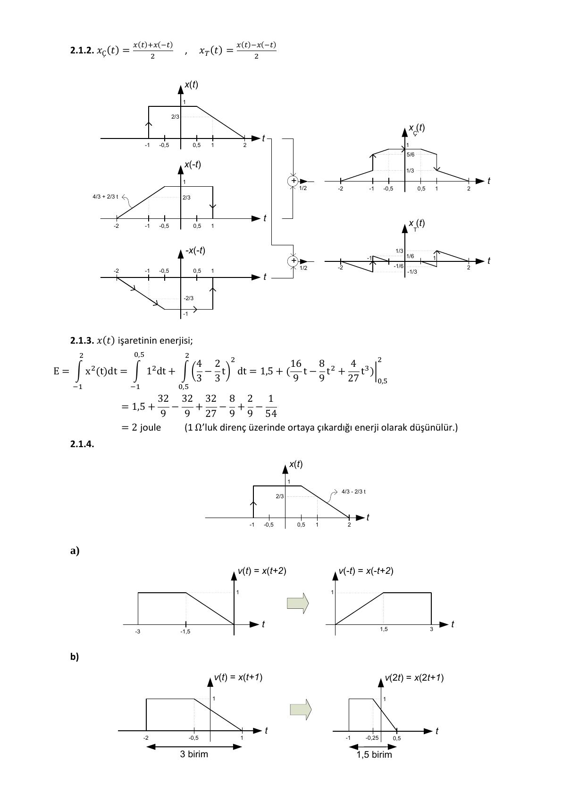
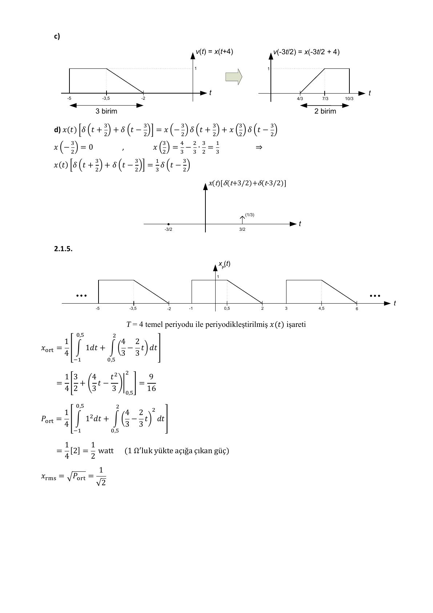
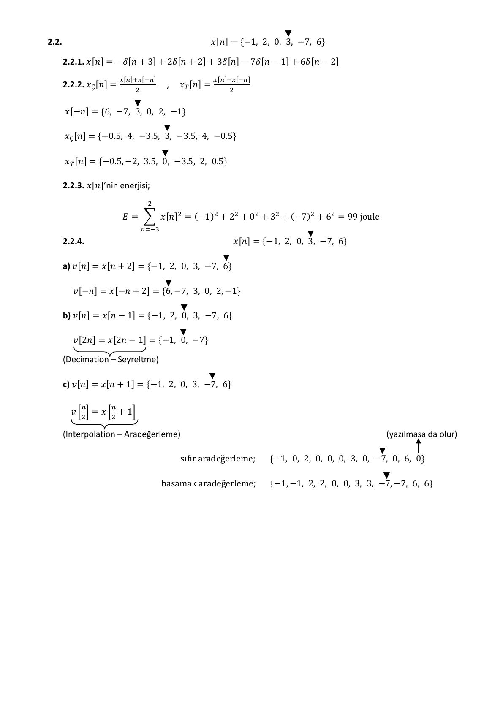
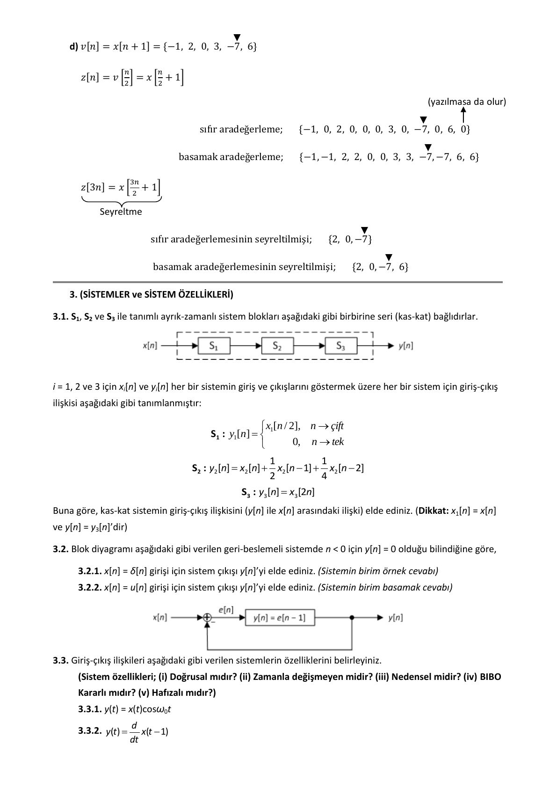
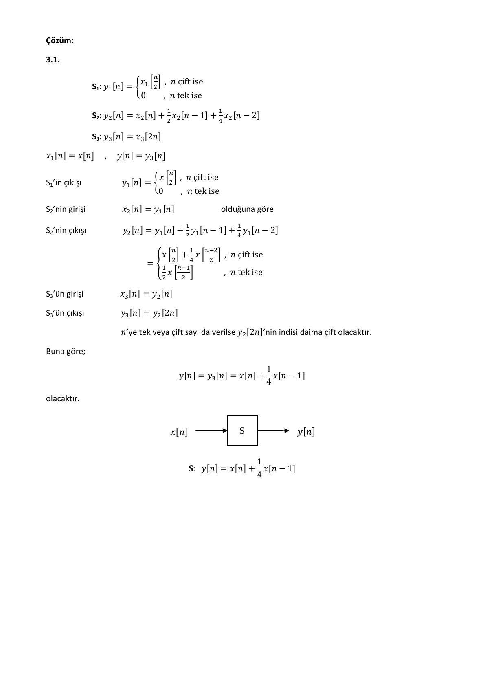
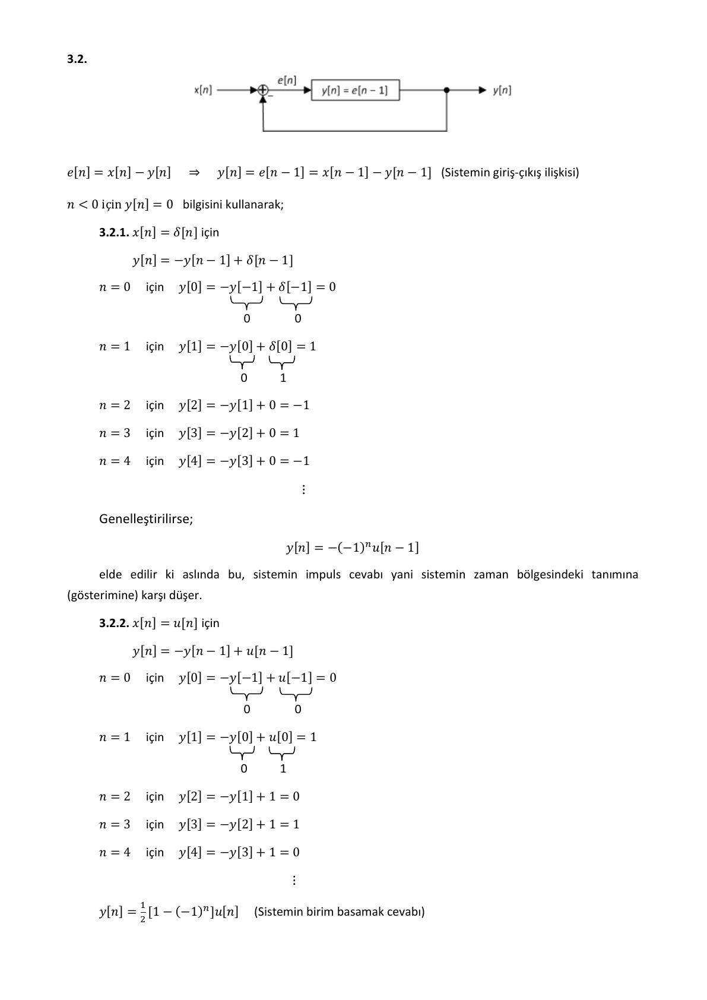
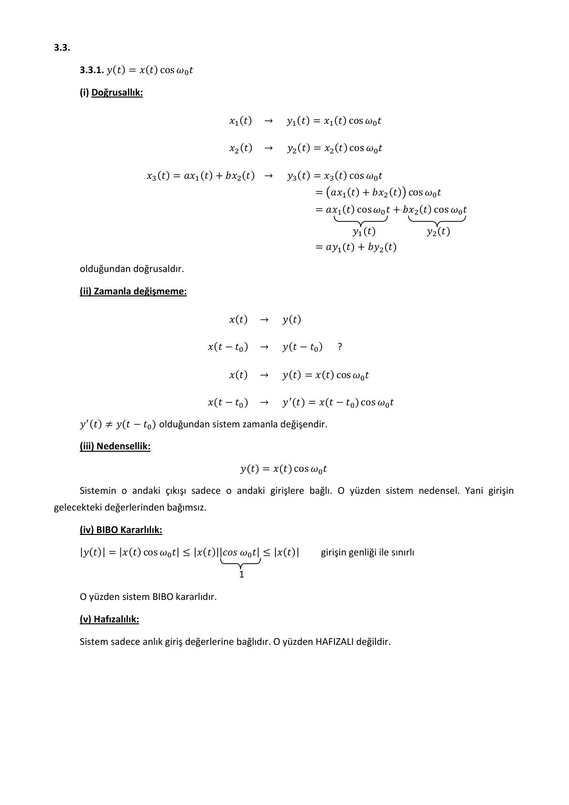
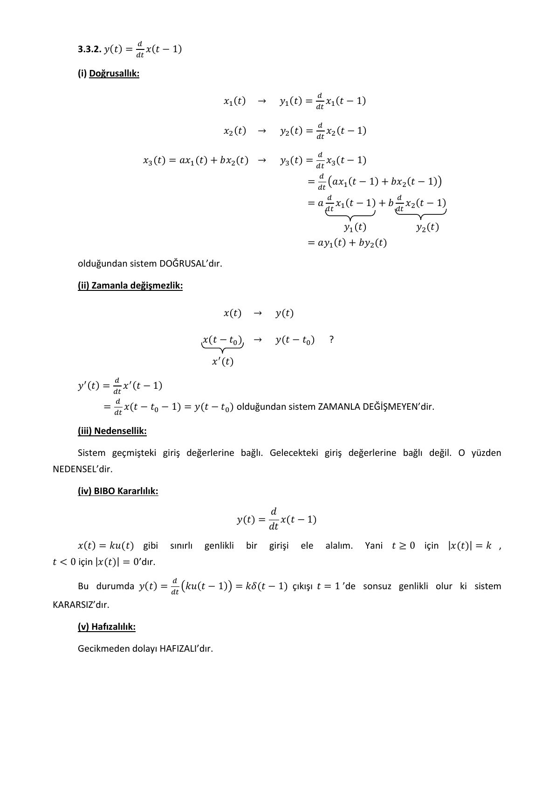

EEM401 klasöründe duran bu 10 sayfalık belge, EEM401'in kendi notu değil; belgenin başlığına göre **EEEN 343 Sinyaller ve Sistemler** dersinin **Uygulama 1** çözümlü soru föyüdür (öğretim üyesi **Doç. Dr. Aydın Kızılkaya**, araştırma görevlisi **Araş. Gör. Adem Ükte**; PDF oluşturma tarihi 29 Haziran 2011, kurum belgede yazmıyor). Sayısal sinyal işlemenin ön bilgisi olduğu için bu derse ekleniyor. Sayfalar aşağıdadır; denklemler görüntü olarak gömülü olduğundan metin dökümü yalnızca soru başlıklarını içerir. PDF yazının sonunda indirilebilir.

*Bu içerik üçüncü taraf bir kaynağa aittir; arşiv ve nostalji amacıyla kaynak belirtilerek paylaşılmıştır. Hak sahibinin talebi hâlinde kaldırılır.*

## Sorular

**1. (Periyodiklik ve periyot belirleme)** Aşağıdaki işaretlerin periyodik olup olmadığını belirleyiniz; periyodik ise temel periyodu bulunuz.

- 1.1 x1(t) = j·e^{j10t}
- 1.2 x2(t) = e^{(−1 + j)t}
- 1.3 x3[n] = e^{j7πn}
- 1.4 x4[n] = 2cos(πn/4) + sin(πn/8) − 2cos(πn/2 + π/6)
- 1.5 x5(t) = 2cos(10t + 1) − sin(4t − 1)
- 1.6 x6(t) = cos(15t) olduğuna göre (1.6.1) x6[n] = x6(nTs) dizisinin periyodik olmasını sağlayacak Ts örnekleme aralığı koşulunu bulunuz; (1.6.2) Ts = 0,1π s ise x6[n]'in temel periyodunu bulunuz.

Çözümde: 1.1 periyodiktir; 1.2 periyodik değildir (üstel terim sönümlüdür); 1.3, 1.4 ve 1.5'te temel periyot, bileşen periyotlarının EKOK'u ile bulunur; 1.6'da periyodiklik için 15·Ts / (2π) oranının rasyonel olması gerekir.

**2. (İşaret gösterimleri ve işlemleri)** Parçalı tanımlı sürekli zamanlı bir x(t) işareti için: birim basamak fonksiyonu cinsinden ifadesi; çift ve tek kısımlarının bulunup çizilmesi; enerjisi (1 Ω'luk dirençte ortaya çıkan enerji olarak); x(2 − t), x(2t + 1), x(4 − 3t/2) ve x(t)[δ(t + 3/2) + δ(t − 3/2)] işaretlerinin çizimi; T = 4 temel periyoduyla periyodikleştirilen işaretin çizimi, ortalama değeri, ortalama gücü ve etkin değeri.

Ayrık zamanlı x[n] = {−1, 2, 0, 3, −7, 6} dizisi için: birim örnek fonksiyonu cinsinden ifadesi; çift ve tek kısımları; enerjisi (1 + 4 + 0 + 9 + 49 + 36 = **99**); x[−n + 2], x[2n − 1] (seyreltme), x[n/2 + 1] (aradeğerleme), x[3n/2 + 1] dizilerinin elde edilmesi.

**3. (Sistemler ve sistem özellikleri)**

3.1 Üç ayrık zamanlı sistem kaskat bağlıdır:
S1: y1[n] = x1[n/2] (n çift), 0 (n tek); S2: y2[n] = x2[n] + ½x2[n − 1] + ¼x2[n − 2]; S3: y3[n] = x3[2n]. Kaskat sistemin y[n] ile x[n] arasındaki ilişkisini bulunuz.

Çözüm: S1'in çıkışı S2'nin girişi, S2'ninki S3'ün girişidir. S3 çıkışı y3[n] = y2[2n] ve S2'nin çıkışındaki indis daima çift olduğundan tek indisli S1 çıkışları (0) etkisiz kalır; sonuçta y[n] = y2[2n] = y1[2n] + ½·y1[2n − 1] + ¼·y1[2n − 2] olur; tek indisli S1 çıkışları sıfır olduğundan **y[n] = x[n] + ¼·x[n − 1]** bulunur (adımlar föyde).

3.2 Geri beslemeli bir sistemde n < 0 için y[n] = 0 olduğuna göre (3.2.1) x[n] = δ[n] için çıkışı (birim örnek cevabı) ve (3.2.2) x[n] = u[n] için çıkışı (birim basamak cevabı) bulunuz. Çözümde sistemin giriş-çıkış ilişkisi yinelemeli olarak yürütülüp genel terim yazılır; birim örnek cevabı sistemin zaman bölgesindeki tanımına karşı düşer.

3.3 Sistem özellikleri (i doğrusal mı, ii zamanla değişmez mi, iii nedensel mi, iv BIBO kararlı mı, v hafızalı mı):

- 3.3.1 y(t) = x(t)·cos(ω0t): **doğrusal**, **zamanla değişen**, **nedensel**, **BIBO kararlı**, **hafızasız** (yalnız anlık girişe bağlı).
- 3.3.2 y(t) = d/dt x(t − 1): **doğrusal**, **zamanla değişmeyen**, **nedensel** (geçmiş girişe bağlı), **BIBO kararsız** (sınırlı genlikli bir girişin türevi, örneğin süreksiz basamak girişte, sonsuz genlikli olur), **hafızalı** (gecikme nedeniyle).

## Föyün sayfaları

