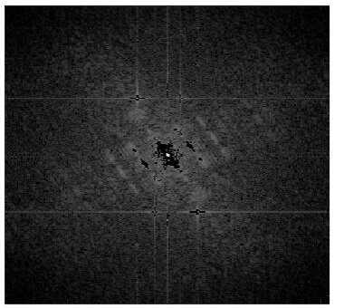

This post brings together the **project proposal form** and the two-column **project report** ("Spectral Image Filtering") prepared by **Hasan Can Öztürk** for the fall 2016 design project of the Başkent University course **EEM 401 Digital Signal Processing**. The proposal form was due on 11.11.2016 and the report on 09.12.2016; the projects were to be presented during class hours on 13–14 December. The project is an individual one. The student-number e-mail address in the report has been redacted; the proposal form and the report can be downloaded as a single PDF at the end of the post.

## Project proposal form

**Project title:** Spectral Image Filtering
**Project team:** Hasan Can Öztürk

**Subject.** A noise with a certain frequency is added to a grayscale image. This noise can be a "pattern" that repeats itself at regular intervals. The region belonging to the noise is determined by performing an FFT analysis of the noisy image; this determination is made by the user selecting a rectangular region with the mouse in the FFT (magnitude) image. The selected noisy region is cleared in the FFT magnitude image, and the noise-free image is obtained with the inverse FFT; that is, simple spectral filtering is performed. A MATLAB program that carries out these operations will be written.

**Objective.** To clear the selected noisy region in the FFT magnitude image and obtain the noise-free image with the inverse FFT.

**Success criterion.** If the selected noisy region is completely cleared in the FFT (magnitude) image and the image is freed of noise, the project will be considered successful.

According to the rules section of the form, each group can propose only one project (if two groups choose the same project, the one that submits the form first and completely gets it). The report must be two-column and at least two pages; the presentation is 15–20 slides, with 15 minutes of talk + 5 minutes of Q&A.

## Report: Spectral Image Filtering

**Abstract.** The report of a MATLAB program that cleans a noisy grayscale image of noise using FFT analysis.

### Introduction

A noise in the form of a pattern that repeats itself at regular intervals, at a certain frequency, is added to a grayscale image. The region belonging to the noise is determined by FFT analysis of the noisy image, this region is cleared in the FFT magnitude image, and the noise-free image is obtained with the inverse FFT.

### Spectral image filtering software

1. The image is read, converted to grayscale, normalized with `mat2gray`, and, before the FFT, scaled to a square size that is a power of two, **256 × 256**.
1. The centered 2D Fourier transform is computed with `fft2` and `fftshift`; the magnitude spectrum is displayed on a logarithmic scale: fLog = log(1 + |F|).
1. The noise peaks that look like "stars" in the spectrum are blocked out. Since the brightest "star", i.e. the DC component, and the low values are not to be removed, a **value range** in which the spectrum will be zeroed is defined. This threshold is as follows:

```matlab
filter = (fLog > .7*max(fLog(:))) | (fLog < .43*max(fLog(:)));
```

1. This binary **output mask** (black = 0, white = 1) is multiplied with the Fourier image and the inverse FFT is taken: B = |IFFT2(F · mask)|. While the mask removes some of the noise, it retains some DC components; in the report, these are interpreted as the margin of error of the method.



### MATLAB code

```matlab
% Read the image
I = imread('clown.jpg');

% Convert to grayscale image
I = rgb2gray(I);

% Normalize the image
I = double(mat2gray(I));

% Set the image size
I = imresize(I, [256 256]);

% Get the size of the image
[rows,cols] = size(I);

% Apply the FFT
f = fftshift(fft2(I));

% Plot the Fourier image
fLog = log(1 + abs(f));

% Filter the Fourier image in the specified range
filter = (fLog > .7*max(fLog(:)) ) | (fLog < .43*max(fLog(:)) );

B = abs(ifft2(f.*filter));

% Obtain the image by applying the inverse Fourier transform
f1 = fftshift(fft2(B));
fLog1 = log(1 + abs(f1));

colormap(gray)
subplot(3,2,1),imagesc(I); title('Orijinal Görüntü')
subplot(3,2,2),imagesc(fLog); title('Fourier Görüntü')
subplot(3,2,3),imagesc(fLog); title('Fourier Görüntü')
subplot(3,2,4),imagesc(filter); title('Çıktı Maskesi')
subplot(3,2,5),imagesc(fLog1); title('Temizlenme Sonrası Fourier Görüntü')
subplot(3,2,6),imagesc(B); title('Temizlenmiş Görüntü')
annotation('textbox', [0 0.9 1 0.1], ...
    'String', 'FFT ile Görüntü Temizleme', ...
    'EdgeColor', 'none', ...
    'HorizontalAlignment', 'center', ...
    'FontSize', 15, ...
    'FontWeight', 'bold')
```

### Discussion and conclusions

After the operations, the image was largely cleaned of noise; however, it can be seen that while some of the noise is removed, some DC components are also retained. The conclusion of the report: although the software is not the best way to filter an image, it can be used depending on the application area.

")

*Note: The proposal form planned for the noise region to be cleared by selecting a rectangle with the mouse; the code in the report instead builds the mask automatically by applying fixed thresholds (43% and 70%) to the log-magnitude spectrum. Also, the code reads the file `clown.jpg`, but the image in Figure 4 is an American football; the output was most likely produced with a different image. Figure 1 (the Fourier image) in the report's Word file came out blank in conversion.*

### References (from the report)

1. Charles Van Loan, *Computational Frameworks for the Fast Fourier Transform*, SIAM, 1992.
1. M. T. Heideman, D. H. Johnson, C. S. Burrus, "Gauss and the history of the fast Fourier transform", *IEEE ASSP Magazine* 1(4), 14–21, 1984.
1. Gilbert Strang, "Wavelets", *American Scientist* 82(3), 253, 1994.
1. J. Dongarra, F. Sullivan, "Guest Editors Introduction to the top 10 algorithms", *Computing in Science & Engineering* 2(1), 22–23, 2000.
1. M. T. Heideman, D. H. Johnson, C. S. Burrus, "Gauss and the history of the fast Fourier transform", *Archive for History of Exact Sciences* 34(3), 265–277, 1985.
1. Frank Yates, "The design and analysis of factorial experiments", Technical Communication no. 35, Commonwealth Bureau of Soils, 1937.
