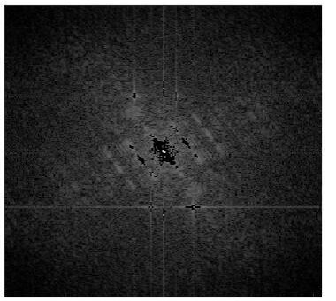

Bu yazı, Başkent Üniversitesi **EEM 401 Sayısal Sinyal İşleme** dersinin 2016 güz dönemindeki tasarım projesi için **Hasan Can Öztürk**'ün hazırladığı **proje öneri formu** ile iki sütunlu **proje raporunu** ("Spektral Görüntü Filtreleme") bir araya getiriyor. Öneri formu 11.11.2016'ya, rapor 09.12.2016'ya kadar teslim edilecek; projeler 13–14 Aralık'ta ders saatlerinde sunulacaktı. Proje tek kişilik. Rapordaki öğrenci numaralı e-posta adresi kapatıldı; öneri formu ve rapor yazının sonunda tek PDF olarak indirilebilir.

## Proje öneri formu

**Proje başlığı:** Spektral Görüntü Filtreleme
**Proje takımı:** Hasan Can Öztürk

**Konu.** Gri tonlara sahip bir görüntüye belirli bir frekansı olan bir gürültü eklenir. Bu gürültü belirli aralıklarla kendini tekrar eden bir "örüntü" (pattern) olabilir. Gürültülü resmin FFT analizi yapılarak gürültüye ait alan belirlenir; bu belirleme kullanıcının FFT (genlik) görüntüsünde fareyle dikdörtgen bir alan seçmesiyle yapılacaktır. Seçilen gürültülü alan FFT genlik görüntüsünde temizlenir ve ters FFT ile gürültüden arındırılmış görüntü elde edilir; yani basit bir spektral filtreleme yapılır. Bu işlemleri yapan MATLAB programı yazılacaktır.

**Amaç.** Seçilen gürültülü alanın FFT genlik görüntüsünde temizlenip ters FFT ile gürültüsüz görüntünün elde edilmesi.

**Başarı ölçütü.** Seçilen gürültülü alan FFT (genlik) görüntüsünde tamamen temizlenerek görüntü gürültüden arındırılırsa proje başarılı sayılacak.

Formun kurallar kısmına göre her grup tek proje önerebiliyor (iki grup aynı projeyi seçerse formu ilk ve eksiksiz getiren alıyor). Rapor iki sütunlu ve en az iki sayfa olmalı; sunum 15–20 slayt, 15 dakika konuşma + 5 dakika soru-cevap.

## Rapor: Spektral Görüntü Filtreleme

**Özet.** Gri tonlu gürültülü bir görüntüyü FFT analiziyle gürültüden temizleyen MATLAB programının raporu.

### Giriş

Gri tonlu bir görüntüye belirli frekansta, kendini belirli aralıklarla tekrar eden bir örüntü biçiminde gürültü ekleniyor. Gürültülü resmin FFT analiziyle gürültüye ait alan belirleniyor, bu alan FFT genlik görüntüsünde temizleniyor ve ters FFT ile gürültüden arındırılmış görüntü elde ediliyor.

### Spektral görüntü filtreleme yazılımı

1. Görüntü okunur, gri tonlamaya çevrilir, `mat2gray` ile normalize edilir ve FFT'den önce ikinin kuvveti olan kare bir boyuta, **256 × 256**'ya ölçeklenir.
1. `fft2` ve `fftshift` ile merkezlenmiş 2B Fourier dönüşümü alınır; genlik spektrumu logaritmik ölçekte gösterilir: fLog = log(1 + |F|).
1. Spektrumda "yıldız" gibi görünen gürültü tepeleri kapatılır. En parlak "yıldız"ı, yani DC bileşenini ve düşük değerleri kaldırmak istenmediği için, spektrumun sıfırlanacağı bir **değer aralığı** tanımlanır. Bu eşik şöyle:

```matlab
filter = (fLog > .7*max(fLog(:))) | (fLog < .43*max(fLog(:)));
```

1. Bu ikili **çıktı maskesi** (siyah = 0, beyaz = 1) Fourier görüntüsüyle çarpılır ve ters FFT alınır: B = |IFFT2(F · maske)|. Maske bazı gürültüleri kaldırırken bazı DC bileşenlerini koruyor; raporda bunlar yöntemin hata payı olarak yorumlanıyor.



### MATLAB kodu

```matlab
% Görüntüyü Oku
I = imread('clown.jpg');

% Gri tonlamalı görüntüye çevir
I = rgb2gray(I);

% Görüntüyü Normalleştir
I = double(mat2gray(I));

% Görüntü boyutunu ayarla
I = imresize(I, [256 256]);

% Resmin boyutunu al
[rows,cols] = size(I);

% FFT'yi uygula
f = fftshift(fft2(I));

% Fourier görüntüyü çizdir
fLog = log(1 + abs(f));

% Fourier görüntüyü belirlenen aralıkta filtrele
filter = (fLog > .7*max(fLog(:)) ) | (fLog < .43*max(fLog(:)) );

B = abs(ifft2(f.*filter));

% Ters Fourier uygulayarak görüntüyü elde et
f1 = fftshift(fft2(B));
fLog1 = log(1 + abs(f1));

colormap(gray)
subplot(3,2,1),imagesc(I); title('Orijinal Görüntü')
subplot(3,2,2),imagesc(fLog); title('Fourier Görüntü')
subplot(3,2,3),imagesc(fLog); title('Fourier Görüntü')
subplot(3,2,4),imagesc(filter); title('Çıktı Maskesi')
subplot(3,2,5),imagesc(fLog1); title('Temizlenme Sonrası Fourier Görüntü')
subplot(3,2,6),imagesc(B); title('Temizlenmiş Görüntü')
annotation('textbox', [0 0.9 1 0.1], ...
    'String', 'FFT ile Görüntü Temizleme', ...
    'EdgeColor', 'none', ...
    'HorizontalAlignment', 'center', ...
    'FontSize', 15, ...
    'FontWeight', 'bold')
```

### Tartışma ve sonuçlar

İşlemler sonrasında görüntü gürültülerden büyük ölçüde temizlendi; ancak bazı gürültüler kalkarken bazı DC bileşenlerinin de korunduğu görülüyor. Raporun vardığı sonuç: yazılım görüntü filtrelemek için en iyi yol olmasa da kullanım alanına göre kullanılabilir.

")

*Not: Öneri formunda gürültü alanının fareyle dikdörtgen seçilerek temizlenmesi planlanmıştı; rapordaki kod ise bunun yerine log-genlik spektrumuna sabit eşikler (%43 ve %70) uygulayarak maskeyi kendiliğinden oluşturuyor. Ayrıca kod `clown.jpg` dosyasını okuyor, ama Şekil 4'teki görüntü bir Amerikan futbolu topu; çıktı büyük olasılıkla farklı bir görüntüyle alınmış. Raporun Word dosyasındaki Şekil 1 (Fourier görüntüsü) dönüştürmede boş çıktı.*

### Kaynakça (rapordan)

1. Charles Van Loan, *Computational Frameworks for the Fast Fourier Transform*, SIAM, 1992.
1. M. T. Heideman, D. H. Johnson, C. S. Burrus, "Gauss and the history of the fast Fourier transform", *IEEE ASSP Magazine* 1(4), 14–21, 1984.
1. Gilbert Strang, "Wavelets", *American Scientist* 82(3), 253, 1994.
1. J. Dongarra, F. Sullivan, "Guest Editors Introduction to the top 10 algorithms", *Computing in Science & Engineering* 2(1), 22–23, 2000.
1. M. T. Heideman, D. H. Johnson, C. S. Burrus, "Gauss and the history of the fast Fourier transform", *Archive for History of Exact Sciences* 34(3), 265–277, 1985.
1. Frank Yates, "The design and analysis of factorial experiments", Technical Communication no. 35, Commonwealth Bureau of Soils, 1937.
