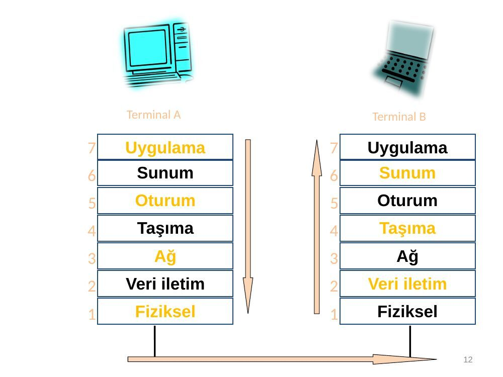
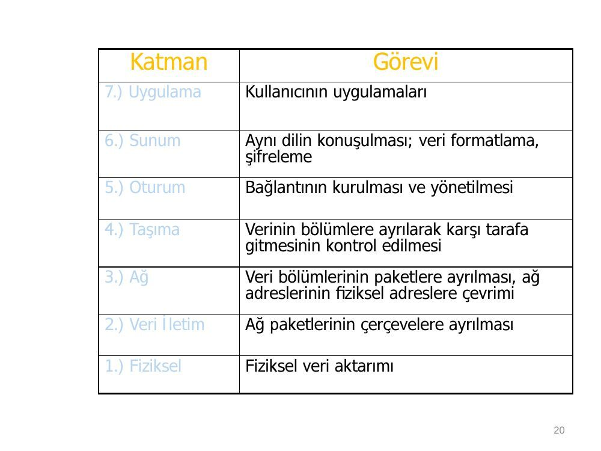
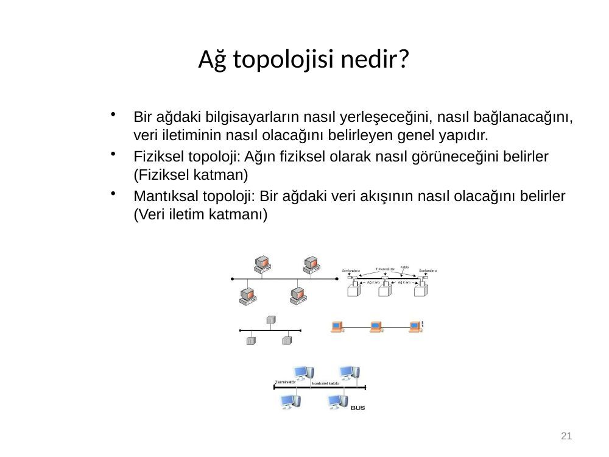
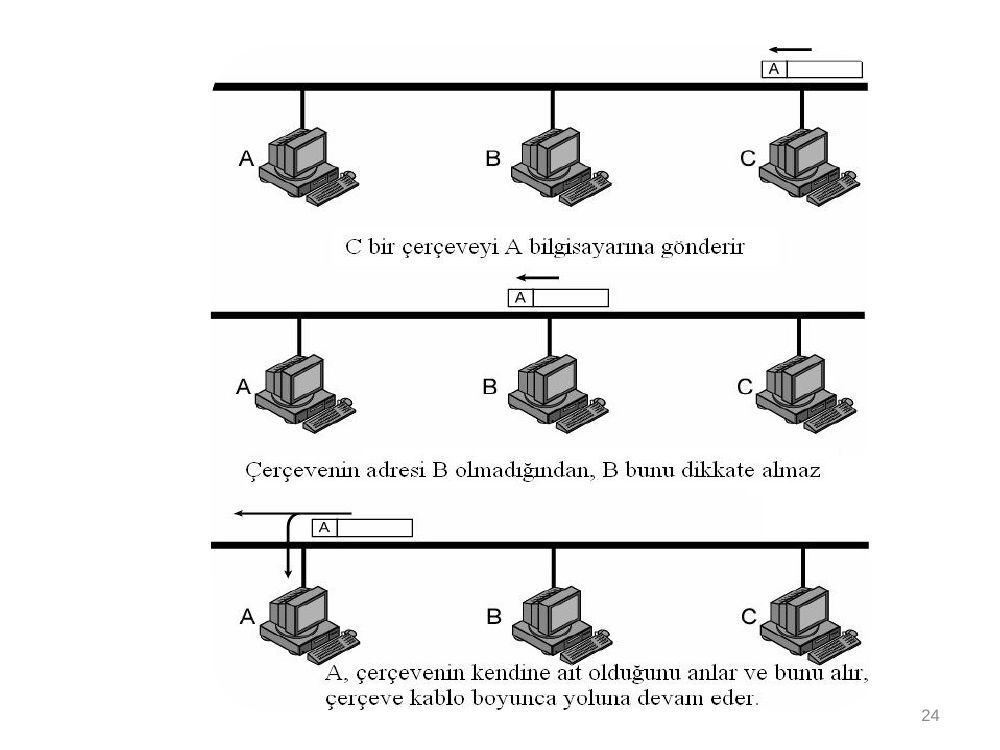
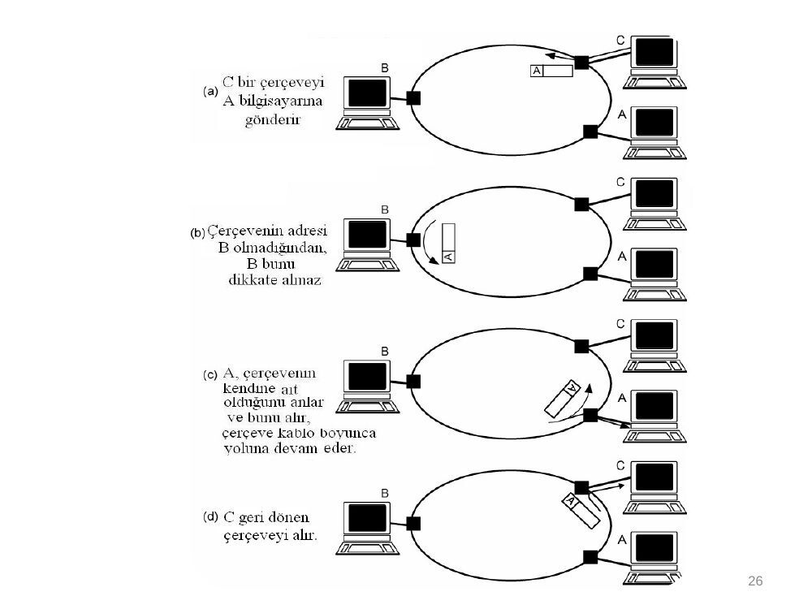
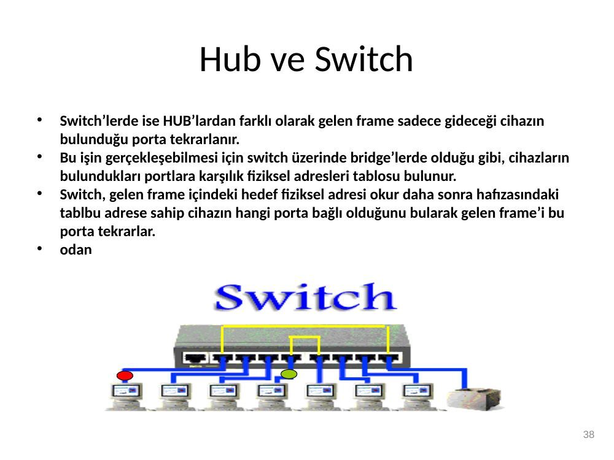
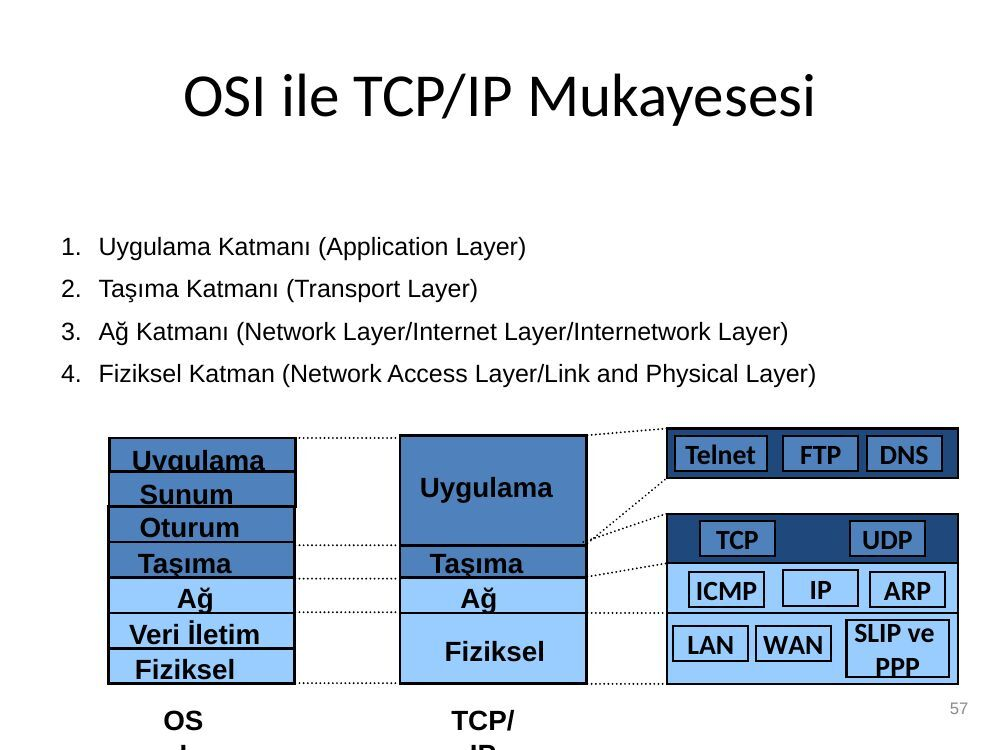
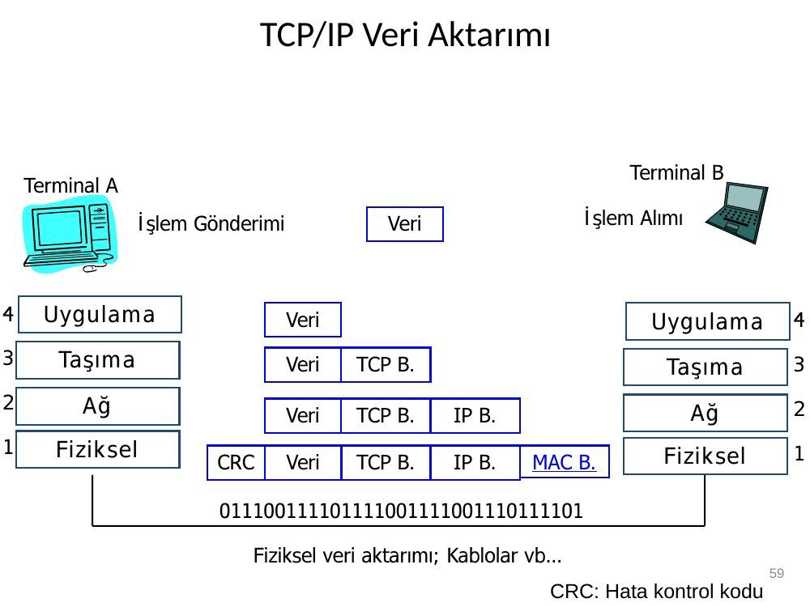

This is a 66-page Turkish-language networking presentation whose author and institution are not stated. It is stored in the EEM413 folder; the date is taken from the creation record of the source file. Archive-ready PDF copies of the documents can be downloaded at the end of the post.

*This content belongs to a third-party source; it is shared for archival and nostalgic purposes with attribution. It will be removed at the request of the rights holder.*

## Computer Networks (slide 1)

Computer Networks

## What Is a Network? (slide 2)

- What is a network?

– Connecting multiple computers to one another in order to share resources.

## Why Has Network Setup Become Necessary? (slide 3)

Why Has Network Setup Become Necessary?

1- For organizations • Resource sharing

- • High reliability

- Scalability

- Communication medium

- E-business, • E-transformation

- Cost savings

2- For individuals • Access to remote information

- • Communication between users

- Interactive entertainment

3- As a platform for carrying voice, data, video, and images…

## Sharing Resources (slide 4)

* Sharing Resources

* Sharing Information

* Standardization in Software

## Uses of Networks at the Application Level (slide 5)

Uses of Networks at the Application Level

- Two application architectures are commonly used in networks.

**1.** Peer-to-peer networks generally have a limited number of PCs connected to one another. These computers are equal in level. That is, none of them is used as a main computer.

**2.** In server-based (client/server) networks there is a main computer. This is called the dedicated server. Network management is carried out on the dedicated server.

## Classification of Computer Networks (slide 6)

Classification of Computer Networks

1- By transmission technology

- Broadcast networks:

- The computers connected to the network use only a single data path.

- Point-to-point networks:

- There are multiple data paths between computers.

2- By physical size

- Local area networks - LAN

- Metropolitan area networks - MAN

- Wide area networks - WAN

## Local Area Networks (LAN) (slide 8)

Local Area Networks (LAN)

- Local area networks (LAN) are a type of computer network used within a building or campus environment.

- A LAN is used for sharing resources and data within such a structure.

- The topologies mainly used in LANs are the bus and ring topologies.

- Although they are generally of the broadcast network type, they also exist as point-to-point types.

## Wide Area Networks (WAN) (slide 9)

Wide Area Networks (WAN)

- Wide area networks (WAN) are networks established across a country or continent.

- - They have few geographical limitations, so their size is much more flexible. - In a WAN, the host computers serving many users are connected to one another through communication subnets.

- The most important characteristic of a WAN is that it treats the computers separately from the communication network. This also makes network design easier.

## Metropolitan Area Networks (MAN) (slide 10)

Metropolitan Area Networks (MAN)

- Metropolitan area networks (MAN) can be described as a LAN extended to city scale. -- A MAN uses the same technologies as broadcast networks. One of the best-known examples is an Internet connection in which two-way communication is established over cable TV lines using unused bands.

- As in a LAN, a MAN has no switching element.

## What Is the OSI Model? (slide 11)

What Is the OSI Model?

- Because problems arose with the development of different computers and standards,

- ISO (International Organization for Standardization) developed the OSI (Open Systems Interconnection) model in 1984.

- It consists of 7 layers and was developed to reduce complexity and to develop standards.

## Terminal A        Terminal B (slide 12)

Terminal A Terminal B

7 Application 7 Application 6 Presentation 6 Presentation 5 Session 5 Session 4 Transport 4 Transport 3 Network 3 Network 2 Data link 2 Data link 1 Physical 1 Physical

## 7. Application Layer (slide 13)

**7.** Application Layer

- All applications run by the user are defined here.

- For example: – HTTP – WWW – FTP – SMTP – E-mail (Simple Mail Transfer Protocol)

## 6. Presentation Layer (slide 14)

**6.** Presentation Layer

- This layer performs encoding and conversion operations on the data while presenting it to the application layer.

- In addition, this layer also performs: – data compression/decompression, – encryption/decryption, – conversion from EBCDIC to ASCII or vice versa.

- Some standards defined in this layer: – PICT, TIFF, JPEG, MIDI, MPEG, HTML.

## 5. Session Layer (slide 15)

**5.** Session Layer

- Provides for establishing, managing, and terminating a session.

- Organizes and synchronizes communication.

- If an error occurs in data transmission, it decides on retransmission.

- Provides data security.

- Examples of protocols operating in this layer: – NFS (Network File System), – SQL (Structured Query Language) – ASP (AppleTalk Session Protocol) – Telnet

START ERROR-FREE

CONTINUE

RETURN 15 ERRONEOUS

## 4. Transport Layer (slide 16)

**4.** Transport Layer

- This layer provides the connection between layers 5-7 and layers 1-3. – It divides the data received from the upper layer into segments and passes them to the lower layer, – and presents these segments to the upper layer by reassembling them.

- It establishes a logical connection between two nodes.

- At the same time, using flow control, it checks whether the data sent to the other side has reached its destination.

- It ensures that the segments sent to the other side are reassembled in the order in which they were sent.

- Examples: TCP, UDP (User Datagram Protocol), SPX

## 3. Network Layer (slide 17)

**3.** Network Layer

- In this layer, the transmitted data blocks are called packets.

- This layer routes data packets to the appropriate networks using network addresses.

- It carries out addressing operations (logical address and physical address conversions).

- Routers are defined in this layer.

- Examples: IP and IPX.

## 2. Data Link Layer (slide 18)

**2.** Data Link Layer

- It is responsible for adding error-checking bits to the data packets received from the network layer and passing them to the physical layer as frames.

- It checks whether the transmitted frame was delivered correctly or incorrectly, and if the frame was delivered with errors, it ensures that the frame is retransmitted.

- It also identifies the other computers on the network and determines who is using the cable at a given moment.

- E.g.: Ethernet, Frame Relay, ISDN, Switch and Bridge

## 1. Physical Layer (slide 19)

**1.** Physical Layer

- It is responsible for the physical sending and receiving of data.

- The standards defined in this layer are not concerned with the content of the data carried. They are mostly concerned with electrical and mechanical characteristics such as the shape of the signal, the type of connector, and the type of cable used in the physical layer.

- Hubs are defined in the physical layer.

## Layer                           Function (slide 20)

Layer Function

**7.** ) Application The user's applications

**6.** ) Presentation Speaking the same language; data formatting, encryption

**5.** ) Session Establishing and managing the connection

**4.** ) Transport Dividing the data into segments and controlling its delivery to the other side

**3.** ) Network Dividing the data segments into packets, converting network addresses to physical addresses

**2.** ) Data Link Dividing network packets into frames

**1.** ) Physical Physical data transfer

## What Is a Network Topology? (slide 21)

What is a network topology?

- It is the general structure that determines how the computers in a network are laid out, how they are connected, and how data transmission takes place.

- Physical topology: determines how the network will physically look (physical layer)

- Logical topology: determines how data will flow in a network (data link layer)

## Network Topology Types (slide 22)

Network Topology Types

- Linear (Bus Topology)

- Ring (Ring Topology)

- Star (Star Topology)

- Tree (Tree Topology)

## Linear (Bus) Topology (slide 23)

Linear (Bus) Topology

- If a cable is thought of as a road, each stop along this road represents a node (terminal/device) in the network.

- This single cable can be called a segment, backbone, or trunk.

## Diagram (slide 24)

## Ring (Token Ring) Topology (slide 25)

Ring (Token Ring) Topology

- If one computer in the ring fails, the entire network connection is broken.

- The probability of collision is low.

- Currently, UTP and STP cables are used in ring topologies.

- The first ring topologies operated at 4 Mbps (CAT3 UTP), and later at 16 Mbps (CAT4 and above, or STP Type 4). – Ethernet cards suitable for ring topology operate at 4 or 16 Mbps.

## Diagram (slide 26)

## Star Topology (slide 27)

Star Topology

- All nodes are connected to a common center (for example, a hub or switch).

## Star Topology (slide 28)

Star Topology

- Advantages – It is easy to set up the network. – If the cable connected to one computer fails, the operation of the network is not affected. – It is easy to detect problems in the network.

- Disadvantages – Network traffic increases when a hub is used. – It requires a greater length of cable than the linear topology. – When the hub or switch fails, the entire network stops working. – Because of devices such as hubs and switches, it is more expensive to set up than the linear topology.

## Tree Topology (slide 29)

Tree Topology

- It is generally used to connect networks in star topology to one another. In this way, networks can be expanded.

- The branches of a tree represent networks in different topologies, and these can be connected to one another through the trunk of the tree.

## Tree Topology (slide 30)

Tree Topology

- Advantages – It is easy to reach each segment. – Many workgroups can be brought together.

- Disadvantages – The length of each segment is limited by the cable used. – When the backbone cable fails, network traffic in the segments is affected. – It is harder to set up and configure.

## Client/Server Architecture (slide 31)

Client/Server Architecture

- Server (workstation or computer): – Is passive – Waits for requests – When there is a request, prepares the information and sends a response

- Client (computer or mobile device): – Is active – Sends requests – Waits until a response returns

## P2P (Peer-to-Peer) (slide 32)

P2P (Peer-to-Peer)

- In peer-to-peer communication, apart from a server-client structure, each participant can share files with the user on the other end (as in the Napster and LimeWire services).

- Peer-level communication eliminates the need for a central database by allowing each user to build their own database.

- Multiplayer games, internet telephony, video telephony, internet radio, and, by its nature, e-mail use peer-level communication.

## Network Devices (Active Devices) (slide 33)

Network Devices (Active Devices)

Repeater

Hub

Switch

## Access Point (Wireless) (slide 34)

Access Point (Wireless)

Bridge

Router

Gateway

Transceiver (Transmitter-Receiver / Converter)

## REPEATER (slide 35)

REPEATER

- When a connection must be made over distances greater than the capacity of the cable, this is a device that strengthens the signal by placing an amplifier in between.

## REPEATER (slide 36)

REPEATER

- Because it operates at layer 1 of OSI, it does not look at the content of the data; it only strengthens signals. It does not manage network traffic.

## SWITCH (slide 37)

SWITCH

- It sends incoming information only to specific computers.

- It monitors the network status, sends the data, and tests whether the transmission has been completed.

## Hub and Switch (slide 38)

Hub and Switch

- In switches, unlike hubs, the incoming frame is repeated only on the port where the destination device is located.

- For this to work, as in bridges, a table of physical addresses corresponding to the ports where devices are located is kept on the switch.

- The switch reads the destination physical address in the incoming frame, then finds from the table in its memory which port the device with that address is connected to, and repeats the incoming frame on that port.

- odan

## Switch Data Flow (slide 39)

Switch Data Flow

## Router (slide 40)

Router

- It is generally used in LAN-WAN and LAN-LAN connections. It has separate ports for LAN and WAN.

ADSL Router

## ROUTER (slide 41)

ROUTER

- A router has a processor, an EPROM, and an operating system on it, IOS (Internal Operating System).

## ROUTER (slide 42)

ROUTER

- It provides the interconnection so that communication between networks (LAN-LAN, LAN-WAN, WAN-WAN) can take place. – It is able to make routing decisions using the header of the incoming packet and the information in the routing table.

## Gateway (slide 43)

Gateway

- A gateway provides conversions between two different protocols.

- This device can be a bridge, switch, or router.

- Since the router usually takes on this task, it is defined as the default gateway.

## Gateway (slide 44)

Gateway

- Gateways enable networks using different protocols to communicate with one another.

- Generally, to get out to the Internet over a LAN, the IP address of the router device is specified as the gateway.

## Network Card (slide 45)

Network Card

- Network cards, used to connect a computer to another computer or to a network device, are also known as Ethernet cards because they generally use the Ethernet protocol.

## Modem (MOdulator/DEModulator) (slide 46)

Modem (MOdulator/DEModulator)

- It enables digital data to be sent over an analog line (such as a telephone line).

- Dial-up modems can download at speeds of at most 56 Kbit/s, whereas ADSL2 modems can reach speeds of up to 25 Mbit/s.

## ADSL (Asymmetric Digital Subscriber Line) (slide 47)

ADSL (Asymmetric Digital Subscriber Line)

- Asymmetric Digital Subscriber Line allows voice and data transmission to be used at the same time (Internet access and a phone call simultaneously).

- Because voice and data travel over separate channels, it provides uninterrupted high-speed Internet access.

- Because it uses the existing telephone infrastructure, its usage cost is quite low compared with alternative access options, which has led to its becoming widespread in recent years.

## Internet (slide 48)

Internet

- It began in the 1960s in the USA as a military communication project under the name ARPANET, and after American universities were given the opportunity to benefit from this project in the early 1970s, it became the largest network in widespread use (public network - global network).

- The TCP/IP (Transmission Control Protocol/Internet Protocol) communication protocol is used in Internet communication (See book page 152).

## Intranet (Private Network – Internal Network) (slide 49)

Intranet (Private Network – Internal Network)

- This is the name given to a TCP/IP-based network system within a particular organization (an in-house Internet).

- Intranets can be connected to other networks or to the Internet through gateways. Access to the Internet is generally provided through a security system known as a firewall, which controls message traffic in both directions.

- Virtual IPs are generally used in an intranet. In this way, Internet access can be given to all computers in the internal network by using only a single real IP for access to the Internet.

## IPv4 & IPv6 (slide 50)

IPv4 & IPv6

- To give an address to each computer or communication device connected to the Internet, 4 numbers of 8 bits each (between 0-255) are used. (E.g.: 193.255.140.17)

- With this addressing method, theoretically at most 232 = 4.3 billion addresses can be assigned.

- With the new addressing method known as IPv6, 2128 = 3.4 x 1038 addresses will be able to be assigned.

- When IPv6 came out, the old addressing method was named IPv4 (see book page 155).

## MAC Address (slide 51)

MAC Address

- Every wired or wireless network card that can be given an IP number has a 48-bit MAC address. E.g.: 00-23-C3-45-00-B3

- The frames used in network communication actually carry out transmission using these MAC addresses.

- IP addresses are at OSI layer 3, MAC addresses at layer 2 (for OSI see book page 139)

## DNS (Domain Name Server) (slide 52)

DNS (Domain Name Server)

- Because IP addresses would be hard to remember, symbolic addresses (URL: Uniform Resource Locator) such as http:// www.google.com are used.

- The IP number equivalents of these symbolic addresses, also known as web addresses, are kept on servers called DNS.

- If we do not define a DNS on our system, we have to type the IP address of the page's server in order to reach the desired web page.

## DHCP (Dynamic Host Configuration Protocol) (slide 53)

DHCP (Dynamic Host Configuration Protocol)

- Dynamic Host Configuration Protocol is used for automatically configuring settings such as IP address, gateway, or DNS server on machines in a TCP/IP network.

- Today it is used in almost all home and public networks, whereas in workplaces or places where a more controlled connection is provided, a static IP address is preferred.

- For detailed information: http://tr.wikipedia.org/wiki/DHCP

## TCP/IP (slide 54)

TCP/IP

## A Short History of the Internet (slide 55)

A Short History of the Internet

ARPANET, the first wide area network, emerged in the mid-1960s for military purposes. Problem: maintaining computer communication if most telephone lines were destroyed during a nuclear war. Solution: developed by Paul Baran, Rand Corp. Baran developed the idea of the packet-switched network. Each message is divided into small pieces, and these pieces successfully reach the destination and reconstruct the original message. Messages divided into small pieces are sent over fast lines. In 1969, the details of the network were presented to ARPA (Advanced Research Projects Agency). In 1972, a network of networks began to emerge. An ARPANET demonstration consisting of 40 computers was held.

## History (Continued) (slide 56)

History (Continued)

In 1975, ARPANET successfully became a functional network, and many organizations joined this network. In 1983, the Internetworking Working Group (INWG) gave TCP/IP its basic form. TCP/IP was added to the UNIX operating system. In 1984, DNS (Domain Name System) was introduced. Its completion took 4 years. In 1985, NSFNET was founded to build and operate a TCP/IP-based network among supercomputers. In 1990, ARPANET was decommissioned. Although the Internet was initially used heavily by the academic world, the Internet has now become an indispensable tool for every segment of information age societies.

## Comparison of OSI and TCP/IP (slide 57)

Comparison of OSI and TCP/IP

**1.** Application Layer

**2.** Transport Layer

**3.** Network Layer (Network Layer/Internet Layer/Internetwork Layer)

**4.** Physical Layer (Network Access Layer/Link and Physical Layer)

Application Telnet FTP DNS Presentation Application Session TCP UDP Transport Transport Network Network ICMP IP ARP Data Link LAN WAN SLIP and Physical Physical PPP OS TCP/

## TCP/IP Protocol Layers (Continued) (slide 58)

TCP/IP Protocol Layers (Continued)

Application RLOGIN FTP SMTP TELNET DNS TFTP

Transport TCP UDP

Routing IP ICMP

IEEE 802.2 / LAPB/ Physical HDLC

Ethernet, X.25, Token-Ring, Dial-up, etc.

## TCP/IP Data Transfer (slide 59)

TCP/IP Data Transfer

Terminal B Terminal A Sending Process Data Receiving Process

4 Application Data Application 4 3 Transport Data TCP H. Transport 3 2 Network 2 Data TCP H. IP H. Network 1 Physical Physical 1 CRC Data TCP H. IP H. MAC H.

0111 0011 1101 1110 0111 1001 1101 1110 1

Physical data transfer; cables, etc… CRC: Error-checking code

## IP (Internet Protocol) (slide 60)

IP (Internet Protocol)

- IPv4 addresses are widely used.

- A total of 32 bits, as 4 numbers of 8 bits each separated by dots.

- An example IP address: – 1000 0000 1001 1100 0000 1110 0000 0111 – w.x.y.z – 128.156.14.7

- There are 232 = 4 billion IP addresses in the world.

- Dynamic IP addresses: connecting from home with a modem

- Static IP addresses: IIS

## IP Address Hierarchy (slide 61)

IP Address Hierarchy

- An IP address consists of two parts. These parts are called the prefix and the suffix.

- This two-level hierarchy is intended to make routing of the transmitted packet easy.

## IP Address Hierarchy (Prefix) (slide 62)

IP Address Hierarchy (Prefix)

- Prefix: The prefix part of the IP address is the physical address of the network to which a computer is connected.

- This shows that each physical network connected to the Internet must have a separate address.

- This address is called the network address.

- This address is the one that will be written as the prefix in the IP addresses of all computers connected to a network.

## IP Address Hierarchy (Suffix) (slide 63)

IP Address Hierarchy (Suffix)

- Suffix: The suffix part of the IP address is the part that distinguishes one computer from the others within a network.

- Since the prefixes of all computers connected to a network must be the same, all suffixes used within a network must be different.

- However, the suffix parts of two computers in two different networks can be the same.

- The suffix part of the IP address is called the host address.

## IP Address Hierarchy (slide 64)

IP Address Hierarchy

- The IP address hierarchy provides us with two things: – First, it ensures that every computer connected to the Internet has a different address. – Second, while requiring network addresses to be distributed from a single center, it leaves the choice of host addresses to those who obtain the network addresses.

## IP Address Classes (slide 65)

IP Address Classes

- We stated earlier that IP addresses are 32 bits.

- So how many of these 32 bits are the prefix, i.e. the network address, and how many are the suffix, i.e. the host address?

- Because of different network technologies, there can be networks that can contain many hosts, as well as networks with few hosts.

## IP Address Classes (slide 66)

IP Address Classes

- Since the choice of the length of the prefix and suffix directly affects the number of networks that can be connected to the Internet and the number of hosts in a network, the length must be chosen carefully.

- When IP addresses were being designed, it was seen that a fixed length for the prefix and suffix would not meet the needs, and IP addresses were divided into three basic classes according to the number of prefix and suffix bits.

- In addition, two special-purpose classes were created.

- IP classes are distinguished from one another by the first 4 bits, as shown on the next slide.

*Note: Some slides refer to a book page; the book's bibliographic details are not given. The functions assigned to the layers are simplified: not every transport protocol provides reliability; UDP is an example. The expansion of DNS is Domain Name System.*
