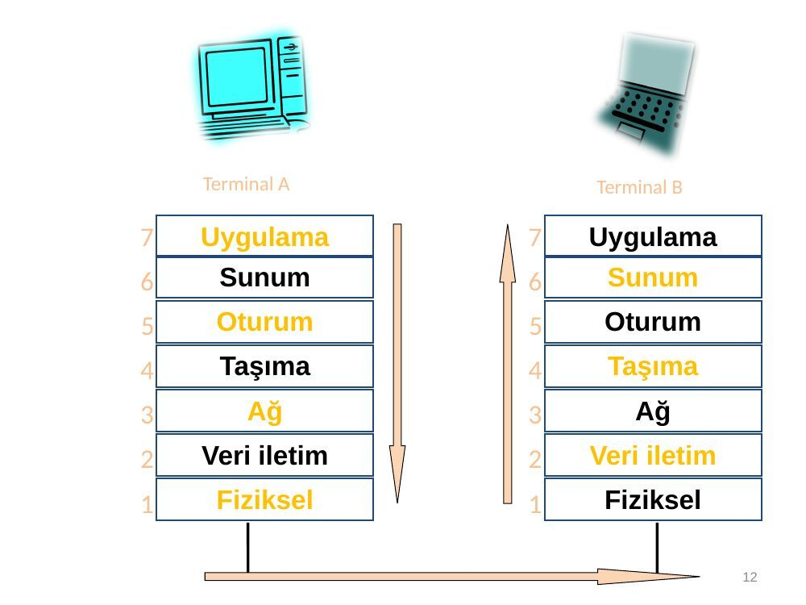
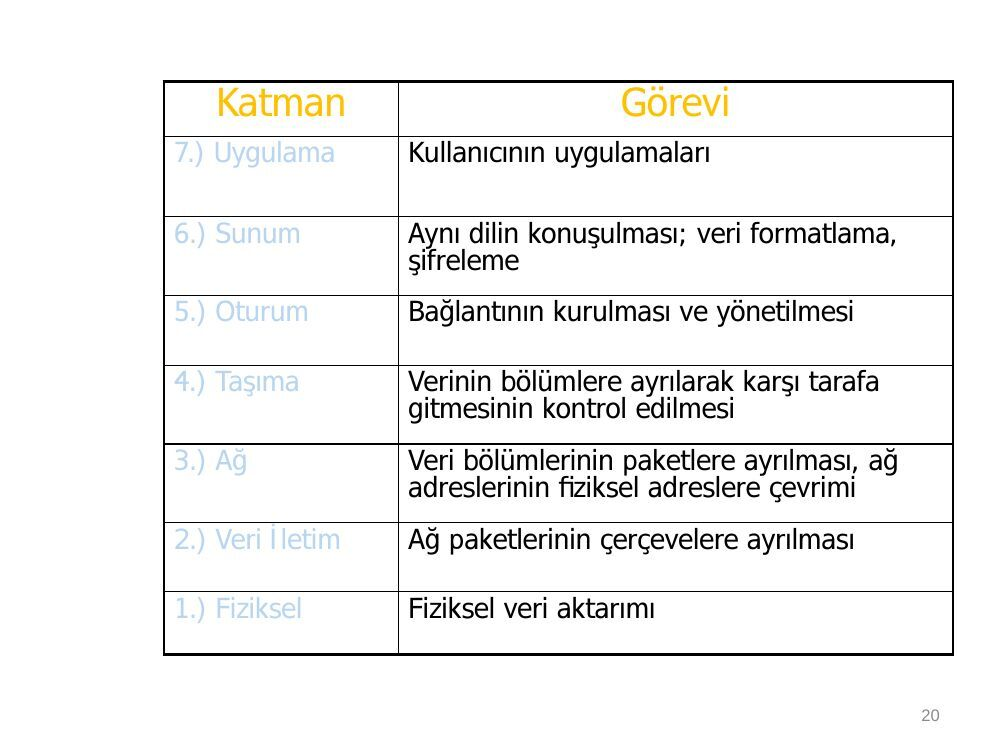
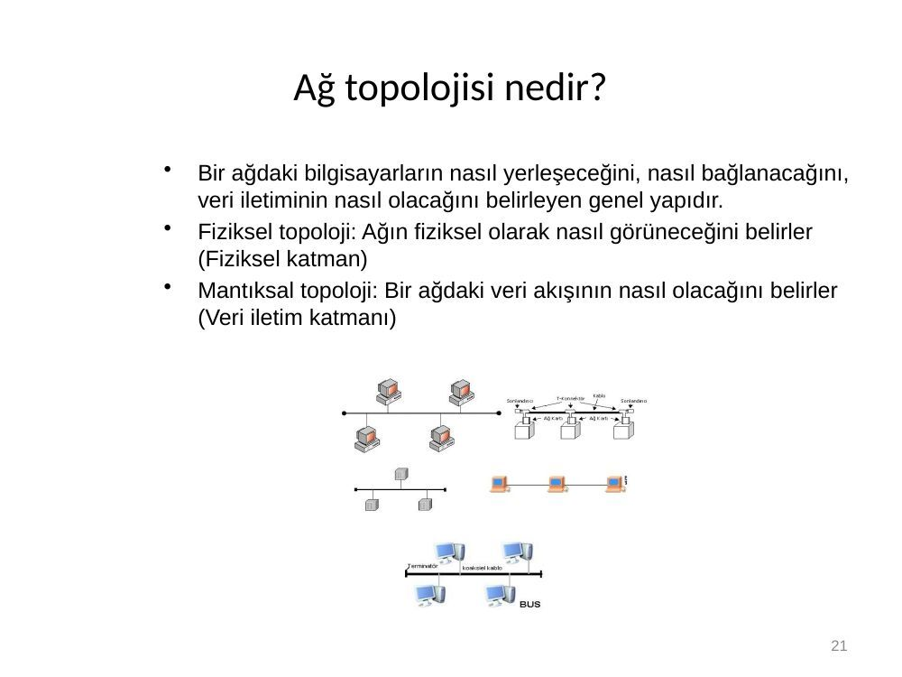
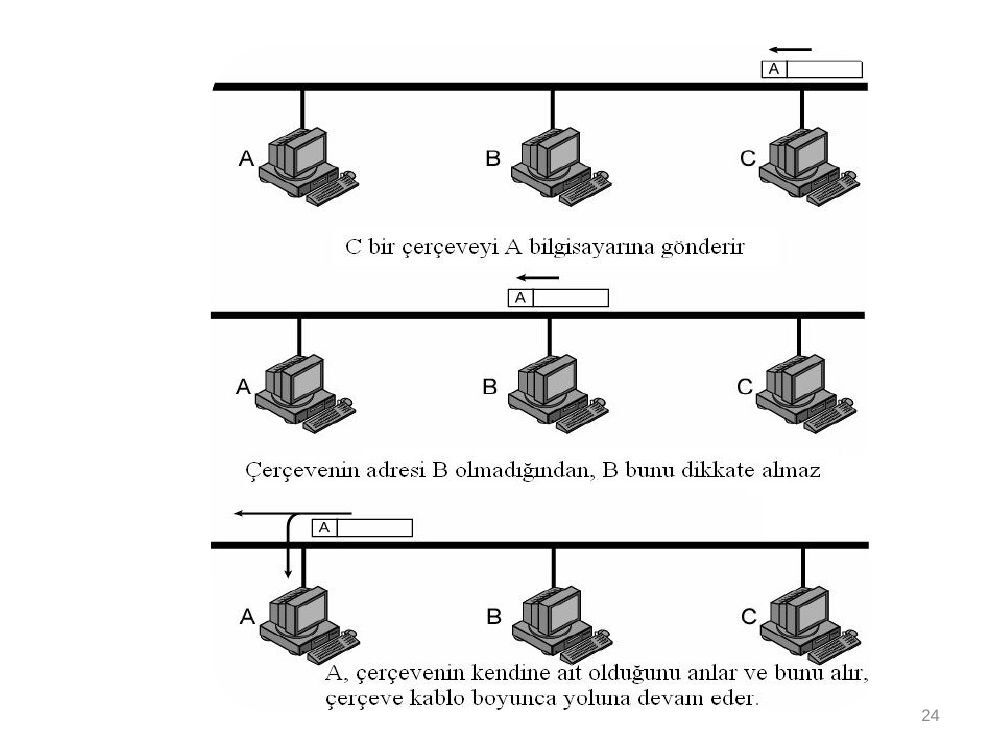
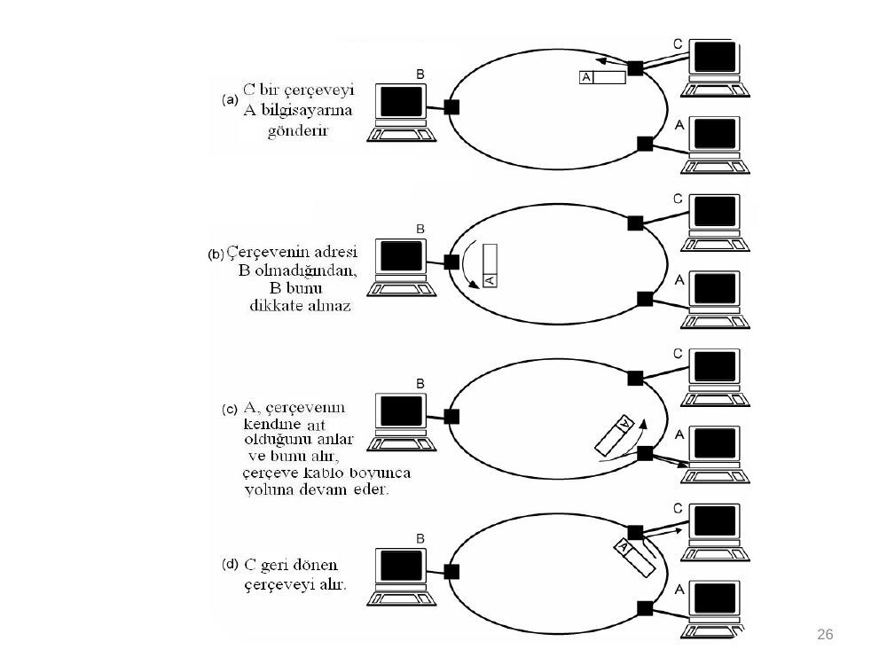
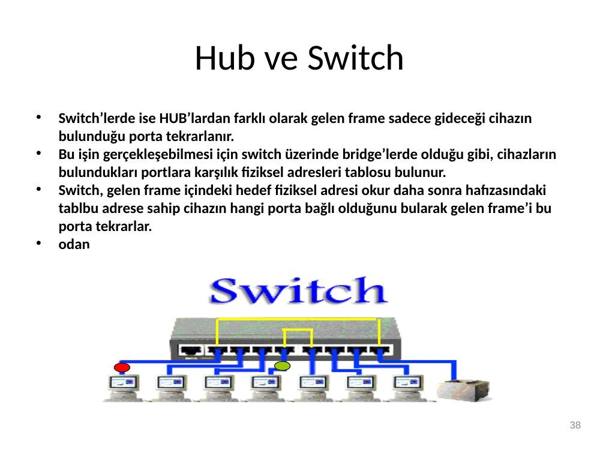
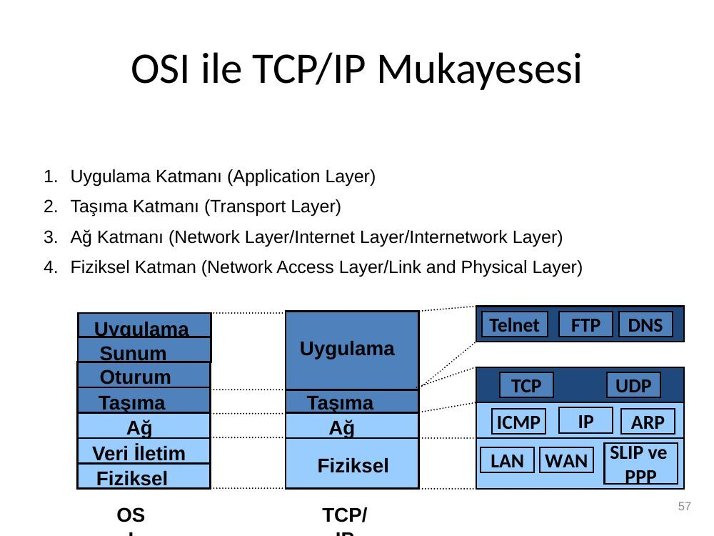
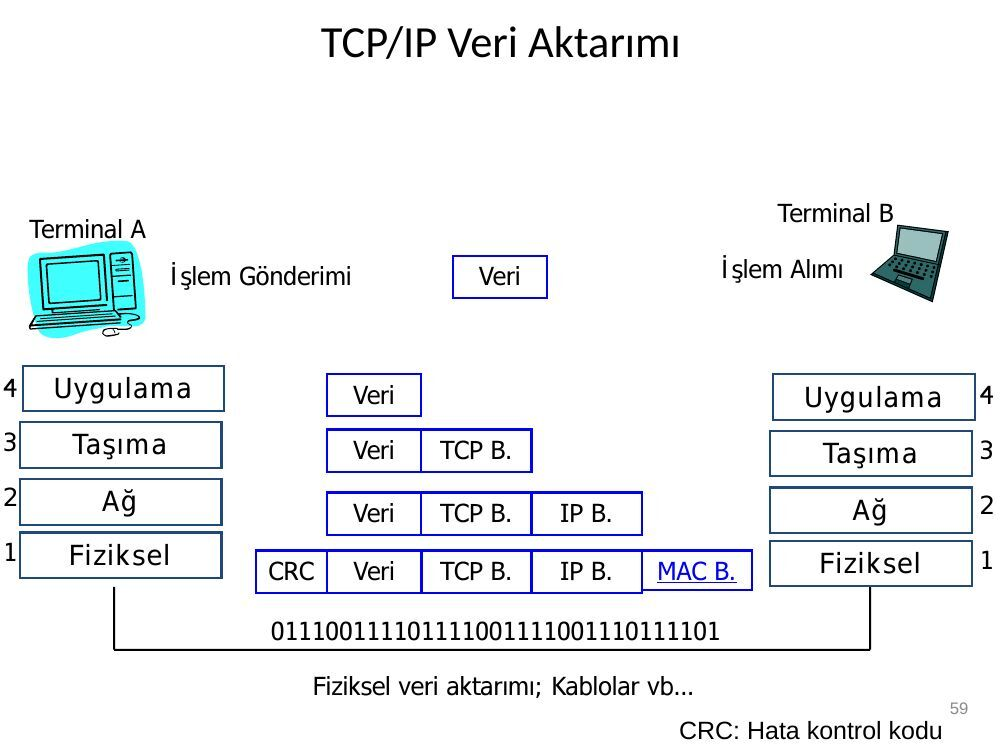

Hazırlayanı ve kurumu belirtilmeyen 66 sayfalık Türkçe ağ sunumudur. EEM413 klasöründe saklanmıştır; tarih kaynak dosyanın oluşturulma kaydından alınmıştır. Belgelerin arşiv için hazırlanmış PDF kopyaları yazının sonunda indirilebilir.

*Bu içerik üçüncü taraf bir kaynağa aittir; arşiv ve nostalji amacıyla kaynak belirtilerek paylaşılmıştır. Hak sahibinin talebi hâlinde kaldırılır.*

## Bilgisayar Ağları (slayt 1)

Bilgisayar Ağları

## Ağ Nedir? (slayt 2)

- Ağ Nedir?

– Birden çok bilgisayarın birbirine bağlanarak kaynakları paylaşmaktır.

## Ağ Kurulumuna Neden Gerek Duyulmuştur? (slayt 3)

Ağ Kurulumuna Neden Gerek Duyulmuştur?

2-Kişiler için 1-Kurumlar için • Uzaktaki bilgiye erişim

- Kaynakların paylaşımı

- • Kullanıcılar arasında Yüksek güvenilirlik

- Ölçeklenebilirlik haberleşme

- Haberleşme ortamı • Etkileşimli eğlence

- E-iş, • E-dönüşüm

- Parasal tasarruf

3- Platform olarak Ses, veri, video, resim taşımak için…

## Kaynakları Paylaşmak (slayt 4)

* Kaynakları Paylaşmak

* Bilgiyi Paylaşmak

* Yazılımda Standartlaşma

## Ağlar ’ın uygulama seviyesindeki kullanımları? (slayt 5)

Ağlar ’ın uygulama seviyesindeki kullanımları?

- Ağ’larda sık kullanılan 2 uygulama mimarisi vardır.

**1.** Eşler-arası (peer-to-peer) Ağlarda genellikle sınırlı sayıda PC birbirine bağlıdır. Bu bilgisayarlar düzey olarak aynıdır. Yani içlerinden birisinin ana bilgisayar olarak kullanılması söz konusu değildir .

**2.** Server-based (client/server) Ağlarda bir ana bilgisayar vardır. Buna ana makine (dedicated server) denir. Ana makine üzerinde ağ yönetimi yapılır.

## Bilgisayar Ağlarının Sınıflandırılması (slayt 6)

Bilgisayar Ağlarının Sınıflandırılması

1- İletim teknolojisine göre

- Yayın Ağları (Broadcast networks):

- Ağa bağlı bilgisayarlar sadece tekbir veri yolunu kullanırlar.

- Noktadan noktaya ağlar (point to point networks) :

- Bilgisayarlar arasında birden çok veriyolu bulunur.

2- Fiziksel boyuta göre

- Yerel alan ağları - LAN

- Kentsel alan ağları - MAN

- Geniş alan ağları- WAN

## Yerel Alan Bilgisayar Ağları (LAN) (slayt 8)

Yerel Alan Bilgisayar Ağları (LAN)

- Yerel alan ağları(LAN), bir bina veya kampüs ortamında kullanılan bir bilgisayar ağı tipidir.

- LAN, bu tip bir yapı içinde kaynak ve veri paylaşımı amacıyla kullanılır.

- LAN’ da temel olarak kullanılan topolojiler veriyolu ve halka topolojileridir.

- Genellikle yayın yapan ağ tipi olmasına rağmen noktadan noktaya tipte de bulunurlar.

## Geniş Alan Bilgisayar Ağları (WAN) (slayt 9)

Geniş Alan Bilgisayar Ağları (WAN)

- Geniş alan ağları(WAN), bir ülke ya da kıta çapında oluşturulan ağlardır.

- - Coğrafi sınırlamaları azdır, dolayısıyla boyutları çok daha esnektir. - WAN’ da birçok kullanıcıya hizmet veren ana bilgisayarlar, haberleşme alt ağları üzerinden birbirine bağlanırlar.

- WAN’ ın en önemli özelliği, bilgisayarları haberleşme ağından ayrı olarak ele almasıdır. Böylece ağ tasarımı da kolaylaşmıştır.

## Kentsel Alan Bilgisayar Ağları (MAN) (slayt 10)

Kentsel Alan Bilgisayar Ağları (MAN)

- Şehirsel alan ağları(MAN), LAN’ın şehir çapında büyütülmüş şeklidir denilebilir. -- MAN da yayın ağlarıyla aynı teknolojileri kullanır. En iyi bilinen örneklerinden birisi kablo TV hatları üzerinden, kullanılmayan bantları kullanarak iki yönlü iletişimin kurulduğu internet bağlantısıdır.

- MAN’ da da LAN’ da olduğu gibi anahtarlama (switching) elemanı bulunmaz.

## OSI Modeli Nedir ? (slayt 11)

OSI Modeli Nedir ?

- Farklı bilgisayarların ve standartların gelişmesi ile sorunların ortaya çıkması nedeniyle

- ISO (International Organization for Standardization), OSI (Open Systems Interconnection) modelini 1984’te geliştirdi.

- 7 Katmandan oluşmakta , karmaşıklığı azaltmak ve standartlar geliştirmek amacıyla geliştirilmiştir.

## Terminal A        Terminal B (slayt 12)

Terminal A Terminal B

7 Uygulama 7 Uygulama 6 Sunum 6 Sunum 5 Oturum 5 Oturum 4 Taşıma 4 Taşıma 3 Ağ 3 Ağ 2 Veri iletim 2 Veri iletim 1 Fiziksel 1 Fiziksel

## 7. Uygulama (Application) Katmanı (slayt 13)

**7.** Uygulama (Application) Katmanı

- Kullanıcı tarafından çalıştırılan tüm uygulamalar burada tanımlıdır.

- Örneğin; – HTTP – WWW – FTP – SMTP – E-mail (Simple Mail Transfer Protocol)

## 6. Sunum (Presentation) Katmanı (slayt 14)

**6.** Sunum (Presentation) Katmanı

- Bu katman verileri, uygulama katmanına sunarken veri üzerinde kodlama ve dönüştürme işlemlerini yapar.

- Ayrıca bu katmanda; – veriyi sıkıştırma/açma, – şifreleme/şifre çözme, – EBCDIC’ den ASCII’ye veya tam tersi yönde bir dönüşüm işlemlerini de yerine getirir.

- Bu katmanda tanımlanan bazı standartlar; – PICT ,TIFF ,JPEG ,MIDI ,MPEG, HTML.

## 5. Oturum (Session) Katmanı (slayt 15)

**5.** Oturum (Session) Katmanı

- Oturumun kurulması, yönetilmesi ve sonlandırılmasını sağlar.

- Haberleşmenin organize ve senkronize edilmesini sağlar.

- Eğer veri iletiminde hata oluşmuş ise tekrar gönderilmesine karar verir.

- Verinin güvenliğini sağlar.

- Bu katmanda çalışan protokollere örnek; – NFS (Network File System), – SQL (Structured Query Language) – ASP (AppleTalk Session Protocol) – Telnet

GİRİŞ HATASIZ

DEVAM

GERİDÖNÜŞ 15 HATALI

## 4. Taşıma (Transport ) Katmanı (slayt 16)

**4.** Taşıma (Transport ) Katmanı

- Bu katman 5-7 ve 1-3 arası katmanlar arası bağlantıyı sağlar. – Üst katmandan aldığı verileri bölümlere (segment) ayırarak bir alt katmana iletir, – Bir üst katmana bu bölümleri birleştirerek sunar.

- İki düğüm arasında mantıksal bir bağlantının kurulmasını sağlar.

- Aynı zamanda akış kontrolü (flow control) kullanarak karşı tarafa gönderilen verinin yerine ulaşıp ulaşmadığını kontrol eder.

- Karşı tarafa gönderilen bölümlerin gönderilen sırayla birleştirilmesini sağlar.

- Örnek; TCP, UDP (User Datagram Protocol), SPX

## 3. Ağ (Network) Katmanı (slayt 17)

**3.** Ağ (Network) Katmanı

- Bu katmanda iletilen veri blokları paket olarak adlandırılır.

- Bu katman, veri paketlerinin ağ adreslerini kullanarak bu paketleri uygun ağlara yönlendirme işini yapar.

- Adresleme işlemlerini (Mantıksal adres ve fiziksel adres çevrimleri) yürütür.

- Yönlendiriciler (Router) bu katmanda tanımlıdırlar.

- Örnek; IP ve IPX.

## 2. Veri İletim (Data Link) Katmanı (slayt 18)

**2.** Veri İletim (Data Link) Katmanı

- Ağ katmanından aldığı veri paketlerine hata kontrol bitlerini ekleyerek çerçeve (frame) halinde fiziksel katmana iletme işinden sorumludur.

- İletilen çerçevenin doğru mu yoksa yanlış mı iletildiğini kontrol eder, eğer çerçeve hatalı iletilmişse çerçevenin yeniden gönderilmesini sağlar.

- Ayrıca ağ üzerindeki diğer bilgisayarları tanımlama, kablonun o anda kimin tarafından kullanıldığının tespitini yapar.

- Örn: Ethernet, Frame Relay, ISDN, Switch ve Bridge

## 1. Fiziksel (Physical) Katmanı (slayt 19)

**1.** Fiziksel (Physical) Katmanı

- Verilerin fiziksel olarak gönderilmesi ve alınmasından sorumludur.

- Bu katmanda tanımlanan standartlar taşınan verinin içeriğiyle ilgilenmezler. Daha çok işaretin şekli,fiziksel katmanda kullanılacak konnektör türü, kablo türü gibi elektriksel ve mekanik özelliklerle ilgilenir.

- Hub’lar fiziksel katmanda tanımlıdır.

## Katman                           Görevi (slayt 20)

Katman Görevi

**7.** ) Uygulama Kullanıcının uygulamaları

**6.** ) Sunum Aynı dilin konuşulması; veri formatlama, şifreleme

**5.** ) Oturum Bağlantının kurulması ve yönetilmesi

**4.** ) Taşıma Verinin bölümlere ayrılarak karşı tarafa gitmesinin kontrol edilmesi

**3.** ) Ağ Veri bölümlerinin paketlere ayrılması, ağ adreslerinin fiziksel adreslere çevrimi

**2.** ) Veri İletim Ağ paketlerinin çerçevelere ayrılması

**1.** ) Fiziksel Fiziksel veri aktarımı

## Ağ topolojisi nedir? (slayt 21)

Ağ topolojisi nedir?

- Bir ağdaki bilgisayarların nasıl yerleşeceğini, nasıl bağlanacağını, veri iletiminin nasıl olacağını belirleyen genel yapıdır.

- Fiziksel topoloji: Ağın fiziksel olarak nasıl görüneceğini belirler (Fiziksel katman)

- Mantıksal topoloji: Bir ağdaki veri akışının nasıl olacağını belirler (Veri iletim katmanı)

## Ağ Topoloji Türleri (slayt 22)

Ağ Topoloji Türleri

- Doğrusal (Bus Topology)

- Halka (Ring Topology)

- Yıldız (Star Topology)

- Ağaç (Tree Topology)

## Doğrusal (Bus) Topoloji (slayt 23)

Doğrusal (Bus) Topoloji

- Bir kablo yol olarak düşünülürse, bu yol üzerindeki her bir durak ağda bir düğümü (node-terminali/cihazı) temsil etmektedir.

- Bu tek kabloya; bölüm (segment), omurga (backbone), trunk denilebilir.

## Şema (slayt 24)

## Halka(Token Ring) Topoloji (slayt 25)

Halka(Token Ring) Topoloji

- Halka içersindeki bir bilgisayar bozulursa tüm ağ bağlantısı kesilir.

- Çarpışma olasılığı düşüktür.

- Şu anda halka topolojilerde UTP, STP kablo kullanılmaktadır.

- İlk halka topolojiler; 4 Mbps (CAT3 UTP), daha sonra 16 Mbps(CAT4 ve üstü veya STP Tip 4) çalışmaktadır. – Halka topolojiye uygun ethernet kartları; 4 veya 16 Mbps’da çalışır.

## Şema (slayt 26)

## Yıldız (Star) Topoloji (slayt 27)

Yıldız (Star) Topoloji

- Tüm düğümlerin ortak bir merkeze (örneğin, hub, switch) bağlanmasıdır.

## Yıldız (Star) Topoloji (slayt 28)

Yıldız (Star) Topoloji

- Avantajları – Ağı kurmak kolaydır – Bir bilgisayara bağlı kablo bozulduğunda ağın çalışması etkilenmez. – Ağdaki sorunları tespit etmek kolaydır.

- Dezavantajları – Hub kullanıldığında ağ trafiği artar. – Doğrusala göre daha fazla uzunlukta kablo gerektirir. – Hub veya Switch bozulduğunda tüm ağ çalışmaz hale gelir. – Hub ve Switch gibi cihazlar nedeniyle doğrusala göre kurulumu daha pahalıdır.

## Ağaç (Tree) Topoloji (slayt 29)

Ağaç (Tree) Topoloji

- Genellikle yıldız topolojisindeki ağları birbirine bağlamak için kullanılır. Böylece ağlar büyütülebilir.

- Bir ağacın dalları farklı topolojilerdeki ağları temsil eder, ağacın gövdesi ile de bunlar birbirine bağlanabilir.

## Ağaç (Tree) Topoloji (slayt 30)

Ağaç (Tree) Topoloji

- Avantajları – Her bir bölüme (segment) ulaşmak kolaydır – Bir çok çalışma grubu bir araya getirilebilir.

- Dezavantajları – Her bir bölümün uzunluğu kullanılan kablo ile sınırlıdır. – Omurga kablosu bozulduğunda bölümlerdeki ağ trafiği etkilenir. – Kurulumu ve düzenlenmesi daha zordur.

## İstemci/Sunucu Mimarisi (slayt 31)

İstemci/Sunucu Mimarisi

- Sunucu (iş istasyonu yada bilgisayar): – Pasif durumdadır – İstekleri (request) bekler – İstek olduğunda bilgiyi hazırlar ve cevap yollar

- İstemci (bilgisayar yada mobil cihaz): – Aktif durumdadır – İstekleri gönderir – Cevap dönene kadar bekler

## P2P (Peer-to-Peer) (slayt 32)

P2P (Peer-to-Peer)

- Uçtan-uca (peer-to-peer) iletişimde her katılımcı bir sunucu-istemci yapısı dışında dosyaları karşısındaki kullanıcıyla paylaşabilmektedir (Napster ve LimeWire servisleri gibi).

- Eşdüzeyli iletişim, her kullanıcının kendi veritabanını oluşturmasını sağlayarak merkezi bir veritabanı ihtiyacını ortadan kaldırmaktadır.

- Çok-oyunculu oyunlar, internet telefonu, video telefon, internet radyosu ve doğası gereği e-posta eşdüzeyli iletişimi kullanmaktadır.

## Ağ Cihazları (Aktif Cihazlar) (slayt 33)

Ağ Cihazları (Aktif Cihazlar)

Repeater (Tekrarlayıcı)

Hub (Göbek)

Switch (Anahtar)

## Access Point(WireLess) [Erişim Noktası] (slayt 34)

Access Point(WireLess) [Erişim Noktası]

Bridge (Köprü)

Router (Yönlendirici)

Gatewaye(Geçit yolu)

Transceiver (Alıcı-Verici / Dönüştürücü)

## YİNELEYİCİ (REPEATER) (slayt 35)

YİNELEYİCİ (REPEATER)

- Kablonun kapasitesinden daha fazla mesafelere bağlantı kurulması gerektiğinde araya bir yükseltici konularak sinyalin güçlendirilmesini sağlayan cihazdır.

## YİNELEYİCİ (REPEATER) (slayt 36)

YİNELEYİCİ (REPEATER)

- OSI’nin 1. katmanında çalıştığı için verinin içeriğine bakmaz, sadece sinyalleri güçlendirir. Ağ trafiğini yönetmez.

## SWITCH (slayt 37)

SWITCH

- Gelen bilgileri sadece belli bir bilgisayarlara gönderir.

- Ağ durumunu izler, veriyi gönderip, iletim işleminin yapılıp yapılmadığını test eder.

## Hub ve Switch (slayt 38)

Hub ve Switch

- Switch’lerde ise HUB’lardan farklı olarak gelen frame sadece gideceği cihazın bulunduğu porta tekrarlanır.

- Bu işin gerçekleşebilmesi için switch üzerinde bridge’lerde olduğu gibi, cihazların bulundukları portlara karşılık fiziksel adresleri tablosu bulunur.

- Switch, gelen frame içindeki hedef fiziksel adresi okur daha sonra hafızasındaki tablbu adrese sahip cihazın hangi porta bağlı olduğunu bularak gelen frame’i bu porta tekrarlar.

- odan

## Switch veri akışı (slayt 39)

Switch veri akışı

## Router (Yönlendirici) (slayt 40)

Router (Yönlendirici)

- Genel olarak LAN-WAN ve LAN-LAN bağlantılarında kullanılır. Üzerinde LAN ve WAN için ayrı portlar bulunur.

ADSL Router

## YÖNLENDİRİCİ (ROUTER) (slayt 41)

YÖNLENDİRİCİ (ROUTER)

- Routerin bir işlemcisi, epromu ve üzerinde bir işletim sistemi IOS (Internal Operating System) vardır.

## YÖNLENDİRİCİ (ROUTER) (slayt 42)

YÖNLENDİRİCİ (ROUTER)

- Ağlar arası (LAN-LAN, LAN-WAN, WAN-WAN) haberleşmenin yapılabilmesi için ara bağlantıyı sağlar. – Gelen paketin başlığından ve yönlendirme tablosu bilgilerinden yararlanarak yönlendirme kararlarını verme yeteneğine sahiptir.

## Ağ Geçidi (GATEWAY) (slayt 43)

Ağ Geçidi (GATEWAY)

- Geçit, iki farklı protokol arasındaki dönüşümleri sağlar.

- Bu cihaz bir Köprü, Switch veya Yönlendirici olabilir.

- Genellikle Yönlendirici (Router) bu görevi üstlendiğinden varsayılan ağ geçidi (default gateway) olarak o tanımlıdır.

## Ağ Geçidi (Gateway) (slayt 44)

Ağ Geçidi (Gateway)

- Ağ Geçitleri farklı protokolleri kullanan ağların birbiri ile iletişimini sağlar.

- Genellikle bir LAN üzerinden İnternet’e çıkmak için router cihazının IP adresi geçit olarak belirlenir.

## Ağ kartı (slayt 45)

Ağ kartı

- Bir bilgisayarı başka bir bilgisayara yada bir ağ cihazına bağlamak için kullanılan ağ kartları genellikle ethernet protokolünü kullandıkları için ethernet kartı olarak ta bilinirler.

## Modem (MOdulator/DEModulator) (slayt 46)

Modem (MOdulator/DEModulator)

- Analog hat (telefon hattı gibi) üzerinden sayısal veri gönderimini sağlar.

- Dial-up modemler en fazla 56 Kbit/s hızında indirme (download) yapabilirken, ADSL2 modemler ise 25 Mbit/s hıza kadar çıkabilmektedir.

## ADSL (Asymmetric Digital Subscriber (slayt 47)

ADSL (Asymmetric Digital Subscriber Line)

- Asimetrik Sayısal Abone Hattı, veri ve ses iletiminin aynı anda kullanılmasına olanak sağlar (aynı anda internet erişimi ve telefon görüşmesi).

- Ses ile veri ayrı kanallardan gittiği için yüksek hızda kesintisiz internet erişimi sağlar.

- Mevcut telefon alt yapısını kullanıyor olması nedeni ile alternatif erişim seçeneklerine göre kullanım maliyetinin oldukça düşük olması son yıllarda yaygınlaşmasını sağlamıştır.

## İnternet (slayt 48)

İnternet

- 60'lı yıllarda ABD’de ARPANET adı altında başlatılan askeri bir iletişim projesi iken, 70'li yılların başında Amerikan üniversitelerine de bu projeden yararlanma imkânı verilmesinin ardından yaygın olarak kullanılmaya başlanan en büyük ağdır (genel ağ - küresel ağ).

- İnternet haberleşmesinde TCP/IP (Transmission Control Protocol/Internet Protocol) iletişim protokolü kullanılır (Bak. Kitap sayfa 152).

## İntranet (Özel Ağ – İç Ağ) (slayt 49)

İntranet (Özel Ağ – İç Ağ)

- Belirli bir kuruluş içindeki TCP/IP tabanlı bir ağ sistemine verilen isimdir (şirket içi İnternet).

- İntranet'ler ağ geçitleri ile diğer ağlara veya İnternet’e bağlanabilir. İnternet çıkışı genellikle Firewall olarak bilinen her iki yönde de ileti trafiğini kontrol eden bir güvenlik sistemi üzerinden sağlanmaktadır.

- İntranet’te genellikle sanal IP kullanılır. Böylece sadece İnternet çıkışı için tek bir gerçek IP kullanılarak iç ağdaki tüm bilgisayarlara İnternet erişimi verilebilir.

## IPv4 & IPv6 (slayt 50)

IPv4 & IPv6

- Internet’e bağlı her bilgisayara yada iletişim cihazına bir adres verilmesi için 4 adet 8 bit büyüklüğünde (0-255 arasında) sayı kullanılmaktadır. (Örn: 193.255.140.17)

- Bu adresleme yöntemi ile teorik olarak en fazla 232 = 4.3 milyar adres verilebilmektedir.

- IPv6 olarak bilinen yeni adresleme yöntemi ile 2128 = 3.4 x 1038 adres verilebilecektir.

- IPv6 çıkınca eski adresleme yöntemi IPv4 olarak isimlendirilmiştir (bak. Kitap sayfa 155).

## MAC Adresi (slayt 51)

MAC Adresi

- IP numarası verilebilen kablolu yada kablosuz her ağ kartının 48 bitlik bir MAC adresi bulunur. Örn: 00-23-C3-45-00-B3

- Ağ iletişiminde kullanılan çerçeveler gerçekte bu MAC adreslerini kullanarak iletim yaparlar.

- IP adresleri OSI 3. katmanda, MAC adresleri 2. katmanda (OSI için bak. Kitap sayfa 139)

## DNS (Domain Name Server) (slayt 52)

DNS (Domain Name Server)

- IP adreslerinin hatırlanması zor olacağı için http:// www.google.com gibi simgesel adresler (URL: Uniform Resource Locator) kullanılmaktadır.

- Web adresi olarak ta bilinen bu simgesel adreslerin IP numarası karşılıkları DNS olarak isimlendirilen sunucularda tutulmaktadır.

- Eğer sistemimize bir DNS tanımlamazsak, istenilen WEB sayfasına erişmek için o sayfanın sunucusunun IP adresini yazmamız gerekir.

## DHCP (Dynamic Host Configuration (slayt 53)

DHCP (Dynamic Host Configuration Protocol)

- Dinamik İstemci Ayarlama Protokolü, bir TCP/IP ağındaki makinelere IP adresi, ağ geçidi veya DNS sunucusu gibi ayarların otomatik olarak yapılması için kullanılır.

- Günümüzde neredeyse tüm ev ve halka açık ağlarda kullanılmaktadır, iş veya daha kontrollü bir bağlantı sağlanan yerlerde ise statik IP adresi tercih edilir.

- Detaylı bilgi için: http://tr.wikipedia.org/wiki/DHCP

## TCP/IP (slayt 54)

TCP/IP

## Internet’in Kısa Tarihçesi (slayt 55)

Internet’in Kısa Tarihçesi

İlk geniş alan ağı olan ARPANET 1960’lı yılların ortasında askeri amaçlarla ortaya çıktı. Problem: Nükleer bir savaş esnasında telefon hatlarının çoğunun tahrip olması durumunda bilgisayar iletişiminin sürdürülmesi Çözüm: Paul Baran, Rand Corp. tarafından geliştirildi. Baran paket-anahtarlamalı ağ fikrini geliştirdi Her mesaj küçük parçalara bölünmesi ve bu parçaların varış noktasına başarı ile ulaşıp orijinal mesajın oluşturulması Küçük parçalara bölünen mesajlar hızlı hatlar üzerinden yollanır 1969’de ağın detayları ARPA’ya (Advanced Research Projects Agency) sunuldu. 1972, ağların ağı ortaya çıkmaya başladı. 40 bilgisayardan oluşan bir ARPANET gösterisi yapıldı.

## Tarihçe (Devam) (slayt 56)

Tarihçe (Devam)

1975 yılında başarılı bir biçimde ARPANET işlevsel bir ağ konumunu aldı, birçok organizasyon bu ağa katıldı. 1983, Internetworking Working Group(INWG) TCP/IP’ye temel halini verdi. TCP/IP UNIX işletim sistemine eklendi. 1984, DNS (Domain Name System) tanıtıldı. Tamamlanması 4 sene sürdü 1985, NSFNET süper bilgisayarlar arası TCP/IP tabanlı ağın oluşturulup çalıştırılması için kuruldu. 1990, ARPANET kaldırıldı Internet’i başlangıçta yoğun olarak akademik dünya kullanmakla beraber, artık Internet bilgi çağı toplumlarının her kesimi için vazgeçilmez bir araç olmuştur

## OSI ile TCP/IP Mukayesesi (slayt 57)

OSI ile TCP/IP Mukayesesi

**1.** Uygulama Katmanı (Application Layer)

**2.** Taşıma Katmanı (Transport Layer)

**3.** Ağ Katmanı (Network Layer/Internet Layer/Internetwork Layer)

**4.** Fiziksel Katman (Network Access Layer/Link and Physical Layer)

Uygulama Telnet FTP DNS Sunum Uygulama Oturum TCP UDP Taşıma Taşıma Ağ Ağ ICMP IP ARP Veri İletim LAN WAN SLIP ve Fiziksel Fiziksel PPP OS TCP/

## TCP/IP Protokol Katmanları (Devam) (slayt 58)

TCP/IP Protokol Katmanları (Devam)

Uygulam RLOGIN FTP SMTP TELNE DNS TFTP a T

Ulaşım TCP UDP

Yönlendirme IP ICMP

IEEE 802.2 / LAPB/ Fiziksel HDLC

Ethernet, X.25, Token-Ring, Dial-up, vs.

## TCP/IP Veri Aktarımı (slayt 59)

TCP/IP Veri Aktarımı

Terminal B Terminal A İşlem Gönderimi Veri İşlem Alımı

4 Uygulama Veri Uygulama 4 3 Taşıma Veri TCP B. Taşıma 3 2 Ağ 2 Veri TCP B. IP B. Ağ 1 Fiziksel Fiziksel 1 CRC Veri TCP B. IP B. MAC B.

0111 0011 1101 1110 0111 1001 1101 1110 1

Fiziksel veri aktarımı; Kablolar vb… CRC: Hata kontrol kodu

## IP (Internet Protocol) (slayt 60)

IP (Internet Protocol)

- Yaygın olarak IPv4 adresler kullanılıyor.

- Toplam 32 bit ve noktalarla ayrılmış 4 adet 8 bitlik sayı.

- Örnek bir IP adresi: – 1000 0000 1001 1100 0000 1110 0000 0111 – w.x.y.z – 128.156.14.7

- IP adresleri dünyada 232 = 4 milyardır.

- Dinamik ip adresleri : Evden modem ile bağlanma

- Statik ip adresleri: IIS

## IP Adresi Hiyerarşisi (slayt 61)

IP Adresi Hiyerarşisi

- Bir IP adresi iki kısımdan oluşur. Bu kısımlar prefix (ön ek) ve suffix (son ek olarak) adlandırılır.

- Bu iki seviyeli hiyerarşi iletilen paketin yönlendirme işinin kolayca yapılabilmesi içindir.

## IP Adresi Hiyerarşisi (Prefix) (slayt 62)

IP Adresi Hiyerarşisi (Prefix)

- Prefix: IP adresinin prefix kısmı bir bilgisayarın bağlı bulunduğu ağın fiziksel adresidir.

- Bu da internete bağlı olan her bir fiziksel ağın ayrı birer adresi bulunması gerektiğini gösterir.

- Bu adrese ağ adresi (network address) denilir.

- Bu adres bir ağa bağlı tüm bilgisayarların IP adreslerinde prefix (ön ek) olarak yazılacak olan adrestir.

## IP Adresi Hiyerarşisi (Suffix) (slayt 63)

IP Adresi Hiyerarşisi (Suffix)

- Suffix: IP adresinin suffix kısmı bir ağ içinde bir bilgisayarı diğerlerinden ayıran kısımdır.

- Bir ağa bağlı tüm bilgisayarların prefixleri aynı olmak zorunda olduğuna göre, bir ağ içinde kullanılan tüm suffixler farklı olmak zorundadır.

- Fakat iki farklı ağ içindeki iki bilgisayarın suffix kısımları aynı olabilir.

- IP adresinin suffix kısmına host adresi denilir.

## IP Adresi Hiyerarşisi (slayt 64)

IP Adresi Hiyerarşisi

- IP adresi hiyerarşisi bize iki şeyi temin eder: – Birincisi internete bağlı her bilgisayarın farklı bir adresi olmasını sağlar. – İkinci olarak ağ adreslerinin tek bir merkezden dağıtılmasını gerekli kılmakla beraber, host adreslerinin seçimini ağ adreslerini alan kişilere bırakır.

## IP adres sınıfları (slayt 65)

IP adres sınıfları

- IP adreslerinin 32 bit olduğunu daha önce belirtmiştik.

- Peki bu 32 bitin kaç biti prefix yani ağ adresi ve kaç biti suffix yani host adresi?

- Farklı ağ teknolojilerinden dolayı çok host içerebilen ağlar olabileceği gibi host sayısı az olan ağlar da olacaktır.

## IP adres sınıfları (slayt 66)

IP adres sınıfları

- Prefix ve suffix in uzunluk seçimi internete bağlanabilecek olan ağ sayısını ve bir ağdaki host sayısını doğrudan etkilediği için uzunluk seçimi dikkatli yapılmalıdır.

- IP adresleri tasarlanırken prefix ve suffix için sabit uzunluk olmasının ihtiyaçları karşılamayacağı görülmüş ve IP adresleri prefix ve suffix bitlerinin sayısına göre üç temel sınıfa ayrılmışlardır.

- Bunun yanısıra iki de özel amaçlı sınıf oluşturulmuştur.

- IP sınıfları sonraki slaytta gösterildiği gibi başlangıçtaki 4 bit ile birbirlerinden ayrılırlar.

*Not: Bazı slaytlarda kitap sayfasına gönderme vardır; kitap künyesi belirtilmemiştir. Katmanlara atanan görevler basitleştirilmiştir: her taşıma protokolü güvenilirlik sağlamaz; UDP buna örnektir. DNS açılımı Domain Name System’dir.*
