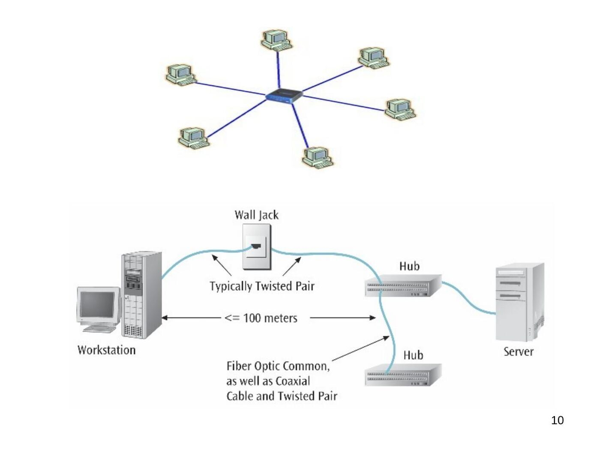
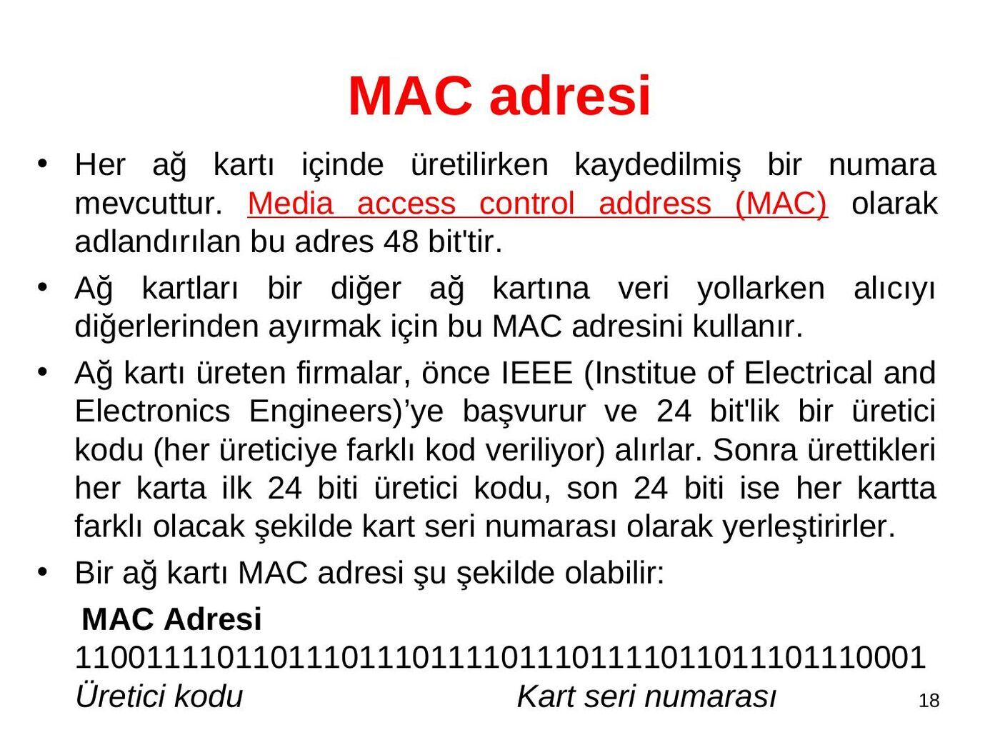
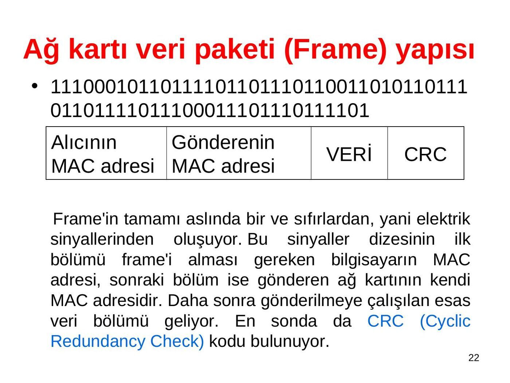
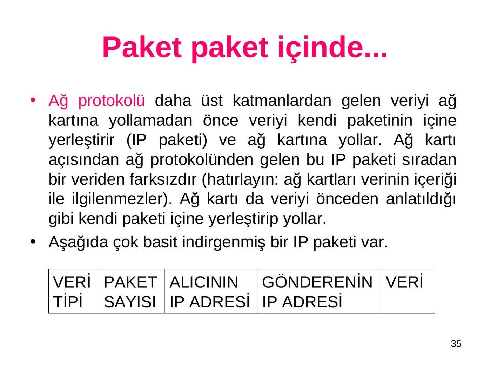
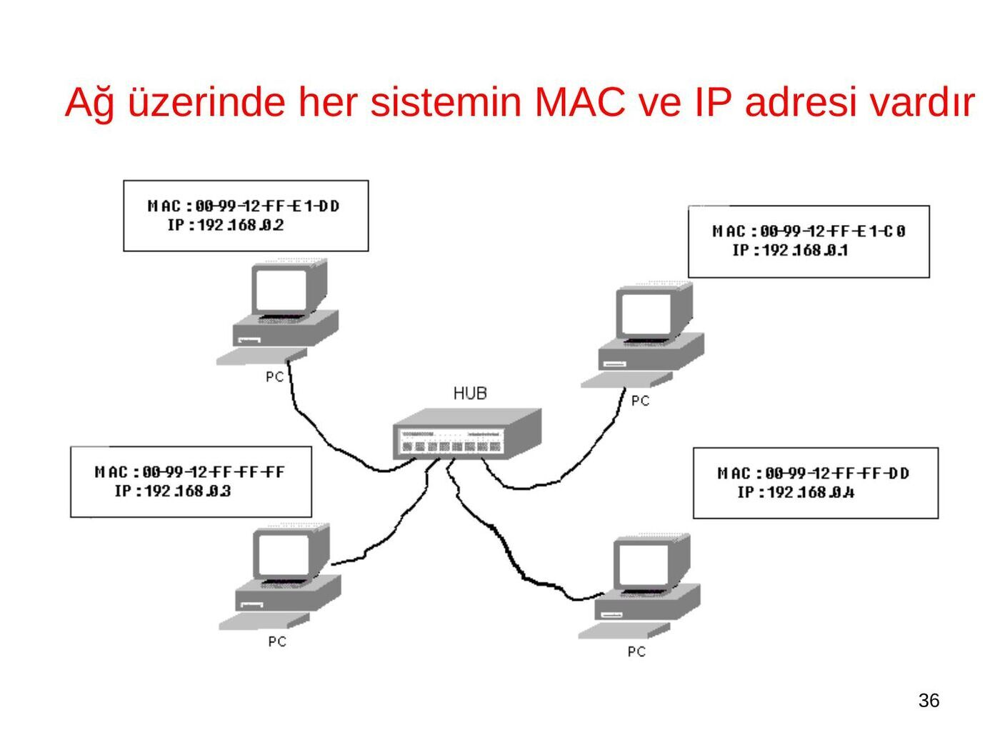
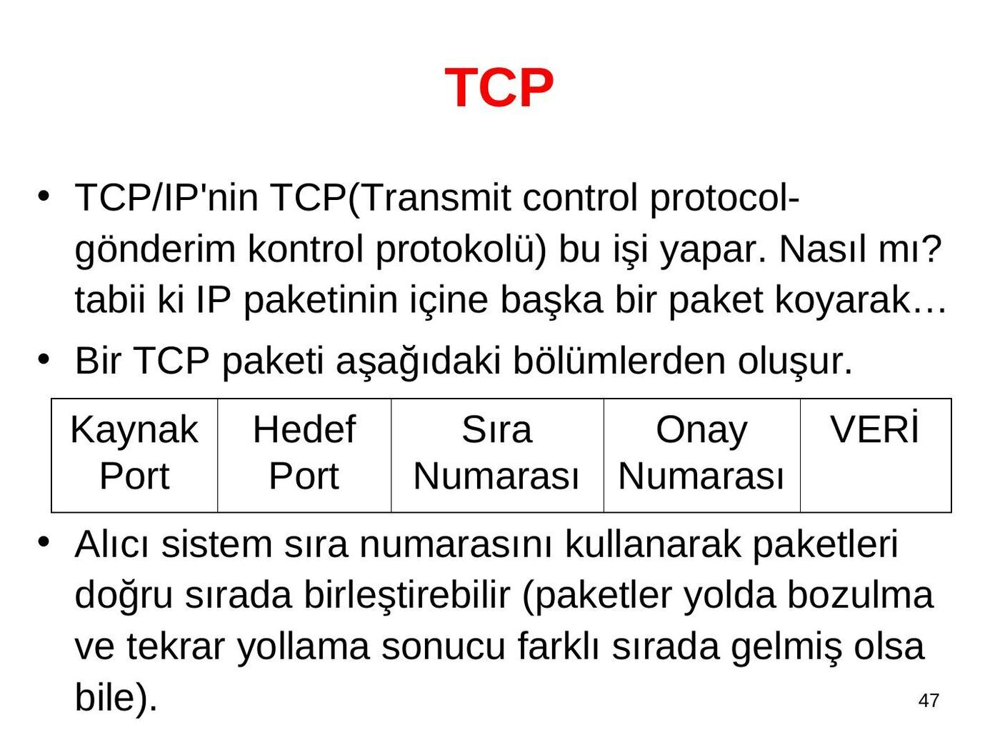
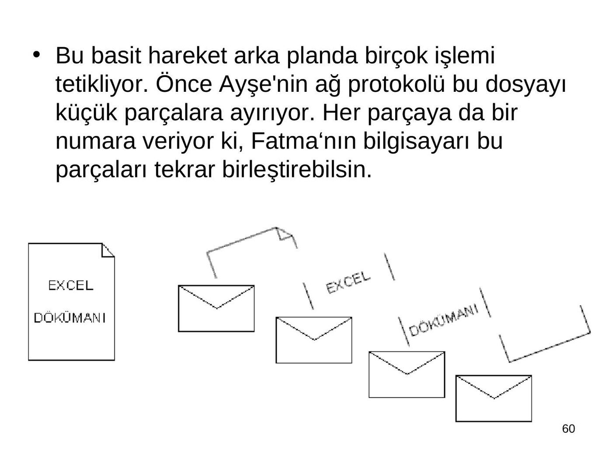
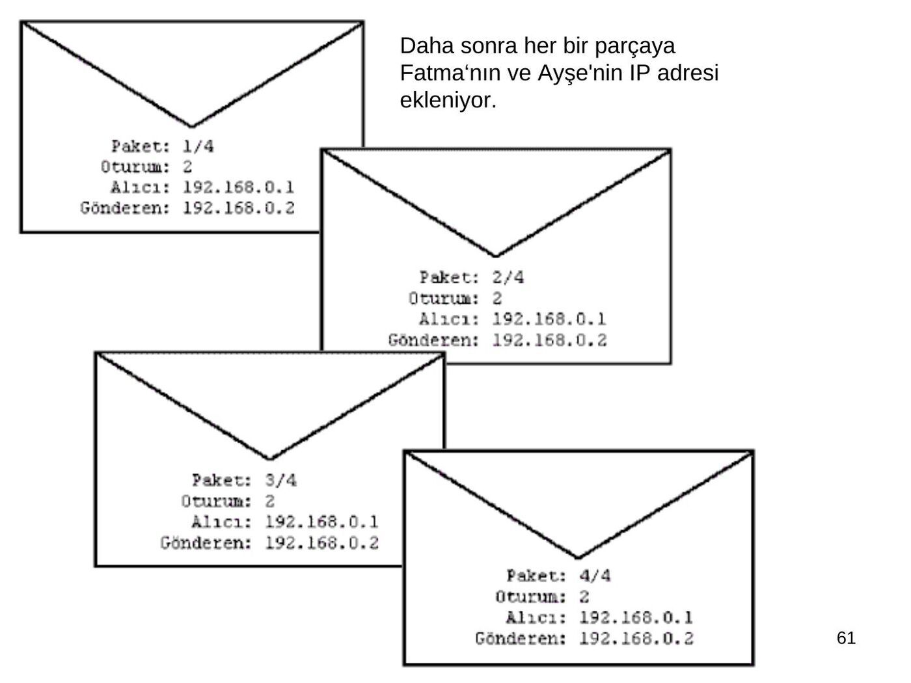
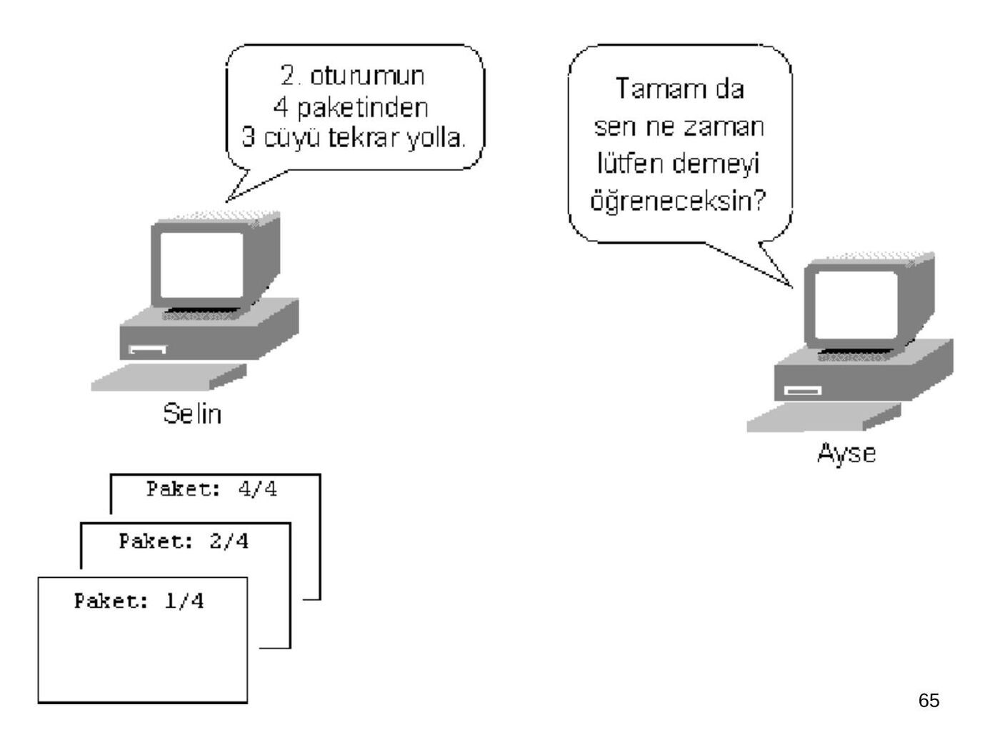

This is the EEM413 introductory presentation designed by Fırat Hardalaç and revised by Derya Yılmaz. The document has no date on it; the date of the source file was used. The photographs of two people in it have been covered. PDF copies of the documents prepared for the archive can be downloaded at the end of the post.

## COMPUTER NETWORKS (slide 1)

COMPUTER NETWORKS General Information-Introduction

Designed by Dr. Fırat Hardalaç, Revised by Dr. Derya Yılmaz

## COURSE CODE/ NAME                      : EEM 413-01 COMPUTER NETWORKS (slide 2)

COURSE CODE/ NAME : EEM 413-01 COMPUTER NETWORKS INSTRUCTOR : Asst. Prof. Dr. Derya Yılmaz (www.baskent.edu.tr/~derya, derya@baskent.edu.tr)

CLASS HOURS : Wednesday 13:00-14:50 Friday 11:00-12:50

OFFICE HOURS : Office: D404

TEXTBOOK : J. F. Kurose, K.W. Ross, Computer Networking, 5th Ed., Pearson, 2010

REFERENCE / SUPPLEMENTARY BOOKS : D. E. Comer, Computer Networks and Internet Applications, Prentice Hall, 2004

W. Stallings, Data and Computer Communications, 7th Ed., Prentice Hall, 2004

GRADING

Participation & Attendance, Quiz + Homework, Project, Laboratory, Midterm Exam, Final Exam, Total ---------- 10 -------- 10 30 50 100 %

## WEEK   TOPICS (slide 3)

WEEK TOPICS

1 Introduction to computer networks and internet 2 Application layer, http, FTP, SMTP 3 Application layer, DNS 4 Transport layer principles 5 Transport control protocol TCP 6 Principles of congestion control in TCP 7 Network layer and routing 8 MIDTERM EXAM 9 Internet protocol IP 10 Routing in the internet 11 Link layer, error detection and correction, Multiple access protocol 12 Local area networks, ethernet 13 Wireless LANs, PPP 14 Wireless and mobile networks

Laboratory program: Wireshark

## How Do Computer Networks Work? (slide 4)

How Do Computer Networks Work?

- Let us take a computer network that you can see in almost every office today and examine the basic operating principles of computer networks.

- Let the company's name be Firma Tic. This company's office has computers with Windows 2000 installed. Windows 2000 is an operating system that provides networking features, which makes it not only an OS (Operating System) but also a NOS (Network Operating System). Firma Tic.'s computer network uses the most popular cabling type, Unshielded Twisted Pair (UTP).

## Computer Networks (slide 5)

Computer Networks

- However, what is explained in this section is related neither to the operating system nor to the cable type. There are different network operating systems and cabling types in the world.

- This text has been prepared only to give you a general view of the different software and hardware components that make up a computer network and the function of each.

- Therefore, even though different networks use different cable types or operating systems, what is explained here will in principle cover all network systems.

## Computer Networks (slide 6)

Computer Networks

- Above you see two computer users. As you can guess, they are Firma Tic. employees Ayşe and Selin, and because of their jobs they often need to use the files on each other's computers. For example, Ayşe has just finished the monthly sales report in Excel and wants Selin to check it as well.

## Computer Networks (slide 7)

Computer Networks

The first thing Ayşe can do is to use the classical method:

- Copy the file to a floppy disk, get up, and hand the disk to Selin.

- However, a computer network lets Selin access Ayşe's computer without getting up from her seat and copy this file to her own computer. Now let us see how this works... 7

## Cable (slide 8)

Cable A network first needs a physical connection between the computers, so that data bits can be transferred between them. Today many networks use Unshielded Twisted Pair (UTP) cable like the one you see next to this text. This type of cable consists of 4 or 8 wires, and these wires are in twisted pairs.

!!!!!! Remember that different cable types, and even wireless technologies, can be used; our aim here is for you to grasp that a network needs a medium to carry the data in order to work. 8

## Another network component is the Hub. A cable runs from each computer on the network to the hub (slide 9)

Another network component is the Hub. A cable runs from each computer on the network to the hub. The hub does not send the information coming from one end only to the end it should go to; it sends it to all ends at once (this is important information, we will encounter it often later). In this case each computer has to determine whether the data coming from the hub belongs to itself.

Next to this text you see a hub. Two yellow cables and one gray cable come from the computers. The colors have no importance whatsoever. Cables can be of different colors. Did you notice the black cable on the far right? If you did not, I did: this cable comes from the electrical connection that makes the hub work, that is, from the adapter. Hubs are active devices, that is, they need electricity to operate. !!!!!! It is worth stating again that a network system using a hub has been taken as an example here. Other network systems exist as well. However, what you will read shortly is valid for all of them.

## Diagram (slide 10)

## Network card (slide 11)

Network card Another component that makes the network work is the Network Interface Card (NIC). It is often called an ethernet card; in fact, it is more correct to say network card. This has become a "generic name". Just as we say "sana yağı" instead of margarine (a Turkish brand name that became a generic term), the network card has turned into the ethernet card because the "ethernet" type is by far the most common type. However, there are also network cards manufactured to work with other network technologies. In conclusion, network card is a general definition, whereas ethernet is a subtype (but the most common one). Network cards can be of many different types, but the ones Firma Tic. uses and the ones you will use will most 11 likely look like the one next to this text.

## So what is the task of the network card? Computers process and store data in binary (slide 12)

- So what is the task of the network card? Computers process and store data in the binary number system, that is, as 1s and 0s. Network cards fulfill the task of transmitting digital data to other systems as electrical, light or radio signals. Since network cards that use electrical signals are the most common type, let us continue with them.

- Millions of small electrical currents are generated every second on the computer's circuit boards. For example, when reading from the hard disk, the electrical signals leaving the hard disk enter the motherboard through the disk cable. From there they reach the CPU (central processing unit) and the memory modules. 12

## Signals travel on the circuits inside the computer case (slide 13)

- Signals travel without any problem on the circuits inside the computer case. However, when these signals leave the computer, they have to travel longer distances. This is actually a rather difficult task, because weak high-frequency electrical signals are very sensitive/vulnerable to external factors.

- Network cards do a very good job in transmitting this data; they transfer the signals from the computer's data buses to the network cable (when sending data) and from the cable back to the computer's data bus (when receiving data). Therefore, the most obvious task of the network card is to transfer the data on the computer's data buses to the outside world.

## However, the task of network cards does not end here. Network cards (slide 14)

- However, the task of network cards does not end here. Network cards also represent the identity of the computer on the network.

- What is identity? Let us imagine that we connect two computers through their serial or parallel ports (the simplest way of making two computers communicate). In such a connection only two computers are involved. The data transmit port of one computer is connected to the receive port of the other, and the transmission of the other is connected to the receive port of the first. With the simplest methods, one side puts the data to be sent on its transmit port and the other side reads it from its receive port.

- However, in a system with more than two computers connected, the following question inevitably comes to mind: how will one side deliver the data to the computer it wants?

## Different network systems (ethernet, token-ring) have given different answers to this question (slide 15)

- Different network systems (ethernet, token-ring) have given different answers to this question. For example, in Token-Ring networks, even though the physical connection between them is a star, that is, even though one cable from each machine goes into a hub in the middle, while the system is running a signal called a Token circulates on the network. This signal visits all terminals in turn. This is where the "Ring" comes from. When a terminal wants to send data, it waits for the empty token signal to come to it. When the token arrives, it attaches the data to be sent to the token message.

## The network card address of the receiving and sending machines is also on the message (slide 16)

- The network card addresses of the receiving and sending machines are also on the message. The full token continues to circulate among the terminals in turn. Each machine looks at the full token that arrives, but takes the data only if the "receiver" address is its own address, and sends back the acknowledgment message. When the token delivers the acknowledgment message to the sending machine, the data has now been sent.

- The token has become empty and continues to ring. Of course, this process takes place millions of times per second. In this system the other machines wait for their turn.

## Ethernet offers a different solution. In an ethernet network, the network card checks the cable before sending data (slide 17)

- Ethernet, on the other hand, offers a different solution. In an ethernet network, the network card checks the cable before sending data; if no one is using it, it puts onto the cable the data containing the network card addresses of the receiving and sending machines. This data is received by all terminals. However, only the machine whose own address is the "receiver" address processes this data; the others ignore it.

- We have learned that Token-Ring and Ethernet differ in the order of using the cable and in the method of data transfer. However, note that in both systems the network cards have an address that is unique on the network. The systems recognize each other by means of this unique identity. And this address is called the Media Access Control - MAC address.

!!!!!The information above about Token-Ring is given for a full understanding of the topic. What is explained in the rest of this page and on all the other pages is valid for ethernet, unless something different is specifically stated.

## MAC address (slide 18)

MAC address

- Every network card has a number recorded inside it during manufacturing. This address, called the Media Access Control address (MAC), is 48 bits long.

- Network cards use this MAC address to distinguish the receiver from the others when sending data to another network card.

- Companies that manufacture network cards first apply to the IEEE (Institute of Electrical and Electronics Engineers) and receive a 24-bit manufacturer code (a different code is given to each manufacturer). Then, for every card they produce, they place the manufacturer code in the first 24 bits and the card serial number, which differs on each card, in the last 24 bits.

- A network card MAC address can look like this: MAC Address 1100 1111 0110 1110 1110 1111 0111 0111 1011 0111 0111 0001 Manufacturer code Card serial number 18

## Of course, since reading numbers in the binary system this way is difficult for us (slide 19)

- Of course, since reading numbers in the binary system this way is difficult for us, MAC addresses are expressed by converting them to the hexadecimal number system. A typical MAC address looks like 00-50-05-1A-00-AF. In this address, which is in hexadecimal (that is, the base-16 number system), each digit (for example B) corresponds to 4 bits.

- Thus 12x4=48. Accordingly, the first 6 digits, that is 00-50-05, are the manufacturer code, and the last 6 digits are the serial number of this card. When the MAC address is considered as a whole, every network card produced in the world has a different MAC address.

- Network cards report their MAC addresses to any software that requests them. If you use Win9x, you can see the MAC address of your network card with the Winipcfg program.

## Adapter Address (slide 20)

Adapter Address shows the MAC address

When you buy the network card, the MAC address is already encoded in an electronic chip on the card. This address normally cannot be changed (although programs that do this have recently appeared). However, it is mostly unnecessary for you to change the MAC address, or even to know what it is.

## Data packets (Frame) (slide 21)

Data packets (Frame)

- Network cards transmit data over the cable as signals. So how do the signals, and therefore the data, reach the other side?

- The data to be sent to the other side, for example a Word file copied to the other machine over the network, is not sent in one piece. It is divided into small fixed-size pieces, and some additional information is added to these pieces before they are sent. These data blocks are called data packets (frames or ethernet frames).

- Data is transmitted over the network in packets (frames) of fixed structure; in fact, this packet is a block of signals containing the data to be transferred and other necessary information. The network card creates these data packets, sends them, and receives and processes incoming packets.

## Network card data packet (Frame) structure (slide 22)

Network card data packet (Frame) structure

- 1110 0010 1101 1110 1101 1101 1001 1010 1101 11 0110 1111 0111 0001 1101 1101 1110 1 Receiver's Sender's DATA CRC MAC address MAC address

The whole frame actually consists of ones and zeros, that is, electrical signals. The first part of this string of signals is the MAC address of the computer that should receive the frame, and the next part is the MAC address of the sending network card itself. Then comes the actual data section that is being sent. At the very end there is the CRC (Cyclic Redundancy Check) code.

## So what is CRC? CRC is a code the receiver uses to understand whether the packet was corrupted on the way (slide 23)

- So what is this CRC? CRC is a code that the receiver uses to determine whether the packet was corrupted on the way. Roughly, the system works as follows: before the data to be sent is transmitted, the sending network card puts it through a mathematical operation. The result of the operation is sent together with the data as the CRC code. The receiver puts the data it received through the same mathematical operation, and if the result it obtains is the same as the CRC, it means the packet reached the receiver without even a single bit being changed on the way.

- While data travels over the network cable, it can be affected by surrounding electromagnetic fields (motors, lamps, magnets, power cables, etc.), and some bits that set out as 1 can arrive on the other side as 0, and some bits that set out as 0 can arrive as 1. As a result, the corruption of even a single bit on the way can cause the data you sent as "shuttle landing speed=250 km/h" to be understood on the other side as "I crave yogurt spinach, dear".

## If a data packet arrives corrupted, the receiver will request the same packet again (slide 24)

- If a data packet arrives corrupted, the receiver will request that the same packet be sent again. However, this process takes place not in the network card but in a higher software layer (this will be addressed on later pages concerning protocols).

- So what kind of thing is the data being sent? Honestly, this concerns neither us nor the network card. The data sent may be the printout of a Word document to be printed on the other side, or it may be a photograph of Britney Spears. The network card is not concerned with this; the network card sends the data that its own driver, running in the operating system, passes to it to the system it should go to. What the data is, or what will be done with it when it reaches the other side, is the job of other programs.

## Each data packet can carry a certain amount of data. Different network (slide 25)

- Each data packet can carry a certain amount of data. The packet structures used by different network systems may differ. However, on average each packet carries 1500 bytes of data. The following question may then immediately come to mind: so what happens if the data being sent (a file, a printout, an e-mail, whatever...) is larger than 1500 bytes?

- In this case the software of the sending system divides the data to be sent into pieces of packet size. The software on the receiving side combines these packets and obtains the data sent as a whole. This fragmentation and reassembly is not the job of the network card. The data to be sent comes to the network card already fragmented by higher-level software. Since the packet-sized data blocks arriving at the network card also contain the sequencing information to be used when reassembling them, the software on the receiving side reassembles the packets coming from its own network card.

## IMPORTANT!!!! (slide 26)

IMPORTANT!!!!

- There are various packet types used by different networks.

- If all the network cards on the network are not set to use the same packet type, they cannot communicate with each other. However, all modern network cards can now automatically select the packet type used on the network.

## Every packet sent onto the network reaches all computers (slide 27)

- Every packet sent onto the network reaches all computers. Each network card checks this packet that comes to it. If the receiver MAC address is its own MAC address, it says "so this packet has come to me" and processes it. However, if the opposite is the case, it deletes this packet.

- Because this point is very important (we will encounter it often later), I want to repeat it: every packet (frame) sent over the network (actually, it would be more correct to say placed onto the network) reaches the network card of all computers but is processed only by its real receiver; the others check this packet, understand that it was not addressed to them, and ignore it. This means that in ethernet networks only one machine can send data at a time. We will examine this in more depth later. 27

## Data transfer (slide 28)

Data transfer

- Having learned the basic structure, let us examine how a simple network communication takes place. When one computer wants to reach another, it of course must first know who the other side is. As computer users, we know either the name or (if TCP/IP is used) the IP address of the other computer. Or, the moment we open "My Network Places", we give the command "show me all the computers on the network" and see our "network neighbors".

Note: TCP/IP: It is a data communication protocol. TCP (Transmission Control Protocol) ensures that data packets are carried without errors and completely. IP (Internet Protocol) is responsible for routing the packets from the sender to the receiver. 28

## Whether the user wants to communicate with a certain IP address or with a computer name (slide 29)

- Whether the user wants to communicate with a certain IP address or with a computer name, network cards can communicate only with MAC addresses.

- What happens when you want to copy a file to the computer with IP 192.168.0.56? If the network card has communicated with the computer having this IP before, it already knows the MAC address and uses it. If it does not know it, it sends a Broadcast message to the network. The Broadcast message is as follows: "If your IP address

**192.** 168.0.56, report your MAC address to me". This message reaches all systems on the network. Each system receives and examines the Broadcast message, and if its own IP address is the IP address being asked about, it reports its MAC address to the network card that sent the Broadcast.

## Now the data transfer can begin. (slide 30)

- Now the data transfer can begin.

- The network card receives the data to be sent from the operating system. It creates the packet to be sent to the other side. It creates the CRC code. It puts the CRC code and the data into the packet. It adds its own MAC address and the receiver's MAC address to the packet. The packet is ready to set out.

- It checks whether there is any other data transfer on the cable at that moment; if the cable is free, it sends the packet to the hub.

- The hub creates copies of this packet and sends them to the computers (that is, the network cards) connected to each of its ports.

- All network cards receive the packet and check whether the "receiver MAC address" is their own MAC address. If the packet has come to it, it processes the packet; otherwise it deletes the packet.

## Protocol (slide 31)

Protocol

- We have seen data transfer between computers connected to the same hub and using the same frame/packet type. So, what will happen when the user wants to connect to the internet? The user will connect to the internet using the telephone line, yet neither the modem nor the telephone system uses MAC addresses.

- Then, beyond the MAC address, we need software/a definition or identity information that provides a different identity to each system and that can work with every type of network card, frame structure and hardware.

## Protocol (slide 32)

Protocol

- This special software is called a network protocol. Beyond providing a unique identity to each system, a network protocol also includes a set of rules that determines how things are carried out. Many tasks, such as dividing the data to be sent into packets and reassembling it on the receiving side, are the job of the network protocol.

- There are different protocol types used by different network systems. However, the same type of protocol must be installed on the computers on the network. The most prominent and most widely used of these protocols is TCP/IP (Transmission Control Protocol/Internet Protocol). For TCP/IP, it is more correct to say "it is a group of protocols" rather than the word "protocol". The IP part of TCP/IP is the part that serves as the network protocol we are interested in right now. 32

## Protocol (slide 33)

Protocol

- The task of IP is simply to ensure that the data packet reaches the system it should go to. IP does this by giving a unique address to every system on the network. Here is an IP address:

**192.** 168.0.1

- IP addresses consist of 4 sections that can take values between 0 and 255. There are dots between the sections. In fact, each of these four sections is an 8-bit number. Remember again that computers work with the binary number system, that is, with 1s and 0s.

## Protocol (slide 34)

Protocol

- Every device on the network must have a different IP address. With the IP system, data can be transferred between systems regardless of hardware and frame type. In this case a second frame/packet appears that contains the IP addresses of the sender and the receiver. That is, a packet within a packet... Let us call this the "IP packet".

## Packet within a packet... (slide 35)

Packet within a packet...

- Before sending data coming from higher layers to the network card, the network protocol places the data inside its own packet (the IP packet) and sends it to the network card. From the point of view of the network card, this IP packet coming from the network protocol is no different from ordinary data (remember: network cards are not concerned with the content of the data). The network card also places the data inside its own packet and sends it, as explained before.

- Below is a very simplified IP packet.

DATA PACKET RECEIVER'S SENDER'S DATA TYPE NUMBER IP ADDRESS IP ADDRESS

## Every system on the network has a MAC and an IP address (slide 36)

Every system on the network has a MAC and an IP address

## Routers (slide 37)

Routers

- The question may come to mind: why do we need the packet-within-a-packet arrangement or IP addresses; isn't there already a MAC address to distinguish computers from each other? There is, but look at what happens...

- If you remember, Ms. Fatma was going to connect to the internet; to be able to do this, we need to connect Firma Tic.'s computer network to the internet. The device that provides this connection is called a Router.

## Routers (slide 38)

Routers

- Routers are used to connect two networks that use different "network packet structures". A typical router has two connection points. One of these connections is the connection to the local network. This connection point is actually a network card of the kind we know, placed inside the router. The other connection point serves to connect the router to the telephone line. That is, this connection point is actually a modem embedded in the router.

## NOTE: (slide 39)

NOTE:

- There are two things that must be said about routers at this point:

**1.** Some routers do not contain an embedded modem as mentioned above, but are connected to a modem.

**2.** A router does not have to be a separate device. Any computer that has two network cards, or a network card and a modem, can act as a router.

## Routers (slide 40)

Routers

- We said that routers are used to connect two networks that use different "network packet structures". Now, Ms. Fatma's local network uses the Ethernet system. However, the data packet leaving Ms. Fatma's computer has to go beyond this local network and reach the internet over telephone lines. Yet in the telephone lines and the internet structure beyond them, the MAC address or the ethernet frame structure is not valid. This is where the IP address comes into play.

## Routers (slide 41)

Routers

- When the router receives an "IP packet" inside a "network packet", it strips the "network packet" (MAC addresses, CRC, etc.). It then places the remaining IP packet inside the packet structure used by the telephone network and sends it.

- It is at this point that we see what the IP packet and the IP address are for. When the router destroys the network packet information, separate information is needed to identify the systems that send and will receive the data. Yes, yes, the IP information...

## If we have nothing to do with the internet, and we are going to set up a simple local (slide 42)

- If we have nothing to do with the internet and are going to set up a simple local network, do we have to use TCP/IP? No. There are different protocols you can use. In fact, some protocols work the moment you install them on each computer without any configuration (the NetBEUI protocol, for example).

## However, when we use TCP/IP, first of all IP (slide 43)

- However, when we use TCP/IP, we will have to make many more settings, such as entering the IP addresses first. The only problem of the other protocols is that they do not work over the internet. That is, if you are going to use the internet (or if you are going to use programs that work with IP even on a local network only), it means you need TCP/IP.

## Nowadays almost every network (slide 44)

- Nowadays almost every network needs an internet connection. In this case TCP/IP gets installed anyway. Once it is installed, there is no point in installing a second protocol.

## ATTENTION!!! (slide 45)

ATTENTION!!!

- If the first section about MAC addresses gave the impression that the network system could work without a protocol, that is very wrong, very very much...

- For any network to work, at least one protocol, or more precisely the same protocol, must be installed on every computer.

- This is because network cards do not perform tasks such as dividing data into packets and reassembling it. We need a protocol for these operations.

## Divide, fragment, send - TCP (slide 46)

Divide, fragment, send - TCP

- The data to be sent over the network is often more than a network packet can carry. For this reason the data must be fragmented before it is sent. The network protocol divides the data coming to it from higher layers (a file, a web page, a print job, etc...) into pieces of network packet size, organizes the pieces so that the receiver can reassemble them, sends them, and checks whether each packet has reached the other side without errors.

- The protocol of the receiving system detects the series of incoming packets and reassembles the packets to obtain the original data again. 46

## TCP (slide 47)

TCP

- The TCP (Transmission Control Protocol) of TCP/IP does this job. How? By putting another packet inside the IP packet, of course…

- A TCP packet consists of the following sections. Source Port, Destination Port, Sequence Number, Acknowledgment Number, DATA

- The receiving system can reassemble the packets in the correct order using the sequence number (even if the packets have arrived in a different order as a result of corruption on the way and retransmission). 47

## Sessions: Doing many things at the same time (slide 48)

Sessions: Doing many things at the same time

- Now that we have learned there is software that divides and reassembles data packets, it is time to examine another aspect of networks.

## Sessions (slide 49)

Sessions

## Sessions (slide 50)

Sessions

- As you can see, a printer is connected to Ayşe's computer and is used by all users. While Selin is looking at Ayşe's Excel file, Ali may be using Ayşe's printer at the same time.

- Ayşe's system has to deliver these incoming requests to the necessary programs or hardware. On the other hand, the computer making the request must first connect to the other side and check whether the request can be fulfilled.

- The layer that does these things is called the session layer. The task of this layer is to enable a computer to be in communication with more than one computer at the same time.

## Let's use common data formats, (slide 51)

Let's use common data formats and stay friends!

- In the past every program used only the file it created itself. For example, if word processor X was used in company A, it was not possible to open a file created there in word processor Y used by company B. That is, a text written with version 4 of MS Word was not compatible with Corel's word processor.

## Today, however, whether we use Microsoft Word or (slide 52)

- Today, however, whether we use Microsoft Word or Open Office running under Linux, if we save our text in DOC format, the other side can use this file regardless of the word processor and operating system it uses.

- In addition, operating systems can use different techniques when saving and processing data. For example, DOS and Windows 95, 98, ME save text as 8 bits (ASCII). However, Windows 2000, NT and XP use the 16-bit Unicode system. Accordingly, a Win9x machine will record the letter A as 0100 0001. Windows 2000, NT or XP will record it as 0000 0000 1000 0001. Of course, the citizen using the computer is only interested in the letter A.

## This is where one of the layers that make up the network, the presentation layer (slide 53)

- This is where the presentation layer, one of the layers that make up the network, comes into play. The task of the presentation layer is to eliminate such differences that may exist between different systems. The operating system of the computer you access over the network and the file structure it uses are not important. For example, the W9x family cannot read the NTFS (New Technology File System) file format. If you attach an additional NTFS-formatted disk to a machine running W9x, you cannot access this disk from within Windows. Yet a W9x machine can access over the network the disk of a Windows 2000, NT or XP machine that uses an NTFS disk.

## Network programs (slide 54)

Network programs

- A user working on the network does not see any of what has been explained so far. This is the nice thing about networks anyway: being able to handle such a complex process so silently...

- However, the computer user definitely sees the last part of the network: the network program they use. Do not be alarmed by the term network program, thinking "Good heavens, why haven't I seen this until now". The simplest example of a network program is Windows Explorer.

## Network programs (slide 55)

Network programs

- Or, otherwise known as "My Computer". When you open My Computer and double-click a network drive, haven't you used the network? Likewise, when surfing the Web we use IE or Firefox. We have a different program for e-mail. As a result, users use the network by means of a program. This program is the last component that makes up the network.

- Network programs may include features such as data encryption and user name verification within themselves. Many of the tasks of the presentation layer that we examined under the previous heading can also be performed by these programs. 55

## A local network operation: How Fatma copied Ayşe's (slide 56)

A local network operation: How Fatma copied Ayşe's Excel file to her own computer

- Up to this point we have examined step by step the different components that make up a network. If you like, let us now see step by step how Fatma copied the Excel file from Ayşe's computer to her own computer. Selin first saw the other computers on the network with "Computers Near Me".

## Fatma and Ayşe use the same Excel version (slide 58)

- Because Fatma and Ayşe use the same Excel version, there is no file format incompatibility. There is no data encryption on this network, but user names are checked. The moment Fatma double-clicks Ayşe's computer, the two systems begin communicating.

- Ayşe's computer checks its own user database to determine what rights the user Fatma has on this computer. At this point, the first session is opened between the two computers. Fatma finds the file on Ayşe's disk and starts the copy operation by dragging it and dropping it onto her own desktop.

## This simple action triggers many operations in the background (slide 60)

- This simple action triggers many operations in the background. First, Ayşe's network protocol splits the file into small pieces. It also assigns a number to each piece so that Fatma's computer can reassemble them.

## Then, to each piece (slide 61)

Then the IP addresses of Fatma and Ayşe are added to each piece.

## The packets are now ready to go to Ayşe's network card (slide 62)

- The packets are now ready to go to Ayşe's network card. This time, the network card places these IP packets inside its own network packet, and adds both its own MAC address and the MAC address of Fatma's network card to the network packet. Of course, it also doesn't forget to generate a CRC code for each packet and include it in the packet.

## When Ayşe's network card has prepared each packet (slide 63)

- When Ayşe's network card has prepared each packet, it checks whether anyone is using the cable, and if the cable is idle, it sends the packet to the hub.

- The packet reaches the hub and from there all the other computers. However, only Fatma's machine processes the incoming packet. After using the CRC code to check whether the packet arrived intact, it unwraps the network packet (that is, strips away information such as the MAC address and the CRC code) and passes the data inside (the IP packet) up to the next layer, the network protocol. 63

## Now Fatma's system (TCP) starts (slide 64)

- Now Fatma's system (TCP) starts reassembling the incoming packets to make the Excel file whole again. If one of the packets has not arrived, it asks Ayşe's computer to send that packet again.

## Diagram (slide 65)

## Once the Excel document has been received as a whole (slide 66)

- Once the Excel document has been received as a whole, the file is handed over to the necessary software. Here, too, we are talking about the Windows Explorer that Fatma uses while copying the file ("Computers Near Me" is a part of Windows Explorer).

- The moment the file appears on Selin's desktop, the network components close the session opened for this operation and get ready for the next one.

- While all of this happens in the background, the only thing Fatma sees while the file is being copied is an animation of a file flying through the air...

*Note: The explanation is based on the historical shared Ethernet example that uses a hub; the statements "it reaches all computers" and "only one machine sends at a time" cannot be generalized to switched full-duplex Ethernet. A matching CRC does not mean that every possible error is guaranteed to be caught. The phrase "Transmit control protocol" in the source should correctly be Transmission Control Protocol.*
