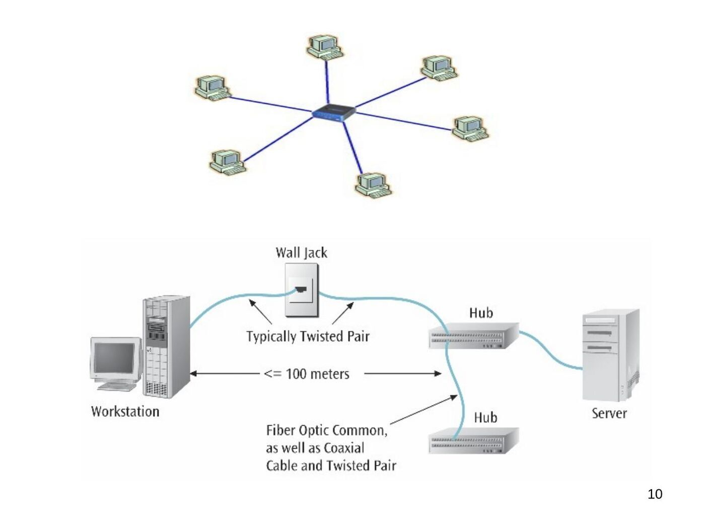
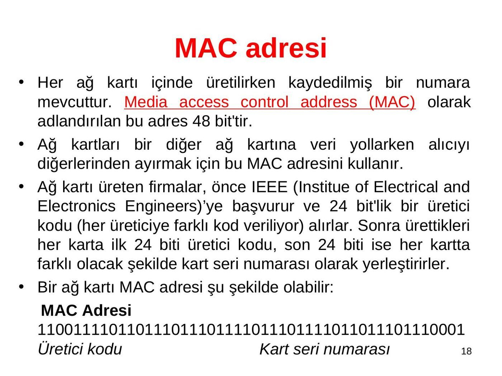
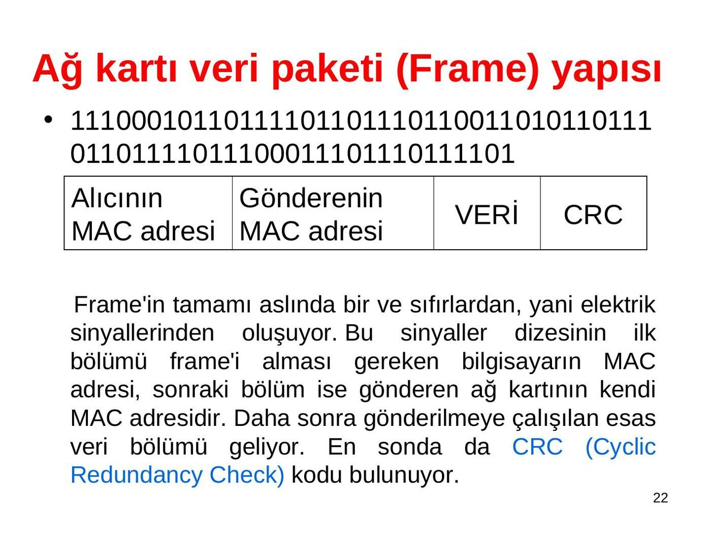
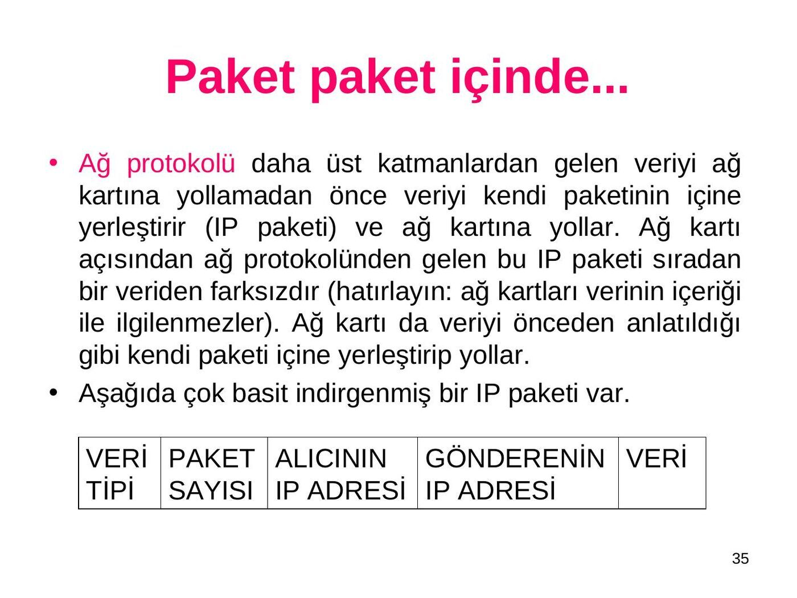
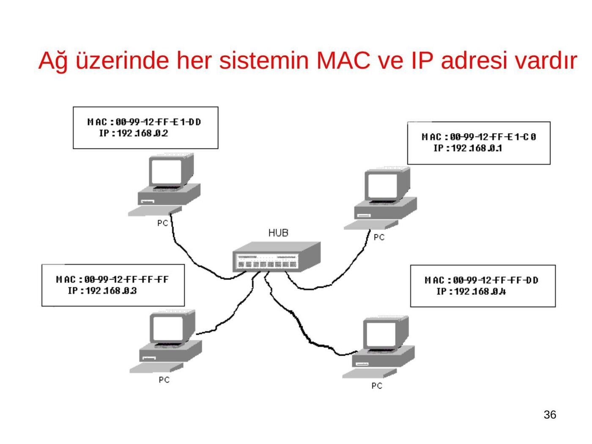
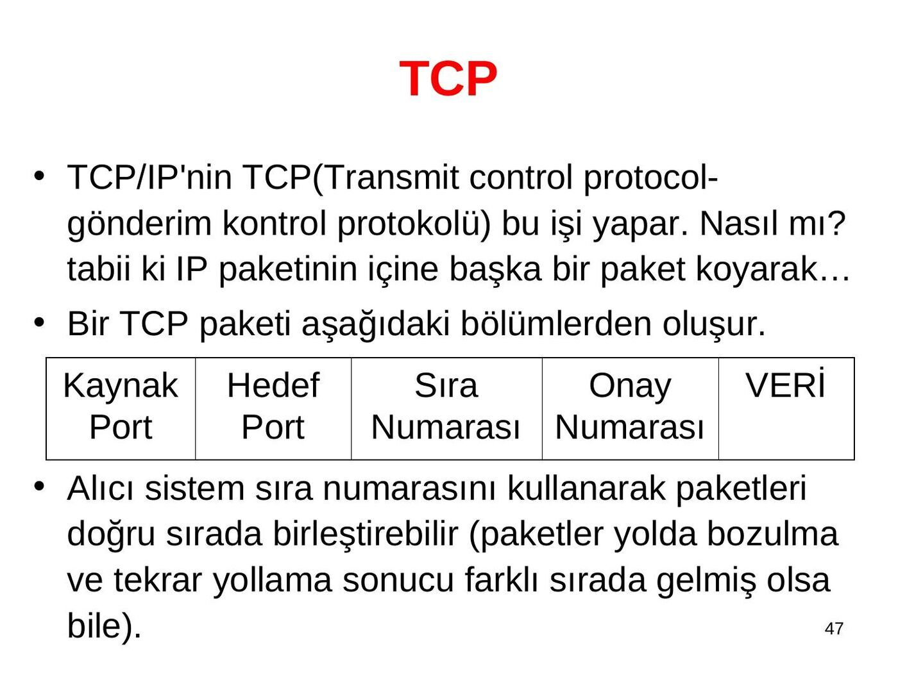
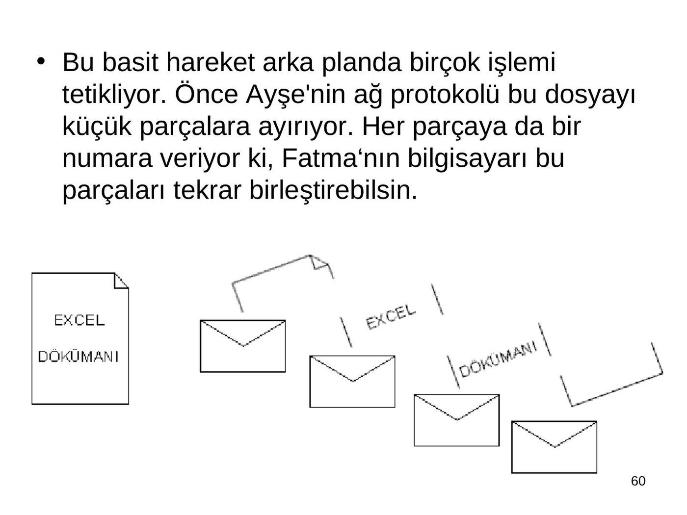
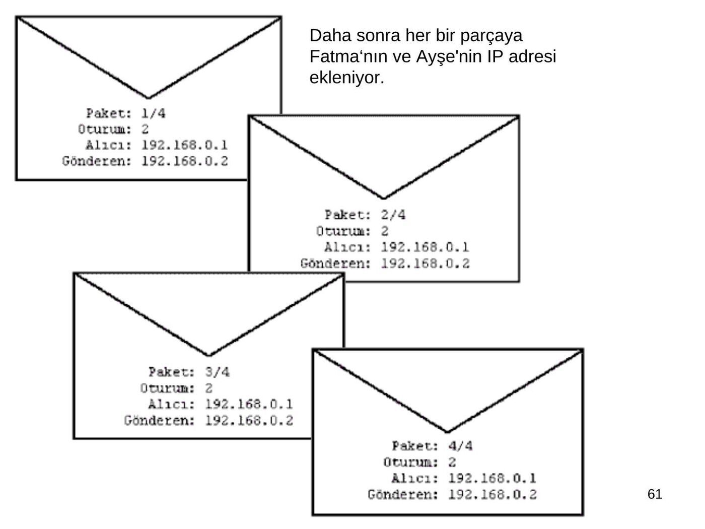
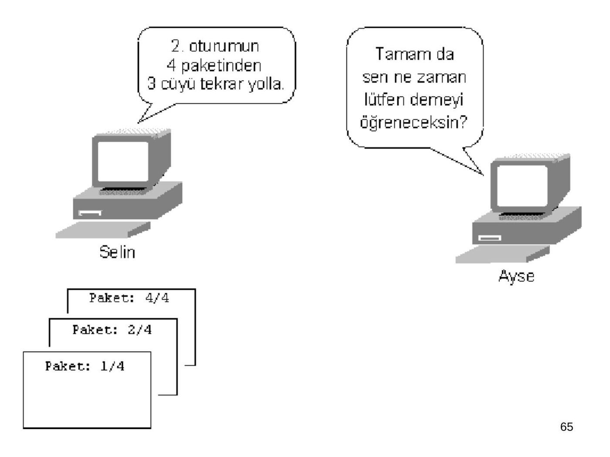

Fırat Hardalaç tarafından tasarlanan ve Derya Yılmaz tarafından düzenlenen EEM413 giriş sunumudur. Belge üzerinde gün bilgisi yoktur; kaynak dosyanın tarih kaydı kullanılmıştır. İçindeki iki kişi fotoğrafı kapatılmıştır. Belgelerin arşiv için hazırlanmış PDF kopyaları yazının sonunda indirilebilir.

## BİLGİSAYAR AĞLARI (slayt 1)

BİLGİSAYAR AĞLARI Genel Bilgi-Giriş

Designed by Dr. Fırat Hardalaç, Revised by Dr. Derya Yılmaz

## DERSİN KODU/ ADI                      : EEM 413-01 BİLGİSAYAR AĞLARI (slayt 2)

DERSİN KODU/ ADI : EEM 413-01 BİLGİSAYAR AĞLARI ÖĞRETİM ELEMANI :Yrd. Doç. Dr. Derya Yılmaz (www.baskent.edu.tr/~derya, derya@baskent.edu.tr)

DERS SAATLERİ :Çarşamba 13:00-14:50 Cuma 11:00-12:50

OFİS SAATLERİ : Ofis:D404

DERS KİTABI :J. F. Kurose, K.W. Ross, Computer Networking, 5th Ed., Pearson, 2010

KAYNAK / YARDIMCI KİTAPLAR :D. E. Comer, Computer Networks and Internet Applications, Prentice Hall, 2004

W. Stallings, Data and Computer Communications, 7th Ed., Prentice Hall, 2004

NOTLANDIRMA

Katılım & Quiz+Ödev Proje Laboratuvar Arasınav Yarıyıl Toplam Devam Sonu Sınavı ---------- 10 -------- 10 30 50 100 %

## HAFTA   KONULAR (slayt 3)

HAFTA KONULAR

1 Introduction to computer networks and internet 2 Application layer, http, FTP, SMTP 3 Application layer, DNS 4 Transport layer principles 5 Transport control protocol TCP 6 Principles of congestion control in TCP 7 Network layer and routing 8 MIDTERM EXAM 9 Internet protocol IP 10 Routing in the internet 11 Link layer, error detection and correction, Multiple access protocol 12 Local area networks, ethernet 13 Wireless LANs, PPP 14 Wireless and mobile networks

Laboratuvar programı: Wireshark

## Bilgisayar Ağları Nasıl Çalışır? (slayt 4)

Bilgisayar Ağları Nasıl Çalışır?

- İsterseniz günümüzde hemen hemen her ofiste görebileceğiniz bir bilgisayar ağını ele alarak, bilgisayar ağlarının temel çalışma prensiplerini inceleyelim.

- Firmanın ismi Firma Tic. olsun. Bu firmanın ofisinde Windows 2000 yüklü bilgisayarlar var. Windows 2000, ağ özelliklerini sağlayan bir işletim sistemidir ve bu da onu OS (Operating System-İşletim Sistemi) olmanın yanı sıra bir de NOS (Network Operating System-Ağ İşletim Sistemi) yapıyor. Firma Tic.'in bilgisayar ağı en popüler kablolama şekli olan Unshielded Twisted Pair (UTP) kullanıyor.

## Bilgisayar Ağları (slayt 5)

Bilgisayar Ağları

- Ancak bu bölümde anlatılacaklar ne işletim sistemiyle ne de kablo tipiyle alakalı. Dünyada farklı ağ işletim sistemleri ve kablolamalar mevcut.

- Bu yazı sadece bir bilgisayar ağını meydana getiren değişik yazılım ve donanım bileşenleri ve her birinin işlevleri üzerinde genel bir görüş edinmenizi sağlamak amacıyla hazırlanmıştır.

- Bu nedenle değişik ağlar değişik kablo tipleri veya işletim sistemleri kullansalar da, burada anlatılacaklar prensip olarak tüm ağ sistemlerini kapsayacaktır.

## Bilgisayar Ağları (slayt 6)

Bilgisayar Ağları

- Yukarıda iki bilgisayar kullanıcısı görüyorsunuz. Tahmin edebileceğiniz gibi onlar Firma Tic. çalışanları Ayşe ve Selin ve işleri gereği sık sık birbirlerinin bilgisayarındaki dosyaları kullanmaları gerekiyor. Örneğin Ayşe Excel'de aylık satış raporunu henüz bitirdi ve Selin'in de kontrol etmesini istiyor.

## Bilgisayar Ağları (slayt 7)

Bilgisayar Ağları

Ayşe'nin yapabileceği ilk şey, klasik yöntemi kullanmak:

- Dosyayı diskete kopyala, ayağa kalk, disketi Selin'e ver.

- Ancak bilgisayar ağı Selin'in yerinden kalkmadan Ayşe'nin bilgisayarına erişmesini ve bu dosyayı kendi bilgisayarına kopyalamasını sağlıyor. Şimdi nasıl oluyor bu işler ona bakalım... 7

## Kablo (slayt 8)

Kablo Ağ ilk başta bilgisayarlar arasında fiziksel bir bağlantıya ihtiyaç duyar. Böylece veri bitleri bilgisayarlar arasında aktarılabilir. Günümüzde bir çok ağ yanda gördüğünüze benzer Unshielded Twisted Pair - Kaplamasız Dolanmış Çift (UTP) kabloyu kullanıyor. Bu tip kablo 4 veya 8 telden oluşur ve bu teller birbirine dolanmış çiftler halindedir.

!!!!!! Unutmayın farklı kablo tipleri, hatta kablosuz teknolojiler de kullanılabilir, burada amacımız, ağ'ın çalışabilmesi için veriyi aktaracak bir ortama ihtiyacı olduğunu kavramanız. 8

## Bir diğer ağ bileşeni ise Hub. Ağa bağlı her bilgisayardan hub'a (slayt 9)

Bir diğer ağ bileşeni ise Hub. Ağa bağlı her bilgisayardan hub'a bir kablo gidiyor. Hub bir uçtan gelen bilgiyi, gitmesi gereken uca yollamıyor, tüm uçlara birden yolluyor (bu önemli bir bilgi, ilerde çok karşımıza çıkacak). Bu durumda her bilgisayar hub'dan gelen verinin kendine ait olup olmadığını tespit etmek zorunda.

Yanda bir hub görüyorsunuz. İki sarı ve bir gri kablo bilgisayarlardan geliyor. Renklerin hiçbir önemi yok. Kablolar değişik renklerde olabilir. En sağdaki siyah kablo dikkatinizi çekti mi? Çekmediyse de ben çektim işte şimdi, bu kablo hub'ın çalışmasını sağlayan elektik bağlantısı, yani adaptörden geliyor. Hub'lar aktif cihazlardır, yani çalışmak için elektriğe ihtiyaç duyarlar. !!!!!! Tekrar belirtmekte fayda var, burada hub kullanan bir ağ sistemi örnek alınmıştır. Farklı ağ sistemleri de mevcuttur. Ancak birazdan okuyacaklarınız hepsi için geçerlidir.

## Şema (slayt 10)

## Ağ kartı (slayt 11)

Ağ kartı Ağın çalışmasını sağlayan diğer bir bileşen ise Network Interface Card (NIC) – Ağ Kartı'dır. Sık sık ethernet kartı denilir, aslında ağ kartı demek daha doğrudur. Bu bir "generic name" haline gelmiştir. Nasıl margarin yerine "sana yağı" diyorsak, ağ kartları için de "ethernet" türü, tartışmasız en yaygın tür olduğu için, ağ kartı ethernet kartına dönüşmüştür. Ancak başka ağ teknolojilerinde çalışmak üzere üretilmiş ağ kartları da mevcuttur. Sonuç olarak ağ kartı genel bir tanımdır, ethernet ise bir alt türdür (ama en yaygın olanı). Ağ kartları çok değişik tipte olabilirler ama Firma Tic.'in kullandıkları ve sizin de kullanacaklarınız muhte- 11 melen yandakine benzeyecektir.

## Peki ağ kartının görevi nedir? Bilgisayarlar verileri ikili (slayt 12)

- Peki ağ kartının görevi nedir? Bilgisayarlar verileri ikili sayı sisteminde yani 1 ve 0'lar olarak işler ve saklarlar. Ağ kartları da sayısal (dijital) veriyi elektrik, ışık veya radyo sinyalleri olarak diğer sistemlere iletme görevini yerine getirir. Elektrik sinyallerini kullanan ağ kartları en yaygın tip olduğu için onlarla devam edelim.

- Bilgisayarın devre kartları üzerinde saniyede milyonlarca küçük elektrik akımı oluşur. Örneğin sabit diskten okuma yapılırken, sabit diskten çıkan elektrik sinyalleri disk kablosundan ana karta girer. Oradan da CPU (central processing unit) ve bellek modüllerine ulaşır. 12

## Sinyaller bilgisayarın kasasındaki devreler üzerinde (slayt 13)

- Sinyaller bilgisayarın kasasındaki devreler üzerinde sorunsuzca seyahat eder. Ancak bu sinyaller bilgisayarın dışına çıktıklarında daha uzun mesafelerde yol almak zorundadır. Bu aslında oldukça zor bir iştir. Çünkü yüksek frekanstaki zayıf elektrik sinyalleri dış etkenlere karşı çok hassastır/zayıftır.

- Ağ kartları işte bu verinin iletiminde oldukça iyi bir iş çıkarırlar ve sinyallerin bilgisayarın veri yollarından ağ kablosuna aktarılması (veri gönderirken) ve kablodan tekrar bilgisayarın veri yoluna aktarılması (veri alırken) işini görürler. Dolayısı ile ağ kartının ilk göze çarpan görevi bilgisayarın veri yollarındaki veriyi dış dünyaya aktarmaktır.

## Ancak ağ kartlarının görevi bununla bitmez. Ağ kartları (slayt 14)

- Ancak ağ kartlarının görevi bununla bitmez. Ağ kartları bilgisayarın ağ üzerindeki kimliğini de temsil ederler.

- Kimlik nedir? İki bilgisayarı üzerlerindeki seri veya paralel port'lardan bağladığımızı düşünelim (iki bilgisayarı haberleştirmenin en basit yoludur). Böyle bir bağlantıda sadece iki bilgisayar söz konusudur. Bir bilgisayarın veri gönderim portu diğerinin alım portuna bağlıdır. Diğerinin gönderimi de ötekinin alım portuna. Ve en basit yöntemlerle bir taraf gönderilecek veriyi gönderim portuna koyar, karşı tarafta alım portundan bunu okur.

- Ancak ikiden fazla bilgisayarın bağlı olduğu bir sistemde ister istemez şu soru akla gelir, bir taraf veriyi istediği bilgisayara nasıl ulaştıracak?

## Değişik ağ sistemleri (ethernet, token-ring) bu soruya (slayt 15)

- Değişik ağ sistemleri (ethernet, token-ring) bu soruya değişik cevap vermiştir. Örneğin Token-Ring ağlarında aradaki fiziksel bağlantı yıldız olsa da, yani bütün makinalardan çıkan birer kablo ortadaki bir hub'a girse de, sistem çalışırken ağ üzerinde Token/Jeton adı verilen bir sinyal dolaşır. Bu sinyal sırayla tüm terminalleri dolaşır. İşte "Ring" buradan gelmektedir. Bir terminal veri göndermek istediğinde boş token sinyalinin kendine gelmesini bekler. Token gelince yollayacağı veriyi token mesajına iliştirir.

## Mesaj üzerinde alıcı ve gönderen makinanın ağ kartı (slayt 16)

- Mesaj üzerinde alıcı ve gönderen makinanın ağ kartı adresi de bulunmaktadır. Dolu token sırayla terminalleri dolaşmaya devam eder. Her makina gelen dolu token'e bakar ancak sadece "alıcı" adresi kendi adresi ise veriyi alır ve geriye onay mesajını yollar. Token onay mesajını gönderen makinaya ulaştırdığında artık veri gönderilmiştir.

- Token boşalmıştır ve ring yapmaya devam eder. Tabii bu işlem saniyede milyonlarca kez gerçekleşir. Bu sistemde diğer makinalar kendi sıralarını beklerler.

## Ethernet ise farklı bir çözüm sunar. Ethernet ağında ağ kartı veri (slayt 17)

- Ethernet ise farklı bir çözüm sunar. Ethernet ağında ağ kartı veri göndermeden önce kabloyu kontrol eder, kimse kullanmıyorsa, alıcı ve gönderen makinanın ağ kartı adresinin yazılı olduğu veriyi kabloya verir. Bu veri tüm terminaller tarafından alınır. Ancak sadece, "alıcı" adresi kendi adresi olan makina bu veriyi işler, diğerleri göz ardı eder.

- Token-Ring ve Ethernetin kabloyu kullanma sırası ve verinin aktarım yönteminde farklılaştığını öğrendik. Ancak her iki sistemde de ağ kartlarının, ağ üzerinde eşi benzeri olmayan, bir adrese sahip olduklarına dikkat ediniz. Sistemler birbirini işte bu benzersiz kimlik ile tanırlar. Ve bu adrese Media Access Control - MAC adresi denilir.

!!!!!Yukarıda Token-Ring ile ilgili bilgi konunun tam anlaşılması için verilmiştir. Bu sayfanın devamında ve diğer tüm sayfalarda anlatılanlar, özellikle farklı bir şey belirtilmediyse, ethernet için geçerlidir.

## MAC adresi (slayt 18)

MAC adresi

- Her ağ kartı içinde üretilirken kaydedilmiş bir numara mevcuttur. Media access control address (MAC) olarak adlandırılan bu adres 48 bit'tir.

- Ağ kartları bir diğer ağ kartına veri yollarken alıcıyı diğerlerinden ayırmak için bu MAC adresini kullanır.

- Ağ kartı üreten firmalar, önce IEEE (Institue of Electrical and Electronics Engineers)’ye başvurur ve 24 bit'lik bir üretici kodu (her üreticiye farklı kod veriliyor) alırlar. Sonra ürettikleri her karta ilk 24 biti üretici kodu, son 24 biti ise her kartta farklı olacak şekilde kart seri numarası olarak yerleştirirler.

- Bir ağ kartı MAC adresi şu şekilde olabilir: MAC Adresi 1100 1111 0110 1110 1110 1111 0111 0111 1011 0111 0111 0001 Üretici kodu Kart seri numarası 18

## Tabii bu şekilde ikili sistemdeki sayıların okunması bizim (slayt 19)

- Tabii bu şekilde ikili sistemdeki sayıların okunması bizim için zor olduğundan MAC adresleri onaltılı sayı sistemine çevrilerek ifade edilir. Tipik bir MAC adresi 00-50-05- 1A-00-AF şeklindedir. Hexadecimal (yani 16'lı sayı sisteminde) olan bu adreste her bir rakam (mesela B) 4 bite karşılık gelir.

- Böylece 12x4=48'dir. Buna göre ilk 6 rakam yani 00-50-05 üretici kodu, son 6 rakam ise bu kartın seri numarasıdır. MAC adresi bütün olarak değerlendirildiğinde dünyada üretilen her ağ kartı farklı bir MAC adresine sahip demektir.

- Ağ kartları istekte bulunan her yazılıma MAC adreslerini bildirirler. Eğer Win9x kullanıyorsanız Winipcfg programı ile ağ kartınızın MAC adresini görebilirsiniz.

## Adapter Address (slayt 20)

Adapter Address MAC adresini gösteriyor

MAC adresi ağ kartını satın aldığınıza zaten kartın üstündeki bir elektronik çipe kodlanmış haldedir. Bu adres normalde değiştirilemez (ancak son dönemde bu işi yapan programlar ortaya çıktı). Ancak MAC adresini değiştirmeniz, hatta ne olduğunu bilmeniz bile çoğu zaman gereksizdir.

## Veri paketleri (Frame) (slayt 21)

Veri paketleri (Frame)

- Ağ kartları veriyi kablo üzerinde sinyaller halinde iletir. Peki sinyaller dolayısıyla veri, karşı tarafa nasıl ulaşır?

- Karşıya yollanacak veri, örneğin ağ üzerinden karşı makinaya kopyalanan bir Word dosyası, tek parça halinde gönderilmez. Sabit boyutta küçük parçalara bölünür ve bu parçalara da bazı ek bilgiler eklenerek gönderilir. Bu veri blokları da veri paketi (frame veya ethernet frame) olarak adlandırılır.

- Veriler ağ üzerinden sabit yapıda paketler (frame) halinde iletilirler, aslında bu paket aktarılacak veriyi ve diğer gerekli bilgileri içeren bir sinyal bloğudur. Ağ kartı bu veri paketlerini oluşturur, yollar ve gelen paketleri alıp işler.

## Ağ kartı veri paketi (Frame) yapısı (slayt 22)

Ağ kartı veri paketi (Frame) yapısı

- 1110 0010 1101 1110 1101 1101 1001 1010 1101 11 0110 1111 0111 0001 1101 1101 1110 1 Alıcının Gönderenin VERİ CRC MAC adresi MAC adresi

Frame'in tamamı aslında bir ve sıfırlardan, yani elektrik sinyallerinden oluşuyor. Bu sinyaller dizesinin ilk bölümü frame'i alması gereken bilgisayarın MAC adresi, sonraki bölüm ise gönderen ağ kartının kendi MAC adresidir. Daha sonra gönderilmeye çalışılan esas veri bölümü geliyor. En sonda da CRC (Cyclic Redundancy Check) kodu bulunuyor.

## Peki CRC de ne oluyor derseniz, CRC alıcının paketin yolda (slayt 23)

- Peki CRC de ne oluyor derseniz, CRC alıcının paketin yolda bozulup bozulmadığını anlaması için kullandığı bir kod. Sistem kabaca şöyle çalışıyor; yollanacak veri yollanmadan önce gönderen ağ kartı tarafından matematiksel bir işlemden geçiriliyor. İşlemin sonucu CRC kodu olarak veri ile beraber yollanıyor. Alıcı, aldığı veriyi aynı matematiksel işlemden geçiriyor, elde ettiği sonuç CRC ile aynı ise, paket yolda bir tek bit'i bile değişmeden alıcıya ulaşmış demektir.

- Veri ağ kablosu üzerinden giderken çevredeki elektromanyetik alanlardan (motorlar, lambalar, mıknatıslar, elektrik kabloları vs.) etkilenip, yola 1 olarak çıkan bazı bitler 0, 0 olarak çıkan bazı bit'lerde 1 olarak karşı tarafa ulaşabilir. Sonuçta bir bit'in bile yolda bozulması sizin "mekiğin iniş hızı=250 km/s" olarak yolladığınız verinin karşı tarafta "canım yoğurtlu ıspanak çekti" şeklinde anlaşılmasına neden olabilir.

## Eğer bir veri paketi bozuk olarak gelmişse, alıcı aynı (slayt 24)

- Eğer bir veri paketi bozuk olarak gelmişse, alıcı aynı paketin tekrar yollanmasını isteyecektir. Ancak bu işlem ağ kartında değil, daha üst bir yazılım katmanında gerçekleşir (protokoller ile ilgili ilerleyen sayfalarda buna değinilecektir).

- Peki yollanan veri nasıl bir şey? Doğrusu bu ne bizi ne de ağ kartını ilgilendirir. Yollanan veri bir word dokümanının karşıda yazdırılacak yazıcı çıktısı olabileceği gibi, Britney Spears'ın fotoğrafı da olabilir. Ağ kartı bununla ilgilenmez, ağ kartı, işletim sisteminde çalışan kendine ait sürücüsünün (driver) kendisine ilettiği veriyi gitmesi gereken sisteme yolar. Veri'nin ne olduğu veya karşı tarafa ulaşınca ne yapılacağı, diğer programların işidir.

## Her bir veri paketi belli boyutta veriyi aktarabilir. Değişik ağ (slayt 25)

- Her bir veri paketi belli boyutta veriyi aktarabilir. Değişik ağ sistemlerinin kullandığı paket yapıları farklı olabilir. Ancak ortalama olarak her bir paket 1500 Byte veri taşır. O zaman hemen şu soru akla gelebilir: Peki yollanan veri (dosya, yazıcı çıktısı, e-mail her neyse...) 1500 Byte'tan büyükse ne olur?

- Bu durumda yollayıcı sistemin yazılımı, yollanacak veriyi paket boyutunda parçalara böler. Alıcı taraftaki yazılım ise bu paketleri birleştirerek yollanan veriyi bütün olarak elde eder. Bu parçalama ve birleştirme işi ağ kartına ait değildir. Gönderilecek veri ağ kartına üst yazılımlar tarafından parçalanmış olarak gelir. Ağ kartına gelen paket boyutundaki veri blokları birleştirirken kullanılacak sıralama bilgisini de içerdiğinden, alıcı taraftaki yazılım kendi ağ kartından gelen paketleri birleştirir.

## ÖNEMLİ!!!! (slayt 26)

ÖNEMLİ!!!!

- Değişik ağların kullandığı çeşitli paket tipleri vardır.

- Ağ üzerindeki tüm ağ kartları aynı paket tipini kullanacak şekilde ayarlı değillerse birbirleriyle haberleşemezler. Bununla beraber tüm modern ağ kartları artık ağda kullanılan paket tipini otomatik seçebilmektedirler.

## Ağ üzerine yollanan her paket tüm bilgisayarlara ula- (slayt 27)

- Ağ üzerine yollanan her paket tüm bilgisayarlara ula- şır. Her bir ağ kartı kendisine gelen bu paketi kontrol eder. Alıcı MAC adresi eğer kendisinin MAC adresi ise "demek ki bu paket bana gelmiş" der ve işleme koyar. Ancak tersi söz konusu ise, bu paketi siler.

- Bu nokta çok önemli olduğu için tekrar etmek istiyorum (bu ilerde çok karşımıza çıkacak çünkü) ağ üzerinden yollanan (aslında ağ üzerine bırakılan demek daha doğru) her paket (frame) tüm bilgisayarların ağ kartına ulaşır ama sadece gerçek alıcısı tarafından işlenir, diğerleri ise bu paketi kontrol edip kendilerine gelmediğini anlayınca göz ardı ederler. Bu da demek oluyor ki ethernet ağlarında aynı anda sadece bir makina veri gönderebilir. İleride bunu daha derin inceleyeceğiz. 27

## Verinin aktarımı (slayt 28)

Verinin aktarımı

- Temel yapıyı öğrendikten sonra, basit bir ağ iletişimi nasıl oluyor onu inceleyelim. Bir bilgisayar diğerine ulaşmak istediğinde elbette önce karşı tarafın kim olduğunu bilmesi gerekir. Biz bilgisayar kullanıcıları olarak karşı bilgisayarın ya ismini, ya da (eğer TCP/IP kullanılıyorsa) IP adresini biliyoruz demektir. Veya ağ komşularım'a girdiğimiz anda, "ağ üzerindeki tüm bilgisayarları bana göster" komutunu vererek "ağ komşularımızı" görürüz.

Not: TCP/IP:Bir veri iletişim protokolüdür. TCP (Transmission Control Protocol) veri paketlerinin hatasız ve eksiksiz olarak taşınmasını sağlar. IP (Internet Protocol) paketlerin gönderenden alıcıya doğru yönlendirilmesinden sorumludur. 28

## Kullanıcı isterse belli bir IP adresiyle, isterse de (slayt 29)

- Kullanıcı isterse belli bir IP adresiyle, isterse de bilgisayar ismi ile iletişime geçmek istesin, ağ kartları sadece MAC adresleriyle haberleşebilirler.

- Siz 192.168.0.56 IP'li bilgisayara bir dosya kopyalamak istediğinizde ne olur? Ağ kartı eğer daha önceden bu IP'ye sahip bilgisayar ile iletişim kurmuşsa zaten MAC de adresini biliyor demektir ve bunu kullanır. Bilmiyorsa ağa bir Broadcast (genel yayın) mesajı yollar. Broadcast mesajı şu şekildedir "Eğer IP adresin

**192.** 168.0.56 ise bana MAC adresini bildir". Bu mesaj ağdaki tüm sistemlere ulaşır. Her bir sistem Broadcast mesajını alır ve inceler, eğer kendi IP adresi sorulan IP ise, MAC adresini Broadcast'i yollayan ağ kartına bildirir.

## Artık veri aktarımına geçilebilir. (slayt 30)

- Artık veri aktarımına geçilebilir.

- Ağ kartı yollanacak veriyi işletim sisteminden alır. Karşıya yollanacak paketi oluşturur. CRC kodunu oluşturur. CRC kodunu ve veriyi pakete koyar. Kendi MAC adresi ve alıcının MAC adresini pakete ekler. Paket yola çıkmaya hazırdır.

- Kabloda o anda başka bir veri aktarımı olup olmadığını kontrol eder, kablo boşsa paketi hub'a yollar.

- Hub bu paketin kopyalarını oluşturur ve her bir portuna bağlı bilgisayarlara (yani ağ kartlarına) yollar.

- Tüm ağ kartları paketi alır ve "alıcı MAC adresi" kendi MAC adresleri mi diye kontrol eder. Eğer paket kendisine gelmişse paketi işler, aksi halde paketi siler.

## Protokol (slayt 31)

Protokol

- Aynı hub'a bağlı, aynı frame/paket tipini kullanan bilgisayarlar arasında veri aktarımını gördük. Peki, kullanıcı internete bağlanmak istediğinde ne olacak? İnternete telefon hattını kullanarak bağlanacak, oysa ne modem ne de telefon sistemi MAC adresi kullanmaz.

- O halde; MAC adresinin ötesinde her sisteme farklı bir kimlik sağlayan, her tip ağ kartı, frame yapısı ve donanım ile çalışabilecek bir yazılıma/tanımlamaya veya kimlik bilgisine ihtiyaç var.

## Protokol (slayt 32)

Protokol

- Bu özel yazılıma ağ protokolü denir. Ağ protokolü her sisteme tekil bir kimlik sağlamanın ötesinde, işlerin nasıl yürütüleceğini belirleyen bir kurallar dizesini de içerir. Gönderilecek verinin paketlere bölünmesi ve alıcı tarafta da birleştirilmesi gibi birçok iş ağ protokolünün görevidir.

- Değişik ağ sistemlerinin kullandığı değişik protokol tipleri vardır. Ancak ağ üzerindeki bilgisayarlarda aynı tip protokolün yüklü olması gerekmektedir. Bu protokoller içinde öne çıkan ve en yaygın kullanıma sahip olanı TCP/IP (Transmission Control Protocol/Internet Protocol)'dir. TCP/IP için "protokol" kelimesi yerine "bir protokoller grubudur" demek daha doğrudur. TCP/IP'nin IP bölümü şu an bizim ilgilendiğimiz ağ protokolü görevini gören kısmıdır. 32

## Protokol (slayt 33)

Protokol

- IP'nin görevi basitçe veri paketinin gitmesi gereken sisteme ulaşmasını sağlar. IP bunu ağa dâhil her sisteme tekil bir adres vererek yapar. İşte bir IP adresi:

**192.** 168.0.1

- IP adresleri 0–255 arası değerler alabilecek 4 bölümden oluşur. Bölümler arasında nokta işareti bulunur. Aslında bu dört bölümün her biri 8 bitlik bir sayıdır. Bilgisayarların ikili sayı sistemi ile, yani 1 ve 0'lar ile çalıştığını tekrar hatırlayın.

## Protokol (slayt 34)

Protokol

- Ağ üzerinde her cihaz farklı bir IP adresine sahip olmak zorundadır. IP sistemi ile, donanım ve frame tipi ne olursa olsun sistemler arasında veri aktarımı yapılabilir. Bu durumda karşımıza gönderen ve alıcının IP adreslerini içeren ikinci bir frame/paket çıkıyor. Yani paket içinde paket olayı... Buna da "IP paketi" diyelim.

## Paket paket içinde... (slayt 35)

Paket paket içinde...

- Ağ protokolü daha üst katmanlardan gelen veriyi ağ kartına yollamadan önce veriyi kendi paketinin içine yerleştirir (IP paketi) ve ağ kartına yollar. Ağ kartı açısından ağ protokolünden gelen bu IP paketi sıradan bir veriden farksızdır (hatırlayın: ağ kartları verinin içeriği ile ilgilenmezler). Ağ kartı da veriyi önceden anlatıldığı gibi kendi paketi içine yerleştirip yollar.

- Aşağıda çok basit indirgenmiş bir IP paketi var.

VERİ PAKET ALICININ GÖNDERENİN VERİ TİPİ SAYISI IP ADRESİ IP ADRESİ

## Ağ üzerinde her sistemin MAC ve IP adresi vardır (slayt 36)

Ağ üzerinde her sistemin MAC ve IP adresi vardır

## Yönlendiriciler (Routers) (slayt 37)

Yönlendiriciler (Routers)

- Şöyle bir soru akla gelebilir: paket içinde paket olayına veya IP adreslerine ne gerek var, bilgisayarları birbirinden ayırmak için MAC adresi yok mu zaten? Var olmasına var ama bakın neler oluyor...

- Hatırlarsanız Fatma Hn. internete bağlanacaktı, bunu yapabilmek için Firma Tic.'in bilgisayar ağını internete bağlamamız gerekiyor. Bu bağlantıyı sağlayacak cihazın adı Router (Yönlendirici)'dır.

## Yönlendiriciler (slayt 38)

Yönlendiriciler

- Yönlendiriciler farklı "ağ paketi yapısı" kullanan iki ağı birbirine bağlamaya yararlar. Tipik bir yönlendiricinin iki bağlantı noktası bulunur. Bu bağlantılardan birisi yerel ağa yapılacak bağlantıdır. Bu bağlantı noktası aslında yönlendirici içine yerleştirilmiş bildiğimiz bir ağ kartıdır. Diğer bağlantı noktası ise yönlendiriciyi telefon hattına bağlamaya yarar. Yani bu bağlantı noktası da aslında yönlendirici içine gömülü bir modem'dir.

## NOT: (slayt 39)

NOT:

- Yönlendiriciler ile ilgili bu noktada söylenmesi gereken iki şey var:

**1.** Bazı yönlendiriciler, yukarıda bahsedildiği gibi gömülü modem içermezler, ama modem'e bağlanırlar.

**2.** Yönlendirici ayrı bir cihaz olmak zorunda değildir. İki ağ kartı veya bir ağ kartı ve bir modem'i olan her bilgisayar yönlendirici olarak görev yapabilir.

## Yönlendiriciler (slayt 40)

Yönlendiriciler

- Yönlendiriciler faklı "ağ paketi yapısı" kullanan iki ağı birbirine bağlamaya yararlar demiştik. Şimdi Fatma Hn.'ın yerel ağı Ethernet sistemini kullanıyor. Oysa Fatma Hn.'ın bilgisayarından çıkan veri paketi bu yerel ağın ötesine geçip, telefon hatlarından internete ulaşmak zorunda. Oysa telefon hatları ve ötesindeki internet yapısında MAC adresi veya ethernetin frame yapısı geçerli değil. İşte bu noktada IP adresi devreye giriyor.

## Yönlendiriciler (slayt 41)

Yönlendiriciler

- Yönlendirici "ağ paketi" içinde bir "IP paketi" aldığında, "ağ paketini" kırpar (MAC adresleri CRC vs.). Geriye kalan IP paketini ise telefon şebekesinin kullandığı paket yapısı içine yerleştirir ve yollar.

- İşte bu noktada IP paketinin ve IP adresinin ne işe yaradığını görüyoruz. Yönlendirici ağ paketi bilgilerini yok edince, veriyi yollayan ve alacak olan sistemleri tanımlayacak ayrı bir bilgiye ihtiyaç duyulur. Evet, evet, IP bilgisine...

## Eğer internetle işimiz yoksa, basit bir yerel (slayt 42)

- Eğer internetle işimiz yoksa, basit bir yerel ağ kuracaksak TCP/IP kullanmak zorunda mıyız? Hayır. Kullanabileceğiniz farklı protokoller var. Hatta bazı protokoller hiçbir ayar yapmadan her bilgisayara yüklediğiniz anda çalışır (NETBeui protokolü mesela).

## Oysa TCP/IP kullandığımızda en başta IP (slayt 43)

- Oysa TCP/IP kullandığımızda en başta IP adreslerinin girilmesi gibi daha birçok ayar yapmamız gerekecektir. Diğer protokollerin tek problemleri internet üzerinde çalışmamalarıdır. Yani internet kullanacaksanız (veya sadece yerel ağ üzerinde olsa bile IP ile çalışan programlar kullanacaksanız) TCP/IP'ye ihtiyacınız var demektir.

## Günümüzde hemen hemen her ağ'da (slayt 44)

- Günümüzde hemen hemen her ağ'da internet bağlantısı gerekiyor. Bu durumda ister istemez TCP/IP yükleniyor. Onu bir kere yükledikten sonra ikinci bir protokolü yüklemenin ise anlamı kalmıyor.

## DİKKAT!!! (slayt 45)

DİKKAT!!!

- MAC adresleriyle ilgili ilk bölüm sanki ağ sistemi protokol olmadan da çalışırmış gibi bir izlenim bıraktıysa, çok yanlış, çook çok...

- Her hangi bir ağ'ın çalışabilmesi için en az bir protokolün, daha doğrusu aynı protokolün, her bilgisayarda yüklü olması gerekiyor.

- Çünkü ağ kartları verinin paketlere ayrılması ve tekrar birleştirilmesi gibi işleri yapmazlar. Bu işlemler için protokole ihtiyacımız var.

## Böl parçala yolla-TCP (slayt 46)

Böl parçala yolla-TCP

- Ağ üzerinde yollanacak veri çoğu zaman bir ağ paketinin taşıyabileceğinden fazladır. Bu nedenle verinin yollanmadan önce parçalanması gerekir. Ağ protokolü daha üst katmanlardan kendisine gelen veriyi (bir dosya, web sayfası, yazdırma işi vb...) ağ paketi boyutunda parçalara böler, alıcının tekrar birleştirebilmesi için parçaları organize eder, yollar ve her bir paketin karşıya hatasız ulaşıp ulaşmadığını kontrol eder.

- Alıcı sistemin protokolü gelen paket serisini algılar, paketleri birleştirerek esas veriyi tekrar elde eder. 46

## TCP (slayt 47)

TCP

- TCP/IP'nin TCP(Transmit control protocol- gönderim kontrol protokolü) bu işi yapar. Nasıl mı? tabii ki IP paketinin içine başka bir paket koyarak…

- Bir TCP paketi aşağıdaki bölümlerden oluşur. Kaynak Hedef Sıra Onay VERİ Port Port Numarası Numarası

- Alıcı sistem sıra numarasını kullanarak paketleri doğru sırada birleştirebilir (paketler yolda bozulma ve tekrar yollama sonucu farklı sırada gelmiş olsa bile). 47

## Oturumlar: Aynı anda birçok iş (slayt 48)

Oturumlar: Aynı anda birçok iş yapmak

- Veri paketlerini bölme ve birleştirme işini yapan bir yazılım olduğunu öğrendikten sonra sıra geldi ağların başka bir yönünü incelemeye.

## Oturumlar (slayt 49)

Oturumlar

## Oturumlar (slayt 50)

Oturumlar

- Gördüğünüz gibi Ayşe'nin bilgisayarına bir yazıcı bağlı ve tüm kullanıcılar tarafından kullanılıyor. Selin Ayşe'nin Excel dosyasına bakarken, Ali'de aynı anda Ayşe'nin yazıcısını kullanıyor olabilir.

- Ayşe'nin sistemi gelen bu istekleri gerekli programlara veya donanımlara ulaştırmak zorunda. Diğer taraftan istekte bulunan bilgisayar da önce karşı tarafa bağlanıp, isteğin yerine getirilip getirilemeyeceğini kontrol etmek zorunda.

- Bunları yapan katmana oturum (session) katmanı diyoruz. Bu katmanın görevi bir bilgisayarın aynı anda birden fazla bilgisayarla iletişim içinde olmasını sağlamaktır.

## Ortak veri biçimleri kullanalım, (slayt 51)

Ortak veri biçimleri kullanalım, dost kalalım!

- Eskiden her program sadece ve ancak kendi oluşturduğu dosyayı kullanıyordu. Örneğin A firmasında X kelime işlemcisi kullanılıyorsa, burada oluşturulmuş bir dosyayı B firmasının kullandığı Y kelime işlemcisinde açmak mümkün değildi. Yani MS Word'ün 4. versiyonu ile yazılmış bir yazı, Corel'in kelime işlemcisi ile uyumlu değildi.

## Oysa bugün ister Microsoft Word kullanalım, istersek (slayt 52)

- Oysa bugün ister Microsoft Word kullanalım, istersek Linux altında çalışan Open Office kullanalım, eğer yazımızı DOC formatında kaydedersek karşı taraf kullandığı kelime işlemci ve işletim sisteminden bağımsız olarak bu dosyayı kullanabilir.

- Ayrıca işletim sistemleri verileri kaydederken ve işlerken farklı teknikler kullanabilirler. Örneğin DOS ve Windows 95, 98, ME metinleri, 8 bit olarak (ASCII) kaydeder. Ancak Windows 2000, NT ve XP 16 bit Unicode sistemini kullanır. Buna göre bir Win9x makinası A harfini 0100 0001 olarak kayıt edecektir. Windows 2000, NT veya XP ise 0000 0000 1000 0001 olarak kaydedecektir. Tabii ki bilgisayarı kullanan vatandaş sadece A harfiyle ilgilenir.

## İşte ağ’ı oluşturan katmanlardan birisi olan (slayt 53)

- İşte ağ’ı oluşturan katmanlardan birisi olan sunum (presentation) katmanı bu noktada devreye girer. Sunum katmanının görevi değişik sistemler arasında olabilecek bu gibi farklılıkları ortadan kaldırmaktır. Ağ üzerinde eriştiğiniz bilgisayarın işletim sistemi, kullandığı dosya yapısı önemli değildir. Örneğin W9x ailesi NTFS (New Technology File System) dosya formatını okuyamaz. W9x çalışan bir makinaya NTFS formatlı ek bir disk taksanız, Windows içinden bu diske ulaşamazsınız. Oysa, bir W9x makinası ağ üzerinden NTFS disk kullanan bir Windows 2000, NT veya XP makinasının diskine ulaşabilir.

## Ağ programları (slayt 54)

Ağ programları

- Bir kullanıcı ağ üzerinde çalışırken şimdiye kadar anlatılanların hiçbirisini görmez. Ağların güzel yanı da budur zaten, bu kadar karmaşık bir işlemi, bu kadar sessizce halledebilmek...

- Ancak bilgisayar kullanıcısı ağın son parçasını kesinlikle görür. Kullandığı ağ programını. Ağ programı deyince "Allah Allah ben niye görmedim bunu şimdiye kadar" diye korkmayın. Ağ programına en basit örnek Windows Explorer'dir.

## Ağ programları (slayt 55)

Ağ programları

- Ya da namı diğer "Bilgisayarım". Bilgisayarım'ı açıp, bir ağ sürücüsüne çift tıkladığınızda ağı kullanmış olmuyor musunuz? Aynı şekilde Web'de sörf yaparken de IE veya Firefox kullanıyoruz. E-mail için farklı bir programımız var. Sonuç olarak kullanıcılar ağ’ı bir program vasıtasıyla kullanırlar. Ağı oluşturan en son bileşen bu programdır.

- Ağ programları kendi içinde veri şifreleme, kullanıcı isminin kontrolü gibi özellikler barındırabilirler. Bir önceki başlık altında incelediğimiz sunum katmanının birçok görevi bu programlar tarafından da yapılabilir. 55

## Bir yerel ağ işlemi :Fatma Ayşe'nin (slayt 56)

Bir yerel ağ işlemi :Fatma Ayşe'nin Excel dosyasını nasıl kendi bilgisayarına kopyaladı

- Bu noktaya kadar adım adım bir ağı oluşturan değişik bileşenleri inceledik. İsterseniz şimdi Fatma’nın Ayşe’nin bilgisayarından Excel dosyasını nasıl kendi bilgisayarına kopyaladığını adım adım görelim. Selin önce "Computers Near Me" ile ağ üzerindeki diğer bilgisayarları gördü.

## Fatma ve Ayşe aynı Excel versiyonunu kullandıkları (slayt 58)

- Fatma ve Ayşe aynı Excel versiyonunu kullandıkları için uyumsuz dosya formatı söz konusu değil. Bu ağda veri şifreleme yok ancak kullanıcı adları kontrol ediliyor. Fatma Ayşe'nin bilgisayarına çift tıkladığı anda iki sistem haberleşmeye başlıyorlar.

- Ayşe'nin bilgisayarı kendi kullanıcı veritabanını kontrol ederek Fatma kullanıcısının bu bilgisayar üzerinde ne gibi haklara sahip olduğunu kontrol ediyor. Bu esnada iki bilgisayar arasında ilk oturum açılmış oluyor. Fatma dosyayı Ayşe'nin diski içinde buluyor ve sürükleyip kendi masaüstüne bırakarak kopyalama işlemini başlatıyor.

## Bu basit hareket arka planda birçok işlemi (slayt 60)

- Bu basit hareket arka planda birçok işlemi tetikliyor. Önce Ayşe'nin ağ protokolü bu dosyayı küçük parçalara ayırıyor. Her parçaya da bir numara veriyor ki, Fatma‘nın bilgisayarı bu parçaları tekrar birleştirebilsin.

## Daha sonra her bir parçaya (slayt 61)

Daha sonra her bir parçaya Fatma‘nın ve Ayşe'nin IP adresi ekleniyor.

## Paketler artık Ayşe'nin ağ kartına gitmeye (slayt 62)

- Paketler artık Ayşe'nin ağ kartına gitmeye hazır. Ağ kartı bu IP paketlerini bu sefer kendi ağ paketinin içine koyuyor ve ağ paketinin üstüne de hem kendi MAC adresini, hem de Fatma’nın ağ kartının MAC adresini ekliyor. Tabii CRC kodunu her paket için oluşturup pakete dâhil etmeyi de unutmuyor.

## Ayşe'nin ağ kartı her bir paketi hazır hale (slayt 63)

- Ayşe'nin ağ kartı her bir paketi hazır hale getirdiğinde kabloyu bir kullanan var mı? diye kontrol ettikten sonra kablo boşta ise paketi hub'a yolluyor.

- Paket hub'a oradan da diğer bütün bilgisayarlara ulaşıyor. Ancak sadece Fatma’nın makinası gelen paketi işleme alıyor. CRC kodunu kullanarak "paket sağlıklı ulaştı mı?" diye kontrol ettikten sonra ağ paketini açıp (yani MAC adresi ve CRC kodu gibi bilgileri temizleyip) içindeki veriyi (IP paketi) bir üst katmana yani ağ protokolüne yolluyor. 63

## Artık Fatma‘nın sistemi (TCP) gelen (slayt 64)

- Artık Fatma‘nın sistemi (TCP) gelen paketleri birleştirip Excel dosyasını bütün hale getirmeye başlıyor. Eğer paketlerden birisi ulaşmamışsa, Ayşe'nin bilgisayarından o paketi tekrar göndermesini istiyor.

## Şema (slayt 65)

## Excel dökümanı bir bütün halinde alındıktan (slayt 66)

- Excel dökümanı bir bütün halinde alındıktan sonra dosya gerekli yazılıma aktarılıyor. Burada da dosya kopyalarken Fatma’nın kullandığı Windows Explorer’dan bahsediyoruz ("Computers Near Me" Windows Explorer’ın bir bölümüdür).

- Dosya Selin'in masaüstünde belirdiği anda ağ bileşenleri bu işlem için açılan oturumu kapatarak bir sonraki işleme hazırlanıyorlar.

- Tüm bu işlemler arka planda olurken, Fatma’nın dosyayı kopyalanırken gördüğü tek şey havada uçan dosya animasyonu oluyor...

*Not: Anlatım paylaşımlı, hub kullanılan tarihsel Ethernet örneğine dayanır; “tüm bilgisayarlara ulaşır” ve “aynı anda tek makine gönderir” ifadeleri anahtarlamalı tam çift yönlü Ethernet’e genellenemez. CRC eşitliği bütün olası hataların kesin yakalandığı anlamına gelmez. Kaynaktaki “Transmit control protocol” ifadesinin doğrusu Transmission Control Protocol’dür.*
