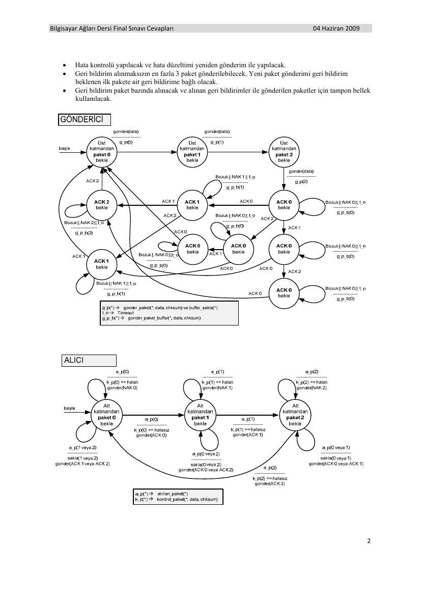

These are the exams of 9 April and 4 June 2009, prepared by M. Ali Akcayol, together with their answers. The course code on the midterm document is BM402; the documents are kept in the EEM413 folder. PDF copies of the documents can be downloaded at the end of the post.

*Note: This content belongs to a third-party source; it is shared for archival and nostalgic purposes with the source credited. It will be removed at the request of the rights holder.*

## CNVize

BM 402 Computer Networks Course Midterm Exam, 9 April 2009

1-) List the layers of the Internet protocol stack in order and describe the operations performed at each layer. (40 Points)

2-) Give detailed information about network types. Compare each of them with the others. (30 Points)

3-) Explain network application architectures in detail. (30 Points)

The exam duration is 1 hour. Good luck. M. Ali Akcayol

## CNVizeCevap

BM 402 Computer Networks Course Midterm Exam, 9 April 2009

1-) List the layers of the Internet protocol stack in order and describe the operations performed at each layer. (40 Points)

Application: application interfaces and protocols FTP, SMTP, HTTP Transport: host-to-host data transfer TCP, UDP Network: routing of datagrams from source to destination IP, routing protocols Link: data transfer between neighboring network elements PPP, Ethernet Physical: transmission of bits over the physical link

2-) Give detailed information about network types. Compare each of them with the others. (30 Points)

- Virtual-circuit networks have the characteristics of both datagram networks and circuit-switched networks.

- As in circuit-switched networks, there are setup and teardown phases.

- Resources are allocated during the setup phase as in circuit-switched networks, or on demand as in datagram networks.

- Every packet in a datagram network carries address information, but here the address identifies the next switch and channel.

- As in circuit-switched networks, all packets use the same path determined during the setup phase.

- A virtual-circuit network is built at the data link layer. Circuit-switched networks are built at the physical layer and datagram networks at the network layer.

BM 402 Computer Networks Course Midterm Exam, 9 April 2009

Delays in a packet-switched network can arise from different causes. Packets are queued in the router buffer. Packets may arrive at a rate exceeding the output link capacity. Packets wait in the queue for their turn. There are four sources of delay:

**1.** Nodal processing: Bit error checking, Determining the output port (link)

**2.** Queuing: Waiting for the output link, Congestion occurring in the router

**3.** Transmission delay: R = link bandwidth (bps), L = packet size (bits), The time needed to push the bits out = L/R seconds.

**4.** Propagation delay: d = length of the physical link, s = propagation speed in the medium (~2x108 mps), propagation delay = d/s

The total delay can be expressed as follows:

d nodal = d proc + d queue + d trans + d prop

dproc = processing delay (Usually a few microseconds or less) dqueue = queuing delay (Depends on congestion) dtrans = transmission delay =(L/R, significant on low-speed links) dprop = propagation delay (A few microseconds to a few hundred milliseconds.)

3-) Explain network application architectures in detail. (30 Points)

Client-server server: Always-on host Fixed IP address Many servers for scaling clients: Communicate with the server May connect intermittently May have dynamic IP addresses Not directly connected to each other Peer-to-peer (P2P) No always-on server

BM 402 Computer Networks Course Midterm Exam, 9 April 2009

End systems connect directly End systems may connect intermittently and change IP addresses Highly scalable Difficult to manage

Hybrid (client-server and P2P) File transfer is done P2P. File search is centralized: End hosts register with a central server End hosts search for content on the central server Communication between two users is done P2P. Presence detection is centralized: When a user comes online, its IP address is registered with the central server Users contact the central server when they want to look up an IP address

## CNFinal

Computer Networks Course Final Exam, 04 June 2009

1-) Compare virtual circuit networks with the others. Explain the delay in packet-switched networks in detail. (25 Points)

2-) Describe the tasks performed at the transport layer. (25 Points)

3-) Design a protocol with the following properties and model it using an automaton. (50 Points)

- At most 3 packets can be sent without receiving feedback. Sending a new packet will depend on the feedback for the first packet awaiting feedback.

- Feedback will be received on a per-packet basis, and buffer memory will be used for the received feedback and for the packets sent.

The exam duration is 90 minutes. Good luck. M. Ali Akcayol

## CNFinalCevap

Computer Networks Course Final Exam Answers, 04 June 2009

1-) Compare virtual circuit networks with the others. Explain the delay in packet-switched networks in detail.

- Virtual-circuit networks have the characteristics of both datagram networks and circuit-switched networks.

- As in circuit-switched networks, there are setup and teardown phases.

- Resources are allocated during the setup phase as in circuit-switched networks, or on demand as in datagram networks.

- Every packet in a datagram network carries address information, but here the address identifies the next switch and channel.

- As in circuit-switched networks, all packets use the same path determined during the setup phase.

- A virtual-circuit network is built at the data link layer. Circuit-switched networks are built at the physical layer and datagram networks at the network layer.

Delays in a packet-switched network can arise from different causes. Packets are queued in the router buffer. Packets may arrive at a rate exceeding the output link capacity. Packets wait in the queue for their turn. There are four sources of delay:

**1.** Nodal processing: Bit error checking, Determining the output port (link)

**2.** Queuing: Waiting for the output link, Congestion occurring in the router

**3.** Transmission delay: R = link bandwidth (bps), L = packet size (bits), The time needed to push the bits out = L/R seconds.

**4.** Propagation delay: d = length of the physical link, s = propagation speed in the medium (~2x108 mps), propagation delay = d/s

The total delay can be expressed as follows:

d nodal = d proc + d queue + d trans + d prop

dproc = processing delay (Usually a few microseconds or less) dqueue = queuing delay (Depends on congestion) dtrans = transmission delay =(L/R, significant on low-speed links) dprop = propagation delay (A few microseconds to a few hundred milliseconds.)

2-) Describe the tasks performed at the transport layer.

Provides logical communication between processes running on different hosts. Transport protocols run in the end systems. Sender side: breaks application messages into segments and passes them to the network layer. Receiver side: reassembles the segments and passes them to the application layer. More than one transport protocol is available to applications. On the Internet, one of the TCP and UDP protocols is used.

Network layer: provides logical communication between hosts. Transport layer: provides logical communication between processes. The transport layer relies on network layer services. It provides reliable, in-order delivery. It performs congestion control, flow control, and error control. TCP establishes a connection. UDP is used for unreliable, unordered delivery. The best-effort service of the IP protocol is used at the network layer.

3-) Design a protocol with the following properties and model it using an automaton.

Computer Networks Course Final Exam Answers, 04 June 2009

- At most 3 packets can be sent without receiving feedback. Sending a new packet will depend on the feedback for the first packet awaiting feedback.

- Feedback will be received on a per-packet basis, and buffer memory will be used for the received feedback and for the packets sent.

