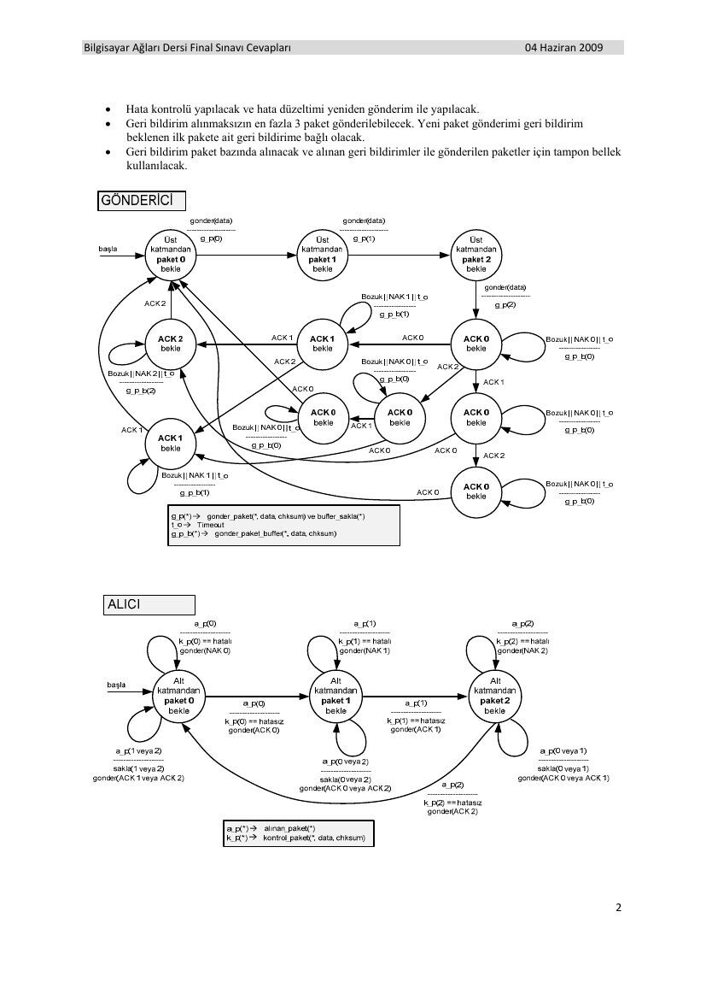

M. Ali Akcayol tarafından hazırlanan 9 Nisan ve 4 Haziran 2009 tarihli sınavlar ile cevaplarıdır. Vize belgesinin ders kodu BM402’dir; belgeler EEM413 klasöründe saklanmıştır. Belgelerin PDF kopyaları yazının sonunda indirilebilir.

*Bu içerik üçüncü taraf bir kaynağa aittir; arşiv ve nostalji amacıyla kaynak belirtilerek paylaşılmıştır. Hak sahibinin talebi hâlinde kaldırılır.*

## CNVize

BM 402 Bilgisayar Ağları Dersi Vize Sınavı 9 Nisan 2009

1-) Internet protokol yığınındaki katmanları sırayla yazarak her bir katmanda gerçekleştirilen işlemler hakkında bilgi veriniz. (40 Puan)

2-) Ağ türleri hakkında detaylı bilgi veriniz. Her birisini diğerleriyle karşılaştırınız. (30 Puan)

3-) Ağ uygulama mimarilerini detaylı açılayınız. (30 Puan)

Sınav süresi 1 saattir. Başarılar dilerim. M. Ali Akcayol

## CNVizeCevap

BM 402 Bilgisayar Ağları Dersi Vize Sınavı 9 Nisan 2009

1-) Internet protokol yığınındaki katmanları sırayla yazarak her bir katmanda gerçekleştirilen işlemler hakkında bilgi veriniz. (40 Puan)

Application: uygulama arayüzleri ve protokolleri FTP, SMTP, HTTP Transport: host-host veri transferi TCP, UDP Network: datagram’ların kaynaktan hedefe yönlendirilmesi IP, routing protocols Link: komşu ağ birimleri arasında veri transferi PPP, Ethernet Physical: fiziksel bağlantı ile bitlerin iletimi

2-) Ağ türleri hakkında detaylı bilgi veriniz. Her birisini diğerleriyle karşılaştırınız. (30 Puan)

- Virtual-circuit ağlar, datagram ağlar ile circuit-switched ağların özelliklerine sahiptir.

- Circuit-switched ağlardaki gibi setup ve teardown aşamaları vardır.

- Kaynaklar circuit-switched ağlardaki gibi setup aşamasında ayrılır veya datagram ağlardaki gibi istek olduğunda ayrılır .

- Datagram ağlardaki her paket adres bilgisi bulundurur ancak adres bir sonraki switch ve kanalı belirler.

- Circuit-switched ağlardaki gibi tüm paketler setup aşamasında belirlenen aynı yolu kullanır.

- Virtual-circuit ağ data link katmanında oluşturulur. Circuit switched ağlar fiziksel katmanda ve datagram ağlar network katmanında oluşturulur.

BM 402 Bilgisayar Ağları Dersi Vize Sınavı 9 Nisan 2009

Paket anahtarlamalı ağdaki gecikmeler farklı nedenlerden kaynaklanabilir. Paketler router buffer’ında kuyruğa atılır. Çıkış link kapasitesinin üstünde paket gelebilir. Paketler kuyrukta sırasının gelmesini bekler. Gecikmelerin dört kaynağı vardır:

**1.** node işlemleri: Bit hata denetimleri, Çıkış portunu (bağlantıyı) belirleme

**2.** kuyruk: Çıkış linki için bekleme, Router da oluşan tıkanıklar

**3.** İletim gecikmesi: R = link bandwidth (bps), L = paket boyutu (bits), Bitleri göndermek için geçen süre = L/R saniye olur.

**4.** Yayılım gecikmesi: d = fiziksel bağlantı uzunluğu, s = ortamdaki yayılım hızı (~2x108 mps), yayılım gecikmesi = d/s

Toplam gecikme aşağıdaki gibi ifade edilebilir:

d nodal = d proc + d queue + d trans + d prop

dproc = processing delay (Genellikle birkaç mikro saniye veya daha az) dqueue = queuing delay (Tıkanıklığa bağlıdır) dtrans = transmission delay =(L/R, düşük hızlı bağlantılarda büyüktür) dprop = propagation delay (Birkaç mikro saniye ile birkaç yüz mili saniyedir.)

3-) Ağ uygulama mimarilerini detaylı açılayınız. (30 Puan)

Client-server server: Always-on host (her zaman açık) Sabit IP adres Ölçekleme için çok sayıda sunucu clients: Sunucuyla haberleşir Aralıklarla birbirine bağlanabilir Dinamik IP adres olabilir Birbirine doğrudan bağlı değil Peer-to-peer (P2P) Her zaman açık sunucu yoktur

BM 402 Bilgisayar Ağları Dersi Vize Sınavı 9 Nisan 2009

Uç sistemler doğrudan bağlanır Uç sistemler aralıklarla doğrudan bağlanabilir ve IP adres değiştirebilir Yüksek ölçeklenirdir Yönetim zordur

Hibrid (client-server ve P2P) Dosya transferi P2P yapılır. Dosya arama merkezi: Merkezi sunucuya uç birimler kayıt olur Uç birimler içerik aramayı merkezi sunucuda yapar İki kullanıcı arasında iletişim P2P yapılır Açık olup olmadığı denetimi merkezidir: Kullanıcı online olduğunda merkezi sunucuya IP adresi kayıt edilir Kullanıcılar IP adres arayacaklarında merkezi sunucuyla iletişime geçerler

## CNFinal

Bilgisayar Ağları Dersi Final Sınavı 04 Haziran 2009

1-) Virtual circuit ağları diğerleriyle karşılaştırnız. Paket anahtarlamalı ağlardaki gecikmeyi detaylı açıklayınız. (25 Puan)

2-) Transport layer’da yapılan işleri anlatınız. (25 Puan)

3-) Aşağıdaki özelliklere sahip bir protokol tasarlayınız ve otomat kullanarak modelleyiniz. (50 Puan)

- Geri bildirim alınmaksızın en fazla 3 paket gönderilebilecek. Yeni paket gönderimi geri bildirim beklenen ilk pakete ait geri bildirime bağlı olacak.

- Geri bildirim paket bazında alınacak ve alınan geri bildirimler ile gönderilen paketler için tampon bellek kullanılacak.

Sınav süresi 90 dakikadır. Başarılar dilerim. M.Ali Akcayol

## CNFinalCevap

Bilgisayar Ağları Dersi Final Sınavı Cevapları 04 Haziran 2009

1-) Virtual circuit ağları diğerleriyle karşılaştırınız. Paket anahtarlamalı ağlardaki gecikmeyi detaylı açıklayınız.

- Virtual-circuit ağlar, datagram ağlar ile circuit-switched ağların özelliklerine sahiptir.

- Circuit-switched ağlardaki gibi setup ve teardown aşamaları vardır.

- Kaynaklar circuit-switched ağlardaki gibi setup aşamasında ayrılır veya datagram ağlardaki gibi istek olduğunda ayrılır .

- Datagram ağlardaki her paket adres bilgisi bulundurur ancak adres bir sonraki switch ve kanalı belirler.

- Circuit-switched ağlardaki gibi tüm paketler setup aşamasında belirlenen aynı yolu kullanır.

- Virtual-circuit ağ data link katmanında oluşturulur. Circuit switched ağlar fiziksel katmanda ve datagram ağlar network katmanında oluşturulur.

Paket anahtarlamalı ağdaki gecikmeler farklı nedenlerden kaynaklanabilir. Paketler router buffer’ında kuyruğa atılır. Çıkış link kapasitesinin üstünde paket gelebilir. Paketler kuyrukta sırasının gelmesini bekler. Gecikmelerin dört kaynağı vardır:

**1.** node işlemleri: Bit hata denetimleri, Çıkış portunu (bağlantıyı) belirleme

**2.** kuyruk: Çıkış linki için bekleme, Router da oluşan tıkanıklar

**3.** İletim gecikmesi: R = link bandwidth (bps), L = paket boyutu (bits), Bitleri göndermek için geçen süre = L/R saniye olur.

**4.** Yayılım gecikmesi: d = fiziksel bağlantı uzunluğu, s = ortamdaki yayılım hızı (~2x108 mps), yayılım gecikmesi = d/s

Toplam gecikme aşağıdaki gibi ifade edilebilir:

d nodal = d proc + d queue + d trans + d prop

dproc = processing delay (Genellikle birkaç mikro saniye veya daha az) dqueue = queuing delay (Tıkanıklığa bağlıdır) dtrans = transmission delay =(L/R, düşük hızlı bağlantılarda büyüktür) dprop = propagation delay (Birkaç mikro saniye ile birkaç yüz mili saniyedir.)

2-) Transport layer’da yapılan işleri anlatınız.

Farklı hostlardaki prosesler arasında mantıksal bağlantı (logical communication) oluşturur. Transport protokolleri uç sistemlerde çalışır. Gönderen taraf: uygulama mesajlarını segment’lere böler ve network layer’a gönderir. Alıcı taraf: segmentleri birleştirir ve applicatio layer’a gönderir. Uygulamalar için birden fazla transport protokol bulunmaktadır. Internette TCP ve UDP protokollerinden birisi kullanılır.

Network layer: hostlar arasında mantıksal bağlantı yapar. Transport layer: prosesler arasında mantıksal bağlantı yapar. Transport layer network layer hizmetlerine güvenir. Güvenilir, sıralı gönderim yapar. Tıkanıklık kontrolü, akış kontrolü ve hata kontrolü yapar. TCP protokolü bağlantı kurulumu yapar. Güvenilir olmayan, sırasız gönderimler için UDP kullanılır. Network layer’da IP protokolünün best-effort özelliği kullanılır.

3-) Aşağıdaki özelliklere sahip bir protokol tasarlayınız ve otomat kullanarak modelleyiniz.

Bilgisayar Ağları Dersi Final Sınavı Cevapları 04 Haziran 2009

- Geri bildirim alınmaksızın en fazla 3 paket gönderilebilecek. Yeni paket gönderimi geri bildirim beklenen ilk pakete ait geri bildirime bağlı olacak.

- Geri bildirim paket bazında alınacak ve alınan geri bildirimler ile gönderilen paketler için tampon bellek kullanılacak.

