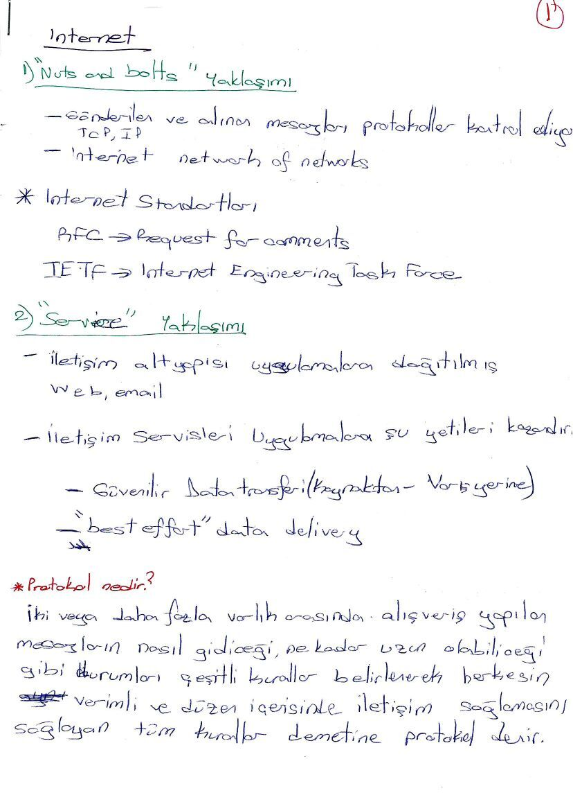
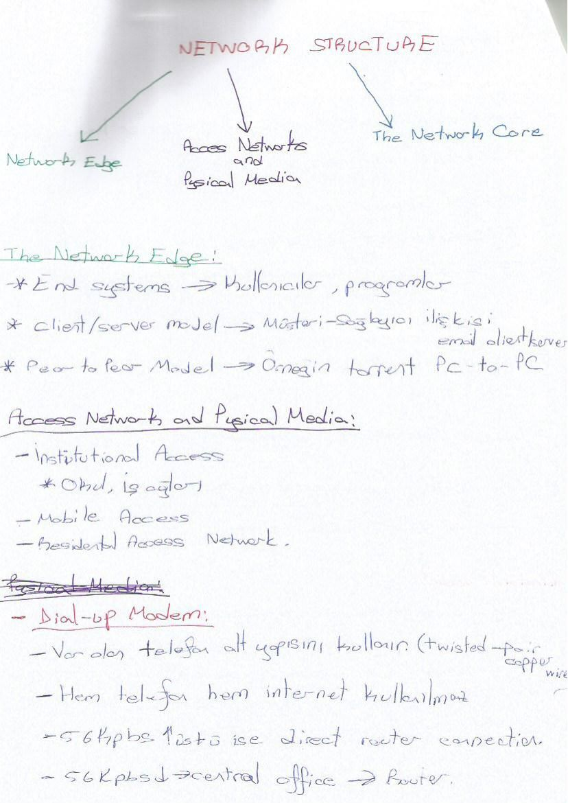
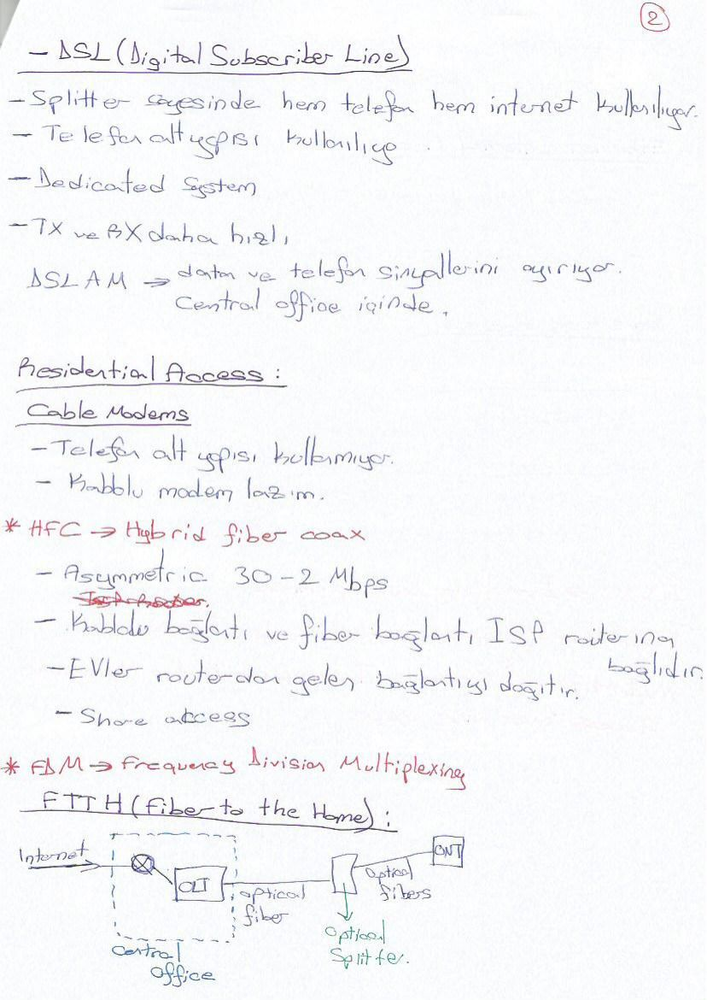
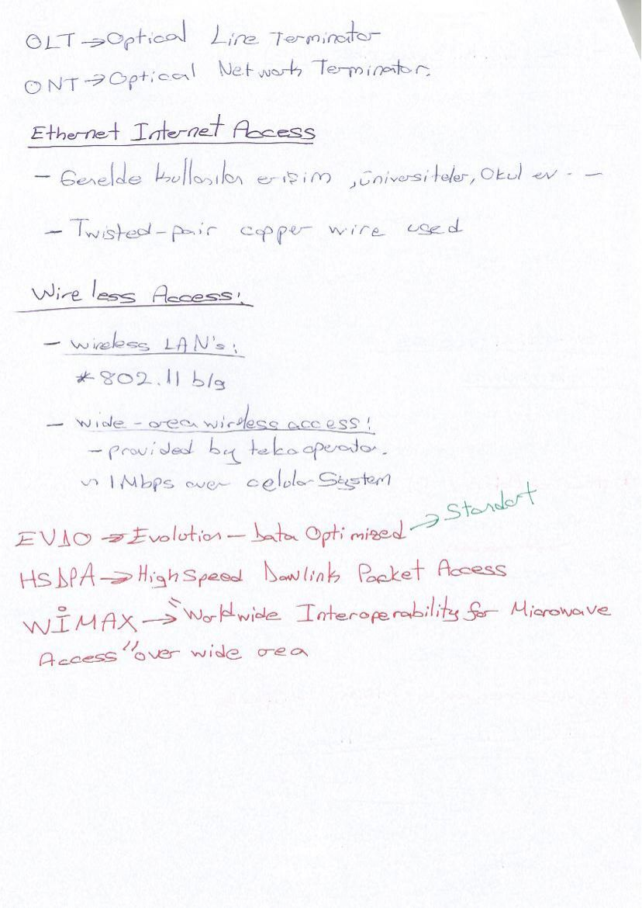
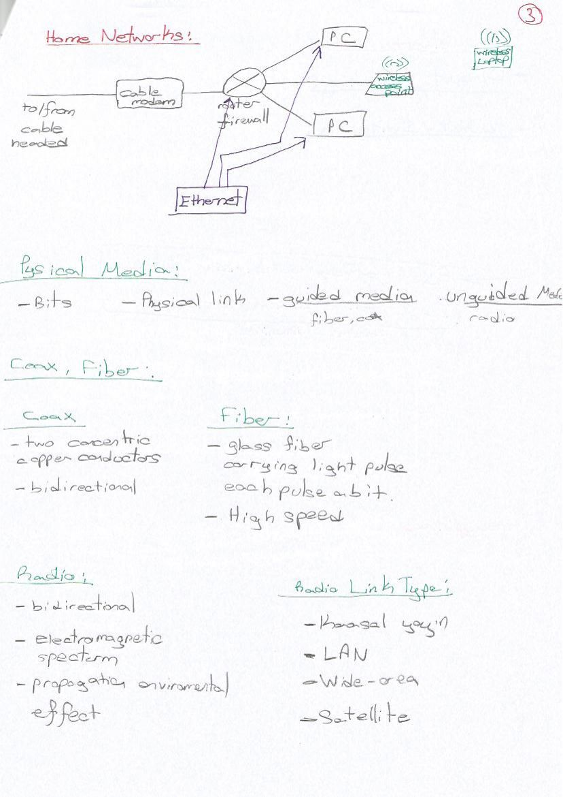
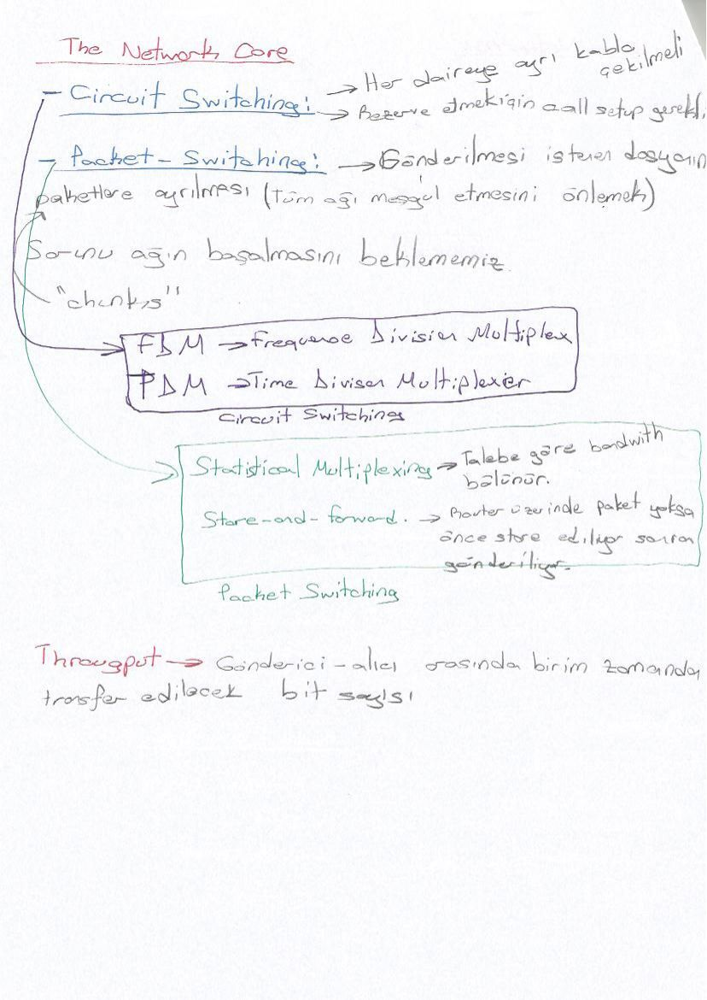
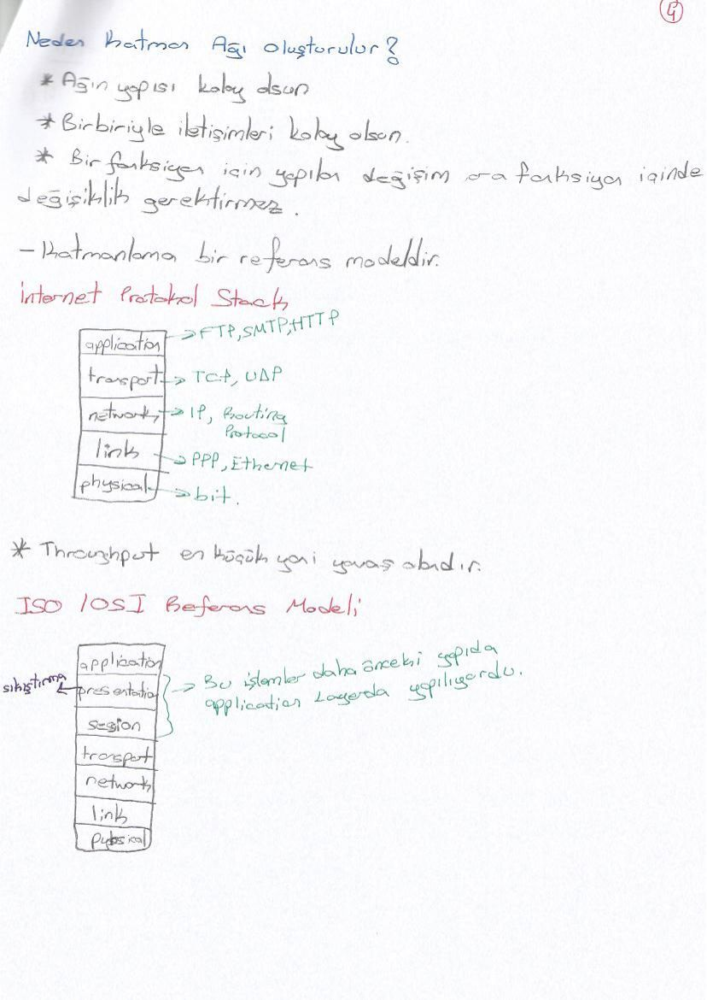

## Structure of the Internet

End systems; client–server and P2P; links; packet switches; protocols and standards. A protocol defines the message format, the order of transmission, and the response to be given to a received message.

## Access networks

DSL uses the telephone line; a splitter separates voice and data. The DSLAM aggregates lines on the service provider side. Cable Internet/HFC shares a common access medium. FTTH reaches the home over an optical line.

## Fiber and wireless access

Within FTTH, the OLT and ONT roles and passive/active optical distribution are shown. Ethernet is a local area network connection, Wi-Fi is wireless local access, and cellular networks are examples of wide-area wireless access.

## Physical media

Twisted pair, coaxial cable, fiber optic, and radio links are compared. Fiber is immune to electromagnetic interference. The network core carries packets through routers.

## Packet switching and circuit switching

Packet switching is explained with store-and-forward and queueing delay. The transmission time of an L-bit packet onto an R bit/s link is L/R seconds. Circuit switching reserves resources in advance.

## FDM, TDM, and delay

FDM divides frequency, and TDM divides time slots, among users. Total nodal delay is the sum of the processing, queueing, transmission, and propagation components.

## Layers

The application, transport, network, link, and physical layers are listed. The OSI model additionally has the presentation and session layers. With encapsulation, each layer adds its own control information; at the receiver it is decoded in the reverse direction.

