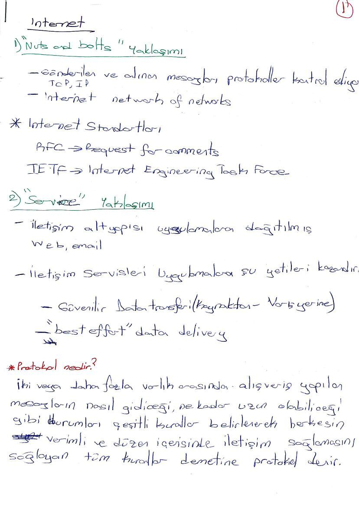
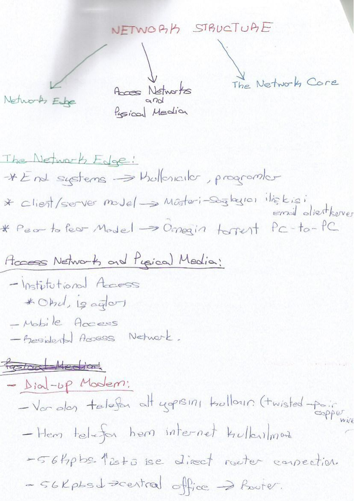
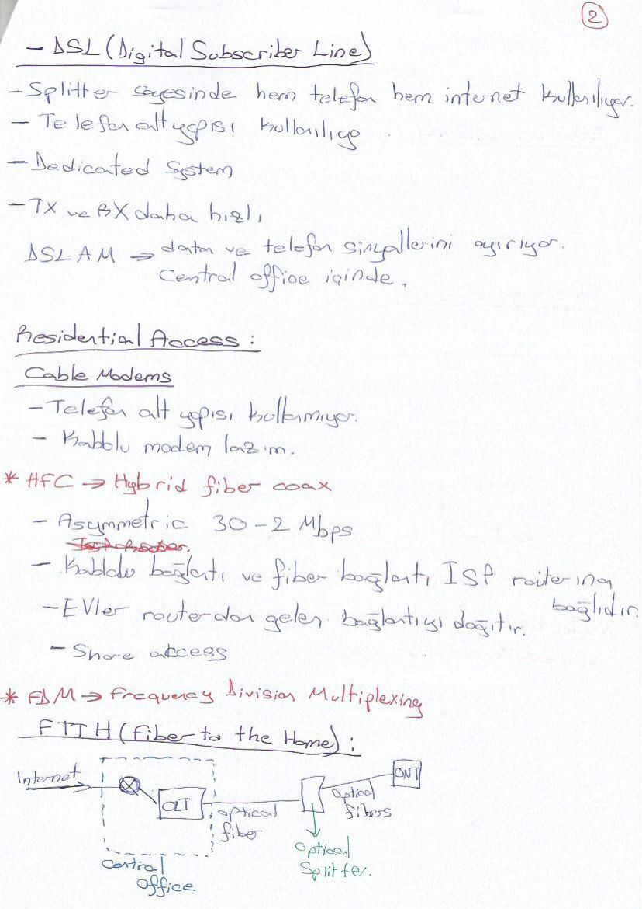
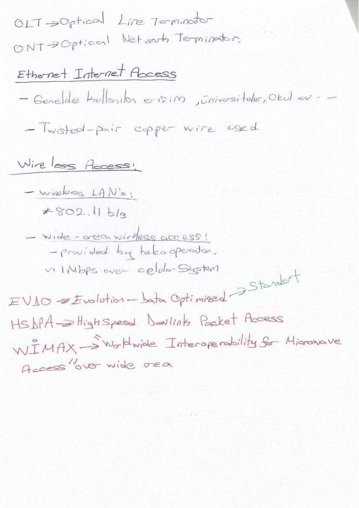
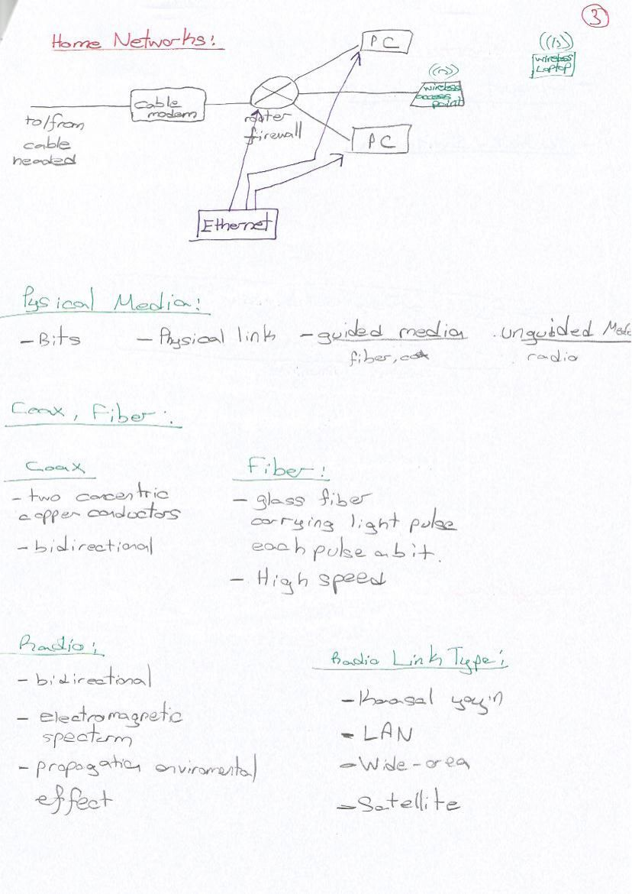
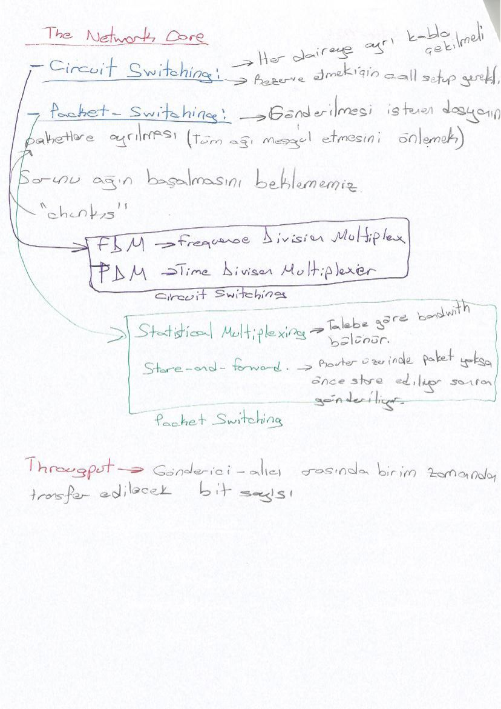
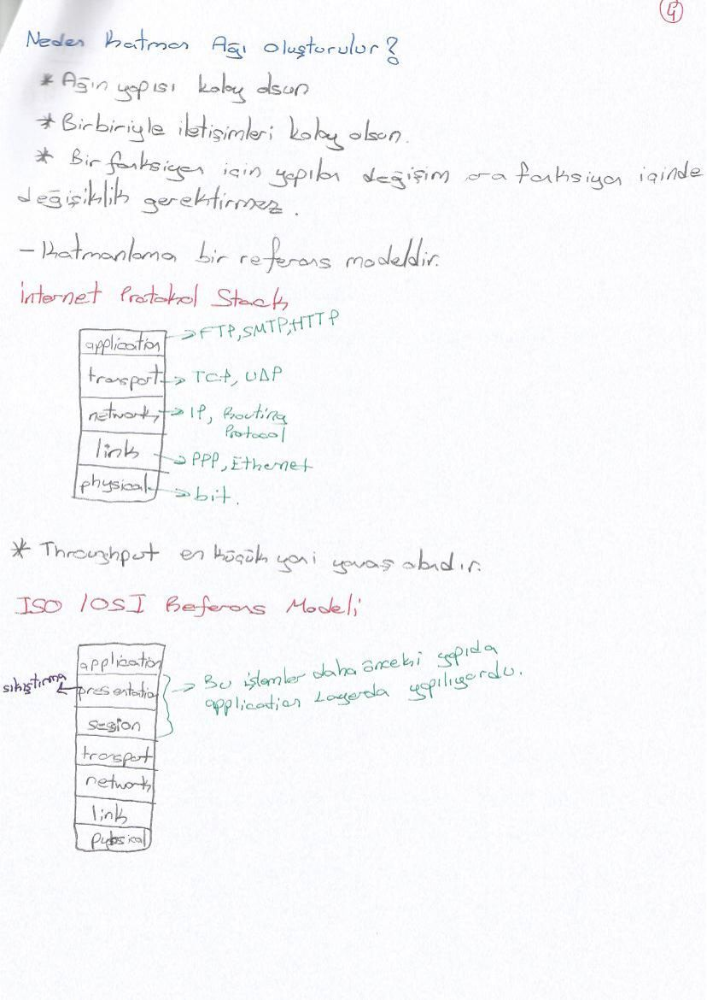

## İnternetin yapısı

Uç sistemler; istemci–sunucu ve P2P; bağlantılar; paket anahtarları; protokol ve standartlar. Protokol mesaj biçimini, gönderim sırasını ve alınan mesaja verilecek tepkiyi tanımlar.

## Erişim ağları

DSL telefon hattını kullanır; splitter ses ve veriyi ayırır. DSLAM servis sağlayıcı tarafında hatları toplar. Kablo İnternet/HFC ortak erişim ortamını paylaşır. FTTH optik hatla eve erişir.

## Fiber ve kablosuz erişim

FTTH içinde OLT ve ONT görevleri, pasif/aktif optik dağıtım gösterilir. Ethernet yerel ağ bağlantısı, Wi-Fi kablosuz yerel erişim, hücresel ağ geniş alan kablosuz erişim örnekleridir.

## Fiziksel ortam

Bükümlü çift, koaksiyel kablo, fiber optik ve radyo bağlantıları karşılaştırılır. Fiber elektromanyetik girişime dayanıklıdır. Ağ çekirdeği paketleri yönlendiriciler üzerinden taşır.

## Paket ve devre anahtarlama

Paket anahtarlama store-and-forward ve kuyruk beklemesiyle anlatılır. L bitlik paketin R bit/s bağlantıya aktarımı L/R saniyedir. Devre anahtarlama önceden kaynak ayırır.

## FDM, TDM ve gecikme

FDM frekansı; TDM zaman dilimlerini kullanıcılar arasında paylaştırır. Toplam düğüm gecikmesi işleme, kuyruk, iletim ve yayılım bileşenlerinin toplamıdır.

## Katmanlar

Uygulama, taşıma, ağ, bağlantı ve fiziksel katman sıralanır. OSI modelinde ayrıca sunum ve oturum vardır. Kapsülleme ile her katman kendi kontrol bilgisini ekler; alıcıda ters yönde çözülür.

