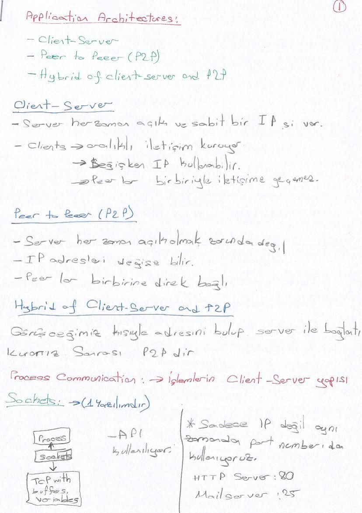
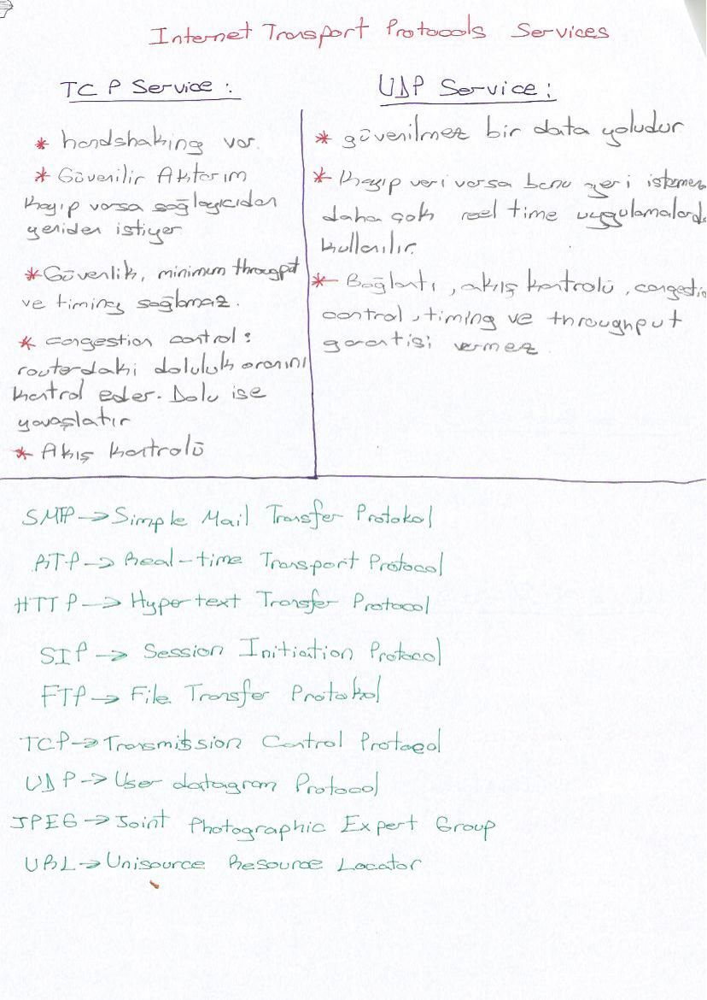
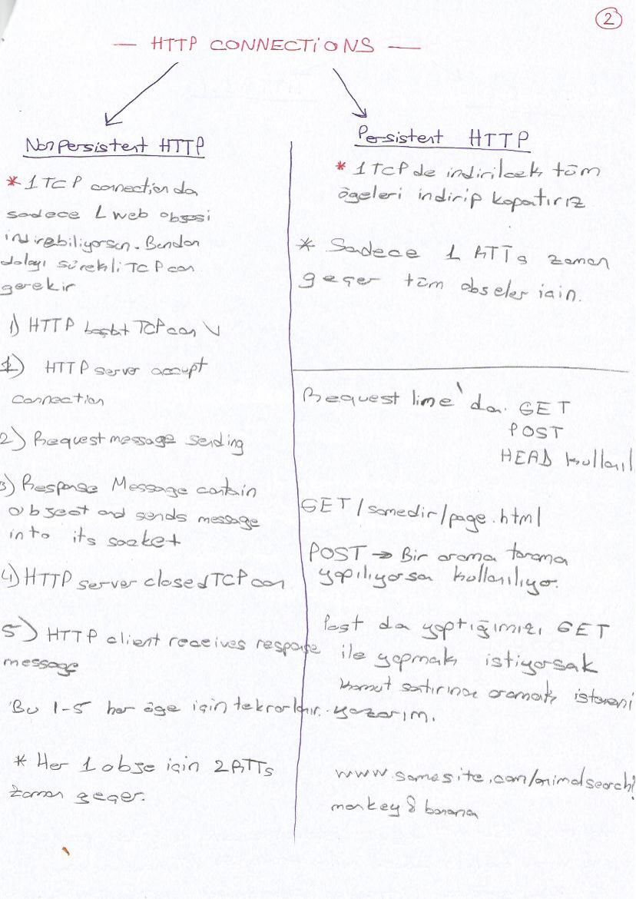
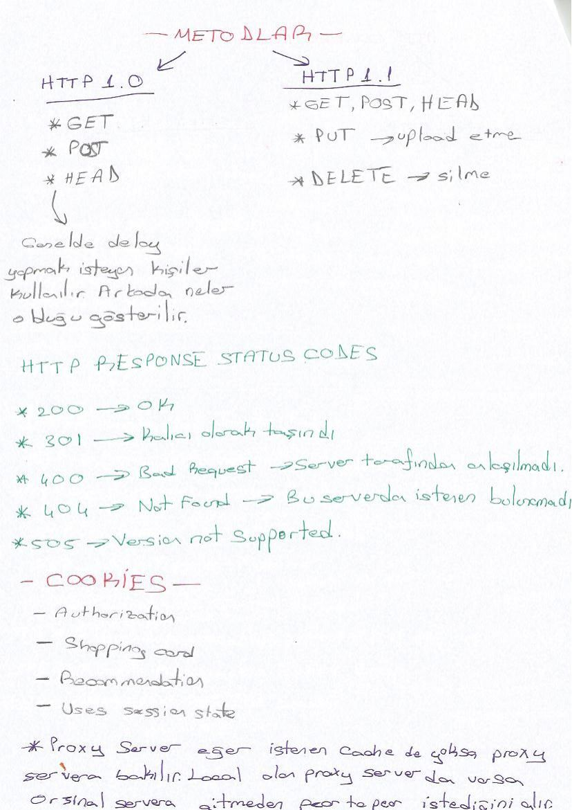
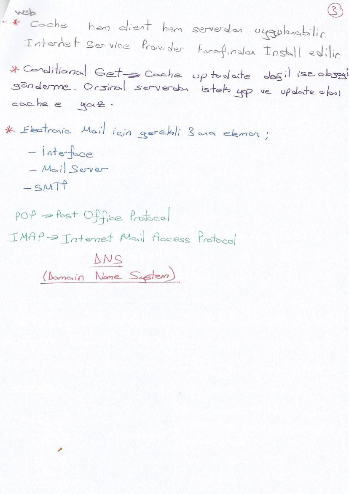

## Application architectures

Client–server and P2P architectures, communication between processes, IP address and port, and the socket as the interface between the application and transport layers are explained.

## Transport requirements of an application

Data integrity, timing, throughput, and security requirements are treated separately. File transfer is loss-sensitive, while real-time audio is delay-sensitive.

## TCP and UDP services

TCP is connection-oriented, reliable, and provides flow and congestion control. UDP is connectionless. Neither of them, by itself, guarantees a minimum transmission rate or a strict delay bound.

## HTTP connections

HTTP works with request and response messages. In a non-persistent connection, a connection is set up for each object. In a simple calculation, the response time is 2 RTT + object transmission time; a persistent connection reduces repeated setup.

## HTTP messages and status codes

The request line contains the method, path, and version. The Host, User-Agent, Connection, and Accept-Language headers are given as examples. The response carries a status code and a phrase; 200 (success), 301 (redirect), 400 (bad request), and 404 (resource not found) are examples.

