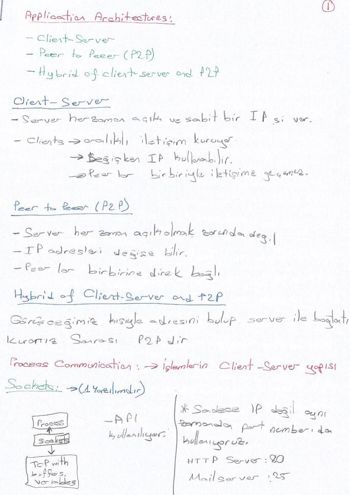
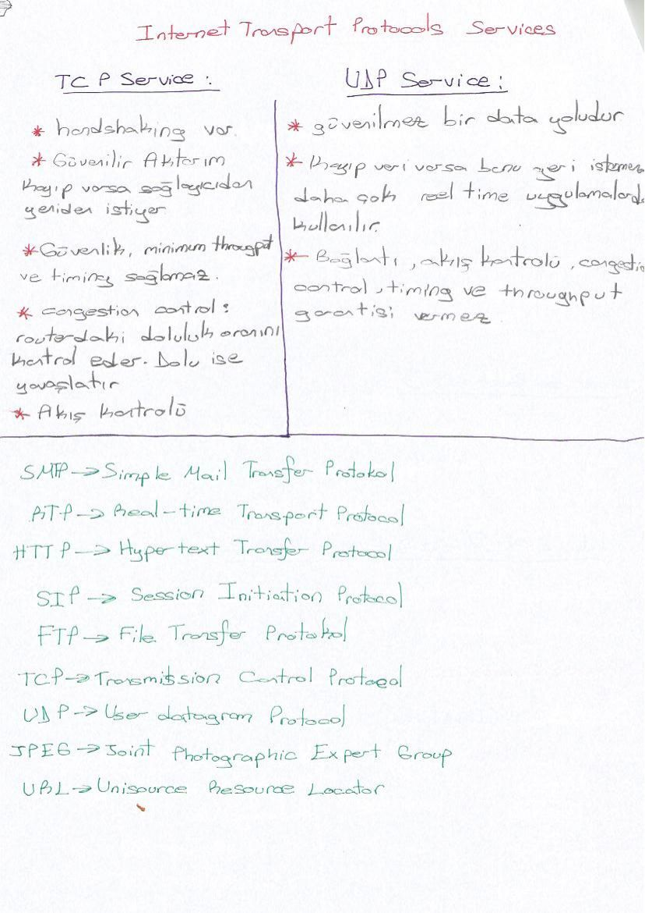
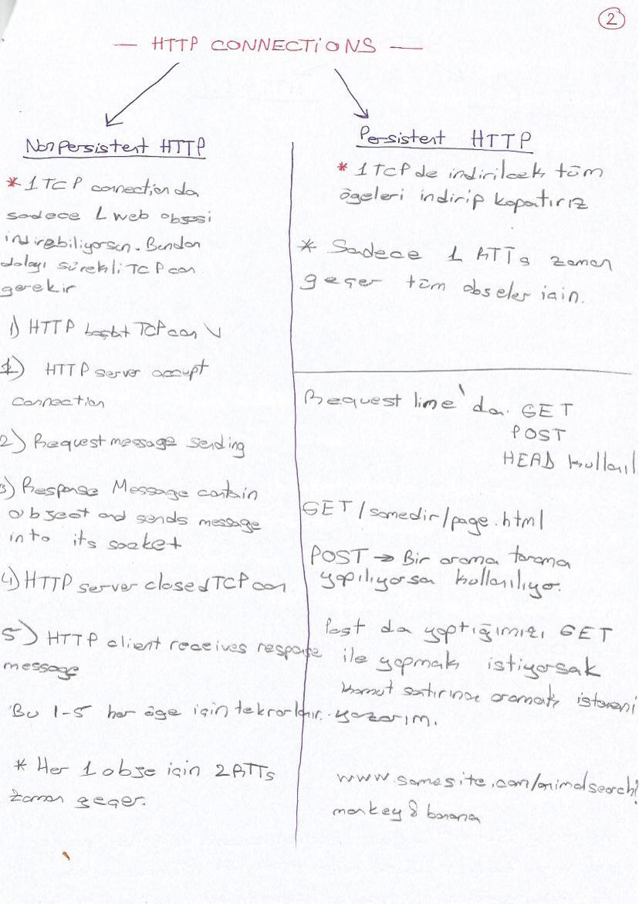
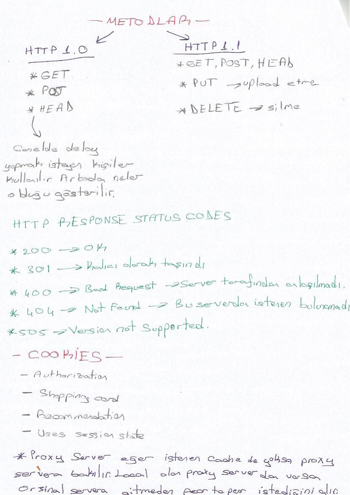
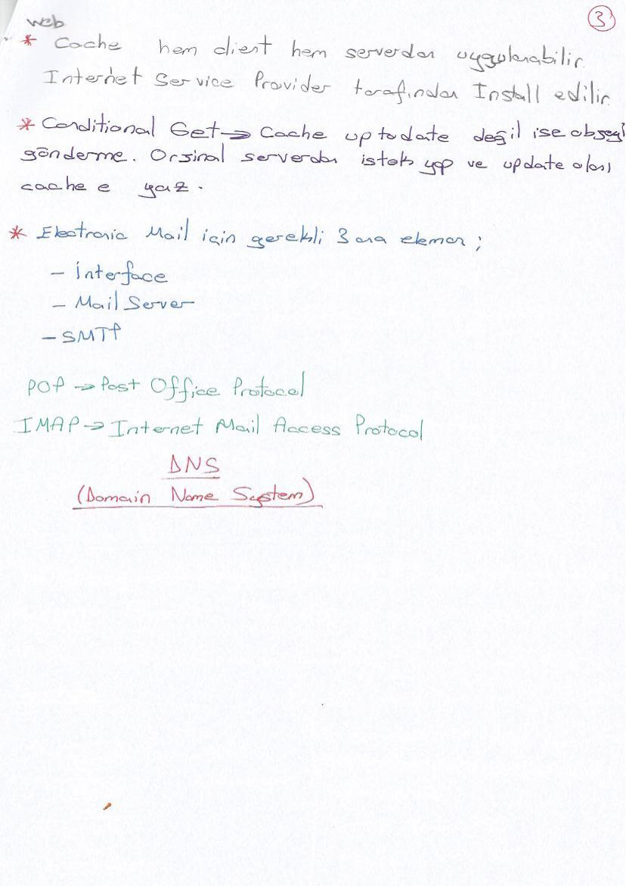

## Uygulama mimarileri

İstemci–sunucu ve P2P mimarileri; süreçler arası haberleşme; IP adresi ve port; soketin uygulama ile taşıma katmanı arasındaki arayüz olması açıklanır.

## Uygulamanın taşıma gereksinimleri

Veri bütünlüğü, zamanlama, throughput ve güvenlik gereksinimleri ayrı ele alınır. Dosya aktarımı kayba duyarlı, gerçek zamanlı ses gecikmeye duyarlıdır.

## TCP ve UDP servisleri

TCP bağlantı odaklı, güvenilir ve akış/tıkanıklık kontrollüdür. UDP bağlantısızdır. İkisinin de tek başına asgari aktarım hızı veya kesin gecikme garantisi yoktur.

## HTTP bağlantıları

HTTP istek ve cevap mesajlarıyla çalışır. Kalıcı olmayan bağlantıda nesne başına bağlantı kurulumu yapılır. Basit hesapta yanıt süresi 2 RTT + nesne iletim süresidir; kalıcı bağlantı tekrar kurulumu azaltır.

## HTTP mesajları ve durum kodları

İstek satırı yöntem, yol ve sürümü içerir. Host, User-Agent, Connection ve Accept-Language başlıkları örneklenir. Yanıt durum kodu ve açıklaması taşır; 200 başarı, 301 yönlendirme, 400 hatalı istek ve 404 bulunamayan kaynak örnekleridir.

