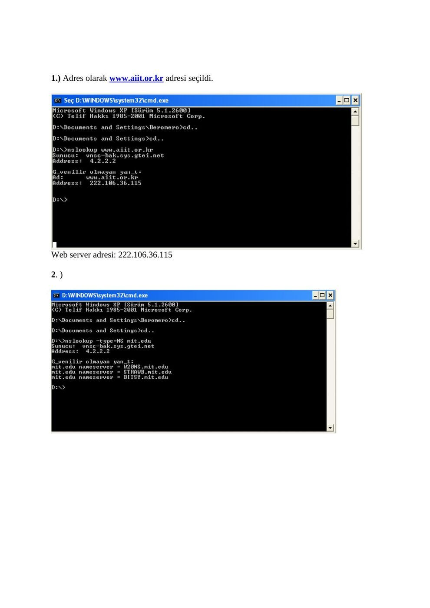
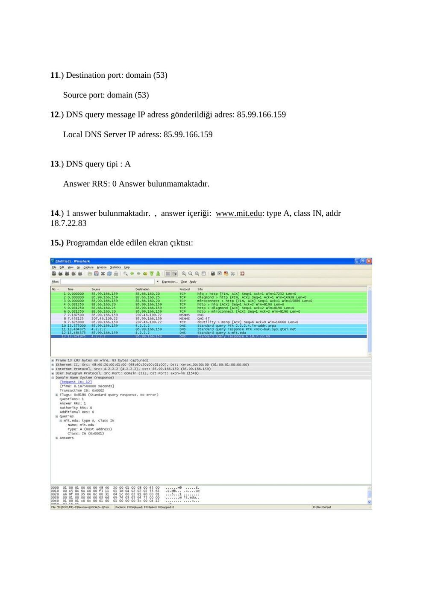
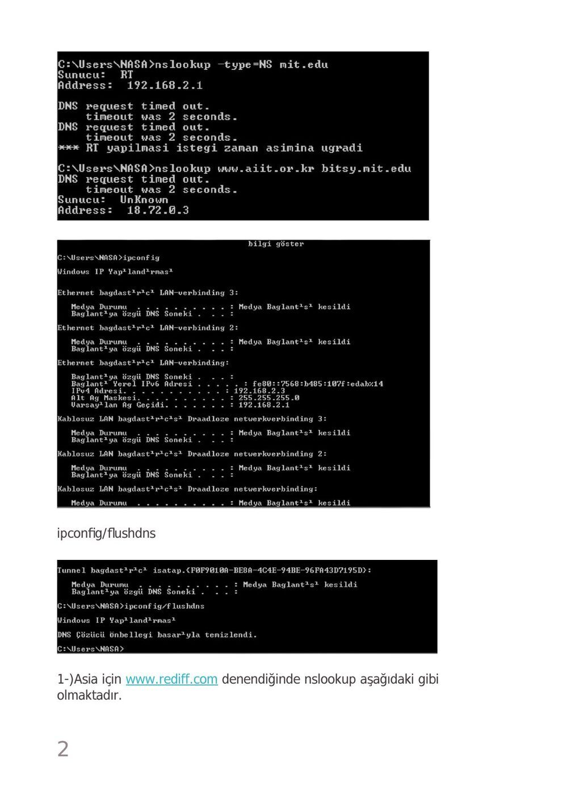
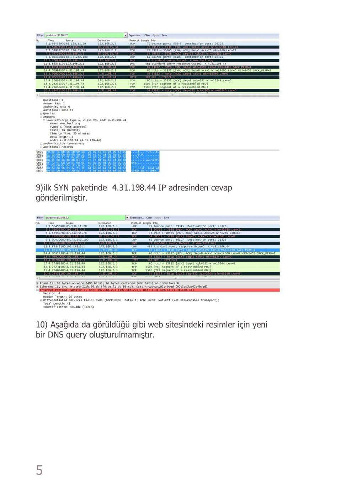
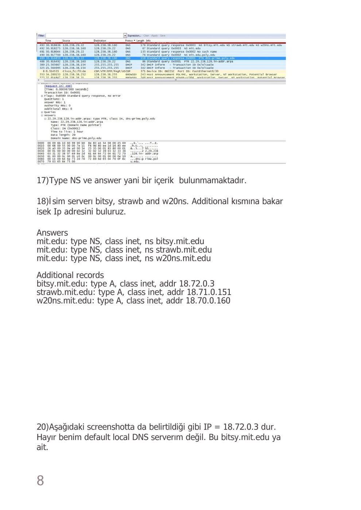
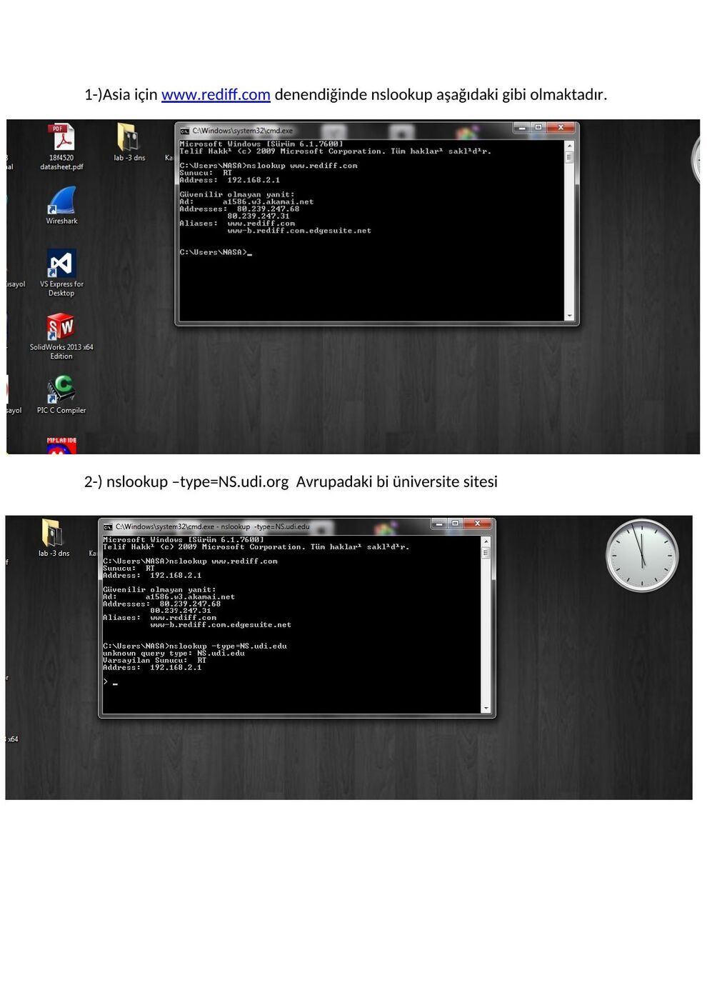
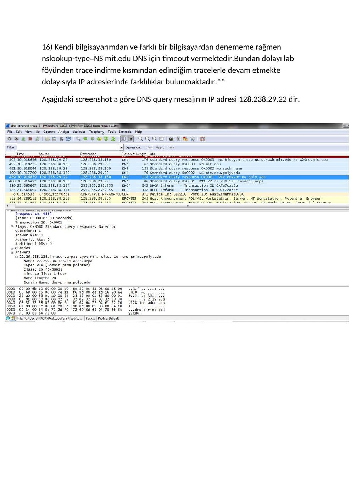

These are student laboratory reports from the course archive; student names, numbers, and identity information have been removed. Where a document carries no date, the creation or last-modified date of the source file has been used. PDF copies of the documents prepared for the archive can be downloaded at the end of the post.

## DNS report A

EEM 413 COMPUTER NETWORKS LAB 2: DNS

**1.** ) The address chosen was www.aiit.or.kr.

Web server address: 222.106.36.115

**2.** )

**3.** )

**4.** ) The DNS query and response messages were sent over UDP (User Datagram Protocol).

**5.** ) DNS response: Source Port: biolink-auth (3411)

DNS query message: Destination Port: domain (53)

**6.** ) The IP address to which the DNS query messages were sent is the same as the IP address of the local DNS server, and it is

**85.** 99.166.159.

**7.** ) The DNS query type is PTR (Domain name pointer). There is no query message carrying an answer. Answer RRs: 0

**8.** ) There is 1 answer. Answer RRs: 1

**9.** ) IP address of the SYN packet is 64.170.98.32

IP address of the DNS response message is 85.99.166.159

**10.** ) The host does not contain any new DNS queries.

**11.** ) Destination port: domain (53)

Source port: domain (53)

**12.** ) IP address to which the DNS query message was sent: 85.99.166.159

Local DNS server IP address: 85.99.166.159

**13.** ) DNS query type: A

Answer RRs: 0. There is no answer.

**14.** ) There is 1 answer. Answer content: www.mit.edu: type A, class IN, addr

**18.** 7.22.83

**15.** ) Screen output obtained from the program:

**16.** ) The IP address to which the DNS query message was sent is the same as the local DNS server IP address: 85.99.166.159

**17.** ) Type: NS (Authoritative name server)

Answer RRs: 0

**18.** ) mit.edu: type NS, class IN, ns bitsy.mit.edu, addr 18.72.0.3

mit.edu: type NS, class IN, ns w20ns.mit.edu, addr 18.70.0.160

mit.edu: type NS, class IN, ns strawb.mit.edu, addr 18.71.0.151

**19.** ) Screen output obtained from the program:

**20.** ) IP address to which the DNS query message was sent: 85.99.166.159

Local DNS server IP address: 85.99.166.159

**21.** ) Type: PTR (Domain name pointer)

Answer RRs: 0

**22.** ) Answer RRs: 1

**3.** 0.72.18.in-addr.arpa: type PTR, class IN, BITSY.MIT.EDU

www.aiit.or.kr: type A, class IN, addr 222.106.36.115

**23.** ) Screen output obtained from the program:

## DNS report B

EEM-413 COMPUTER NETWORKS

LABORATORY 2 - DNS When nslookup www.mit.edu is entered:

When nslookup –type = NS mit.edu is entered:

Nslookup www.aiit.or.kr bitsy.mit.edu

ipconfig/flushdns

1-) When www.rediff.com was tried for Asia, nslookup gives the output below.

2-) nslookup –type=NS.udi.org (a university site in Europe)

3-) When we look at nslookup mail.yahoo.com:

4-) Looking at www.ietf.com in Wireshark, as marked in red below, User Datagram Protocol, i.e. UDP, was used.

**5.** As can also be seen in the screenshot above, the source port (Src port) = 65292 and the destination port, i.e. Dst, is port 53.

**6.** As I show below, the default gateway and DHCP server IP is 192.168.2.1. It can also be seen in Wireshark. My own IP address is 192.168.2.3.

**7.** This is a standard query message and does not contain any data. It can also be seen in the screenshot above.

**8.** As shown below, TYPE A, class IN, address 4.31.198.44, and when we open the DNS tab, answer = 1 can be seen.

**9.** A reply was sent from IP address 4.31.198.44 in the first SYN packet.

**10.** As seen below, no new DNS query was generated for the images on the website.

When we run www.mit.edu from the nslookup command line, we see the output below.

**11.** The source port is 55516 and the destination port is 53. It can also be seen in the screenshot above.

**12.** As we also saw earlier when we ran ipconfig /all, IP address

**192.** 168.2.1 is my local default DNS server IP address.

**13.** As seen in the screenshot above, the DNS type is TYPE A. And it contains no answer or other content.

**14.** As seen in the screenshot below, 1 answer arrived, and its content is shown below.

**16.** Although I tried from my own computer and from a different computer, nslookup -type=NS mit.edu times out for DNS. Therefore I continued with the traces I obtained from the trace download section of the lab handout, so there are differences in the IP addresses. According to the screenshot below, the IP address of the DNS query message is 128.238.29.22.

**17.** The type is NS, and there is no answer, i.e. no content.

**18.** The name servers are bitsy, strawb and w20ns. If we look at the Additional section, we find the IP addresses.

Answers mit.edu: type NS, class inet, ns bitsy.mit.edu mit.edu: type NS, class inet, ns strawb.mit.edu mit.edu: type NS, class inet, ns w20ns.mit.edu

Additional records bitsy.mit.edu: type A, class inet, addr 18.72.0.3 strawb.mit.edu: type A, class inet, addr 18.71.0.151 w20ns.mit.edu: type A, class inet, addr 18.70.0.160

**20.** As indicated in the screenshot below, the IP = 18.72.0.3. No, it is not my default local DNS server. It belongs to bitsy.mit.edu.

**21.** As seen above, the DNS type is TYPE A. And there is no answer.

22-23) As seen in the screenshot below, there is 1 answer, and its content is shown in the screenshot.

## DNS report C

EEM-413 Computer Networks Lab 2 (DNS)

When nslookup www.mit.edu is entered:

When nslookup –type = NS mit.edu is entered:

Nslookup www.aiit.or.kr bitsy.mit.edu

- ipconfig/all

ipconfig /flushdns

1-) When www.rediff.com was tried for Asia, nslookup gives the output below.

2-) nslookup –type=NS.udi.org (a university site in Europe)

3-) When we look at nslookup mail.yahoo.com:

**3.** The first part of the process:

**4.** 

Looking at www.ietf.com in Wireshark, as marked in red below, User Datagram Protocol, i.e. UDP, was used.

**5.** As can also be seen in the screenshot above, the source port (Src port) = 65292 and the destination port, i.e. Dst, is port 53.

**6.** As I show below, the default gateway and DHCP server IP is

**192.** 168.2.1. It can also be seen in Wireshark. My own IP address is 192.168.2.3.

**7.** This is a standard query message and does not contain any data. It can also be seen in the screenshot above.

**8.** As shown below, TYPE A, class IN, address 4.31.198.44, and when we open the DNS tab, answer = 1 can be seen.

**9.** A reply was sent from IP address 4.31.198.44 in the first SYN packet.

**10.** As seen below, no new DNS query was generated for the images on the website.

** When we run www.mit.edu from the nslookup command line, we see the output below.

**11.** The source port is 55516 and the destination port is 53. It can also be seen in the screenshot above.

**12.** As we also saw earlier when we ran ipconfig /all, IP address 192.168.2.1 is my local default DNS server IP address.

**13.** As seen in the screenshot above, the DNS type is TYPE A. And it contains no answer or other content.

**14.** As seen in the screenshot below, 1 answer arrived, and its content is shown below.

**16.** Although I tried from my own computer and from a different computer, nslookup -type=NS mit.edu times out for DNS. Therefore I continued with the traces I obtained from the trace download section of the lab handout, so there are differences in the IP addresses.**

According to the screenshot below, the IP address of the DNS query message is 128.238.29.22.

**17.** 

The type is NS, and there is no answer, i.e. no content.

**18.** 

The name servers are bitsy, strawb and w20ns. If we look at the Additional section, we find the IP addresses. Answers mit.edu: type NS, class inet, ns bitsy.mit.edu mit.edu: type NS, class inet, ns strawb.mit.edu mit.edu: type NS, class inet, ns w20ns.mit.edu Additional records bitsy.mit.edu: type A, class inet, addr 18.72.0.3 strawb.mit.edu: type A, class inet, addr 18.71.0.151 w20ns.mit.edu: type A, class inet, addr 18.70.0.160

**20.** 

Because the same problem occurred in this question, I did it in the same way, by downloading the trace file from the site indicated in the handout.**

As indicated in the screenshot below, the IP = 18.72.0.3. No, it is not my default local DNS server. It belongs to bitsy.mit.edu.

**21.** As seen above, the DNS type is TYPE A. And there is no answer.

22-23) As seen in the screenshot below, there is 1 answer, and its content is shown in the screenshot.

*Note: DNS does not use UDP exclusively; TCP can also be used. The UDP information seen in the reports applies to the capture examined. The skipped question numbers and the absence of some answers are characteristic of the source documents.*
