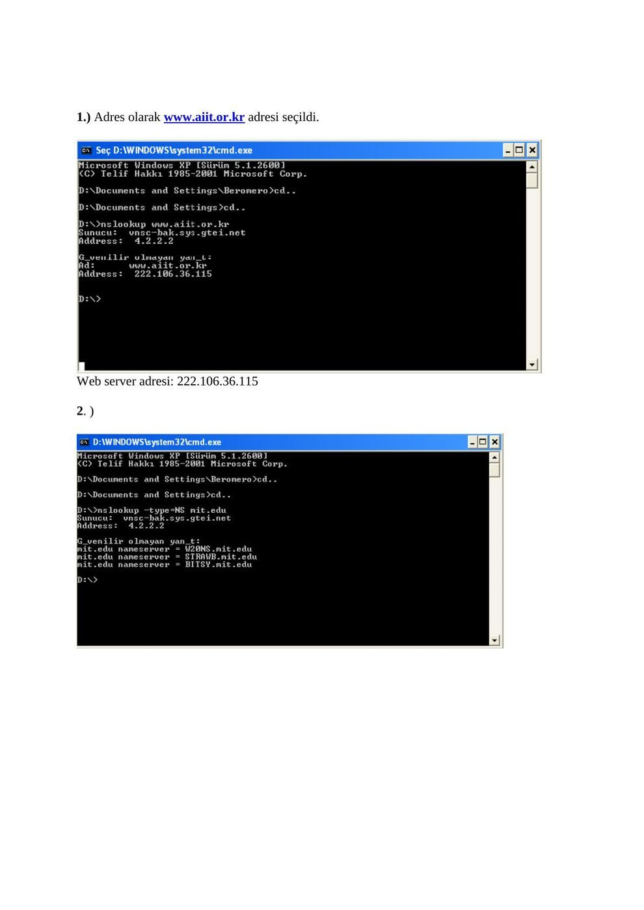
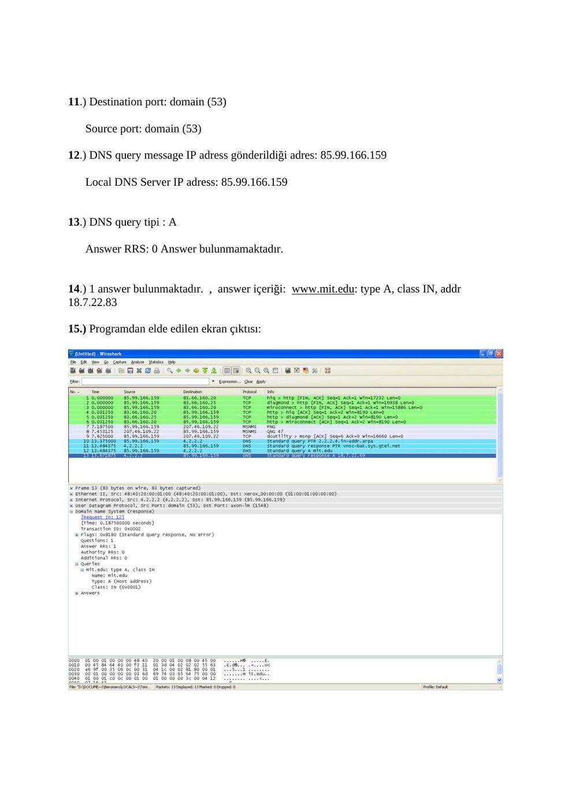
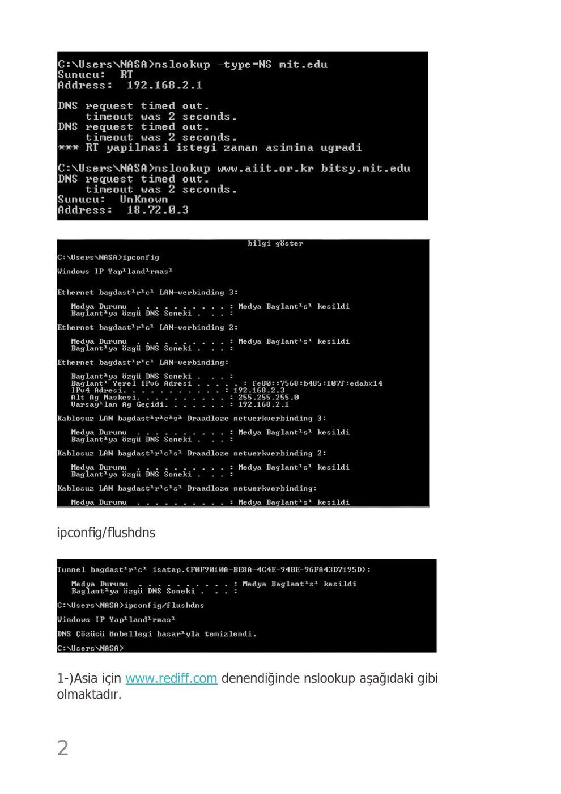
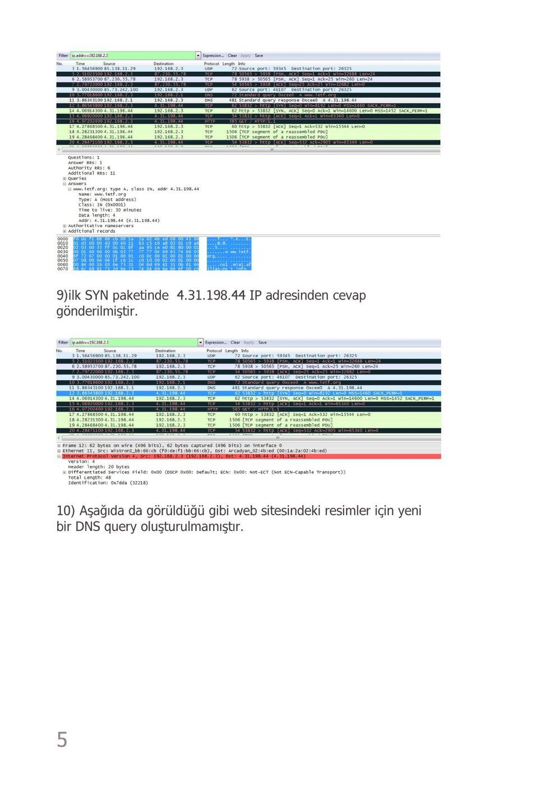
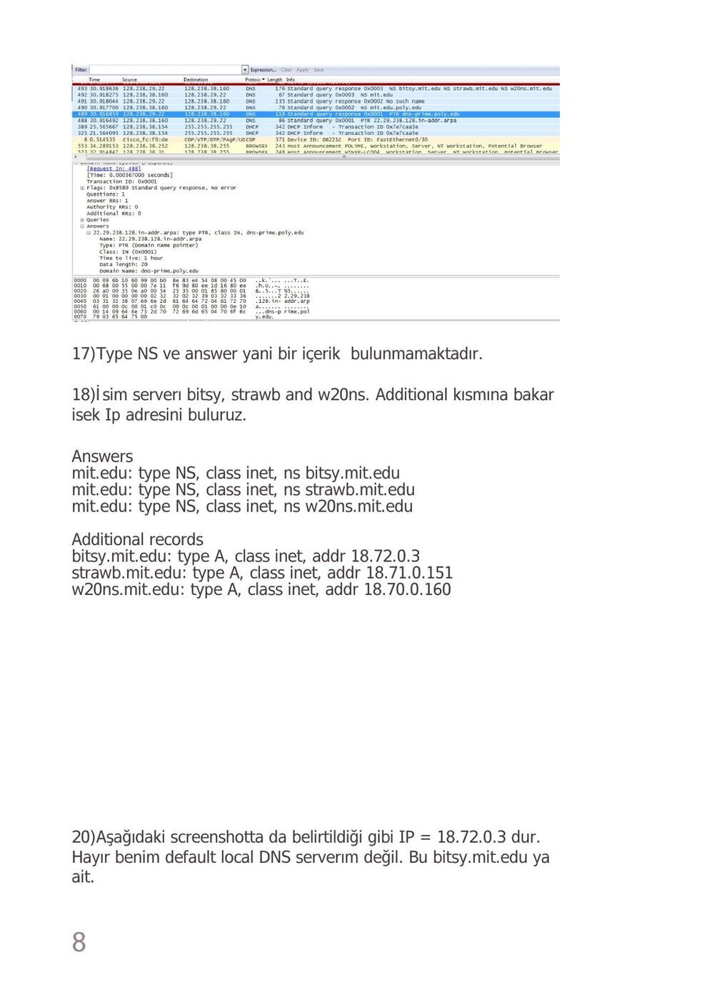
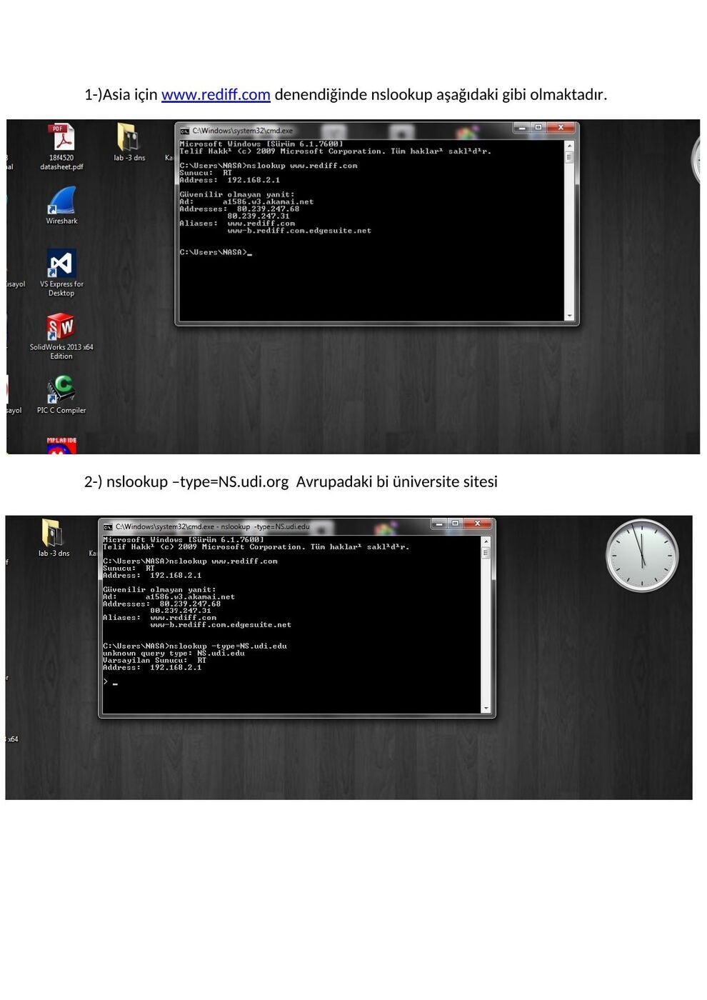
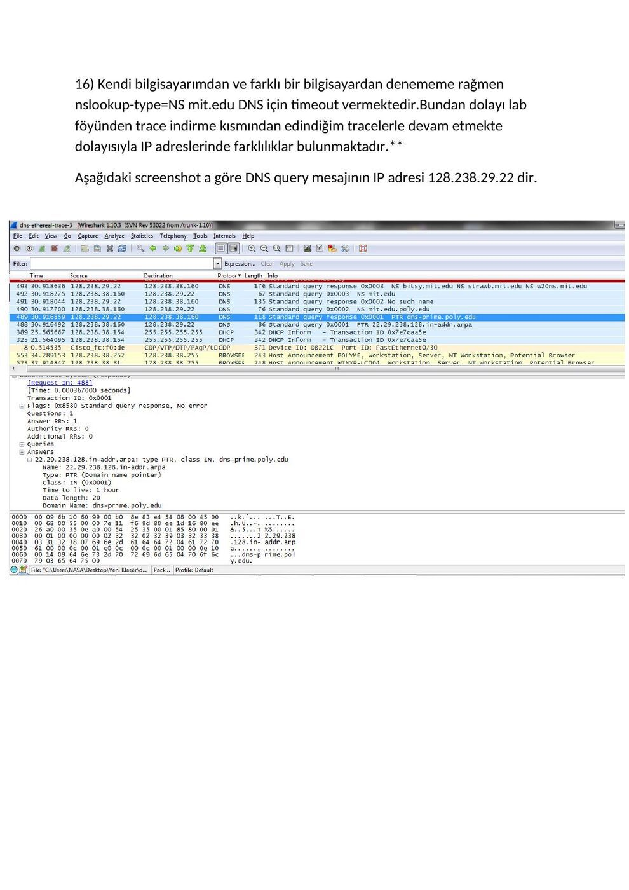

Ders arşivindeki öğrenci laboratuvar raporlarıdır; öğrenci adları, numaraları ve kimlik bilgileri çıkarılmıştır. Belge üzerindeki tarih bulunmadığında kaynak dosyanın oluşturulma ya da son değiştirilme tarihi kullanılmıştır. Belgelerin arşiv için hazırlanmış PDF kopyaları yazının sonunda indirilebilir.

## DNS raporu A

EEM 413 BİLGİSAYAR AĞLARI LAB 2 : DNS

**1.** ) Adres olarak www.aiit.or.kr adresi seçildi.

Web server adresi: 222.106.36.115

**2.** )

**3.** )

**4.** ) DNS query ve response mesajları UDP (User Datagram Protocol) üzerinden gönderilmiştir.

**5.** ) DNS response: Source Port : biolink-auth (3411)

DNS query message: Destination Port : domain (53)

**6.** ) DNS query mesajlarının gönderildiği IP adresi ile local DNS Server’ının IP adresi aynı ve

**85.** 99.166.159’tur.

**7.** ) DNS query tipi PT R(Domain name pointer)’dir. , Answer taşıyan query mesajı yoktur. Answer RRs: 0

**8.** ) 1 answer bulunmaktadır. Answer RRs: 1

**9.** ) IP address of the SYN packet is 64.170.98.32

IP address of the DNS response message is 85.99.166.159

**10.** ) Host yeni DNS queries bulundurmamaktadır.

**11.** ) Destination port: domain (53)

Source port: domain (53)

**12.** ) DNS query message IP adress gönderildiği adres: 85.99.166.159

Local DNS Server IP adress: 85.99.166.159

**13.** ) DNS query tipi : A

Answer RRS: 0 Answer bulunmamaktadır.

**14.** ) 1 answer bulunmaktadır. , answer içeriği: www.mit.edu: type A, class IN, addr

**18.** 7.22.83

**15.** ) Programdan elde edilen ekran çıktısı:

**16.** ) DNS query mesajının gittiği IP adresi local DNS server IP adresi ile aynı : 85.99.166.159

**17.** ) Type: NS (Authoritative name server)

Answer RRs: 0

**18.** ) mit.edu: type NS, class IN, ns bitsy.mit.edu, addr 18.72.0.3

mit.edu: type NS, class IN, ns w20ns.mit.edu, addr 18.70.0.160

mit.edu: type NS, class IN, ns strawb.mit.edu, addr 18.71.0.151

**19.** ) Programdan elde edilen ekran çıktısı:

**20.** ) DNS query message IP adress gönderildiği adres: 85.99.166.159

Local DNS Server IP adress: 85.99.166.159

**21.** ) Type: PTR (Domain name pointer)

Answer RRs: 0

**22.** ) Answer RRs: 1

**3.** 0.72.18.in-addr.arpa: type PTR, class IN, BITSY.MIT.EDU

www.aiit.or.kr: type A, class IN, addr 222.106.36.115

**23.** ) Programdan elde edilen ekran çıktısı:

## DNS raporu B

EEM-413 BİLGİSAYAR AĞLARI

LABORATUVAR 2 - DNS Nslookup www.mit.edu yazıldığında ;

Nslookup –type = NS mit.edu yazıldığında ;

Nslookup www.aiit.or.kr bitsy.mit.edu

ipconfig/flushdns

1-)Asia için www.rediff.com denendiğinde nslookup aşağıdaki gibi olmaktadır.

2-) nslookup –type=NS.udi.org Avrupadaki bi üniversite sitesi

3-) nslookup mail.yahoo.com ya baktığımızda ;

4-)www.ietf.com için wireshark ta bakıldığında aşağıda kırmızıyla belirttiğim gibi User Datagram Protocol yani UDP kullanılmıştır.

**5.** Yukarıdaki screenshotta da görüldüğü gibi Source port (Scr port ) = 65292 ve Destination port yani Dst = 53 üncü porttadır.

**6.** Aşağıda da gösterdiğim gibi Varsayılan ağ geçidi ve DHCP sunucusu IP si 192.168.2.1 dir.Wire shar ta da görülmektedir. Benim Ip adresimde 192.168.2.3 dür.

**7.** Bu standart bir query mesaj ve herhangi bir veri içermemektedir. Yukarıdaki screenshotta da görülmektedir.

**8.** Aşağıda da gösterildiği gibi TYPE A class IN addres 4.31.198.44 ve DNS sekmesini açtığımızda answer =1 görülmektedir.

**9.** ilk SYN paketinde 4.31.198.44 IP adresinden cevap gönderilmiştir.

**10.** Aşağıda da görüldüğü gibi web sitesindeki resimler için yeni bir DNS query oluşturulmamıştır.

nslookup cmd kısmından www.mit.edu yaptığımızda aşağıdaki çıktıyı görmekteyiz.

**11.** Source port 55516 ve Destination Port ta 53 dür. Yukarıdaki screen shottada görülmektedir.

**12.** Daha önce ipconfig / all yaptığımızda da gördüğümüz gibi

**192.** 168.2.1 IP adresi benim local default DNS server IP adresimdir.

**13.** Yukarıdaki screenshottada görüldüğü gibi TYPE A DNS türüdür. Ve Answer veya bi içerik içermez.

**14.** Aşağıdaki screenshottada görüldüğü gibi 1 cevap gelmiş ve içeriğide aşağıda belirtilmiştir.

**16.** Kendi bilgisayarımdan ve farklı bir bilgisayardan denememe rağmen nslookup-type=NS mit.edu DNS için timeout vermektedir. Bundan dolayı lab föyünden trace indirme kısmından edindiğim tracelerle devam etmekte dolayısıyla IP adreslerinde farklılıklar bulunmaktadır. Aşağıdaki screenshot a göre DNS query mesajının IP adresi 128.238.29.22 dir.

**17.** Type NS ve answer yani bir içerik bulunmamaktadır.

**18.** İsim serverı bitsy, strawb and w20ns. Additional kısmına bakar isek Ip adresini buluruz.

Answers mit.edu: type NS, class inet, ns bitsy.mit.edu mit.edu: type NS, class inet, ns strawb.mit.edu mit.edu: type NS, class inet, ns w20ns.mit.edu

Additional records bitsy.mit.edu: type A, class inet, addr 18.72.0.3 strawb.mit.edu: type A, class inet, addr 18.71.0.151 w20ns.mit.edu: type A, class inet, addr 18.70.0.160

**20.** Aşağıdaki screenshotta da belirtildiği gibi IP = 18.72.0.3 dur. Hayır benim default local DNS serverım değil. Bu bitsy.mit.edu ya ait.

**21.** Yukarıda da görüldüğü gibi DNS TYPE A dır. Ve answer yoktur.

22-23) Aşağıdaki screenshot tada görüldüğü gibi 1 answer var ve içeriğide screenshotta gösterilmiştir.

## DNS raporu C

EEM-413 Bilgisayar Ağları Lab2 (DNS)

Nslookup www.mit.edu yazıldığında ;

Nslookup –type = NS mit.edu yazıldığında ;

Nslookup www.aiit.or.kr bitsy.mit.edu

- İpconfig/all

İpconfig /flushdns

1-)Asia için www.rediff.com denendiğinde nslookup aşağıdaki gibi olmaktadır.

2-) nslookup –type=NS.udi.org Avrupadaki bi üniversite sitesi

3-) nslookup mail.yahoo.com ya baktığımızda ;

**3.** Kısım ilk işlemi;

**4.** 

www.ietf.com için wireshark ta bakıldığında aşağıda kırmızıyla belirttiğim gibi User Datagram Protocol yani UDP kullanılmıştır.

**5.** Yukarıdaki screenshotta da görüldüğü gibi Source port (Scr port ) = 65292 ve Destination port yani Dst = 53 üncü porttadır.

**6.** Aşağıda da gösterdiğim gibi Varsayılan ağ geçidi ve DHCP sunucusu IP si

**192.** 168.2.1 dir.Wire shar ta da görülmektedir. Benim Ip adresimde 192.168.2.3 dür.

**7.** Bu standart bir query mesaj ve herhangi bir veri içermemektedir. Yukarıdaki screenshotta da görülmektedir.

**8.** Aşağıda da gösterildiği gibi TYPE A class IN addres 4.31.198.44 ve DNS sekmesini açtığımızda answer =1 görülmektedir.

**9.** ilk SYN paketinde 4.31.198.44 IP adresinden cevap gönderilmiştir.

**10.** Aşağıda da görüldüğü gibi web sitesindeki resimler için yeni bir DNS query oluşturulmamıştır.

** nslookup cmd kısmından www.mit.edu yaptığımızda aşağıdaki çıktıyı görmekteyiz.

**11.** Source port 55516 ve Destination Port ta 53 dür. Yukarıdaki screen shottada görülmektedir.

**12.** Daha önce ipconfig / all yaptığımızda da gördüğümüz gibi 192.168.2.1 IP adresi benim local default DNS server IP adresimdir.

**13.** Yukarıdaki screenshottada görüldüğü gibi TYPE A DNS türüdür. Ve Answer veya bi içerik içermez.

**14.** Aşağıdaki screenshottada görüldüğü gibi 1 cevap gelmiş ve içeriğide aşağıda belirtilmiştir.

**16.** Kendi bilgisayarımdan ve farklı bir bilgisayardan denememe rağmen nslookup-type=NS mit.edu DNS için timeout vermektedir.Bundan dolayı lab föyünden trace indirme kısmından edindiğim tracelerle devam etmekte dolayısıyla IP adreslerinde farklılıklar bulunmaktadır.**

Aşağıdaki screenshot a göre DNS query mesajının IP adresi 128.238.29.22 dir.

**17.** 

Type NS ve answer yani bir içerik bulunmamaktadır.

**18.** 

İsim serverı bitsy, strawb and w20ns. Additional kısmına bakar isek Ip adresini buluruz Answers mit.edu: type NS, class inet, ns bitsy.mit.edu mit.edu: type NS, class inet, ns strawb.mit.edu mit.edu: type NS, class inet, ns w20ns.mit.edu Additional records bitsy.mit.edu: type A, class inet, addr 18.72.0.3 strawb.mit.edu: type A, class inet, addr 18.71.0.151 w20ns.mit.edu: type A, class inet, addr 18.70.0.160

**20.** 

Bu soruda da aynı sıkıntı yaşandığı için aynı şekilde trace dosyasını föyde belirtilen siteden indirerek yaptım.**

Aşağıdaki screenshotta da belirtildiği gibi IP = 18.72.0.3 dur. Hayır benim default local DNS serverım değil. Bu bitsy.mit.edu ya ait.

**21.** Yukarıda da görüldüğü gibi DNS TYPE A dır. Ve answer yoktur.

22-23) Aşağıdaki screenshot tada görüldüğü gibi 1 answer var ve içeriğide screenshotta gösterilmiştir.

*Not: DNS yalnız UDP kullanmaz; TCP de kullanılabilir. Raporlarda görülen UDP bilgisi incelenen yakalama içindir. Soru numaralarının atlaması ve bazı cevapların bulunmaması kaynak belgelerin özelliğidir.*

