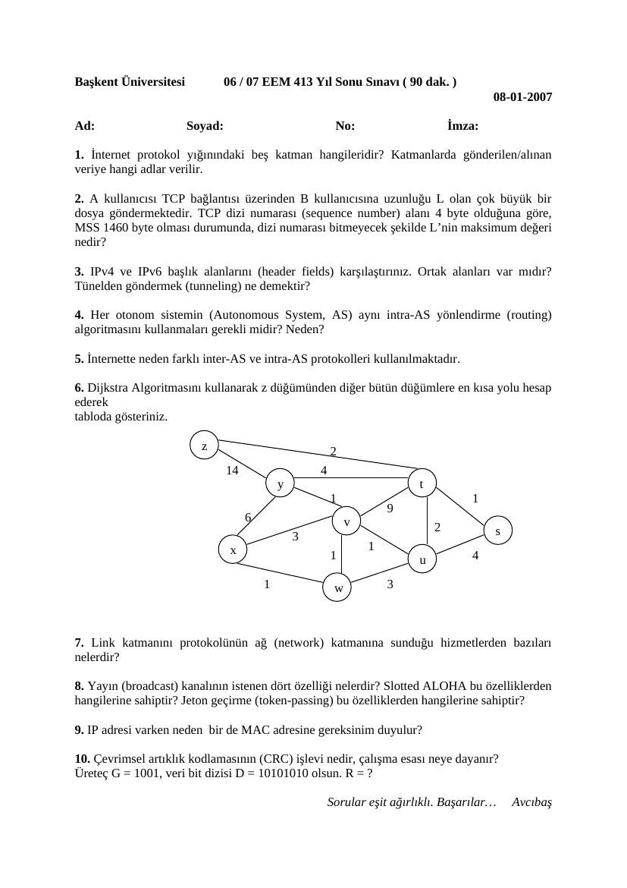
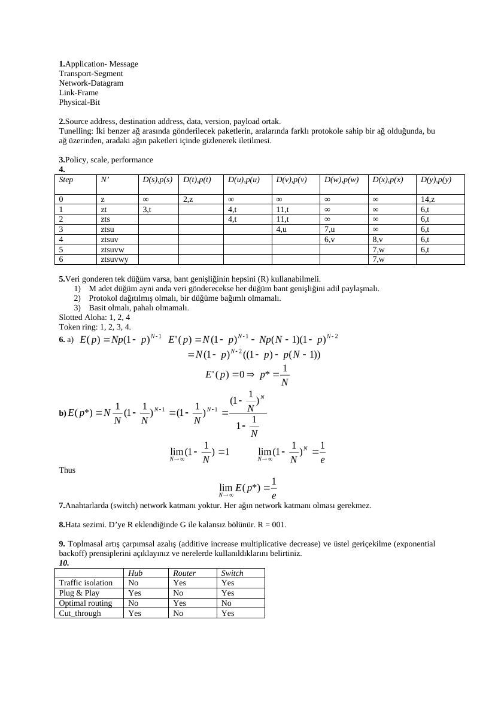

The answer keys for the final exams of 8 January 2007 and 14 January 2008, signed by Avcıbaş, at Başkent University have been brought together. PDF copies of the documents can be downloaded at the end of the post.

## EEM413 Final 2007

Başkent University 06 / 07 EEM 413 End-of-Year Exam ( 90 min. ) 08-01-2007

**1.** What are the five layers of the Internet protocol stack? What names are given to the data sent/received at each layer?

**2.** User A is sending a very large file of length L to user B over a TCP connection. Given that the TCP sequence number field is 4 bytes and the MSS is 1460 bytes, what is the maximum value of L such that the sequence numbers do not run out?

**3.** Compare the IPv4 and IPv6 header fields. Do they have any fields in common? What does tunneling mean?

**4.** Is it necessary for every autonomous system (AS) to use the same intra-AS routing algorithm? Why?

**5.** Why are different inter-AS and intra-AS protocols used in the Internet?

**6.** Using Dijkstra's algorithm, compute the shortest paths from node z to all other nodes and show them in a table.

z 2 14 4 y t 1 1 6 v 2 s x 1 1 u 4

1 w 3

**7.** What are some of the services that the link layer protocol provides to the network layer?

**8.** What are the four desired characteristics of a broadcast channel? Which of these characteristics does slotted ALOHA have? Which of these characteristics does token passing have?

**9.** Why is a MAC address needed when there is already an IP address?

**10.** What is the function of cyclic redundancy check (CRC) coding, and what is its working principle based on? Let the generator be G = 1001 and the data bit sequence be D = 1010 1010. R = ?

The questions are equally weighted. Good luck… Avcıbaş

## EEM413 Final Answer Key

**1.** What are the five layers of the Internet protocol stack? What name is given to the data at each layer? Application - Message; Transport - Segment; Network - Datagram; Link - Frame; Physical - Bit

**2.** User A is sending a very large file of length L to user B over a TCP connection. Given that the TCP sequence number field is 4 bytes and the MSS is 1460 bytes, what is the maximum value of L such that the sequence numbers do not run out? There are  sequence numbers. The sequence number does not increase by one with each segment sent; instead, it increases by the number of bytes sent. In this respect, the MSS size is irrelevant. The maximum file length that A can send to B is .

**3.** Compare the IPv4 and IPv6 header fields. Do they have any fields in common? What does tunneling mean? Source address, destination address, data, version, and payload are common. Tunneling: When there is a network with a different protocol between two similar networks, the packets to be sent between them are transmitted across that intermediate network by being hidden inside the packets of the intermediate network.

**4.** Is it necessary for every autonomous system (AS) to use the same intra-AS routing algorithm? Why? No. Each AS administrator can perform routing in whatever way they wish.

**5.** Why are different inter-AS and intra-AS protocols used in the Internet?

**6.**  Step N’ D(s),p(s D(t),p(t) D(u),p(u) D(v),p(v) D(w),p(w) D(x),p(x) D(y),p(y) ) 0 z ∞ 2,z ∞ ∞ ∞ ∞ 14,z 1 zt 3,t 4,t 11,t ∞ ∞ 6,t 2 zts 4,t 11,t ∞ ∞ 6,t 3 ztsu 4,u 7,u ∞ 6,t 4 ztsuv 6,v 8,v 6,t 5 ztsuvw 7,w 6,t 6 ztsuvwy 7,w

**7.** What are some of the services that the link layer protocol provides to the network layer? Framing, link access, reliable delivery, flow control, error detection and correction; full duplex.

**8.** What are the four desired characteristics of a broadcast channel? Which of these characteristics does slotted ALOHA have? Which of these characteristics does token passing have?

**1.** When only a single node has data to send, it should be able to use the entire bandwidth (R).

**2.** When M nodes send data at the same time, each node should share the bandwidth fairly.

**3.** The protocol should be distributed and should not depend on a single node.

**4.** It should be simple and inexpensive. Slotted ALOHA: 1, 2, 4. Token ring: 1, 2, 3, 4.

9: Why is a MAC address needed when there is already an IP address? Switches do not have a network layer.

**10.** What is cyclic redundancy check (CRC) coding used for, and how does it work? Let the generator be G = 1001 and the data bit sequence be D = 1010 1010. R = ? Error detection. When R is appended to D, the result is divisible by G with no remainder. R = 001.

## EEM413 Final 2008

Başkent University 07 / 08 EEM 413 End-of-Year Exam ( 100 min. ) 14-01-2008

**1.** What are the five layers of the Internet protocol stack? What names are given to the data sent/received at each layer?

**2.** Which of the IPv4 and IPv6 header fields are common to both? What does tunneling mean?

**3.** Why are different inter-AS and intra-AS protocols used in the Internet?

**4.** Using Dijkstra's algorithm, compute the shortest paths from node z to all other nodes and show them in a table. z 2 14 4 y t 1 1 6 v 2 s x 1 1 u 4

1 w 3

**5.** What are the four desired characteristics of a broadcast channel? Which of these characteristics does slotted ALOHA have? Which of these characteristics does token passing have?

**6.** With N active nodes, the probability that any given node succeeds in slotted ALOHA is given by E(p)=Np(1-p)N-1. a. Find the value of p that maximizes this expression. b. Substitute the value of p found in part a into the expression and find the efficiency of slotted ALOHA as N goes to infinity. Hint: The expression ( 1-1/N) N approaches 1/e as N goes to infinity.

**7.** Why is a MAC address needed when there is already an IP address?

**8.** What is the function of cyclic redundancy check (CRC) coding, and what is its working principle based on? Let the generator be G = 1001 and the data bit sequence be D = 1010 1010. R = ?

**9.** Explain the principles of additive increase multiplicative decrease and exponential backoff, and state where they are used.

**10.** Compare hubs, switches and routers with the help of a table in terms of traffic isolation, plug and play, optimal routing, and cut-through forwarding.

The questions are equally weighted. Good luck… Avcıbaş

## EEM413 Final 2008 Answer Key

**1.** Application - Message; Transport - Segment; Network - Datagram; Link - Frame; Physical - Bit

**2.** Source address, destination address, data, version, and payload are common. Tunneling: When there is a network with a different protocol between two similar networks, the packets to be sent between them are transmitted across that intermediate network by being hidden inside the packets of the intermediate network.

**3.** Policy, scale, performance

**4.**  Step N’ D(s),p(s) D(t),p(t) D(u),p(u) D(v),p(v) D(w),p(w) D(x),p(x) D(y),p(y)

0 z ∞ 2,z ∞ ∞ ∞ ∞ 14,z 1 zt 3,t 4,t 11,t ∞ ∞ 6,t 2 zts 4,t 11,t ∞ ∞ 6,t 3 ztsu 4,u 7,u ∞ 6,t 4 ztsuv 6,v 8,v 6,t 5 ztsuvw 7,w 6,t 6 ztsuvwy 7,w

**5.** When only a single node has data to send, it should be able to use the entire bandwidth (R).

**1.** When M nodes send data at the same time, each node should share the bandwidth fairly.

**2.** The protocol should be distributed and should not depend on a single node.

**3.** It should be simple and inexpensive. Slotted ALOHA: 1, 2, 4. Token ring: 1, 2, 3, 4.

**6.** a)

b)

Thus

**7.** Switches do not have a network layer. Not every network needs to have a network layer.

**8.** Error detection. When R is appended to D, the result is divisible by G with no remainder. R = 001.

**9.** Explain the principles of additive increase multiplicative decrease and exponential backoff, and state where they are used.

**10.**  Hub Router Switch Traffic isolation No Yes Yes Plug & Play Yes No Yes Optimal routing No Yes No Cut_through Yes No Yes

*Note: In the CRC example, R = 001 has been verified for D = 1010 1010 and G = 1001. For slotted ALOHA, E(p) = Np(1−p)^(N−1), the optimal p is 1/N, and the limiting efficiency is 1/e. In the Dijkstra table, the cost of the path z→t→u is 4 and the u→v edge is 1, so the cost of v should be 5; the value 4 in the key and some of the values following it are inconsistent.*

## Marginal notes in the photograph

The marginal notes on the photographed copy of the 2008 final have been transcribed. Next to the first question there are abbreviations recalling the application, transport, network, link and physical layers. Under the exponential backoff question, it is noted that after a collision the NIC chooses a random K, and its relation to CSMA/CD. Next to the last question, the words "link layer technologies" and "Ethernet" can be read. Faded and cropped parts were not completed; the photograph is kept in the private archive.
