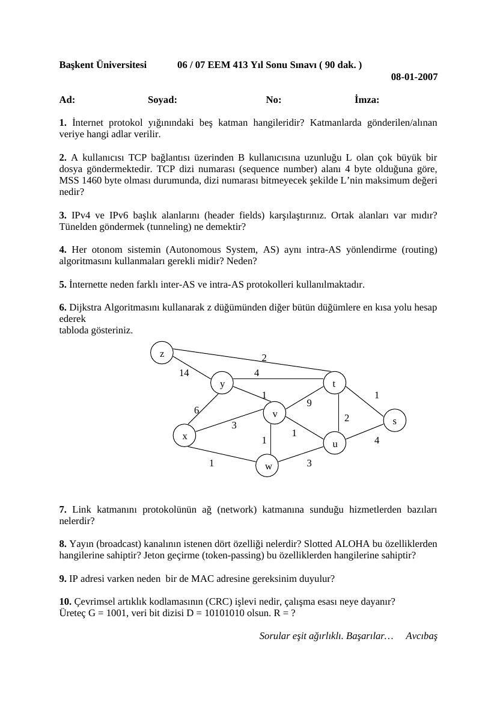
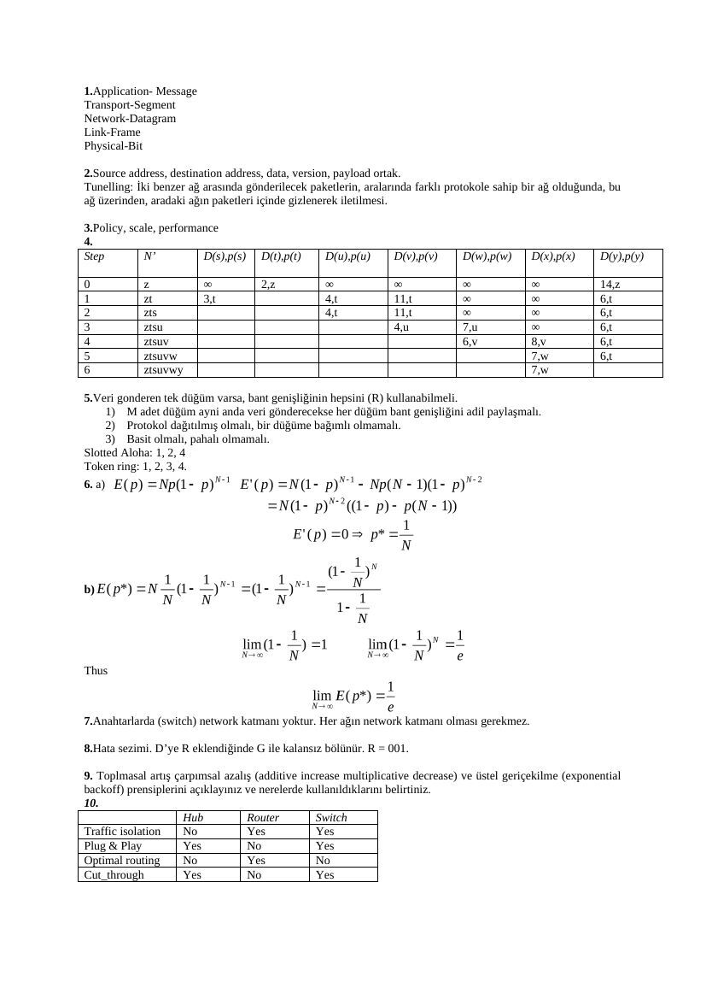

Başkent Üniversitesi, Avcıbaş imzalı 8 Ocak 2007 ve 14 Ocak 2008 final sınavları ile ilgili cevap anahtarları bir araya getirildi. Belgelerin PDF kopyaları yazının sonunda indirilebilir.

## EEM413 Final 2007

Başkent Üniversitesi 06 / 07 EEM 413 Yıl Sonu Sınavı ( 90 dak. ) 08-01-2007

**1.** İnternet protokol yığınındaki beş katman hangileridir? Katmanlarda gönderilen/alınan veriye hangi adlar verilir.

**2.** A kullanıcısı TCP bağlantısı üzerinden B kullanıcısına uzunluğu L olan çok büyük bir dosya göndermektedir. TCP dizi numarası (sequence number) alanı 4 byte olduğuna göre, MSS 1460 byte olması durumunda, dizi numarası bitmeyecek şekilde L’nin maksimum değeri nedir?

**3.** IPv4 ve IPv6 başlık alanlarını (header fields) karşılaştırınız. Ortak alanları var mıdır? Tünelden göndermek (tunneling) ne demektir?

**4.** Her otonom sistemin (Autonomous System, AS) aynı intra-AS yönlendirme (routing) algoritmasını kullanmaları gerekli midir? Neden?

**5.** İnternette neden farklı inter-AS ve intra-AS protokolleri kullanılmaktadır.

**6.** Dijkstra Algoritmasını kullanarak z düğümünden diğer bütün düğümlere en kısa yolu hesap ederek tabloda gösteriniz.

z 2 14 4 y t 1 1 6 v 2 s x 1 1 u 4

1 w 3

**7.** Link katmanını protokolünün ağ (network) katmanına sunduğu hizmetlerden bazıları nelerdir?

**8.** Yayın (broadcast) kanalının istenen dört özelliği nelerdir? Slotted ALOHA bu özelliklerden hangilerine sahiptir? Jeton geçirme (token-passing) bu özelliklerden hangilerine sahiptir?

**9.** IP adresi varken neden bir de MAC adresine gereksinim duyulur?

**10.** Çevrimsel artıklık kodlamasının (CRC) işlevi nedir, çalışma esası neye dayanır? Üreteç G = 1001, veri bit dizisi D = 1010 1010 olsun. R = ?

Sorular eşit ağırlıklı. Başarılar… Avcıbaş

## EEM413 Final Cevap Anahtar

**1.** İnternet protokol yığınındaki beş katman hangileridir? Her katmanda veriye hangi isim verilir. Application- Message Transport-Segment Network-Datagram Link-Frame Physical-Bit

**2.** A kullanıcısı TCP bağlantısı üzerinden B kullanıcısına uzunluğu L olan çok büyük bir dosya göndermektedir. TCP dizi numarası (sequence number) alanı 4 byte olduğuna göre, MSS 1460 byte olması durumunda, dizi numarası bitmeyecek şekilde L’nin maksimum değeri nedir? adet dizi numarası vardır. Her gönderilen segmentle birlikte dizi numarası bir artmaz, bunun yerine gönderilen byte kadar artar. Bu açıdan MSS büyüklüğü önemsizdir. A’nın B’ye gönderebileceği maksimum dosya uzunluğu .

**3.** IPv4 ve IPv6 başlık alanlarını (header fields) karşılaştırınız. Ortak alanları var mıdır? Tünelden göndermek (tunneling) ne demektir? Source address, destination address, data, version, payload ortak. Tunelling: İki benzer ağ arasında gönderilecek paketlerin, aralarında farklı protokole sahip bir ağ olduğunda, bu ağ üzerinden, aradaki ağın paketleri içinde gizlenerek iletilmesi.

**4.** Her otonom sistemin (Autonomous System, AS) aynı intra-AS yönlendirme (routing) algoritmasını kullanmaları gerekli midir? Neden? Hayır. Her AS yöneticisi istediği şekilde yönlendirme yapabilir.

**5.** İnternette neden farklı inter-AS ve intra-AS protokolleri kullanılmaktadır.

**6.**  Step N’ D(s),p(s D(t),p(t) D(u),p(u) D(v),p(v) D(w),p(w) D(x),p(x) D(y),p(y) ) 0 z ∞ 2,z ∞ ∞ ∞ ∞ 14,z 1 zt 3,t 4,t 11,t ∞ ∞ 6,t 2 zts 4,t 11,t ∞ ∞ 6,t 3 ztsu 4,u 7,u ∞ 6,t 4 ztsuv 6,v 8,v 6,t 5 ztsuvw 7,w 6,t 6 ztsuvwy 7,w

**7.** Link katmanını protokolünün ağ (network) katmanına sunduğu hizmetlerden bazıları nelerdir? Framing, link access, reliable delivery, flow control, error detection and correction; full duplex.

**8.** Yayın (broadcast) kanalının istenen dört özelliği nelerdir? Slotted ALOHA bu özelliklerden hangilerine sahiptir? Jeton geçirme (token-passing) bu özelliklerden hangilerine sahiptir?

**1.** Veri gonderen tek düğüm varsa, bant genişliğinin hepsini (R) kullanabilmeli.

**2.** M adet düğüm ayni anda veri gönderecekse her düğüm bant genişliğini adil paylaşmalı.

**3.** Protokol dağıtılmış olmalı, bir düğüme bağımlı olmamalı.

**4.** Basit olmalı, pahalı olmamalı. Slotted Aloha: 1, 2, 4 Token ring: 1, 2, 3, 4.

9: IP adresi varken neden bir de MAC adresine gereksinim duyulur? Anahtarlarda (switch) network katmanı yoktur.

**10.** Çevrimsel artıklık kodlaması (CRC) ne işe yarar, nasıl çalışır? Üreteç G = 1001, veri bit dizisi D = 1010 1010 olsun. R=? Hata sezimi. D’ye R eklendiğinde G ile kalansız bölünür. R = 001.

## EEM413 Final 2008

Başkent Üniversitesi 07 / 08 EEM 413 Yıl Sonu Sınavı ( 100 dak. ) 14-01-2008

**1.** İnternet protokol yığınındaki beş katman hangileridir? Katmanlarda gönderilen/alınan veriye hangi adlar verilir.

**2.** IPv4 ve IPv6 başlık alanlarından (header fields) ortak olanları hangileridir? Tünelden göndermek (tunneling) ne demektir?

**3.** İnternette neden farklı inter-AS ve intra-AS protokolleri kullanılır?

**4.** Dijkstra Algoritmasını kullanarak z düğümünden diğer bütün düğümlere en kısa yolu hesap ederek tabloda gösteriniz. z 2 14 4 y t 1 1 6 v 2 s x 1 1 u 4

1 w 3

**5.** Yayın (broadcast) kanalının istenen dört özelliği nelerdir? Slotted ALOHA bu özelliklerden hangilerine sahiptir? Jeton geçirme (token-passing) bu özelliklerden hangilerine sahiptir?

**6.** N adet aktif düğüm (node) varken slotted ALOHA’da her hangi bir düğümün başarılı olması E(p)=Np(1-p)N-1 ifadesi ile bulunur. a. Bu ifadeyi en büyük yapan p değerini bulunuz. b. a şıkkında bulduğunuz p değerini ifadede yerine koyup, N sonsuza giderken slotted ALOHA’nın verimliliğini bulunuz. İpucu: ( 1-1/N) N ifadesi N sonsuza giderken 1/e değerini alır.

**7.** IP adresi varken neden bir de MAC adresine gereksinim duyulur?

**8.** Çevrimsel artıklık kodlamasının (CRC) işlevi nedir, çalışma esası neye dayanır? Üreteç G = 1001, veri bit dizisi D = 1010 1010 olsun. R = ?

**9.** Toplamsal artış çarpımsal azalış (additive increase multiplicative decrease) ve üstel geriçekilme (exponential backoff) prensiplerini açıklayınız ve nerelerde kullanıldıklarını belirtiniz.

**10.** Hub, Switch ve Router aygıtlarını tarafik izolasyonu, tak ve oyna, optimal yönlendirme, kestirmeden gönderme özellikleri açısından bir tablo yardımı ile karşılaştırınız.

Sorular eşit ağırlıklı. Başarılar… Avcıbaş

## EEM413 Final 2008 Cevap Anahtar

**1.** Application- Message Transport-Segment Network-Datagram Link-Frame Physical-Bit

**2.** Source address, destination address, data, version, payload ortak. Tunelling: İki benzer ağ arasında gönderilecek paketlerin, aralarında farklı protokole sahip bir ağ olduğunda, bu ağ üzerinden, aradaki ağın paketleri içinde gizlenerek iletilmesi.

**3.** Policy, scale, performance

**4.**  Step N’ D(s),p(s) D(t),p(t) D(u),p(u) D(v),p(v) D(w),p(w) D(x),p(x) D(y),p(y)

0 z ∞ 2,z ∞ ∞ ∞ ∞ 14,z 1 zt 3,t 4,t 11,t ∞ ∞ 6,t 2 zts 4,t 11,t ∞ ∞ 6,t 3 ztsu 4,u 7,u ∞ 6,t 4 ztsuv 6,v 8,v 6,t 5 ztsuvw 7,w 6,t 6 ztsuvwy 7,w

**5.** Veri gonderen tek düğüm varsa, bant genişliğinin hepsini (R) kullanabilmeli.

**1.** M adet düğüm ayni anda veri gönderecekse her düğüm bant genişliğini adil paylaşmalı.

**2.** Protokol dağıtılmış olmalı, bir düğüme bağımlı olmamalı.

**3.** Basit olmalı, pahalı olmamalı. Slotted Aloha: 1, 2, 4 Token ring: 1, 2, 3, 4.

**6.** a)

b)

Thus

**7.** Anahtarlarda (switch) network katmanı yoktur. Her ağın network katmanı olması gerekmez.

**8.** Hata sezimi. D’ye R eklendiğinde G ile kalansız bölünür. R = 001.

**9.** Toplmasal artış çarpımsal azalış (additive increase multiplicative decrease) ve üstel geriçekilme (exponential backoff) prensiplerini açıklayınız ve nerelerde kullanıldıklarını belirtiniz.

**10.**  Hub Router Switch Traffic isolation No Yes Yes Plug & Play Yes No Yes Optimal routing No Yes No Cut_through Yes No Yes

*Not: CRC örneğinde D = 1010 1010, G = 1001 için R = 001 doğrulanmıştır. Slotted ALOHA için E(p) = Np(1−p)^(N−1), en iyi p = 1/N ve limit verim 1/e’dir. Dijkstra tablosunda z→t→u yolunun maliyeti 4 iken u→v kenarı 1 olduğu için v maliyeti 5 olmalıdır; anahtardaki 4 değeri ve bunu izleyen bazı değerler tutarsızdır.*

## Fotoğraftaki kenar notları

2008 finalinin fotoğraflanmış kopyasındaki kenar notları metne aktarıldı. Birinci sorunun yanında application, transport, network, link ve physical katmanlarını hatırlatan kısaltmalar vardır. Üstel geri çekilme sorusunun altında, çarpışmadan sonra NIC’nin rastgele K seçmesi ve CSMA/CD ile ilişkisi not edilmiştir. Son sorunun yanında “link layer technologies” ve “Ethernet” sözcükleri okunmaktadır. Silik ve kesilmiş kısımlar tamamlanmadı; fotoğraf özel arşivde tutulur.
