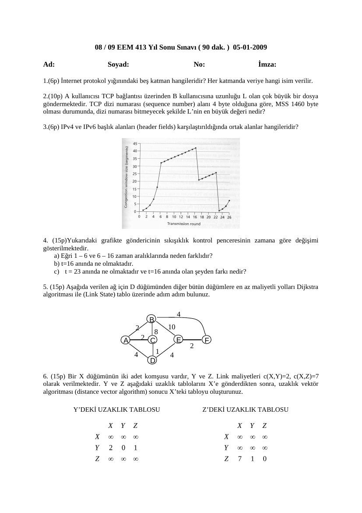
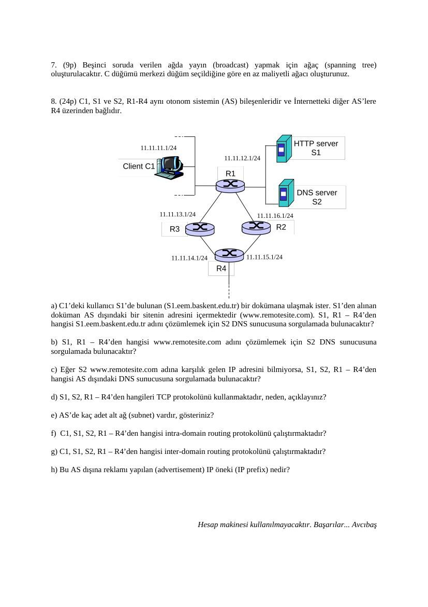
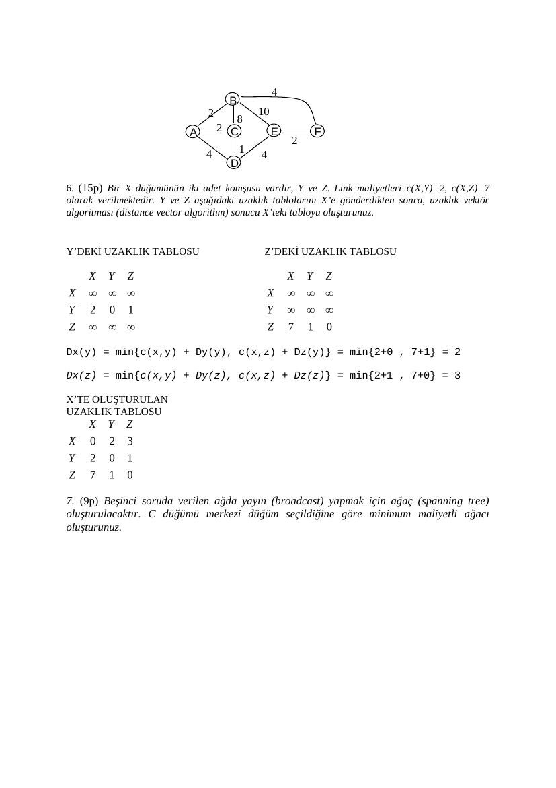

This is the final exam of 5 January 2009 signed by Avcıbaş at Başkent University, together with its answer key. PDF copies of the documents can be downloaded at the end of the post.

## EEM413 Final 2009

08 / 09 EEM 413 Final Exam ( 90 min. ) 05-01-2009

**1.** (6p) What are the five layers of the Internet protocol stack? What is the data called at each layer?

**2.** (10p) User A is sending a very large file of length L to user B over a TCP connection. Given that the TCP sequence number field is 4 bytes, and the MSS is 1460 bytes, what is the maximum value of L such that the sequence numbers do not run out?

**3.** (6p) When the IPv4 and IPv6 header fields are compared, which fields are common?

**4.** (15p) The graph above shows the sender's congestion control window as a function of time. a) Why does the curve differ in the time intervals 1 – 6 and 6 – 16? b) What happens at t=16? c) What happens at t = 23, and how does it differ from what happened at t=16?

**5.** (15p) For the network given below, find the least-cost paths from node D to all other nodes using Dijkstra's algorithm (Link State), step by step in a table.

B 2 10 A 2 C E F 4 1 4 D

**6.** (15p) A node X has two neighbors, Y and Z. The link costs are given as c(X,Y)=2, c(X,Z)=7. After Y and Z send the distance tables below to X, construct the table at X resulting from the distance vector algorithm.

DISTANCE TABLE AT Y DISTANCE TABLE AT Z

**7.** (9p) A spanning tree will be built for broadcast in the network given in question five. Given that node C is chosen as the center node, construct the least-cost tree.

**8.** (24p) C1, S1 and S2, R1-R4 are components of the same autonomous system (AS) and are connected to the other ASes on the Internet through R4.

a) The user at C1 wants to access a document located at S1 (S1.eem.baskent.edu.tr). The document retrieved from S1 contains the address of a site outside the AS (www.remotesite.com). Which of S1, R1 – R4 will query the DNS server S2 to resolve the name S1.eem.baskent.edu.tr?

b) Which of S1, R1 – R4 will query the DNS server S2 to resolve the name www.remotesite.com?

c) If S2 does not know the IP address corresponding to the name www.remotesite.com, which of S1, S2, R1 – R4 will query a DNS server outside the AS?

d) Which of S1, S2, R1 – R4 use the TCP protocol, and why? Explain.

e) How many subnets are there in the AS? Show them.

f) Which of C1, S1, S2, R1 – R4 run an intra-domain routing protocol?

g) Which of C1, S1, S2, R1 – R4 run an inter-domain routing protocol?

h) What is the IP prefix advertised outside this AS?

## EEM413 Final 2009 Answer Key

Başkent University 08 / 09 EEM 413 Final Exam ( 90 min. ) 05-01-2009

**1.** (6p) What are the five layers of the Internet protocol stack? What is the data called at each layer? Application - Message; Transport - Segment; Network - Datagram; Link - Frame; Physical - Bit

**2.** (10p) User A is sending a very large file of length L to user B over a TCP connection. Given that the TCP sequence number field is 4 bytes, and the MSS is 1460 bytes, what is the maximum value of L such that the sequence numbers do not run out? There are sequence numbers in total. With each segment sent, the sequence number does not increase by one; instead it increases by the number of bytes sent. In this respect the MSS size is irrelevant. The maximum file length that A can send to B is .

**3.** (6p) When the IPv4 and IPv6 header fields are compared, which fields are common? Source address, destination address, data, version, payload are common.

**4.** (15p) The graph above shows the sender's congestion control window as a function of time. a) Why does the curve differ in the time intervals 1 – 6 and 6 – 16? b) What happens at t=16? c) What happens at t = 23, and how does it differ from what happened at t=16?

**5.** (15p) For the network given below, find the least-cost paths from node D to all other nodes using Dijkstra's algorithm (Link State), showing the steps in a table.

N D(A),p(A) D(B),p(B) D(C),p(C) D(E),p(E) D(F),p(F) D 4,A infty 1,C 4,E infty DC 3,C 9,C 4,E infty DCA 5,A 4,E infty DCAE 5,A 6,E DCAEB 6,E DCAEBF

B 2 10 A 2 C E F 4 1 4 D

**6.** (15p) A node X has two neighbors, Y and Z. The link costs are given as c(X,Y)=2, c(X,Z)=7. After Y and Z send the distance tables below to X, construct the table at X resulting from the distance vector algorithm.

DISTANCE TABLE AT Y DISTANCE TABLE AT Z

Dx(y) = min{c(x,y) + Dy(y), c(x,z) + Dz(y)} = min{2+0 , 7+1} = 2

Dx(z) = min{c(x,y) + Dy(z), c(x,z) + Dz(z)} = min{2+1 , 7+0} = 3

DISTANCE TABLE CONSTRUCTED AT X

**7.** (9p) A spanning tree will be built for broadcast in the network given in question five. Given that node C is chosen as the center node, construct the minimum-cost tree.

**8.** (24p) C1, S1 and S2, R1-R4 are components of the same autonomous system and are connected to the other autonomous systems (AS) on the Internet through R4.

a) The user at C1 wants to access a document located at S1 (S1.eem.baskent.edu.tr); the document retrieved from S1 contains the address of a site outside the AS (www.remotesite.com). Which of S1, R1 – R4 will query the DNS server S2 to resolve the name S1.eem.baskent.edu.tr? The client C1 will need to contact the DNS in order to get the IP address of HTTP server S1 b) Which of S1, R1 – R4 will query the DNS server S2 to resolve the name www.remotesite.com? Client C1 will contact DN server S2 in order to resolve the name www.remotesite.com c) If S2 does not know the IP address corresponding to the name www.remotesite.com, which of S1, R1 – R4 will query a DNS server outside the AS? S2 will contact an external DNS server, under recursive DNS queries. d) Which of S1, R1 – R4 use the TCP protocol, and why? Explain. C1 and S1 are know to be running HTTP, which requires TCP. R4 must be running BGP (the only interdomain protocol being used in the Internet) in order for the BGP speaker in R4 to talk to the BGP speaker on the other side of the ISP access link, in order to get and advertise BGP tables. Hence R4 must also be running TCP. DNS uses UDP, so server S2 need not run TCP. If the intradomain routers were running OSPF, they would not need to run TCP to exchange tables. e) How many subnets are there in the AS? Show them. There are six networks, as shown in the figure above. f) Which of C1, S1, S2, R1 – R4 run an intra-domain routing protocol? All of these must all run the intradomain routing protocol g) Which of C1, S1, S2, R1 – R4 run an inter-domain routing protocol? R4. h) What is the IP prefix advertised outside this AS? The prefix 11.11/16 could be advertised to the outside world, since all IP addresses within the network fall within this range.

*Note: The image formula in the key is 2³² = 4,294,967,296 bytes; since the TCP sequence number counts bytes, the MSS does not change this limit. The distance vector calculation gives Dₓ(y) = 2, Dₓ(z) = 3. Although C1 does not appear among the question's options, it is the client C1 that issues the DNS query. DNS is not restricted to UDP only; this statement in the key should not be read as a generalization.*
